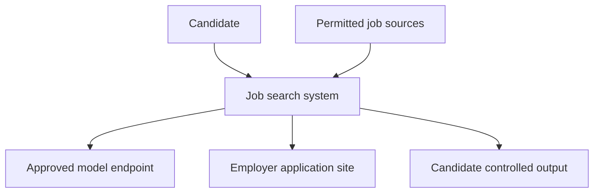
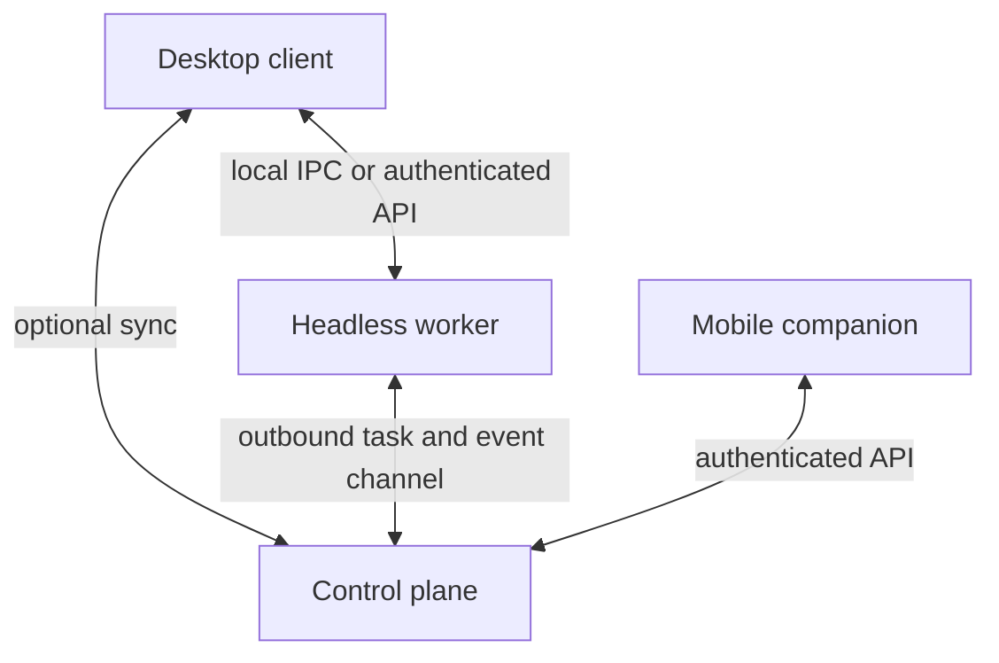
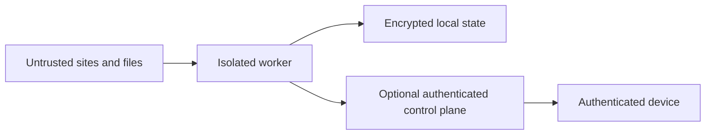
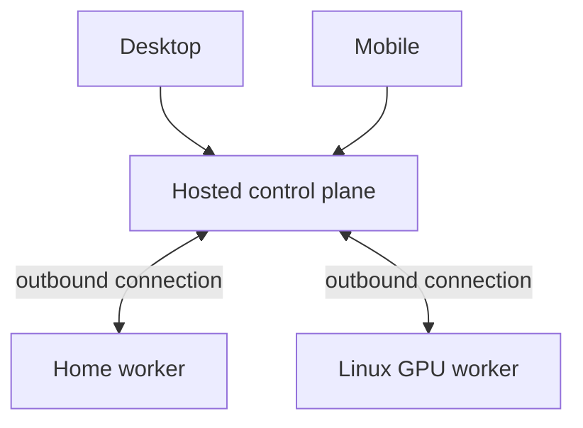
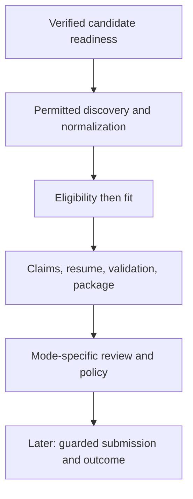

# 00_PRODUCT_AND_SYSTEM_PLAN.md

## 1. Document Control and Status

| Item | Value |
| --- | --- |
| Owner | Product owner, with architecture review by the future implementation team |
| Status and approval | Approved by the product owner; v1.0 approved 2026-09-27 after the gap audit, v1.1 changes approved 2026-09-28 (section 42); v1.2 and v1.3 changes approved 2026-09-29 (sections 42.2 and 42.3, the hardened baseline and the independent audit fixes); binding upstream baseline for `01` to `07`; version 1.4 changes (section 42.4) directed by the product owner on 2026-09-30, text awaiting the owner's review |
| Version and date | 1.4, 2026-09-30 (supersedes 1.3 of 2026-09-29, 1.2 of 2026-09-29, 1.1 of 2026-09-28, 1.0 of 2026-09-27, and 0.1 of 2026-09-23) |
| Audience | Product owner, designers, security reviewers, implementation agents |
| Authoritative inputs | Current project instructions; originating eight-document decision; `Prompts/Prompt_00_Product_and_System_Plan.md`; `Job_Automation_PLAN_Generator_Prompt.md`; `DEP_Prompt.md`; product-owner decisions of 2026-09-27 and 2026-09-28 recorded in section 42 |
| Downstream consumers | Documents `01` through `07`, then the separate production handoff prompt |

Change control: preserve identifiers. Record a changed decision with its old and new wording, affected sections and downstream documents, migration consequences, and owner approval. A later document may refine a boundary but cannot silently reverse it. This document specifies a product; it authorizes no application development. The version 1.0 change record is section 42.

## 2. Executive Summary

The product discovers relevant paid technical jobs, separates eligibility from fit, prepares truthful applications from verified evidence, and ultimately assists with permitted submissions under explicit human and safety controls. Its first deliverable is a single-user, local-first desktop and worker vertical slice: discovery from a small supported source set, candidate verification, one tailored PDF and DOCX pair, validation, a versioned local package, and Manual review. No real-world automatic submission occurs in the MVP.

The long-term design comprises four bounded components: desktop client, headless worker, mobile companion, and control plane. Local-only use must work without a vendor-hosted account; remote synchronization and mobile approvals require an explicitly chosen control plane. Multiple workers are separate executors, never implicitly pooled into a single GPU.

## 3. Source Basis, Authority Order, and Conflict Register

Authority: latest explicit user direction, current project instructions, approved conversation decisions, `Job_Automation_PLAN_Generator_Prompt.md` (abbreviated `Generator`), `DEP_Prompt.md` (`DEP`), then labeled assumptions. The attached prompt for this document applies the approved resolutions. The originating project discussion replaced a single plan with eight sequential documents; its substance is reflected in the project instructions and attached prompt. The complete originating transcript was not available as an independently readable file in this turn.

| Conflict | Affected sources | Effect and resolution | Approval |
| --- | --- | --- | --- |
| One `PLAN.md` and immediate implementation versus eight pre-production documents | Generator, DEP versus project instructions and attached prompt | Supersede one-plan and implementation instructions; this is document `00` only | Already resolved |
| Four old modes versus three approved modes | DEP versus Generator and attached prompt | `Discovery Only` and `Prepare` become workflow scopes, `Assisted Apply` maps to Hybrid or Manual checkpoints, `Trusted Auto Apply` maps to Auto with mandatory gates | Already resolved |
| “Continuous/no-limit” versus protective budgets | Generator versus safety requirements | No time limit means bounded resource, rate, cost, and application budgets still apply | Already resolved |
| “Use all sources” versus permission and technical limits | Generator and DEP | Registry covers all named sources; attempts require enablement, permission, technical support, and rate limits; health shows failures | Already resolved |
| Existing chat subscriptions as automated model quota versus separate API billing | Generator versus provider documentation | Consumer subscriptions do not become API credentials; supported developer integrations require separate review | Already resolved at product level |
| MVP cloud onboarding and phone coverage versus local-first single-user vertical slice | Generator sections on account and mobile versus MVP section | Local identity and secure setup are MVP; hosted identity, remote sync, push, and mobile approvals follow later | Accepted in v1.0 (section 42, `CHG-006`); the full account feature set remains required and is sequenced by `07` |
| Unstated MVP reference platform versus provisional macOS inferred from a browser user agent | Earlier `ASM-01`, `OQ-01`, `ARCH-15` | v1.0 selected Pop!_OS (2026-09-27). v1.1: the product owner made the MacBook Pro (macOS) the only active development and test device, so macOS is the MVP reference platform; Pop!_OS and Windows remain compatibility targets | Decided by product owner, 2026-09-28 (`CHG-011`) |

## 4. Product Vision and North-Star Outcome

The north star is improved probability of obtaining suitable paid professional software work using genuine candidate capabilities. Observe interview and offer conversion over time, segmented by eligible role and application quality, rather than maximizing submissions. Small samples and delayed outcomes make this a directional metric, not a claim of causal improvement.

## 5. Product Principles

Truth before tailoring; eligibility before fit; user control over consequential actions; explainable decisions; explicit provenance; safe recovery; broad but honest source coverage; local control of sensitive data; portable interfaces around changing sites, models, and platforms. Deterministic policy decides what is permissible. Models interpret and draft within that policy.

## 6. Goals, Non-Goals, and Success Measures

Goals: reduce time spent finding plausible jobs, eliminate duplicate review, surface eligibility uncertainty, produce defensible role-specific documents, and maintain an auditable history. Initial measures: weekly unique eligible postings reviewed, false-positive eligibility rate on a labeled sample, factual-claim rejection rate, validated package completion rate, and time from user-selected job to reviewable package. Later measures: interview and offer conversion by cohort and time to first review after publication, with attribution caveats.

Non-goals: legal eligibility adjudication, guaranteed ATS acceptance, universal scraping, guaranteed placement, CAPTCHA solving, stealth automation, invented experience, arbitrarily pooled GPUs, unbounded mass submission, or autonomous job decisions made by one unconstrained agent. Skill-gap and interview-preparation recommendations, including DSA and C++ systems topics, are later advisory features, never evidence of existing skill.

## 7. Users, Personas, and Jobs to Be Done

The initial persona is a student seeking early-career paid work across software, systems, Python, games, and adjacent roles, with geography and authorization constraints that vary by employer. The product model remains candidate neutral. A second persona is a privacy-focused user running locally; a third is a multi-device user reviewing a home worker remotely. Their jobs are to verify a candidate record, define opportunity boundaries, review explainable discoveries, generate documents, control runs, and record results. Operators of self-hosted control planes need backup, health, update, and incident visibility.

## 8. Scope and Product Boundaries

The worker may fetch permitted listings, process user-provided evidence, use approved models, create documents, and later operate supported forms. The control plane coordinates identity, devices, leases, approvals, notifications, and shared audit state when enabled. Desktop is the full configuration and review surface. Mobile is a secure companion. A job-site account remains the user's account; the product never assumes blanket permission to automate that site. Country-specific employment facts are supplied and confirmed by the user, with legal review when required.

## 9. Canonical High-Level Terminology

| Term | Meaning |
| --- | --- |
| Evidence / verified claim | Source material / a candidate statement reviewed and authorized for defined uses |
| Posting / canonical job | One observed source listing / deduplicated opportunity retaining all observations |
| Eligibility / fit | Ability to accept a job under current facts / alignment with role requirements; independent results |
| Application package | Versioned job snapshot, analysis, approved answers where applicable, documents, and manifest |
| Application / attempt | Candidate's real-world submission record / one bounded preparation or form interaction |
| Worker / control plane | Executor with declared capabilities / authority for shared coordination and approvals |
| Operating mode / run strategy | Manual, Hybrid, Auto / Scheduled, Continuous, Timed Immediate |
| Review gate | Explicit pause requiring an authenticated user decision or direct interaction |

## 10. Functional Requirements

| ID | Testable product requirement |
| --- | --- |
| PRD-01 | Provide resumable security and privacy setup, device controls, export, and deletion appropriate to topology. |
| PRD-02 | Ingest PDF/DOCX resumes, portfolio URLs or exports, repositories or profiles where supported, supporting files, full manual entry, and combinations; require user review of extracted facts. |
| PRD-03 | Block job automation until every required candidate fact and answer policy is verified, with itemized reasons. |
| PRD-04 | Configure ordered role families, aliases, exclusions, seniority, skill priorities, thresholds, job types, geographies, work arrangements, eligibility facts, and destinations independently. |
| PRD-05 | Register every named source, show enabled state and coverage health, and attempt every enabled, permissible, supported source during a full-coverage run. |
| PRD-06 | Normalize and deduplicate postings while preserving original observations, timestamps, identifiers, canonical destinations, and permitted snapshots. |
| PRD-07 | Apply configurable deterministic filters, evaluate eligibility separately from explainable multidimensional fit, and keep ambiguous cases for review. |
| PRD-08 | Tailor each selected resume from verified claims, create both PDF and DOCX, validate content and layout, and save a versioned package atomically. Generate a cover letter only when the employer requires one, the user requests one, or the form asks for one, using the same claim verification. |
| PRD-09 | Support source-specific and ATS-specific discovery and later application adapters, with safe handoff to verified canonical destinations. |
| PRD-10 | Enforce exactly Manual, Hybrid, and Auto modes with per-item safety gates and explicit audited mode changes. |
| PRD-11 | Provide exactly Scheduled, Continuous, and Timed Immediate run strategies with resource budgets and stop controls. |
| PRD-12 | Provide desktop management and later mobile review, notifications, device registration, remote controls, and single-use consequential approvals. |
| PRD-13 | Route semantic tasks through evaluated hosted API, officially permitted developer integration, OpenAI-compatible, or self-hosted provider capabilities; stop unsuitable fallbacks. |
| PRD-14 | Track job, package, application, response, interview, offer, run, and source outcomes; propose evidence-based ranking improvements without editing facts. |
| PRD-15 | In later releases, guide local model setup from hardware inventory and a maintained capability catalog; require benchmark and licensing review. |
| PRD-16 | Provide user-visible source, worker, model, schedule, failure, and audit status, with recoverable per-item errors. |
| PRD-17 | Maintain a reusable answer library for recurring application questions (identity, contact, links, education, availability, preferences). Non-sensitive entries may be reused after their wording matches; sensitive and legally consequential entries (`POL-02`) are proposals until verified for the exact question and context (`01` `CON-128`). An unknown answer routes the item to manual review. |

## 11. Non-Functional Requirements and Initial Service Objectives

All figures are provisional single-user engineering targets, validated by EXP-04; they are not hosted-service promises.

| ID | Initial target |
| --- | --- |
| NFR-01 | Zero known duplicate submissions under crash and concurrent replay tests; when confirmation is uncertain, block automatic retry. |
| NFR-02 | Every consequential transition commits with an audit record or neither commits; verified backups restore a chosen point within 24 hours in later hosted mode. |
| NFR-03 | Local UI shows cached jobs within 2 seconds at a dataset of 10,000 jobs on reference hardware; network and model latencies display progress rather than block navigation. |
| NFR-04 | Graceful stop stops claiming new work within 5 seconds locally, provisional; emergency stop revokes new leases immediately when reachable and flags any in-flight submission as uncertain. |
| NFR-05 | Core flows support keyboard-only use, labeled controls, scalable text, visible focus, and WCAG 2.2 AA as a release target; platform audits determine exceptions. |
| NFR-06 | Local-only mode can inspect previously saved data without network; no claim that remote changes synchronize offline until reconnect and conflict handling. |
| NFR-07 | No secrets or sensitive application answers in default telemetry; optional diagnostics must be redacted and separately consented to. |
| NFR-08 | MVP runs on a supported macOS reference build on the product owner's MacBook Pro, with Linux (Pop!_OS first) and Windows compatibility demonstrated before claiming production support; minimum OS versions are decided by platform plans. The exact macOS version and chip are recorded in `EXP-01` before `04` fixes minimum versions. |
| NFR-09 | At least 95% of a representative labeled benchmark of standard single-column resumes preserves expected ordered text in both exported formats, with zero accepted unsupported claims. |
| NFR-10 | Every stored instant is UTC with the original offset preserved; every schedule uses an IANA time zone (`01` section 7.1). UI strings are externalized from code so later localization needs no redesign; the initial UI language is English. Each generated document records a BCP 47 locale, defaulting to the candidate's configured locale, and spelling conventions follow that locale. |

## 12. Constraints and Corrective Realities

Official docs separate ChatGPT subscription and API billing, and Claude paid chat and API Console billing. No automated “use subscription allowance then fail over” policy is assumed. [RES-01; RES-02] iOS generally suspends background apps and grants only defined processing opportunities; Android sustained background execution is constrained and job-dependent. This supports the companion role rather than a general phone worker. [RES-03; RES-04; RES-05]

“Remote” does not prove hireability from the candidate's residence. Source terms, authentication, and permitted data access require source-specific verification before enabling an adapter. Model inference cannot safely resolve unknown legal status. A locally validated resume cannot guarantee every employer's ATS interpretation.

## 13. System Context

External sites, model services, uploaded material, and generated responses cross distinct trust boundaries. Employer submissions are consequential external effects; package generation is a local reversible action.

## 14. Selected High-Level Architecture

Select local-first execution and an optional hosted or self-hosted control plane. The MVP uses local desktop and worker with a local authority and no required hosted service. A hosted deployment uses one modular monolith for account, policy, scheduling, approvals, and coordination, with isolated worker processes. Avoid introducing microservices until independent scaling, trust isolation, or team ownership requires them. The worker receives tasks but rechecks local capability and policy before effects; the control plane decides global approval and lease authority in synchronized topologies.

Technology direction: a Tauri 2 desktop shell with React/TypeScript UI, a separately packaged Python worker using Playwright, a Python API control plane (FastAPI candidate), SQLite local state and PostgreSQL for hosted authoritative shared state, and a separately evaluated Flutter mobile client. Tauri documents external binary sidecars; Playwright Python documents headed/headless support on the three desktop OS families; Flutter supports both mobile and desktop but requires platform-specific integration. These establish feasibility, not completed distribution support. [RES-06; RES-07; RES-08; RES-09] Avoid Next.js server assumptions inside a desktop shell. Validate sidecar packaging, sandbox permissions, accessibility, and signing before commitment. The mobile framework choice is provisional pending an approval and secure-storage prototype.

Reference-platform consequence (v1.1, `CHG-011`): on the macOS reference, Tauri 2 renders through the system WebKit view, and secrets are stored in the Keychain (`02` `ADR-201`, `RES-204`). The worker's Playwright browser runs as a separate process under the same OS user. The Linux consequences recorded in v1.0 still apply when Pop!_OS is proven as a compatibility target: Tauri renders through the system WebKitGTK 4.1 library [RES-19], and secret storage depends on a working Secret Service provider in the desktop session, with `02` `ADR-201` governing the fallback [RES-18].

## 15. Deployable Components and Responsibility Boundaries

| Component | Owns; does not own | Inputs and authority | Availability, failure, detailed plan |
| --- | --- | --- | --- |
| Desktop, macOS/Windows/Linux | Onboarding, settings, full review, local permission acquisition, worker lifecycle; not scraping or durable global leases | User actions trusted only after authentication; job/model content untrusted; caches views and local access grants | Can run without cloud; UI exit need not corrupt worker; `04` |
| Worker, macOS/Windows/Linux/headless Linux | Discovery, analysis, model invocation, document rendering, later isolated browser automation; not global approval authority | Signed/authorized commands, untrusted sites/files/model output; owns local execution state, private browser profiles, local packages | Can continue only under explicit run policy and valid leases; failures pause affected tasks; `03` |
| Mobile, iOS/Android | Monitoring, review, authenticated approvals, notifications, stop commands; not unrestricted worker execution | Authenticated API and untrusted notification/deep-link data; encrypted cache, no canonical submission state | Offline shows stale state, disables consequential actions; `05` |
| Control plane, hosted or self-hosted | Identity, device and worker registry, synchronized canonical state, leases, approval authority, notification dispatch, shared audit; not automated browser execution | Authenticated clients/workers and untrusted external notification transport; authoritative shared database | Outage pauses remote effects and approvals, local read-only or explicitly local runs per topology; `03`, `02` |

## 16. Trust Zones and High-Level Data Flow

The worker sanitizes and labels retrieved text before model use; a model response is data, never a policy instruction. Credential storage, automation browser profile, local documents, hosted sync, and third-party model endpoints have separate access controls. Hosted model requests disclose only task-minimal candidate data under visible provider privacy settings. `02` specifies encryption, isolation, incident response, retention, and adversarial testing.

## 17. Data Ownership and Sources of Truth

In local-only mode, one local encrypted store is authoritative for profile, claims, roles, jobs, runs, approvals, and audit; rendered bytes live in protected local storage and selected destinations. The worker and desktop coordinate through one transactional local service, avoiding concurrent writers to the same database. In hosted or self-hosted synchronized mode, control-plane state is authoritative for identity, device revocation, cross-worker leases, approvals, and shared application events; the candidate elects which profile and evidence fields sync, while worker-local secrets, browser sessions, temporary snapshots, and output permissions stay local. A versioned conflict is resolved explicitly for edited facts; never silently last-write-wins on eligibility or approval. Where a document remains local, the shared record stores a reference and validation digest, not a promise of universal remote access. `01` defines the exact replication rules and IDs.

Offline edits in synchronized mode (v1.0 clarification, `01` `CON-101` and `ADR-105`, `02` `SEC-CF-201`): once a claim revision is published to the control plane, that accepted revision is authoritative. An edit made on a device while offline is a local proposal until the control plane accepts it. A private claim that was never published stays locally authoritative but cannot satisfy a consequential decision taken by the synchronized authority. At no time do two authorities exist for one published revision.

## 18. Deployment Topologies and Operating Models

| Topology | Authority and connectivity | Capability and limitation |
| --- | --- | --- |
| One desktop plus local worker | Local store and IPC; no cloud necessary | MVP on the macOS reference (MacBook Pro); the laptop must be awake and running the app for work |
| Desktop worker plus phone | Hosted or self-hosted control plane with device registration | Phone can approve or stop online; no direct arbitrary desktop path access |
| Two GPU PCs, laptop, phone | Control-plane leases and per-worker discovery | Jobs assigned by actual GPU, memory, OS, model and browser capability; no transparent shared VRAM |
| Linux GPU server, desktop, phone | Server worker with authenticated outbound channel | Inference and scheduled tasks run server-side; files must be exported or explicitly synchronized |
| Hosted control plane, user workers | Hosted identity and audit authority; outbound workers behind NAT | Avoid inbound worker ports; offline worker tasks pause or remain local by policy |
| Fully self-hosted | User-operated control plane and worker | Requires identity, TLS, backups, remote ingress or VPN, update and notification arrangements; push may still use OS vendor transport |

Remote access defaults to client and worker initiated encrypted connections. VPN or private ingress is a self-hosted option; no unauthenticated public model endpoint. GPU sharding or pooling is an explicit runtime-specific capability to benchmark, never inferred from owning several devices.

## 19. Cross-Platform Capability Matrix

`Intent` describes the proposed product role. OS guarantees and final minimum versions remain subject to platform spikes.

| Capability | macOS | Windows | Linux | iOS | Android |
| --- | --- | --- | --- | --- | --- |
| Full UI | Intent yes | Intent yes | Intent yes | Companion | Companion |
| Worker/headless | Yes, packaging to prove | Yes, packaging to prove | Yes, service path to prove | No general worker | No general worker |
| Sustained background execution | OS process subject to power/settings | OS process subject to power/settings | Service subject to host lifecycle | Restricted, scheduled/continued tasks only | Restricted, scheduled/foreground work only |
| Browser automation | Playwright candidate | Playwright candidate | Playwright candidate | External handoff only | External handoff only |
| File destination | Picker and scoped grants if sandboxed | User grant and OS ACL | User grant and OS permissions | App storage, document provider, scoped access | App storage or Storage Access Framework |
| Notifications | Desktop OS integration | Desktop OS integration | Desktop environment dependent | APNs via configured provider | FCM via configured provider |
| Local inference | Optional worker capability | Optional worker capability | Optional worker capability | No sustained product task | No sustained product task |
| Credential storage | Keychain | Credential Manager or protected store | Secret Service or documented fallback | Keychain | Keystore |
| Release | Signing/notarization or store review | Signing/install and update | Package variants and distro testing | Apple signing and review | Android signing and store review |
| MVP role | Reference desktop: MacBook Pro (v1.1, `CHG-011`) | Compatibility prototype | Compatibility prototype, Pop!_OS first | Deferred | Deferred |

macOS security-scoped bookmarks can persist a sandboxed app's authorized access; iOS document pickers can grant scoped directory access, but persistence and provider behavior must be tested. Android provides persistable URI grants through its Storage Access Framework. These facts do not justify a blanket promise of perpetual write permission. [RES-10; RES-11; RES-12] Remote mobile notification delivery needs APNs on Apple platforms and a configured Android push path such as FCM; the push is a hint to fetch current state, never an approval credential. [RES-13; RES-14]

## 20. End-to-End Product Workflow

Each stage records provenance, policy version, actor, state, and recoverable failure. A rejected listing remains inspectable. A removed job, ambiguous eligibility, validation error, or unsupported form pauses its own item. Broad safety conditions, such as compromised credentials or an emergency stop, halt the relevant run or workers.

## 21. Candidate Knowledge and Mandatory Readiness Gate

Evidence can be imported from one or more resumes, a site or its export, repository links, supporting files, or complete manual entry. Extraction creates unverified candidate proposals. The user may accept, correct, merge, reject, restrict use, or set review expiry. Each claim carries source location when possible, extraction path, revision history, verification actor and time, sensitivity, contradictions, and permitted uses. Skill mentions alone do not prove proficiency.

`POL-01`: No factual generated claim is usable unless grounded in a verified permitted claim; connective prose introduces no additional fact. `POL-02`: Sensitive and legally consequential answers, including authorization, citizenship, clearance, compensation, relocation, availability commitments, demographics, disability, veteran status, criminal history, and background disclosures, are never guessed.

`PRD-03` requires verified legal and preferred name policy, contact channels, current location, jurisdiction-specific eligibility answers, education and dates, employment dates or explicit no-experience declaration, defensible projects and skills, links if used, role and job-type preferences, selected mode, output destination, and a review policy for sensitive questions. Require only facts relevant to configured jurisdictions, but block applications needing unknown answers. Portfolio and existing resume are optional. Claim expiration or contradiction reopens readiness where material.

## 22. Roles, Job Types, Geography, Work Arrangement, Eligibility, and Output Destination

Role targeting contains ordered role families and title aliases/exclusions, per-role priorities and fit thresholds, experience bands, and archetype hints. Job type includes paid employee, contract, internship, co-op, freelance and other explicit categories. Job geography records employer and eligible hiring regions; work arrangement records remote, hybrid, or on-site independently. Candidate eligibility facts, residence, time zone, relocation policy, and travel limits are separate user-verified inputs. Output destination is only a storage grant, never a job location. A remote posting restricted to another country remains ineligible or ambiguous until evidence supports a determination.

## 23. Job Discovery, Source-Coverage Policy, and Provenance

Registry entries are mandatory for Hiring Cafe, Himalayas, Wellfound, Hitmarker, Remote OK, Remotive, We Work Remotely, Working Nomads, Work With Indies, GameDev.net, official company career pages, Greenhouse, Lever, Ashby, Workday, SmartRecruiters, BambooHR, Teamtailor, custom ATS platforms, and reliable future sources. LinkedIn and Indeed are optional and lower priority. These are planned entries, not claims that their APIs, feeds, or automation permissions exist.

For each entry, store configured/disabled/blocked/unsupported state, preferred permitted integration, last attempt and success, freshness, count, rate-limit state, authentication requirement, error, and remediation. Prefer verifiable official employer or ATS records, then other permitted source observations. Use stable IDs, URLs, company, title, descriptions and location signals to group duplicates with confidence; retain every source link, fetch time, source ID, and lawful snapshot. Low-confidence merges require review. The worker plan `03` owns a current source-by-source feasibility matrix and fixtures.

## 24. Eligibility, Fit, and Decision Policy

Hard filters address unpaid roles where excluded, explicit residency or authorization restrictions, required relocation, incompatible job types, disallowed seniority, and clearance facts. “Three years preferred” is not an automatic rejection for a junior candidate. Eligibility outcomes are verified eligible, likely eligible, ambiguous, and ineligible, each with supporting and contrary posting text plus candidate facts. Likely and ambiguous never authorize a legal answer. Fit is a separately calibrated score with components for technical evidence, experience, role alignment, job-type preference, compensation if present, freshness and reliable competition signals. Eligibility can gate application even when fit is high. Overrides are explicit, scoped, and audited; none can invent work authorization.

Eligibility assessment and answer authorization are separate (v1.0 clarification, `01` `CON-102`, `CON-121`, `CON-128`; `02` `SEC-CF-202`). No eligibility outcome, including verified eligible, fills a form answer by itself. An affirmative work-authorization or similar answer requires a current user-verified answer for the exact question, jurisdiction, and job context.

## 25. Resume, Document, and ATS Strategy

Select an evidence-based archetype such as systems/C++, general software/Python, or real-time/game/graphics; those are content strategies rather than claims about any candidate. Parse job requirements, rank verified experience and projects, draft structured content, check each claim, render single-column PDF and DOCX, extract both, compare with expected content, check order, glyphs, links, minimum font size, page count, and visual overflow. Default to Times New Roman or EB Garamond, one family per document. Prefer one readable page and allow two when material warrants it. Never shrink text below a validated readability floor or use decorative parsing tricks. Font licensing and cross-format rendering require a spike. Package versions preserve input snapshot, claim IDs, prompt/model/template versions and validation result. “ATS-safe” means passing the defined local benchmark, not guaranteed acceptance by an employer.

Font licensing decision (v1.0, `CHG-008`): EB Garamond is licensed under the SIL Open Font License 1.1, which permits bundling it with the worker and embedding it in generated documents [RES-17]. Microsoft distributes Times New Roman only with its own products and requires a separate license for redistribution [RES-16]. The worker therefore bundles EB Garamond and never redistributes Times New Roman. Times New Roman is offered only when a licensed copy is already installed on the rendering host and the font's embedding permission allows PDF embedding; the DOCX references the font by name and the recipient's machine supplies it. Pop!_OS does not install Times New Roman by default. macOS includes Times New Roman, so on the macOS reference (v1.1) both fonts are available to the user; EB Garamond stays the default because it is the only one guaranteed on every platform. `EXP-03` confirms embedding behavior for both fonts.

Proposed readability floor (v1.0, `CHG-008`; finalized by `06` and validated by `EXP-03`): body text at least 10 pt in Times New Roman and at least 10.5 pt in EB Garamond, which has a smaller x-height; secondary text such as dates and contact lines at least 9 pt; margins at least 0.5 in (12.7 mm); line spacing at least 1.0. A document that cannot meet the floor on one page moves to two pages. It never shrinks below the floor.

## 26. Application Preparation, Automation, and Submission Boundaries

The package root is selected through an OS-supported picker or app-managed storage. A sanitized, length-bounded company and title plus stable ID and version prevents collisions across Unicode and case-insensitive filesystems. Write to a temporary location, validate manifest and output permissions, then mark complete atomically where supported; otherwise use a manifest completion marker and recovery path. Include resume.pdf, resume.docx, job snapshot where permitted, metadata, fit analysis, and manifest. Store answers encrypted or omit them from exported packages by default. A cover letter is generated only when requested or demonstrably useful, using verified claims. The exact directory naming, sanitization, length, collision, and file-member rules are the shared contract `01` `CON-148`; completion means a verified manifest commit (`01` `CON-103`, `CON-127`). Duplicate prevention uses an application identity guard that is independent of job grouping and survives merges and splits (`01` `CON-104`, `CON-141`).

Later application adapters for Greenhouse, Lever, Ashby, Workday, SmartRecruiters, BambooHR, Teamtailor, and a generic company form identify supported flow/version, map fields, attach files, handle conditional questions, show final answer bundles, and capture confirmation. Verify redirect domains and job identity. No retry after an uncertain submission without human reconciliation. The MVP ends at package review and an external application handoff, with no automatic form submission.

## 27. Manual, Hybrid, and Auto Modes

| Mode | Progress and submission |
| --- | --- |
| Manual | User selects job, reviews resume and answers, initiates any form assistance, checks attachments, and expressly submits. MVP implements preparation and external handoff only. |
| Hybrid | Worker prepares and fills supported fields, then requires one authenticated final approval of the exact bundle before supported submission. |
| Auto | Worker may submit only on an explicitly allowed source/adapter and when every readiness, eligibility, threshold, answer, duplicate, validation, confidence, and user rule passes. |

`POL-03`: Auto never overrides mandatory gates. `POL-04`: Unsupported flow, ambiguity, CAPTCHA, MFA, changed form, authentication barrier, sensitive unknown, or failed validation pauses the affected application in the `MANUAL_ACTION_REQUIRED` state with a typed reason (`01` `SM-104`); a system-wide compromise pauses the run. `POL-05`: Mode changes are audited and do not retroactively change queued item behavior without explicit user policy. Scope controls such as discovery-only and prepare-only are workflow limits within these modes, not additional primary modes.

## 28. Scheduled, Continuous, and Timed-Immediate Runs

Scheduled runs use local time zone, weekday rules, DST and missed-run policy. Continuous runs have no preset end time, but require acknowledgement of CPU/GPU, RAM, disk, battery, thermal, bandwidth, source account and model cost effects, and retain budgets. Timed Immediate starts now for a chosen duration and shows remaining time. Per-run and daily job, API cost, token, storage, and later application caps apply in all modes. Pause releases new claims, graceful stop drains or safely suspends current steps, and emergency stop revokes future authorization and marks uncertain external effects for reconciliation. `03` defines leases and heartbeat details.

## 29. Human Review, Approvals, Notifications, and Remote Control

Review bundles show canonical job and source, eligibility evidence, fit, exact documents, all proposed answers and disclosures, warnings, and destination. Editing a consequential answer invalidates earlier approvals and regenerates its bundle version. Later, send minimal-content notifications to registered devices; deep links open the current authoritative review item. `POL-06`: Notification delivery or tapping cannot authorize submission. Require a signed-in, recently authenticated device, item/version-bound and expiring single-use decision, server-side transition check, and audit. Two devices racing produce exactly one accepted decision. An offline mobile client displays stale data and queues no submission approval. User device revocation takes effect at the central authority. Email notification is available only when the user explicitly enables it, carries the same minimal content as a push, and, like a push, only links to the authoritative review item; it never carries an approval action.

## 30. AI Provider and Self-Hosted Model Strategy

Use capability-tagged adapters for official hosted APIs, separately assessed developer integrations, OpenAI-compatible services, and local runtimes. Route extraction, semantic eligibility support, fit, resume strategy, writing, question interpretation and high-risk review only to models that pass task-specific benchmarks; deterministic validators retain authority. Enforce structured results, schema checking, retry bounds, caching, privacy classification, and prompt/model versioning. Show API cost estimates and measured usage, never invented consumer quota. A chat-only subscription can be used through an explicit human copy/review workflow if allowed, not as an embedded automated endpoint. [RES-01; RES-02]

The later setup wizard inventories OS, CPU, memory, GPU and VRAM, disk, network, uptime, privacy, power, and concurrent load. It offers minimum, recommended and higher-quality model classes with versioned licenses, checksums, expected memory, context, runtime compatibility and measured task evaluation. Compare Ollama, llama.cpp, vLLM, MLX and any current alternative per target hardware in `03`; no fixed model name or “GPU available means adequate” shortcut. No public unauthenticated inference port.

Subscription feasibility ownership (v1.0): the Generator requires current verification of whether existing ChatGPT and Claude subscriptions can be used programmatically. `00` fixes only the product rule that a consumer subscription is not an API credential (`POL-14`). `03` owns the dated research into each provider's current official developer tools and terms, including whether any official tool that signs in with a consumer subscription may be invoked by this product. `03` records each finding with its source and access date and does not treat a permitted personal tool as a permitted embedded integration without that evidence.

Model access routes (v1.1, `CHG-012`): the product owner intends to run the product's model tasks on existing Claude and ChatGPT subscriptions rather than paid API keys or local models. Both vendors bill subscriptions separately from their APIs [RES-01; RES-02]. Each vendor now offers an official developer tool that signs in with a consumer plan: Anthropic's help center describes a monthly Agent SDK credit for Claude plans, covering personal projects and third-party apps, but carries a notice that the change is paused and "for now, nothing has changed" [RES-20]; OpenAI states that Codex is included in ChatGPT plans and signs in with the ChatGPT account, without addressing automated use by another application [RES-21]. The terms are therefore unsettled, and the product defines four routes:

| Route | Rule | MVP status |
| --- | --- | --- |
| R1 Subscription developer tool | The worker invokes an official vendor tool (Claude Agent SDK or Codex) under the user's own sign-in, for the user's own use, with every tool capability disabled so it acts only as a text model (`02` `CTRL-227`). Enabled only after `03` records dated evidence from current vendor terms that this use is permitted, and disabled automatically if a later check finds otherwise. | Preferred when permitted |
| R2 Manual relay | The app assembles a task-minimal prompt package; the user pastes it into a chat subscription and pastes the reply back; the app validates it exactly as it validates any model output. | Always available; the guaranteed MVP path |
| R3 Metered API | A user-supplied API key with hard per-run and per-day cost caps. | Optional; off unless the user enables it |
| R4 Self-hosted model | A local runtime on a capable worker, such as the Pop!_OS GPU desktop. | Later phase |

`POL-17` (v1.1): the MVP must complete every model task through R2 alone, with no API key, no local model, and no subscription automation. Quota for R1 and R2 is never inferred; the product shows only what the vendor tool reports. No route scrapes a chat website, replays browser cookies, or extracts tokens (`POL-14`).

## 31. Security, Privacy, Safety, and Compliance Baseline

`POL-07`: Sites, descriptions, user uploads, retrieved code, and model output are untrusted. `POL-08`: Every consequential action and transition is audited and idempotent where technically possible. `POL-09`: Prevent duplicate applications; uncertain external effects require reconciliation. `POL-10`: Keep dedicated automation browser profiles separate from everyday browser profiles. `POL-11`: Do not bypass CAPTCHA, MFA, authentication, anti-bot systems or source restrictions. `POL-12`: Continuous runs retain protective limits. `POL-13`: Mobile is not a general worker. `POL-14`: Consumer model subscriptions are not API access by default. `POL-15`: Full coverage means transparent strategies and permitted attempts, never universal scraping. `POL-16`: No automatic real-world submission in MVP.

Classify credentials, cookies, eligibility information, application answers, documents, source snapshots and screenshots as sensitive with differential retention. Keep secrets in platform-protected stores, encrypt transport and sensitive storage, minimize hosted and model disclosures, redact diagnostics, require explicit telemetry consent, and provide export/deletion controls. Disable and quarantine malicious redirects and prompt injection. Legal and privacy professionals must review jurisdiction-specific processing, source terms, employer form handling and retention before hosted commercialization; the product does not issue immigration advice. `02` owns controls, key lifecycles and abuse cases.

## 32. Observability, Auditability, Failure Recovery, and Supportability

Each run shows stage counts, source attempt/freshness, worker and provider health, budget consumption, retries, and stop status. Audit records capture actor, item, prior/new state, input/version hash, approval reference, policy result, and timestamp while redacting protected values. A changed selector opens a source-specific circuit; expired authentication requests user action; model failure pauses only dependent tasks; disk full and output permission loss leave incomplete packages recoverable; control-plane outage disables central approvals and leases. Push failure retains the review item in the authoritative queue. Browser crash or uncertain submit yields a reconciliation-required state. Diagnostics retain snapshots/screenshots only when justified and time-bounded. `03` and `02` specify retention and recovery matrix.

## 33. UX Principles, Major Surfaces, and Accessibility Baseline

Desktop surfaces: onboarding checklist, claim review, profile and preferences, source health, worker/provider configuration, jobs and explanations, document preview, package history, run control, review queue, security and devices, analytics, and privacy/export. Mobile surfaces: current run, compact job and review detail, exact bundle inspection, approval, notification inbox, stop and account security. Always show operating mode, worker availability, source failure, stale/offline state, and why an action is blocked. Use progressive disclosure and plain wording for authorization uncertainty. Target WCAG 2.2 AA, full keyboard navigation and screen reader semantics, responsive text and reduced motion. `06` owns exact flows, tokens, layouts and prototypes.

## 34. MVP Definition and Explicit Deferrals

MVP is a single-user local-first macOS reference installation on the product owner's MacBook Pro with separately bounded local worker, secure local setup, complete manual or imported candidate verification, mandatory readiness gate, distinct target preferences and destination, the model access routes of section 30 (manual relay always; the subscription route only if `03` confirms it is permitted; metered API only if the user opts in), two or three permitted representative discovery adapters, normalization/deduplication, eligibility and explainable fit, one-job resume strategy, PDF and DOCX, ATS and visual validation, versioned local package, dashboard, and Manual review. History of the reference choice: v0.1 inferred macOS from a browser user agent; v1.0 selected Pop!_OS (2026-09-27); v1.1 selected the MacBook Pro because it is the only machine available for active development and testing (2026-09-28, `CHG-011`). MVP runs are started by the user; scheduled and continuous runs are later phases.

The MVP is the first release, not the product boundary. It follows the MVP definition in the Generator ("MVP BOUNDARY") and `DEP` section 44. Every requirement `PRD-01` to `PRD-17` stays in scope for the full product and is sequenced by `07`; a deferral below postpones a feature and never removes it.

Defer hosted registration, sync, mobile approvals, broad source coverage, application-form filling, Hybrid and Auto execution, real-world automatic submission, multi-worker leases, continuous unattended operation, self-hosted setup wizard, advanced analytics, skill-gap and interview preparation, and cross-platform release packaging. Their architecture boundaries are present now; each feature needs separate technical, permission, security and release evidence. Preliminary ordering: verify local vertical slice, source breadth, distributed identity and approvals, one controlled application adapter, bounded automation, then advanced learning; `07` owns gates and sequence.

## 35. System-Level Acceptance Criteria

| ID | Verification target |
| --- | --- |
| AC-01 | For each missing readiness item, Start is disabled with its specific reason; a verified complete profile enables permitted discovery. |
| AC-02 | One posting observed through two fixtures yields one canonical job with two retained source records and timestamps. |
| AC-03 | Injecting an unsupported factual resume claim causes validation to fail before package completion. |
| AC-04 | PDF and DOCX both preserve required ordered text, URLs, and selected font under the benchmark; unreadable overflow fails. |
| AC-05 | A revoked destination grant produces a recoverable error and no completed manifest. |
| AC-06 | Mode policy fixtures yield distinct Manual, Hybrid, Auto outcomes; every mandatory Auto gate pauses the affected item. |
| AC-07 | Graceful stop begins no new local item later than 5 seconds after command acknowledgement on reference hardware; in-flight state is recoverable. |
| AC-08 | Concurrent or replayed requests for the same candidate and canonical job cannot create two authorized submissions; uncertain confirmations block retry. |
| AC-09 | Two device approvals for one bundle version accept at most one; expired, revoked, or stale-version approval fails. |
| AC-10 | A mobile device is never advertised or leased unrestricted browser or sustained worker capability. |
| AC-11 | Disabled, unavailable or restricted source entries stay visible with attempt time, reason and remediation. |
| AC-12 | Before any real-world form adapter is enabled, safe local mock-form tests prove challenge handoff and no submission after changed form or unknown sensitive answer. |
| AC-13 | Package-naming fixtures from `01` `CON-148` (reserved Windows names, forbidden characters, 300-character titles, mixed Unicode normalization, case-only title differences, renamed postings) each produce a valid, unique, stable directory on ext4, APFS (case-insensitive), and NTFS test volumes. |
| AC-14 | A resume whose content cannot fit on one page at the readability floor in section 25 renders on two pages; no rendered text measures below the floor in either PDF or DOCX. |
| AC-15 | A recurring non-sensitive question is filled from the answer library only when its wording matches; a sensitive question with only a stored answer from another context produces a proposal and routes the item to review (`PRD-17`). |
| AC-16 | With no API key and no subscription route configured, the full MVP pipeline (extraction, eligibility support, fit, resume writing) completes through the manual relay route; a pasted response that fails schema or claim validation is rejected with a specific reason and never changes state (`POL-17`). |

`AC-01` through `AC-05`, `AC-13`, `AC-14`, and `AC-16` are MVP release checks, executed on the macOS reference build (v1.1). `AC-15` is a later phase gate that ships with form assistance. `AC-06` tests the policy model in MVP, with Hybrid and Auto execution deferred. `AC-07` through `AC-12` are later phase gates where the underlying feature is deferred.

## 36. Architecture Decision Register

| ID | Context and alternatives | Selected recommendation, consequence, invalidation test, owner |
| --- | --- | --- |
| ARCH-01 | Local-first vs mandatory hosted vs fully self-hosted | Local-first MVP, optional hosted/self-hosted sync; easier private onboarding, harder later migration. Test restore/sync conflicts; `01`, `03`. |
| ARCH-02 | Single process vs bounded worker | Separate Python worker from desktop; packaging cost buys crash and privilege isolation. Spike signed sidecars; `03`, `04`. |
| ARCH-03 | Microservices vs modular monolith | One initial control-plane process with modules; split only after measured load or boundary failure; `03`. |
| ARCH-04 | Flutter desktop vs Tauri desktop | Provisional Tauri 2 plus React for desktop native shell, use platform integrations for permissions; compare footprint, accessibility and sidecar lifecycle in EXP-01; `04`, `06`. |
| ARCH-05 | Flutter vs native mobile | Provisional Flutter companion, with native platform channels for security and push; change if approval flows or accessibility prototype fail; `05`. |
| ARCH-06 | Python vs C++ worker | Python worker for adapters, parsing, models, Playwright, with isolated subprocesses and bounded resources; no cross-language uniformity requirement. EXP-01; `03`. |
| ARCH-07 | SQLite alone vs server database | SQLite local authority in MVP, PostgreSQL for synchronized control plane; explicit mapping and migration, never concurrent unsupervised writers; `01`, `03`. |
| ARCH-08 | Polling/inbound worker vs outbound channel | Authenticated outbound worker connection plus lease and durable task state; easier NAT, introduces central dependency; EXP-02; `03`. |
| ARCH-09 | Generic scraper vs per-source adapters | Versioned typed discovery and later ATS adapters, official source preference, fixture tests and circuit breakers; maintenance cost is visible; `03`. |
| ARCH-10 | Everyday browser vs isolated profile | Dedicated per-site automation contexts and protected local credentials; login convenience costs more explicit setup; `02`, `03`. |
| ARCH-11 | One model agent vs task routing | Capability-validated provider adapters, deterministic policy and document verification; benchmark fallback by task; `01`, `03`. |
| ARCH-12 | HTML-only PDF vs independent typed documents | Structured resume representation to PDF and DOCX renderers plus extraction/visual validation; cross-format drift requires benchmark; `01`, `03`. |
| ARCH-13 | Push approval vs server-authorized decision | Push signals only, authoritative approval transition bound to session and bundle version; offline approvals wait; `01`, `02`, `05`. |
| ARCH-14 | Mandatory telemetry vs privacy default | Local operational logs, opt-in external telemetry; harder remote support, mitigated exportable redacted diagnostics; `02`, `03`. |
| ARCH-15 | First platform Linux vs Windows vs macOS | v1.1 decision: macOS on the product owner's MacBook Pro is the MVP reference platform, decided on 2026-09-28 because it is the only machine available for active development and testing. It replaces the v1.0 Pop!_OS choice of 2026-09-27, which in turn replaced a provisional macOS choice based only on a browser user agent. Consequences: Tauri runs on the system WebKit view, secrets use the Keychain, both approved fonts are available, and there is no dedicated GPU, so self-hosted inference waits for a later Pop!_OS GPU worker. Pop!_OS and Windows remain compatibility prototypes; cross-platform portability spike; `04`, `07`. |

## 37. Assumptions, Risks, Open Questions, and Technical Spikes

| ID | Item and resolution path |
| --- | --- |
| ASM-01 | Resolved in v1.1: the MVP reference is the product owner's MacBook Pro running macOS. It is a laptop, so MVP runs are user-started and later scheduled runs must handle sleep and an offline worker (`03`). The Pop!_OS desktop is unavailable for at least the next 15 days and is not needed for documentation or MVP development. |
| ASM-02 | A single candidate and worker suffice to validate the first vertical slice; user-count demand is unverified. |
| RISK-01 | Job-site terms or layouts make desired coverage unavailable; keep blocked registry entries visible and substitute permitted official sources. |
| RISK-02 | Candidate eligibility facts become stale or legally ambiguous; reverify with user and seek jurisdiction-specific review, never infer affirmative rights. |
| RISK-03 | PDF and DOCX drift across fonts/renderers/ATS; benchmark both and hold package completion on failure. |
| RISK-04 | Sync conflicts or a compromised worker cause duplicate or unauthorized submission; central leases, one-time approvals and uncertain-effect reconciliation are mandatory. |
| RISK-05 | Hosted model privacy, cost or local-model quality impairs use; minimize shared data, budget requests and benchmark task fallback. |
| RISK-06 | (v1.1: applies to the Linux compatibility target, not the macOS MVP reference.) On Pop!_OS with the COSMIC desktop, an open upstream issue reports that libsecret clients hang when the keyring daemon restarts mid-session [RES-18]. The worker must time out Secret Service calls, pause dependent tasks, and fall back per `02` `ADR-201` rather than hang; `EXP-01` tests this. |
| OQ-01 | Resolved in v1.1 (`CHG-011`, `CHG-006`): the MacBook Pro running macOS is the development, test, and reference machine, and the local-only MVP is accepted. The exact macOS version and chip are recorded during `EXP-01`. |
| OQ-02 | Which candidate jurisdictions and sensitive answers may be stored or synced? Resolve during actual user onboarding, not in this generic plan. |
| OQ-03 | Which named sources permit a durable integration today? Source-by-source legal/technical review in `03`. |
| EXP-01 | Prototype Tauri desktop plus packaged Python worker on macOS, Windows and Linux, starting with the macOS reference (v1.1): install, update, secret store (Keychain on macOS; keyring-daemon restart and locked-keyring cases when Linux is tested), picker, browser launch, permissions and clean stop. Record the macOS version and chip for the reference, and later the Pop!_OS release, desktop session, WebKitGTK version, and NVIDIA driver version for the Linux compatibility run. |
| EXP-02 | Simulate worker outages, network partitions, multiple claimants and two-device approvals against a mock control plane. |
| EXP-03 | Benchmark representative resumes in two fonts through PDF/DOCX extraction and visual review; check available licensing and fallback. Confirm EB Garamond embedding and subsetting, confirm Times New Roman embedding permission on a host with a licensed copy, and validate the section 25 readability floor. |
| EXP-04 | Measure provisional latency, stop time, accessibility and offline behavior on reference hardware. |
| EXP-05 | Compare hosted and local task model accuracy on eligibility ambiguity, structured output and claim attribution with a labeled dataset. |

## 38. Downstream Document Ownership and Dependency Map

| Document | Inherits | Must decide, without silently redefining |
| --- | --- | --- |
| `01_SHARED_CONTRACTS_AND_DOMAIN_MODEL.md` | Terminology, ownership, modes, policies | Field schemas, commands/events, states, conflict rules, versioning, idempotency |
| `02_SECURITY_AND_THREAT_MODEL.md` | Trust zones, data classes, safety gates | Threat cases, controls, crypto, keys, incident response, privacy retention |
| `03_CONTROL_PLANE_AND_WORKER_RUNTIME_PLAN.md` | Four components, topology, adapters, provider and state ownership | Runtime lifecycle, scheduling, source matrix, queues/leases, model benchmarks, interfaces |
| `04_DESKTOP_APPLICATION_PLAN.md` | Desktop authority and macOS (MacBook Pro) reference platform (v1.1) | Three desktop OS packaging, permissions, local IPC, signing, updates |
| `05_MOBILE_COMPANION_PLAN.md` | Companion role and server-authorized approvals | iOS/Android flows, secure registration, push, offline and store release |
| `06_DESIGN_SYSTEM_AND_UX_PLAN.md` | User journeys and accessibility target | Full IA, screen flows, design tokens, copy and platform prototypes |
| `07_PHASED_IMPLEMENTATION_ROADMAP.md` | All approved decisions and acceptance criteria | Consistency audit, dependency gates, testing, rollback, phase approval and handoff |

## 39. Requirements Traceability and Forward-Allocation Matrix

`Generator` and `DEP` refer to the two source prompts. Each row lists a coherent requirement family rather than hiding individual features under “miscellaneous.”

| Requirement ID | Requirement summary | Source | Section | Owning component | Downstream | Scope | Verification |
| --- | --- | --- | --- | --- | --- | --- | --- |
| PRD-01 | Account, security, privacy, devices, export/deletion | Generator first-run | 10, 31 | Desktop/control | 01, 02, 04, 05 | Local setup MVP; sync later | Setup and security tests |
| PRD-02, PRD-03 | Multi-input profile, claim ledger, manual path, readiness | Generator candidate; DEP 9, 37 | 21 | Desktop/worker | 01, 04, 06 | MVP | Claims and gate fixtures |
| PRD-04 | Roles, aliases, job types, regions, arrangement, eligibility, destination | Generator target/output; DEP 3, 6 | 22 | Desktop/control | 01, 04, 06 | MVP | Preference and location fixtures |
| PRD-05, PRD-06 | All named sources, registry health, provenance, dedup | Generator source; DEP 4, 5, 24 | 23 | Worker | 01, 03 | Narrow MVP, breadth later | Adapter fixtures |
| PRD-07 | Hard filters, legal ambiguity, fit, scoring calibration | Generator pipeline; DEP 7, 8 | 24 | Worker | 01, 03 | MVP | Labeled evaluations |
| PRD-08 | Archetypes, claim verification, fonts, PDF/DOCX, ATS, packages | Generator resume/output; DEP 10-15, 35 | 25, 26 | Worker | 01, 03, 06 | MVP | Extraction and snapshot benchmark |
| PRD-09 | ATS adapters, safe URLs and confirmations | Generator application; DEP 18, 45 | 26 | Worker | 01, 02, 03 | Later | Mock ATS tests |
| PRD-10 | Three modes and manual action policy | Generator modes; DEP 19 | 27 | Control/worker | 01, 03, 06 | Manual MVP | Policy fixture matrix |
| PRD-11 | Three run strategies, budgets, stop/recovery | Generator scheduling; DEP 22, 32 | 28 | Control/worker | 01, 03 | Later | Clock/crash tests |
| PRD-12 | Mobile, notification, approval, revocation | Generator devices/notifications | 29 | Control/mobile | 01, 02, 05 | Later | Replay and offline tests |
| PRD-13, PRD-15 | APIs, developer integrations, self-host, routing, catalog | Generator AI/setup; DEP 28, 29 | 30 | Worker/control | 01, 03 | One provider MVP, setup later | Task benchmark |
| PRD-14 | History, outcomes, analytics, skill gaps and interview advice | DEP 23, 25-27, 38, 39 | 32, 34 | Control/desktop | 01, 03, 06 | History MVP, learning later | Cohort and provenance review |
| PRD-16 | Health, security incidents, privacy, failure recovery | Generator data/security/operations; DEP 30-32 | 31, 32 | All | 02, 03, 04, 05 | Core MVP, remote later | Fault injection |
| POL-01 to POL-16 | Truth, human gates, source legality, browser isolation, protected runs | Both; attached prompt | 21, 27, 31 | All | 01, 02, 03 | Mandatory where applicable | Policy and adversarial tests |
| NFR-01 to NFR-09 | Durability, accessibility, privacy, responsiveness | Generator quality/testing; DEP 41, 42 | 11 | All | 02 to 07 | Provisional | Benchmarks and gates |
| PRD-17 | Reusable verified answer library, sensitive-answer review | Generator application automation; DEP 17, 36 | 10, 24 | Worker/authority | 01, 02, 03, 06 | Library MVP for review display; form use later | `AC-15` |
| POL-17, PRD-13 | Subscription-first model access with a guaranteed manual relay route | Generator AI providers and subscription feasibility; product owner decision 2026-09-28 | 30 | Worker/desktop | 01, 02, 03, 06 | MVP (R2), R1 if permitted | `AC-16` |
| NFR-10 | Time zones, locale, externalized strings | Generator accessibility, localization and time zones | 11 | All | 01, 04, 05, 06 | MVP for time and locale fields | Clock, DST and locale fixtures |
| PRD-08 (cover letter) | Conditional cover letter from verified claims | Generator output layout; DEP 16 | 10, 26 | Worker | 01, 03, 06 | MVP when requested | Claim verification fixture |
| POL-11, POL-15 | No security bypass; quality over mass application | DEP 20, 21 | 5, 6, 31 | All | 02, 03 | Mandatory | Adversarial and budget tests |
| PRD-16, section 33 | Dashboard, job review UI, manual review queue | DEP 33, 34 | 33 | Desktop | 04, 06 | MVP | UX acceptance in `06` |
| Section 14 | Initial technology direction evaluated critically | DEP 40, 41 | 14, 36 | All | 03, 04, 05, 07 | Decided or allocated in section 39.1 | ADR review |
| Section 34 | Staged vertical development, MVP success criteria | DEP 43, 44; Generator phase plan and MVP boundary | 34 | All | 07 | Governs sequencing | Phase gates in `07` |
| Section 5 | Engineering principles, design for change, north star | DEP 46 to 52 | 4, 5 | All | 01 to 07 | Mandatory | Design review |
| Section 3 | Working rules for the coding agent | DEP 47 to 49; Generator handoff contract | 3 | Handoff prompt | 07, handoff prompt | Handoff | Handoff review |

Detailed repository structure, database fields, API payloads, screen inventory, source-by-source legal matrix, security controls, and exact phase gates are allocated to the named downstream owners. The prior prompts' instruction to start implementation is superseded, not deferred within this documentation project.

### 39.1 Allocation of Generator Architecture Decisions and Plan Sections (v1.0)

The Generator lists architecture decisions that must be chosen, not merely listed, and a plan structure whose sections must exist somewhere in the package. Version 0.1 allocated them only in general terms. This table assigns each one to a single owning document so that no decision is left unowned. "Decided" means this package already contains the decision; the owner refines it without reversing it.

| Generator decision or section | Status in v1.0 | Owning document |
| --- | --- | --- |
| Client UI framework | Decided: Tauri 2 with React/TypeScript (`ARCH-04`), provisional until `EXP-01` | `04`, `06` |
| Desktop packaging approach | Open: macOS package for the reference first, then Linux (Pop!_OS) and Windows | `04` |
| Mobile packaging approach | Decided provisionally: Flutter (`ARCH-05`) | `05` |
| Control plane architecture | Decided: modular monolith (`ARCH-03`); module boundaries open | `03` |
| Worker runtime language and packaging | Decided: Python worker (`ARCH-06`); sidecar packaging open | `03`, with `04` for desktop bundling |
| API protocol | Open | `03` |
| Local and hosted database strategy | Decided: SQLite local, PostgreSQL hosted (`ARCH-07`); schema open | `03` |
| Queue and scheduler | Open | `03` |
| Browser automation framework | Decided provisionally: Playwright (section 14) | `03` |
| Source adapter interface | Contract in `01` `CON-118` to `CON-120`; interface open | `03` |
| Application adapter interface | Open | `03` |
| Document generation pipeline, PDF renderer, DOCX generator | Pipeline decided (`ARCH-12`); renderer and generator choices open | `03` |
| ATS validation tools | Open | `03` |
| Object and file storage | Local packages decided (`01` `CON-127`, `CON-148`); hosted object storage open | `03` |
| Authentication | Policy decided (`02` `CTRL-225`); identity implementation open | `03`, `05` |
| Secrets storage | Decided (`02` `ADR-201`) | `02`, proven in `04` |
| Push notification design | Boundary decided (`ARCH-13`, `02` `CTRL-208`); implementation open | `05` |
| Hosted and local model interfaces, model routing, capability catalog | Boundary decided (`ARCH-11`); interfaces open | `03` |
| Hosted subscription feasibility | Product rule decided (`POL-14`); dated research open (section 30) | `03` |
| Distributed worker coordination | Decided: outbound channel with leases (`ARCH-08`); protocol open | `03` |
| Observability stack | Open | `03` |
| CI/CD strategy, environments, configuration | Open | `07` for CI/CD and gates; `03` for runtime environments and configuration |
| Desktop update mechanism | Integrity rules decided (`02` `CTRL-223`); mechanism open | `04` |
| Mobile release path | Open | `05` |
| Self-hosted installation and update path | Open | `03` |
| Repository and package structure | Open | `07` |
| Source coverage matrix, failure handling matrix | Open | `03` |
| Testing and AI evaluation strategy | Test obligations defined per document; consolidated strategy open | `07` |
| Accessibility, localization, and time zones | Targets decided (`NFR-05`, `NFR-10`); detail open | `06`, with `01` for data types |
| Build, packaging, signing, updates, distribution | Open | `04`, `05` |
| Handoff instructions for the coding agent | Open | Final production handoff prompt |

## 40. Research Register and Authoritative References

Accessed 2026-09-23. These primary sources support the bounded claims below. Product choices labeled “inference” remain subject to spikes. Source terms for each job board have not yet been cleared.

| Source | Claim supported; affected decision | Confidence / limit |
| --- | --- | --- |
| OpenAI billing help [RES-01]; Anthropic billing help [RES-02] | Chat subscriptions and API billing are separate; ARCH-11, POL-14 | High for billing separation; developer tools need separate current review |
| Apple background execution [RES-03]; Android background work [RES-04; RES-05] | Platform controlled background work; mobile companion boundary | High for restrictions, exact exception differs by OS release |
| Flutter supported platforms and integration [RES-08; RES-09] | Flutter mobile feasible with native bridging; ARCH-05 | High for framework support, app-specific security to test |
| Tauri sidecar docs [RES-06]; Playwright Python intro [RES-07] | Binary worker and desktop browser runtime candidates; ARCH-02, ARCH-06 | Feasibility only; signing, sandbox and bundled browser are unproven |
| Apple scoped access [RES-10; RES-11]; Android SAF [RES-12] | Permission-based output destinations; section 19 | Provider- and grant-dependent persistence |
| Apple APNs [RES-13]; Firebase Cloud Messaging [RES-14] | Remote notification transport; ARCH-13 | Transport capability, not delivery or approval guarantee |
| Python sqlite docs [RES-15] | Serverless local data-store candidate; ARCH-07 | Inference about product suitability, restore and migration need testing |
| Microsoft Times New Roman font page [RES-16]; EB Garamond license [RES-17] | Font bundling and embedding decision; section 25 | High for license terms; embedding behavior confirmed in `EXP-03` |
| COSMIC keyring issue [RES-18]; Tauri prerequisites [RES-19] | Linux compatibility consequences; section 14, `RISK-06` | Issue status can change; recheck when Linux is tested |
| Claude Agent SDK plan article [RES-20]; Codex with ChatGPT plan [RES-21] | Subscription route R1 is possible but unsettled; section 30, `POL-17` | Vendor terms are changing; `03` rechecks and dates the evidence |

v1.0 citation repair: version 0.1 cited sources through chat-session markers that did not resolve to any URL. Each marker has been replaced with a reference ID below. Each URL is the official page that supports the stated claim, verified on 2026-09-27. The original 0.1 research session may have used different pages on the same sites; the claims themselves were rechecked against these pages.

| ID | Source | URL |
| --- | --- | --- |
| RES-01 | OpenAI Help Center, "Managing billing for ChatGPT and the API platform" | https://help.openai.com/en/articles/9039756-managing-billing-for-chatgpt-and-the-api-platform |
| RES-02 | Claude Help Center, paid Claude subscription and separate API and Console billing | https://support.claude.com/en/articles/9876003-i-have-a-paid-claude-subscription-pro-max-team-or-enterprise-plans-why-do-i-have-to-pay-separately-to-use-the-claude-api-and-console |
| RES-03 | Apple Developer, "Choosing Background Strategies for Your App" | https://developer.apple.com/documentation/backgroundtasks/choosing-background-strategies-for-your-app |
| RES-04 | Android Developers, "Background tasks overview" | https://developer.android.com/develop/background-work/background-tasks |
| RES-05 | Android Developers, "Restrictions on starting a foreground service from the background" | https://developer.android.com/develop/background-work/services/fgs/restrictions-bg-start |
| RES-06 | Tauri 2, "Embedding External Binaries" (sidecar) | https://v2.tauri.app/develop/sidecar/ |
| RES-07 | Playwright for Python, "Installation" | https://playwright.dev/python/docs/intro |
| RES-08 | Flutter, "Supported deployment platforms" | https://docs.flutter.dev/reference/supported-platforms |
| RES-09 | Flutter, "Writing custom platform-specific code" | https://docs.flutter.dev/platform-integration/platform-channels |
| RES-10 | Apple Developer, "Accessing files from the macOS App Sandbox" | https://developer.apple.com/documentation/security/accessing-files-from-the-macos-app-sandbox |
| RES-11 | Apple Developer, "Providing access to directories" | https://developer.apple.com/documentation/uikit/providing-access-to-directories |
| RES-12 | Android Developers, "Access documents and other files from shared storage" | https://developer.android.com/training/data-storage/shared/documents-files |
| RES-13 | Apple Developer, "Setting up a remote notification server" | https://developer.apple.com/documentation/usernotifications/setting-up-a-remote-notification-server |
| RES-14 | Firebase Cloud Messaging documentation | https://firebase.google.com/docs/cloud-messaging |
| RES-15 | Python documentation, `sqlite3` module | https://docs.python.org/3/library/sqlite3.html |
| RES-16 | Microsoft Learn, "Times New Roman font family" | https://learn.microsoft.com/en-us/typography/font-list/times-new-roman |
| RES-17 | EB Garamond source repository, SIL Open Font License 1.1 | https://github.com/octaviopardo/EBGaramond12 |
| RES-18 | pop-os/cosmic-epoch issue 3453, libsecret clients hang after keyring daemon restart (open as of 2026-09-27) | https://github.com/pop-os/cosmic-epoch/issues/3453 |
| RES-19 | Tauri 2, "Prerequisites" (Linux WebKitGTK dependencies) | https://v2.tauri.app/start/prerequisites/ |
| RES-20 | Claude Help Center, "Use the Claude Agent SDK with your Claude plan" (includes a pause notice; checked 2026-09-28) | https://support.claude.com/en/articles/15036540-use-the-claude-agent-sdk-with-your-claude-plan |
| RES-21 | OpenAI Help Center, "Using Codex with your ChatGPT plan" (checked 2026-09-28) | https://help.openai.com/en/articles/11369540-using-codex-with-your-chatgpt-plan |

## 41. Completeness and Contradiction Audit

Checked: all five operating-system families; four bounded components; exactly three primary modes and three run strategies; candidate readiness; separated geography, arrangement, eligibility, job type, and destination; every named source; source failures visible; verified claim policy; PDF/DOCX, approved fonts and two-page fallback; subscription/API distinction; local models; multi-device approval authority; prompt injection; focused non-submitting MVP; seven downstream owners; stable identifiers and measurable criteria. Resolved in v1.0 and v1.1: the reference platform is macOS on the MacBook Pro (`CHG-011`, replacing `CHG-005`), the local-only first topology is accepted (`CHG-006`), and the UI technology direction is accepted as provisional, pending `EXP-01` (`ARCH-04`). No implementation has been started. Unverified source permissions, performance numbers, font licensing, and remote delivery are explicitly assigned to research and spikes rather than presented as solved.

## 42. Version 1.0 Change Record and Approval

Version 1.0 is the result of a gap audit of `00`, `01`, and `02` run on 2026-09-27 before `03` was drafted. The audit compared each document against the Generator, `DEP`, the project instructions, and the other two documents. The product owner instructed that the documents be treated as unapproved until the gaps were fixed, and approved them once fixed. No identifier was removed or renumbered, and no line of version 0.1 was deleted. Changed lines are listed below, and all other changes are additions.

| Change | Old state | New state | Sections affected | Downstream effect |
| --- | --- | --- | --- | --- |
| `CHG-001` | Status "Draft for user review", version 0.1 | Approved, version 1.0 | 1 | `01` to `07` treat `00` v1.0 as binding |
| `CHG-002` | 18 citations were chat-session markers with no URL | Reference IDs `RES-01` to `RES-19` with verified URLs | 12, 14, 19, 30, 40 | None; claims unchanged |
| `CHG-003` | Input listed as `Prompt_00_Product_and_System_Plan(1).md` | `Prompts/Prompt_00_Product_and_System_Plan.md`, the file's actual path | 1 | None |
| `CHG-004` | MVP onboarding conflict marked "user review of this draft" | Accepted; platform conflict row added | 3 | `07` sequences the deferred account features |
| `CHG-005` | Provisional macOS reference inferred from a browser user agent | Pop!_OS (Linux, x86_64) on the owner's desktop, decided by the product owner on 2026-09-27 | 14, 18, 19, 34, 36 (`ARCH-15`), 37 (`ASM-01`, `OQ-01`, `EXP-01`, `RISK-06`), 38, `NFR-08` | `03` worker packaging targets Linux first; `04` proves Pop!_OS packaging, WebKitGTK, and Secret Service first |
| `CHG-006` | Local-only MVP and deferral list awaiting review | Accepted as the first release, following the Generator MVP boundary and `DEP` section 44; stated explicitly that deferral never removes a requirement | 34 | `07` must schedule every deferred requirement |
| `CHG-007` | Cover letters, reusable answers, localization, and email notification had no requirement ID | `PRD-08` extended; `PRD-17` and `NFR-10` added; optional email notification added | 10, 11, 29 | `01` answer contract, `03`, `05`, `06` |
| `CHG-008` | Font licensing and readability floor left to an unnamed spike | EB Garamond bundled under OFL; Times New Roman only from a licensed local install; proposed numeric floor | 25, `EXP-03`, `AC-14` | `03` renderer, `06` typography |
| `CHG-009` | `02` `SEC-CF-201` to `SEC-CF-204` asked for explanatory text in `00` if reopened | Offline authority, eligibility versus answer authorization, manifest commit, and application identity guard now stated in `00`; `POL-04` names the `MANUAL_ACTION_REQUIRED` state | 17, 24, 26, 27 | Aligns with `01` v1.0 |
| `CHG-010` | Traceability omitted `DEP` sections 16, 17, 20, 21, 33, 34, 40, 41, 43, 44, 46 to 52; Generator architecture decisions had no single owner | Rows added to section 39; decision allocation table 39.1; subscription feasibility owned by `03`; `AC-13` to `AC-15` added | 30, 35, 39 | `03` inherits the open decisions assigned to it |

Approval: with these changes the audit found no remaining gap that blocks `03`. Open items that stay open by design each have a named owner and a decision point: `OQ-02`, `OQ-03`, the open rows of section 39.1, and experiments `EXP-01` to `EXP-05`. The product owner's approval of the fixed package, given in advance on 2026-09-27, makes this version binding.

### 42.1 Version 1.1 changes (2026-09-28)

The product owner is travelling with only the MacBook Pro and will not have the Pop!_OS desktop for at least 15 days. The owner made the MacBook Pro the only active development and test device and asked that model tasks rely on the existing Claude and ChatGPT subscriptions. The owner approved these changes on 2026-09-28. No identifier was removed, and no line of version 1.0 was deleted.

| Change | Old state (v1.0) | New state (v1.1) | Sections affected | Downstream effect |
| --- | --- | --- | --- | --- |
| `CHG-011` | Pop!_OS desktop as MVP reference (`CHG-005`) | macOS on the MacBook Pro as MVP reference; Pop!_OS becomes the first Linux compatibility target and the later GPU worker host | 3, 14, 18, 19, 25, 34, 35, 36 (`ARCH-15`), 37 (`ASM-01`, `OQ-01`, `EXP-01`, `RISK-06`), 38, 39.1, 40, 41, `NFR-08` | `03` packages the worker for macOS first; `04` proves macOS packaging, Keychain, and signing first; `02` moves `AC-218` to the Linux gate |
| `CHG-012` | One unspecified "evaluated provider path" in the MVP | Four model access routes; the manual relay route is the guaranteed MVP path; the subscription route requires dated evidence from `03`; `POL-17`; `AC-16`; `RES-20`, `RES-21` | 30, 34, 35, 40 | `01` provider kinds and relay contract; `02` controls for both routes; `03` must research and design R1 and R2 |
| `CHG-013` | EB Garamond as the only MVP font on the Pop!_OS reference | Both fonts available on the macOS reference; EB Garamond remains the default | 25 | `06` template choices |

Approval: the product owner approved version 1.1 on 2026-09-28. `00` v1.1 is binding for `01` to `07`.

### 42.2 Version 1.2 changes (2026-09-29)

On 2026-09-29 the product owner approved `03` version 1.0, took the signing and naming decisions recorded in `04` section 30, and set security as the product's first priority for personal use as much as for any public release. No identifier was removed and no line of version 1.1 was deleted; the Status and Version rows of section 1 were updated in place.

| Change | Old state (v1.1) | New state (v1.2) | Sections affected | Downstream effect |
| --- | --- | --- | --- | --- |
| `CHG-014` | Section 30 lists route R1 as "Preferred when permitted" | Dated research in `03` section 16.3 (2026-09-29) found R1 not permitted for Claude plans and not supported for programmatic use of ChatGPT plans; R1 stays disabled and is rechecked on `03`'s triggers; the owner's subscriptions serve the product through R2 (`03` `RT-CF-301`, acknowledged by the owner) | 30 | `05`, `06`, `07` design no R1 path |
| `CHG-015` | `ARCH-02`: one separately packaged Python worker with isolated subprocesses | The worker is a set of role processes, each confined by an operating-system sandbox, with a single egress broker as the only network client, no plaintext intermediate files, pre-connected local channels, hardware-backed key protection where available, and protected release keys (`02` section 28, `03` `ADR-317` to `ADR-320`, `04` section 31). A role that cannot be confined is unavailable. This refines, not reverses, `ARCH-02` | 14, 15, 16, 31, 34 | All downstream documents; `07` places isolation in the first build phase |
| `CHG-016` | `ADR-203` in `02`: synchronized fields readable by the service | End-to-end encryption for protected candidate and application classes (`02` `ADR-205`) | 17, 31 | `03`, `05`, `07` |
| `CHG-017` | Distribution and signing open | Direct distribution from the owner's own site when the product is released, never the Mac App Store. Until the owner decides to monetize, only free signing tiers are used: builds are supported only on the owner's Mac; any use by another person requires the paid platform signing programs and the independent review of `02` `CTRL-236` first (`04` section 30) | 34, 39.1 | `04`, `07` |
| `CHG-018` | Product name unset | Deferred by the owner until before `06`; the bundle identifier is chosen with it (`04` `OQ-402`) | 1 | `06` |

MVP consequence: the MVP of section 34 now includes the isolated worker roles. Security is not deferred to a later phase for personal use.

Approval: the product owner directed these changes on 2026-09-29 and reviews the text for approval.

### 42.3 Version 1.3 changes: independent audit fixes and approval (2026-09-29)

On 2026-09-29 an independent reviewer audited `00` to `04` and reported 24 findings (0 Critical, 7 High, 12 Medium, 5 Low). The product owner instructed that every gap be fixed, that the MVP have no known security gap while staying efficient for daily use, and approved all documents on that basis. The fixes are recorded in `02` section 29, `03` section 34, `04` section 32, and `01` section 29.3. No identifier was removed and no line of earlier text was deleted; the Status and Version rows of section 1 were updated in place.

**Single source of truth for isolation.** `02` section 28 as amended by `02` section 29 is the only authoritative statement of process isolation, key protection, and at-rest rules. `03` section 34 and `04` section 32 state the mechanisms. Any other passage in `00` to `04` that describes the worker as one process, a worker holding network access, a socket file, plaintext staging, or a separate backup key is superseded by those sections.

| Change | Old state (v1.2) | New state (v1.3) | Sections affected | Downstream effect |
| --- | --- | --- | --- | --- |
| `CHG-019` | Worker roles `fetch`, `parse`, `render`, `write`, `egress` | Roles by data class: `egress-source`, `egress-model`, `work-public`, `work-private`, and the core's `commit`; the authority plans source requests; a confinement self-test gates Start (`02` `CTRL-239`, `CTRL-240`, `ADR-208`) | 14, 15, 16, `ARCH-02` | `03`, `04`, `07` |
| `CHG-020` | Section 14 consequence line "The worker's Playwright browser runs as a separate process under the same OS user"; sections 15 and 16 describing one worker; section 34 "separately bounded local worker"; `ARCH-02` row | Superseded by the single-source statement above; the browser, when it ships, runs in a virtual machine (`02` `CTRL-238`) | 14, 15, 16, 34, 36 | None beyond the listed sections |
| `CHG-021` | MVP included an updater, a backup key, a recovery file, and warnings for unsafe folders | MVP has no updater; key tiers `K2` or `K1P` with a 24-word recovery phrase never stored; recipient-encrypted backups; FileVault required at setup; unsafe package and backup folders refused unless overridden; UI lock does not stop runs (`02` `ADR-207`, `ADR-209`, `CTRL-241`, `CTRL-242`, `CTRL-245`) | 34 | `04`, `06`, `07` |
| `CHG-022` | Package held raw HTML and undefined metadata and fit files | `job-description.txt` only; member schemas and classes; no free text in `fit-analysis.json` (`01` `CON-155`, `02` `CTRL-243`) | 22 | `03`, `04`, `06` |
| `CHG-023` | `POL-17` and `AC-16` make R2 the only guaranteed completion route | R2 stays guaranteed when no key exists. R3 with a hard spend cap is an accepted completion route and the recommended default when the owner has an API key. `AC-17` added | 30, 35 | `03`, `04`, `06` |
| `CHG-024` | Status "pending the owner's review" | Version 1.3 approved | 1 | Binding for `05` to `07` |

| ID | Verification target |
| --- | --- |
| AC-17 | With an API key and a spend cap configured, the full MVP pipeline (extraction, eligibility support, fit, resume writing) completes through R3; the cap stops further calls and pauses the affected tasks with `BUDGET_EXHAUSTED`; jobs prepared per hour are measured for R3 and R2 on the reference Mac. |

`AC-17` is an MVP release check alongside `AC-16`.

**Second verification.** A second independent reviewer checked the fixes and found 10 further issues (2 High, 5 Medium, 3 Low): no writer for the owner-folder backup, portfolio hosts outside the ticket host rule, unverified multi-instance assumptions, macOS crash reports, search parameters and cursor placement, a Phase 0 statement that overclaimed, reproducibility, digest-witness wording, eligibility reason codes, and incomplete supersession lists. All are fixed in `02` section 29.13, `03` section 34.15, `04` section 32.15, and `01` section 29.3 (`CHG-025`).

| Change | Old state | New state | Sections affected | Downstream effect |
| --- | --- | --- | --- | --- |
| `CHG-025` | Second-review issues `N-1` to `N-10` open | Fixed; `CTRL-250`, `SOURCE_QUERY` class, crash-report handling, Phase 0 no-go outcome and cut list, one process per bundle | 31, 34 | `02`, `03`, `04`, `07` |

MVP consequence: the MVP is buildable only through the Phase 0 gate of `04` section 32.10, which settles every unverified platform fact before feature work starts. The accepted residual risks are listed in `02` section 29.10.

Approval: on 2026-09-29 the product owner approved version 1.3 of this document together with `01` v1.3, `02` v1.3, `03` v1.2, and `04` v1.0.

### 42.4 Version 1.4 changes: synchronized job data and the mobile companion (2026-09-30)

The review of `05` version 0.1 found that, in the synchronized topology, the control plane could read which postings, employers, and roles the owner pursues, and that the phone's security controls had no home in the approved documents. On 2026-09-30 the product owner directed that these gaps be fixed at their source. No identifier was removed and no line of version 1.3 was deleted; the Status and Version rows of section 1 were updated in place.

| Change | Old state (v1.3) | New state (v1.4) | Sections affected | Downstream effect |
| --- | --- | --- | --- | --- |
| `CHG-026` | Section 17: "the candidate elects which profile and evidence fields sync"; `02` let selected job metadata sync readably | In a synchronized realm, every record that names or identifies a posting or employer, every record derived from one, search parameters, and notification targets are end-to-end encrypted; the control plane sees IDs, states, revisions, timestamps, bucketed sizes, and keyed digests only (`02` `ADR-210`) | 17, 31 | `01` section 29.4, `02` section 30, `03` section 35, `04` section 33, `05` |
| `CHG-027` | Remote sessions were bearer tokens; device records were unsigned; remote stops had no confirmation | Proof-of-possession sessions, a device registry signed by the owner's devices, human decisions re-verified before any effect or commit, worker-signed stop receipts (`02` `CTRL-251` to `CTRL-253`) | 29, 31 | `01`, `03`, `04`, `05` |
| `CHG-028` | Distribution gate without an export review | Encryption export declaration for every App Store Connect upload and a professional export review before any distribution (`02` `CTRL-254`) | 34, 39.1 (`CHG-017`) | `04`, `05`, `07` |

`ARCH-05` (provisional Flutter) is unchanged; `05` recommends replacing it, pending the owner's decision (`05` `MB-CF-502`).

Approval: the product owner directed these changes on 2026-09-30; the text awaits the owner's review.
