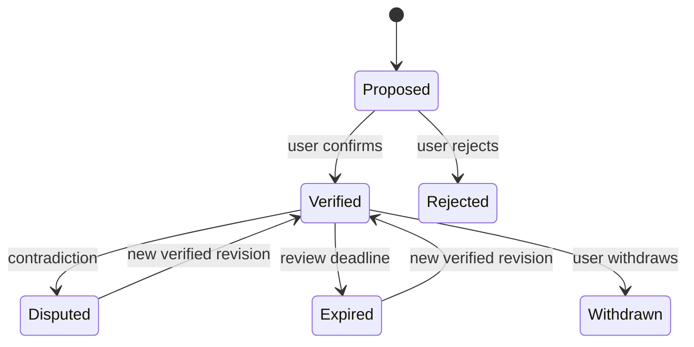
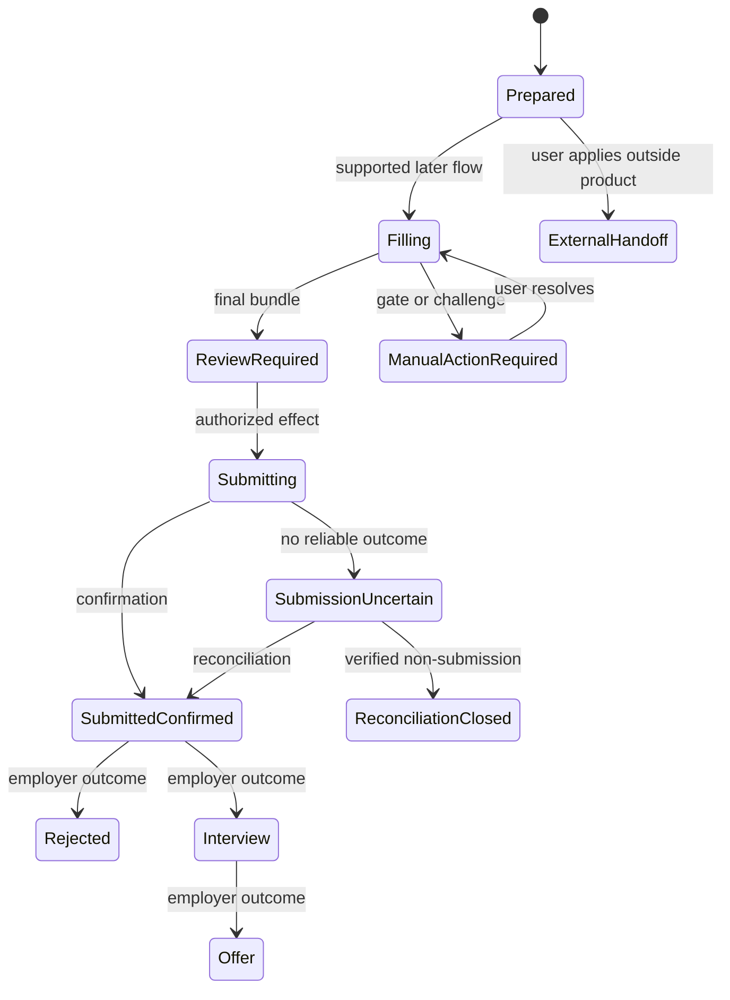

# 01_SHARED_CONTRACTS_AND_DOMAIN_MODEL.md

## 1. Document Control and Status

| Item | Value |
| --- | --- |
| Document | `01_SHARED_CONTRACTS_AND_DOMAIN_MODEL.md` |
| Version | 1.4 (supersedes 1.3, 1.2, 1.1, 1.0, and 0.1) |
| Date | 2026-09-30 (1.3 and 1.2 dated 2026-09-29; 1.1 dated 2026-09-28; 1.0 dated 2026-09-27; 0.1 dated 2026-09-23) |
| Status | Approved by the product owner; v1.0 approved 2026-09-27 after the gap audit (section 29), v1.1 changes approved 2026-09-28 (section 29.1); v1.2 and v1.3 changes approved 2026-09-29 (sections 29.2 and 29.3, the hardened baseline and the independent audit fixes); binding for `02` to `07`; version 1.4 changes (section 29.4) directed by the product owner on 2026-09-30, text awaiting the owner's review |
| Upstream baseline | `00_PRODUCT_AND_SYSTEM_PLAN.md`, version 1.3 (approved 2026-09-29) |
| Other inputs | `Job_Automation_PLAN_Generator_Prompt.md`, `DEP_Prompt.md`, project instructions, and the request for this document |
| Intended readers | Product owner, security architect, runtime architect, desktop and mobile designers, implementation agents |
| Change rule | Preserve identifiers and record any changed invariant, affected consumers, migration effect, and required product decision |

The system plan is the approved v1.0 baseline. Contracts in this document are approved decisions as of version 1.0; a later document may refine them only through the change rule above. This document defines behavior and data meaning. It does not authorize implementation or a real-world application submission.

## 2. Executive Summary

The platform has four bounded components: desktop application, headless worker, mobile companion, and optional control plane. The local-first MVP uses a desktop application, worker, and one local authority. Hosted and fully self-hosted topologies add a control plane for synchronized identity, shared state, leases, and approvals.

The central rule is that a generated statement must refer to current, verified candidate evidence permitted for that use. A job observation, an AI inference, and a candidate statement have different authority. Eligibility is decided separately from fit. A package is a collection of prepared materials; an application is a record of an actual external interaction. A notification carries information, never approval.

This document proposes immutable revisions for consequential facts and bundles, conditional commands against authoritative versions, append-only transition history, and explicit reconciliation of uncertain external effects. Those choices support local use now and synchronized use later without implying that a local database and a remote database can both independently authorize the same action.

## 3. Upstream Decisions, Dependencies, and Conflict Register

### 3.1 Inherited baseline

| Baseline | Contract consequence |
| --- | --- |
| `ARCH-01`, `ARCH-07` | A local authority is complete in local-only mode. An optional control plane becomes authority for defined shared fields after enrollment. SQLite and PostgreSQL are provisional storage mappings, not contract formats. |
| `ARCH-02`, `ARCH-08` | Workers execute tasks. They do not become approval or synchronized lease authorities. |
| `ARCH-11`, `ARCH-12` | Model outputs are proposals. A structured resume representation precedes independent PDF and DOCX renders. |
| `ARCH-13` | A push notification cannot approve a bundle. |
| `PRD-03`, `POL-01`, `POL-02` | Readiness and verified evidence gate factual generation and sensitive answers. |
| `PRD-10`, `PRD-11` | Exactly three primary modes and three run strategies exist. |
| `POL-16` | The MVP has no automatic real-world submission. |

### 3.2 Conflicts and gaps exposed by contract design

| ID | Statements and affected documents | Practical consequence | Recommended resolution | Approval |
| --- | --- | --- | --- | --- |
| `CON-101` | System plan section 17 says the local store owns profile and claims, while the control plane owns synchronized canonical state. It does not identify the authority for a synced claim being edited offline. Affects `00`, `01`, `02`, `03`, `04`, `05`. | Two devices could independently treat different eligibility answers as verified. | A published synchronized claim revision is authoritative at the control plane. Offline edits are proposals until accepted there. Unsynced private evidence remains locally authoritative but cannot satisfy a remote approval unless an authorized, sufficient assertion is published. | Resolved in v1.0: adopted as `ADR-105` and reflected in `00` section 17. |
| `CON-102` | System plan section 24 calls out likely eligibility but also requires verified authorization for consequential answers. Affects `00`, `01`, `03`, `06`. | A user may mistake “likely eligible” for permission to answer “yes” on a form. | Make the eligibility label distinct from answer authorization. Only a current verified answer to the exact question, jurisdiction, and job context can authorize an affirmative answer. | Resolved in v1.0: adopted in `CON-121` and `CON-128`, reflected in `00` section 24. |
| `CON-103` | The system plan calls for an atomically saved package while acknowledging filesystems without the same atomic operations. Affects `00`, `01`, `03`, `04`. | A partial export might appear complete after a crash. | Define completion as a verified manifest commit. The worker may use an atomic rename where supported; otherwise readers recognize only a committed manifest marker after checking file hashes. | Resolved in v1.0: adopted in `CON-127` and made concrete in `CON-148`. |
| `CON-104` | The system plan requires duplicate prevention but does not define identity after an erroneous job merge or split. Affects `00`, `01`, `03`. | A split could permit another submission to the same employer requisition. | Keep immutable observation history and a separate application identity guard that survives merges and splits. Ambiguous identities block submission pending reconciliation. | Resolved in v1.0: adopted in `ADR-102` and `CON-141`, reflected in `00` section 26. |

No conflict above changes the local-only, Manual MVP boundary.

v1.0 gap resolutions added by this document: `CON-148` (package directory and file contract), `CON-149` (employer record), `CON-150` (source attempt record), `CON-151` (secret reference), `CON-152` (outcome events), `SM-106` (job workflow), `SM-107` (run transitions), full transition tables for `SM-102` and `SM-104`, and the `MANUAL_ACTION_REQUIRED` application state required by the Generator. Section 29 lists every change.

## 4. Scope, Contract Principles, and Ownership Boundaries

A **contract** specifies an invariant, authority, lifecycle, version, validation, and failure behavior. Product policy decides whether an action is permitted. A logical entity describes information regardless of storage. A command or event is a transport-level expression of a permitted change.

| ID | Principle | Invariant and failure behavior | Upstream |
| --- | --- | --- | --- |
| `CON-105` | Authority is explicit | Exactly one authority decides each consequential transition within a topology. If unavailable, the transition waits. | `ARCH-01`, `ARCH-07`, `NFR-02` |
| `CON-106` | Proposals have no inherited authority | Import, extraction, posting text, and model output cannot become verified candidate claims by copying fields. Invalid promotion is rejected and audited. | `POL-01`, `POL-07` |
| `CON-107` | Consequential inputs are version-bound | A change to a referenced claim, answer, posting, policy, document, or destination invalidates dependent approval and requires reevaluation. | `PRD-03`, `PRD-08`, `ARCH-13` |
| `CON-108` | External effects are not transactionally reversible | After an uncertain external submission, the system records uncertainty and requires reconciliation. It does not infer failure from a timeout. | `POL-09`, `NFR-01` |
| `CON-109` | Capability is declared and checked | A task requiring unsupported or revoked capability is not assigned or executed. | `PRD-12`, `PRD-13`, `AC-10` |

The authority may delegate computation to a worker. Delegation does not delegate the right to confirm a claim, accept an approval, or assert that an employer received an application.

## 5. Canonical Glossary and Naming Rules

| Term | Canonical meaning |
| --- | --- |
| Candidate | Person whose facts and application history the system manages. |
| Local profile | Candidate record created in one local installation before optional account enrollment. |
| Account | Identity within one hosted or self-hosted control-plane realm. |
| Evidence | Material supplied or entered to support a candidate statement. |
| Claim | Versioned candidate statement with evidence, verification, permitted uses, and sensitivity. |
| Observation | One retrieval or import of one source listing at a particular time. |
| Canonical job | Grouping of observations believed to describe the same opportunity. |
| Eligibility assessment | Contextual finding about whether the candidate could accept a particular job under the known facts. It is not legal advice. |
| Fit analysis | Explainable assessment of alignment with the role. |
| Decision record | Versioned application of filters, eligibility, fit, overrides, and policy to a job. |
| Document revision | Immutable structured content and its associated rendered outputs and validations. |
| Package | Versioned manifest of a job snapshot, decision, materials, answer bundle, and export status. |
| Application | History of interaction with an employer's application process, including uncertain outcomes. |
| Attempt | One bounded form or submission interaction within an application. |
| Approval | One authoritative decision on one exact review bundle version. |
| Run | Bounded execution under a captured mode, strategy, scopes, and budgets. |
| Task | Assignable unit of work within a run. |
| Authority | Component whose accepted revision determines current consequential state. |
| Projection | Cached or deliberately shared view of an authoritative record. |

Contract field names use `snake_case`; enum wire values use `SCREAMING_SNAKE_CASE`. Display labels may differ. `DISCOVERY_ONLY` and `PREPARE_ONLY` are workflow scopes, not primary operating modes.

## 6. Identity, Tenancy, Devices, and Worker Identifiers

### 6.1 Identifier design

**`ADR-101`:** Use opaque, globally unique, client-generable identifiers with a type prefix for new entities. A UUIDv7-compatible value is a proposed encoding; implementations may use another collision-resistant format if its canonical string representation and validation are fixed before data exchange. IDs never encode a name, jurisdiction, or account. Example form: `clm_018f...`. The illustrative suffix is not a valid full identifier.

| Prefix | Entity | Issuer and authority |
| --- | --- | --- |
| `usr_` | Account user | Control plane within a named realm |
| `prf_` | Local or synchronized candidate profile | Local authority initially; retained after enrollment |
| `dev_` | Registered device | Local authority for local-only use; control plane for synchronized registration |
| `wrk_` | Worker installation | Local authority initially; control plane registration binds its existing ID to a realm |
| `src_` | Source registry entry | Authority managing the source catalog |
| `obs_` | Source observation | Ingesting worker proposes; authority accepts |
| `job_` | Canonical job | Authority |
| `evd_`, `clm_` | Evidence and claim | Local authority; control plane for published synced revisions |
| `doc_`, `pkg_` | Document and package | Worker proposes; authority accepts revision and status |
| `run_`, `tsk_` | Run and task | Authority |
| `app_`, `att_` | Application and attempt | Authority |
| `apr_`, `aud_` | Approval and audit event | Authority |
| `ans_`, `dec_`, `ntf_` | Answer, decision, notification | Authority |
| `emp_` | Employer record (`CON-149`) | Authority; worker proposes aliases and domains |
| `sat_` | Source attempt record (`CON-150`) | Worker proposes; authority accepts |
| `sch_` | Schedule (`CON-131`) | Authority |
| `bnd_` | Review bundle (`CON-135`) | Authority |
| `exp_` | Package export record (`CON-127`) | Authority |
| `prv_`, `mcl_` | Provider configuration, model call and usage record (`CON-138`, `CON-139`) | Authority for configuration; worker proposes call records |
| `sec_` | Secret reference, never the secret value (`CON-151`) | Local authority or worker that holds the protected store |
| `rlm_`, `local_` | Control-plane realm, local authority installation | Control plane for realms; local installation for its own authority ID |
| `cmd_`, `idem_`, `nonce_` | Command ID, idempotency key, single-use nonce | Issuing client or authority; tokens, not durable entities |

An ID is immutable, including after sync enrollment. The server adds a realm binding and server revision; it does not replace an imported local ID. An account can contain more than one distinct profile only through an explicit user action. No import automatically merges candidate accounts, profiles, or application histories.

**Alternative considered:** Server-issued IDs simplify server uniqueness but force offline remapping and broken references. Content-derived IDs fail when facts are corrected. Client-generable opaque IDs preserve references, while the authority still controls registration and accepted revisions.

### 6.2 Realm and account binding

Every synchronized record carries `realm_id`, `account_id`, `profile_id`, and an authority revision. A local-only record carries `local_authority_id` and `profile_id`; `account_id` is absent. Absence differs from JSON `null`: absence means the field is outside this topology. A signed-in user may own a registered device, but a device ID is never an authorization credential by itself.

An enrollment import first stages a complete inventory, validates ID collisions and application identity guards, and displays both histories. It then either attaches the local profile as a distinct profile or performs an explicit, reviewed merge with reversible source mappings and preserved event history. A conflicting external application is quarantined for reconciliation. A failed import leaves the local authority unchanged.

### 6.3 Creation and change authority

| Entity | Local-only authority | Synchronized authority | Worker or client role |
| --- | --- | --- | --- |
| Identity, registration, revocation | Local authority | Control plane | Desktop/mobile request; worker authenticates and caches limited registration |
| Candidate claim and preference | Local authority | Control plane for published shared revision; local authority for unsynced private revision | Desktop proposes and user confirms; mobile proposes where supported |
| Observation and job grouping | Local authority | Control plane for shared grouping | Worker proposes observations and merge evidence |
| Document bytes | Local worker storage and selected destination | Originating worker storage unless explicitly shared | Control plane holds digest and availability descriptor only by default |
| Runs, tasks, leases | Local authority | Control plane | Worker executes authorized tasks |
| Approval and application state | Local authority | Control plane | Clients request changes; workers report evidence and external effects |
| Audit events | Authority performing the transition | Control plane for shared transitions; local authority for local-only events | Clients and workers submit attributable inputs |

## 7. Common Types, Metadata, Versions, and Provenance

### 7.1 Shared value rules

| Type | Rule |
| --- | --- |
| Instant | RFC 3339 timestamp with explicit offset; normalize comparison to UTC. Preserve original source time and zone if known. |
| Local schedule time | Date or wall-clock time plus an IANA time zone ID and explicit DST policy. An offset alone is insufficient. |
| Duration | Integer milliseconds for execution bounds; display conversion is separate. |
| Money | Decimal amount encoded as a string, ISO 4217 currency code, and period such as `YEAR` or `HOUR`. Never use binary floating point for commitments. |
| Locale | BCP 47 language tag for text generation and parsing; preserve a candidate's chosen display name and spelling. |
| Text | Preserve the original; normalize to Unicode NFC for comparison, with whitespace and case folding only in explicitly named match keys. |
| URL | Preserve original and resolved URL separately. Compare using parsed scheme, host, path, and source-specific stable identifier rules. Remove tracking parameters only in a comparison key, never from provenance. Only approved `https` application destinations can be considered for assisted form actions, subject to later adapter policy. |
| Hash | Algorithm-tagged digest over specified canonical bytes. A hash verifies a revision; it does not by itself prove truth. |
| Unknown | `{ "kind": "UNKNOWN" }` when the concept applies but its value is not established. |
| Withheld | `{ "kind": "WITHHELD" }` when the person declines to disclose a value. |
| Not applicable | `{ "kind": "NOT_APPLICABLE" }` with a reason and verifier when required. |
| Absent | Property omitted because the contract version or context does not include it. |

`null` is prohibited for a required semantic field. An optional nullable field must explicitly state what null means in its schema; otherwise omit it. An empty string never means unknown or withheld.

### 7.2 Entity envelope

**`CON-110`:** Every durable consequential entity has an ID, schema version, creation time, accepted revision, authority identifier, and audit reference. Mutation is represented as a new revision or a transition event. Expected failure on malformed or unsupported versions is a typed rejection without partial mutation.

```json
{
  "entity_id": "clm_018f7a0c-0000-7000-8000-000000000001",
  "schema_version": "1.0",
  "revision": 3,
  "authority_id": "local_018f7a0c-0000-7000-8000-000000000002",
  "created_at": "2026-09-23T09:00:00Z",
  "updated_at": "2026-09-23T09:15:00Z",
  "last_audit_event_id": "aud_018f7a0c-0000-7000-8000-000000000003"
}
```

The example specifies fields and relationships; exact ID encoding remains subject to `ADR-101`. Accepted revisions increase monotonically per entity. Event sequences increase monotonically per authority stream. Neither number represents global time.

### 7.3 Provenance types

`CANDIDATE_VERIFIED`, `CANDIDATE_UNVERIFIED`, `IMPORTED_EXTRACT`, `MODEL_INFERENCE`, `POSTING_ASSERTION`, `USER_DECISION`, and `SYSTEM_OBSERVATION` are distinct origin kinds. A posting assertion about visa sponsorship is evidence of what the posting said, not proof of the candidate's status. A model inference can propose a match but cannot verify a candidate claim.

## 8. Candidate Profile, Evidence, Claims, and Readiness

### 8.1 Evidence and claim contracts

| Contract | Invariant | Lifecycle and version | Validation and failure |
| --- | --- | --- | --- |
| `CON-111` Evidence | Records origin type, acquisition time, owner, permitted uses, sensitivity, integrity digest where bytes exist, and source locator when possible. | New evidence ID per source item; corrections add an annotation or new item. | Missing source locator is explicitly `UNKNOWN` for imported material. Inaccessible evidence blocks verification if it was the only support. |
| `CON-112` Claim | One atomic candidate assertion has source references, verification state, actor, time, permitted uses, expiry or review rule, contradiction links, and revision. | A correction creates a new revision; old revision remains in history. | An extract or inference starts `PROPOSED`, never `VERIFIED`. |
| `CON-113` Readiness | Derived from current accepted claim revisions and settings, with itemized blockers. It is never an editable boolean. | Recompute when dependencies or policy change. | A failed dependency changes readiness to blocked before any new consequential task is authorized. |

An evidence locator may be `{ "kind": "FILE_PAGE", "page": 2, "text_span": "..." }`, `{ "kind": "URL_FRAGMENT", "url": "...", "selector": "..." }`, `{ "kind": "REPOSITORY_COMMIT", "revision": "..." }`, or `{ "kind": "MANUAL_ATTESTATION", "entered_at": "..." }`. Manual attestation is a complete evidence path when the user provides and verifies a fact. It is not automatically lower authority solely because no uploaded document exists.

Claim verification states are `PROPOSED`, `VERIFIED`, `DISPUTED`, `EXPIRED`, `WITHDRAWN`, and `REJECTED`. A verified claim may later be withdrawn, disputed, or expire. Reverification creates a new accepted revision. An explicit contradiction must be resolved by a user decision identifying which assertion, if either, is currently usable. Confidence from a parser is stored separately from verification.

Permitted uses are an explicit set, such as `PROFILE_DISPLAY`, `ELIGIBILITY`, `RESUME`, `COVER_LETTER`, and `APPLICATION_ANSWER`. Sensitivity classes are assigned in section 23. An assertion verified for a resume is not thereby approved as an authorization answer.

**`CON-112` field completion (v1.0):** The Generator's claim ledger also requires these fields, now part of the claim contract: `category` (`IDENTITY`, `CONTACT`, `LOCATION`, `ELIGIBILITY`, `EDUCATION`, `EMPLOYMENT`, `PROJECT`, `SKILL`, `CERTIFICATION`, `ACHIEVEMENT`, `LINK`, `PREFERENCE_FACT`, or `OTHER`); `extraction_method` (`MANUAL_ENTRY`, `DETERMINISTIC_PARSER`, `MODEL_EXTRACTION`, or `IMPORTED_STRUCTURED`, with parser or model version); `extraction_confidence` (0 to 1, or `UNKNOWN` for manual entry), which never affects verification state; and `edit_history`, the ordered revision list with the actor and changed fields for each user edit. A claim is atomic: one category per claim.

### 8.2 Readiness checklist

**`CON-114`:** Before job automation begins, the authority evaluates these items and returns an individual reason for each failure:

1. Verified legal-name entry and explicit preferred-name policy.
2. Verified usable email and phone information, including an explicit policy if a channel is unavailable or withheld.
3. Verified current location at the granularity needed for selected jurisdictions.
4. Verified eligibility facts for each selected jurisdiction where they are relevant; unknown regions may be searched for review but cannot support affirmative application answers.
5. Verified education and relevant dates, or an explicit, verified absence where applicable.
6. Verified employment history and dates, or a verified statement that no employment history is being claimed.
7. At least one defensible project or experience basis and individually supported skill claims for any skill to be used.
8. Verification of every portfolio or repository link selected for use; links are optional.
9. At least one enabled target role and explicit job-type preferences.
10. One of `MANUAL`, `HYBRID`, or `AUTO`, with available features constrained by release.
11. An app-managed destination or a currently usable user-selected destination.
12. A sensitive-question policy that defaults to pausing and requesting user review for unknown or withheld answers.

A readiness result includes `policy_version`, `dependency_revisions`, `evaluated_at`, `status`, and `blockers[]`. General discovery and package preparation may have different additional task gates, but neither can bypass this baseline once automation starts. The MVP supports `MANUAL` only.

**`CON-115`:** Withdrawal, expiry, or unresolved contradiction of a supporting claim invalidates any dependent draft document's validation status, moves an incomplete package back to review, and revokes unused approvals. A completed historical package retains its immutable bytes and is marked `SUPERSEDED_OR_UNSAFE_FOR_REUSE`; it is not rewritten. An active form attempt pauses before its next external effect. A submitted application remains a historical fact and gains a correction or disclosure review task where appropriate. The transition and dependency traversal are audited.

## 9. Roles, Preferences, Geography, Eligibility Facts, and Destinations

**`CON-116`:** Preferences are versioned policy, not candidate evidence. A target role contains ordered role family, exact titles, aliases, exclusions, seniority band, required and preferred skill priorities, threshold, enabled state, and optional archetype hint. User edits create a new policy revision. A run captures the revision it uses.

Separate fields represent:

- `job_geography`: employer location, stated hiring regions, and any country-specific restriction, each with source evidence.
- `work_arrangement`: `REMOTE`, `HYBRID`, `ON_SITE`, or `UNKNOWN`, plus stated attendance conditions.
- `candidate_location` and `eligibility_facts`: user-verified facts with jurisdiction, effective dates, and permitted answer use.
- `job_type`: `FULL_TIME`, `PART_TIME`, `CONTRACT`, `TEMPORARY`, `INTERNSHIP`, `CO_OP`, `APPRENTICESHIP`, `FREELANCE`, `VOLUNTEER`, `OTHER`, or `UNKNOWN`; compensation status is separately known or unknown.
- `destination`: app-managed storage or a user-authorized output location, with device binding, grant status, and expiry or revalidation behavior.

**`CON-117`:** A destination grant is an operational permission, not a location preference. A stale or revoked grant blocks package completion and returns a recoverable permission error. The control plane may sync a destination's descriptive label and owning worker ID, but never presumes the same filesystem path or access grant exists on another device.

## 10. Source Registry, Observations, Canonical Jobs, and Deduplication

### 10.1 Source registry

**`CON-118`:** Each planned source has a registry entry even if it cannot currently be used. The registry includes Hiring Cafe, Himalayas, Wellfound, Hitmarker, Remote OK, Remotive, We Work Remotely, Working Nomads, Work With Indies, GameDev.net, official company career pages, Greenhouse, Lever, Ashby, Workday, SmartRecruiters, BambooHR, Teamtailor, and custom ATS platforms. LinkedIn and Indeed are optional lower-priority entries. Registry presence does not assert that access or automation is permitted.

A source records `DISABLED`, `ENABLED`, `RESTRICTED`, `UNSUPPORTED`, or `BLOCKED`; adapter version; permitted access method; authentication requirement; last attempt, success, failure, freshness, count, rate state, and remediation. Attempt health is separate from configuration. A full-coverage run attempts each enabled, permissible, supported source within budgets and reports every omission.

### 10.2 Observation and job

**`CON-119`:** An observation is append-only with source ID, source posting ID if supplied, original and resolved URLs, fetched time, content digest, parsed fields with confidence, and raw snapshot reference only if retention is permitted. Re-fetching changed content creates another observation revision or observation event; it never destroys the original record.

**`CON-120`:** A canonical job holds links to all observations, chosen display fields with their observation references, current canonical destination, historical destinations, merge rationale, confidence, and grouping revision. Prefer a verified official employer or ATS destination over an aggregator when they demonstrably refer to the same posting. Redirect or URL change adds history and triggers destination revalidation.

**`ADR-102`:** Deduplication uses stable employer or ATS IDs and validated canonical URLs first, then company, title, location, content, and semantic similarity as weaker signals. Automatic grouping requires a calibrated high-confidence policy. Low-confidence cases remain separate and reviewable. A mistaken merge is split by moving observation links into new canonical groups through an audited command. No observation, source URL, or prior grouping event is deleted. Existing application identity guards remain active for both groups until their employer requisition identity is resolved.

### 10.3 Employer and source attempt records (v1.0)

**`CON-149` Employer record:** An employer record holds a display name, legal or alternate names as aliases, verified official web domains, known ATS tenant identifiers (for example a Greenhouse board token or Workday tenant), and provenance for each. Deduplication (`ADR-102`) and destination validation (`02` `CTRL-217`) use the verified domains and tenant identifiers. An alias or domain proposed from a posting stays unverified until confirmed by an official source or the user. Employer records merge and split like canonical jobs, with audit and without deleting history.

**`CON-150` Source attempt record:** Each attempt to read one source within one run records source ID, run ID, adapter and schema versions, start and end instants, request count, items seen, new and changed observation counts, rate-limit state, authentication state, outcome (`SUCCEEDED`, `PARTIAL`, `FAILED`, `SKIPPED_DISABLED`, `SKIPPED_RESTRICTED`, `SKIPPED_BUDGET`, `SKIPPED_UNSUPPORTED`), safe error class, and remediation text. Registry health in `CON-118` is a projection over these records. A full-coverage run produces one attempt record for every registered source, including skipped ones, so that no source is silently omitted.

## 11. Eligibility Assessment, Fit Analysis, and Decision Records

**`CON-121`:** Eligibility has exactly four assessment outcomes: `VERIFIED_ELIGIBLE`, `LIKELY_ELIGIBLE`, `AMBIGUOUS`, and `INELIGIBLE`. The result records candidate claim revisions, posting observation revisions, jurisdiction and arrangement context, supporting and contrary excerpts, policy version, assessment time, and expiry or review trigger. `VERIFIED_ELIGIBLE` means the available verified facts and posting terms support the platform's configured determination; it is not a legal certification. Changed facts or posting restrictions make the result stale.

**`CON-122`:** Hard-filter decisions are `PASS`, `REJECT`, or `REVIEW`, each with rule ID and evidence. An override names the exact rule, job, actor, reason, expiry, and effect. No override changes an underlying candidate fact or permits an unsupported affirmative authorization answer.

**`CON-123`:** Fit is a separately versioned analysis with dimensions for technical evidence, experience, role alignment, job-type preference, compensation when known, freshness, and reliable competition signals when available. Each dimension has a value, confidence, evidence references, and explanation. Overall numeric score is optional and calibrated. Location and authorization findings stay in eligibility and gating, even if display summaries show them beside fit. A high fit score cannot promote `AMBIGUOUS` to `VERIFIED_ELIGIBLE`.

A decision record captures the exact input revisions, hard filters, eligibility result, fit analysis, thresholds, overrides, policy and model versions, recommendation, and blockers. A changed input schedules reevaluation and marks the old decision `STALE`; historical decisions remain inspectable.

## 12. Resume Strategy, Structured Content, Documents, and Validation

**`CON-124`:** A resume strategy names an archetype and version, job snapshot revision, chosen claim revisions, ordering rationale, exclusions, and template version. Archetypes describe presentation strategy, not candidate identity or skill.

**`CON-125`:** The structured resume intermediate representation contains ordered sections and blocks. Every factual sentence or bullet has one or more `claim_ref` values with exact claim revision and permitted-use check. Contact fields have verified profile references. Non-factual connective text is marked as such and checked for newly implied facts. A rejected, expired, disputed, or unpermitted claim makes the document invalid.

**`CON-126`:** Each immutable document revision stores structured-content digest, source and claim revision set, archetype, prompt, model, renderer, template, font, locale, creation time, PDF and DOCX render records, extracted-text digests, link checks, and validation results. A renderer retry creates a new render record or document revision; it never silently replaces accepted bytes.

Validation must check PDF and DOCX extraction, ordered expected text, missing or duplicate content, glyphs, links, page count, font size, visual overflow, and current claim validity. A local validation pass is a measurable engineering result, not a guarantee of acceptance by every employer ATS. The upstream font and layout rules apply: one selected family, Times New Roman or EB Garamond subject to licensing and platform proof, conventional single-column layout, readable text, one page when sound, and two when necessary.

## 13. Application Packages, Answers, Applications, and Outcomes

### 13.1 Packages

**`CON-127`:** A package revision binds a specific job snapshot, decision, structured document revision, PDF and DOCX digests, validation records, optional cover letter, proposed answer bundle, destination descriptor, and manifest digest. States are `STAGING`, `VALIDATING`, `READY_FOR_REVIEW`, `COMPLETE`, `FAILED`, and `SUPERSEDED_OR_UNSAFE_FOR_REUSE`. `COMPLETE` requires current claims, both valid documents, validated manifest and hashes, and a usable destination grant at commit time.

The worker prepares a temporary package. The authority accepts `COMPLETE` only after verified file availability and a completion marker or equivalent commit protocol. On filesystems without atomic directory rename, readers consider only a valid committed manifest complete. A permission failure produces `FAILED` with a retryable action after renewed access. Exports are distinct records with destination, time, manifest hash, and outcome. A new version never overwrites an earlier package.

### 13.1.1 Package directory and file contract

**`CON-148` (v1.0):** This contract fixes the on-disk layout the Generator requires, so that the worker, desktop, and any exporter produce identical, collision-free, versioned directories.

Layout:

```text
<destination-root>/
  <company> - <job-title> - job-<short-id>/
    v001/
      resume.pdf
      resume.docx
      job-description.html            (or job-description.pdf; present only when snapshot retention is permitted)
      job-metadata.json
      fit-analysis.json
      application-answers.enc.json    (omitted by default; present only when the user opts in, encrypted per 02)
      cover-letter.pdf                (only when a cover letter was generated)
      cover-letter.docx               (only when a cover letter was generated)
      audit-manifest.json             (written last; its presence and validity is the commit marker)
    v002/
      ...
```

Directory name rules, applied in order:

1. Take the employer display name and the posting title from the canonical job at the first package commit for that job and profile.
2. Normalize each label to Unicode NFC.
3. Replace control characters (U+0000 to U+001F and U+007F) and the characters `< > : " / \ | ? *` with `-`.
4. Collapse runs of whitespace to one space and runs of `-` to one `-`; trim leading and trailing spaces, dots, and hyphens.
5. Substitute `unknown-employer` or `untitled-role` for a label that is now empty.
6. If a label equals a Windows reserved device name (`CON`, `PRN`, `AUX`, `NUL`, `COM1` to `COM9`, `LPT1` to `LPT9`), case-insensitively and with or without an extension, append `_`.
7. Truncate the company label to 40 and the title label to 60 user-perceived characters, cutting only at grapheme cluster boundaries, then re-trim.
8. `short-id` is the final 12 hexadecimal characters of the canonical job ID, which fall in the random portion of a UUIDv7-compatible value (`ADR-101`). If another job's directory under the same root already uses that short ID, use the full job ID instead.
9. Join as `<company> - <title> - job-<short-id>`. The whole name must not exceed 150 UTF-8 bytes; if it does, shorten the title, then the company, never the short ID.
10. On Windows destinations, if the longest resulting file path would exceed 240 characters and long paths are not enabled, shorten the title, then the company, down to 10 characters each; if still too long, fail with `ERR-115` and ask for a shorter destination root.

Stability and collisions: the job directory name is fixed at the first commit and never renamed, even if the posting title or employer name later changes; later names are recorded in `job-metadata.json`. Uniqueness comes from the short ID, so two postings whose names differ only by case, or are identical, still get distinct directories on case-insensitive filesystems. Each new package revision for the same job creates the next `vNNN` directory (three digits, extending to four after `v999`); no version directory is ever overwritten or deleted by the product. A second candidate profile on the same installation must use a different destination root.

Commit protocol (refines `CON-103` and `CON-127`): the worker renders into a private app-managed staging area, validates, copies the members into `<job-dir>/.vNNN.partial/`, verifies each member hash in place, writes `audit-manifest.json` last through a temporary file and same-directory rename, then renames `.vNNN.partial` to `vNNN`. Readers treat a version as complete only when `audit-manifest.json` parses, matches the schema, and every listed member's SHA-256 digest and byte size match. A leftover `.vNNN.partial` directory is incomplete, is reported as recoverable, and is never shown as a package.

Manifest contents: schema version; package ID and revision; job ID and grouping revision; profile ID; creation time; worker ID and version; document revision, claim revision set, template, font, renderer, and model versions; validation result references; for each member its file name, SHA-256 digest, byte size, media type, and privacy class (`01` section 23); and each omitted member with its reason (`SNAPSHOT_NOT_PERMITTED`, `ANSWERS_EXCLUDED_BY_DEFAULT`, `NO_COVER_LETTER`).

### 13.2 Answers

**`CON-128`:** An answer has a question snapshot and field identity, type, exact proposed value, source claim revisions or explicit user attestation, status, scope, sensitivity, and bundle revision. Supported types include text, boolean, choice, multi-choice, numeric money, date, file, and explicit decline where the form permits it. States are `PROPOSED`, `USER_VERIFIED`, `WITHHELD`, `INVALIDATED`, and `SUBMITTED`.

Legal and work authorization, citizenship, clearance, compensation commitments, relocation, availability commitments, demographics, disability, veteran status, criminal history, and background disclosures require a current, context-specific user-verified value or direct user action. A generic answer remembered from another form is a proposal until its wording and context are checked. `UNKNOWN` and `WITHHELD` cannot be converted to a yes or no. Preserve the exact submitted question and answer set where permitted; section 23 and document `02` govern protection and retention.

### 13.3 Application history

**`CON-129`:** A package is not an application submission. An application links a candidate profile, application identity guard, canonical job and observation references, employer destination, attempts, selected package revision, submitted answers if any, and outcome history. Later release states distinguish preparation, supported filling, final review, submission in progress, confirmed submission, uncertain submission, known failure before external effect, rejection, interview, offer, and archival. An employer rejection is an outcome after submission, not a preparation failure.

An external handoff in the MVP records `EXTERNAL_HANDOFF`; it does not assert that the candidate applied. The user may later record a manual submission with date and evidence. `SUBMITTED_CONFIRMED` requires credible employer confirmation or an explicit user-attested manual submission, with the confirmation kind preserved.

**`CON-152` Outcome events (v1.0):** Employer and candidate outcomes are appended as events to the application history: `RESPONSE_RECEIVED`, `ASSESSMENT_REQUESTED`, `INTERVIEW_SCHEDULED`, `INTERVIEW_COMPLETED`, `REJECTED`, `OFFER_RECEIVED`, `OFFER_ACCEPTED`, `OFFER_DECLINED`, `WITHDRAWN_BY_CANDIDATE`, and `NO_RESPONSE_CLOSED`. Each carries occurred time, recorded time, source (`USER_ENTERED`, `EMAIL_IMPORTED`, `EMPLOYER_PORTAL`), and optional evidence reference. Outcome events drive the `SM-104` states `REJECTED`, `INTERVIEW`, and `OFFER`, and feed `PRD-14` analytics as read-only projections. They never modify submitted answers, packages, or candidate claims (`DEP` section 27).

## 14. Operating Modes, Run Strategies, Schedules, Budgets, and Runs

**`CON-130`:** The only primary modes are `MANUAL`, `HYBRID`, and `AUTO`. The only strategies are `SCHEDULED`, `CONTINUOUS`, and `TIMED_IMMEDIATE`. A run captures the mode and policy revision at creation. A mode change creates an audited new policy revision and does not change queued work. Rebinding queued items requires an explicit command and fresh gate evaluation.

| Mode | Preparation | Form filling in a later supported release | Submission in a later supported release |
| --- | --- | --- | --- |
| `MANUAL` | User checkpoints for selection and materials | User initiates and reviews each stage | User expressly initiates final submission |
| `HYBRID` | Automatic within policy | Supported fields may be filled | Requires one valid approval of the exact final bundle |
| `AUTO` | Automatic within policy | Supported fields may be filled | Only on explicitly allowed flows after every mandatory gate and user rule passes |

The MVP allows Manual preparation and external handoff only. Workflow scopes such as discovery-only or prepare-only further restrict an authorized mode.

**`CON-131`:** A run strategy describes timing, never permission to exceed budgets. Every run captures per-run and daily limits for discovered and analyzed jobs, model tokens and cost, storage, source requests, hardware use, and, in later releases, form and submission counts. `CONTINUOUS` has no predetermined end time but still pauses on exhausted budgets. `TIMED_IMMEDIATE` records start, duration, and end instant. `SCHEDULED` records wall time, IANA zone, weekdays, DST ambiguity policy, missed-run policy, and offline-worker policy. `03` chooses scheduling algorithms.

A run has `CREATED`, `READY`, `RUNNING`, `PAUSING`, `PAUSED`, `STOPPING`, `STOPPED`, `COMPLETED`, or `FAILED` status. Emergency stop revokes permission for new external effects and creates reconciliation work for any in-flight submission whose outcome is unknown.

## 15. Worker Capabilities, Tasks, Leases, and Execution Records

**`CON-132`:** A worker capability declaration names worker and platform, capability kind and version, adapter support, browser availability, document renderers, model task capabilities, resource bounds, freshness, and trust or registration state. A capability declaration is an assertion to validate, not evidence that an arbitrary mobile device can run a worker.

**`CON-133`:** A task states its required capabilities and minimum versions, input revisions, policy snapshot, allowed effects, budget reservation, authority, and idempotency key. A worker lacking any required capability receives no such task. A worker rechecks capability and policy before an effect. Assignment failure is visible and recoverable by selecting a compatible worker or changing the task scope.

**`CON-134`:** A lease allows bounded execution of a task; it is not the application identity guard and does not grant an evergreen right to submit. Lost or expired lease prevents new external effects. If a form may already have been submitted when the lease is lost, the attempt becomes `SUBMISSION_UNCERTAIN` and enters reconciliation. `03` defines durations, heartbeat, queue, and handoff mechanics.

Execution records retain stage, input and output hashes, worker and capability versions, start and end times, failure class, resource usage, and effect receipt. Sensitive raw content is excluded from default operational logs.

## 16. Reviews, Approvals, Notifications, and Device Actions

**`CON-135`:** A review bundle binds the exact canonical job grouping revision, chosen observation and destination, eligibility evidence, fit, document bytes or verifiable hashes and availability, answer set, disclosures, warnings, adapter and form version, policy revision, and allowed decisions. Any material edit creates a new bundle revision.

**`CON-136`:** An approval names subject ID, bundle revision and digest, decision type, allowed decision set, expiry, authenticated actor, registered device, session freshness assertion, single-use nonce, authority revision, and accepted time. The local authority handles local-only decisions; the control plane handles synchronized decisions. Only a conditional authoritative transition can accept a decision. A competing device receives `ALREADY_DECIDED` and the accepted outcome, without creating another approval.

Revocation before consumption blocks use. Revocation after an external effect cannot retract that effect; it records a later correction or stop request. An expired, stale, offline, or wrong-device approval is rejected. A submitted answer edit invalidates the bundle and unused approval.

**`CON-137`:** Notification state records creation, attempted delivery, delivery acknowledgement where available, and opened view. None is an approval. An offline mobile device may show a cached review labeled with last-sync time but cannot queue a consequential approval for later replay. Stop commands also require an authoritative acknowledgement; offline display must not imply that an unreachable worker has stopped.

## 17. Provider Capabilities, Model Tasks, and Usage Records

**`CON-138`:** Provider records distinguish hosted API, separately assessed developer integration, OpenAI-compatible endpoint, and local runtime. Capability fields name structured-output support as tested, context and privacy limits, task evaluation version, model identifier, endpoint class, cost basis, and permitted data classes. A consumer chat subscription is never an embedded API credential or quota.

Model tasks include extraction, semantic posting analysis, fit support, resume strategy, factual writing, answer interpretation, and high-risk review. Their outputs are versioned proposals with input digests, prompt and model versions, output schema version, confidence when meaningful, and validation results. Provider fallback requires compatible capability, privacy permission, task benchmark, and budget. A failed or unsuitable fallback pauses the item.

**`CON-139`:** Usage records state provider, model, task, tokens or other metered units if reported, estimated or actual cost, currency, time, and caching disposition. Missing provider usage is `UNKNOWN`, never zero.

**`CON-138` provider kinds (v1.1):** In addition to the kinds listed in `CON-138`, a provider record may be `SUBSCRIPTION_DEVELOPER_TOOL` (an official vendor tool such as the Claude Agent SDK or Codex, running under the user's own subscription sign-in; route R1 in `00` section 30) or `MANUAL_RELAY` (route R2). A `SUBSCRIPTION_DEVELOPER_TOOL` record also stores the terms-evidence reference and date that `03` recorded, the tool name and version, and an `enabled_by_policy` flag the authority clears when that evidence expires or a check fails. Its credentials stay inside the vendor tool; the record never holds them (`CON-151`, `02` `CTRL-227`).

**`CON-153` Manual relay exchange (v1.1):** One relay exchange records task type, input digest, the exported prompt package (task-minimal and privacy-classified per section 23), the output schema version, the time exported, the user's declared destination service and model name (stored as `UNVERIFIED`), the pasted response, the time received, and the validation result. States are `EXPORTED`, `RESPONSE_RECEIVED`, `ACCEPTED`, `REJECTED`, and `ABANDONED`. A pasted response is a model proposal (`MODEL_INFERENCE` origin, section 7.3) and passes the same schema, claim, and policy validation as any model output. A rejected response changes no state except the exchange itself. An exchange whose input digest no longer matches current inputs is stale and cannot be accepted. Usage for relay exchanges is `UNKNOWN` (`CON-139`).

**`CON-151` Secret reference (v1.0):** Contracts refer to secrets only through a `sec_` reference that names owner (worker or local authority), kind (`MODEL_API_KEY`, `SITE_SESSION`, `LOCAL_ENDPOINT_TOKEN`, `WORKER_CREDENTIAL`, `DATA_KEY`, `DESTINATION_GRANT`), scope, storage kind, creation, rotation, and revocation times, and status. The secret value never appears in an entity, command, event, package, log, or model prompt. Storage, rotation, and revocation rules belong to `02` `CTRL-209` and `CTRL-210`.

## 18. Canonical State Machines and Transition Rules

State owner means the authority that commits the transition and its audit event. A worker may report evidence for a transition; the authority validates it.

### 18.1 Claim, package, and approval



| ID | State machine | Authority and transition guard | Recovery or terminal behavior | Audit |
| --- | --- | --- | --- | --- |
| `SM-101` | Claim: `PROPOSED`, `VERIFIED`, `DISPUTED`, `EXPIRED`, `WITHDRAWN`, `REJECTED` | User confirmation and current revision required for verification; authority commits. | Reverification creates a revision. Rejected and withdrawn revisions remain historical. | Actor, old/new revision, evidence and dependency invalidation. |
| `SM-102` | Package: `STAGING`, `VALIDATING`, `READY_FOR_REVIEW`, `COMPLETE`, `FAILED`, `SUPERSEDED_OR_UNSAFE_FOR_REUSE` | Worker proposes outputs; authority checks claim, hash, format, destination, and manifest. | Failed package can create a new attempt or version. Complete package remains immutable. | Validation and destination results, hashes, transition. |
| `SM-103` | Approval: `PENDING`, `ACCEPTED`, `DECLINED`, `EXPIRED`, `REVOKED`, `INVALIDATED` | Authority compare-and-set against pending ID, bundle digest, nonce, session, and expiry. | All except pending are terminal for that approval ID. A new bundle needs a new approval. | Winning decision and rejected competing attempts. |

### 18.2 Application and task



| ID | State machine | Authority and transition guard | Recovery or terminal behavior | Audit |
| --- | --- | --- | --- | --- |
| `SM-104` | Application: `PREPARED`, `EXTERNAL_HANDOFF`, `FILLING`, `MANUAL_ACTION_REQUIRED` (added v1.0), `REVIEW_REQUIRED`, `SUBMITTING`, `SUBMISSION_UNCERTAIN`, `SUBMITTED_CONFIRMED`, `KNOWN_NOT_SUBMITTED`, `RECONCILIATION_CLOSED`, `REJECTED`, `INTERVIEW`, `OFFER`, `ARCHIVED` | Authority checks application identity guard, policy, bundle, answer set, approval if required, and effect receipt. | `SUBMISSION_UNCERTAIN` blocks retry until explicit reconciliation. `ARCHIVED` hides from active work but preserves history. Employer outcomes can add events after confirmation. | Every transition, external evidence, actor, and old/new state. |
| `SM-105` | Task: `QUEUED`, `LEASED`, `RUNNING`, `PAUSED`, `SUCCEEDED`, `FAILED`, `CANCELLED`, `EFFECT_UNCERTAIN` | Authority assigns; worker reports with current lease and input revisions. | Safe pure computation may retry. `EFFECT_UNCERTAIN` requires external reconciliation. | Assignment, lease changes, effects, and failures. |

`EXTERNAL_HANDOFF` is not synonymous with submission. `KNOWN_NOT_SUBMITTED` requires evidence that the external effect did not occur. `RECONCILIATION_CLOSED` records the determination and may allow an explicitly new attempt if policy authorizes it. A new interview or offer outcome does not rewrite the submitted answer set.

### 18.3 Full transition tables (v1.0)

Version 0.1 summarized `SM-102` and `SM-104` in one row each. The Generator requires allowed transitions, actor, preconditions, idempotency key, audit event, compensation, and terminal states. The tables below are normative. A transition not listed is rejected with `ERR-101` or a more specific error. Every transition commits with its audit event (`CON-147`); `EVT-113` is the generic transition event where no specific event exists.

**`SM-102` Package transitions.** In the MVP (Manual mode), every package waits in `READY_FOR_REVIEW` for the user's materials checkpoint. In Hybrid and Auto, a package passes that state automatically unless a user rule requires materials review.

| From | To | Actor | Preconditions | Idempotency key | Event | Compensation |
| --- | --- | --- | --- | --- | --- | --- |
| (new) | `STAGING` | Worker proposes, authority creates | Job selected, readiness passes, destination descriptor present | Profile, job grouping revision, document revision | `EVT-113` | None |
| `STAGING` | `VALIDATING` | Worker | All members rendered in staging | Package ID and revision | `EVT-113` | None |
| `STAGING` or `VALIDATING` | `FAILED` | Worker reports, authority commits | Render or validation failure, or dependency invalidated (`CON-115`) | Package ID, failure class | `EVT-113`, `EVT-102` when invalidated | A regeneration item enters the review queue; retry creates a new package revision |
| `VALIDATING` | `READY_FOR_REVIEW` | Authority | Both documents valid, claims current, manifest draft valid | Package ID and revision | `EVT-113` | None |
| `READY_FOR_REVIEW` | `COMPLETE` | User (Manual) or policy (Hybrid, Auto) | Materials accepted; claims still current; destination grant usable; `CON-148` commit succeeded and verified | Package ID, revision, manifest digest | `EVT-106` | None; complete bytes are immutable |
| `READY_FOR_REVIEW` | `FAILED` | Authority | Commit failed (for example `ERR-105`, `ERR-115`) or dependency invalidated | Package ID, failure class | `EVT-113` | Partial directory left as `.vNNN.partial` and reported; retry after renewed access |
| `READY_FOR_REVIEW` | `SUPERSEDED_OR_UNSAFE_FOR_REUSE` | User | User rejects materials and requests a new version | Package ID, revision | `EVT-113` | New package revision |
| `COMPLETE` | `SUPERSEDED_OR_UNSAFE_FOR_REUSE` | Authority | Newer complete revision for the same job, or a supporting claim invalidated (`CON-115`) | Package ID, cause | `EVT-102` | Bytes retained; reuse blocked |

Terminal states: `FAILED` and `SUPERSEDED_OR_UNSAFE_FOR_REUSE`. `COMPLETE` is immutable and can move only to `SUPERSEDED_OR_UNSAFE_FOR_REUSE`. The `CON-115` phrase "moves an incomplete package back to review" means the `FAILED` transition above plus a regeneration item in the review queue.

**`SM-104` Application transitions.** `MANUAL_ACTION_REQUIRED` carries one reason code: `CAPTCHA`, `MFA`, `AUTHENTICATION_REQUIRED`, `UNSUPPORTED_FLOW`, `FORM_CHANGED`, `SENSITIVE_ANSWER_UNKNOWN`, `ELIGIBILITY_UNRESOLVED`, `VALIDATION_FAILED`, `DUPLICATE_SUSPECTED`, `DESTINATION_UNVERIFIED`, `ADAPTER_UNTRUSTED`, or `USER_RULE`. It applies only while no submit request can have left the product; once one may have, the state is `SUBMISSION_UNCERTAIN`.

| From | To | Actor | Preconditions | Idempotency key | Event | Compensation |
| --- | --- | --- | --- | --- | --- | --- |
| (new) | `PREPARED` | User (Manual) or policy | A `COMPLETE` package; identity guard created or attached (`CON-141`) | Profile, employer requisition identity, package revision | `EVT-113` | None |
| `PREPARED` | `EXTERNAL_HANDOFF` | User | User opens the verified destination outside the product (MVP path) | Application ID, attempt ID | `EVT-113` | None |
| `EXTERNAL_HANDOFF` | `SUBMITTED_CONFIRMED` | User | User attests submission with date and optional evidence (`CMD-109`) | Application ID, attempt ID | `EVT-109` | Correctable only by a later audited correction event |
| `EXTERNAL_HANDOFF` | `KNOWN_NOT_SUBMITTED` | User | User records that no application was made | Application ID, attempt ID | `EVT-113` | None |
| `PREPARED` or `KNOWN_NOT_SUBMITTED` | `FILLING` | Policy or user (later release) | Supported adapter and version, mode permits, valid lease, destination verified, guard free | Application ID, new attempt ID | `EVT-113` | Abandon attempt |
| `FILLING` | `MANUAL_ACTION_REQUIRED` | Worker reports, authority commits | Any reason code above; no submit request sent | Attempt ID, reason code | `EVT-113` | None |
| `MANUAL_ACTION_REQUIRED` | `FILLING` | User | Cause resolved by the user directly; all gates rechecked | Attempt ID, resolution ID | `EVT-113` | None |
| `MANUAL_ACTION_REQUIRED` | `EXTERNAL_HANDOFF` | User | User chooses to finish on the employer site | Attempt ID | `EVT-113` | None |
| `FILLING` | `REVIEW_REQUIRED` | Authority | Final bundle assembled; Manual and Hybrid always, Auto when a user rule requires | Bundle ID and revision | `EVT-113` | None |
| `REVIEW_REQUIRED` | `FILLING` | User | User edits a field; bundle revision increments; unused approvals invalidated | Bundle ID, new revision | `EVT-102` | None |
| `REVIEW_REQUIRED` | `KNOWN_NOT_SUBMITTED` | User | User declines the bundle; nothing was sent | Approval ID | `EVT-107` | None |
| `REVIEW_REQUIRED` | `SUBMITTING` | Authority | Accepted approval of the exact bundle (`CMD-107`), then `CMD-108`; lease valid | Approval ID, attempt ID | `EVT-107`, `EVT-108` | None once effect starts |
| `FILLING` | `SUBMITTING` | Policy (Auto only) | Allowed flow, every mandatory gate passes, no review rule applies, `CMD-108` | Attempt ID | `EVT-108` | None once effect starts |
| `SUBMITTING` | `SUBMITTED_CONFIRMED` | Worker reports, authority commits | Credible confirmation evidence | Attempt ID | `EVT-109` | None |
| `SUBMITTING` | `SUBMISSION_UNCERTAIN` | Authority | No reliable outcome, lost lease, crash, or partition | Attempt ID | `EVT-110` | Reconciliation required |
| `SUBMITTING` | `KNOWN_NOT_SUBMITTED` | Authority | Evidence that no submit request left the product | Attempt ID | `EVT-113` | None |
| `SUBMISSION_UNCERTAIN` | `SUBMITTED_CONFIRMED` or `RECONCILIATION_CLOSED` | User | Evidence and disposition recorded (`CMD-110`) | Attempt ID, reconciliation ID | `EVT-111` | New attempt only under explicit reapplication policy |
| `SUBMITTED_CONFIRMED` | `REJECTED` or `INTERVIEW` | User or imported outcome | Outcome event (`CON-152`) | Outcome event ID | `EVT-113` | Correction event |
| `INTERVIEW` | `OFFER` or `REJECTED` | User or imported outcome | Outcome event (`CON-152`) | Outcome event ID | `EVT-113` | Correction event |
| Any state except `SUBMITTING` and `SUBMISSION_UNCERTAIN` | `ARCHIVED` | User | Archive command (`CMD-115`); prior state recorded | Application ID | `EVT-113` | Unarchive restores the prior state |

Terminal states for active work: `KNOWN_NOT_SUBMITTED` (until a new attempt), `RECONCILIATION_CLOSED`, `REJECTED`, `OFFER`, and `ARCHIVED`. Outcome events may still be appended in any post-submission state. A posting that disappears while the application is `PREPARED`, `FILLING`, or `MANUAL_ACTION_REQUIRED` moves it to `KNOWN_NOT_SUBMITTED` with reason `POSTING_REMOVED`.

### 18.4 Job workflow and run transitions (v1.0)

**`SM-106` Job workflow**, per profile and canonical job. It is separate from grouping (`CON-120`) and from any application.

| State | Meaning | Entered by |
| --- | --- | --- |
| `DISCOVERED` | Grouped and awaiting evaluation, or awaiting reevaluation after a stale decision | Authority, on accepted observation or `STALE` decision |
| `FILTERED_OUT` | A hard filter returned `REJECT` | Authority |
| `NEEDS_REVIEW` | A hard filter returned `REVIEW`, eligibility is `AMBIGUOUS`, or a merge is low confidence | Authority |
| `EVALUATED` | Current decision record exists; not shortlisted | Authority |
| `SHORTLISTED` | Decision recommends applying, or the user selected the job | Authority or user |
| `DISMISSED` | User rejected the job | User (`CMD-114`) |
| `PREPARING` | A package is in `STAGING`, `VALIDATING`, or `READY_FOR_REVIEW` | Authority |
| `PACKAGE_READY` | A package is `COMPLETE` and no application beyond `PREPARED` exists | Authority |
| `IN_APPLICATION` | An application is in any state after `PREPARED` | Authority |
| `CLOSED` | The posting was removed or expired | Authority |
| `ARCHIVED` | Hidden from active views | User (`CMD-114`) |

Allowed moves: `DISCOVERED` to `FILTERED_OUT`, `NEEDS_REVIEW`, or `EVALUATED`; `NEEDS_REVIEW` to `EVALUATED`, `FILTERED_OUT`, or `DISMISSED` after user review or an audited override (`CON-122`); `EVALUATED` to `SHORTLISTED` or `DISMISSED`; `SHORTLISTED` to `PREPARING` or `DISMISSED`; `PREPARING` to `PACKAGE_READY`, or back to `SHORTLISTED` when the package fails; `PACKAGE_READY` to `IN_APPLICATION`; any non-archived state to `CLOSED` on posting removal and to `ARCHIVED` by the user; `FILTERED_OUT` or `DISMISSED` to `EVALUATED` only by explicit user action. A stale decision (`CON-123`) returns `EVALUATED`, `SHORTLISTED`, or `NEEDS_REVIEW` to `DISCOVERED` for reevaluation. A re-observed posting that the user dismissed stays `DISMISSED` and is flagged as changed if its grouping revision changed. Dismissal and filtering never delete observations.

**`SM-107` Run transitions** (`CON-131`):

| From | To | Trigger and guard |
| --- | --- | --- |
| `CREATED` | `READY` | Readiness passes, budgets reserved, a capable worker is registered |
| `READY` | `RUNNING` | Scheduled time reached or user starts the run |
| `RUNNING` | `PAUSING` then `PAUSED` | Pause command, exhausted budget, readiness lost, or worker unavailable; `PAUSED` once no task holds an effect-capable step |
| `PAUSED` | `RUNNING` | Resume command; readiness, budgets, and worker availability rechecked |
| `RUNNING` or `PAUSED` | `STOPPING` then `STOPPED` | Graceful stop, timed end reached, or emergency stop; emergency stop revokes new effects immediately and marks in-flight effects `EFFECT_UNCERTAIN` (`SM-105`) |
| `RUNNING` | `COMPLETED` | A `SCHEDULED` or `TIMED_IMMEDIATE` run finished its bounded work; a `CONTINUOUS` run never completes on its own |
| Any non-terminal | `FAILED` | Unrecoverable run-level error; affected tasks recorded |

Terminal states: `STOPPED`, `COMPLETED`, `FAILED`. Each transition emits `EVT-113` with the trigger.

### 18.5 Mapping of source-prompt state names (v1.0)

| Source name | Canonical state |
| --- | --- |
| `DEP` `DISCOVERED` | `SM-106` `DISCOVERED` |
| `DEP` `FILTERED` | `SM-106` `FILTERED_OUT` when rejected; otherwise the job continues to evaluation |
| `DEP` `ELIGIBLE`, `SCORED` | `SM-106` `EVALUATED` with its decision record |
| `DEP` `SHORTLISTED` | `SM-106` `SHORTLISTED` |
| `DEP` `RESUME_GENERATED` | `SM-106` `PACKAGE_READY` (package `COMPLETE`) |
| `DEP` `READY_TO_APPLY` | `SM-104` `PREPARED` |
| `DEP` `APPLICATION_STARTED` | `SM-104` `FILLING`, or `EXTERNAL_HANDOFF` for manual application |
| `DEP` and Generator `MANUAL_ACTION_REQUIRED` | `SM-104` `MANUAL_ACTION_REQUIRED` |
| Generator `READY_FOR_REVIEW` (application) | `SM-104` `REVIEW_REQUIRED` |
| `DEP` and Generator `SUBMITTED` | `SM-104` `SUBMITTED_CONFIRMED`, or `SUBMISSION_UNCERTAIN` until confirmed |
| `DEP` `REJECTED`, `INTERVIEW`, `OFFER`, `ARCHIVED` | Same names in `SM-104` |

## 19. Commands, Queries, Events, and Error Contracts

### 19.1 Command envelope

**`CON-140`:** Mutating commands require command ID, actor and device context, authority realm, target ID, expected revision, idempotency key, contract version, issue time, and payload. The authority validates authentication, policy, revision, and payload before mutation. Rejection has no partial durable effect.

| ID | Command | Essential precondition and result |
| --- | --- | --- |
| `CMD-101` | `ConfirmClaim` | Candidate actor, evidence and permitted uses; creates verified revision and readiness reevaluation. |
| `CMD-102` | `WithdrawClaim` | Current claim revision; invalidates dependencies. |
| `CMD-103` | `SetPreferences` | Expected policy revision; creates new preference revision. |
| `CMD-104` | `MergeJobs` / `SplitJob` | Observation membership and merge rationale; retains audit and application guards. |
| `CMD-105` | `CommitPackage` | Current claims, PDF and DOCX validations, hashes, destination grant, manifest. |
| `CMD-106` | `CreateRun` / `ChangeRunState` | Captured mode, strategy, scopes, budgets, and readiness. |
| `CMD-107` | `DecideReview` | Exact bundle digest, nonce, expiry, current authoritative state. |
| `CMD-108` | `AuthorizeSubmission` | Later release only; all policy gates and application identity guard. |
| `CMD-109` | `RecordExternalOutcome` | Attempt ID and evidence; uncertain outcomes cannot be assumed failures. |
| `CMD-110` | `ReconcileSubmission` | Explicit actor, evidence, disposition, and reapplication policy if relevant. |
| `CMD-111` | `EnrollLocalProfile` | Staged inventory and explicit mapping decision. |
| `CMD-112` | `RevokeDevice` | Authenticated authority transition; invalidates outstanding device decisions. |
| `CMD-113` | `ResolveManualAction` | Attempt in `MANUAL_ACTION_REQUIRED`, resolution kind and evidence; gates rechecked (v1.0). |
| `CMD-114` | `SetJobWorkflowState` | User shortlist, dismiss, restore, or archive under `SM-106` (v1.0). |
| `CMD-115` | `ArchiveApplication` / `UnarchiveApplication` | Allowed source state under `SM-104`; prior state recorded (v1.0). |

Queries include `GetReadiness`, `GetJobWithObservations`, `GetDecisionExplanation`, `GetPackageManifest`, `GetReviewBundle`, `GetApplicationTimeline`, `GetRunStatus`, and `GetSyncStatus`. Responses include authority revision, generated time, and stale marker where applicable.

### 19.2 Events

Events describe accepted facts, not requests. At minimum:

| ID | Event | Meaning |
| --- | --- | --- |
| `EVT-101` | `ClaimRevisionAccepted` | New accepted claim revision, including permitted uses. |
| `EVT-102` | `DependenciesInvalidated` | Named document, package, decision, or approval references became unusable. |
| `EVT-103` | `ObservationAccepted` | A source observation was durably recorded. |
| `EVT-104` | `JobGroupingChanged` | Merge or split with previous and new memberships. |
| `EVT-105` | `EligibilityAssessed` | Assessment under an identified input and policy set. |
| `EVT-106` | `PackageCommitted` | Validated package manifest became complete. |
| `EVT-107` | `ApprovalDecided` | One authoritative approval result. |
| `EVT-108` | `ExternalEffectStarted` | Submission attempt entered the external effect boundary. |
| `EVT-109` | `SubmissionConfirmed` | Credible confirmation recorded. |
| `EVT-110` | `SubmissionOutcomeUncertain` | An external effect may have occurred. |
| `EVT-111` | `SubmissionReconciled` | Explicit disposition and evidence recorded. |
| `EVT-112` | `DeviceRevoked` | Registration and pending decisions invalidated. |
| `EVT-113` | `EntityTransitioned` | Generic transition record for `SM-102`, `SM-104`, `SM-106`, and `SM-107` transitions with no more specific event; carries machine ID, old and new state, trigger, and reason code (v1.0). |

An event has `event_id`, authority stream ID and monotonic sequence, entity ID and revision, event schema version, occurred time, recorded time, actor, causation command ID, correlation ID, policy version, and privacy class. Consumers must tolerate duplicate delivery.

### 19.3 Errors

| ID | Error | Retry behavior |
| --- | --- | --- |
| `ERR-101` | `REVISION_CONFLICT` | Reload and ask for a deliberate merge or new command. |
| `ERR-102` | `READINESS_BLOCKED` | Resolve listed blockers. |
| `ERR-103` | `CLAIM_NOT_USABLE` | Reverify or remove dependency. |
| `ERR-104` | `ELIGIBILITY_NOT_AUTHORIZING` | Review; no affirmative answer inferred. |
| `ERR-105` | `DESTINATION_PERMISSION_LOST` | Renew grant and revalidate package. |
| `ERR-106` | `BUNDLE_STALE` | Fetch and review current bundle. |
| `ERR-107` | `ALREADY_DECIDED` | Fetch accepted authoritative result. |
| `ERR-108` | `DUPLICATE_APPLICATION_GUARD` | Reconcile existing identity before new attempt. |
| `ERR-109` | `EXTERNAL_OUTCOME_UNCERTAIN` | Reconcile; do not automatically retry. |
| `ERR-110` | `CAPABILITY_UNSUPPORTED` | Assign compatible worker or change task. |
| `ERR-111` | `CONTRACT_VERSION_UNSUPPORTED` | Upgrade or restrict to compatible queries. |
| `ERR-112` | `SOURCE_RESTRICTED` | Show source status and remediation. |
| `ERR-113` | `SYNC_CONFLICT` | Resolve competing consequential revisions. |
| `ERR-114` | `AUTHORITY_UNAVAILABLE` | Retain draft locally; do not claim acceptance. |
| `ERR-115` | `DESTINATION_PATH_UNUSABLE` | The `CON-148` path cannot be created within length or character limits; choose a shorter or different destination root (v1.0). |

Errors carry code, safe user message, correlation ID, retry classification, and structured blocker references. Protected values are excluded from generic error text.

## 20. Idempotency, Concurrency, Ordering, and Duplicate Prevention

**`ADR-103`:** Commands use caller-generated idempotency keys scoped to authority realm, actor, command type, target or application identity guard, and canonical payload digest. The authority retains a result record at least for the lifetime of the affected entity and, for submission commands, throughout the application history. Reusing a key with the same digest returns the original result. Reusing it with different content returns a conflict. A new key does not evade a unique application identity guard.

**`CON-141`:** One active submission authorization exists per profile and employer requisition identity, including known aliases and canonical job groups. The guard is created before an external submit attempt, is retained through split or merge, and moves into uncertain or confirmed state with the attempt. A weak or conflicting identity blocks automation until reviewed. Explicit reapplication requires a new audited policy decision describing why another application is legitimate.

**`CON-142`:** Consequential transitions are compare-and-set against the authority revision and commit together with an audit event. A replayed event updates no state twice. Across distinct entities, no global delivery order is promised. Within one authority stream, events have a monotonic sequence; consumers detect gaps and fetch a snapshot before acting. Wall-clock timestamps support display, not conflict arbitration.

**Alternative considered:** Last-write-wins is simple but can erase an approval or work eligibility correction. Universal exactly-once transport is not achievable across an employer website and the platform's database. The selected design uses at-least-once delivery, idempotent internal state transitions, one guarded authorization, and explicit uncertainty at the external boundary.

## 21. Local Authority, Synchronization, Offline Behavior, and Conflicts

### 21.1 Authority transfer

**`CON-143`:** Local-only use has one local transactional authority. Synchronization is opt-in and begins with a staged import and explicit field-sharing selection. For synchronized records, the control plane becomes authority only after it accepts a specific revision and acknowledges the binding. The local copy is then a cache or unpublished draft. A failed enrollment cannot leave an ambiguous dual-authority record.

A fully self-hosted control plane follows the same contract as a hosted one. Its operator controls availability, but client behavior and authority rules do not change.

### 21.2 Field ownership

| Data | Local-only | Synchronized |
| --- | --- | --- |
| Private evidence bytes, browser sessions, credentials, filesystem grants, temporary snapshots | Local authority and worker-local protected storage | Remain worker-local unless a separate user choice and security policy permit particular evidence to sync. Credentials, sessions, and destination grants do not sync through this domain contract. |
| Published candidate claims and eligibility facts | Local authority | Control plane accepts revisions; local offline edits remain proposals. |
| Unsynced candidate claims | Local authority | Local authority only; cannot satisfy a remote consequential decision without a sufficient published assertion. |
| Preferences, job grouping, shared decisions, run policy | Local authority | Control plane for elected shared scope. |
| Local document bytes | Local storage | Stay local by default; sync digest, availability, and source worker. Explicit document sync is separately consented. |
| Approvals, shared application identity guard, application outcomes, cross-worker tasks | Local authority | Control plane. No offline final approval or submission authorization. |

### 21.3 Offline and conflict behavior

**`CON-144`:** Offline clients can inspect cached data with last-authoritative-sync time and may create private edits or proposals. They cannot label their approval, eligibility, application, or stop status as current. In synchronized mode, consequential changes wait for authoritative acceptance. A worker disconnected from the control plane cannot acquire new shared leases or perform a new shared external submission.

Concurrent edits to claims or eligibility facts produce an explicit conflict containing both revisions and provenance. The user resolves it through a new verified revision. Conflicting approvals resolve by first valid authoritative acceptance. Application status is reconciled from attributable events, never last-write-wins. Harmless display preferences may use an expressly declared merge rule, with its fields listed by `03` or `04`.

**`CON-145`:** Deletion uses a versioned deletion request and tombstone for synchronized records, propagated to registered replicas with acknowledgement. Privacy deletion, retention exceptions, backups, and the distinction between deleting local bytes and retaining an audit-minimal legal record belong to `02`. A device that has not acknowledged deletion is shown as pending, not silently treated as complete.

## 22. Contract Versioning, Compatibility, and Migration Rules

**`CON-146`:** Version each of schema, API, event, worker capability, adapter, prompt, model evaluation, document template, and policy independently. A major version changes meaning or removes a required field. A minor version adds optional fields or enum values only where consumers have a declared unknown-value rule. Patch versions fix representation without changing meaning.

| Surface | Compatibility rule |
| --- | --- |
| Durable schema | Store source schema version and migrate through an audited, reversible or backed-up procedure. Preserve immutable historical payloads or interpretable snapshots. |
| API | Client advertises supported major versions; authority selects one. Unsupported mutation is rejected; compatible read-only access may continue. |
| Events | Unknown optional fields may be ignored. Unknown event types or enum values affecting consequential state force snapshot refresh or upgrade before action. |
| Worker capabilities and adapters | Task requires named capability plus minimum version and validated adapter/form compatibility. An older worker receives no incompatible task. |
| Prompt, model, template, policy | Output records exact identifiers and digests. Changing any dependency makes affected proposed outputs candidates for revalidation, not silent upgrades. |

**`ADR-104`:** Prefer explicit capability negotiation to inferring compatibility from an application version string. Rolling upgrades allow older clients to read compatible projections while blocking unsupported commands. The authority publishes minimum accepted client and worker versions. A migrated local-only profile must retain a readable export path if sync enrollment is abandoned. `03` owns deployment and migration mechanics.

## 23. Privacy Classes, Retention References, and Audit Semantics

| Class | Examples | Contract handling |
| --- | --- | --- |
| `PUBLIC_SOURCE` | Public posting text and source URL | Still retain only within source permission and snapshot policy. |
| `CANDIDATE_PERSONAL` | Contact details, education, work history | Sync only by user choice and within declared purpose. |
| `CANDIDATE_SENSITIVE` | Eligibility facts and legally consequential answers | Restrict access, sync, model disclosure, and telemetry by policy in `02`. |
| `SECRET` | Tokens, sessions, cookies, credentials | Reference protected store; never include raw value in events or ordinary packages. |
| `APPLICATION_CONFIDENTIAL` | Exact answers, completed forms, screenshots | Minimize, access-control, and retain under `02` policy. |
| `OPERATIONAL` | Task stage, timing, safe error code | Redact protected values before diagnostics. |

**`CON-147`:** Each audit event identifies actor or system principal, device or worker where relevant, authority, old and new state, input revision digests, policy result, approval reference, time, and causation. The state transition and its audit event commit together, or neither does. A submission receipt and an uncertain-effect record are separate event kinds. Audit history must be sufficient to explain a merge, split, claim correction, approval race, and reapplication decision without retaining raw secrets in the audit stream.

`02_SECURITY_AND_THREAT_MODEL.md` must define encryption, access control, retention periods, deletion exceptions, key handling, and disclosure controls. This document deliberately assigns no universal retention duration to sensitive answers or third-party snapshots.

## 24. Validation Rules and Representative Contract Examples

The examples below show contract shape. The final wire schema must preserve these distinctions and reject additional consequential fields it does not understand.

### 24.1 Claim and readiness

```json
{
  "claim_id": "clm_018f7a0c-0000-7000-8000-000000000101",
  "revision": 2,
  "category": "PROJECT",
  "statement": "Built a C++ networked project",
  "extraction_method": "MANUAL_ENTRY",
  "extraction_confidence": { "kind": "UNKNOWN" },
  "status": "VERIFIED",
  "origin_kind": "CANDIDATE_VERIFIED",
  "evidence_refs": [
    {
      "evidence_id": "evd_018f7a0c-0000-7000-8000-000000000102",
      "locator": {
        "kind": "MANUAL_ATTESTATION",
        "entered_at": "2026-09-23T09:00:00Z"
      }
    }
  ],
  "permitted_uses": ["PROFILE_DISPLAY", "RESUME"],
  "verified_by": "usr_018f7a0c-0000-7000-8000-000000000103",
  "verified_at": "2026-09-23T09:10:00Z",
  "review_due_at": { "kind": "NOT_APPLICABLE", "reason": "No configured review interval" },
  "contradiction_claim_ids": [],
  "sensitivity": "CANDIDATE_PERSONAL"
}
```

This claim cannot answer a work authorization question. A readiness response lists items rather than a bare flag:

```json
{
  "profile_id": "prf_018f7a0c-0000-7000-8000-000000000104",
  "status": "BLOCKED",
  "policy_version": "readiness/1.0",
  "evaluated_at": "2026-09-23T09:12:00Z",
  "blockers": [
    {
      "item": "ELIGIBILITY_FACTS",
      "jurisdiction": "CA",
      "reason": "Applicable current answer is unknown"
    }
  ]
}
```

### 24.2 Observation grouping and eligibility

```json
{
  "job_id": "job_018f7a0c-0000-7000-8000-000000000201",
  "grouping_revision": 2,
  "observation_ids": [
    "obs_018f7a0c-0000-7000-8000-000000000202",
    "obs_018f7a0c-0000-7000-8000-000000000203"
  ],
  "preferred_destination_observation_id": "obs_018f7a0c-0000-7000-8000-000000000203",
  "merge_basis": "Matching employer requisition identifier",
  "merge_confidence": 0.98,
  "historical_urls_retained": true
}
```

```json
{
  "decision_id": "dec_018f7a0c-0000-7000-8000-000000000204",
  "job_id": "job_018f7a0c-0000-7000-8000-000000000201",
  "eligibility": {
    "outcome": "AMBIGUOUS",
    "reason": "Remote region is not stated",
    "candidate_claim_revisions": [
      { "claim_id": "clm_018f7a0c-0000-7000-8000-000000000101", "revision": 2 }
    ],
    "observation_ids": [
      "obs_018f7a0c-0000-7000-8000-000000000203"
    ],
    "observation_revisions": [
      { "observation_id": "obs_018f7a0c-0000-7000-8000-000000000203", "revision": 1 }
    ]
  },
  "fit": {
    "overall_score": 87,
    "scale": "0_TO_100",
    "policy_version": "fit/1.0",
    "dimensions": [
      { "name": "TECHNICAL_EVIDENCE", "value": 91, "confidence": 0.8, "evidence_refs": ["clm_018f7a0c-0000-7000-8000-000000000101"] },
      { "name": "EXPERIENCE", "value": 74, "confidence": 0.7, "evidence_refs": [] }
    ]
  },
  "submission_gate": "BLOCKED_PENDING_ELIGIBILITY_REVIEW"
}
```

A score of 87 does not alter the ambiguous eligibility result. (v1.0: the example now references claims by ID and revision and shows fit dimensions, matching `CON-121` and `CON-123`; the dimension list is abbreviated.)

### 24.3 Exact review decision

```json
{
  "command_id": "cmd_018f7a0c-0000-7000-8000-000000000301",
  "command_type": "DecideReview",
  "contract_version": "1.0",
  "actor_id": "usr_018f7a0c-0000-7000-8000-000000000103",
  "device_id": "dev_018f7a0c-0000-7000-8000-000000000302",
  "target_id": "apr_018f7a0c-0000-7000-8000-000000000303",
  "expected_revision": 1,
  "idempotency_key": "idem_018f7a0c-0000-7000-8000-000000000304",
  "issued_at": "2026-09-23T09:20:00Z",
  "payload": {
    "decision": "APPROVE",
    "bundle_revision": 4,
    "bundle_digest": "sha256:example-digest-to-be-replaced-by-a-valid-64-hex-value",
    "single_use_nonce": "nonce_018f7a0c-0000-7000-8000-000000000305"
  }
}
```

The digest text above illustrates a field, not a valid digest value. A conforming payload requires `sha256:` followed by 64 lowercase hexadecimal characters. This command is rejected if the authoritative bundle is now revision 5, another device already decided, the nonce is consumed, or the device is revoked.

## 25. Contract Test Matrix and Acceptance Criteria

The IDs here are new and do not replace upstream `AC-01` through `AC-12`.

| ID | Fixture and expected result | Upstream |
| --- | --- | --- |
| `AC-101` | Withdraw the only verified claim supporting a draft bullet. Readiness or scoped eligibility is reevaluated, document validation fails, dependent incomplete packages and unused approvals become unusable, and history remains. | `POL-01`, `PRD-03`, `AC-03` |
| `AC-102` | Ingest the same requisition from two sources. One canonical job references both observations, original URLs, times, and permitted snapshots. | `PRD-06`, `AC-02` |
| `AC-103` | Split a mistaken merge. Both observations and all prior merge and split audit events remain; application guards are not dropped. | `PRD-06`, `POL-09` |
| `AC-104` | A high-fit job with ambiguous authorization cannot generate an affirmative answer or pass an Auto submission gate. | `POL-02`, `PRD-07` |
| `AC-105` | Fail PDF text extraction or revoke destination permission before commit. Package cannot become `COMPLETE`; the error names the recoverable cause. | `PRD-08`, `AC-04`, `AC-05` |
| `AC-106` | Approve bundle revision 3 after an answer edit creates revision 4. Authority returns `BUNDLE_STALE`; no submission authorization exists. | `ARCH-13`, `AC-09` |
| `AC-107` | Two registered devices approve the same pending bundle concurrently. Exactly one authoritative result is accepted, with a recorded losing request. | `AC-09`, `NFR-02` |
| `AC-108` | Replay an identical submission command after a timeout, then try a new key for the same application identity. Neither produces a second authorized external submission. | `AC-08`, `NFR-01` |
| `AC-109` | Lose the response after an external submit interaction. Mark `SUBMISSION_UNCERTAIN`; require evidence-based reconciliation before any new attempt. | `POL-09`, `AC-08` |
| `AC-110` | Disconnect mobile after loading a review. Display cached time and stale status; reject offline approval and make no claim that application or stop status is current. | `NFR-06`, `ARCH-13` |
| `AC-111` | Offer a task requiring an adapter version or browser capability absent on a worker. No lease is issued to that worker. | `AC-10`, `PRD-12` |
| `AC-112` | Import a local profile whose history overlaps a synchronized account. Stage distinct inventories and request explicit merge or separate-profile choice; overwrite neither history. | `ARCH-01`, `ARCH-07` |
| `AC-113` | Expire a claim during a running preparation task. The next consequential step fails its revision check and records the invalidation. | `POL-01`, `NFR-02` |
| `AC-114` | Reorder, duplicate, and omit delivered events. Projection deduplicates by event ID, detects stream gaps, and refreshes before consequential action. | `PRD-16`, `NFR-02` |
| `AC-115` | Run each of the three modes with discovery-only scope. All stop before form interaction; mode-specific checkpoints still differ where relevant. | `PRD-10`, `AC-06` |
| `AC-116` | Start a Continuous run with exhausted model cost budget. It pauses the dependent task and cannot spend past the authority's recorded cap. | `PRD-11`, `POL-12` |
| `AC-117` | For each `MANUAL_ACTION_REQUIRED` reason code, a mock form triggers the pause; no submit request leaves the product, unrelated items continue, and `CMD-113` resumes only after gates pass. | `POL-04`, `AC-12` |
| `AC-118` | `CON-148` fixtures (reserved names, forbidden characters, long and emoji titles, NFD input, case-only differences, renamed postings, a second version) produce the specified names; a killed commit leaves only a `.vNNN.partial` directory that readers reject. | `PRD-08`, `AC-05`, `AC-13` |
| `AC-119` | Dismiss a job, then re-observe the same posting with a changed description. The job stays `DISMISSED`, is flagged changed, and all observations remain. | `PRD-06`, `SM-106` |
| `AC-120` | Drive every `SM-102`, `SM-104`, and `SM-107` transition in the tables and one unlisted transition for each; listed transitions commit with events, unlisted ones are rejected without state change. | `NFR-02` |
| `AC-121` | A full-coverage run with one disabled, one restricted, and one budget-skipped source produces a `CON-150` attempt record for every registered source. | `PRD-05`, `AC-11` |
| `AC-122` | Complete one job's extraction, fit support, and resume writing through `CON-153` relay exchanges with no API key configured. Paste a malformed reply, a reply adding an unverified claim, and a reply to an outdated package: each is `REJECTED` with a reason, and no document or decision changes. | `POL-17`, `AC-16` in `00` |

## 26. Decisions, Assumptions, Risks, and Open Questions

### Decisions proposed by this document

| ID | Decision and reason |
| --- | --- |
| `ADR-101` | Preserve opaque client-generable IDs across local enrollment to avoid reference rewriting. |
| `ADR-102` | Group observations into reversible canonical jobs while preserving separate application guards. |
| `ADR-103` | Use durable idempotency result records and application identity guards, with explicit external uncertainty. |
| `ADR-104` | Negotiate named capabilities and independent contract versions. |
| `ADR-105` | Treat published synchronized claim revisions as control-plane authoritative; offline edits remain proposals. This resolves `CON-101`; approved in v1.0. |
| `ADR-106` | Fix package directories by job short ID at first commit, version each package in its own immutable subdirectory, and use the manifest as the commit marker (`CON-148`). Rejected alternatives: renaming directories when titles change (breaks references and grants) and overwriting a single package directory (violates versioning). |

### Assumptions

| ID | Assumption |
| --- | --- |
| `ASM-101` | The MVP has one candidate profile and one local authority, consistent with upstream `ASM-02`. |
| `ASM-102` | A later synchronized account may register multiple devices and workers but uses one authoritative control-plane realm for shared transitions. |
| `ASM-103` | A specific employer requisition identifier is often unavailable; submission automation must therefore tolerate an unresolved application identity by pausing. |

### Risks

| ID | Risk and mitigation |
| --- | --- |
| `RISK-101` | False job merges can obscure separate openings. Preserve observations, reversible grouping, and manual split. |
| `RISK-102` | A shared claim projection may expose more personal evidence than intended. Sync only selected assertion fields and use `02` for access and disclosure controls. |
| `RISK-103` | A filesystem may acknowledge writes before they are durable or later lose access. Commit a verified manifest, check availability, and expose recovery state; `03` and `04` must test target platforms. |
| `RISK-104` | Employer confirmations can be missing or misleading. Keep confirmation evidence kind and an uncertainty state; never equate click completion with receipt. |
| `RISK-105` | Contract evolution can strand older workers. Advertise minimum versions, reject incompatible tasks, and retain read-only recovery or export. |

### Open questions

| ID | Question and owner |
| --- | --- |
| `OQ-101` | Which exact candidate facts and evidence may be synchronized by default? Product owner and `02`; safe default is no evidence bytes and an explicit field selection. |
| `OQ-102` | Which form contexts, if any, may use a prior user-verified sensitive answer without a fresh checkpoint? Product owner, security review, and later adapter design; default is exact-context verification. |
| `OQ-103` | What evidence qualifies as employer submission confirmation for each supported adapter? `03` source and adapter study; default is uncertainty without reliable confirmation. |
| `OQ-104` | What storage durability guarantees are available for each desktop destination? `04` platform validation, starting with APFS on the macOS reference (v1.1; ext4 when Pop!_OS is tested); the manifest contract remains independent of the answer. |

`OQ-101` and `OQ-102` stay open by design in v1.0. They govern synchronization and form automation, which are later phases. Their safe defaults apply until the product owner decides them, and the decision is required before the phase that enables each feature (`07`).

## 27. Requirements Traceability and Downstream Allocation

| Upstream requirement | Contract section and ID | Owning component | Downstream document | Verification |
| --- | --- | --- | --- | --- |
| `PRD-01`, `ARCH-01`, `ARCH-07` | 6, 21, 22; `CON-105`, `CON-143` | Local authority or control plane | `02`, `03`, `04`, `05` | Enrollment, conflict, deletion, and export tests |
| `PRD-02`, `PRD-03`, `POL-01`, `POL-02`, `AC-01` | 7, 8; `CON-111` to `CON-115` | Candidate authority | `02`, `04`, `06` | Manual-entry and readiness fixtures |
| `PRD-04` | 9; `CON-116`, `CON-117` | Candidate authority | `04`, `06` | Preference and destination validation |
| `PRD-05`, `PRD-06`, `POL-15`, `AC-02`, `AC-11` | 10; `CON-118` to `CON-120` | Worker proposes, authority accepts | `03` | Registry, provenance, merge and split fixtures |
| `PRD-07`, `RISK-02` | 11; `CON-121` to `CON-123` | Authority decides using worker analysis | `02`, `03`, `06` | Labeled eligibility and fit evaluations |
| `PRD-08`, `ARCH-12`, `AC-03` to `AC-05`, `NFR-09` | 12, 13; `CON-124` to `CON-127` | Worker proposes, authority commits | `03`, `04`, `06` | Claim, extraction, layout, permission tests |
| `PRD-09`, `POL-09`, `AC-08`, `AC-12` | 13, 18, 20; `CON-129`, `CON-141` | Control plane when synced; local authority otherwise | `02`, `03` | Mock-form replay and uncertain-effect tests |
| `PRD-10`, `POL-03` to `POL-05`, `AC-06` | 14, 18; `CON-130` | Authority | `03`, `06` | Mode and queued-policy fixtures |
| `PRD-11`, `POL-12`, `NFR-04`, `AC-07` | 14, 15; `CON-131` to `CON-134` | Authority and worker | `03`, `04` | Budget, clock, stop, and crash tests |
| `PRD-12`, `ARCH-13`, `POL-06`, `AC-09`, `AC-10` | 16, 21; `CON-135` to `CON-137` | Control plane for synchronized approval | `02`, `05`, `06` | Race, stale, revocation, offline tests |
| `PRD-13`, `PRD-15`, `ARCH-11`, `POL-14` | 17, 22; `CON-138`, `CON-139` | Worker within authority policy | `03` | Capability, privacy, cost, benchmark tests |
| `POL-17`, `PRD-13` model access routes | 17; `CON-138` kinds, `CON-153` | Worker and desktop within authority policy | `02`, `03`, `06` | `AC-122` |
| `PRD-14` | 13, 18, 19; `CON-129`, `EVT-109` to `EVT-111` | Authority | `03`, `06` | Outcome timeline and provenance tests |
| `PRD-16`, `NFR-01`, `NFR-02`, `NFR-06`, `NFR-07` | 19 to 23; `CON-140` to `CON-147` | All, with one transition authority | `02`, `03`, `04`, `05` | Fault injection, event replay, privacy review |
| `NFR-03`, `NFR-05`, `NFR-08` | 19, 21, 22 query and compatibility rules | Desktop and mobile | `04`, `05`, `06`, `07` | Platform, accessibility, performance gates |
| `POL-07`, `POL-08`, `POL-10`, `POL-11`, `POL-13`, `POL-16` | 4, 15, 18, 23 and MVP restrictions | All | `02`, `03`, `04`, `05` | Threat, capability, and release-gate tests |
| `PRD-08` package layout, `AC-13` | 13.1.1; `CON-148`, `ADR-106` | Worker writes, authority commits | `03`, `04` | `AC-118` |
| `PRD-17` answer library | 13.2; `CON-128` | Authority | `03`, `06` | `AC-15` in `00` |
| `PRD-05`, `PRD-06` employer and attempt records | 10.3; `CON-149`, `CON-150` | Worker proposes, authority accepts | `03` | `AC-121` |
| `POL-04` manual action state, Generator application state machine | 18.3; `SM-104` | Authority | `03`, `06` | `AC-117`, `AC-120` |
| `PRD-14` outcomes, `DEP` 25 to 27 | 13.3; `CON-152` | Authority | `03`, `06` | Outcome timeline tests |
| `DEP` 23 job states | 18.4, 18.5; `SM-106` | Authority | `03`, `06` | `AC-119` |
| `PRD-11` run control | 18.4; `SM-107` | Authority | `03` | `AC-120` |
| Secrets (Generator data model) | 17; `CON-151` | Protected store owner | `02`, `03`, `04` | `02` `AC-208` |

### 27.1 Generator data-model coverage (v1.0)

The Generator lists the entities whose authoritative model and ownership must be defined. Each is mapped to its contract here or to the downstream owner of its physical schema. `03` owns the physical database schema for every row.

| Generator entity | Contract |
| --- | --- |
| Users, accounts | Section 6.2, `usr_` |
| Devices | Section 6, `dev_`; revocation `CMD-112` |
| Workers, worker capabilities | `wrk_`, `CON-132` |
| Provider configurations, model calls and prompt versions | `CON-138`, `CON-139`, `prv_`, `mcl_` |
| Encrypted secrets | `CON-151` references only; storage in `02` |
| Candidate profiles, evidence, claims and provenance | `prf_`, `CON-111`, `CON-112`, section 7.3 |
| Roles and role families, search preferences | `CON-116` |
| Eligibility facts | Section 9, `CON-121` |
| Job sources, source runs | `CON-118`, `CON-150` |
| Raw job snapshots, canonical jobs, job-source links | `CON-119`, `CON-120` |
| Employers (from `DEP` `companies`) | `CON-149` |
| Job analyses, fit scores, decisions | `CON-121` to `CON-123`, `dec_` |
| Resume archetypes, content versions, rendered documents, ATS validation results | `CON-124` to `CON-126` |
| Application packages and files | `CON-127`, `CON-148` |
| Application answers | `CON-128`, `PRD-17` |
| Applications, state transitions | `CON-129`, `SM-104`, section 18.3 |
| Approvals, review bundles | `CON-135`, `CON-136`, `SM-103` |
| Notifications | `CON-137` |
| Schedules, automation runs | `CON-131`, `SM-107` |
| Audit events | `CON-147` |
| Errors | Section 19.3; execution records in section 15 |
| Outcomes | `CON-152` |
| Analytics | Read-only projections over events; no authoritative data (`03`, `06`) |

## 28. Completeness and Contradiction Audit

The contract defines exactly three modes and three run strategies. Discovery-only and preparation-only remain scopes. The MVP remains local-first and Manual, with no automatic real-world submission. No schema embeds the original candidate's personal facts. Eligibility, fit, work arrangement, job geography, job type, and output destination have separate meanings.

Every state machine in section 18 identifies a committing authority, transition guard, recovery or terminal path, and audit consequence. A lost lease does not erase an application identity guard. A completed package does not claim an employer submission. An uncertain submission is distinct from confirmation and known non-submission. A stale mobile view cannot authorize a transition. Local-only authority and synchronized authority are distinguished at the point of enrollment, with offline proposals barred from consequential acceptance.

The representative claim, grouping, eligibility, and command examples use the documented field meanings. The approval example intentionally labels its digest as illustrative and specifies the valid wire form. Before implementation, `02` must settle sensitive-data and retention controls; `03` must define operational lease, adapter, and confirmation evidence rules; `04` and `05` must validate platform permissions and offline presentation. `CON-101` through `CON-104` were product-review items in version 0.1; they are resolved in version 1.0 (section 3.2) now that `00` v1.0 is approved.

## 29. Version 1.0 Change Record and Approval

Version 1.0 results from the 2026-09-27 gap audit of `00`, `01`, and `02`, run before `03` was drafted. The product owner instructed that the documents be treated as unapproved until the gaps were fixed, and approved them once fixed. No identifier was removed or renumbered, and no line of version 0.1 was deleted. The table lists modified content; all other changes are additions.

| Change | Old state | New state | Sections | Downstream effect |
| --- | --- | --- | --- | --- |
| `CHG-101` | Version 0.1, "Draft for user review"; upstream `00` described as a draft | Version 1.0, approved; upstream `00` v1.0 | 1, 28 | Binding for `02` to `07` |
| `CHG-102` | `CON-101` to `CON-104` awaiting review | Resolved, with the adopting contract named for each | 3.2, 26 | `00` sections 17, 24, 26 now state the same rules |
| `CHG-103` | No on-disk package layout, naming, or length rules, though the Generator requires exact path rules | `CON-148`, `ADR-106`, `ERR-115`, `AC-118` | 13.1.1 | `03` implements writer and reader; `04` validates filesystems |
| `CHG-104` | Application machine lacked the Generator's `MANUAL_ACTION_REQUIRED` state and a transition table; package `READY_FOR_REVIEW` to `COMPLETE` trigger undefined | State added; normative tables for `SM-102` and `SM-104`; `CMD-113`, `CMD-115`, `EVT-113`, `AC-117`, `AC-120` | 18.2, 18.3 | `03` runtime, `06` review and manual-action screens |
| `CHG-105` | No job workflow state or run transitions | `SM-106`, `SM-107`, `CMD-114`, `AC-119`; mapping of `DEP` and Generator state names | 18.4, 18.5 | `03`, `06` |
| `CHG-106` | Generator entities employer, source run, secret, and outcome had no contract | `CON-149` to `CON-152`, new ID prefixes, coverage table 27.1, `AC-121` | 6.1, 10.3, 13.3, 17, 27.1 | `03` schema |
| `CHG-107` | Claim contract missing category, extraction method, confidence, and edit history | Added to `CON-112` | 8.1 | `03`, `04`, `06` |
| `CHG-108` | Examples used an unscoped claim revision, a skill category for a project statement, and a fit score without dimensions | Examples corrected | 24.1, 24.2 | None |
| `CHG-109` | `OQ-101`, `OQ-102` open without a stated decision point | Kept open by design with defaults; decision required before the enabling phase | 26 | `07` |
| `CHG-110` | Error table rows had two cells under a three-column header, so the retry behavior rendered in the Error column | Rows split into ID, Error, and Retry behavior cells; content unchanged | 19.3 | None |

Approval: with these changes the audit found no remaining gap in `01` that blocks `03`. The product owner's approval of the fixed package, given in advance on 2026-09-27, makes this version binding.

### 29.1 Version 1.1 changes (2026-09-28)

| Change | Old state (v1.0) | New state (v1.1) | Sections | Downstream effect |
| --- | --- | --- | --- | --- |
| `CHG-111` | Upstream `00` v1.0 with the Pop!_OS reference; `OQ-104` started on ext4 | Upstream `00` v1.1 with the macOS reference; `OQ-104` starts on APFS | 1, 26 | `04` validates APFS first |
| `CHG-112` | Provider kinds limited to hosted API, developer integration, OpenAI-compatible endpoint, and local runtime | Kinds `SUBSCRIPTION_DEVELOPER_TOOL` and `MANUAL_RELAY`; relay exchange contract `CON-153`; `AC-122` | 17, 27 | `03` designs routes R1 and R2; `06` designs the relay screens |

No identifier was removed, and no line of version 1.0 was deleted. The product owner approved version 1.1 on 2026-09-28.

### 29.2 Version 1.2 changes (2026-09-29)

These changes write the additions the owner approved with `03` version 1.0 (`RT-CF-308` to `RT-CF-310`) and apply the security baseline of `02` version 1.2 section 28. No identifier was removed and no line of version 1.1 was deleted; the Version and Status rows of section 1 were updated in place.

**`ERR-116` `SESSION_LOCKED`** (from `03` `RT-CF-308`). A consequential user command arrived while the desktop app is locked. Retry behavior: unlock, then resend the same command with the same idempotency key. It extends the error table of section 19.3.

**`CON-138` evidence status** (from `03` `RT-CF-309`). A `SUBSCRIPTION_DEVELOPER_TOOL` provider record carries `evidence_status`: `UNKNOWN`, `NOT_PERMITTED`, `NOT_SUPPORTED_FOR_PROGRAMMATIC_USE`, or `PERMITTED`, each with evidence URLs, quoted text, and access date. Only `PERMITTED` allows `enabled_by_policy` to be set.

**`SM-105` pause reasons** (from `03` `RT-CF-310`). A task in `PAUSED` carries exactly one `pause_reason`: `RUN_PAUSED`, `BUDGET_EXHAUSTED`, `READINESS_LOST`, `SOURCE_CIRCUIT_OPEN`, `SECRET_LOCKED`, `DESTINATION_UNAVAILABLE`, `WORKER_UNAVAILABLE`, `MODEL_ROUTE_UNAVAILABLE`, or `AWAITING_RELAY_RESPONSE`. The clearing condition of each is `03` section 9.7.

**`CON-154` Worker role principals** (from `02` `CTRL-228`, `03` `ADR-317`). A worker installation (`wrk_`) consists of one or more role principals (`fetch`, `parse`, `render`, `write`, `egress`, later `browser` and `model-local`). Each role principal has its own credential and a capability declaration (`CON-132`) limited to its role; the authority leases a task only to a role principal whose declaration includes the task's capability class (`CON-133`). Enrollment, revocation, and audit attribution use the installation ID plus the role name. Revoking an installation revokes all its role principals; a role principal can be disabled alone (for example after `03` `FAIL-336`).

**`CON-143` and section 21.2 under end-to-end encryption** (from `02` `ADR-205`). For the classes `CANDIDATE_PERSONAL`, `CANDIDATE_SENSITIVE`, and `APPLICATION_CONFIDENTIAL`, a synchronized revision is a client-encrypted payload plus `OPERATIONAL` metadata. The control plane remains the accepting authority for ordering, revisions, approvals, identity guards, leases, and tombstones, but it accepts a content-bearing revision on the strength of the submitting device authority's validation result and a signature by a registered device key, because it cannot read the content. `CON-136` approvals from synchronized devices are signed by the approving device's key in addition to the session rules. A device that is not registered, or has been revoked (`CMD-112`), cannot decrypt new content. The protocol is `02` `OQ-208`.

| Change | Old state (v1.1) | New state (v1.2) | Sections | Downstream effect |
| --- | --- | --- | --- | --- |
| `CHG-113` | No locked-session error; provider evidence status and pause reasons only in `03` | `ERR-116`, `CON-138` evidence status, `SM-105` pause reasons | 17, 18.2, 19.3 | `03`, `04`, `06` |
| `CHG-114` | One worker principal per installation | `CON-154` role principals | 15 | `03` `ADR-317`, `04` section 31 |
| `CHG-115` | Synchronized content readable by the control plane | Client-encrypted protected classes with device-signed acceptance | 16, 21 | `03` section 33.10, `05` |

The product owner directed these changes on 2026-09-29 and reviews the text for approval.

### 29.3 Version 1.3 changes: independent audit fixes (2026-09-29)

These changes apply `02` version 1.3 section 29 and `03` version 1.2 section 34 and fix the contract findings of the independent audit of 2026-09-29 (`F-03`, `F-05`, `F-13`, `F-15`, `F-18`, `F-19`, `F-20`). No identifier was removed and no line of earlier text was deleted; the Version, Date, Status, and Upstream rows of section 1 were updated in place.

**`CON-154` refined: role principals.** The role principals of a worker installation are `egress-source`, `egress-model`, `work-public`, `work-private`, and, in local mode, the desktop core's `commit` principal; later `browser` and `model-local`. The names `fetch`, `parse`, `render`, `write`, and `egress` of version 1.2 are retired and never reused for another meaning. Capability declarations follow `03` section 34.1: `egress-source` and `egress-model` declare no leasable task class (they serve tickets), `work-public` declares public parsing, `work-private` declares candidate-data parsing, rendering, and validation, and `commit` declares `package`. A declaration may not combine public parsing with candidate-data work.

**`CON-148` amendments.**

1. Layout: `job-description.html` (or `.pdf`) is replaced by `job-description.txt`, present whenever the sanitized snapshot exists (`02` `CTRL-247`). No package member contains HTML, script, or a reference that a viewer would fetch.
2. Directory name rule 2 applies Unicode NFKC instead of NFC, so compatibility forms (full-width letters, ligatures) fold to their plain forms.
3. Directory name rule 3 additionally removes every character of Unicode general categories `Cc`, `Cf`, `Zl`, `Zp`, `Cs`, and `Co` (this covers bidirectional overrides and isolates, zero-width characters, the byte order mark, C1 controls, and tag characters), before the listed ASCII replacements.
4. The paragraph describing a worker that "renders into a private app-managed staging area" and copies members is superseded by `03` `ADR-324`: members are held by the authority as encrypted blobs and written by the core's `commit` principal; the commit marker rule is unchanged.
5. The manifest records the privacy class of every member (`CON-155`) and the package class, which is the highest member class.

**`CON-155` Package member schemas and classes.**

| Member | Class | Content rule |
| --- | --- | --- |
| `resume.pdf`, `resume.docx` | `CANDIDATE_PERSONAL` | Generated from verified claims only (`CON-112`) |
| `cover-letter.pdf`, `cover-letter.docx` | `CANDIDATE_PERSONAL` | Same |
| `job-description.txt` | `PUBLIC_SOURCE` | UTF-8, LF line endings, no control characters other than LF and TAB, at most 200,000 characters; first lines give the source URL and capture time; body is the sanitized snapshot text |
| `job-metadata.json` | `PUBLIC_SOURCE` | Fields: `schema_version`, `job_id`, `canonical_job_id`, `posting_title`, `employer_display_name`, `location_as_posted`, `employment_type_as_posted`, `salary_as_posted` (nullable), `source_name`, `source_url`, `source_posting_id` (nullable), `captured_at`, `first_seen_at`. No candidate field is allowed |
| `fit-analysis.json` | `CANDIDATE_PERSONAL` | Fields: `schema_version`, `job_id`, `profile_version_id`, `eligibility_outcome` (one of the four `CON-121` outcomes), `fit_scores` (dimension name and number pairs), `matched_requirements` (requirement ID and claim ID pairs), `gaps` (requirement IDs). No free-text field is allowed, so the file cannot restate residence, citizenship, work authorization, or immigration facts. The explanatory text stays in the app |
| `application-answers.enc.json` | `APPLICATION_CONFIDENTIAL` | Unchanged: opt-in and encrypted per `02` |
| `audit-manifest.json` | `OPERATIONAL` | `CON-148` manifest contents plus the class of each member |

The core's `commit` principal accepts only these names. A member that fails its schema blocks the commit.

**`CON-156` Posting snapshot records.** A posting snapshot record holds the sanitized text blob reference, its digest, the source attempt that produced it, capture time, and the retention anchor of `02` `CTRL-247` (the application IDs that reference it, or the last-use time). Raw response blobs carry a deletion deadline 24 hours after the successful parse. Quarantined inputs carry the failure code and a 7-day deadline.

**`CON-157` Local framed protocol.** Every local channel carries frames of this form:

```text
frame   = length:u32 big-endian (bytes after this field, at most 16 MiB)
          type:u8   (1 = REQUEST, 2 = RESPONSE, 3 = EVENT, 4 = BYTES, 5 = CLOSE)
          stream:u32 big-endian (request correlation; 0 for EVENT)
          body
REQUEST  body = UTF-8 JSON { "method", "idempotency_key"?, "payload" }
RESPONSE body = UTF-8 JSON { "status", "payload" | "error" (section 19.3 error shape) }
EVENT    body = UTF-8 JSON { "event", "sequence", "payload" }
BYTES    body = raw bytes of a blob in transfer, following a REQUEST or RESPONSE that declared
          its digest and total length; chunks at most 4 MiB
```

Rules: method names equal the section 7 endpoint names of `03` (for example `commands.create`), so payload schemas are shared with the remote HTTP API; each principal has an allowlist of methods; JSON is parsed strictly (no duplicate keys, no NaN, maximum nesting depth 32); any frame over the limit, of unknown type, or outside the allowlist closes the channel (`03` `FAIL-339`). Remote topologies keep HTTP over TLS.

**Retention of the posting snapshot in the Generator and DEP traceability.** The Generator's "raw snapshot where permitted" and the DEP prompt's "job description snapshot" in application history are satisfied by `CON-156`: the sanitized text snapshot for the life of the application, plus the 7-day quarantine for reproducibility.

**Second verification amendments (2026-09-29, `02` section 29.13).**

1. **`CON-154` clarification (`N-8`).** The task capability classes of `03` section 9.1 (`fetch`, `parse`, `render`, `package`, `browser`, `model_local`, `inventory`) keep their names. Only the role principal names `fetch`, `parse`, `render`, `write`, and `egress` are retired. The `commit` principal declares `package` and a `backup` capability.
2. **`backup` capability.** The core's `commit` principal accepts, under `backup`, only a directory named `backup-<UTC timestamp in the form YYYYMMDDTHHMMSSZ>` holding `db.sqlcipher`, `blobs-NNNN.bin` (four decimal digits), `key.age`, and `manifest.json`. The manifest lists each file's digest and size and the backup's schema version; the backup's class is `CANDIDATE_SENSITIVE` although every file is ciphertext.
3. **`SOURCE_QUERY` privacy class.** Added to the classes of section 23: the minimum search parameters the owner approved for sending to job sources (keywords, location, remote preference, posted-since window). Handling: may be sent to the sources the owner enabled; may be held by `egress-source`; never combined with other candidate fields in a request.
4. **`CON-155` amendments (`N-6` and a Low note).** `fit-analysis.json` carries `eligibility_outcome` and no reason codes (the table above already reflects this). The body of `job-description.txt` has bidirectional override and isolate characters (U+202A to U+202E, U+2066 to U+2069) removed.
5. **`CON-156` amendment (`N-9`).** Successful parses are reproducible from the sanitized snapshot, the adapter version, and fixtures; original bytes are kept only for failures (`02` `RISK-216`).

| ID | Fixture and expected result | Traceability |
| --- | --- | --- |
| `AC-123` | `CON-148` name fixtures with bidirectional overrides, zero-width characters, C1 controls, tag characters, private-use characters, and full-width letters produce names without them and with folded forms; two labels that differ only by those characters produce the same base name and are disambiguated by the job short ID | `F-20`, `AC-118` |
| `AC-124` | Every committed package validates against `CON-155`; a `fit-analysis.json` with any string field outside the enumerated codes is refused; a member name outside the table is refused | `02` `AC-233` |
| `AC-125` | `CON-157` fixtures: oversize, truncated, unknown-type, duplicate-key, deep-nesting, and non-allowlisted frames each close the channel with a security event | `03` `AC-343` |

| Change | Old state (v1.2) | New state (v1.3) | Sections | Downstream effect |
| --- | --- | --- | --- | --- |
| `CHG-116` | Role principals `fetch`, `parse`, `render`, `write`, `egress` | `CON-154` refined | 15, 29.2 | `03` `ADR-322`, `04` `ADR-419` |
| `CHG-117` | Package with raw HTML, undefined metadata and fit files, NFC names stripping only ASCII controls, staging-based commit | `CON-148` amendments, `CON-155`, `CON-156` | 13.1.1 | `03` `ADR-324`, `04` section 32.8 |
| `CHG-118` | Local HTTP on pre-connected sockets | `CON-157` | 29.3 | `03` `ADR-323` |
| `CHG-120` | Second-review contract gaps | `backup` capability and allowlist, `SOURCE_QUERY` class, capability-class clarification, `CON-155` and `CON-156` amendments | 23, 29.3 | `02` `CTRL-250`, `03`, `04` |
| `CHG-119` | Status "pending the owner's review" | Version 1.3 approved | 1 | Binding for `05` to `07` |

Approval: on 2026-09-29 the product owner instructed that the audit gaps be fixed and approved all documents on that basis. Version 1.3 is approved.

### 29.4 Version 1.4 changes: synchronized job data and the mobile companion (2026-09-30)

These changes write the contracts that `02` version 1.4 section 30 and `05` sections 8, 11, 12, and 30 require. The product owner directed them on 2026-09-30 to close the security gaps found in the review of `05`. No identifier was removed and no line of earlier text was deleted; the Version, Date, and Status rows of section 1 were updated in place.

**`CON-143` and section 21.2 under `02` `ADR-210`.** In a synchronized realm, records that name or identify a posting or employer, records derived from them, `SOURCE_QUERY` values, and notification targets are client-encrypted like the three classes of section 29.2. The control plane accepts them as ciphertext plus `OPERATIONAL` metadata limited to entity IDs, `src_` IDs, revisions, states, timestamps, bucketed sizes, and ciphertext or keyed digests. Query responses from the control plane (section 19.1) filter only on those fields; clients filter the rest after decryption.

**`CON-158` Stop receipt.** A stop receipt names the run ID, the stop command ID, the worker installation ID, the kind (`GRACEFUL` or `EMERGENCY`), the supervisor's observed time, the statement that no lease of the run is held by any role of the installation, for `EMERGENCY` the statement that the role processes serving the run have ended, and a signature by the supervisor's installation key registered in `CON-159`. `GetRunStatus` gains a `stop_status` object per worker installation involved in the run: the stop command ID, `state` (`ACCEPTED`, `WORKER_CONFIRMED`, or `WORKER_UNREACHABLE`), `accepted_at`, `confirmed_at` or `unreachable_at`, and the receipt reference. `WORKER_UNREACHABLE` is set when no heartbeat arrives within one lease TTL after `ACCEPTED`. A client shows `WORKER_CONFIRMED` only after verifying the receipt itself. This refines `CON-137`'s rule that stop commands need an authoritative acknowledgement.

**`CON-159` Device registry entry.** The registry is an append-only chain for the account. Entry kinds: `GENESIS` (the first desktop's public keys and the recovery public key of `02` `CTRL-241`), `ENROLL` (device ID, platform, public keys with their purposes and hardware security level, attestation digest, capability set `FULL` or `NO_DECISIONS`, enrolling device ID), `REPLACE_KEYS` (new keys for an enrolled device after, for example, a biometric change), `REVOKE` (device ID, reason), and `WORKER_KEY` (worker installation ID and its supervisor's signing public key). Every entry carries its sequence number, time, and the digest of the previous entry, and is signed by an enrolled device's decision key or, for `GENESIS` and `REVOKE`, optionally by the recovery key. A client pins its anchor at enrollment, verifies the chain before trusting any key, and refuses a chain whose head is older than the head it has already seen.

**`CON-160` Package acceptance record.** A registered device may record acceptance of a package in `READY_FOR_REVIEW`: package ID, package revision, manifest digest covering every member digest, accepting device ID, time, and a signature by that device's decision key. The package stays in `READY_FOR_REVIEW` with the acceptance attached.

**`SM-102` guard refinement.** The transition `READY_FOR_REVIEW` to `COMPLETE` by the user (Manual) accepts either an acceptance given in the same session as the commit or a `CON-160` record given earlier. At commit time the `commit` principal verifies the signature and registry entry, that the manifest digest still matches, and every guard of section 18.3 (claims current, destination usable, `CON-148` commit). If any check fails, the acceptance is void, the package stays in `READY_FOR_REVIEW`, and `EVT-113` records reason `ACCEPTANCE_VOID`.

**`CON-136` addition.** An approval from a registered device carries the device ID, the head sequence number of `CON-159` the device verified, and the decision key signature over the canonical payload of section 24.3 plus those two fields. The worker installation's supervisor verifies it before an external effect (`02` `CTRL-252`).

**`CON-137` addition.** For phones, delivery acknowledgement is recorded as `UNAVAILABLE`, not as missing, because the phone runs no code when a notification arrives (`05` `ADR-516`). The provider's acceptance or rejection and the opened view are recorded.

**Errors.** The error table of section 19.3 is extended:

| ID | Error | Retry behavior |
| --- | --- | --- |
| `ERR-117` | `DEVICE_REVOKED` | Never; the client deletes its tokens, cache, and keys. |
| `ERR-118` | `DEVICE_PROOF_INVALID` (reason `MISSING`, `KEY_MISMATCH`, `NONCE_REUSED`, or `CLOCK_SKEW`) | `CLOCK_SKEW`: after the device clock is corrected; other reasons: never automatically; a security event is recorded. |
| `ERR-119` | `DECISION_SIGNATURE_INVALID` | Never automatically; the user decides again on the current item. |
| `ERR-120` | `ENROLLMENT_REFUSED` (reason `PAIRING_EXPIRED`, `PAIRING_USED`, `CODE_MISMATCH`, `ATTESTATION_FAILED`, or `CANCELLED`) | Start a new pairing. |

A client below the minimum accepted version receives the existing `ERR-111`.

| ID | Fixture and expected result | Traceability |
| --- | --- | --- |
| `AC-126` | Each of `ERR-117` to `ERR-120`, with each reason, is returned for its fixture with a safe message and no state change | `05` `AC-535` |
| `AC-127` | `stop_status` moves to `WORKER_CONFIRMED` only with a valid `CON-158` receipt and to `WORKER_UNREACHABLE` one lease TTL after `ACCEPTED` without a heartbeat | `02` `AC-247` |
| `AC-128` | A `CON-160` acceptance whose manifest digest no longer matches, or whose supporting claim was withdrawn, does not commit; `EVT-113` records `ACCEPTANCE_VOID` | `05` `AC-523` |

| Change | Old state (v1.3) | New state (v1.4) | Sections | Downstream effect |
| --- | --- | --- | --- | --- |
| `CHG-121` | Job metadata readable by the control plane; no stop receipt, device registry, or acceptance record contracts; no device error codes | `CON-143` under `ADR-210`, `CON-158` to `CON-160`, `SM-102` guard refinement, `CON-136` and `CON-137` additions, `ERR-117` to `ERR-120`, `AC-126` to `AC-128` | 16, 18.3, 19.3, 21 | `02` section 30, `03` section 35, `04` section 33, `05` section 31 |
| `CHG-122` | Status: version 1.3 approved | Version 1.4 changes directed by the owner on 2026-09-30; text awaiting the owner's review | 1 | None |
