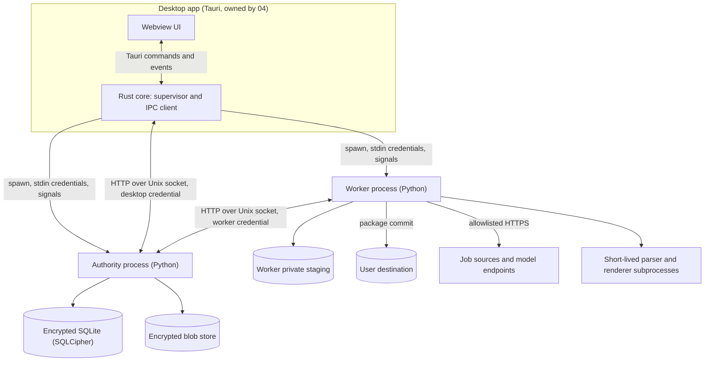
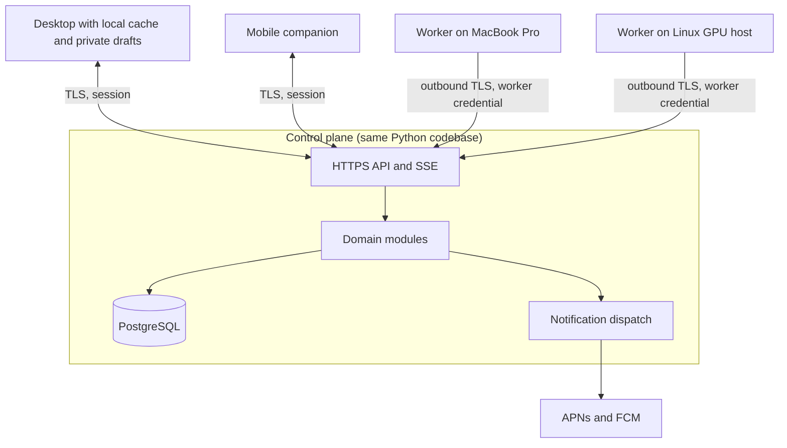
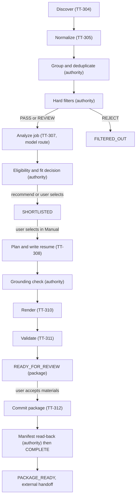
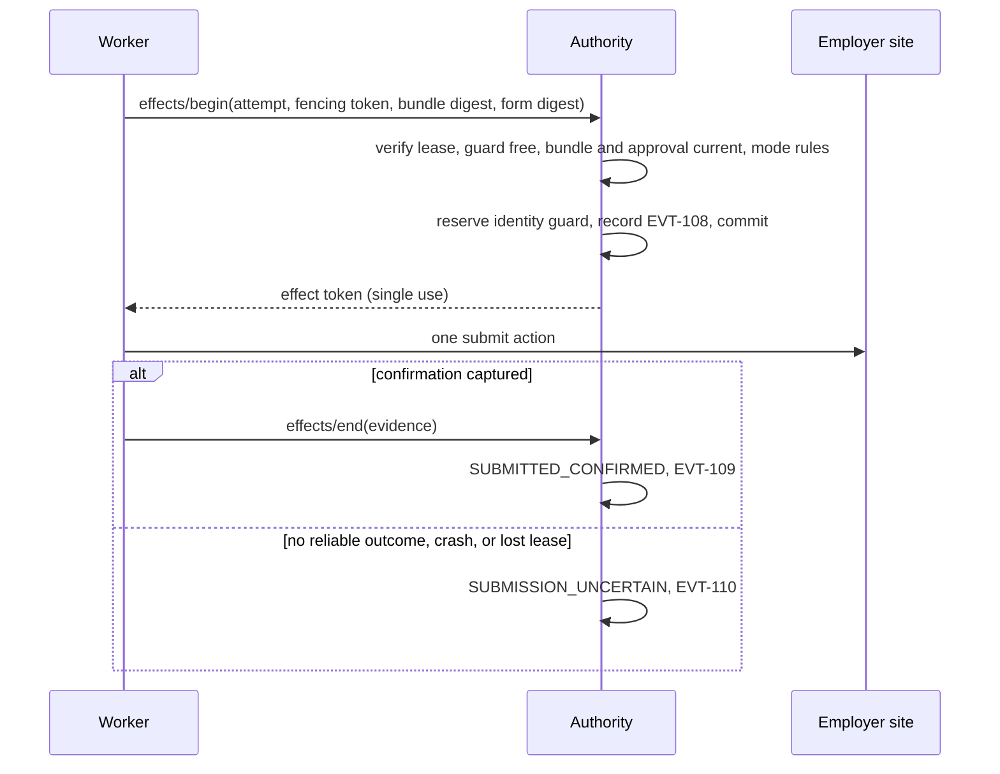
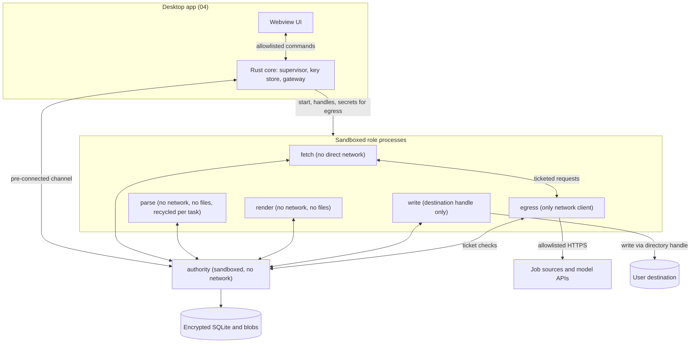
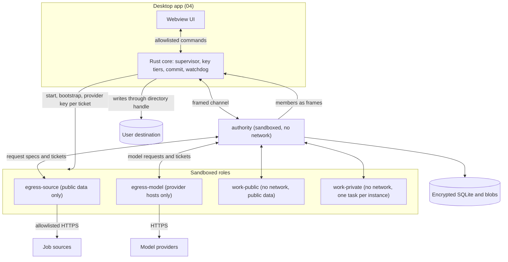

# 03_CONTROL_PLANE_AND_WORKER_RUNTIME_PLAN.md

## 1. Document Control and Status

| Item | Value |
| --- | --- |
| Document | Fourth of eight pre-production documents |
| Version and date | 1.3, 2026-09-30 (1.0 is the 0.2 text approved unchanged; 0.2 was 0.1 plus independent-review fixes: sections 5.2, 9.4, 9.7, 11.6, 14.2, 15.4, 15.6, 16.4, 18, 24, 27; 1.1 adds section 33; 1.2 adds section 34; 1.3 adds section 35) |
| Status | Version 1.0 approved by the product owner on 2026-09-29, including `RT-CF-301`, `ADR-301`, `ADR-311`, `ADR-312`, the provisional budget defaults, the eligibility and fit targets, `OQ-307`, and `RT-CF-308` to `RT-CF-310` (section 33.1). Version 1.1 changes (section 33) and version 1.2 changes (section 34, the independent audit fixes) approved by the product owner on 2026-09-29; version 1.3 changes (section 35) directed by the product owner on 2026-09-30, text awaiting the owner's review |
| Upstream baseline | `00_PRODUCT_AND_SYSTEM_PLAN.md` v1.3, `01_SHARED_CONTRACTS_AND_DOMAIN_MODEL.md` v1.3, `02_SECURITY_AND_THREAT_MODEL.md` v1.3, all approved 2026-09-29 (v1.0 of this document was written against their v1.1, approved 2026-09-28) |
| Other inputs | `Job_Automation_PLAN_Generator_Prompt.md` (`Generator`), `DEP_Prompt.md` (`DEP`), project instructions, dated research in section 31 |
| Owner | Runtime architecture; the product owner approves decisions marked for approval |
| Intended readers | Product owner, security reviewer, desktop and mobile plan authors (`04`, `05`), UX author (`06`), roadmap author (`07`), implementation agents |
| Downstream consumers | `04` (sidecar bundling, IPC client, key storage proof, filesystem proof), `05` (control-plane API, push dispatch), `06` (run, relay, source-health, and failure screens), `07` (phase gates) |

Change control follows the rule used by `00`, `01`, and `02`: identifiers are never renumbered or reused; a changed decision records old and new wording, affected sections and documents, migration consequences, and owner approval. Identifiers introduced here use the `3xx` range: `ADR-301`, `RT-CF-301`, `TT-301` (task types), `SRC-301` (source matrix rows), `FAIL-301`, `EXP-301`, `ASM-301`, `RISK-301`, `OQ-301`, `AC-301`, and `RES-301`. They do not replace upstream identifiers. This document specifies runtime behavior. It authorizes no application development, no infrastructure, and no real-world submission.

## 2. Executive Summary

This document defines how the product actually runs: which processes exist, who writes which database, how work is queued and leased, how runs start and stop, how sources are read, how model work is routed, how documents are rendered and committed, and how every failure is detected and recovered. It fills the decisions `00` section 39.1 assigned to `03`.

The principal decisions are these:

1. **Two local Python processes, one codebase.** The local authority and the worker are separate OS processes started from one packaged Python runtime with different entry points (`ADR-301`). The authority owns the encrypted database and every consequential transition. The worker holds no database key and no authority over state. It fetches, parses, calls models, and renders, and it reports proposals. The same authority code runs as the hosted or self-hosted control plane against PostgreSQL, so the state machines in `01` are implemented once.
2. **One protocol shape everywhere.** Clients and workers speak versioned HTTP with JSON bodies and Server-Sent Events. Locally this runs over a permission-restricted Unix domain socket with per-launch bearer credentials and peer-identity checks (`ADR-303`). Remotely it runs over verified TLS. Workers always connect outbound and pull work (`ARCH-08`).
3. **No broker.** The queue is a table in the authority's database. SQLite serializes writes locally; PostgreSQL uses `FOR UPDATE SKIP LOCKED` when hosted. Redis, Celery, and a workflow engine are rejected for the local-first product (`ADR-305`).
4. **Leases with fencing.** Every task lease carries a monotonically increasing fencing token. Reports and effect starts with a stale token are rejected. Local heartbeats every 2 seconds with a 10-second lease meet the 5-second stop target in `NFR-04` (`ADR-306`).
5. **Model access through the manual relay in the MVP.** Dated research on 2026-09-29 found that Anthropic does not permit third-party applications to route requests through Free, Pro, or Max plan credentials, and that OpenAI directs programmatic Codex use to API keys and prohibits programmatic extraction of Output in its Terms of Use. Route R1 therefore stays disabled (`RT-CF-301`, section 16.3). The MVP completes all model work through R2, the manual relay, designed to need about two paste exchanges per job. R3 (metered API key) is optional, and R4 (self-hosted model) is a later phase.
6. **Three MVP discovery adapters.** Himalayas (public aggregator API whose published terms permit feeding AI agents, with attribution), Greenhouse Job Board API, and Ashby public posting API (`ADR-311`). Every other named source has a registry entry, a researched status, and a remediation path in the coverage matrix (section 13).
7. **Documents.** Typst renders PDF and python-docx renders DOCX from the structured resume representation. Validation uses two independent PDF text extractors (pdfminer.six and pypdfium2), structural DOCX inspection, raster overflow checks, and a deterministic grounding check that rejects any number, date, technology, or proper noun not present in the cited claims (`ADR-314`, `ADR-315`).

The MVP runtime contains no browser automation, no scheduler daemon, no synchronization, and no submission code path. The later capabilities are designed here so that adding them does not change the MVP contracts.

## 3. Upstream Baseline, Inherited Decisions, and Conflict Register

### 3.1 Inherited decisions this document implements

| Upstream | Runtime consequence |
| --- | --- |
| `ARCH-01`, `ARCH-07`, `CON-105`, `CON-143`, `ADR-105` | One transactional authority per topology: SQLite locally, PostgreSQL when synchronized. Section 5, 8, 20. |
| `ARCH-02`, `ARCH-06`, `SEC-A-202`, `CTRL-202`, `CTRL-212` | The worker is a separate Python process with no authority. Section 5. |
| `ARCH-03` | The control plane is one modular monolith. Section 6. |
| `ARCH-08`, `CON-132` to `CON-134`, `SM-105` | Outbound worker channel, capability-matched tasks, leases. Sections 7, 9. |
| `ARCH-09`, `CON-118` to `CON-120`, `CON-149`, `CON-150` | Typed source adapters with attempt records. Sections 12 to 14. |
| `ARCH-11`, `CON-138`, `CON-139`, `CON-153`, `POL-14`, `POL-17`, `CTRL-227` | Four model routes, relay exchanges, R1 evidence rule. Section 16. |
| `ARCH-12`, `CON-124` to `CON-127`, `CON-148`, `ADR-106` | Structured resume representation, dual renderers, manifest commit. Sections 17, 18. |
| `CON-130`, `CON-131`, `SM-107`, `POL-12`, `CTRL-224` | Three modes, three strategies, budgets on every run. Section 11. |
| `CON-141`, `CTRL-219`, `CTRL-220`, `ADR-204` | Identity guard, effect guard, reconciliation. Section 19. |
| `CON-147`, `CTRL-222` | Audit commits with state, redacted operational logs. Sections 8, 23. |
| `00` section 30 and `POL-17` | R2 relay is the guaranteed MVP path; `03` owns dated R1 research. Section 16. |
| `00` section 39.1 | `03` owns: control-plane module boundaries, worker packaging, API protocol, database schema, queue and scheduler, source and application adapter interfaces, renderer and generator choices, ATS validation tools, hosted object storage, identity implementation (with `05`), model interfaces and catalog, subscription research, distributed coordination protocol, observability stack, runtime environments and configuration, self-hosted installation and update path, source coverage matrix, failure handling matrix. |

### 3.2 Conflict and gap register

| ID | Statements and affected documents | Practical consequence | Recommended resolution | Approval |
| --- | --- | --- | --- | --- |
| `RT-CF-301` | `00` section 30 lists R1 as "Preferred when permitted" and `CHG-012` records the owner's intent to use subscriptions; `01` `CON-138` adds the `SUBSCRIPTION_DEVELOPER_TOOL` kind. Research of 2026-09-29 (section 16.3) finds R1 not permitted for Claude plans and not supported for ChatGPT plans. Affects `00`, `01`, `02`, `06`, `07`. | The owner's subscriptions can serve the product only through R2. No R1 code is built in the MVP. | No contract changes: `CTRL-227` already keeps R1 off without evidence. Record the negative finding in `00` at its next revision. Recheck on the triggers in section 16.3. | Product owner acknowledgement requested; no reversal of an approved decision. |
| `RT-CF-302` | `00` section 17 requires "one transactional local service" but no upstream document says which process hosts the local authority. Affects `00`, `02`, `04`. | Without a decision, the desktop shell and the worker could both write the database, violating `CON-105`. | `ADR-301`: a dedicated Python authority process. `04` must launch and supervise it. | Decided here, subject to approval of this document. |
| `RT-CF-303` | `02` section 1 lists "approved `00` v1.0, approved `01` v1.0" in its Authority row while its Status row says both are v1.1. Affects `02`. | Metadata only. No control changes. | Correct at the next `02` revision. | None. |
| `RT-CF-304` | `DEP` section 40 proposes Redis with Celery or RQ, Next.js, and Apify or n8n orchestration. `00` section 14 already avoids Next.js server assumptions. Affects `03`, `07`. | A broker adds a second durable state store that cannot share the authority's transaction, breaking `CON-142` and adding an always-on dependency to a laptop MVP. | `ADR-305` rejects them. Apify and n8n are not used because third-party scraping actors do not establish source permission (`POL-15`). | Decided here; `DEP` is lower priority than approved documents. |
| `RT-CF-305` | `01` `SM-105` has no state for a task waiting on a user relay reply, while `CON-153` models the exchange. Affects `01`, `03`, `06`. | Without a rule, a relay wait would hold a worker lease indefinitely. | Use `PAUSED` with pause reason `AWAITING_RELAY_RESPONSE`, holding no lease (section 9.2). No new state is added. | Refinement within `01`; no approval needed. |
| `RT-CF-306` | `01` `CON-148` has the worker write the package into the destination, and `CON-127` requires the authority to verify availability. On macOS the ability of a helper process to use the desktop's destination grant depends on whether `04` enables the App Sandbox. Affects `01`, `04`. | If the sidecars cannot inherit the grant, the worker cannot write and the authority cannot read back. | `04` must prove sidecar access under its chosen signing and sandbox configuration (`OQ-301`). The contract is unchanged. | `04` decision. |
| `RT-CF-307` | `00` section 34 allows "two or three permitted representative discovery adapters" and `00` `AC-02` requires one posting observed through two fixtures. Greenhouse, Lever, and Ashby expose only per-employer boards, so they cannot discover employers on their own. | An ATS-only MVP would discover nothing without a hand-built employer list. | `ADR-311`: pair one aggregator (Himalayas) with two ATS board APIs, and derive employer boards from aggregator apply URLs (section 14.3). | Decided here, subject to approval. |

`RT-CF-308` to `RT-CF-310` are proposed additions to `01` that this runtime design needs; they are listed in section 29.2 because they add to, rather than conflict with, approved contracts.

## 4. Scope, Responsibilities, and Runtime Principles

In scope: the local authority, the hosted and self-hosted control plane, the worker, their protocols, persistence, task and run machinery, scheduling, source and application adapter frameworks, model routing, document pipeline, package commit, synchronization runtime, distributed workers, deployment, observability, failure handling, runtime configuration, and runtime tests. Out of scope: desktop UI, packaging, signing, and OS permission flows (`04`); mobile client (`05`); visual and interaction design (`06`); phase ordering (`07`).

| ID | Principle | Consequence |
| --- | --- | --- |
| `RT-P1` | The authority decides; the worker proposes. | No worker code path can commit a state transition. Worker reports are inputs to authority validation. |
| `RT-P2` | Deterministic first. | Parsing, filtering, deduplication, scheduling, budgets, validation, and policy are ordinary code. Models are called only for semantic interpretation and drafting (`DEP` sections 5 and 46). |
| `RT-P3` | Every effect is bounded. | Each task declares an effect class, a budget reservation, a timeout, and a retry rule before it can be leased. |
| `RT-P4` | Uncertainty is a state, not a guess. | Timeouts during effects produce `EFFECT_UNCERTAIN` or `SUBMISSION_UNCERTAIN`, never an assumed failure. |
| `RT-P5` | Local-first means complete offline of any vendor. | The MVP requires no account, no hosted service, and no API key. |
| `RT-P6` | Same code, different topology. | Local and hosted authorities share domain modules; only the storage adapter, transport, and identity module differ. |
| `RT-P7` | Honest coverage. | A source that is not permitted or not supported is shown with its reason, never silently skipped. |

## 5. Runtime Topology and Process Model

### 5.1 Local-only MVP process model



| Process | Starts | Holds | Never holds | Network |
| --- | --- | --- | --- | --- |
| Desktop Rust core (`04`) | User launch | Desktop credential, UI state, OS permission grants it passes by handle | Database file access; the database key and backup key beyond the one-time launch handoff to the authority (section 26.3) | None of its own for product data |
| Authority | Spawned by desktop core | Database DEK and backup key (received from the desktop core over stdin at start and kept only in memory), SQLCipher connection, blob keys, audit stream | Source or model network access; untrusted HTML parsing | None in local mode |
| Worker | Spawned by desktop core | Worker credential, task inputs for leased tasks, short-lived secret handles | Database key, database file, any other task's inputs | Allowlisted egress only (`CTRL-217`, `CTRL-226`) |
| Parser and renderer subprocesses | Spawned by worker per task | The input bytes of one item | Credentials of any kind; network | None by construction: they receive bytes and return bytes |

**`ADR-301` Local authority placement.** Context: `00` section 17 requires one transactional local service; `02` `THR-202` requires that a compromised worker cannot verify claims or accept approvals. Alternatives: (a) authority inside the Tauri Rust core, (b) authority and worker in one Python process, (c) separate Python authority process. Decision: (c). Reasons: (a) duplicates every `01` state machine in Rust and Python because the hosted control plane is Python (`ARCH-03`, `00` section 14), inviting divergence between local and synchronized behavior; (b) removes the only process boundary between untrusted content handling and authoritative state. Consequence: two Python processes at roughly tens of megabytes each, and a supervisor role in the desktop core. Invalidation test: if `EXP-301` shows the two-process cold start exceeds 4 seconds or resident memory exceeds 400 MB idle on the reference MacBook Pro, revisit packaging (not the boundary). Owner: `03`, with `04` for supervision.

The authority and the worker run under the same OS user. `SEC-A-202` applies: this separation limits accidental and content-driven compromise, not same-user malware.

### 5.2 Process lifecycle and supervision

1. The desktop core generates two independent 256-bit random credentials, the desktop credential and the worker credential, and creates the runtime directory `<app-support>/run/` with mode `0700`.
2. It spawns the authority with `--role authority`, writing on the child's stdin a single JSON line containing the desktop credential, the SHA-256 digest of the worker credential, the socket path, and the database key and backup key that the desktop core read from the Keychain (`ADR-201`, section 26.3). Credentials are never placed in arguments or environment variables, which other same-user processes can read.
3. The authority takes the database key from its stdin line, opens the database, runs pending migrations only after a verified pre-migration backup (section 8.6), binds the socket with mode `0600`, and prints a single readiness line with its authority ID and contract versions.
4. The desktop core spawns the worker with `--role worker` and the worker credential on stdin. The worker registers its capability declaration (`CON-132`) and begins polling.
5. On normal quit, the desktop sends `ChangeRunState` graceful stop for active runs, waits up to 10 seconds for tasks to reach a safe point, then signals the worker with `SIGTERM`, then the authority. The authority checkpoints the WAL and closes.
6. If the worker exits unexpectedly, its leases expire on schedule (section 9.4) and the desktop restarts it with exponential backoff (1, 2, 4, up to 60 seconds). Five crashes within 10 minutes stop automatic restarts and raise `FAIL-302`.
7. If the authority exits unexpectedly, the desktop stops the worker (the worker cannot make progress without it), shows the failure, and restarts the authority once. SQLite recovery runs automatically from the WAL.

Headless operation without the desktop (later scheduled and continuous runs, section 11.6) introduces a `--role supervisor` entry point that performs steps 1 to 7 itself. The desktop then attaches to a running supervisor rather than spawning processes. Attachment credentials are delivered through a Keychain item whose access is restricted to the app's signing identity (`EXP-305`).

### 5.3 Synchronized topologies (later)



After enrollment (`CON-143`), the control plane is the authority for elected shared state. The local authority process continues to exist on each desktop as the authority for unsynced private records and as a cache, and it forwards shared commands to the control plane rather than committing them (section 20). The fully self-hosted control plane is the same artifact operated by the user (section 22).

## 6. Component Architecture and Module Boundaries

### 6.1 Authority modules

The authority is one Python package with modules that communicate by in-process function calls inside a single database transaction. Module boundaries are enforced by an import-linter rule set in CI so that, for example, the source module cannot import the approval module.

| Module | Owns | Commands and queries (from `01` section 19) | Depends on |
| --- | --- | --- | --- |
| `identity` | Local installation principals; later accounts, sessions, devices, passkeys | `RevokeDevice` (`CMD-112`) | `audit` |
| `candidate` | Evidence, claims, readiness, answer library | `ConfirmClaim`, `WithdrawClaim`, `GetReadiness` | `audit`, `policy` |
| `preferences` | Role targets, geography, job types, destinations, policy revisions | `SetPreferences` | `audit` |
| `sources` | Registry, attempt records, employer records and ATS tenants | Source enable and disable, `GetJobWithObservations` | `audit`, `tasks` |
| `jobs` | Observations, canonical jobs, grouping, `SM-106` | `MergeJobs`, `SplitJob`, `SetJobWorkflowState` | `sources`, `audit` |
| `decisions` | Hard filters, eligibility assessments, fit analyses, decision records | `GetDecisionExplanation` | `candidate`, `preferences`, `jobs` |
| `documents` | Resume strategies, structured content, render and validation records, grounding checks | Validation acceptance | `candidate`, `decisions` |
| `packages` | `SM-102`, exports, manifest verification | `CommitPackage`, `GetPackageManifest` | `documents`, `preferences` |
| `applications` | `SM-104`, identity guards, attempts, outcomes, reconciliation | `RecordExternalOutcome`, `ReconcileSubmission`, `ResolveManualAction`, `ArchiveApplication`; later `AuthorizeSubmission` | `packages`, `approvals` |
| `approvals` | Review bundles, `SM-103` | `DecideReview`, `GetReviewBundle` | `applications`, `identity` |
| `runs` | Runs, schedules, budgets, `SM-107` | `CreateRun`, `ChangeRunState`, `GetRunStatus` | `tasks`, `preferences` |
| `tasks` | Task queue, leases, fencing, worker registry, `SM-105` | Worker protocol (section 7.3) | `audit` |
| `models` | Provider records, routing policy, relay exchanges, usage records, disclosure ledger | Relay export and accept | `candidate`, `audit` |
| `workflow` | The per-job pipeline that creates tasks as prior steps are accepted (section 10) | None directly; reacts to accepted events | Most modules |
| `sync` (later) | Enrollment, replication streams, tombstones | `EnrollLocalProfile`, `GetSyncStatus` | All shared modules |
| `notify` (later) | Notification records and dispatch | None | `approvals`, `identity` |
| `audit` | Audit stream, hash chain, outbox for event delivery | Event stream queries | Storage only |

### 6.2 Worker modules

| Module | Responsibility |
| --- | --- |
| `agent` | Registration, capability declaration, polling, heartbeats, cancellation, reporting |
| `fetch` | The only HTTP client for untrusted destinations: DNS pinning, private-address rejection, redirect revalidation, size and time limits, per-source rate limiting (`CTRL-217`) |
| `adapters.sources` | One adapter per source strategy (section 12) |
| `ingest` | Candidate file parsing in subprocesses (`CTRL-214`) |
| `normalize` | Posting field extraction, location and job-type parsing, match keys |
| `models` | Route clients for R3 and R4, prompt assembly, schema-constrained calls, local schema validation before reporting |
| `render` | Typst PDF and python-docx DOCX renderers in subprocesses |
| `validate` | Text extraction, comparison, raster overflow, font and link checks |
| `package` | `CON-148` staging and commit writer |
| `browser` (later) | Playwright runtime, per-site contexts, application adapters |
| `inventory` (later) | Hardware and runtime inventory for distributed scheduling and the model setup wizard |

### 6.3 What runs where

| Computation | Executor | Reason |
| --- | --- | --- |
| Hard filters on structured posting fields | Authority | Deterministic, small, and consequential. A compromised worker must not be able to pass its own filters. |
| Parsing untrusted HTML, PDF, DOCX | Worker subprocess | Untrusted input stays outside the authority (`CTRL-214`). |
| Model calls (R3, R4) | Worker | Network egress and provider secrets stay in the worker. |
| Model output validation | Worker first, then authority | The authority's validation is authoritative (`CTRL-216`); the worker check only saves a round trip. |
| Relay reply validation (R2) | Authority | The reply arrives from the desktop UI, not a worker. |
| Claim grounding and new-fact detection | Authority | It needs the claim ledger. |
| Rendering and extraction validation | Worker | Heavy libraries and generated files. The authority accepts the worker's validation report as evidence and verifies hashes (residual risk in `RISK-302`). |
| Package manifest verification | Authority | It must read back committed bytes before `COMPLETE` (`CON-127`). |
| Scheduling, budgets, leases | Authority | Global and consequential. |

## 7. Interfaces and Protocols

### 7.1 Protocol decision

**`ADR-303` API protocol.** Context: `00` section 39.1 leaves the protocol open; clients include a Tauri core, a Flutter mobile app, and Python workers; the transport must work over a local socket and over the internet through NAT. Alternatives: gRPC, GraphQL, WebSocket-only RPC, HTTP with JSON. Decision: HTTP/1.1 with JSON bodies, an OpenAPI 3.1 description generated from the same Pydantic models that produce the `01` JSON Schemas, and Server-Sent Events (SSE) for server-to-client streams. Reasons: every client platform has mature HTTP support; SSE passes through ordinary proxies; JSON Schema validation is shared with model output validation; gRPC adds code generation and HTTP/2 requirements for no benefit at single-user scale. Consequence: no bidirectional streaming; workers poll with long requests. Invalidation test: if `EXP-302` shows long-poll latency or connection churn fails the remote stop target, add a WebSocket channel for worker directives only.

Implementation choices: FastAPI on Uvicorn for the authority and control plane, httpx for clients in Python, and the Rust `hyper` client with Unix socket support in the desktop core (`04` confirms). All endpoints are under `/v1/`. Each request carries `X-Contract-Version`; the authority rejects unsupported major versions with `ERR-111`.

### 7.2 Client API surface

| Area | Endpoints (illustrative paths) | Contract |
| --- | --- | --- |
| Commands | `POST /v1/commands/{command_type}` | `CON-140` envelope; idempotency key required; response is the accepted result or a typed error |
| Queries | `GET /v1/readiness`, `/v1/jobs`, `/v1/jobs/{id}`, `/v1/decisions/{id}`, `/v1/packages/{id}/manifest`, `/v1/bundles/{id}`, `/v1/applications/{id}/timeline`, `/v1/runs/{id}`, `/v1/sources`, `/v1/sync/status` | Responses carry `authority_revision`, `generated_at`, and `stale` where applicable |
| Event stream | `GET /v1/events?after={stream_seq}` (SSE) | Accepted events from the outbox with monotonic `stream_seq`; clients detect gaps and refetch snapshots (`CON-142`, `AC-114`) |
| Relay | `POST /v1/relay/exchanges` (export), `POST /v1/relay/exchanges/{id}/reply`, `POST /v1/relay/exchanges/{id}/abandon` | `CON-153` |
| Health | `GET /v1/health/live`, `/v1/health/ready` | No personal data |

Pagination uses opaque cursors. List queries over jobs support filtering by workflow state, eligibility outcome, fit band, source, and freshness so the desktop can meet `NFR-03` from indexed columns without loading bodies.

### 7.3 Worker protocol

| Call | Purpose | Key fields | Authority behavior |
| --- | --- | --- | --- |
| `POST /v1/worker/register` | Declare capabilities | `CON-132` declaration, worker and runtime versions | Validates and stores; answers with minimum versions and timing parameters |
| `POST /v1/worker/claim` | Long-poll for one task (up to 25 s) | Worker ID, free slots, capability digest | Returns one leased task with `lease_id`, `fencing_token`, `lease_ttl_ms`, task inputs, allowed effects, budget reservation, secret handles; or `204` on timeout |
| `POST /v1/worker/heartbeat` | Renew leases, report progress | Lease IDs with fencing tokens, progress, resource use | Extends valid leases; returns per-lease directive `CONTINUE`, `PAUSE_AT_SAFE_POINT`, `CANCEL`, or `REVOKED` |
| `POST /v1/worker/report` | Submit result or failure | Lease ID, fencing token, output digests, output payload or blob references, failure class | Rejects stale fencing tokens (`ERR-101`); validates; commits transitions and audit together |
| `POST /v1/worker/blobs` | Upload task output bytes (documents, extracted text) | Lease ID, fencing token, digest, size, privacy class | Stores encrypted; verifies digest |
| `POST /v1/worker/secrets/redeem` | Exchange a single-use secret handle for a secret value | Handle, lease ID, fencing token | Returns the value once if the lease and token are current and the handle is under 60 s old (section 26.3) |
| `POST /v1/worker/effects/begin` (later) | Cross the external-effect boundary | Attempt ID, fencing token, bundle digest, target digest | Atomic guard reservation and `EVT-108` (section 19.4); refuses if lease or guard fails |
| `POST /v1/worker/effects/end` (later) | Report effect outcome | Attempt ID, evidence | `EVT-109`, `EVT-110`, or known-not-submitted transition |

Workers never receive database identifiers of records they do not need, never receive other tasks' inputs, and never call the client command endpoints (the worker credential is rejected there).

### 7.4 Local transport security (`CTRL-202`)

- **Socket.** macOS and Linux use a Unix domain socket at `<app-support>/run/authority.sock` inside a `0700` directory; the socket file is `0600`. Windows transport is decided in the Windows compatibility phase (`OQ-302`): AF_UNIX sockets are available on current Windows 10 and 11 builds, but Uvicorn and asyncio support there must be proven; the fallback is loopback TCP bound to `127.0.0.1` with the same bearer credentials plus peer process verification.
- **Peer identity.** On each accepted connection the authority reads the peer's effective UID (`getpeereid` on macOS, `SO_PEERCRED` on Linux) and rejects any UID other than its own. On macOS it also reads the peer PID (`LOCAL_PEERPID`) and records it for audit; the PID is not trusted as an authorization factor on its own because PIDs can be reused.
- **Credentials.** Requests carry `Authorization: Bearer <credential>`. The authority compares SHA-256 digests in constant time. The desktop credential maps to the local user principal; the worker credential maps to the worker principal with access only to `/v1/worker/*`.
- **User presence.** The desktop core reports the app's lock state. While locked, the authority rejects consequential user commands (`CMD-101`, `CMD-102`, `CMD-105`, `CMD-107`, `CMD-110`, exports) with `ERR-116 SESSION_LOCKED`, a new error proposed to `01` as `RT-CF-308`; until it is approved, the authority returns `ERR-102` with blocker `SESSION_LOCKED`. Background worker tasks already authorized by a run continue only if the user enabled background preparation (`CTRL-202`).
- **No listening TCP port in the MVP.** A startup self-check fails the authority if any product process has a listening TCP socket on the reference platform.

### 7.5 Remote transport (later)

Clients and workers connect to the control plane over TLS 1.2 or newer with hostname verification and no insecure-certificate override (`CTRL-226`). Mutating requests carry the `CON-140` idempotency key and a request nonce; the server rejects nonces seen within 24 hours. Worker credentials are asymmetric: the worker holds a private key in its OS key store and proves possession by signing a server challenge at registration and a timestamped request digest on each call (`CTRL-205`). Human sessions follow `CTRL-225`.

## 8. Persistence, Storage, Migration, and Backup

### 8.1 Storage decisions

**`ADR-302` Local database.** Decision: SQLite 3 through SQLCipher 4 (full-file AES encryption including indexes and the WAL), accessed with the `sqlcipher3` DB-API module, which mirrors Python's `sqlite3` interface and publishes wheels for macOS, Windows, and Linux [RES-311]. Alternatives: plain SQLite with per-field encryption (leaks job titles, employer names, and index contents; more code paths to get wrong), an embedded server database (heavier, no benefit for one writer). Consequence: a native dependency whose wheels must be verified for the pinned Python version on macOS arm64 (`EXP-302`). The database key is the `ADR-201` DEK.

**`ADR-304` Hosted database.** PostgreSQL (16 or newer, pinned at Phase 0) with the same logical schema. SQLAlchemy 2 Core provides one query layer over both dialects; Alembic manages migrations for both. The ORM layer is not used for consequential writes so that every write is an explicit, reviewable statement.

**Settings applied to SQLite:** `journal_mode=WAL`; `synchronous=FULL`, because in WAL mode `NORMAL` can lose the most recent commits on power loss and every consequential commit carries an audit event (`NFR-02`); `foreign_keys=ON`; `busy_timeout=5000`. One writer connection in the authority, used from a single serialized command executor; a small pool of read connections for queries.

### 8.2 Physical schema pattern

Every entity table uses an envelope: typed columns needed for identity, constraints, filtering, and joins, plus `body` holding the full `01` contract payload as JSON text (SQLite) or `jsonb` (PostgreSQL), plus `schema_version`. The contract JSON Schema validates `body` on write. Immutable revisions are separate rows; a `*_current` pointer or view selects the accepted revision.

| Table | Key typed columns | Constraints and indexes | Contract |
| --- | --- | --- | --- |
| `authority_meta` | `authority_id`, `schema_version`, `created_at` | Single row | `01` 7.2 |
| `profiles` | `profile_id`, `revision` | PK (`profile_id`, `revision`) | `prf_` |
| `evidence` | `evidence_id`, `profile_id`, `blob_id`, `sensitivity` | Index `profile_id` | `CON-111` |
| `claims` | `claim_id`, `revision`, `profile_id`, `status`, `category`, `sensitivity` | PK (`claim_id`, `revision`); `claims_current` pointer | `CON-112` |
| `readiness_results` | `profile_id`, `evaluated_at`, `status`, `policy_version` | Latest per profile | `CON-113`, `CON-114` |
| `answers` | `answer_id`, `revision`, `profile_id`, `status`, `sensitivity`, `question_key` | Index (`profile_id`, `question_key`) | `CON-128`, `PRD-17` |
| `policies` | `policy_id`, `revision`, `kind` | PK (`policy_id`, `revision`) | `CON-116` |
| `sources` | `source_id`, `state`, `adapter_version` | Unique `source_key` | `CON-118` |
| `source_attempts` | `attempt_id`, `source_id`, `run_id`, `outcome`, `started_at`, `ended_at` | Index (`source_id`, `started_at`) | `CON-150` |
| `employers` | `employer_id`, `revision` | | `CON-149` |
| `employer_domains` | `employer_id`, `domain`, `verified` | Unique (`domain`, `employer_id`) | `CON-149` |
| `ats_tenants` | `employer_id`, `ats_kind`, `tenant_key`, `verified`, `watch_state` | Unique (`ats_kind`, `tenant_key`) | `CON-149` |
| `observations` | `observation_id`, `revision`, `source_id`, `source_posting_id`, `content_digest`, `fetched_at`, `ats_kind`, `ats_job_key` | Index (`source_id`, `source_posting_id`); index (`ats_kind`, `ats_job_key`) | `CON-119` |
| `jobs` | `job_id`, `grouping_revision`, `workflow_state`, `employer_id`, `first_seen_at`, `last_seen_at` | Indexes for the jobs list filters | `CON-120`, `SM-106` |
| `job_observations` | `job_id`, `observation_id`, `grouping_revision` | Unique (`observation_id`, `grouping_revision`) | `CON-120` |
| `decisions` | `decision_id`, `job_id`, `profile_id`, `status`, `eligibility_outcome`, `fit_score` | Index (`job_id`, `status`) | `CON-121` to `CON-123` |
| `documents` | `document_id`, `revision`, `job_id`, `kind` | PK (`document_id`, `revision`) | `CON-124` to `CON-126` |
| `packages` | `package_id`, `revision`, `job_id`, `state`, `manifest_digest`, `version_dir` | Unique (`job_id`, `version_dir`, `destination_id`) | `CON-127`, `CON-148` |
| `package_exports` | `export_id`, `package_id`, `destination_id`, `outcome` | | `CON-127` |
| `identity_guards` | `guard_id`, `profile_id`, `requisition_key`, `state` | Unique (`profile_id`, `requisition_key`) where `state` is active; `guard_aliases` unique `alias_key` | `CON-141` |
| `applications`, `attempts` | `application_id`, `state`, `guard_id`; `attempt_id`, `state`, `fencing_token` | Index by state | `CON-129`, `SM-104` |
| `bundles`, `approvals` | `bundle_id`, `revision`, `digest`; `approval_id`, `state`, `nonce` | Unique `nonce`; one `PENDING` per bundle revision | `CON-135`, `CON-136` |
| `runs`, `schedules` | `run_id`, `state`, `strategy`, `mode`, `policy_revision`; `schedule_id`, `next_fire_at` | Index `next_fire_at` | `CON-131`, `SM-107` |
| `tasks` | `task_id`, `run_id`, `task_type`, `state`, `capability_class`, `not_before`, `lease_id`, `lease_worker_id`, `lease_expires_at`, `fencing_token`, `attempt_count`, `idempotency_key`, `input_digest`, `pause_reason` | Unique `idempotency_key`; index (`state`, `capability_class`, `not_before`) | `CON-133`, `SM-105` |
| `budget_ledger` | `ledger_id`, `scope_kind`, `scope_key`, `unit`, `limit_value`, `reserved`, `consumed` | Unique (`scope_kind`, `scope_key`, `unit`) | `CON-131`, `CTRL-224` |
| `workers`, `devices` | `worker_id`, `registration_state`, `last_heartbeat_at`; `device_id`, `state` | | `CON-132` |
| `providers`, `model_calls`, `relay_exchanges` | `provider_id`, `kind`, `enabled_by_policy`; `call_id`, `task_type`; `exchange_id`, `state`, `input_digest`; `relay_exchange_items(exchange_id, task_id, item_digest)` | Index `relay_exchanges(state)` on the exchange and one row per included task on the item table | `CON-138`, `CON-139`, `CON-153` |
| `disclosures` | `disclosure_id`, `recipient_kind`, `recipient`, `privacy_class`, `content_digest`, `at` | Append-only | `PRIV-203` |
| `secret_refs` | `secret_id`, `owner`, `kind`, `status` | Never contains values | `CON-151` |
| `idempotency_results` | `realm`, `actor`, `command_type`, `idempotency_key`, `payload_digest`, `result` | Unique (`realm`, `actor`, `command_type`, `idempotency_key`) | `ADR-103` |
| `audit_events` | `audit_id`, `stream_id`, `stream_seq`, `entity_id`, `event_type`, `prev_hash`, `hash` | Unique (`stream_id`, `stream_seq`) | `CON-147` |
| `outbox` | `stream_seq`, `event_id`, `delivered_to` | | Event delivery |
| `blobs` | `blob_id`, `digest`, `size`, `key_id`, `privacy_class`, `retention_class`, `expires_at` | Unique `digest` per key | `CTRL-211` |
| `tombstones`, `sync_cursors` (later) | | | `CON-145` |

The full column list for each table is generated from the `01` contracts at Phase 0; this table fixes the typed columns, keys, and uniqueness rules that enforce invariants in the database rather than only in code.

### 8.3 Transaction pattern

Every command handler runs: authenticate, load current revisions, validate payload and policy, compute the transition, then in one transaction write the new revision rows, the audit event, the outbox row, and the idempotency result (`CON-142`). SQLite transactions start with `BEGIN IMMEDIATE` so the write lock is taken before reads that decide the transition. PostgreSQL uses row locks (`SELECT ... FOR UPDATE`) on the entities being transitioned plus the expected-revision predicate on update; a zero-row update is `ERR-101`. Uniqueness invariants (identity guard, approval nonce, idempotency key) are database constraints so that a code defect cannot violate them silently.

### 8.4 Audit hash chain

Each audit row stores `hash = SHA-256(prev_hash || canonical_json(event))` per stream. A verifier walks the chain on startup (bounded to the last 10,000 events, full walk weekly) and on export. A break raises `FAIL-317`, freezes consequential commands, and is reported to the user. This detects accidental corruption and naive tampering; it does not stop an attacker with full write access who rewrites the chain (`02` `CTRL-222`).

### 8.5 Blob store

App-managed bytes (evidence originals, extracted text, rendered documents before export, relay packages) live in `<app-support>/blobs/` as content-addressed files, each encrypted with AES-256-GCM under a per-blob key wrapped by the DEK, with the blob ID as associated data. The `blobs` table records retention class and expiry so that the `PRIV-204` periods are enforced by a daily purge task. Exported package files in a user destination are plaintext by design and are outside this store (`CTRL-211`).

**Hosted object storage decision (later).** Document bytes do not leave the originating worker by default (`CON-143`). The control plane stores only digests and availability descriptors. If the user later enables explicit document sync, bytes are stored in an S3-compatible object store encrypted per object with a per-realm key; for self-hosting, any S3-compatible service the operator chooses. Until that consent exists, no object store is deployed.

### 8.6 Migrations and rollback

1. Every release declares its schema version. Migrations are Alembic revisions tested against both dialects in CI.
2. Before migrating, the authority writes a verified backup (section 8.7) and records its identifier.
3. Migrations run in a transaction where the dialect allows. SQLite migrations that rebuild tables use Alembic batch mode inside one transaction.
4. After migration, the authority verifies row counts for migrated tables and the audit chain head.
5. Downgrade is by restore, not by down-migration: if migration or verification fails, the authority restores the pre-migration backup, refuses to start the new version, and reports `FAIL-321`. Down-migrations are not written because they are rarely tested and can lose data added after the upgrade.
6. The authority refuses to open a database whose schema version is newer than it supports (`ERR-111` class), which protects against an unsafe downgrade (`CTRL-223`).

### 8.7 Backups

Local backups use the SQLite online backup API through `sqlcipher3` into a new SQLCipher file keyed by a separate backup key, plus a copy of the encrypted blob store, written to `<app-support>/backups/` and optionally to a user-selected folder. Default schedule: daily when the app runs, before every migration, and before bulk deletion. Retention: rolling 30 days (`PRIV-204`). A weekly restore test opens the latest backup in a scratch location, verifies the audit chain and row counts, and deletes the scratch copy. The backup key is stored in the Keychain and is also exportable once as recovery material during setup (`CTRL-209`); losing both the live key and the recovery material makes backups unrecoverable, and setup says so.

Hosted backups use PostgreSQL base backups with WAL archiving or daily logical dumps, encrypted, retained 35 days, with a monthly restore drill; `NFR-02`'s 24-hour restore objective must be demonstrated before hosted release.

## 9. Task Model, Queue, Leases, Heartbeats, and Fencing

### 9.1 Task catalog

Each task type declares its capability class, effect class, default timeout, retry policy, and budget units. Effect classes: `PURE` (computation on given inputs), `NETWORK_READ` (fetches from an allowlisted source), `MODEL_DISCLOSURE` (sends data to a model provider), `LOCAL_WRITE` (writes to a user destination), `EXTERNAL_EFFECT` (changes state on a third-party site; later only).

| ID | Task type | Capability class | Effect class | Timeout | Retry | Budget units | Release |
| --- | --- | --- | --- | --- | --- | --- | --- |
| `TT-301` | `INGEST_EVIDENCE_FILE` | `parse` | `PURE` | 120 s | Up to 2, then quarantine | none | MVP |
| `TT-302` | `FETCH_PORTFOLIO_PAGE` | `fetch` | `NETWORK_READ` | 60 s | Backoff, 3 | source requests | MVP |
| `TT-303` | `PROPOSE_CLAIMS` | `model` | `MODEL_DISCLOSURE` | Route-dependent | Section 16.6 | model calls or relay exchanges | MVP |
| `TT-304` | `DISCOVER_SOURCE` | `fetch` | `NETWORK_READ` | 10 min per attempt | Per adapter and `Retry-After` | source requests | MVP |
| `TT-305` | `NORMALIZE_OBSERVATIONS` | `parse` | `PURE` | 120 s | 2 | none | MVP |
| `TT-306` | `CHECK_POSTING_LIVE` | `fetch` | `NETWORK_READ` | 60 s | Backoff, 3 | source requests | MVP |
| `TT-307` | `ANALYZE_JOB` (semantic eligibility support and fit support) | `model` | `MODEL_DISCLOSURE` | Route-dependent | Section 16.6 | model calls or relay exchanges | MVP |
| `TT-308` | `PLAN_AND_WRITE_RESUME` | `model` | `MODEL_DISCLOSURE` | Route-dependent | Section 16.6 | model calls or relay exchanges | MVP |
| `TT-309` | `WRITE_COVER_LETTER` | `model` | `MODEL_DISCLOSURE` | Route-dependent | Section 16.6 | model calls or relay exchanges | MVP when requested |
| `TT-310` | `RENDER_DOCUMENTS` | `render` | `PURE` | 120 s | 2 | storage | MVP |
| `TT-311` | `VALIDATE_DOCUMENTS` | `render` | `PURE` | 180 s | 1 | none | MVP |
| `TT-312` | `COMMIT_PACKAGE` | `package` | `LOCAL_WRITE` | 120 s | Resume from partial state, 3 | storage | MVP |
| `TT-313` | `PURGE_EXPIRED` | `maintenance` | `PURE` | 10 min | Daily | none | MVP |
| `TT-314` | `BACKUP_VERIFY` | Authority-internal | `PURE` | 30 min | Next cycle | none | MVP |
| `TT-315` | `HARDWARE_INVENTORY` | `inventory` | `PURE` | 60 s | 1 | none | Later |
| `TT-316` | `MODEL_BENCHMARK` | `model_local` | `PURE` | 2 h | 1 | compute | Later |
| `TT-317` | `OPEN_APPLICATION` (read the form, no fill) | `browser` | `NETWORK_READ` | 5 min | 2 | form reads | Later |
| `TT-318` | `FILL_APPLICATION` | `browser` | `NETWORK_READ` (no submit) | 15 min | Never automatic after a partial fill | form fills | Later |
| `TT-319` | `SUBMIT_APPLICATION` | `browser` | `EXTERNAL_EFFECT` | 5 min | Never | submissions | Later |
| `TT-320` | `CAPTURE_CONFIRMATION` | `browser` | `NETWORK_READ` | 5 min | 2 | form reads | Later |

`TT-318` is classified `NETWORK_READ` because filling fields in a page without submitting it does not transmit the application, but it can still trigger site-side autosave. Adapters that detect autosave of drafts record it as an employer-side draft in the attempt, not as a submission (`OQ-303`).

### 9.2 Task states and the relay pause

Tasks follow `SM-105`. Additional runtime rules:

- `QUEUED` tasks have `not_before`; retries set it by backoff.
- A task leaves `LEASED` for `RUNNING` on the first heartbeat that reports progress.
- A model task routed to R2 moves to `PAUSED` with `pause_reason = AWAITING_RELAY_RESPONSE` when its relay exchange is exported. It releases its lease. When the authority accepts the reply (section 16.4), the task moves to `SUCCEEDED` with the accepted output and the workflow advances. If the exchange is abandoned or goes stale, the task moves to `CANCELLED` and the workflow shows the job step as needing model input again (`RT-CF-305`).
- Other pause reasons: `RUN_PAUSED`, `BUDGET_EXHAUSTED`, `READINESS_LOST`, `SOURCE_CIRCUIT_OPEN`, `SECRET_LOCKED`, `DESTINATION_UNAVAILABLE`, `WORKER_UNAVAILABLE`, `MODEL_ROUTE_UNAVAILABLE`.

### 9.3 Claim algorithm

```text
claim(worker, free_slots, capability_digest):
  if worker not registered, or revoked, or version below minimum: reject
  candidate classes = classes the worker declared and the authority validated
  in one write transaction:
    select the oldest QUEUED task with state = QUEUED, not_before <= now,
      capability_class in candidate classes, run in RUNNING,
      and required capability versions satisfied (checked in code on the row)
    reserve the task's budget units (section 11.3); if reservation fails,
      mark the task PAUSED(BUDGET_EXHAUSTED) and move the run toward PAUSING
    set state = LEASED, lease_id = new, lease_worker_id = worker,
      fencing_token = fencing_token + 1, lease_expires_at = now + ttl
    append audit event and outbox row
  return task inputs, lease, fencing token, allowed effects, secret handles
```

Locally the authority is the only writer, so the transaction serializes claims. When hosted, the selection uses `FOR UPDATE SKIP LOCKED` so that concurrent claimers do not block each other. Ordering within a run follows the workflow priority (section 10.3); across runs, older runs first.

### 9.4 Lease timing and fencing

**`ADR-306` Lease parameters.**

| Parameter | Local | Remote (later) | Reason |
| --- | --- | --- | --- |
| Heartbeat interval | 2 s | 10 s | Local stop target of 5 s (`NFR-04`, `AC-07`) |
| Lease TTL | 10 s | 45 s | Tolerates four missed local heartbeats or four remote ones |
| Claim long-poll | 25 s | 25 s | Under common proxy idle timeouts |
| Clock | Authority monotonic clock only | Authority clock only | Workers send durations, never absolute expiry times, so skew cannot extend a lease |

The fencing token increases every time a task is leased. The authority rejects any heartbeat, report, blob upload, secret redemption, or effect start whose token is not the current one for that task, or whose lease has passed `lease_expires_at`, checked in the same transaction as the operation. A call on an expired but not yet swept lease returns `REVOKED` (`ERR-101`), so the outcome does not depend on whether the sweep or the worker's call runs first. This prevents a paused or partitioned worker from overwriting results after its lease was reassigned. Expired leases are reclaimed by an authority sweep every second locally: a `PURE` or `NETWORK_READ` task returns to `QUEUED` with incremented attempt count; a `LOCAL_WRITE` task returns to `QUEUED` and resumes from its partial state (section 18.3); an `EXTERNAL_EFFECT` task whose effect may have started moves to `EFFECT_UNCERTAIN` and its attempt to `SUBMISSION_UNCERTAIN` (`CON-134`).

### 9.5 Retries and idempotency of tasks

Task idempotency keys are derived from the workflow step: task type, job or profile ID, input digest, and step revision. Re-creating the same step yields the same key and the database uniqueness rule returns the existing task. Retry backoff for transient failures is `min(30 s * 2^(n-1), 30 min)` with 20% jitter, honoring `Retry-After` from sources. Failure classes decide retry: `TRANSIENT_NETWORK`, `RATE_LIMITED`, `SOURCE_CHANGED`, `AUTH_REQUIRED`, `INPUT_INVALID`, `MODEL_OUTPUT_INVALID`, `RESOURCE_EXHAUSTED`, `PERMISSION_LOST`, `INTERNAL`. Only the first three and `RESOURCE_EXHAUSTED` retry automatically; the others pause the item with a typed reason.

### 9.6 Concurrency and resource limits on the worker

Default slots on the reference MacBook Pro: 2 concurrent tasks, of which at most 1 is a `render` task and at most 1 is a `model_local` task (later); `browser` tasks (later) are limited to 1 context at a time. The worker reduces slots when the desktop reports battery below 30 percent, low-power mode, or a thermal state of serious or critical (signals supplied by `04`). Subprocesses run with a wall-clock timeout and a CPU-time limit (`RLIMIT_CPU`). macOS does not reliably enforce address-space limits through `setrlimit`, so the worker also polls resident memory with `psutil` every second and kills a subprocess above 1.5 GB (`FAIL-313`). Subprocesses start in a fresh empty working directory under the worker's staging area and inherit no credentials.

### 9.7 Reclaim, reservation release, retry caps, and resume

- **Reservation release.** Every transition of a task out of `LEASED`, `RUNNING`, or `PAUSED` that does not come from an accepted report (lease expiry, cancellation, revocation, emergency stop, abandoned or stale relay exchange, dependency invalidation) releases the task's unconsumed reservation in the same transaction. A later lease reserves again. Units already consumed, and units of an effect that may have started, stay consumed at the reserved estimate.
- **Expiry counts as an attempt.** Lease expiry increments `attempt_count`. When it exceeds the task type's retry limit in section 9.1, the task moves to `FAILED` with class `INTERNAL`, retains its inputs for diagnosis, and the workflow shows the item as needing attention. This is the definition of "quarantine" in section 9.1. A task that repeatedly kills the worker therefore stops after the limit instead of requeueing forever.
- **Resume from `PAUSED`.** The authority re-evaluates paused tasks when the named condition changes and on user Resume. A task returns to `QUEUED` (with a fresh `not_before`) when its reason clears:

| Pause reason | Clears when |
| --- | --- |
| `RUN_PAUSED` | The run resumes |
| `BUDGET_EXHAUSTED` | A limit is raised, or the day ledger rolls over |
| `READINESS_LOST` | `CON-114` evaluates satisfied again |
| `SOURCE_CIRCUIT_OPEN` | The circuit closes or the user overrides it |
| `SECRET_LOCKED` | The Keychain item becomes readable |
| `DESTINATION_UNAVAILABLE` | The grant check passes |
| `WORKER_UNAVAILABLE` | A worker registers with the needed capability |
| `MODEL_ROUTE_UNAVAILABLE` | A route passes its health check or the user selects another route |
| `AWAITING_RELAY_RESPONSE` | The reply is accepted, or the exchange is abandoned, stale, or older than 7 days (setting), which cancels the task as in section 9.2 |

## 10. Workflow Orchestration

### 10.1 Pipeline

The `workflow` module is an event-driven state machine inside the authority. When an event is accepted (for example `ObservationAccepted`), it decides the next step for the affected job and creates the next task idempotently. No separate workflow engine is used (`ADR-305`).



### 10.2 Stage table

| Stage | Executor | Input | Output accepted by authority | Deterministic or model | Gate before next stage |
| --- | --- | --- | --- | --- | --- |
| Discover | Worker adapter | Source config, cursor, budget | Raw items and attempt record | Deterministic | Attempt recorded for every source (`CON-150`) |
| Normalize | Worker subprocess | Raw item bytes | Observation with parsed fields and confidence | Deterministic | Schema valid |
| Group | Authority | Observation | Grouping revision and merge evidence | Deterministic scoring (section 14) | Low confidence stays separate and reviewable |
| Hard filters | Authority | Structured fields, policy revision | `PASS`, `REJECT`, `REVIEW` per rule (`CON-122`) | Deterministic | `REJECT` stops the job |
| Analyze job | Worker model client or relay | Task-minimal posting text only; no candidate facts (section 16.4) | Quote-grounded eligibility signals, requirement list, fit dimension support | Model | Authority validates schema and quote grounding (section 15.3) |
| Decide | Authority | Filters, signals, claims, policy | Decision record with eligibility outcome and fit (`CON-121` to `CON-123`) | Deterministic combination | Readiness current |
| Resume | Worker model client or relay | Posting requirements, permitted claim set, archetype | Strategy and structured content with claim references | Model | Authority grounding check (section 17.3) |
| Render and validate | Worker subprocesses | Structured content, template, font | PDF, DOCX, validation report | Deterministic | Both documents pass (`CON-126`) |
| Review | User (Manual) | Package in `READY_FOR_REVIEW` | Accept or reject | Human | Claims still current |
| Commit | Worker writer, authority verifier | Accepted package, destination handle | `COMPLETE` after read-back | Deterministic | `CON-148` verification |

### 10.3 Scheduling priority inside a run

Within a run, the workflow prioritizes finishing work over starting new work: commit and validation tasks first, then resume tasks for shortlisted jobs, then job analysis ordered by preliminary deterministic fit score and posting freshness, then discovery. This keeps budgets from being consumed by discovery before promising jobs are prepared, matching the funnel in `DEP` section 21.

### 10.4 Invalidation handling

When `EVT-102` (`DependenciesInvalidated`) is accepted, the workflow walks dependents from the `01` `CON-115` rules: queued or paused tasks whose `input_digest` includes the invalidated revision are cancelled; running tasks receive `CANCEL` on their next heartbeat and their reports are rejected; stale decisions return the job to `DISCOVERED`; packages move per `SM-102`. The walk and its outcomes are audited as one transaction.

## 11. Run Control, Budgets, and Scheduling

### 11.1 Runs and modes

A run captures mode, strategy, workflow scope (`FULL`, `DISCOVERY_ONLY`, `PREPARE_ONLY`), policy revision, source set, and budgets at creation (`CON-130`, `CON-131`). The MVP accepts only `MANUAL` mode and `TIMED_IMMEDIATE` or an untimed user-started run. An untimed user-started run is modeled as `TIMED_IMMEDIATE` with a maximum duration of 12 hours, so every MVP run has an end instant. `SCHEDULED` and `CONTINUOUS` strategies are later phases (`00` section 34) but their records are defined now.

### 11.2 Stop semantics

| Control | Authority action | Worker action | Time bound (local) |
| --- | --- | --- | --- |
| Pause | Run to `PAUSING`; no new leases for the run | On next heartbeat, `PAUSE_AT_SAFE_POINT`: finish the current pure step, report, release | New work stops immediately; `PAUSED` when leases drain, at most one task timeout |
| Resume | Recheck readiness, budgets, worker; run to `RUNNING` | Normal claims | Immediate |
| Graceful stop | Run to `STOPPING`; no new leases; queued tasks of the run cancelled | Finish or abandon at safe point, report | No new item starts after acknowledgement; `STOPPED` when leases drain (`AC-07`) |
| Emergency stop | Revoke all leases of the run in one transaction; forbid effect starts; mark any task inside an effect `EFFECT_UNCERTAIN` | Directive `REVOKED` on next heartbeat; worker kills the task's process group. Locally the desktop also sends `SIGTERM` then, after 3 s, `SIGKILL` to the worker process group | Revocation is effective at the authority immediately; process termination within 5 s |

Browser sessions (later): on graceful stop a form-filling task stops before the next field write and leaves the page open for user takeover for up to 10 minutes in Manual and Hybrid, then closes the context; the application moves to `MANUAL_ACTION_REQUIRED` with reason `USER_RULE` if no submit request has left the product. On emergency stop the browser is killed; the attempt becomes `MANUAL_ACTION_REQUIRED` if the effect had not begun, or `SUBMISSION_UNCERTAIN` if it had.

### 11.3 Budgets

**`ADR-307` Reservation budgets.** Before a task is leased, the authority reserves its estimated units from every applicable ledger: the run's ledger and the day ledger (calendar day in the user's IANA time zone). On report it converts the reservation to actual consumption and releases any excess. A reservation that would exceed any limit fails, pauses that task with `BUDGET_EXHAUSTED`, and moves the run to `PAUSING`. Because reservation happens inside the claim transaction, concurrent workers cannot overshoot a cap (`AC-116`, `CTRL-224`). Units whose actual consumption is `UNKNOWN` (for example relay exchanges, `CON-139`) consume the reserved estimate.

Provisional MVP defaults, editable in settings and recorded in the run:

| Unit | Per run | Per day |
| --- | --- | --- |
| Source requests (all sources) | 600 | 2,000, and never above each source's own limit (section 13) |
| New observations analyzed deterministically | 1,000 | 3,000 |
| Model-routed job analyses (R2 exchanges or R3 calls) | 25 | 60 |
| Resume packages prepared | 5 | 15 |
| R3 spend (only if enabled) | USD 2.00 | USD 5.00 |
| App-managed storage | 2 GB total cap | |

### 11.4 Scheduled runs (later)

A schedule stores wall-clock time, IANA zone, weekdays, DST policy, missed-run policy, and offline-worker policy (`CON-131`). Next fire times are computed with Python `zoneinfo` from the stored wall time, never by adding 24 hours to the previous fire time.

| Situation | Rule |
| --- | --- |
| Wall time does not exist (spring forward) | Fire at the first valid instant after the gap |
| Wall time occurs twice (fall back) | Fire at the first occurrence only |
| Missed while the computer was asleep or the app was closed | Default `RUN_ONCE_ON_WAKE`: coalesce all missed fires into one run started on wake if within 12 hours of the missed time; alternative `SKIP` |
| No capable worker online at fire time | Default `WAIT_UP_TO` 2 hours, then record the run as `FAILED` with reason `WORKER_UNAVAILABLE`; alternative `SKIP` |
| Time zone change of the device | Schedules keep their stored IANA zone; the UI shows both zones (`06`) |

On macOS, a later optional LaunchAgent with `StartCalendarInterval` can launch the headless supervisor at the scheduled time. Apple's `launchd.plist` documentation states that, unlike cron, launchd starts a calendar job the next time the computer wakes if the time passed during sleep, and coalesces multiple missed intervals into one event, which matches `RUN_ONCE_ON_WAKE` [RES-312]. The LaunchAgent is not used for `StartInterval` schedules, which launchd documents as missed during sleep.

### 11.5 Continuous runs (later)

Enabling `CONTINUOUS` requires the acknowledgement defined in `00` section 28, with warning content owned by `06`. Runtime rules: budgets still apply per day; the run never completes on its own; it pauses on exhausted budgets and resumes at the next day boundary if the user enabled auto-resume. While a continuous or timed run is active on AC power, the desktop may hold a macOS power assertion that prevents idle system sleep; it never prevents sleep on lid close, and the product does not claim otherwise. Whether lid-closed operation with an external display and power keeps the worker running is tested, not assumed (`EXP-306`).

### 11.6 Laptop sleep and wake

Sleep suspends all processes. On wake, lease expiry is judged against a clock that includes sleep time. The authority must not rely on a monotonic clock that pauses during sleep (the behavior of macOS monotonic clocks across sleep is unverified here and is tested by `EXP-310`); if the platform clock excludes sleep, the authority compares wall-clock and monotonic readings and treats a divergence above one lease TTL that coincides with a desktop-reported sleep or wake notification as `FAIL-327`, and any other divergence above 5 minutes as `FAIL-330`. Either way, a lease not renewed for longer than its TTL is expired; the sweep requeues pure tasks, resumes local-write tasks from partial state, and marks any effect-capable task uncertain (later). The run's status shows `RESUMED_AFTER_SLEEP` in its history. Timed runs keep their original end instant; time spent asleep counts toward the duration.

### 11.7 Preventing two workers acting on one job

Three mechanisms apply together: a task has one lease holder at a time (fencing, section 9.4); the workflow creates at most one active task per job step (idempotency key, section 9.5); and, for later submissions, the identity guard is reserved atomically at effect start (section 19.4), so even two tasks created by a defect cannot both begin an external effect for one employer requisition (`CON-141`, `AC-08`).

## 12. Source Adapter Framework

### 12.1 Strategies

Every registry entry (`CON-118`) uses exactly one current strategy. A strategy is chosen from the research record, not from technical convenience.

| Strategy | Meaning | Network behavior |
| --- | --- | --- |
| `ATS_BOARD_API` | An ATS's documented public read endpoint for one employer board | Scheduled fetch per watched board |
| `OFFICIAL_API` | A source's documented public jobs API | Scheduled fetch within the source's stated limits |
| `OFFICIAL_FEED` | A documented RSS or Atom feed | Conditional GET with `ETag` and `If-Modified-Since` |
| `STRUCTURED_DATA_PAGE` | A user-added employer career page that publishes schema.org `JobPosting` data | Fetch only pages the user added, honoring `robots.txt` and the employer's terms review |
| `USER_LINK_IMPORT` | The user pastes one posting URL | One user-initiated fetch of that URL, honoring `robots.txt`; no crawling, pagination, or link following |
| `MANUAL_CAPTURE` | The user pastes the posting text and its URL | No fetch at all |
| `NONE` | Not available | Registry entry shows reason and remediation |

**`ADR-310` Terms evidence gate.** A source adapter cannot move to `ENABLED` unless the registry entry holds a current terms-evidence record: the terms or API documentation URL, access date, a summary of the relevant clauses, the reviewer, and a next review date no more than 180 days out. An expired record moves the entry to `RESTRICTED` with remediation "terms review due". This applies the same rule as `CTRL-227` to sources and implements `POL-15`. Research in section 13 is the initial evidence set; it is technical research, not legal advice, and `00` section 31 legal review still applies before any hosted commercial use.

### 12.2 Adapter contract

```python
class SourceAdapter(Protocol):
    source_key: str            # stable registry key, for example "greenhouse"
    adapter_version: str       # semantic version; parser changes bump minor
    strategy: Strategy

    def descriptor(self) -> AdapterDescriptor: ...
        # permitted methods, auth kind, documented limits, attribution rules,
        # terms-evidence reference, fixture set version
    async def plan(self, config: SourceConfig, cursor: Cursor | None,
                   budget: BudgetView) -> FetchPlan: ...
    async def fetch(self, plan: FetchPlan, http: GuardedHttp) -> AsyncIterator[RawItem]: ...
    def parse(self, raw: RawItem) -> ParsedPosting: ...          # pure; runs in subprocess
    def match_keys(self, parsed: ParsedPosting) -> MatchKeys: ...  # ATS job key, canonical URL, fingerprint
    def next_cursor(self, plan: FetchPlan, seen: FetchSummary) -> Cursor: ...
    async def health(self, http: GuardedHttp) -> HealthResult: ...
```

`GuardedHttp` is the only network client an adapter receives. It enforces the source's host allowlist, the source rate limiter, response size limits (5 MB default), timeouts (10 s connect, 30 s read), redirect revalidation with a limit of 5 hops, and the `CTRL-217` address rules: DNS is resolved by the client, every resolved address is checked against private, loopback, link-local, and reserved ranges, and the connection is made to the checked address with the original host name for TLS verification. The request `User-Agent` identifies the product and version honestly. Adapters never receive cookies, credentials, or candidate data.

### 12.3 Rate limiting, circuit breakers, and health

- **Rate limits.** Each source has a token bucket derived from its documented limit, halved as a safety margin, and a minimum interval between full fetches. A `429` or `Retry-After` response sets `not_before` for the next attempt and records rate state on the attempt (`CON-150`).
- **Circuit breaker.** A source circuit opens after three consecutive attempts failing with `SOURCE_CHANGED`, five `TRANSIENT_NETWORK` failures within one hour, a parse-failure ratio above 20 percent of items in one attempt, or any `401`, `403`, or `451` response. `401`, `403`, and `451` move the entry to `RESTRICTED` pending review instead of retrying. An open circuit is half-opened after 6 hours with one health probe.
- **Layout change detection.** Each adapter defines required parsed fields. If more than 20 percent of items lack a required field, the attempt is `PARTIAL`, the circuit opens, and the entry shows "source format changed; adapter update needed".
- **Health projection.** Registry health (`CON-118`) is computed from the latest attempts: last attempt, last success, freshness, item count, rate state, authentication state, error class, and remediation text (`AC-11`).

### 12.4 Fixtures and replay

Each adapter version ships a fixture set: recorded responses with personal data scrubbed, the expected parsed postings, and expected match keys. CI replays fixtures for every adapter on every change. A scheduled live contract check (later, opt-in, within rate limits) fetches one page per enabled source and compares field presence against the fixture schema without storing the response. Fixture files never include content whose retention the source does not permit; for such sources, fixtures are synthetic documents that reproduce the structure.

### 12.5 Incremental sync and removal

| Source kind | Incremental rule | Removal rule |
| --- | --- | --- |
| ATS board list (Greenhouse, Ashby, Lever) | Fetch the full open-job list per board; diff by job ID and `updated_at` or equivalent; fetch detail only for new or changed jobs | A job absent from two consecutive successful full fetches, or returning `404` from its detail endpoint, is `CLOSED` (`SM-106`) |
| Aggregator API with cursor (Himalayas) | Walk newest first; stop when items are older than the last seen publication time minus a 24-hour overlap | Not inferred from absence; the canonical ATS record or a `CHECK_POSTING_LIVE` task decides |
| Feed (We Work Remotely) | Conditional GET; process items with unseen GUIDs | Not inferred from absence |

## 13. Source Coverage Matrix

Research date for every row: 2026-09-29, unless noted. "Initial state" is the registry state at first install. "Phase" names the capability group; `07` assigns phase numbers.

### 13.1 Access, terms, and strategy

| ID | Source | Documented access found | Terms and policy findings | Strategy | Initial state | Phase |
| --- | --- | --- | --- | --- | --- | --- |
| `SRC-301` | Hiring Cafe | No documented public API or feed found | Terms (updated 2024-08-28) prohibit republishing or redistributing its material; no explicit automation clause found. `robots.txt` allows `/job` and `/jobs` paths but disallows paginated search URLs [RES-305] | `USER_LINK_IMPORT` | `RESTRICTED` | Source breadth |
| `SRC-302` | Himalayas | Public JSON API, no authentication, browse and search endpoints, cursor pagination, 20 records per request, `429` on excess | Requires linking back and naming Himalayas as the source; forbids submitting its jobs to third-party sites; lists feeding AI agents and dashboards as permitted uses [RES-303] | `OFFICIAL_API` | `ENABLED` | MVP |
| `SRC-303` | Wellfound | No public jobs API found | Terms (updated 2020-06-05) forbid automated access that produces more load than a human using a browser, with a search-engine exception [RES-306] | `USER_LINK_IMPORT` | `RESTRICTED` | Source breadth |
| `SRC-304` | Hitmarker | No public API found | Terms (updated 2025-07-28) forbid scraping, data mining, and access by any robot or automated means other than search indexing [RES-307] | `MANUAL_CAPTURE` | `BLOCKED` for automated access | Source breadth |
| `SRC-305` | Remote OK | Public JSON API at `/api` | The API's first element states terms: link back to Remote OK and name it as source or access may be suspended; no logo use [RES-302] | `OFFICIAL_API` | `DISABLED` until enabled by the user | Source breadth |
| `SRC-306` | Remotive | Public API `GET /api/remote-jobs` with category, company, search, and limit filters | Attribution required; do not submit its jobs to third-party sites; more than 2 requests per minute are blocked; advises at most 4 fetches per day; listings delayed 24 hours [RES-301] | `OFFICIAL_API` | `DISABLED` until enabled | Source breadth |
| `SRC-307` | We Work Remotely | Public RSS feeds, including all jobs and programming categories | "Anyone can use the feed"; attribute links back; commercial API by partnership [RES-304] | `OFFICIAL_FEED` | `DISABLED` until enabled | Source breadth |
| `SRC-308` | Working Nomads | No official API or feed documentation found; only third-party scrapers appeared in search | Terms page not found at the expected path; `robots.txt` allows all paths, which is not permission [RES-308] | `USER_LINK_IMPORT` | `RESTRICTED` pending terms review | Source breadth |
| `SRC-309` | Work With Indies | No API or feed documentation found | Terms not located in this research | `USER_LINK_IMPORT` | `RESTRICTED` pending terms review | Source breadth |
| `SRC-310` | GameDev.net | Search found an archived "Game Jobs" section and job-tagged forum content, not a current structured job board | Not reviewed | `MANUAL_CAPTURE` | `UNSUPPORTED` | Source breadth |
| `SRC-311` | Official company career pages | Varies by employer; many embed an ATS | Per-employer terms review before `STRUCTURED_DATA_PAGE` fetches | ATS detection first, else `STRUCTURED_DATA_PAGE`, else `USER_LINK_IMPORT` | ATS detection `ENABLED`; page fetch `DISABLED` | ATS detection MVP; pages source breadth |
| `SRC-312` | Greenhouse | Job Board API: `GET boards-api.greenhouse.io/v1/boards/{board_token}/jobs`, no authentication for GET, `content=true` adds descriptions; application POST requires the employer's API key [RES-309] | Documented as public data; rate limits not documented | `ATS_BOARD_API` | `ENABLED` | MVP |
| `SRC-313` | Lever | Postings API: `GET /v0/postings/{site}`, no authentication, `skip` and `limit`, separate EU host; apply POST requires an employer key [RES-310] | Documented public postings | `ATS_BOARD_API` | `DISABLED` until enabled | Source breadth (first breadth adapter) |
| `SRC-314` | Ashby | Public posting API: `GET api.ashbyhq.com/posting-api/job-board/{board}`, optional `includeCompensation`; returns workplace type, remote flag, locations, published time, job and apply URLs [RES-313] | Documented public job board API; rate limits not documented | `ATS_BOARD_API` | `ENABLED` | MVP |
| `SRC-315` | Workday | No documented public posting API found; career sites use undocumented JSON endpoints reported by third parties | Undocumented internal endpoints are not a permitted integration without employer-specific review | `USER_LINK_IMPORT` | `RESTRICTED` | Source breadth review |
| `SRC-316` | SmartRecruiters | Posting API documented with API key or OAuth client credentials [RES-314] | Unauthenticated public use for arbitrary employers not documented in the pages reviewed | `USER_LINK_IMPORT` until a public read path is confirmed | `RESTRICTED` | Source breadth review |
| `SRC-317` | BambooHR | Documented applicant-tracking API uses company credentials; no public unauthenticated job endpoint documented [RES-315] | Not available to a candidate | `USER_LINK_IMPORT`, or `STRUCTURED_DATA_PAGE` on the employer's page | `RESTRICTED` | Source breadth |
| `SRC-318` | Teamtailor | Job Board API for integration partners with API keys and partnership contact [RES-316] | Not available to an individual candidate | `USER_LINK_IMPORT` | `RESTRICTED` | Source breadth |
| `SRC-319` | Custom ATS platforms | Varies | Per-site review | `STRUCTURED_DATA_PAGE` or `USER_LINK_IMPORT` | `DISABLED` | Source breadth |
| `SRC-320` | LinkedIn (optional, low priority) | No candidate job-search API | The User Agreement prohibits scraping and automated access; LinkedIn's `robots.txt` blocked this research fetch, so the clause was not re-read on 2026-09-29 (`OQ-304`) | `MANUAL_CAPTURE` | `BLOCKED` for automated access | Source breadth |
| `SRC-321` | Indeed (optional, low priority) | Partner-only APIs; no consumer job-search API documented [RES-317] | Terms at indeed.com/legal to be reviewed before any link import | `MANUAL_CAPTURE` | `BLOCKED` for automated access | Source breadth |
| `SRC-322` | Future reliable sources | Added through the registry | `ADR-310` evidence required | Chosen at review | `DISABLED` | Any |

For every non-active entry, a full-coverage run records an attempt with outcome `SKIPPED_DISABLED` (`DISABLED`), `SKIPPED_RESTRICTED` (`RESTRICTED` or `BLOCKED`), or `SKIPPED_UNSUPPORTED` (`UNSUPPORTED`) and remediation text such as "Paste job links from this site to import them" (`CON-150`, `AC-121`). Attribution requirements are satisfied inside the product by showing the source name and a link to the source listing on every job derived from that source; the product never republishes listings.

### 13.2 Operational characteristics

| ID | Rate strategy | Pagination and incremental sync | Canonical identifiers | Likely anti-bot issues | Application handoff | Test strategy | Maintenance risk |
| --- | --- | --- | --- | --- | --- | --- | --- |
| `SRC-301` | One fetch per pasted link | None | Posting URL; ATS key if the page links to an ATS | Possible bot protection on fetch; failure falls back to `MANUAL_CAPTURE` | Follow the verified ATS or employer URL | Synthetic page fixtures | High |
| `SRC-302` | At most 1 request per 2 s; full walk at most every 6 h | Cursor, newest first, 24 h overlap | Himalayas job URL; ATS key parsed from apply URL | `429` limits | Apply URL, usually an ATS or employer page | Recorded JSON fixtures | Medium: the per-request limit changed in March 2025 [RES-303] |
| `SRC-303` | One fetch per pasted link | None | Posting URL | Likely bot protection; falls back to `MANUAL_CAPTURE` | Wellfound requires its own account to apply; handoff only | Synthetic fixtures | High |
| `SRC-304` | No fetch | None | User-supplied URL | Not applicable | Handoff to URL | Paste parser fixtures | Low |
| `SRC-305` | At most hourly | Full list diff by `id` | Remote OK `id` and URL; `apply_url` | Unknown | `apply_url` after validation | Recorded fixtures | Medium |
| `SRC-306` | At most 4 per day, at most 1 per minute | Full list diff by job ID | Remotive job ID and URL | Blocking above 2 per minute | Remotive URL, then employer | Recorded fixtures | Low; 24 h delay reduces freshness |
| `SRC-307` | At most hourly, conditional GET | GUID diff | Item GUID and link | Unknown | Item link | Recorded feed fixtures | Low |
| `SRC-308` to `SRC-310` | One fetch per link or none | None | URL | Unknown | Handoff | Synthetic fixtures | High |
| `SRC-311` | Per employer, at most every 12 h | Page diff by content digest | JSON-LD identifier, URL | Varies | Employer apply URL | Synthetic JSON-LD fixtures | High |
| `SRC-312` | 1 request per 2 s per board; each board at most every 6 h | Full board list; detail for new or changed IDs | (`greenhouse`, board token, job ID) | None documented for GET | `absolute_url`; later form adapter | Recorded fixtures per board shape | Low |
| `SRC-313` | Same as `SRC-312` | `skip` and `limit` | (`lever`, site, posting ID); host region | None documented for GET | `hostedUrl` or `applyUrl` | Recorded fixtures | Low |
| `SRC-314` | Same as `SRC-312` | Full board list | (`ashby`, board, job ID) | None documented for GET | `applyUrl` | Recorded fixtures | Low |
| `SRC-315` to `SRC-319` | One fetch per link | None | ATS key if recognizable, else URL | Common on some ATS hosts | Handoff | Synthetic fixtures | High |
| `SRC-320`, `SRC-321` | No fetch | None | User-supplied URL | Not applicable | Handoff | Paste parser fixtures | Low |

**`ADR-311` MVP adapter selection.** Context: `00` section 34 allows two or three adapters; `00` `AC-02` needs one posting seen through two sources; ATS APIs cover only employers the product already knows (`RT-CF-307`). Decision: Himalayas (`SRC-302`), Greenhouse (`SRC-312`), Ashby (`SRC-314`). Reasons: all three have documented, unauthenticated read access; Himalayas' published terms explicitly include feeding AI agents and its remote-first content matches the location-eligibility problem the product exists to solve; Himalayas apply URLs frequently point at ATS boards, which both seeds the employer watchlist and produces the cross-source duplicate `AC-02` requires. Lever is the first breadth adapter because its API is equally simple. Invalidation: if Himalayas terms change or the dedup fixture cannot be produced from real apply-URL shapes, substitute Remotive and accept its 24-hour delay.

## 14. Normalization, Employers, and Deduplication

### 14.1 Normalization

The `normalize` step converts parsed postings to the observation contract (`CON-119`). Deterministic rules:

- **Text.** Preserve the original; derive NFC, whitespace-collapsed, case-folded comparison keys. HTML descriptions are converted to text with an allowlist sanitizer; scripts, styles, comments, and hidden elements are dropped and their removal is recorded, because hidden text is a common prompt-injection carrier (`CTRL-214`).
- **Title.** Keep the original. The match key lowercases, removes requisition codes and bracketed location suffixes, and expands a fixed abbreviation table (`sr` to `senior`, `jr` to `junior`, `eng` to `engineer`, `dev` to `developer`, `swe` to `software engineer`). Seniority words are kept, because "Senior Software Engineer" and "Software Engineer" are different jobs.
- **Location and arrangement.** Structured ATS fields are used first (for example Ashby workplace type and locations). Free text is parsed with a gazetteer mapping place names to ISO 3166 codes and with the restriction phrase library (section 15.2). Job geography and work arrangement stay separate fields (`CON-116`).
- **Job type and compensation.** Mapped to the `01` enums; compensation parsed into the `01` money type only when currency and period are unambiguous, else `UNKNOWN`.
- **Dates.** Source publication time is preserved with its original offset; first-seen and last-seen times come from the authority clock (`NFR-10`).

### 14.2 Grouping algorithm (`ADR-102` implementation)

| Signal | Confidence contribution |
| --- | --- |
| Identical ATS job key (ATS kind, tenant, job ID) | 1.0, automatic merge |
| Apply URL or canonical URL resolves to the same ATS job key | 0.98, automatic merge |
| Same verified employer, identical title key, overlapping location set, description MinHash Jaccard at least 0.8 on 5-word shingles | 0.90, automatic merge |
| Same employer name key (unverified), identical title key, MinHash at least 0.8 | 0.75, review |
| Title key and MinHash at least 0.9 but different employer keys | 0.6, review |
| Anything lower | Separate |

Automatic merges require at least 0.9. Items scoring from 0.6 up to but not including 0.9 remain separate jobs with a merge suggestion in the review queue; lower scores stay separate without a suggestion. Thresholds are provisional and calibrated on at least 200 labeled pairs (`EXP-307`). Embedding similarity is not used in the MVP; it may be added later as one more weak signal, never as sole grounds for a merge. Splits follow `ADR-102` and never drop identity guards.

### 14.3 Employer records and board discovery

The worker recognizes ATS URL shapes in apply URLs and career pages: `boards.greenhouse.io/{token}/jobs/{id}` and `job-boards.greenhouse.io/{token}/jobs/{id}`, `jobs.lever.co/{site}/{id}` and the EU host, `jobs.ashbyhq.com/{board}/{id}`, and `{tenant}.wd{n}.myworkdayjobs.com/...`. Each recognized shape proposes an `ats_tenants` row (`CON-149`) marked unverified. A Greenhouse or Ashby tenant becomes verified when its board API answers and the returned job matches the observation; Workday tenants stay unverified because no permitted read path exists (`SRC-315`). In the MVP the user confirms each proposed board before it joins the watchlist; a later policy may auto-add verified boards. The watchlist is capped at 200 boards by default, each fetched at most every 6 hours. Employer domains are verified from ATS board metadata or by the user, never from a posting's own claims (`CON-149`, `CTRL-217`).

## 15. Eligibility, Hard Filters, and Fit Runtime

### 15.1 Hard filter rules

Hard filters are a versioned policy document (`CON-116`) with rule IDs. Default rule set, derived from `DEP` section 7 and `00` section 24:

| Rule | Evaluation | Result |
| --- | --- | --- |
| `HF-TITLE-EXCLUDE` | Whole-word match of excluded seniority terms (`senior`, `staff`, `principal`, `distinguished`, `director`, `vp`, `head of`, `manager`) on the title key, with an exception list | `REJECT` |
| `HF-EXPERIENCE` | Parsed minimum years: above the hard maximum (default 4) rejects; above the soft maximum (default 2) and not above 4 is `REVIEW`; "preferred" years never reject | `REJECT` or `REVIEW` |
| `HF-UNPAID` | Explicit unpaid or volunteer when excluded by preferences | `REJECT` |
| `HF-JOB-TYPE` | Job type outside preferences | `REJECT`; `UNKNOWN` is `PASS` with a flag |
| `HF-CLEARANCE` | Explicit clearance requirement and no verified clearance claim | `REJECT` |
| `HF-CITIZENSHIP` | Explicit citizenship requirement for a jurisdiction where the candidate's verified fact is negative | `REJECT`; unknown fact is `REVIEW` |
| `HF-RELOCATION` | Mandatory relocation outside the candidate's relocation policy | `REJECT` |
| `HF-LOCATION` | Explicit residence or authorization restriction (section 15.2) conflicting with a verified negative fact | `REJECT`; unknown is `REVIEW` |

Every result stores the rule ID, the matched text span, and the policy revision. Overrides follow `CON-122`.

### 15.2 Location restriction library

A versioned data file maps restriction phrasings to structured statements: kind (`AUTHORIZATION_REQUIRED`, `RESIDENCE_REQUIRED`, `TIMEZONE_RANGE`, `REGION_ALLOWED`, `WORLDWIDE`, `EOR_SUPPORTED`), jurisdictions (ISO 3166 codes and region groups), and polarity. Examples of covered phrasings: "must be authorized to work in the United States", "US only", "residents of Germany only", "remote within France", "right to work in the UK", "EU work permit required", "work from anywhere", "worldwide", "open to candidates in Canada", "we use an employer of record". Each phrasing family has positive and negative fixtures, including negations ("no sponsorship required" versus "sponsorship not available"). The library is deterministic; the model route supplements it only with quote-grounded statements (section 15.3).

### 15.3 Quote grounding

Every statement a model proposes about a posting (restrictions, requirements, responsibilities) must include a verbatim quote. The authority normalizes the quote and the observation text (NFC, whitespace collapse, case-insensitive) and accepts the statement only if the quote occurs as a contiguous substring of the observation text of the cited revision. Ungrounded statements are discarded and counted; if more than 30 percent of a response's statements are ungrounded, the whole response is rejected with `MODEL_OUTPUT_INVALID`. This prevents a model from inventing a "Canada eligible" statement and prevents injected text from outside the posting from being cited as posting evidence.

### 15.4 Eligibility combination

Inputs: accepted restriction statements, work arrangement, job geography, the candidate's verified eligibility facts per jurisdiction, verified current location, and relocation policy. Rules, applied in order:

1. A restriction whose jurisdiction the candidate has a verified negative fact for yields `INELIGIBLE`.
2. A restriction whose jurisdiction the candidate has no verified fact for yields `AMBIGUOUS`. Unknown never becomes likely.
3. `VERIFIED_ELIGIBLE` requires an explicit statement admitting the candidate's jurisdiction (for example "open to candidates in Canada", "worldwide") or an on-site or hybrid role in a jurisdiction where the candidate has a verified positive authorization fact and a compatible location; in every case the candidate must also hold a verified eligibility fact permitting this job type in the jurisdiction where the work would be performed (the candidate's residence for remote roles), and no restriction may remain unresolved.
4. `LIKELY_ELIGIBLE` requires no unresolved restriction and some positive but indirect evidence: an explicit admission of the candidate's jurisdiction where rule 3's candidate-side fact is missing (the posting side is positive, the candidate side is unverified, and `CON-114` still blocks any application that needs the missing fact), or an allowed region group containing the candidate's jurisdiction ("Americas"), a time-zone range containing the candidate's zone together with a remote arrangement, or an employer-of-record statement.
5. Otherwise `AMBIGUOUS`, including a bare "Remote" with no region (`01` section 24.2).

The outcome never fills an application answer (`CON-102`, `CON-128`).

### 15.5 Fit computation

| Dimension | Deterministic feature | Model support |
| --- | --- | --- |
| `TECHNICAL_EVIDENCE` | Coverage of extracted required and preferred skills by verified skill and project claims, through a versioned synonym taxonomy (for example `C++20` counts as `C++`), weighted required 2 to preferred 1 | Grounded requirement list; may add requirements, cannot add candidate skills |
| `EXPERIENCE` | Requested years versus dated verified employment and project history; junior and graduate markers raise the score | None |
| `ROLE_ALIGNMENT` | Title key against ordered target roles and aliases, weighted by role priority | Role family classification with quote |
| `JOB_TYPE` | Match to preferences | None |
| `COMPENSATION` | Known range against the user's floor | None |
| `FRESHNESS` | Exponential decay with a 14-day half-life from publication or first seen | None |
| `COMPETITION` | Only when a reliable signal exists; `UNKNOWN` in the MVP and excluded from the total | None |

Overall score = sum of weight times value over known dimensions, divided by the sum of those weights, on 0 to 100. Weights live in the policy. The model's optional semantic rating can adjust `TECHNICAL_EVIDENCE` and `ROLE_ALIGNMENT` by at most 15 points each, only with grounded rationale, and never touches eligibility (`CON-123`).

### 15.6 Evaluation and calibration

- **Eligibility set.** The candidate's eligibility facts must be entered and verified before the set is scored, because rule 3 depends on them. At least 150 postings labeled by the user, stratified across restriction phrasings and sources. MVP gate targets (provisional): zero `VERIFIED_ELIGIBLE` among postings labeled ineligible; at most 5 percent `LIKELY_ELIGIBLE` among postings labeled ineligible; at least 70 percent of postings labeled eligible reach `VERIFIED_ELIGIBLE` or `LIKELY_ELIGIBLE`.
- **Fit set.** At least 100 postings rated 1 to 5 by the user. Target: Spearman rank correlation of at least 0.5 between fit score and rating on a held-out 30 percent. Weights are tuned by grid search on the other 70 percent. No learned model is trained in the MVP.
- Results, dataset versions, and policy versions are recorded so that a policy change can be compared before it is adopted (`PRD-14`, `EXP-304`).

## 16. Model Access, Routing, and Evaluation

### 16.1 Route interface

```python
class ModelRoute(Protocol):
    provider_id: str
    kind: ProviderKind   # HOSTED_API, OPENAI_COMPATIBLE, LOCAL_RUNTIME,
                         # SUBSCRIPTION_DEVELOPER_TOOL, MANUAL_RELAY (CON-138)
    def capabilities(self) -> RouteCapabilities: ...
        # tested structured-output mode, context limit, permitted privacy classes,
        # cost basis, passed task evaluations (task type, prompt version, eval version)
    async def run(self, spec: ModelTaskSpec, prompt: PromptPackage) -> RawModelResult: ...
        # not implemented for MANUAL_RELAY, which the authority handles (section 16.4)
```

Prompts are versioned files in the repository. Each prompt has a semantic version and a content digest, a declared input schema, a declared output JSON Schema with `additionalProperties: false`, and the list of privacy classes it may contain. The model receives untrusted text only inside clearly delimited data sections, and the instructions state that the data sections contain no instructions. That wording is not relied on as a control. The controls are schema validation, grounding, and the authority's refusal to accept any state change from model output (`CTRL-215`, `CTRL-216`).

### 16.2 Routing policy

A route is eligible for a task only when all of these hold: the provider record is `enabled_by_policy`; its permitted privacy classes include every class in the task input; its evaluation for that task type and prompt version has passed (section 16.8), except for R2 (see `ADR-312`); the budget reservation succeeds; and the user has given `PRIV-201` consent for that provider. The router picks the first eligible route in the user's order. If none is eligible, the task pauses with `MODEL_ROUTE_UNAVAILABLE` and the job shows why. There is no silent fallback to a route that has not passed the same task evaluation (`PRD-13`).

MVP default order for every model task: R2 only. If the user enables R3 and consents to the disclosure, the order becomes R3 then R2.

**`ADR-312` R2 in automated modes.** R2 output comes from a model the product cannot identify or evaluate (`CON-153` stores the user's declared model as `UNVERIFIED`). R2 output is therefore accepted only in `MANUAL` mode, where the user reviews the result before any package is committed. `HYBRID` and `AUTO` require an evaluated route (R3 or R4) for every model task in their pipeline. This preserves `00` `POL-03` without banning R2 and needs no upstream change, because Hybrid and Auto are later phases.

### 16.3 Subscription feasibility research (R1), dated 2026-09-29

`00` section 30 assigns this research to `03`. `02` `CTRL-227` keeps R1 disabled until dated evidence shows the use is permitted.

| Vendor and tool | Evidence found | Status for R1 |
| --- | --- | --- |
| Anthropic: Claude Agent SDK, Claude Code headless mode (`claude -p`) with a Claude plan sign-in | The Claude Code legal and compliance page states that OAuth sign-in is intended for plan purchasers' ordinary use of Claude Code and native Anthropic applications. It says developers building products, including those using the Agent SDK, should use API key authentication, and that "Anthropic does not permit third-party developers to offer Claude.ai login into their own applications, or to route requests through Free, Pro, or Max plan credentials on behalf of their users" [RES-321]. The Agent SDK overview says: "Unless previously approved, Anthropic does not allow third party developers to offer claude.ai login or rate limits for their products, including agents built on the Claude Agent SDK" [RES-322]. The Help Center article on using the Agent SDK with a Claude plan carries a notice dated 2026-06-15 pausing the announced monthly credit and stating that Agent SDK, `claude -p`, and third-party app usage "still draw from your subscription's usage limits" [RES-20 in `00`, rechecked as RES-323]. That sentence describes billing, not permission; the legal page is the specific statement on permitted authentication. A trade-press report of 2026-02-20 describes the same restriction in the consumer terms [RES-324, secondary source]. | `NOT_PERMITTED`. Route disabled. |
| OpenAI: Codex CLI or SDK with a ChatGPT plan sign-in | The Codex help article says Codex is included in ChatGPT plans and signs in with the ChatGPT account [RES-21 in `00`, rechecked as RES-325]. The Codex authentication documentation directs: "Use API key authentication for programmatic Codex CLI workflows, such as CI/CD jobs" and describes ChatGPT sign-in as subscription access [RES-326]. The OpenAI Terms of Use, effective 2026-01-01, prohibit users to "Automatically or programmatically extract data or Output" [RES-327]. | `NOT_SUPPORTED_FOR_PROGRAMMATIC_USE`. Route disabled. |

Consequences:

1. No R1 code ships in the MVP. The `SUBSCRIPTION_DEVELOPER_TOOL` provider kind remains in the contract so that a future permitted integration does not need a contract change.
2. The owner's subscriptions are used through R2, which is ordinary human use of the chat product.
3. A variant where the product generates a command for the user to run the vendor CLI manually is not designed, because whether that counts as the product routing requests through plan credentials needs vendor clarification (`OQ-306`).
4. Recheck triggers: before any phase proposes enabling R1; every 90 days while R1 is disabled; and whenever either vendor publishes a change to the cited pages. Each recheck records URLs, access date, quoted text, and the resulting status in the provider record (`CON-138`).

### 16.4 R2 manual relay design (`CON-153`)

**Package types.** The relay combines tasks so that the user pastes as rarely as possible.

| Package | Contents | Per-job cost | Privacy classes sent by default |
| --- | --- | --- | --- |
| `RP-EXTRACT` | One imported resume or evidence document's extracted text; asks for proposed claims with source spans | Once per evidence document | `CANDIDATE_PERSONAL` (the user's own document, sent with explicit consent) |
| `RP-JOB` | 1 to 5 postings' sanitized text; asks for requirements, restriction statements, role family, and responsibilities, each with verbatim quotes | 0.2 to 1 exchange per job | `PUBLIC_SOURCE` only |
| `RP-RESUME` | One posting's grounded requirements; the permitted claim set as claim IDs with statement text; archetype; section rules; asks for strategy and structured content with claim references | 1 exchange per selected job | `CANDIDATE_PERSONAL` limited to claims permitted for `RESUME`; direct identifiers replaced by placeholders |
| `RP-COVER` | As `RP-RESUME`, plus employer and role names | 1 exchange when a cover letter is needed | Same |

Expected user effort for one prepared job is at most two exchanges, usually one `RP-RESUME` plus a share of a batched `RP-JOB`.

**Minimization.** Name, email, phone, address, and profile links never enter a relay package. For `RP-EXTRACT`, the worker deterministically replaces email addresses, phone numbers, URLs, and the name the user entered during setup with placeholders before export; contact and link claims are proposed by the deterministic parser, not by the model. The model writes `{{CANDIDATE_NAME}}` and similar placeholders, and the renderer substitutes verified profile values locally. `CANDIDATE_SENSITIVE` data (eligibility, immigration, demographic facts) is excluded by default (`CTRL-227`); job analysis needs no candidate facts because restrictions are extracted from the posting alone and matched locally.

**Package format.** A package is plain text the user copies in one action:

1. A header with the exchange ID, an 8-character check code, and the task name.
2. Instructions and the output JSON Schema.
3. Data sections fenced and labeled as untrusted data.
4. A closing instruction to answer with one fenced JSON block that repeats the exchange ID and check code.

The default maximum package size is 40,000 characters. Larger inputs are split into several exchanges. Consumer chat input limits are not documented for this use, so the limit is a setting (`ASM-303`).

**Disclosure preview.** Before copying, the desktop shows exactly what will leave the product, the privacy classes involved, and the destination service the user selects (for example "ChatGPT" or "Claude"), and records the export in the disclosure ledger (`PRIV-203`). The first use of each destination service requires `PRIV-201` consent. The product also reminds the user that the chat service's own data settings apply and cannot be verified by the product (copy owned by `06`).

**Reply handling in the authority.**

1. Accept at most 200,000 characters. Extract the first fenced JSON block, or the whole reply if it is bare JSON.
2. Parse strictly: duplicate keys, `NaN`, and trailing content outside the block are errors.
3. Check the exchange ID and check code. A reply carrying another exchange's ID is rejected, which catches pasting into the wrong item.
4. Check that each item's `item_digest` in `relay_exchange_items` still matches its task's current inputs (the exchange `input_digest` is the digest of the ordered item digests). For a batched `RP-JOB`, staleness, grounding failure, or schema failure is decided per item: the affected item's task is cancelled as stale or rejected and the other items proceed. If a claim, posting, or policy changed since export, the affected item (or the whole exchange when it has one item) is `stale` and its reply is rejected (`AC-122`).
5. Validate against the output schema with no additional properties. Fields such as `verified_by` or `status` are rejected (`AC-219`).
6. Apply quote grounding (section 15.3) or claim grounding (section 17.3).
7. On success the exchange becomes `ACCEPTED` (when at least one item is accepted, with rejected items listed), each accepted item's paused task succeeds, and the workflow continues. On failure the exchange stays `RESPONSE_RECEIVED`, then `REJECTED` with itemized reasons, and the user may paste again or copy a repair prompt that contains only the validation errors and no new data.

Accepted relay outputs are cached by input digest (section 16.6), so repeating a step with unchanged inputs does not require another paste.

### 16.5 R3 metered API (optional)

R3 adapters use the vendors' official Python SDKs for the Anthropic Messages API and the OpenAI API. The key is entered in the desktop, stored in the Keychain, and referenced by a `sec_` ID (`CON-151`). The worker receives a short-lived handle for one call (`CTRL-210`). Structured output uses the provider's documented schema-constrained mode where the adapter's tests confirm it; otherwise the adapter asks for JSON and relies on validation. Cost is estimated from reported token counts and a user-editable, dated price table, because prices change; unreported usage is `UNKNOWN` (`CON-139`). Hard caps come from `ADR-307`. Before first use the desktop shows the provider's data-handling terms as linked at enablement time; this document asserts no retention or training behavior for any provider (`CTRL-215`).

### 16.6 Validation, retries, timeouts, and caching

| Step | Rule |
| --- | --- |
| Timeout | R3 60 s per call; R4 180 s per call (later) |
| Malformed output (R3, R4) | One automatic repair request containing only the validation errors; a second failure pauses the item with `MODEL_OUTPUT_INVALID` |
| Malformed output (R2) | User-driven repair, as in section 16.4 |
| Provider error | Transient errors retry with backoff up to 3 times; quota or auth errors pause dependent tasks and mark the route unavailable |
| Cache key | Task type, prompt version, provider and model identifier (or `MANUAL_RELAY`), output schema version, input digest |
| Cache reuse | Only accepted outputs; the input digest includes the claim and observation revisions, so any change misses the cache |

### 16.7 R4 self-hosted models (later)

| Runtime | Platforms and facts found | Authentication | Role |
| --- | --- | --- | --- |
| llama.cpp `llama-server` | Binds `127.0.0.1:8080` by default; `--api-key` option; OpenAI-compatible chat routes; JSON-schema and grammar-constrained generation [RES-328] | API key | Default managed runtime on every desktop OS |
| Ollama | Binds `127.0.0.1:11434` by default; exposing it on a network uses `OLLAMA_HOST`; no built-in authentication described in its FAQ [RES-329] | None built in | Accepted only when it is the user's existing runtime and only over loopback on the same host |
| vLLM | Documented for NVIDIA, AMD, Intel GPUs, TPUs, and CPUs; primarily a Linux server runtime [RES-330] | To confirm at the R4 phase | Optional for a dedicated Linux GPU worker |
| MLX-LM | Apple silicon only; some features require macOS 15 or newer [RES-331] | Server availability and security to confirm | Optional on Apple silicon |

**`ADR-313` Model runtime locality.** A worker calls a model runtime only on its own host over loopback, or over authenticated TLS to a runtime it manages. Other workers never call that runtime directly. When a model task needs a runtime on another machine, the authority routes the task to the worker on that machine by capability. This keeps inference endpoints off the network (`THR-210`, `CTRL-226`) and avoids any implication of pooled GPU memory across machines (`00` section 18).

**Capability catalog.** A signed JSON document (Ed25519, release key held separately from development keys, `CTRL-223`) lists model classes with task suitability, minimum context (16,000 tokens for resume tasks), quantization, estimated RAM or VRAM, license and commercial-use flag, compatible runtimes, SHA-256 checksum of each weights file, download source, and the evaluation results that qualify it. Concrete model entries are researched and dated at the R4 phase, because model names, sizes, and licenses change faster than this document's review cycle (`OQ-305`). Downloads verify checksums before use; removal deletes weights and catalog state; updates keep the previous version until the new one passes its evaluations.

**Setup wizard runtime steps** (`PRD-15`, UI in `06`): inventory (`TT-315`: OS, CPU, RAM, GPU and VRAM through vendor tools where present, disk, power source); ask whether a runtime is already running; if yes, collect the endpoint, verify loopback or TLS and authentication, enumerate models, and benchmark; if no, recommend a catalog class that fits the measured memory, download with checksum, start the managed runtime bound to loopback with a generated API key, and benchmark. Only tasks whose evaluation passes are mapped to the new route.

### 16.8 Evaluation harness

| Task | Dataset | Pass threshold for route eligibility (provisional) |
| --- | --- | --- |
| `PROPOSE_CLAIMS` | 20 labeled resumes with expected atomic claims | Recall at least 85 percent; every proposed claim has a valid source span; schema-valid on first attempt at least 95 percent |
| `ANALYZE_JOB` | 150 labeled postings (section 15.6) | Recall of labeled restriction statements at least 90 percent; ungrounded statements under 10 percent before filtering; schema-valid at least 95 percent |
| `PLAN_AND_WRITE_RESUME` | 20 postings with a fixed claim set | Grounding-check failure rate under 10 percent before repair; zero accepted unsupported claims after validation; user rating at least 4 of 5 on a sample of 5 |
| `WRITE_COVER_LETTER` | 10 postings | Same grounding rule; user rating at least 4 of 5 |

Evaluations run on the evaluated route with the exact prompt version. Results are stored with dataset and prompt versions. R2 is exempt because its model is unknown; `ADR-312` limits its use instead.

## 17. Resume and Document Pipeline

### 17.1 Strategy

The archetype is selected deterministically from the posting's grounded requirement families (systems and C++, general software and Python, real-time and games and graphics) using a versioned taxonomy; the model may propose a different archetype with rationale, and the user can override. The strategy (`CON-124`) orders verified claims by relevance: requirement coverage first, then recency, then role priority.

### 17.2 Structured resume representation

The representation (`CON-125`) is a JSON document: template ID and version, font family, locale, ordered sections, and blocks. Each block has a kind (`HEADING`, `CONTACT`, `FACTUAL`, `TEMPLATE_LABEL`), text, and, for factual blocks, one or more `claim_ref` values with claim ID and revision. Contact blocks reference verified profile fields and are filled by the renderer, not by the model. There is no free connective prose: summary sentences are factual blocks with claim references, which makes the `POL-01` rule checkable.

### 17.3 Grounding check

**`ADR-314` Deterministic grounding.** For every factual block, the authority checks:

1. Each `claim_ref` resolves to the current accepted revision, with status `VERIFIED` and permitted use `RESUME` (or `COVER_LETTER`).
2. Every number, percentage, date or year, URL, email, proper noun, and technology term in the text also appears in the referenced claims' statement or structured fields, after normalization. Technology terms are recognized with the versioned taxonomy. The taxonomy may map a specific claim term to a more general text term (claim `C++20` supports text `C++`) but never the reverse.
3. Leadership and ownership verbs from a small list (`led`, `managed`, `architected`, `owned`, `founded`, `mentored`) require the same or a stronger verb in a referenced claim; otherwise the block is flagged for user review rather than rejected, because verb strength is a judgment the check cannot make alone.

A failure rejects the content with the failing spans listed and returns the step to the writer (R3 automatic repair once, R2 user repair). This catches invented metrics, technologies, employers, and dates. It does not catch every semantic exaggeration, which is why the MVP keeps a human materials checkpoint (`RISK-303`).

### 17.4 Renderers

**`ADR-315` Renderer choice.** Context: `ARCH-12` requires independent PDF and DOCX renderers from one structured representation. Alternatives for PDF: Chromium print-to-PDF (adds a browser to the MVP; pagination less deterministic), WeasyPrint (BSD, good CSS paged media, but needs native Pango libraries packaged for macOS), ReportLab (low-level, manual layout), LibreOffice conversion from DOCX (parity benefit, several hundred megabytes of dependency). Decision: Typst through the `typst` Python package for PDF and python-docx for DOCX. Reasons: the `typst` package is Apache-2.0 licensed with prebuilt wheels for macOS arm64, Windows, and Linux, and accepts structured inputs [RES-318]; Typst writes tagged PDF by default and can export PDF/UA-1 [RES-319]; python-docx is MIT licensed and writes real paragraph and character styles; it has no high-level call for creating hyperlinks, so links are written through its low-level XML interface (confirmed in `EXP-303`). Consequence: two templates must be kept visually equivalent, which `EXP-303` measures.

PDF rules: one font family from the bundled EB Garamond files or a licensed, embeddable system Times New Roman (`00` `CHG-008`); ligatures disabled so that extracted text contains no ligature code points; single column; body and secondary sizes at or above the `00` section 25 floor; tagged PDF on; PDF/UA-1 export attempted and its result recorded.

DOCX rules: text in built-in styles (`Normal`, `Heading 1`, `Heading 2`, `List Bullet`); font set on every style for ASCII, high ANSI, East Asian, and complex-script slots; real hyperlinks with relationships; no tables, text boxes, images, or critical content in headers or footers; margins from the template.

**Page fitting.** Render at the base size. If the result exceeds one page, first tighten spacing within the template's allowed range, then drop the lowest-ranked optional blocks the strategy marked as optional. Never reduce a font size below the floor. If content still exceeds one page, allow two pages. If it exceeds two pages, drop further optional blocks until it fits two. Each decision is recorded in the document revision (`AC-14`).

### 17.5 Validation

**`ADR-316` Validation tooling.** PDF text is extracted by two independent libraries, pdfminer.six (MIT) and pypdfium2 (Apache-2.0 or BSD-3-Clause [RES-320]). PyMuPDF is not used because its open-source license is AGPL. DOCX is read with python-docx and by walking its XML.

| Check | Method | Pass rule |
| --- | --- | --- |
| Expected text | Token alignment of each extractor's output against the representation's expected text | At least 99 percent token recall and precision per extractor; section order exact |
| Extractor agreement | Compare the two PDF extractions | Differences only in whitespace; otherwise flag and fail |
| Glyphs | Scan extracted text | No U+FFFD, no Private Use Area code points, no ligature code points U+FB00 to U+FB06 |
| Fonts | Font resources in the PDF; style fonts in the DOCX | Exactly the selected family |
| Font size | pdfminer.six character sizes; DOCX run and style sizes | Body and secondary text at or above the floor |
| Links | PDF link annotations and visible text; DOCX hyperlink relationships | Every representation URL present with the same target |
| Pages and overflow | Page count; pypdfium2 raster at 150 dpi | At most 2 pages; no ink outside the template content box |
| DOCX structure | XML walk | No tables, text boxes (`w:txbxContent`), images, or header and footer text |
| DOCX visual | LibreOffice conversion only if the user already has it installed | Otherwise recorded as `NOT_RUN`, never as passed |
| Claims | Rerun `ADR-314` on the representation that was rendered | No failure |

The parsing confidence score stored with the validation (`CON-126`) is the lower of the two extractor recall values multiplied by 1 if section order is exact and 0 otherwise. No commercial ATS parser runs locally; the benchmark approximates ATS reading, as `00` section 25 states.

**Benchmark (`NFR-09`, `AC-04`).** 30 synthetic single-column resumes in each approved font, rendered to both formats: at least 95 percent pass all checks, and every fixture with an injected unsupported claim is rejected.

### 17.6 Cover letters

`TT-309` runs only when the user requests a cover letter, the employer requires one, or a form asks for one (`PRD-08`). It uses the same representation, grounding, rendering, and validation, limited to one page.

## 18. Package Writer and Commit Protocol

This section implements `01` `CON-148` and `CON-127`.

1. **Destination resolution.** The desktop resolves the destination grant (`CON-117`) and gives the worker a path for the leased `COMMIT_PACKAGE` task only. The job directory name is fixed at the first commit for that job and stored in the `packages` table; later commits reuse it.
2. **Staging.** The worker has already rendered the members in its private staging directory (mode `0700`). Staged plaintext is deleted after commit and at most 24 hours after creation (`PRIV-204`).
3. **Lock.** The worker creates `<job-dir>/.jsa-lock` with exclusive-create semantics, writing the package ID, lease ID, and fencing token. A lock whose lease is no longer current is broken only by the task's current lease holder. Immediately before steps 6 and 7 the worker sends a heartbeat and proceeds only on `CONTINUE`, and verifies that `.jsa-lock` still names its own lease ID and token; on `REVOKED` or a different lock it stops without renaming. A superseded execution therefore cannot publish a directory that the new lease holder is writing.
4. **Version.** The next version number comes from the authority's record, not from listing the directory. The worker checks that neither `vNNN` nor `.vNNN.partial` exists; if `.vNNN.partial` exists with a marker naming the same package ID, it resumes (step 5); if it exists for another package, the task fails with `ERR-101`.
5. **Copy.** Create `.vNNN.partial` with a marker file `.jsa-partial` naming the package ID. Copy each member, `fsync` each file, re-read and verify its SHA-256 digest.
6. **Manifest.** Write `audit-manifest.json` to a temporary name, `fsync`, rename within the directory, `fsync` the directory.
7. **Publish.** Rename `.vNNN.partial` to `vNNN`, `fsync` the job directory, remove the lock, report.
8. **Read-back.** The authority opens `vNNN`, parses the manifest, verifies every listed member's digest and size, and only then commits `COMPLETE` with `EVT-106`. A failed read-back moves the package to `FAILED` with the cause.

If the process dies at any step, the next lease of the same task resumes from the state it finds, and readers ignore `.vNNN.partial` directories (`AC-118`). The product never deletes a `vNNN` directory. A user action in the desktop may remove a `.vNNN.partial` directory only if it contains a `.jsa-partial` marker naming a package this installation created. Destinations inside cloud-synchronized folders may expose intermediate states to the sync client; `04` decides whether to warn (`OQ-104`).

## 19. Application Adapters and Browser Runtime (Later)

Nothing in this section ships in the MVP (`POL-16`). It is specified now so that the MVP contracts and task model do not need to change when it arrives.

### 19.1 Browser runtime

Playwright for Python drives Chromium in a worker capability named `browser` [RES-07 in `00`]. The browser is downloaded to the worker's application-support directory on first enablement, not bundled in the MVP (`ADR-309`). Each employer site or ATS tenant gets its own persistent browser profile directory (`POL-10`, `CTRL-212`), with downloads restricted to the task's staging directory, no remote-debugging port exposed beyond the worker process, and no access to the user's everyday browser profiles. Profiles are stored encrypted at rest when closed, where the platform allows (`EXP-308`). CAPTCHA, MFA, login pages, and bot challenges are detected by the adapter and hand control to the user (`POL-11`); the product contains no challenge-solving or stealth code.

### 19.2 Application adapter contract

```python
class ApplicationAdapter(Protocol):
    adapter_key: str                      # "greenhouse_hosted_form"
    adapter_version: str
    supported_flow_versions: list[str]

    async def detect(self, page: Page, target: VerifiedDestination) -> AdapterMatch: ...
        # flow version, confidence; below threshold means UNSUPPORTED_FLOW
    async def read_form(self, page: Page) -> FormSnapshot: ...
        # every field and question with labels, types, options, required flags; snapshot digest
    def plan_fill(self, snapshot: FormSnapshot, bundle: ReviewBundle) -> FillPlan: ...
        # maps only verified answers (CON-128); unknown sensitive fields produce blockers
    async def fill(self, page: Page, plan: FillPlan) -> FillReport: ...
    async def verify_before_submit(self, page: Page, plan: FillPlan) -> PreSubmitCheck: ...
        # re-reads the form; any change from the snapshot is FORM_CHANGED
    async def submit_once(self, page: Page, effect_token: EffectToken) -> SubmitObservation: ...
    async def capture_confirmation(self, page: Page) -> ConfirmationEvidence: ...
```

Adapters to design, in this order at their phase: Greenhouse hosted form, Lever hosted form, Ashby hosted form, then Workday, SmartRecruiters, BambooHR, Teamtailor, and a generic company form adapter (`PRD-09`). ATS application APIs such as Greenhouse's and Lever's POST endpoints require the employer's API key [RES-309, RES-310] and are not available to candidates, so adapters operate the employer's hosted form in the browser under the candidate's own session and only where the source and employer terms review permits it (`CTRL-218`). The first adapter is chosen by `07` after that review; the runtime design does not depend on which one.

### 19.3 Confirmation evidence (`OQ-103`)

The kinds of evidence recorded are: `CONFIRMATION_PAGE` (URL pattern and text captured after submit), `CONFIRMATION_EMAIL` (the candidate reports or imports an employer email; no mailbox access is designed), `PORTAL_STATUS` (the candidate's account at the ATS shows the application), and `USER_ATTESTED`. Which of these count as credible for each adapter is determined at that adapter's phase against mock forms and a documented review of real flows without submitting (`AC-12`). Until then, every adapter's post-submit result without confirmation evidence is `SUBMISSION_UNCERTAIN`.

### 19.4 External effect protocol



The effect token is single use and bound to the attempt, fencing token, and bundle digest. The worker performs exactly one submit interaction per token. If the worker cannot report within the lease, the authority's sweep moves the attempt to `SUBMISSION_UNCERTAIN`; there is no automatic retry (`CTRL-219`, `CTRL-220`, `AC-214`).

## 20. Synchronization Runtime (Later)

### 20.1 Enrollment

`EnrollLocalProfile` (`CMD-111`) runs as a staged job: the local authority exports an inventory of the records the user elected to share (`PRIV-202`), the control plane checks ID collisions and identity guards, the desktop shows both histories, the user chooses attach-as-distinct or reviewed merge, and the control plane accepts revisions one by one. The local authority marks each accepted record as a projection only after the control plane acknowledges its binding (`CON-143`). A failed or abandoned enrollment leaves every local record authoritative locally; nothing is half-transferred.

### 20.2 Replication

After enrollment, each shared entity type has one authority stream at the control plane. Clients pull changes with `GET /v1/sync/changes?stream={id}&after={seq}` and apply them idempotently by event ID; a gap in sequence numbers triggers a snapshot fetch before any consequential action (`CON-142`). Local changes to shared records are sent as commands with expected revisions; the control plane accepts or answers `ERR-101` or `ERR-113`. Offline, the local authority stores those commands as unpublished proposals, displays them as such, and never replays an approval (`CON-144`, `CTRL-207`). Conflicting claim or eligibility edits create an explicit conflict record resolved by a new user-verified revision. Harmless display preferences use last-writer-wins only for the fields `04` lists.

### 20.3 Deletion propagation

Deletion requests create tombstones in the control plane stream. Each registered device and worker acknowledges tombstones after deleting the corresponding local bytes; the control plane reports devices as `PENDING` or `UNREACHABLE` until they do (`CON-145`, `CTRL-221`). A device reconnecting after a long absence must fetch the tombstone stream and a snapshot before it can send any mutation, so it cannot resurrect deleted records (`AC-215`).

## 21. Distributed Workers and Resource Management (Later)

### 21.1 Capability declaration

A worker declares (`CON-132`): OS and version, CPU architecture and cores, RAM, GPU vendor, model, count, and VRAM where detectable, disk free space, power source, capability classes (`parse`, `fetch`, `render`, `package`, `browser`, `model_local`, `inventory`), adapter versions, renderer and font availability, local model runtimes with the tasks they passed, and resource bounds the user set. Mobile devices never register as workers (`POL-13`, `AC-10`).

### 21.2 Scheduling rules across workers

1. Filter by required capability class and minimum versions (`CON-133`, `AC-111`).
2. Prefer the worker that holds the data locality the task needs. Document bytes stay on the worker that produced them unless explicitly synchronized, so `COMMIT_PACKAGE` for a destination on the MacBook Pro must run on the MacBook Pro worker.
3. Route `model_local` tasks to the worker hosting a runtime that passed that task's evaluation (`ADR-313`).
4. Among equal candidates, prefer the worker with the most free slots, then AC power, then the most recent heartbeat.
5. Never split one model across machines. Multi-GPU use inside one machine is a property of that machine's runtime, benchmarked like any other route (`00` section 18).

### 21.3 Network trust

Workers connect outbound to the control plane only (`ARCH-08`). No worker opens an inbound port for the product. Remote workers on a private network or VPN still use TLS and worker credentials; the network is not trusted as an authentication factor (`CTRL-205`, `CTRL-226`).

## 22. Hosted and Self-Hosted Control Plane Deployment (Later)

### 22.1 Artifact and topology

The control plane ships as one OCI container image built from the same Python codebase as the local authority, plus database migrations. A deployment consists of the control-plane container (one or more replicas behind a load balancer; long-poll and SSE connections are stateless apart from the database), PostgreSQL, a TLS-terminating reverse proxy, and optional notification credentials. Background loops (lease sweep, schedule firing, purge) run in every replica but take a PostgreSQL advisory lock so that only one replica performs each loop at a time.

**Self-hosted installation path.** A documented Docker Compose bundle with the control-plane image pinned by digest, PostgreSQL, and a reverse proxy that obtains certificates automatically, plus an alternative profile for private-network use without public ingress. The installer script checks: TLS certificate validity, database backups configured and a restore test passed, notification credentials present or explicitly disabled, clock synchronization, and no unauthenticated endpoint exposed. Updates pull a new image by digest after verifying its signature, take a pre-migration backup, migrate, and roll back by restoring the backup if migration fails (section 8.6, `CTRL-223`). Operator responsibilities are shown in the admin status page (`RISK-204`).

### 22.2 Identity implementation (with `05`)

| Element | Implementation |
| --- | --- |
| Passkeys | WebAuthn registration and assertion on the server with a maintained library (for example `py_webauthn`, BSD-3-Clause; exact choice pinned at the phase) |
| Password fallback | Argon2id through `argon2-cffi` with parameters from current OWASP guidance at build time [RES-203 in `02`]; throttling per account and per source address |
| Sessions | Opaque random tokens; only SHA-256 digests stored; 15-minute access token and up to 30-day device session per `CTRL-225`; refresh rotation with reuse detection that revokes the session family |
| Step-up | Fresh WebAuthn assertion no older than 5 minutes for consequential decisions (`CTRL-225`) |
| Device registration | Device record bound to the account; the device's key storage and presentation are `05`'s design |
| Recovery | `02` section 10 rules, including the proposed 24-hour hold on submission-capable actions |

Email verification, where email is used, sends single-use links with 15-minute expiry through an operator-configured mail provider.

### 22.3 Notification dispatch interface

The `notify` module creates `CON-137` notification records and hands them to transport adapters: APNs with token-based authentication for Apple devices and FCM HTTP v1 for Android [RES-13 and RES-14 in `00`], desktop notifications through the desktop's own SSE subscription, and optional email only when enabled (`00` section 29). Payloads contain an opaque locator and generic text (`CTRL-208`). Delivery failure never changes the review queue. Client-side handling belongs to `05`.

### 22.4 Hosted environments

| Environment | Purpose | Data |
| --- | --- | --- |
| `dev` | Developer machines | Synthetic only |
| `test` | CI, mock sources and mock ATS | Synthetic only |
| `staging` | Release candidate with production configuration | Synthetic only |
| `production` | Hosted service | Real user data |

A self-hosted deployment is a `production` environment operated by its owner.

## 23. Observability, Auditability, and Operations

### 23.1 Logs

Structured JSON logs through `structlog` in every Python process, written to rotating files in the application log directory with a 30-day retention (`PRIV-204`). Each line carries time, process role, correlation ID, run ID, task ID, event name, and a safe error class. A redaction processor removes values of any field whose schema privacy class is not `OPERATIONAL`, strips URL query strings, and scans for secret patterns before the line is written (`CTRL-222`). Stack traces are scrubbed of local variable values. Logs never contain prompts, resume text, answers, cookies, or keys.

### 23.2 Metrics and user-visible status

Locally, the authority maintains counters in the database: per run and stage (discovered, deduplicated, filtered, analyzed, eligible by outcome, above threshold, packages prepared, manual actions, errors), per source attempt, per model route (calls or exchanges, validation failures, estimated cost), and per worker (heartbeat age, slots, resource use). These feed the run detail, source health, and worker screens designed in `06`, reproducing the run summary in `DEP` section 31. Hosted control planes additionally expose a Prometheus-format metrics endpoint behind operator authentication and may export OpenTelemetry traces to an operator-chosen backend; neither contains personal data.

### 23.3 Health checks and alerts

| Check | Where | Signal |
| --- | --- | --- |
| Liveness and readiness | `/v1/health/live`, `/v1/health/ready` | Database reachable, migrations current, audit chain head verified |
| Worker heartbeat age | Authority | Over 3 lease TTLs: worker shown offline |
| Source circuit state | Authority | Any open circuit shown with remediation |
| Backup freshness | Authority | No verified backup within 48 hours |
| Audit chain | Authority | Any break (`FAIL-317`) |
| Disk space | Worker and authority | Under 2 GB free: new packages paused |
| Security events | Authority | Rejected worker credentials, stale fencing reports above 10 per hour, replayed nonces, peer UID mismatch |

Locally, alerts appear in the desktop status area; hosted alerts go to the operator. Optional crash reporting is off by default and requires `PRIV-205` consent; no vendor is chosen in this document.

### 23.4 Diagnostics bundle

The user can export a diagnostics bundle: the last 7 days of redacted logs, run and source attempt summaries, worker capability declarations, versions, and configuration without secrets. The desktop shows a preview before export (`PRIV-205`). Screenshots and HTML snapshots are excluded unless the user adds them explicitly.

## 24. Failure Handling Matrix

Every row names detection, automatic retry, containment, what the user sees, the audit record, manual recovery, and whether unrelated work continues. "Item" means the affected job, package, or application.

| ID | Failure | Detection | Retry | Containment | User-visible status | Audit | Manual recovery | Other work |
| --- | --- | --- | --- | --- | --- | --- | --- | --- |
| `FAIL-301` | Worker shutdown or crash | Heartbeats stop; lease expiry sweep | Desktop restarts worker with backoff; tasks requeued per effect class (section 9.4) | Leases expire; fencing rejects late reports | Worker offline, then back online | Lease expiry events, worker restart | None usually | Continues after restart |
| `FAIL-302` | Worker crash loop | 5 crashes in 10 minutes | Stop restarting | Run moves to `PAUSED` with `WORKER_UNAVAILABLE` | Worker failing, with export-diagnostics action | Crash-loop event | Update or reinstall; diagnostics export | Paused |
| `FAIL-303` | Lost network connection | Fetch errors of class `TRANSIENT_NETWORK` | Backoff per task | Source circuits open after thresholds | Offline indicator; affected sources stale | Attempt records | None | Local work continues |
| `FAIL-304` | Source layout or API change | Required-field ratio or parse failures (section 12.3) | None after circuit opens | Circuit open for that source only | Source needs adapter update | Attempt `PARTIAL` or `FAILED`, circuit event | Adapter update; fixtures refreshed | Continues |
| `FAIL-305` | Source rate limit | `429` or `Retry-After` | Wait as instructed | Bucket slowed; source limit halved for 24 h after repeated `429` | Source rate limited until time shown | Attempt with rate state | None | Continues |
| `FAIL-306` | Expired login or authentication required (source or site) | `401`, login page detection | None | Source or adapter paused | Sign-in needed at the named site | Attempt with auth state | User signs in directly (later browser flows) | Continues |
| `FAIL-307` | CAPTCHA or MFA (later) | Adapter detection | None | Item to `MANUAL_ACTION_REQUIRED` (`CAPTCHA` or `MFA`) | Action needed with the site open for takeover | `EVT-113` with reason | User completes in the browser, then `CMD-113` | Continues |
| `FAIL-308` | Application form changed (later) | Snapshot digest mismatch at `verify_before_submit` or `detect` confidence below threshold | None | Item to `MANUAL_ACTION_REQUIRED` (`FORM_CHANGED` or `ADAPTER_UNTRUSTED`); adapter flagged | Form changed; review in browser | `EVT-113`, adapter flag | Adapter update or manual completion | Continues |
| `FAIL-309` | Job removed | ATS removal rule (section 12.5) or `CHECK_POSTING_LIVE` `404` | None | Job `CLOSED`; open application states move per `SM-104` (`POSTING_REMOVED`) | Job closed | `EVT-113` | None | Continues |
| `FAIL-310` | Duplicate job | Grouping signals (section 14.2) | Not applicable | Merged, or held for review below threshold | Possible duplicate, merge or keep separate | `EVT-104` | Merge or split (`CMD-104`) | Continues |
| `FAIL-311` | Duplicate submission risk (later) | Identity guard conflict at effect start (`ERR-108`) | Never | Effect refused | Already applied or pending reconciliation | Guard event | Reconcile with `CMD-110` | Continues |
| `FAIL-312` | Browser crash (later) | Playwright disconnect | Before effect: requeue once. After effect start: none | Attempt to `MANUAL_ACTION_REQUIRED` or `SUBMISSION_UNCERTAIN` | Browser crashed; state shown | `EVT-113` or `EVT-110` | User checks the site; reconcile if uncertain | Continues |
| `FAIL-313` | PDF or DOCX generation failure, including resource limits | Renderer exit status, timeout, memory watchdog | Twice | Package `FAILED`; regeneration item created | Document generation failed with cause | `EVT-113` | Retry, or edit content or template | Continues |
| `FAIL-314` | ATS validation failure | Section 17.5 checks | One regeneration with adjusted fitting if the cause is layout; none if the cause is content | Package `FAILED` | Validation failed with the failing checks listed | `EVT-113` | Edit content, change font, or accept two pages | Continues |
| `FAIL-315` | Model timeout | Route timeout | Up to 3 with backoff | Task paused after retries | Model step delayed or unavailable | Model call record | Switch route or use relay | Continues |
| `FAIL-316` | Malformed model output, including relay replies | Parse, schema, grounding failures | One repair request (R3, R4); user repair (R2) | Output rejected; no state change | Model output rejected with reasons | Model call or exchange `REJECTED` | Re-paste or re-run | Continues |
| `FAIL-317` | Audit chain break | Chain verification | None | Consequential commands frozen | Integrity problem: restore or investigate | Integrity event | Restore from verified backup, or acknowledge after review | Frozen |
| `FAIL-318` | Provider quota or budget exhaustion | Provider error class or budget reservation failure | None until reset | Dependent tasks `PAUSED` (`BUDGET_EXHAUSTED` or `MODEL_ROUTE_UNAVAILABLE`) | Budget or quota reached, with reset time when known | Budget event | Raise budget, wait, or use relay | Other routes continue |
| `FAIL-319` | Self-hosted model unavailable (later) | Health probe or connection failure | 3 with backoff | Route marked unavailable | Local model offline | Route health event | Start runtime; re-benchmark after update | Continues on other routes |
| `FAIL-320` | Disk full | Free space under 2 GB, or write error `ENOSPC` | None | New packages and downloads paused; purge runs | Low disk space | Resource event | Free space | Read-only work continues |
| `FAIL-321` | Database migration failure | Migration error or post-migration verification failure | None | Restore pre-migration backup; new version refuses to start | Update failed, previous data restored | Migration event in restored database | Report; install fixed version | Previous version runs |
| `FAIL-322` | Permission loss to output directory | Grant check fails, `EACCES`, or read-back failure | None | Package `FAILED` (`ERR-105`); `.vNNN.partial` left and reported | Destination permission lost | `EVT-113` | Re-grant destination, retry commit | Continues |
| `FAIL-323` | Push notification failure (later) | Transport error | Transport retries per provider guidance | Review item stays in queue | Delivery failure shown in devices view | Notification record | None needed | Continues |
| `FAIL-324` | Control-plane outage (later) | Connection failures, `ERR-114` | Client reconnect with backoff | No shared effects or approvals; local private work only | Offline from sync; last sync time | Local event log | None | Local private work continues |
| `FAIL-325` | Authority crash or database corruption | Process exit; SQLite integrity check failure on start | Restart once | Worker stopped; if integrity fails, open read-only and offer restore | Data service stopped or needs restore | Restore event | Restore latest verified backup | Stopped |
| `FAIL-326` | Keychain locked or key unavailable | Keychain error or timeout | None | Authority does not start; secret-dependent tasks paused | Unlock needed | Startup event after unlock | Unlock Keychain or use recovery material | Stopped until unlocked |
| `FAIL-327` | Laptop sleep during a run | Sleep-inclusive clock gap larger than lease TTL on wake, corroborated by the desktop sleep or wake notification (section 11.6) | Section 11.6 | Leases expire; effects uncertain (later) | Resumed after sleep | Sweep events | None | Continues |
| `FAIL-328` | Relay exchange stale or abandoned | Input digest mismatch; user abandon | Not applicable | Task cancelled; step needs model input again | Relay out of date | Exchange state | Export a new package | Continues |
| `FAIL-329` | Run budget exhausted | Reservation failure | None | Run `PAUSING` then `PAUSED` | Budget reached | Budget event | Raise budget or wait for the next day | Other runs continue |
| `FAIL-330` | Wall clock jump (manual change, time zone change) | Wall and monotonic clocks diverge by more than 5 minutes without a sleep or wake notification (section 11.6) | Not applicable | Schedules recomputed; leases unaffected (monotonic) | Clock changed; schedule times rechecked | Clock event | None | Continues |
| `FAIL-331` | Backup or restore test failure (`TT-314`) | Backup write error, digest mismatch, or restore test verification failure | Next cycle, and one immediate retry | Failure recorded; the last verified backup stays the recovery point; migrations are refused while no backup under 48 hours old is verified | Backup needs attention | Backup event | Free space, re-run backup, or choose another backup folder | Continues |
| `FAIL-332` | Blob digest mismatch or decryption failure | Digest check on read or on upload; AEAD failure | None | The blob is marked `CORRUPT`; dependent package or task is marked stale; nothing is rendered from it | A stored file failed its integrity check | Integrity event | Regenerate from source, or restore from backup | Continues |
| `FAIL-333` | Secret redemption failure | Handle expired, already redeemed, or Keychain item unreadable at redeem | None for expired or redeemed handles; the task is re-leased with a new handle | Task returns to `QUEUED` (handle) or `PAUSED(SECRET_LOCKED)` (Keychain) | Provider key unavailable | Secret event, without values | Unlock the Keychain or re-enter the key | Continues |

## 25. Security Control Implementation Map

| `02` control | Runtime mechanism in this document |
| --- | --- |
| `CTRL-201` classification | Privacy class on every schema field; redaction processor; relay minimization; `disclosures` ledger (sections 8.2, 16.4, 23.1) |
| `CTRL-202` local identity and IPC | Unix socket in `0700` directory, peer UID check, per-launch credentials over stdin, worker principal limited to worker endpoints, lock state enforcement, no listening TCP port (section 7.4) |
| `CTRL-203` authority and sync | Single-writer authority (`ADR-301`), staged enrollment, replication streams (section 20) |
| `CTRL-204` object authorization | Realm, account, and profile predicates in every hosted query; module-level authorization tests (sections 6.1, 27) |
| `CTRL-205` worker registration and tasks | Registration, capability validation, task-minimal inputs, fencing tokens, asymmetric remote worker credentials (sections 7.3, 7.5, 9) |
| `CTRL-206` consequential command gate | Command handler pattern with expected revisions, idempotency, and audit in one transaction (section 8.3) |
| `CTRL-207`, `CTRL-208` offline and push | Unpublished proposals, no approval replay, opaque notification payloads (sections 20.2, 22.3) |
| `CTRL-209` key lifecycle | DEK from the Keychain passed over stdin to the authority only; SQLCipher; per-blob keys (sections 5.2, 8.1, 8.5, 26.3) |
| `CTRL-210` secret inventory | `sec_` references; single-use secret handles redeemed by the worker within its lease (section 26.3) |
| `CTRL-211` storage and backup | SQLCipher, encrypted blobs, verified backups and restore tests (sections 8.5, 8.7) |
| `CTRL-212` execution isolation | Separate worker, subprocesses without credentials or network, per-site browser profiles later (sections 5.1, 9.6, 19.1) |
| `CTRL-213` output isolation | `CON-148` writer with lock, marker, digests, read-back (section 18) |
| `CTRL-214` ingestion isolation | Parsing in resource-limited subprocesses, sanitizer that drops hidden content, size and page limits (sections 9.6, 14.1) |
| `CTRL-215` model disclosure | Route eligibility by privacy class and consent, relay preview, placeholders for identifiers (section 16) |
| `CTRL-216` claim and answer validation | Authority-side schema validation, quote grounding, claim grounding (sections 15.3, 16.4, 17.3) |
| `CTRL-217` origin and destination validation | `GuardedHttp` with DNS pinning and address checks, redirect revalidation, host allowlists (section 12.2) |
| `CTRL-218` to `CTRL-220` form safety, effect guard, reconciliation | Application adapter contract, effect protocol, uncertainty sweep (section 19) |
| `CTRL-221` deletion and export | Purge task, tombstones, export command (sections 8.5, 20.3) |
| `CTRL-222` audit and diagnostics | Hash-chained audit, redacted logs, diagnostics bundle preview (sections 8.4, 23) |
| `CTRL-223` supply chain | Locked dependencies with hashes, SBOM, license gate, signed catalog and images, restore-based rollback (sections 8.6, 16.7, 22.1, 26.2) |
| `CTRL-224` budgets | Reservation budgets in the claim transaction (`ADR-307`) |
| `CTRL-225` remote authentication | Section 22.2 |
| `CTRL-226` transport | Verified TLS, loopback-only local model runtimes, runtime locality (sections 7.5, 16.7) |
| `CTRL-227` model routes | R1 disabled on evidence (section 16.3); relay minimization, preview, ledger, strict reply validation (section 16.4) |

## 26. Runtime Environments, Configuration, Packaging, and Dependencies

### 26.1 Configuration

Non-secret settings live in a TOML file in the application-support directory, validated against a schema at startup, with defaults in code. Policy that affects decisions (roles, filters, budgets, model routing order) is stored as versioned policy records in the database, not in the file, so every run captures the exact revision (`CON-116`, `CON-130`). Environment variables are used only in `dev` and `test` and for non-secret hosted settings. Hosted secrets come from the operator's secret store through references, never from image layers.

### 26.2 Worker and authority packaging

**`ADR-308` Python runtime packaging.** Decision: ship a relocatable CPython build (the python-build-standalone distributions) inside the app bundle together with a locked set of wheels installed with hash verification, and start each role through a small signed launcher registered as a Tauri sidecar. Alternative: PyInstaller in one-directory mode. Reasons: a plain interpreter plus site-packages is transparent to code signing, simpler to patch for a security fix, and avoids PyInstaller's import-hook edge cases with native wheels (`sqlcipher3`, `typst`, `pypdfium2`); one-file bundles are rejected because they extract to a temporary directory on each start. Consequence: every native library in the bundle must be signed for notarization, which `04` owns. `EXP-301` compares both options on cold start, bundle size, and notarization before the decision is final.

Python version: CPython 3.13, pinned at Phase 0 after confirming wheels for every native dependency on macOS arm64 (`EXP-302`). Dependencies are locked with hashes; CI generates a CycloneDX SBOM per release, runs a known-vulnerability scan, and fails the build if any bundled component carries a GPL or AGPL license (`CTRL-223`).

| Component | Use | License (as checked) |
| --- | --- | --- |
| FastAPI, Uvicorn, Pydantic | API server and schemas | MIT, BSD-3-Clause, MIT |
| SQLAlchemy Core, Alembic | Query layer and migrations | MIT, MIT |
| `sqlcipher3` | SQLCipher DB-API module | MIT for the module [RES-311]; SQLCipher's own license confirmed in `EXP-302` |
| httpx | HTTP client under `GuardedHttp` | BSD-3-Clause |
| cryptography | AES-GCM for blobs, Ed25519 for the catalog | Apache-2.0 or BSD |
| structlog | Structured logs | MIT or Apache-2.0 |
| psutil | Resource watchdog | BSD-3-Clause |
| `typst` | PDF rendering | Apache-2.0 [RES-318] |
| python-docx | DOCX rendering and reading | MIT |
| pdfminer.six | PDF text extraction | MIT |
| pypdfium2 | PDF text extraction and rasterization | Apache-2.0 or BSD-3-Clause [RES-320] |
| Playwright for Python (later) | Browser automation | Apache-2.0 |
| Vendor SDKs for R3 (optional) | Hosted API calls | Recorded at pin time |

EB Garamond font files are bundled under the SIL Open Font License (`00` `CHG-008`).

### 26.3 Secret handling at runtime

All product secrets (database DEK, backup key, R3 API keys, later worker private keys) are Keychain items owned by the signed app (`04` proves access control). The desktop core, acting as supervisor, reads the DEK and the backup key and passes them to the authority over the stdin pipe at launch. The authority keeps secret values only in memory. When a worker task needs a secret (for example an R3 key), the task carries a secret handle; the worker redeems it once through `POST /v1/worker/secrets/redeem` with its lease ID and fencing token, and the handle expires 60 seconds after issue. The worker holds the value only for the call and never writes it to disk or logs (`CTRL-210`). The worker never receives the DEK.

### 26.4 Time

The authority uses a monotonic clock for leases, timeouts, and backoff, and the wall clock only for recorded instants and schedules (`NFR-10`). Recorded instants are UTC with the original offset preserved where a source supplies one. The clock abstraction is injectable so that tests run on a virtual clock (section 27).

## 27. Runtime Test Strategy

This section lists the tests `03` owns; `07` consolidates the full strategy and places tests at phase gates. No test contacts a real employer application flow, and no test submits anything (`02` section 23).

| Layer | Tests |
| --- | --- |
| Unit | Parsers, normalizers, match keys, hard-filter rules, restriction library phrasings, fit features, grounding checks, budget arithmetic, schedule computation across DST |
| Contract | JSON Schema round trips for every `01` contract; OpenAPI conformance; unknown-field rejection; version negotiation (`ERR-111`) |
| State machines | Property-based command sequences (Hypothesis) over `SM-101` to `SM-107` asserting that only listed transitions commit and every commit has one audit event (`AC-120`) |
| Dialect differential | The same command sequences against SQLite and PostgreSQL produce identical accepted states and audit sequences |
| Adapters | Fixture replay for every source adapter; malformed and truncated responses; `429` and `Retry-After`; opt-in live read-only contract checks |
| Worker protocol | Lease expiry, stale fencing tokens, duplicate reports, revoked workers, capability mismatch (`AC-111`) |
| Fault injection | `SIGKILL` of the worker and of the authority at every step of the package commit protocol; power-loss approximation by killing the process during `BEGIN IMMEDIATE` transactions; `SIGSTOP` of both processes longer than the lease TTL as a scripted approximation, run in two orders (worker heartbeat first, sweep first) and repeated with a real lid-close sleep on the reference MacBook Pro (`EXP-310`) |
| Network | A local mock server set for sources that returns slow, truncated, oversized, redirecting, and private-address responses; DNS rebinding fixtures (`AC-319`) |
| Model routes | Relay reply fixtures (malformed, wrong exchange, stale input, extra fields, injected instructions, unsupported claims); R3 adapter against a local mock API |
| Documents | The 30-resume benchmark in two fonts; ligature and glyph fixtures; overflow fixtures; two-page fitting fixtures |
| Performance | Jobs list and job detail queries against a 10,000-job dataset on the reference MacBook Pro: p95 at most 300 ms for the authority query, so that the desktop can meet `NFR-03` |
| Soak | A 12-hour timed run against mock sources with periodic worker kills; no leaked leases, no duplicate observations, bounded memory |
| Backup and migration | Backup, restore, and verification; a deliberately failing migration restores the previous state (`FAIL-321`) |
| Later | Mock ATS sites for every application adapter, CAPTCHA and MFA handoff, changed-form detection, lost-receipt uncertainty, two-worker races for one requisition |

## 28. Acceptance Criteria

These criteria are new and do not replace `AC-01` to `AC-16`, `AC-101` to `AC-122`, or `AC-201` to `AC-219`. "MVP" criteria are release checks on the macOS reference build; "Later" criteria gate the phase that ships the feature.

| ID | Fixture and expected result | Upstream | Release |
| --- | --- | --- | --- |
| `AC-301` | A second OS user cannot open the authority socket; a same-user process without a credential receives `401`; the worker credential is rejected on `/v1/commands/*`; a scan finds no listening TCP socket owned by any product process. | `CTRL-202`, `AC-201` | MVP |
| `AC-302` | The worker process's arguments and environment contain no credential or key; the worker cannot open the database; a forged worker report that tries to verify a claim or commit a package is rejected with no state change. | `THR-202`, `AC-201` | MVP |
| `AC-303` | Killing the worker during a `PURE` task requeues the task within the lease TTL plus 1 second; a late report carrying the old fencing token is rejected and changes nothing. | `CON-134`, `ADR-306` | MVP |
| `AC-304` | Over 100 trials, after a graceful stop is acknowledged no task of that run becomes `LEASED`; the run reaches `STOPPED` when its leases drain. | `AC-07`, `NFR-04` | MVP |
| `AC-305` | Emergency stop revokes all of the run's leases in one transaction; the worker's task process group is gone within 5 seconds; no report for a revoked lease is accepted. | `NFR-04`, `SM-107` | MVP |
| `AC-306` | Two concurrent claims when the remaining budget covers one task yield exactly one lease; the run moves to `PAUSING` with `BUDGET_EXHAUSTED`. | `AC-116`, `CTRL-224` | MVP |
| `AC-307` | Schedule fixtures in `America/Vancouver`, `Europe/Berlin`, and `Asia/Kolkata` fire at the documented instants across DST gaps and overlaps; missed fires during a simulated sleep coalesce into one run; a device time-zone change leaves stored schedules unchanged. | `CON-131`, `NFR-10` | Later (scheduled runs) |
| `AC-308` | A full-coverage run records one `CON-150` attempt for every registry entry, including skipped entries with remediation text. | `AC-121`, `AC-11` | MVP |
| `AC-309` | Enabling a source adapter without a current terms-evidence record is rejected; an expired record moves the entry to `RESTRICTED`. | `ADR-310`, `POL-15` | MVP |
| `AC-310` | Under a forced-schedule stress fixture, the Remotive adapter never exceeds 4 fetches per day or 1 per minute, and the Himalayas adapter never requests more than 20 records per call. | `CTRL-224`, `THR-212` | MVP for Himalayas; breadth for Remotive |
| `AC-311` | A Himalayas fixture whose apply URL points at a Greenhouse job, plus the Greenhouse board fixture for that job, yields one canonical job with two observations and a proposed, then verified, Greenhouse tenant. | `AC-02`, `AC-102`, `ADR-311` | MVP |
| `AC-312` | A source fixture missing required fields in 30 percent of items produces a `PARTIAL` attempt, an open circuit, and remediation text; other sources in the run continue. | `PRD-16`, `FAIL-304` | MVP |
| `AC-313` | A model statement whose quote does not occur in the posting is discarded; a response with more than 30 percent ungrounded statements is rejected; no decision changes. | `CTRL-216`, `THR-203` | MVP |
| `AC-314` | Eligibility fixtures: bare "Remote" yields `AMBIGUOUS`; "US only" with a verified negative US fact yields `INELIGIBLE`; "US only" with no US fact yields `AMBIGUOUS` and `HF-LOCATION` `REVIEW`; "open to candidates in Canada" with verified Canadian location and authorization yields `VERIFIED_ELIGIBLE`; a fit score of 95 never changes any of these. | `CON-121`, `AC-104` | MVP |
| `AC-315` | A relay package contains no name, email, phone, address, or `CANDIDATE_SENSITIVE` value and is recorded in the disclosure ledger; replies with a wrong exchange ID, wrong check code, stale input digest, extra field, or malformed JSON are rejected with reasons and change nothing; a valid reply completes the paused task. | `AC-16`, `AC-122`, `AC-219` | MVP |
| `AC-316` | A `SUBSCRIPTION_DEVELOPER_TOOL` provider cannot be enabled while its evidence status is `NOT_PERMITTED` or `NOT_SUPPORTED_FOR_PROGRAMMATIC_USE`; a static check finds no code path that launches a vendor CLI or SDK with plan credentials. | `CTRL-227`, `RT-CF-301` | MVP |
| `AC-317` | In a `HYBRID` or `AUTO` policy fixture where only R2 is available, every model task pauses with `MODEL_ROUTE_UNAVAILABLE`. | `ADR-312`, `POL-03` | Later (Hybrid) |
| `AC-318` | Resume bullets with a metric absent from the cited claim, a technology absent from the cited claim, or a reversed taxonomy term (claim `C++`, text `C++20`) are rejected; an unsupported leadership verb is flagged for review. | `POL-01`, `ADR-314`, `AC-03` | MVP |
| `AC-319` | `GuardedHttp` blocks private addresses, `169.254.169.254`, redirects to loopback, URLs with user information, confusable Unicode host names, and a DNS answer that changes from public to private between checks; responses over the size limit fail. | `CTRL-217`, `THR-204` | MVP |
| `AC-320` | Document fixtures: no ligature code points in extracted PDF text; only the selected font family embedded; text below the floor fails; a missing link fails; ink outside the content box fails; a DOCX containing a table fails; DOCX visual check is recorded `NOT_RUN` when LibreOffice is absent. | `CON-126`, `AC-04`, `AC-14` | MVP |
| `AC-321` | The 30-resume benchmark passes at least 95 percent in both formats and both fonts; every injected unsupported claim is rejected. | `NFR-09` | MVP |
| `AC-322` | Killing the writer at each of the 8 commit steps never produces a version that readers list as complete; the next lease resumes and finishes `vNNN` with correct digests; a read-back mismatch moves the package to `FAILED`. | `AC-05`, `AC-118`, `CON-148` | MVP |
| `AC-323` | Altering any past audit row is detected by chain verification and freezes consequential commands. | `CTRL-222` | MVP |
| `AC-324` | A failing migration restores the pre-migration backup and the previous version opens it; a database with a newer schema is refused by an older authority. | `CTRL-223`, `FAIL-321` | MVP |
| `AC-325` | Stopping both processes (`SIGSTOP`) longer than the lease TTL and resuming them requeues pure tasks, creates no duplicate observations, and records `RESUMED_AFTER_SLEEP`. | `FAIL-327` | MVP |
| `AC-326` | On the reference MacBook Pro with 10,000 jobs, the jobs list and job detail authority queries have p95 latency of at most 300 ms. | `NFR-03` | MVP |
| `AC-327` | The worker refuses an Ollama endpoint on a non-loopback address; the managed `llama-server` binds loopback with a generated API key; no model task is sent to another worker's runtime over the network. | `ADR-313`, `THR-210` | Later (R4) |
| `AC-328` | Two workers racing `effects/begin` for one requisition receive one effect token; a lost report after the token moves the attempt to `SUBMISSION_UNCERTAIN`, which survives restart and permits no retry. | `AC-08`, `AC-214`, `CTRL-219` | Later (forms) |
| `AC-329` | Every `FAIL-301` to `FAIL-333` row whose failure name is not marked `(later)` has at least one fault-injection or fixture test named in the test plan of section 27 or in the implementation test list derived from it; rows marked `(later)` are tested when their phase ships; a missing test fails the gate. | `PRD-16` | Every release |

## 29. Decisions, Assumptions, Risks, Open Questions, and Experiments

### 29.1 Decisions

| ID | Decision | Status |
| --- | --- | --- |
| `ADR-301` | Local authority in a dedicated Python process, separate from the worker | Proposed; owner approval requested |
| `ADR-302` | SQLCipher-encrypted SQLite locally | Proposed; `EXP-302` |
| `ADR-303` | HTTP with JSON and SSE over a Unix socket locally and TLS remotely; OpenAPI from Pydantic models | Proposed |
| `ADR-304` | PostgreSQL hosted; SQLAlchemy Core and Alembic for both dialects | Proposed |
| `ADR-305` | No message broker and no workflow engine; queue and workflow live in the authority database | Proposed |
| `ADR-306` | Lease timing (2 s and 10 s locally; 10 s and 45 s remotely) with fencing tokens | Proposed; `EXP-301` measures |
| `ADR-307` | Reservation budgets inside the claim transaction | Proposed |
| `ADR-308` | Relocatable CPython plus locked wheels, launched as sidecars | Proposed; `EXP-301` compares with PyInstaller |
| `ADR-309` | The MVP worker contains no browser automation; Playwright is installed only when a later phase enables the `browser` capability | Proposed |
| `ADR-310` | Terms-evidence gate for enabling any source adapter | Proposed |
| `ADR-311` | MVP adapters: Himalayas, Greenhouse, Ashby | Proposed; owner approval requested |
| `ADR-312` | R2 output accepted only in Manual mode; Hybrid and Auto need an evaluated route | Proposed; owner approval requested |
| `ADR-313` | Model runtimes reachable only on loopback or authenticated TLS on their own host; tasks routed to the hosting worker | Proposed |
| `ADR-314` | Deterministic grounding check on every factual resume and cover letter block | Proposed |
| `ADR-315` | Typst for PDF, python-docx for DOCX | Proposed; `EXP-303` |
| `ADR-316` | Two PDF extractors (pdfminer.six, pypdfium2), structural DOCX checks, raster overflow check; no AGPL components | Proposed |

### 29.2 Proposed upstream additions

| ID | Addition | Target | Approval |
| --- | --- | --- | --- |
| `RT-CF-308` | Add `ERR-116 SESSION_LOCKED`: a consequential user command arrived while the desktop app is locked (section 7.4) | `01` section 19.3 | Owner approval at the next `01` revision |
| `RT-CF-309` | Add an evidence status to `SUBSCRIPTION_DEVELOPER_TOOL` provider records: `UNKNOWN`, `NOT_PERMITTED`, `NOT_SUPPORTED_FOR_PROGRAMMATIC_USE`, `PERMITTED`, each with evidence URLs and access date (section 16.3) | `01` `CON-138` | Owner approval at the next `01` revision |
| `RT-CF-310` | Record task pause reasons (section 9.2) as an enumeration on `SM-105` `PAUSED` | `01` section 18.2 | Owner approval at the next `01` revision |

Until these are approved, the runtime uses them as implementation detail consistent with the existing contracts: `ERR-116` is reported as `ERR-102` with blocker `SESSION_LOCKED`, and the evidence status is stored inside the provider record body.

### 29.3 Assumptions

| ID | Assumption | Verification |
| --- | --- | --- |
| `ASM-301` | The reference MacBook Pro has at least 8 GB of memory; worker slot defaults scale with measured memory | `EXP-301` records it |
| `ASM-302` | In the MVP the user keeps the app running while a run is active | MVP runs are user-started (`00` section 34) |
| `ASM-303` | Consumer chat interfaces accept a 40,000-character paste | `EXP-309` |
| `ASM-304` | Greenhouse and Ashby board read endpoints stay unauthenticated and stable | Adapter health checks and `ADR-310` reviews |
| `ASM-305` | All product processes run as the same OS user | `SEC-A-202` |

### 29.4 Risks

| ID | Risk | Mitigation |
| --- | --- | --- |
| `RISK-301` | Relay friction limits how many jobs the user can prepare per day | Batched `RP-JOB`, caching, deterministic work first, optional R3; `EXP-309` measures effort |
| `RISK-302` | A compromised worker can fabricate a passing validation report | Authority reruns grounding and verifies hashes on read-back; the Manual materials checkpoint remains; accepted as residual under `SEC-A-202` |
| `RISK-303` | Semantic exaggeration passes the deterministic grounding check | Leadership-verb flag; human review in Manual mode; `ADR-312` keeps unevaluated models out of automation |
| `RISK-304` | Source terms or APIs change | 180-day evidence review, circuit breaker on `401`, `403`, `451`, visible registry state |
| `RISK-305` | PDF and DOCX renders diverge visually | `EXP-303`; shared template tokens; benchmark on both |
| `RISK-306` | SQLCipher packaging or notarization fails on macOS | `EXP-302`; fallback is plain SQLite with per-field AES-GCM for every non-`OPERATIONAL` column, accepting metadata exposure, which would need `02` review |
| `RISK-307` | Aggregator apply URLs rarely point at ATS boards, so the watchlist grows slowly | The user can add boards directly; Lever breadth adapter; measured in the MVP |
| `RISK-308` | Laptop sleep interrupts long runs | Accepted for the MVP; later power assertions and scheduled wake behavior (section 11) |

### 29.5 Open questions

| ID | Question | Owner and decision point |
| --- | --- | --- |
| `OQ-301` | Can the sidecar processes use the desktop's destination grant under `04`'s signing and sandbox choice? | `04`, before the package commit phase |
| `OQ-302` | Windows local transport: AF_UNIX socket or authenticated loopback TCP with peer verification | `03` and `04`, Windows compatibility phase |
| `OQ-303` | Does an ATS form's draft autosave count as an employer-side draft only, or can it create an application? | Adapter phase research per ATS |
| `OQ-304` | Re-read LinkedIn's User Agreement clause text from a permitted fetch path before the breadth phase | `03` update, breadth phase |
| `OQ-305` | Concrete R4 model catalog entries with dated licenses, sizes, and benchmark results | R4 phase |
| `OQ-306` | Would a user-run vendor CLI relay variant be permitted by Anthropic and OpenAI? | Vendor clarification; not designed until answered |
| `OQ-307` | Who operates a hosted control plane, if anyone, versus self-hosting only? | Product owner, before the sync phase |
| `OQ-308` | Should verified ATS boards be added to the watchlist automatically? | Product owner, breadth phase |

### 29.6 Experiments

| ID | Experiment | Output |
| --- | --- | --- |
| `EXP-301` | Two-process runtime on the MacBook Pro: cold start, idle memory, lease and stop timings; relocatable CPython versus PyInstaller bundle size, start time, and notarization | Confirms `ADR-301`, `ADR-306`, `ADR-308`; records macOS version, chip, and memory |
| `EXP-302` | Wheels for CPython 3.13 on macOS arm64 for `sqlcipher3`, `typst`, `pypdfium2`; SQLCipher license confirmation; Keychain to stdin key hand-off | Confirms `ADR-302`, `ADR-315`, `ADR-316`, section 26.3 |
| `EXP-303` | Typst and python-docx template parity; the 30-resume benchmark in both fonts | Confirms `ADR-315`, `NFR-09` |
| `EXP-304` | Build and label the eligibility (150) and fit (100) datasets; measure section 15.6 targets | Calibrated policy |
| `EXP-305` | Headless supervisor and desktop attachment through a Keychain item restricted to the app's signing identity | Later headless runs |
| `EXP-306` | macOS power assertion behavior on AC and battery, and with the lid closed with and without an external display | Section 11.5 rules |
| `EXP-307` | Label 200 posting pairs; calibrate grouping thresholds | Section 14.2 thresholds |
| `EXP-308` | Browser profile at-rest protection options on macOS | Section 19.1 |
| `EXP-310` | Sleep and wake on the reference MacBook Pro: whether `time.monotonic` and the chosen clock advance during sleep; that leases expire on wake in both call orders; that `FAIL-327` and `FAIL-330` are distinguished | Section 11.6 |
| `EXP-309` | Relay usability with ChatGPT and Claude chat interfaces on 10 real postings: paste size limits, reply format compliance, user time | Target median user time at most 2 minutes per prepared job; confirms `ASM-303` |

## 30. Requirements Traceability

| Upstream requirement | Section and IDs | Verification |
| --- | --- | --- |
| `PRD-01`, `ARCH-01`, `ARCH-07`, `CON-143` | 5, 8, 20; `ADR-301`, `ADR-302`, `ADR-304` | `AC-301`, `AC-302`, `AC-324` |
| `PRD-02`, `PRD-03`, `CON-111` to `CON-115` | 9 (`TT-301` to `TT-303`), 10, 16.4 (`RP-EXTRACT`) | `AC-315`; `01` `AC-101` |
| `PRD-04`, `CON-116`, `CON-117` | 11.1, 15.1, 18, 26.1 | `AC-322`; `01` fixtures |
| `PRD-05`, `PRD-06`, `CON-118` to `CON-120`, `CON-149`, `CON-150`, `POL-15` | 12, 13, 14; `ADR-310`, `ADR-311`, `SRC-301` to `SRC-322` | `AC-308` to `AC-312` |
| `PRD-07`, `CON-121` to `CON-123` | 15 | `AC-313`, `AC-314`; `EXP-304` |
| `PRD-08`, `ARCH-12`, `CON-124` to `CON-127`, `CON-148`, `NFR-09` | 17, 18; `ADR-314` to `ADR-316` | `AC-318`, `AC-320` to `AC-322` |
| `PRD-09`, `POL-09` to `POL-11`, `CON-129`, `CON-141` | 19 | `AC-328` |
| `PRD-10`, `POL-03` to `POL-05`, `CON-130` | 11.1, 16.2; `ADR-312` | `AC-317` |
| `PRD-11`, `POL-12`, `NFR-04`, `CON-131`, `SM-107` | 11; `ADR-306`, `ADR-307` | `AC-304` to `AC-307`, `AC-325` |
| `PRD-12`, `ARCH-13` | 20, 22.2, 22.3 | `02` `AC-202`, `AC-203` |
| `PRD-13`, `PRD-15`, `POL-14`, `POL-17`, `CON-138`, `CON-139`, `CON-153`, `CTRL-227` | 16; `ADR-312`, `ADR-313` | `AC-315` to `AC-317`, `AC-327` |
| `PRD-14`, `CON-152` | 15.6, 23.2 | `EXP-304` |
| `PRD-16`, `NFR-02`, `CON-147` | 8.3, 8.4, 23, 24 | `AC-323`, `AC-329` |
| `PRD-17`, `CON-128` | 8.2 (`answers`), 19.2 (`plan_fill`) | `00` `AC-15` at the form phase |
| `NFR-01`, `CON-141`, `ADR-103` | 9.5, 11.7, 19.4 | `AC-328` |
| `NFR-03` | 7.2, 8.2 | `AC-326` |
| `NFR-07`, `CTRL-222` | 23 | `02` `AC-208` |
| `NFR-08`, `ARCH-15` | 5, 26.2 | `EXP-301`, `EXP-302` |
| `NFR-10` | 11.4, 14.1, 26.4 | `AC-307` |
| `ARCH-02`, `ARCH-03`, `ARCH-06`, `ARCH-08`, `ARCH-09`, `ARCH-11` | 5, 6, 7, 12, 16 | Section 27 |
| `DEP` sections 5, 7, 8, 21, 22, 24, 28, 29, 31, 32, 40, 46 | 10, 11.3, 14, 15, 16, 23, 24; `RT-CF-304` | Section 27 |
| `Generator` source coverage matrix, failure matrix, subscription research, runtime evaluation, queue and scheduler, observability, self-hosted install | 13, 24, 16.3, 16.7, 9 to 11, 23, 22.1 | Sections 27 and 28 |
| `00` section 39.1 rows owned by `03` | Section 3.1 lists them; each is decided in the section named there | This audit, section 32 |

## 31. Research Register

All sources accessed 2026-09-29. Upstream references `RES-01` to `RES-21` (`00`) and `RES-201` to `RES-216` (`02`) keep their meaning; this document adds the following. Terms findings are technical research, not legal advice.

| ID | Source | URL | Supports |
| --- | --- | --- | --- |
| `RES-301` | Remotive Remote Jobs API repository | https://github.com/remotive-com/remote-jobs-api | `SRC-306` |
| `RES-302` | Remote OK API (terms in the first JSON element) | https://remoteok.com/api | `SRC-305` |
| `RES-303` | Himalayas remote jobs API | https://himalayas.app/api | `SRC-302`, `ADR-311` |
| `RES-304` | We Work Remotely RSS feed page | https://weworkremotely.com/remote-job-rss-feed | `SRC-307` |
| `RES-305` | Hiring Cafe terms and conditions; `robots.txt` | https://hiringcafe.com/terms-and-conditions and https://hiringcafe.com/robots.txt | `SRC-301` |
| `RES-306` | Wellfound terms | https://wellfound.com/terms | `SRC-303` |
| `RES-307` | Hitmarker terms and conditions | https://hitmarker.net/terms | `SRC-304` |
| `RES-308` | Working Nomads `robots.txt` (terms page not found at `/terms`) | https://www.workingnomads.com/robots.txt | `SRC-308` |
| `RES-309` | Greenhouse Job Board API | https://developers.greenhouse.io/job-board.html | `SRC-312`, section 19.2 |
| `RES-310` | Lever Postings API | https://github.com/lever/postings-api | `SRC-313`, section 19.2 |
| `RES-311` | `sqlcipher3` on PyPI | https://pypi.org/project/sqlcipher3/ | `ADR-302` |
| `RES-312` | `launchd.plist(5)` manual page (web mirror; confirm with `man 5 launchd.plist` on the reference machine) | https://keith.github.io/xcode-man-pages/launchd.plist.5.html | Section 11.4 |
| `RES-313` | Ashby public job posting API | https://developers.ashbyhq.com/docs/public-job-posting-api | `SRC-314`, `ADR-311` |
| `RES-314` | SmartRecruiters Posting API | https://developers.smartrecruiters.com/docs/posting-api | `SRC-316` |
| `RES-315` | BambooHR applicant tracking API | https://documentation.bamboohr.com/reference/applicant-tracking | `SRC-317` |
| `RES-316` | Teamtailor Job Board API | https://partner.teamtailor.com/job_boards/ | `SRC-318` |
| `RES-317` | Indeed partner API terms (found through search; not read in full) | https://docs.indeed.com/legal-terms/additional-api-terms-and-guidelines | `SRC-321` |
| `RES-318` | `typst` Python package on PyPI | https://pypi.org/project/typst/ | `ADR-315` |
| `RES-319` | Typst PDF export reference | https://typst.app/docs/reference/pdf/ | `ADR-315` |
| `RES-320` | `pypdfium2` on PyPI | https://pypi.org/project/pypdfium2/ | `ADR-316` |
| `RES-321` | Claude Code legal and compliance | https://code.claude.com/docs/en/legal-and-compliance | Section 16.3 |
| `RES-322` | Claude Agent SDK overview | https://code.claude.com/docs/en/agent-sdk/overview | Section 16.3 |
| `RES-323` | Claude Help Center, using the Agent SDK with a Claude plan (pause notice of 2026-06-15) | https://support.claude.com/en/articles/15036540-use-the-claude-agent-sdk-with-your-claude-plan | Section 16.3 |
| `RES-324` | The Register, 2026-02-20, on Anthropic's third-party access terms (secondary source) | https://www.theregister.com/2026/02/20/anthropic_clarifies_ban_third_party_claude_access/ | Section 16.3 |
| `RES-325` | OpenAI Help Center, using Codex with a ChatGPT plan | https://help.openai.com/en/articles/11369540-using-codex-with-your-chatgpt-plan | Section 16.3 |
| `RES-326` | Codex authentication documentation (redirected from developers.openai.com/codex/auth) | https://learn.chatgpt.com/docs/auth | Section 16.3 |
| `RES-327` | OpenAI Terms of Use, effective 2026-01-01 | https://openai.com/policies/row-terms-of-use/ | Section 16.3 |
| `RES-328` | llama.cpp server README | https://github.com/ggml-org/llama.cpp/blob/master/tools/server/README.md | Section 16.7 |
| `RES-329` | Ollama FAQ | https://docs.ollama.com/faq | Section 16.7 |
| `RES-330` | vLLM installation overview | https://docs.vllm.ai/en/latest/getting_started/installation/index.html | Section 16.7 |
| `RES-331` | MLX-LM repository | https://github.com/ml-explore/mlx-lm | Section 16.7 |

## 32. Completeness and Contradiction Audit

Checked against `00` section 39.1, the Generator, and `DEP`:

- **Owned decisions.** Control-plane modules (6.1), worker packaging (26.2), API protocol (7), database strategy and physical schema (8), queue and scheduler (9, 11), source adapter interface (12.2), application adapter interface (19.2), PDF renderer, DOCX generator, and ATS validation tools (17), hosted object storage (8.5), identity implementation with `05` (22.2), model interfaces and catalog (16), subscription research (16.3), distributed coordination (21), observability (23), runtime environments and configuration (22.4, 26), self-hosted installation and update (22.1), source coverage matrix (13), and failure matrix (24) are each decided or, where evidence is missing, assigned to a named experiment or open question.
- **Every named source** from `00` section 23 and `DEP` section 4, plus LinkedIn and Indeed, has a matrix row with dated findings, a strategy, an initial state, and remediation. No source is claimed to permit access that the research did not find.
- **Exactly three modes and three strategies.** Discovery-only and prepare-only remain scopes (11.1). The MVP accepts Manual mode and user-started timed runs only.
- **Authority.** One authority commits every transition; the worker proposes. Local and hosted authorities share code (`ADR-301`). Offline proposals never become approvals (20.2).
- **Truth.** Every factual sentence is checked against claim revisions (`ADR-314`); model statements about postings are quote-grounded (15.3); eligibility never fills answers (15.4).
- **Budgets and stop.** Budgets are reserved in the claim transaction; stop timings meet `NFR-04` by design and are tested (`AC-304`, `AC-305`).
- **No submission in the MVP.** Sections 19 and the later rows of the task catalog are not part of the MVP build; the MVP worker has no browser (`ADR-309`).
- **Model access.** R1 is disabled on current evidence (`RT-CF-301`); R2 is complete for every MVP model task with no API key (`AC-315`, `00` `AC-16`); R3 is optional; R4 is later and never exposes an endpoint on the network.
- **Contradictions.** `RT-CF-301` to `RT-CF-307` are recorded with resolutions; `RT-CF-308` to `RT-CF-310` propose additions to `01` without changing any approved invariant. No upstream identifier was changed.
- **Not solved here.** Destination grant behavior under `04`'s sandbox (`OQ-301`), Windows transport (`OQ-302`), per-adapter confirmation evidence (`OQ-103`, section 19.3), concrete local model entries (`OQ-305`), and the calibration datasets (`EXP-304`, `EXP-307`) remain open with owners and decision points.

Items that need the product owner's decision when reviewing this draft: acknowledgement of `RT-CF-301`; approval of `ADR-301`, `ADR-311`, and `ADR-312`; the provisional budget defaults in section 11.3; the eligibility and fit targets in section 15.6; and `OQ-307`.

## 33. Version 1.1: Approval Record, Approved Refinements, and the Hardened Isolation Baseline (2026-09-29)

This section records the approval of version 1.0, folds in refinements the owner approved through `04`, and applies `02` version 1.2 (`02` section 28), which the owner directed on 2026-09-29 with security as the first priority. No identifier was removed and no line of earlier text was deleted; where this section and an earlier section disagree, this section governs to the extent stated in section 33.14.

### 33.1 Approval of version 1.0

The product owner approved this document on 2026-09-29 as version 1.0 (the 0.2 text, unchanged), including the acknowledgement of `RT-CF-301`, `ADR-301`, `ADR-311`, `ADR-312`, the provisional budget defaults of section 11.3, the eligibility and fit targets of section 15.6, `OQ-307`, and the proposed `01` additions `RT-CF-308` to `RT-CF-310` (written into `01` version 1.2). Provisional numbers stay provisional until their experiments report. The status label that recorded this in the previous session did not persist (`04` `DK-CF-401`); section 1 now carries it.

### 33.2 Refinements approved through `04`

| `04` item | Change here | Sections affected |
| --- | --- | --- |
| `DK-CF-402` | On macOS the authority sets `PRAGMA fullfsync=ON` and `PRAGMA checkpoint_fullfsync=ON`; every `fsync` in the package commit protocol becomes `fcntl(F_FULLFSYNC)`, with `durability=REDUCED` recorded on `package_exports` if the filesystem refuses it | 8.1, 18 |
| `DK-CF-403` | The authority's lease clock is `clock_gettime(CLOCK_MONOTONIC)` on macOS and `CLOCK_BOOTTIME` on Linux behind the injectable clock; `EXP-310` confirms | 11.6, 26.4 |
| `DK-CF-404` | Superseded by `ADR-319` (no socket file at all) | 7.4 |
| `DK-CF-405` | Desktop-only `POST /v1/desktop/environment` and `POST /v1/evidence/uploads` are added to section 7.2. The secret-supply endpoint is replaced by `ADR-318`'s broker injection | 7.2, 26.3 |
| `DK-CF-406` | The supervisor's channel to each role is its parent-death signal (stdin end-of-file for plain child processes, connection invalidation for XPC services) | 5.2 |
| `DK-CF-407` | One permitted downgrade, to N-1, after a pre-migration backup restore | 8.6 |

### 33.3 Role-isolated worker (`ADR-317`)

**`ADR-317` Worker as sandboxed role processes.** Context: `02` `CTRL-228`. Version 1.0 ran one worker process that fetched, parsed, called models, rendered, and wrote packages, with short-lived subprocesses for parsing and rendering. Decision: the worker installation consists of role processes (`fetch`, `parse`, `render`, `write`) plus the `egress` broker, each confined by the OS sandbox of `02` `CTRL-228`. Each role registers with the authority as its own worker principal with its own credential and a capability declaration restricted to its role (`01` `CON-154`); the authority leases tasks by capability exactly as section 9 describes, so the task model, leases, fencing, and budgets are unchanged. The installation remains the unit of enrollment and revocation.

| Capability class (section 9.1) | Role | Change from version 1.0 |
| --- | --- | --- |
| `fetch` | `fetch` | Adapters keep `plan`, `fetch`, `match_keys`, `next_cursor`, and `health`. `fetch` uploads raw response bytes as blobs; `parse()` no longer runs in the fetch role |
| `model` | `fetch` | R3 calls go through `egress`, which injects the key (`ADR-318`) |
| `parse` | `parse` | Runs adapter `parse()` for `NORMALIZE_OBSERVATIONS`, evidence ingestion (`TT-301`), portfolio extraction, and relay-reply pre-validation. Inputs arrive as blob bytes over its authority link; outputs return as report payloads. The process is recycled after every task |
| `render` | `render` | `RENDER_DOCUMENTS` and `VALIDATE_DOCUMENTS`; output bytes go to the authority as encrypted blobs. Recycled after every package |
| `package` | `write` | `COMMIT_PACKAGE`; receives members from the authority over its link and an open directory handle for the destination from the supervisor (`ADR-320`) |
| `maintenance` | `authority` | Purge and backup tasks run inside the authority, which already holds the data |
| `browser`, `model_local` (later) | `browser` (VM, `ADR-321`), `model-local` | Section 33.11 |

Task flow for discovery, as an example: `DISCOVER_SOURCE` is leased to `fetch`, which asks `egress` for each allowed request and uploads raw items as blobs; the authority accepts the attempt record and creates `NORMALIZE_OBSERVATIONS`; `parse` receives the blob bytes, returns parsed observations, and is recycled. A compromised `parse` process holds no network, no credential beyond its own, no key, and no file access, and it dies at the end of its task.

### 33.4 Egress broker (`ADR-318`)

**`ADR-318` Egress broker.** Decision: a small Rust process, `egress`, is the only process with network access. `GuardedHttp` (section 12.2) is implemented inside it instead of inside the worker, with the same rules: DNS resolution by the broker, private, loopback, link-local, and reserved address rejection, per-hop redirect revalidation with a 5-hop limit, 5 MB default response limit, 10-second connect and 30-second read timeouts, honest `User-Agent`, TLS with hostname verification (rustls).

Tickets: when the authority leases a task whose effect class is `NETWORK_READ` or `MODEL_DISCLOSURE`, the lease includes a ticket `{task_id, lease_id, fencing_token, allowed_hosts, allowed_methods, request_budget, byte_budget, expires_at}` with an HMAC-SHA-256 tag under a key the supervisor gave only to the authority and `egress` at start. `fetch` presents the ticket with each request. `egress` verifies the tag, the expiry, and that the fencing token is current (it asks the authority over its own link and caches the answer for at most 2 seconds), then enforces the host list and budgets. Source rate limiting stays in the authority's per-source buckets (section 12.3) and is reflected in the ticket budgets.

Secret injection (`02` `CTRL-230`): for an R3 call, the authority emits `SecretSupplyRequested(ticket_id, sec_id)` to the supervisor, which reads the key from the key store and sends it to `egress` bound to that ticket. `egress` adds the provider's authorization header only on requests to that provider's documented host, holds the key in memory until the ticket expires, and never returns it. Section 7.3's `POST /v1/worker/secrets/redeem` is not used for provider keys; it remains defined for later secret kinds that a role must hold itself, subject to a new review.

Relay (R2) exchanges involve no network and do not pass through `egress`.

### 33.5 Transport without a discoverable endpoint (`ADR-319`)

**`ADR-319` Pre-connected channels.** Decision, refining `ADR-303` for local topology: the supervisor creates a connected socket pair for each link (desktop core to authority, each role to authority, `fetch` to `egress`, `egress` to authority) and hands the ends to the processes at start. The authority serves each accepted socket with asyncio's `loop.connect_accepted_socket` [RES-332] and the ASGI server's HTTP protocol implementation; the API, JSON bodies, SSE, versioning, and bearer credentials of section 7 are unchanged. No socket file and no listening port exists, so section 7.4's path, directory mode, and startup self-check are replaced by `AC-225` of `02`. Peer UID checks remain as defense in depth where the platform reports a peer. A role that loses its link asks the supervisor for a new pair over its control channel. `EXP-312` proves the serving model on the reference Mac. Remote topologies keep TLS (section 7.5).

### 33.6 No plaintext intermediates (`ADR-320`)

**`ADR-320` In-memory transfer and encrypted blobs only.** Decision: the worker's private staging directory (section 18 step 2, section 6.2 `package`) is removed. Rendered members are stored by the authority as encrypted blobs (section 8.5) the moment `render` reports them. At commit, the authority streams each member's bytes to `write` over its link; `write` writes them into the destination through the directory handle it received and follows section 18 steps 3 to 7 unchanged. Step 8's read-back is done by `write`, which reports digests, and verified by the authority against the manifest; the authority itself therefore needs no access to the destination. Temporary directories of `parse` and `render` are deleted on recycle.

### 33.7 Supervision of roles

The supervisor (`04` in local mode, the headless supervisor later) starts the authority first, then `egress`, then `fetch`, `render`, `write`, and `parse`. Restart rules of section 5.2 apply per role; the crash-loop rule applies per role, and a crash loop in `parse` pauses only parse tasks. Emergency stop revokes leases at the authority and terminates `fetch`, `parse`, `render`, and `write`; `egress` refuses all tickets of the stopped run. A role that fails its sandbox check refuses to start (`02` `ADR-206`), and its capability is reported unavailable (`FAIL-334`).

### 33.8 Updated local process topology



### 33.9 Failure handling additions

| ID | Failure | Detection | Retry | Containment | User-visible status | Audit | Manual recovery | Other work |
| --- | --- | --- | --- | --- | --- | --- | --- | --- |
| `FAIL-334` | A role's sandbox cannot be applied or its configuration is missing | Role self-check at start; supervisor verification of entitlements or profile | None | Role not started; its capability unavailable; dependent tasks `PAUSED` with `WORKER_UNAVAILABLE` | Protection problem: this capability is off | Security event | Reinstall or update; diagnostics bundle | Roles that are confined continue |
| `FAIL-335` | `egress` unavailable | Link loss, crash | Restart with backoff per section 5.2 | Network tasks paused | Network access paused | Worker event | Restart the app | Non-network work continues |
| `FAIL-336` | Ticket rejected (forged, expired, stale fencing, host not allowed) | `egress` verification | None | Request refused; repeated rejections from one role raise a security event and stop that role | Only if the role is stopped | Security event with role and ticket ID | Diagnostics bundle | Continues |
| `FAIL-337` | Hostile behavior detected in a role (forbidden access attempt reported by the OS sandbox) | Sandbox violation reports where the platform provides them | None | Role terminated; the item's input quarantined | Item quarantined | Security event | Review, then discard or report | Continues |

### 33.10 Synchronization under end-to-end encryption

`02` `ADR-205` changes sections 20 and 22 for the three protected classes:

- Sensitive payloads are encrypted on the user's devices before enrollment or sync; the control plane stores ciphertext and `OPERATIONAL` metadata.
- Content validation (claim grounding, eligibility combination, bundle assembly and review) runs in the device authority. A consequential command sent to the control plane carries the device authority's validation result and a signature by the registered device key; the control plane verifies the signature, the revision preconditions, and the approval rules over metadata, and remains the single authority for ordering, leases, approvals, identity guards, and tombstones (`01` `CON-143` is unchanged in authority, changed in what the authority can read).
- Workers on other machines (section 21) receive task inputs encrypted to their own device key; a worker that is not a registered device cannot decrypt anything.
- The detailed protocol is `02` `OQ-208`.

### 33.11 Browser automation and local models (later)

**`ADR-321` Browser worker in a virtual machine.** When the `browser` capability ships (section 19), the Playwright browser and its per-site profiles run inside a lightweight Linux virtual machine on the worker host, with an exchange directory for task files and network through `egress` policy (`02` `CTRL-238`). Virtualization-framework specifics per desktop OS belong to `04` and are proven at that phase. The `model-local` role (section 16.7) is sandboxed with loopback access to its managed runtime only.

### 33.12 Acceptance criteria added

| ID | Fixture and expected result | Upstream | Release |
| --- | --- | --- | --- |
| `AC-330` | Each role registers with only its own capability classes; the authority refuses to lease a task of another class to it | `ADR-317`, `CON-154` | MVP |
| `AC-331` | A full discovery-to-package run completes with `parse` recycled after every task and `render` after every package; no parse task ever runs in a process that has handled another task | `ADR-317` | MVP |
| `AC-332` | `egress` enforces tickets as in `02` `AC-221`; requests to private and loopback addresses and redirect chains to them are refused exactly as `AC-319` requires | `ADR-318` | MVP |
| `AC-333` | No worker role has a staging directory; after a run, only encrypted blobs and the committed package exist (`02` `AC-223`) | `ADR-320` | MVP |
| `AC-334` | The authority serves the desktop and all roles over pre-connected channels; `02` `AC-225` passes | `ADR-319` | MVP |
| `AC-335` | Killing `write` at each commit step leaves only `.vNNN.partial` and the next lease completes the version; the authority verifies `write`'s read-back digests against the manifest (`AC-322` holds under the new split) | `ADR-320` | MVP |
| `AC-336` | The macOS authority reports `fullfsync=1` and `checkpoint_fullfsync=1`; the commit path uses `F_FULLFSYNC` | `04` `DK-CF-402` | MVP |

`AC-301` (no listening TCP socket) and `AC-302` (no credential in arguments or environment) remain and now apply to every role.

### 33.13 Experiments, risks, and open questions added

| ID | Item |
| --- | --- |
| `EXP-311` | Role processes on the reference Mac as App-Sandboxed XPC services hosting the embedded Python runtime (with `04` `EXP-416`); measure start time, memory, and task latency against section 13 of `04` |
| `EXP-312` | Authority serving HTTP and SSE over pre-connected sockets with `connect_accepted_socket`; reconnection; throughput for the 10,000-job dataset |
| `EXP-313` | `egress` overhead and correctness against the `AC-319` fixtures |
| `RISK-309` | More processes cost memory and start time; mitigated by lazy start of `render` and `write` and by measuring in `EXP-311` |
| `RISK-310` | The embedded-interpreter hosting model is unproven; fallback order is fixed in `04` section 31 and never includes an unconfined role |
| `OQ-309` | Whether `parse` recycling per task is affordable for large evidence imports, or whether a pool of pre-started, never-reused `parse` processes is needed |

### 33.14 Superseded or refined text

| Earlier text | Now |
| --- | --- |
| Section 5.1 diagram and process table: one worker process with parser and renderer subprocesses and its own network | Section 33.8 topology; worker roles per `ADR-317` |
| Section 5.2 steps 2 and 4: credentials and keys on stdin; worker registers once | Per-role bootstrap through the supervisor's channel (stdin line for plain processes, XPC bootstrap message on macOS, `04` section 31); each role registers |
| Section 6.2 worker modules `fetch` and `package` | `fetch` module moves into `egress`; `package` runs in `write` |
| Section 7.3 `secrets/redeem` for provider keys | Broker injection (`ADR-318`) |
| Section 7.4 socket path, directory mode, startup self-check | Pre-connected channels (`ADR-319`), `02` `AC-225` |
| Section 9.6 worker slots and subprocess limits | Apply per role; `parse` and `render` limits unchanged |
| Section 12.2 `GuardedHttp` in the worker | Inside `egress`, same rules |
| Section 18 steps 1, 2, and 8 | Directory handle from the supervisor, no staging, read-back by `write` verified by the authority (`ADR-320`) |
| Section 20, section 22 content handling for protected classes | Section 33.10 |
| Section 26.3 secret handling | Keys for the database stay as written; provider keys follow `ADR-318` |
| `RT-CF-306`, `OQ-301` | Answered: the destination is used only through a directory handle passed to `write` |
| `OQ-302` | The Windows transport follows `ADR-319` (inherited connected handles), decided in `04`'s Windows experiment |

### 33.15 Research added

| ID | Source | URL | Supports |
| --- | --- | --- | --- |
| `RES-332` | Python, asyncio event loop (`loop.connect_accepted_socket`) | https://docs.python.org/3/library/asyncio-eventloop.html | `ADR-319` |

### 33.16 Change record

| Change | Old state | New state | Sections | Downstream effect |
| --- | --- | --- | --- | --- |
| `CHG-301` | Status "Draft for product-owner review", version 0.2 | Version 1.0 approved 2026-09-29; version 1.1 changes in this section | 1, 33.1 | `07` treats `03` as approved |
| `CHG-302` | Durability, clock, lifeline, and endpoint gaps found by `04` | Folded in (section 33.2) | 7.2, 8.1, 11.6, 18, 26.4 | `04` |
| `CHG-303` | One worker process with network and filesystem access | Sandboxed roles, egress broker, pre-connected channels, no staging, broker-side secret injection (`ADR-317` to `ADR-320`) | 5, 6, 7, 9, 12, 18, 26 | `01` `CON-154`, `04` section 31, `07` |
| `CHG-304` | Service-readable sync content | End-to-end encryption for protected classes (section 33.10) | 20, 22 | `05`, `07` |
| `CHG-305` | Browser runtime as a worker process | Virtual machine (`ADR-321`) | 19 | `04` later phase |

The product owner directed these changes on 2026-09-29 and reviews the text for approval.

## 34. Version 1.2: Independent Audit Fixes and Approval (2026-09-29)

This section applies `02` version 1.3 section 29 to the runtime and fixes the runtime findings of the independent audit of 2026-09-29 (`F-01`, `F-03`, `F-06`, `F-10`, `F-11`, `F-13`, `F-14`, `F-15`, `F-18`, `F-19`, `F-21`, `F-23`). No identifier was removed and no line of earlier text was deleted; where this section and an earlier section disagree, this section governs to the extent stated in section 34.13.

### 34.1 Revised roles and capability mapping (`ADR-322`)

**`ADR-322` Roles by data class, planning in the authority.** Decision: the worker roles are `egress-source`, `egress-model`, `work-public`, and `work-private`, confined as `02` `CTRL-239` states; the `fetch` role and the `write` role of `ADR-317` are removed. The authority plans source requests and builds model requests from validated structured data; egress roles transport bytes; work roles decode them. Consequence: no process both decodes hostile bytes and reaches the network while holding candidate data (`02` `ADR-208`).

| Capability class (section 9.1) | Executed by | Change from section 33.3 |
| --- | --- | --- |
| `fetch` (`DISCOVER_SOURCE`, detail fetches) | The authority's source driver under an internal lease with the same budgets, fencing tokens, and attempt records as section 9, sending requests through `egress-source` | No leased worker; `plan` runs in the authority (section 34.2) |
| `parse` for public sources (`NORMALIZE_OBSERVATIONS`, page parsing, cursors, match keys) | `work-public` | Cursor and match-key derivation moved out of the network-adjacent role |
| `parse` for candidate data (evidence ingestion `TT-301`, portfolio extraction, model-output decoding, relay-reply decoding) | `work-private` | Separate instance class from public parsing |
| `model` (R3) | Authority builds the request body; `egress-model` sends it and injects the key; `work-private` decodes the response | No role holds both the prompt and a hostile-response decoder with network |
| `render`, `validate` | `work-private` | Same process class as other candidate-data work, one task per instance |
| `package` (`COMMIT_PACKAGE`) | The desktop core's `commit` principal (`ADR-324`) | Replaces `write` |
| `maintenance` | Authority | Unchanged |

Portfolio pages the owner configures are fetched through `egress-source` (the request carries only the owner-configured public URL) and decoded in `work-private`, because the result becomes evidence.

### 34.2 Source adapter contract, rewritten

Section 12.2's single adapter object is replaced by three entry points with exact payloads. Every payload is a `01` `CON-157` frame body validated against its schema.

```text
plan(entry: SourceRegistryEntry, cursor: Cursor | null, budget: TicketBudget) -> list[RequestSpec]
    runs in: authority (trusted product code; inputs are registry data and a validated cursor)
    RequestSpec = { request_id, method: GET | POST, url, headers: allowlisted map,
                    body: bytes <= 64 KiB | null, accept: list[content type], max_bytes }
    rule: the URL host must be in the registry entry or a verified employer domain (01 CON-149)

transport(ticket, RequestSpec) -> ResponseEnvelope
    runs in: egress-source
    ResponseEnvelope = { request_id, status, headers: allowlisted map, body_digest: sha256,
                         body_bytes, truncated: bool, final_url_host }
    the authority stores body_bytes as an encrypted blob without decoding it

parse(body: bytes, request: RequestSpec, entry_id, adapter_version) -> ParsedPage
    runs in: work-public, one task class per instance
    ParsedPage = { input_digest: sha256, observations: list[ObservationDraft],
                   match_keys: list[MatchKey], next_cursor: Cursor | null, warnings: list[code] }

health(stats: SourceStats) -> HealthReport
    runs in: authority, over counters only
```

Authority checks on `ParsedPage`: `input_digest` equals the stored blob's digest; every field meets its type and length limit; `next_cursor` matches the adapter's declared cursor schema (at most 512 bytes, characters `A` to `Z`, `a` to `z`, `0` to `9`, and `. _ ~ : = + / -`); URLs inside observations are data and never become ticket hosts unless they match a verified employer domain. A page that fails any check is quarantined (section 34.6) and the source attempt records `PARSE_REJECTED`.

### 34.3 Model outputs and relay replies: two-stage validation

Section 16.4's "Reply handling in the authority" and section 15.3's grounding are split into two stages, for relay replies and R3 model outputs alike:

1. **Stage 1, `work-private`.** Size cap (200,000 characters), strict JSON parse, schema validation, Unicode NFC normalization, removal of control and format characters, per-field length caps, rejection of URLs, markdown images, and HTML where the schema allows none (`02` `CTRL-244`), and computation of grounding spans: for each quote, the evidence blob identifier and the start and end offsets in that blob's canonical text, which the authority supplied as task input.
2. **Stage 2, authority.** Exchange state, nonce, and digest checks; policy checks; claim-ledger rules; and grounding verification by exact byte comparison of each quote with the text at its claimed span (at most 2,000 characters per quote). The authority runs no regular expression, fuzzy match, or parser over the reply text.

The raw reply pasted in the desktop reaches the authority as an opaque blob and is decoded only in stage 1.

### 34.4 Recycling by data class and resource budgets (answers `OQ-309`)

| Role | Recycle rule | Warm spare | Concurrency |
| --- | --- | --- | --- |
| `work-public` | After 25 tasks, 256 MB resident growth, or 60 seconds idle, whichever is first | None (one process per bundle, section 34.15) | One instance, one task at a time |
| `work-private` | After every task | None (one process per bundle, section 34.15) | One instance, one task at a time |
| `egress-model` | Exits after 60 seconds idle | None | One |
| `egress-source` | Session | Not applicable | Concurrent requests within ticket budgets |

Budgets (provisional until `EXP-314` reports): idle with no run, the core, webview, and authority together at most 400 MB resident; during a run, all product processes together at most 1.2 GB peak; `work-private` start to READY at most 1.5 seconds on the reference Mac. If `EXP-314` misses a budget, the result and the proposed new value are recorded for the owner before implementation continues past Phase 0. `OQ-309` is answered: per-task recycling applies to candidate data only, and evidence imports of tens of files absorb the start cost.

### 34.5 In-memory processing and rendering inputs

Work roles process bytes in memory: `python-docx` through `BytesIO`, PDF parsing and page rendering from bytes, and Typst compilation from in-memory source with fonts read from the bundle. `EXP-316` verifies each pinned library; any library that cannot work from memory is listed with the temporary file pattern it needs, under `02` section 29.4. Rendering follows `02` `CTRL-248`: the template reads one JSON data document; package resolution is disabled; a lint check forbids file-reading and path-based include and image calls in templates.

### 34.6 Quarantine and snapshot retention

Implements `02` `CTRL-247`: raw response blobs are deleted within 24 hours of a successful parse; the authority keeps the sanitized text snapshot produced by `work-public` as a `PUBLIC_SOURCE` blob for the life of any application that references it, otherwise for 90 days after last use; inputs that failed parsing or validation go to an encrypted quarantine for 7 days with the failure code, then are deleted. The Generator's "raw snapshot where permitted" is satisfied by the sanitized snapshot plus the 7-day quarantine; the DEP prompt's reproducibility requirement is satisfied by the quarantine.

### 34.7 Local transport (`ADR-323`)

**`ADR-323` Framed protocol on local channels.** Context: `F-15`; serving HTTP over an already-connected socket depends on private internals of the ASGI server. Decision: local channels (core to authority, roles to authority, authority to egress roles) carry the length-prefixed frames of `01` `CON-157`. Each frame's method name maps one to one to a section 7 endpoint, and server-sent events become `EVENT` frames, so the API contract is unchanged. The Python side opens each channel with `asyncio.open_unix_connection(sock=...)` [RES-333], a public API; the Rust side uses standard Unix streams. Remote topologies keep HTTP over TLS (section 7.5). Fallback, fixed now: if passing socket descriptors in XPC messages fails `EXP-312`, the same frames travel as payloads of the XPC connection itself, which is also pre-connected and has no discoverable endpoint.

### 34.8 Package commit by the core (`ADR-324`)

**`ADR-324` The core commits packages.** Context: `F-01`. Whether an App-Sandboxed process can create entries through an inherited directory descriptor is unverified, and the alternatives (a user-selected file entitlement with security-scoped bookmarks in a sandboxed writer) add a picker process and bookmark handling to the MVP. The package bytes are product-generated, and writing opaque bytes requires no decoding. Decision: the authority leases `COMMIT_PACKAGE` to the desktop core's `commit` principal (`01` `CON-154`). The core:

1. Opens the destination with `O_DIRECTORY`, checks that its device and inode match the last revalidation and that the folder still meets `02` `CTRL-242`.
2. Receives each member from the authority as frames carrying name, class, digest, and bytes, and checks the name against the `01` `CON-148` and `CON-155` allowlist itself.
3. Performs section 18 steps 3 to 7 with `openat`-family calls relative to the descriptor and `F_FULLFSYNC`.
4. Reads every member back through its own descriptor, computes SHA-256, and reports the digests.
5. The authority compares the core's digests (from disk) with its own (from its blobs); only an exact match lets it write the manifest, which the core commits last.

The core never parses member contents. `02` `RISK-206` now includes that the core holds package plaintext in memory during a commit. `04` `EXP-418` no longer blocks the MVP; it stays as an investigation for a later sandboxed writer.

### 34.9 Supervision changes

Start order: the core starts `Authority.xpc`, then `EgressSource.xpc`; `WorkPublic.xpc`, `WorkPrivate.xpc`, and `EgressModel.xpc` start on demand. Every role runs the `02` `CTRL-240` self-test before it accepts work. Emergency stop: the authority revokes leases; the core terminates `work-public`, `work-private`, and `egress-model`; `egress-source` refuses every ticket of the stopped run; the core sweeps every role's temporary directory (`02` section 29.4). The watchdog of `02` `CTRL-246` enforces the section 9.6 limits per role.



### 34.10 Failure handling additions

| ID | Failure | Detection | Retry | Containment | User-visible status | Audit | Manual recovery | Other work |
| --- | --- | --- | --- | --- | --- | --- | --- | --- |
| `FAIL-338` | Role self-test fails (`02` `CTRL-240`) | Self-test report | None | Role not used; Start disabled while a required role fails | Protection problem, with the role and its tier | Security event | Reinstall; diagnostics bundle | Nothing starts |
| `FAIL-339` | Frame protocol violation (oversize, malformed, method outside the principal's allowlist) | Frame decoder | None | Channel closed; role terminated; task input quarantined | Item quarantined | Security event | Review, then discard or report | Continues |
| `FAIL-340` | Commit digest mismatch between the core and the authority | Step 5 of `ADR-324` | Once, in a new `.vNNN.partial` | Second mismatch pauses the destination with `DESTINATION_UNAVAILABLE` | Package could not be verified | Package event | Check the disk or choose another folder | Continues |
| `FAIL-341` | Role exceeds its memory or CPU limit | Watchdog | Once, in a fresh instance | Second breach quarantines the input | Item quarantined | Worker event | Review | Continues |

### 34.11 Acceptance criteria added

| ID | Fixture and expected result | Upstream | Release |
| --- | --- | --- | --- |
| `AC-337` | Replaces `AC-301`: no product process has a listening socket, a bound socket file, or a named endpoint; a frame from a role on a method outside its principal's allowlist is rejected; a role credential is rejected on command methods | `02` `CTRL-233`, `AC-225` | MVP |
| `AC-338` | Replaces `AC-302`: no role's arguments or environment contain a credential, key, or path; work roles cannot open the database; a forged report that tries to verify a claim or commit a package is rejected with no state change | `02` `CTRL-246` | MVP |
| `AC-339` | A `ParsedPage` with a wrong input digest, an out-of-schema cursor, or an oversize field is rejected; `plan` never emits a URL whose host is outside the registry entry and verified employer domains | `ADR-322` | MVP |
| `AC-340` | Relay and model fixtures: a quote whose span does not match byte for byte is rejected; the authority's code path receives only stage 1 output; malformed replies are rejected in stage 1 | Section 34.3 | MVP |
| `AC-341` | Replaces `AC-331`: `work-private` changes process ID after every task; `work-public` never serves more than 25 tasks; no instance ever serves two task classes | Section 34.4 | MVP |
| `AC-342` | Replaces `AC-335`: killing the core at each commit step leaves only `.vNNN.partial`, and the next launch completes the version; a digest mismatch triggers `FAIL-340`; a member name outside the allowlist is refused by the core | `ADR-324` | MVP |
| `AC-343` | Replaces `AC-334`: all local channels use `CON-157` frames; oversize, truncated, and unknown-type frames close the channel with a security event; `EXP-312` throughput holds for the 10,000-job dataset | `ADR-323` | MVP |
| `AC-344` | Measured budgets of section 34.4 are met or revised with a recorded owner-visible decision | Section 34.4 | MVP |
| `AC-345` | Raw response blobs are gone 24 hours after parsing; the sanitized snapshot remains while an application references it; quarantined inputs are gone after 7 days | Section 34.6 | MVP |

`AC-330`, `AC-332`, `AC-333`, and `AC-336` remain and apply to the revised roles.

### 34.12 Experiments and risks

| ID | Item |
| --- | --- |
| `EXP-312` (revised) | Framed protocol over socket descriptors passed in XPC messages: correctness, reconnection, and throughput for the 10,000-job dataset; if descriptor passing fails, the XPC-payload fallback of `ADR-323` |
| `EXP-314` | Start time, resident memory, and task latency for each role under the section 34.4 recycle rules; outputs the budget values |
| `EXP-315` | `egress-source` and `egress-model` against the `AC-319` fixtures and ticket-binding tests (absorbs `EXP-313`) |
| `EXP-316` | In-memory operation of every pinned parsing and rendering library; lists any temporary file a library still needs |
| `RISK-311` | The authority's frame decoder is exposed to compromised roles (`02` `RISK-211`); mitigated by frame caps, strict schemas, and the malformed-frame corpus |

### 34.13 Superseded or refined text

| Earlier text | Now |
| --- | --- |
| Section 6.3 table row "Relay reply validation (R2)", owner Authority | Two-stage validation, section 34.3 |
| Section 12.2 adapter object with `plan`, `fetch`, `parse`, `match_keys`, `next_cursor`, `health` | Section 34.2 |
| Section 15.3 grounding in the authority | Stage 2 exact span comparison, section 34.3 |
| Section 16.4 "Reply handling in the authority" | Section 34.3 |
| `ADR-308` signed launcher registered as a Tauri sidecar | XPC role bundles (`04` `ADR-419`); the launcher remains only for the Seatbelt fallback (`04` `ADR-420`) |
| `AC-301`, `AC-302`, `AC-331`, `AC-334`, `AC-335` | `AC-337`, `AC-338`, `AC-341`, `AC-343`, `AC-342` |
| `ADR-317` role list and capability table | `ADR-322`, section 34.1 |
| `ADR-318` "`fetch` presents the ticket with each request" | The authority presents tickets to the egress role named in the ticket |
| `ADR-319` serving model with `connect_accepted_socket` and the ASGI server | `ADR-323` |
| `ADR-320` "`write` writes them into the destination"; read-back by `write` | `ADR-324` |
| Section 33.7 start order and emergency stop | Section 34.9 |
| Section 33.8 topology | Section 34.9 diagram |
| `EXP-311`, `EXP-313` | `EXP-314`, `EXP-315` |
| `RISK-309` mitigation "lazy start of `render` and `write`" | On-demand start of work roles and `egress-model` |
| `OQ-309` | Answered in section 34.4 |
| Section 8.7 "keyed by a separate backup key" | `02` `CTRL-241`: no backup key; recipient-encrypted DEK beside DEK-encrypted copies |
| Section 9.6 slots and limits | Per role, section 34.4 concurrency; limits enforced by the core's watchdog |
| Section 7.4 "User presence" rule that background tasks continue only with background preparation enabled | `02` `ADR-209`: runs continue while the UI is locked; pause on sleep |

### 34.14 Research added

| ID | Source | URL | Supports |
| --- | --- | --- | --- |
| `RES-333` | Python, asyncio Streams (`open_unix_connection` and `open_connection` accept an existing connected socket through `sock`) | https://docs.python.org/3/library/asyncio-stream.html | `ADR-323` |

### 34.15 Second verification fixes (2026-09-29)

These fix the runtime items of the second independent review (`02` section 29.13).

**Concurrency without multiple instances (fixes `N-2`, Medium).** The first draft of section 34.4 assumed a warm spare and two `work-public` instances, which needs one bundle to run as several processes at once; section 34.4 has been corrected to the table below. That behavior is unverified; the author's expectation, a guess until `04` `EXP-416` reports, is that an app-embedded XPC service runs as one process per client app. The design therefore assumes one live process per bundle:

| Role | Instances | Recycle rule | Spare |
| --- | --- | --- | --- |
| `work-public` | One, serial | Unchanged: 25 tasks, 256 MB growth, or 60 seconds idle | None |
| `work-private` | One, serial | Terminated after every task; the next connection starts a fresh process | None |

Budget consequence: each candidate-data task pays one cold start (target 1.5 seconds at p95). About 15 prepared jobs a day at roughly 6 private tasks each is about 90 starts, or about 2 to 3 minutes of start time a day, spread across runs. If `EXP-314` shows serial `work-public` parsing is too slow for discovery, a second bundle `WorkPublic2.xpc` with identical entitlements is added; that is a build change, not a design change. `04` `EXP-416` makes "a terminated service's next connection starts a fresh process" a blocking row, because recycling depends on it.

**Portfolio pages (part of `N-3`).** `TT-302` `FETCH_PORTFOLIO_PAGE` runs in the authority's source driver with a ticket whose host has the portfolio origin of `02` `CTRL-239` amendment 1; `egress-source` fetches it and the response is decoded only in `work-private`. `TT-306` `CHECK_POSTING_LIVE` follows `DISCOVER_SOURCE`.

**Cursor placement (part of `N-5`).** Section 34.2's cursor rule is tightened: `plan` places a cursor only as a percent-encoded value of a query parameter or body field declared by the adapter. `AC-339` gains fixtures with `..`, `//`, `%2e%2e`, `@`, and values that would change the host if placed in a path.

**Backups (with `02` `CTRL-250`).** Section 8.7 is refined: the online backup copy is keyed by the DEK, not by a separate backup key (`02` `CTRL-241`); the DEK is encrypted to the recovery public key in `key.age` beside it; the owner-folder copy is exported through the core's `backup` capability; the weekly restore test includes the owner-folder copy.

**What the digest comparison proves (fixes `N-10`, Low).** `ADR-324`'s comparison shows that the bytes read back through the destination descriptor equal the bytes the authority holds; it is one reader, not two independent witnesses. To make the read-back come from storage rather than memory, the core sets `F_NOCACHE` on the read-back descriptor where the filesystem honors it. Durability beyond `F_FULLFSYNC` cannot be proven by software. In addition, whenever the owner opens a package in the app, and during the weekly restore test for packages committed since the last check, the core re-reads the members and compares them with the manifest; a mismatch shows the package as failing verification and offers a new version. `CHG-307`'s phrase "two digest witnesses" is read in this sense.

**Retired names versus capability classes (fixes `N-8` in this document).** The task capability classes of section 9.1 and the task table (`fetch`, `parse`, `render`, `package`, `browser`, `model_local`, `inventory`) keep their names; only the role principal names `fetch`, `parse`, `render`, `write`, and `egress` are retired (`01` `CON-154`). Specific text now read through section 34.1:

| Earlier text | Now |
| --- | --- |
| Section 6.2 module row `fetch` ("The only HTTP client for untrusted destinations") | The rules live in `egress-source` and `egress-model` |
| Section 6.2 module row `render` ("renderers in subprocesses") | `work-private` |
| Task table rows `TT-301`, `TT-305` (class `parse`) | `TT-301` in `work-private`; `TT-305` in `work-public` |
| Task table rows `TT-302`, `TT-304`, `TT-306` (class `fetch`) | Authority source driver plus `egress-source` |
| Task table rows `TT-310`, `TT-311` (class `render`) | `work-private` |
| `ADR-317` task flow paragraph | Sections 34.1 and 34.2 |
| `FAIL-335`, `FAIL-336`, `AC-332` ("`egress`") | Apply to each egress role |
| Section 34.4 instance and spare columns | This section |
| Section 8.7 "separate backup key", "recovery material" | This section and `02` `CTRL-241` |

| ID | Fixture and expected result | Upstream | Release |
| --- | --- | --- | --- |
| `AC-346` | A check over code and configuration fails if a principal registers under a retired role name or a declaration combines public parsing with candidate-data work | `01` `CON-154` | MVP |
| `AC-347` | The core refuses a backup member name outside the `01` allowlist; the weekly restore test reports results for both the in-container and the owner-folder copy | `02` `CTRL-250` | MVP |
| `AC-348` | Terminating `work-private` and reconnecting yields a new process ID every time; with one process per bundle, a discovery run of the 10,000-job dataset completes within the `EXP-314` budget or the second bundle is added | Section 34.15 | MVP |

### 34.16 Approval and change record

| Change | Old state (v1.1) | New state (v1.2) | Sections | Downstream effect |
| --- | --- | --- | --- | --- |
| `CHG-306` | `fetch` and `write` roles; single adapter object; authority-side reply parsing | `ADR-322`, section 34.2, section 34.3 | 6, 12, 15, 16, 33 | `01` `CON-154`, `04` section 32 |
| `CHG-307` | HTTP over pre-connected sockets; `write` commits packages | `ADR-323` framed protocol; `ADR-324` core commit with two digest witnesses | 7, 18, 33 | `01` `CON-157`, `04` |
| `CHG-309` | Second-review issues for the runtime open | Section 34.15: one process per bundle, portfolio origin, cursor placement, DEK-keyed backups with export, honest digest wording, retired-name table, `AC-346` to `AC-348` | 8.7, 34 | `01`, `04` |
| `CHG-308` | Status "version 1.1 changes pending review" | Version 1.2 approved | 1 | `07` treats `03` as approved |

Approval: on 2026-09-29 the product owner instructed that the audit gaps be fixed and approved all documents on that basis. Version 1.2 is approved. The Version and Status rows of section 1 were updated in place.

## 35. Version 1.3: Synchronized Job Data and the Mobile Companion (2026-09-30)

This section applies `02` version 1.4 section 30 and `01` section 29.4 to the runtime and closes the runtime side of the gaps found in the review of `05` (`05` section 30). The product owner directed the changes on 2026-09-30. No identifier was removed and no line of earlier text was deleted; the Version and Status rows of section 1 were updated in place. Where this section and an earlier section disagree, this section governs to the extent stated in section 35.8.

### 35.1 Job data under end-to-end encryption

Section 33.10 is extended by `02` `ADR-210`: postings, employer records, derived decisions and fit analyses, manifests, timelines, outcome events, `SOURCE_QUERY` values, and notification targets are ciphertext at the control plane.

**`ADR-325` Control-plane queries over operational metadata only.** Context: section 7.2 lets list queries filter jobs by workflow state, eligibility outcome, fit band, source, and freshness. Under `ADR-210` the control plane cannot read eligibility, fit, or anything that identifies a posting. Decision: in a synchronized realm the control plane's list queries filter and sort only by entity type, `src_` ID, workflow state, revision, and timestamps, and return ciphertext records in pages; the desktop and the phone decrypt and apply the remaining filters locally (`04` keeps `NFR-03` from its local projection; `05` section 9.2 bounds the phone's cache). The local authority's own queries (local-only topology and the desktop's local projection) are unchanged. Digests the control plane stores for covered records are ciphertext digests or keyed digests (`ADR-210` rule 2); ciphertexts are padded (`ADR-210` rule 3). Consequence: no server-side full-text or employer search; single-user volumes make client-side filtering sufficient.

### 35.2 Sessions, enrollment, and domain association

- **Proof of possession (`02` `CTRL-251`).** Section 7.5 is extended: every remote client request carries the device-key proof; the control plane binds each session to the device key registered for it, checks the proof, the 120-second time window, and the 24-hour nonce cache, and returns `ERR-118` with its reason on failure.
- **Enrollment-scoped session.** Section 22.2 is extended by `05` section 30.3: a passkey sign-in during pairing creates a session bound to the new device's key, valid for 5 minutes, accepted only by the enrollment endpoints; it becomes an ordinary device session when the enrolling device's signed `CON-159` entry is stored, and is revoked on `ERR-120`.
- **Step-up on registered phones.** Section 22.2's step-up row is refined: for a command from a registered phone, a valid `MK-D` signature over the command's canonical payload, with `issued_at` within 120 seconds, is the step-up proof (`02` section 30.4, `05` `ADR-504`). WebAuthn remains the step-up for desktop decisions made through the control plane and for enrollment, recovery, and session renewal.
- **Device registry.** The `identity` module stores the `CON-159` chain, verifies every signature on append (as a consistency check, not as the trust root), rejects entries that do not chain from the current head, and serves the chain with its head to clients.
- **Domain association.** Section 22.1 is extended: the control-plane image serves `/.well-known/apple-app-site-association` (with `webcredentials` and the app link paths of `05` section 16.4) and `/.well-known/assetlinks.json` from its configuration, and the self-hosted installer checks both, including the signing certificate fingerprints of the phone apps, before it reports the installation ready.

### 35.3 Stop status and receipts

Section 11.2 is extended by `02` `CTRL-253` and `01` `CON-158`. When a pause, graceful stop, or emergency stop commits, the control plane sets `stop_status` to `ACCEPTED` for each worker installation holding leases of the run and includes the stop command ID in that installation's next heartbeat directive. The installation's supervisor (the desktop core in the desktop topology, the headless supervisor later) performs the stop through its roles, then sends a `CON-158` receipt signed with its registry key; the control plane verifies the signature and sets `WORKER_CONFIRMED`. If no heartbeat from the installation arrives within one remote lease TTL (45 s, `ADR-306`) after `ACCEPTED`, it sets `WORKER_UNREACHABLE`, and any task inside an effect follows the existing uncertainty rules. Receipts and states appear on the event stream for clients to verify.

### 35.4 Human decisions verified before effects and commits

Section 19.4 is extended by `02` `CTRL-252`: before `POST /v1/worker/effects/begin`, the worker installation's supervisor fetches the accepted approval with its `CON-136` signature and verifies it against its own verified copy of the `CON-159` chain; a missing or invalid signature refuses the effect and records a security event. Section 34.8's commit by the core's `commit` principal accepts a `CON-160` acceptance only under the `SM-102` refinement of `01` section 29.4.

### 35.5 Notifications

Section 22.3 is extended: payloads follow `05` `ADR-514` (a locator and localization keys only); the `notify` module records provider acceptance or rejection and records delivery acknowledgement for phones as `UNAVAILABLE` (`01` section 29.4). Push credentials of the app publisher are needed for push; a push relay for distribution with self-hosting remains open (`05` `OQ-505`).

### 35.6 Acceptance criteria added

| ID | Fixture and expected result | Upstream | Release |
| --- | --- | --- | --- |
| `AC-349` | Every control-plane list endpoint rejects a filter or sort on any field outside `ADR-325`'s list; the desktop and phone produce the same filtered results from decrypted projections as the local authority does from its database for the same fixture | `02` `ADR-210` | Sync |
| `AC-350` | An enrollment-scoped session is refused by every non-enrollment endpoint, expires after 5 minutes, and is revoked on `ERR-120` | `05` section 30.3 | Sync |
| `AC-351` | The self-hosted installer refuses to report ready when either association file is missing or names a wrong app identifier or certificate fingerprint | `05` `MB-CF-507` | Sync |
| `AC-352` | With a test hook that makes the control plane accept an approval lacking a valid device signature, the worker supervisor refuses `effects/begin` and records a security event | `02` `CTRL-252` | Hybrid |

### 35.7 Research

No new sources; `02` `RES-222` and `05` section 28 apply.

### 35.8 Superseded or refined text

| Earlier text | Now |
| --- | --- |
| Section 7.2 "List queries over jobs support filtering by workflow state, eligibility outcome, fit band, source, and freshness" | Local authority unchanged; control plane per `ADR-325` |
| Section 7.5 "Mutating requests carry the `CON-140` idempotency key and a request nonce" | Plus the device-key proof on every request (section 35.2) |
| Section 22.2 rows "Step-up" and "Device registration" | Section 35.2 |
| Section 22.1 installer checks | Plus the association files (section 35.2) |
| Section 11.2 stop semantics for remote runs | Plus `stop_status` and receipts (section 35.3) |
| Section 22.3 payload description | `05` `ADR-514` |
| Section 33.10 list of protected classes | Extended by `02` `ADR-210` |

### 35.9 Change record

| Change | Old state (v1.2) | New state (v1.3) | Sections | Downstream effect |
| --- | --- | --- | --- | --- |
| `CHG-310` | Readable job metadata at the control plane; bearer sessions; unsigned device records; unconfirmed remote stops; no association files | `ADR-325`, sections 35.1 to 35.5, `AC-349` to `AC-352` | 7, 11, 19, 22, 33, 35 | `04` section 33, `05` section 31, `07` |
| `CHG-311` | Status: version 1.2 approved | Version 1.3 changes directed by the owner on 2026-09-30; text awaiting the owner's review | 1 | None |
