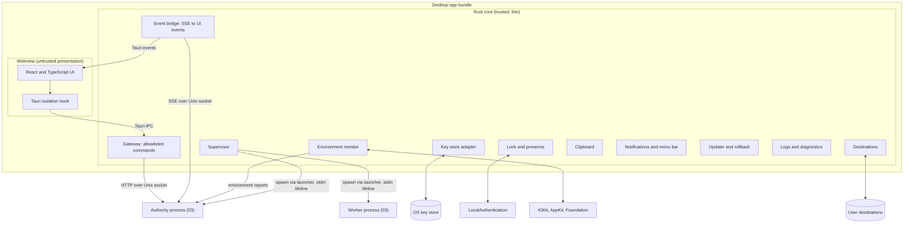
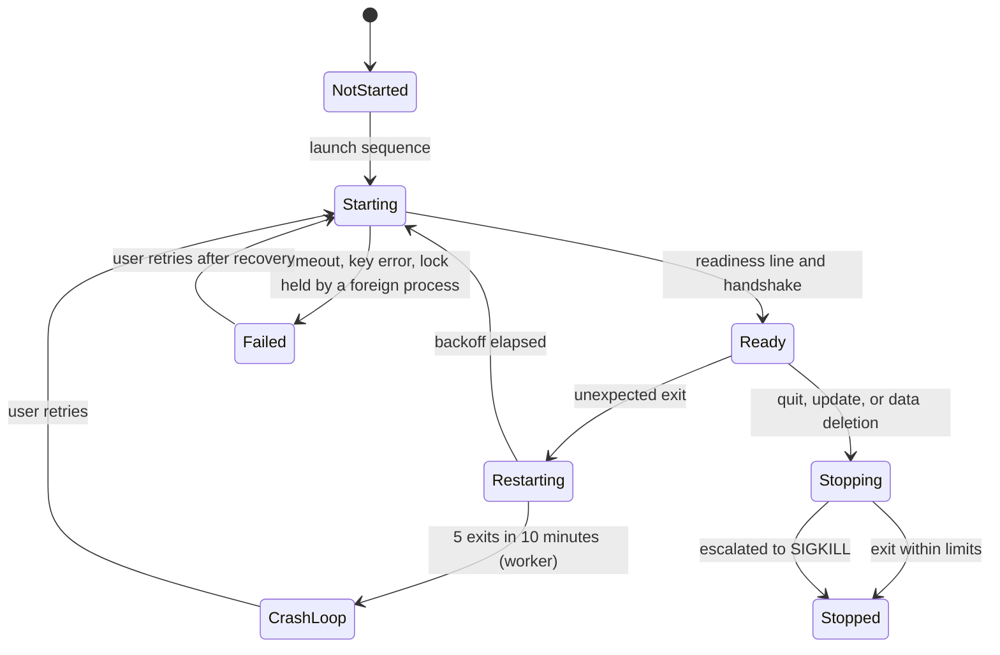
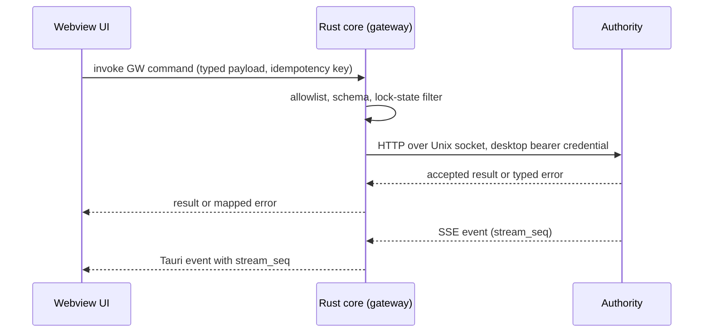
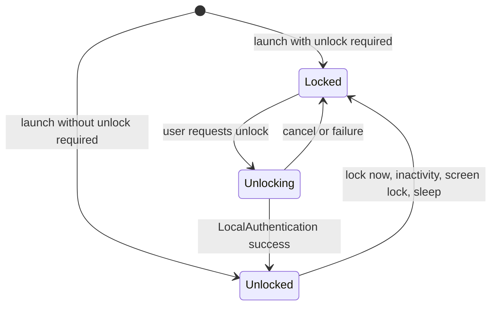

# 04_DESKTOP_APPLICATION_PLAN.md

## 1. Document Control and Status

| Item | Value |
| --- | --- |
| Document | Fifth of eight pre-production documents |
| Version and date | 1.1, 2026-09-30 (1.0 plus section 33; 1.0 was 0.3 plus the independent audit fixes in section 32; 0.3 was 0.2 plus the hardened isolation baseline in section 31; 0.2 was 0.1 plus the product-owner decisions recorded in section 30) |
| Status | Version 1.0 approved by the product owner on 2026-09-29, including the decisions of section 30, the hardened baseline of section 31, and the audit fixes of section 32; `OQ-402` (name and identifier) deferred by the owner until before `06`; version 1.1 changes (section 33) directed by the product owner on 2026-09-30, text awaiting the owner's review |
| Upstream baseline | `00_PRODUCT_AND_SYSTEM_PLAN.md` v1.1, `01_SHARED_CONTRACTS_AND_DOMAIN_MODEL.md` v1.1, `02_SECURITY_AND_THREAT_MODEL.md` v1.1 (all approved 2026-09-28), and `03_CONTROL_PLANE_AND_WORKER_RUNTIME_PLAN.md`, approved by the product owner on 2026-09-29 (see `DK-CF-401` for the stale status label in the stored copies); version 0.3 applies `00`, `01`, and `02` v1.2 and `03` v1.1; version 1.0 applies `00`, `01`, and `02` v1.3 and `03` v1.2, all approved 2026-09-29 |
| Other inputs | `Job_Automation_PLAN_Generator_Prompt.md` (`Generator`), `DEP_Prompt.md` (`DEP`), project instructions, the project chats of 2026-09-27 to 2026-09-29, dated research in section 28 |
| Owner | Desktop application architecture; the product owner approves decisions marked for approval |
| Intended readers | Product owner, security reviewer, mobile and UX plan authors (`05`, `06`), roadmap author (`07`), implementation agents |
| Downstream consumers | `05` (shared client conventions, later sync client behavior), `06` (screen inventory, platform conventions, lock and relay mechanics, accessibility platform baseline), `07` (platform gates, packaging and signing tiers, experiments to schedule) |

Change control follows the rule used by `00` to `03`: identifiers are never renumbered or reused; a changed decision records old and new wording, affected sections and documents, migration consequences, and owner approval. Identifiers introduced here use the `4xx` range: `ADR-401`, `DK-CF-401` (conflicts), `DK-P1` (principles), `GW-401` (gateway command groups), `ENV-401` (desktop environment signals), `FAIL-401`, `EXP-401`, `ASM-401`, `RISK-401`, `OQ-401`, `AC-401`, and `RES-401`. They do not replace upstream identifiers. This document specifies the desktop application for macOS, Windows, and Linux. It authorizes no application development, no signing certificate purchase, no infrastructure, and no real-world submission.

## 2. Executive Summary

The desktop application is the only full user surface in the MVP and the supervisor of the two local Python processes defined in `03`. This document decides how it is built, how it starts and supervises those processes, how it protects keys and user data on each desktop OS, how it obtains and keeps access to the user's output folder, how it reports power, sleep, and lock state to the runtime, how it is packaged, signed, updated, and rolled back, and how it is tested. It fills the rows that `00` section 39.1 assigned to `04` and the obligations that `02` and `03` handed to it.

Version 0.3 note: section 31 revises decisions 2, 3, 4, and 7 below. Untrusted work now runs in sandboxed role processes, only an egress broker has network access, the destination reaches only the package writer as a directory handle, and the database key is wrapped by the Secure Enclave where the free signing tier allows it.

The principal decisions are these:

1. **Tauri 2 with a thin Rust core and a React and TypeScript UI, confirmed with conditions (`ADR-401`).** The Rust core is the only process that talks to the authority. The webview never opens a socket, never touches the filesystem, and never spawns a process. It calls an allowlist of typed commands (`ADR-403`). Electron is the named fallback if `EXP-401` fails.
2. **Direct distribution, no App Sandbox in the MVP (`ADR-402`).** The Mac App Store is rejected because App Sandbox inheritance constrains helper processes to exactly two entitlements [RES-420], Tauri has no built-in support for security-scoped resources [RES-417], and the later phases download a browser and model runtimes, which App Store guideline 2.5.2 does not permit [RES-453]. The consequence, recorded in `DK-CF-409`, is that least privilege on macOS comes from the process design in `03`, the hardened runtime, and an optional `sandbox-exec` profile for parser subprocesses, not from the App Sandbox. This needs owner acceptance.
3. **One supervisor, one lifeline (`ADR-404`).** The Rust core spawns the authority and the worker through a small signed launcher, hands each its credentials and keys on a stdin pipe that stays open for the life of the child, and uses end-of-file on that pipe as the parent-death signal. Every child runs in its own process group with core dumps disabled and a scrubbed environment. A single-instance guard plus an exclusive lock held by the authority prevents two authorities from ever opening the database.
4. **Keys in the login keychain under a stable signing identity (`ADR-405`).** The MVP stores the database key, the backup key, and any R3 API key as generic password items in the file-based login keychain. The data protection keychain needs a provisioning profile [RES-422], which a Developer ID build can have but a personal build cannot, so it is deferred. Keychain access control and macOS privacy consent are keyed to the code signature, so every build that touches real data is signed with a stable identity, never ad hoc (`ADR-412`).
5. **An in-app lock backed by LocalAuthentication (`ADR-407`).** Touch ID, Apple Watch, or the macOS password unlocks the app. While locked, sensitive views are discarded by reloading the webview and the authority refuses consequential commands (`03` section 7.4). Pause, stop, and emergency stop stay available.
6. **Destinations by path, validated before every commit (`ADR-406`).** Without the sandbox, the user's folder choice is a path plus a relocation bookmark, revalidated on launch, on wake, on volume events, and immediately before each package commit. On macOS, the package writer and SQLite must use `F_FULLFSYNC`; plain `fsync` does not make the `03` durability claim true on this platform (`DK-CF-402`).
7. **The desktop feeds the runtime the signals `03` depends on.** A new desktop-only endpoint carries lock state, power source, battery, Low Power Mode, thermal state, sleep and wake transitions, destination status, time zone changes, and network state (`DK-CF-405`). On system sleep the desktop asks the authority to stop leasing before acknowledging the sleep, because macOS runs processes during dark wakes without any full-wake notification [RES-432].
8. **Signed updates with an N-1 rollback path (`ADR-408`).** The Tauri updater verifies a mandatory signature and refuses downgrades by default [RES-405]. The desktop keeps the previous signed build so that a failed migration can be rolled back by restoring the pre-migration backup and reinstalling exactly one version back (`DK-CF-407`).
9. **macOS first, Windows 11 and Pop!_OS as compatibility tiers (`ADR-410`).** The MVP supports Apple silicon Macs on macOS 14 or later and is tested only on the reference MacBook Pro. Windows and Linux designs are specified now and proven in their compatibility phases (`EXP-412`, `EXP-413`).

The MVP desktop contains no browser automation, no account sign-in, no synchronization client, no custom URL scheme, and no listening TCP port. The later capabilities are specified in section 21 so that adding them does not change the MVP structure.

## 3. Upstream Baseline, Inherited Obligations, and Conflict Register

### 3.1 Inherited decisions this document implements

| Upstream | Desktop consequence |
| --- | --- |
| `00` `ARCH-04`, section 14 | Tauri 2 with React and TypeScript is the provisional desktop direction, to be confirmed by `EXP-01`. Section 5.2 confirms it with conditions. |
| `00` `ARCH-15`, `NFR-08`, `CHG-011`, `ASM-01` | macOS on the owner's MacBook Pro is the MVP reference platform; Pop!_OS and Windows are compatibility targets. Section 4.3. |
| `00` `NFR-03`, `NFR-04`, `NFR-05`, `NFR-06`, `NFR-07`, `NFR-10` | Responsiveness, stop timing, accessibility, offline inspection, private diagnostics, and time and locale rules for the desktop. Sections 11, 13, 14, 19. |
| `00` section 19, `01` `CON-117`, `CON-148`, `OQ-104`, `02` `CTRL-213` | Destinations are grants, validated before commit, with the `CON-148` layout and commit protocol. Section 10. |
| `00` section 33 | Desktop is the full configuration and review surface. Section 18 lists the screens and their MVP status; `06` designs them. |
| `02` `ADR-201`, `CTRL-209`, `CTRL-210`, `OQ-203` | Random DEK protected by the OS store, proven first on macOS. Section 8. |
| `02` `CTRL-202`, `AC-201` | Local IPC authentication and lock behavior. Sections 7 and 9. |
| `02` `CTRL-212`, `CTRL-214`, `SEC-A-202`, `SEC-A-203` | Execution isolation proven per OS; capabilities narrow where OS enforcement cannot be shown. Sections 6.2 and 10.1, `DK-CF-409`. |
| `02` `CTRL-221`, `CTRL-222`, `PRIV-205` | Export, deletion, redacted diagnostics, crash reports off by default. Sections 19 and 20. |
| `02` `CTRL-223`, `AC-212` | Signed releases and updates, no unsafe downgrade, verified rollback. Sections 15 and 16. |
| `02` `CTRL-227`, `03` section 16.4 | The R2 relay runs through the desktop: disclosure preview, copy, paste back. Section 12.6. |
| `03` `ADR-301`, section 5.2 | The desktop core launches and supervises the authority and worker and hands keys over stdin. Section 6. |
| `03` `ADR-303`, section 7.4 | HTTP over a `0600` Unix socket with bearer credentials and peer UID checks; the desktop core is the client. Section 7. |
| `03` `ADR-308`, section 26.2 | Relocatable CPython plus locked wheels, launched through a signed launcher; `04` owns signing and notarization of every native library. Section 15. |
| `03` sections 9.6, 11.5, 11.6, `EXP-306`, `EXP-310` | The desktop supplies battery, Low Power Mode, thermal, and sleep and wake signals; power assertions never claim to prevent lid-close sleep. Section 11. |
| `03` `RT-CF-306`, `OQ-301` | `04` must prove that the sidecars can use the destination grant under its signing and sandbox choice. Section 10.1. |
| `03` `OQ-302` | Windows local transport is decided jointly at the Windows phase. Section 15.6 gives the recommendation. |
| `03` section 20.2, `01` `CON-144` | `04` lists the display preferences that may use last-writer-wins. Section 12.4. |
| `03` section 5.2 (headless), `EXP-305` | A later supervisor role; the desktop attaches to it. Section 21.5. |

### 3.2 Obligations assigned to this document

Every row below was assigned to `04` by an upstream document. The last column is where this document discharges it.

| Obligation | Source | Section |
| --- | --- | --- |
| Client UI framework | `00` section 39.1 | 5.2 |
| Desktop packaging approach | `00` section 39.1 | 15 |
| Worker bundling on the desktop | `00` section 39.1, `03` `ADR-308` | 15.2 |
| Secrets storage proof | `00` section 39.1, `02` `OQ-203` | 8, `EXP-405` |
| Desktop update mechanism | `00` section 39.1, `02` `CTRL-223` | 16 |
| Build, packaging, signing, updates, distribution | `00` section 39.1 | 15, 16 |
| Three desktop OS packaging, permissions, local IPC, signing, updates | `00` section 38 | 6, 7, 10, 15, 16 |
| Storage durability per destination filesystem | `01` `OQ-104`, `02` `OQ-206` | 10.3, 10.4 |
| Display-preference merge fields | `01` `CON-144`, `03` section 20.2 | 12.4 |
| Launch and supervise the authority and worker | `03` `RT-CF-302`, `ADR-301` | 6 |
| Keychain proof for the key handoff | `03` section 26.3, `EXP-302` | 8.4 |
| Sidecar access to the destination grant | `03` `RT-CF-306`, `OQ-301` | 10.1, `EXP-404` |
| Sleep, wake, battery, thermal signals | `03` sections 9.6, 11.6 | 11 |
| Cloud-synchronized destination warning | `03` section 18 | 10.3 |
| Rust Unix socket client confirmation | `03` section 7.1 | 7.2 |
| Linux Secret Service timeout and fallback | `02` `AC-218` | 8.6, `EXP-413` |
| Update integrity and rollback proof | `02` `AC-212` | 16, `AC-416` |
| Local IPC proof against a second OS user and a rogue process | `02` `AC-201`, `03` `AC-301` | 7, `AC-402`, `AC-417` |

### 3.3 Conflict and gap register

| ID | Statements and affected documents | Practical consequence | Recommended resolution | Approval |
| --- | --- | --- | --- | --- |
| `DK-CF-401` | The project copy and the local copy of `03` both carry "Version 0.2 ... Draft for product-owner review" in section 1, while the owner approved `03` on 2026-09-29, including `RT-CF-301`, `ADR-301`, `ADR-311`, `ADR-312`, the budget defaults, the eligibility and fit targets, `OQ-307`, and `RT-CF-308` to `RT-CF-310`. The approved label written in the previous session did not persist. Affects `03`, `07`. | Metadata only, but `07`'s consistency audit would otherwise treat `03` as unapproved. | Rewrite the `03` status row to v1.0 approved 2026-09-29 with the decisions listed. This document treats `03` as approved. | Owner confirms; no decision changes. |
| `DK-CF-402` | `03` section 8.1 sets `synchronous=FULL` "because in WAL mode `NORMAL` can lose the most recent commits on power loss", and `03` section 18 uses `fsync` in the package commit protocol. On macOS, SQLite uses `F_FULLFSYNC` only when `PRAGMA fullfsync` is on, and its default is off [RES-426]; Python's `os.fsync` calls the native `fsync` [RES-428], and the macOS `fsync(2)` manual warns that after `fsync` the drive may not write the data for some time and that applications needing strict write ordering should use `F_FULLFSYNC` [RES-452] (secondary analysis of SQLite on macOS in [RES-427]). Affects `03`, `01` `RISK-103`, `00` `NFR-02`. | The power-loss durability claim for audit commits and committed packages is not met on the reference platform as written. | On macOS: `PRAGMA fullfsync=ON` and `PRAGMA checkpoint_fullfsync=ON` for the authority connection; the package writer calls `fcntl(fd, F_FULLFSYNC)` where `03` section 18 says `fsync`, for files and for the directory. `EXP-301` measures the commit latency cost. | Refinement of `03` at its next revision; owner approval requested because it changes an approved document's mechanism, not its contract. |
| `DK-CF-403` | `03` section 11.6 requires a lease clock that includes sleep and leaves the question to `EXP-310`. Python documents that `time.monotonic()` on macOS calls `mach_absolute_time()` [RES-429]; the macOS `clock_gettime` manual states that `CLOCK_MONOTONIC` "will continue to increment while the system is asleep" and that `CLOCK_UPTIME_RAW` does not [RES-430]. Affects `03`. | If the authority uses `time.monotonic()`, leases may not expire across sleep as `03` intends, unless `mach_absolute_time` advances during sleep, which the sources read here do not state. | Implement the authority's lease clock as `time.clock_gettime(time.CLOCK_MONOTONIC)` on macOS and `time.CLOCK_BOOTTIME` on Linux, behind the injectable clock of `03` section 26.4. `EXP-310` confirms both behaviors on the reference machine. The desktop sleep protocol in section 11.2 makes correctness independent of the result. | Refinement of `03`; no approval needed beyond `03`'s own experiment. |
| `DK-CF-404` | `03` section 7.4 fixes the socket at `<app-support>/run/authority.sock`. A Unix socket path on macOS is limited to the size of `sun_path`, 104 bytes (secondary reports in [RES-448]; confirmed against `sys/un.h` in `EXP-401`). A long home-directory name can exceed it. Affects `03`. | Authority start would fail for some user names. | Section 7.2 rule: use the `03` path when it fits; otherwise use a per-user runtime directory with mode `0700` under the user's temporary directory and pass the path to both children. | Decided here; implementation detail of `03`. |
| `DK-CF-405` | `03` section 7.4 says "the desktop core reports the app's lock state", `03` section 9.6 relies on battery, Low Power Mode, and thermal signals "supplied by `04`", `03` section 18 has the desktop give the worker a destination path, and `03` section 26.3 has the worker redeem R3 key handles; no `03` endpoint carries any of these, and no document says how the authority obtains an R3 key value. Evidence upload also has no endpoint. Affects `03`, `01`. | Without endpoints, each implementation would invent its own channel. | Add three desktop-principal endpoints (section 7.5): `POST /v1/desktop/environment` (`ENV-401` to `ENV-412`), `POST /v1/desktop/secrets/{handle}` answering a `SecretSupplyRequested` event on the desktop's event stream, and `POST /v1/evidence/uploads` for streamed evidence bytes. The worker credential is rejected on all three. | Additive proposal to `03` section 7.2; owner approval with this document. |
| `DK-CF-406` | `03` section 5.2 step 2 writes "a single JSON line" on the child's stdin. It does not say whether stdin is then closed, and no upstream document defines how a child learns that the desktop died. Affects `03`. | Orphaned sidecars could keep the database open and block the next launch. | The desktop keeps the stdin pipe open for the child's lifetime; end-of-file on stdin is the parent-death signal (section 6.2). Compatible with `03`. | Refinement; no approval needed. |
| `DK-CF-407` | `02` `CTRL-223` requires "prohibit unsafe downgrade" and "rollback to previously verified version"; `03` section 8.6 rolls back by restoring the pre-migration backup and refusing to start the new version; the Tauri updater installs only newer versions unless the comparator is customized [RES-405]. Affects `02`, `03`. | After a failed migration the user would hold a restored database and no installable older build. | Keep a copy of the previously installed, code-signed bundle (N-1) and allow exactly one downgrade, to N-1, only after the authority has restored a backup whose schema N-1 supports (section 16.3). All other downgrades are refused. | Decided here, subject to approval. |
| `DK-CF-408` | `01` `CON-144` and `03` section 20.2 require `04` to list the display preferences that may merge by last-writer-wins. No list existed. Affects `01`, `03`, `05`. | Sync would otherwise have no rule for these fields. | Section 12.4 lists them and marks which are device-local and never synchronized. | Gap closure; no approval needed. |
| `DK-CF-409` | `00` section 19 anticipates "scoped grants if sandboxed", `02` `CTRL-212` asks for least filesystem and network permission "feasible on each target OS", and `02` `SEC-A-203` says capabilities narrow where OS enforcement of network limits cannot be shown. `ADR-402` ships the macOS MVP without the App Sandbox. Affects `00`, `02`, `03`. | On macOS, the worker's network egress limits and the authority's filesystem reach are enforced by application code and process separation, not by the OS. A compromised worker process under the same user can reach the network and any file the user can reach. | Accept for the MVP, with compensating controls: hardened runtime on every executable, separate processes and credentials (`03`), `GuardedHttp` egress rules, parser and renderer subprocesses under a deny-network `sandbox-exec` profile when `EXP-406` passes, and the residual risk recorded as `RISK-402`. Revisit before any Hybrid or Auto phase and before distributing to anyone other than the owner. | Owner acceptance of the residual risk required. |
| `DK-CF-410` | `03` section 5.1 says the desktop core never holds "database file access". The desktop's full data deletion (section 20) and backup-folder selection touch those files. Affects `03`. | Ambiguity about whether the core may delete the database. | Clarification: the core never opens or reads the database or blob files. It may delete the application data tree only during a confirmed full deletion, after both children have exited. | Clarification; no approval needed. |
| `DK-CF-411` | `00` `NFR-08` and `EXP-01` say the exact macOS version and chip are recorded "before `04` fixes minimum versions". They have not been recorded. Affects `00`, `07`. | Minimum versions would rest on an unrecorded baseline. | `ADR-410` sets a provisional floor of macOS 14 and states that only the reference version is tested; `EXP-401` records the version and chip and confirms or raises the floor. | Owner approval with this document. |

## 4. Scope, Principles, and Platform Tiers

### 4.1 Scope

In scope: the desktop shell and its Rust core, the UI architecture and its security boundary, process supervision, the local IPC client, keys and secrets on each desktop OS, the in-app lock, output destinations and filesystem behavior, power and sleep signals, notifications and OS integration, the relay's clipboard mechanics, document preview, packaging, signing, notarization, updates, rollback, uninstall, desktop diagnostics, desktop failure handling, desktop tests, and the platform side of onboarding. Out of scope: runtime behavior of the authority and worker (`03`), mobile (`05`), visual design, flows, copy, and tokens (`06`), phase order and CI/CD gates (`07`).

### 4.2 Desktop principles

| ID | Principle | Consequence |
| --- | --- | --- |
| `DK-P1` | The webview is untrusted presentation. | It renders data and asks the core for allowlisted actions. It holds no credential, no key, no file path it can act on, and no persistent copy of candidate data. |
| `DK-P2` | The core is thin and does not decide. | The core supervises, relays, and integrates with the OS. Every consequential decision belongs to the authority (`03` `RT-P1`). The core contains no state machine from `01`. |
| `DK-P3` | Platform facts are proven, not assumed. | Each OS behavior this document relies on has a named experiment, and a failed experiment narrows the capability instead of being papered over (`02` `SEC-A-203`). |
| `DK-P4` | Stable identity before real data. | No build that touches real candidate data runs ad hoc signed, because keychain access and privacy consent follow the code signature. |
| `DK-P5` | Fail visible and recoverable. | A lost key, folder, volume, permission, or child process becomes a named state with a recovery action, never a silent retry or a false success. |
| `DK-P6` | Nothing listens. | Release builds open no listening TCP port and register no custom URL scheme in the MVP. |

### 4.3 Platform tiers and minimum versions

**`ADR-410` Platform tiers.** Context: `00` `NFR-08` requires the macOS reference first and Linux and Windows compatibility before any production claim; `DK-CF-411` notes that the reference OS version is unrecorded. Decision:

| Tier | Platform | Architectures | Declared minimum | Tested in MVP | Status |
| --- | --- | --- | --- | --- | --- |
| Reference | macOS | Apple silicon (arm64) only | macOS 14.0 (provisional) | The reference MacBook Pro's installed version only, recorded in `EXP-401` | MVP |
| Compatibility 1 | Linux: Pop!_OS 24.04 (COSMIC), then Ubuntu 24.04 LTS | x86_64 | WebKitGTK 4.1 [RES-404] | No | Linux compatibility phase (`EXP-413`) |
| Compatibility 2 | Windows 11 | x64 first; arm64 later | Windows 11 23H2 (provisional) | No | Windows compatibility phase (`EXP-412`) |

Reasons: Intel Macs are excluded because Apple's next macOS release is reported to drop Intel support entirely [RES-441] and a universal build doubles the signed native surface of the Python runtime for no MVP user. macOS 14 is chosen as a floor that is recent enough to keep the untested range small, and it is the first macOS version on which Tauri exposes a custom webview data store identifier, should `EXP-414` show that the non-persistent store is insufficient [RES-424]. Windows 10 is excluded because Microsoft ended its support on 2025-10-14 [RES-450]. A declared minimum is not a support claim: until a version is tested, it is "may run, unsupported". Invalidation: raise the macOS floor if `EXP-401` or `EXP-402` finds a dependency that needs a newer SDK.

## 5. Desktop Architecture

### 5.1 Components



The webview holds no authority, no key, and no durable data. The Rust core is trusted but deliberately small: it holds the desktop credential, reads keys from the OS store at launch and on demand, and turns OS events into reports. It never opens the database or the blob store (`DK-CF-410`). The authority and worker are specified by `03`.

### 5.2 Technology decision

**`ADR-401` Desktop UI technology.** Context: `00` `ARCH-04` chose Tauri 2 with React and TypeScript provisionally, pending `EXP-01`. The desktop must supervise two Python processes, keep a strict boundary between rendered untrusted text and privileged actions, meet WCAG 2.2 AA as a target (`NFR-05`), run on three desktop OS families, and be maintainable by one developer whose strongest languages are C++ and Python.

| Criterion | Tauri 2 (Rust core, system webview) | Electron (Chromium, Node main) | Flutter desktop | Qt 6 with QML | Native per OS |
| --- | --- | --- | --- | --- | --- |
| Footprint of the shell | Small; uses the OS webview [RES-404] | Large; ships Chromium | Medium | Medium to large | Small |
| Privileged boundary | Deny-by-default capabilities, isolation pattern, typed Rust commands [RES-406, RES-408] | Context isolation and preload; Node in the main process widens the trusted surface | Single process; no web boundary needed | Single process | Single process |
| Rendering consistency | Three engines: WebKit (macOS), WebView2 (Windows), WebKitGTK (Linux) | One engine everywhere | One renderer | One renderer | Different per OS |
| macOS UI test automation | Embedded WebDriver plugin in test builds [RES-409, RES-410]; young | Mature Chromium tooling | Flutter test driver | Qt test tooling | XCUITest |
| Accessibility | Inherits each webview's accessibility tree; WebKitGTK weakest | Chromium accessibility tree | Semantics tree; desktop support maturing | Mature | Best |
| Sidecar supervision | Rust `std::process` and `tokio::process` | Node `child_process` | Dart `Process` | `QProcess` | Native |
| Language fit for the owner | Rust (new), TypeScript (new) | TypeScript | Dart | C++ (primary) | Swift, C#, C or C++ |
| Licensing | MIT or Apache-2.0 | MIT | BSD-3-Clause | LGPLv3 or commercial | Platform SDKs |
| Code shared with mobile (`05`) | UI code possibly reusable in a web client only | Same | High, if `05` keeps Flutter | Low | None |

Decision: Tauri 2 (2.x, pinned at Phase 0; 2.12 is current as of 2026-09-26 [RES-416]) with React and TypeScript, confirmed on four conditions, each tested in `EXP-401`, `EXP-409`, and `EXP-410`:

1. A signed bundle with the Python runtime runs under the hardened runtime on the reference Mac, and the two-process start meets `03` `ADR-301`'s invalidation limit (4 seconds, 400 MB idle for the Python processes).
2. The UI test harness drives the release-equivalent build on macOS.
3. VoiceOver can operate the MVP flows listed in section 14 without workarounds that `06` cannot design around.
4. A 10,000-row jobs list meets `NFR-03` in WKWebView.

Reasons: the Rust core gives the smallest trusted shell with an explicit command allowlist, which matters because the UI renders untrusted posting text and model output next to buttons that verify claims and commit packages. Qt was the strongest alternative on language fit and accessibility, but it would move the UI into a C++ process that also renders untrusted text, without a structural boundary; its LGPL obligations are manageable but real. Flutter's advantage, one codebase with the mobile companion, does not outweigh a weaker desktop accessibility record and an approved `ARCH-04`. Native per OS triples the UI work for one maintainer.

Consequences: the maintainer works in three languages (Rust, TypeScript, Python); section 5.3 keeps the Rust core small so that this cost stays bounded (`RISK-405`). Rendering differs across three engines, so `06` must test layouts on each tier before claiming it. Invalidation: if condition 1 or 2 fails and cannot be fixed within the experiment's time box, switch to Electron. The React UI survives the switch; the core's modules must be rewritten in TypeScript for Node, which is why the core stays thin.

### 5.3 Rust core modules

| Module | Owns | Platform code | Never does |
| --- | --- | --- | --- |
| `gateway` | Typed Tauri commands (`GW-401` to `GW-412`), request validation, idempotency-key pass-through, error mapping, lock-state filtering | None | Forward an arbitrary path, URL, or endpoint chosen by the UI |
| `events` | One SSE connection to the authority, sequence tracking, reconnection, fan-out to the UI | None | Persist events |
| `supervisor` | Launch sequence, credentials, lifeline pipes, restarts, shutdown, orphan handling (section 6) | Process groups, signals, `kqueue` or `pidfd` or Job objects | Read child stdout beyond the readiness line |
| `keystore` | Key creation, reads, rotation hooks, R3 key entry, destination bookmarks as `DESTINATION_GRANT` secrets (section 8) | Keychain (macOS), Credential Manager (Windows), Secret Service (Linux) | Return a secret value to the webview |
| `lock` | Lock state machine, LocalAuthentication, inactivity timer, screen-lock and session events (section 9) | LocalAuthentication, AppKit notifications | Cache the user's password |
| `environment` | Power, battery, Low Power Mode, thermal, sleep and wake, clock and time zone, network, disk space (section 11) | IOKit, Foundation, Network framework | Decide scheduling policy |
| `destinations` | Folder picker, validation, bookmark, volume facts, revalidation, write probe (section 10) | AppKit open panel, `statfs`, URL resource values | Write package members (the worker does, per `03` section 18) |
| `clipboard` | Relay package copy with concealment flags and auto-clear (section 12.6) | `NSPasteboard` | Read the clipboard except for its own change counter |
| `notify` | Desktop notifications, menu bar extra, Dock badge (section 12) | Notification center, status item | Put job or employer names in notifications by default |
| `updater` | Update checks, signature verification, install sequence, N-1 snapshot and rollback (section 16) | Bundle replacement | Install an unsigned or older build except the N-1 rollback |
| `diagnostics` | Desktop logs with redaction, panic hook, diagnostics bundle save (section 19) | Log directories | Log command payloads |

Proposed crates, pinned at Phase 0 and subject to the license gate of `03` section 26.2: `tauri` 2.x, `tokio`, `hyper` 1.x with `hyper-util` over `tokio::net::UnixStream` (this answers `03` section 7.1's request to confirm the Rust Unix-socket client), `serde`, `security-framework` for the macOS keychain, the `objc2` family for AppKit, Foundation, LocalAuthentication, and IOKit bindings, `zeroize` for key buffers, `tracing` for logs, and `getrandom` for credentials. The `keyring` crate's own documentation says it is not meant for applications that need to control which credential store is used [RES-447], so the core uses the platform crates directly behind one `KeyStore` trait.

### 5.4 Frontend architecture

| Concern | Decision |
| --- | --- |
| Language and build | TypeScript in strict mode, React, Vite. All assets, fonts, and icons are bundled; no CDN, so `NFR-06` offline inspection holds. |
| Data access | A generated TypeScript client for `GW-4xx` commands. Request and response types are generated from the `03` OpenAPI document and the gateway's command schema; a mismatch fails the build. |
| Server state | An in-memory query cache (TanStack Query proposed) keyed by authority revision; no persistence adapter is ever enabled. The cache is dropped on lock by reloading the webview. |
| Large lists | Virtualized rendering (TanStack Virtual proposed) over cursor-paged queries (`03` section 7.2). |
| Routing | A typed client router; routes carry entity IDs, never sensitive values, so that a route can be restored after unlock. |
| Rendering untrusted text | Posting text, relay replies, extracted evidence, and source names render as text nodes only. A lint rule forbids `dangerouslySetInnerHTML`, `eval`, `new Function`, and string-built URLs in `href`. Links inside posting text are shown as text; the only clickable external links are those the core opens after validation (section 12.8). |
| Strings and locale | All UI strings externalized in ICU message format from the first screen (`NFR-10`); dates and times formatted with `Intl` using an explicit IANA zone from the authority. |
| Design system | Tokens, components, and layouts come from `06`. |

### 5.5 What runs where

| Computation | Where | Reason |
| --- | --- | --- |
| Rendering, form state, client-side input validation for usability | Webview | Presentation only; the authority revalidates everything |
| Command allowlisting, lock filtering, URL and path validation | Rust core | The last trusted check before the authority, and the only place that can refuse a request from a compromised webview |
| Key reads, folder picker, clipboard writes, notifications, sleep handling | Rust core | Needs OS APIs and the app's code signature |
| Every consequential decision and every write to the database | Authority (`03`) | `CON-105`, `03` `RT-P1` |
| Fetching, parsing, model calls, rendering documents, writing packages | Worker (`03`) | `03` section 6.3 |
| PDF page images for preview | Worker renders; UI displays | Section 12.7, `ADR-411` |

## 6. Process Lifecycle and Supervision

This section implements `03` section 5.2 on the desktop.

### 6.1 Launch sequence

1. **Single instance.** The single-instance guard [RES-411] detects a running instance, asks it to show its window, and exits. On macOS, LaunchServices normally does the same, but `open -n` and direct execution bypass it, so the guard is not the last line of defense (step 7).
2. **Location check (macOS).** If the bundle runs from a read-only volume or from an App Translocation mount [RES-440], the core shows a "move to Applications" screen and starts nothing else, because updates and stable privacy grants depend on a fixed location.
3. **Window first.** The main window shows the shell within 1.5 seconds (`AC-401`) in the locked or starting state. No sensitive data is displayed before the authority is ready and the app is unlocked.
4. **Directories.** The core creates or verifies the application data tree (section 10.7) with mode `0700` and refuses to continue if the tree is owned by another user or is group- or world-writable.
5. **Keys.** On first run, the setup flow creates the keys (section 8.3). On later runs, the core reads the database key and backup key from the key store. A read failure is `FAIL-401` or `FAIL-402`; the authority is not started without its key.
6. **Credentials and socket path.** The core generates two 256-bit credentials with the OS random source and chooses the socket path (section 7.2).
7. **Authority.** The core spawns the launcher with `--role authority` (section 6.2) and writes one JSON line on its stdin: protocol version, desktop credential, SHA-256 of the worker credential, socket path, database key, backup key, and initial lock state. The key buffers are zeroed immediately after the write. The authority takes an exclusive, non-blocking lock on `<app-data>/authority.lock` before opening the database. If the lock is held, it exits with a distinct status and the core runs orphan handling (section 6.6).
8. **Readiness.** The authority prints one readiness line on stdout: `{"ready": true, "authority_id", "schema_version", "contract_versions"}`. While migrating, it prints progress lines instead, and the core shows migration progress for up to 10 minutes before `FAIL-321` handling. Without migration, readiness must arrive within 15 seconds, else the core stops the child and shows `FAIL-325`.
9. **Handshake.** The core connects over the socket, calls `GET /v1/health/ready` with `X-Contract-Version`, and checks that the authority ID matches the readiness line.
10. **Environment.** The core sends a full environment snapshot (section 7.5).
11. **Worker.** The core spawns the launcher with `--role worker` and the worker credential on stdin. The worker registers with the authority (`03` section 7.3).
12. **Events.** The core opens the SSE event stream and attaches the UI.

### 6.2 The launcher, process hardening, and the lifeline

**`ADR-404` Launcher and child process hardening.** Context: `03` `ADR-308` requires a small signed launcher; `02` `CTRL-209` asks that secrets stay out of crash dumps; `DK-CF-406` needs a parent-death signal. Decision: a Rust launcher (`jsa-runtime`, bundled as a Tauri external binary [RES-401] but spawned by the core with `std::process`, not through the shell plugin, so that no JavaScript API can spawn processes) with these duties:

| Duty | Mechanism |
| --- | --- |
| Find the interpreter | Resolve the bundled interpreter relative to the launcher's own executable path; never search `PATH`. |
| Clean environment | Clear the inherited environment, then set only `HOME`, a private `TMPDIR` under the application data tree, `LANG` and `LC_ALL` to a UTF-8 locale, `PYTHONNOUSERSITE=1`, and `PYTHONDONTWRITEBYTECODE=1` (bytecode is precompiled at build time because the bundle is signed and read-only). |
| Isolated interpreter | Start Python with `-I` (isolated mode) and `-B`, running the product's entry module with the role argument. |
| No core dumps | `setrlimit(RLIMIT_CORE, 0)` before `exec`. |
| Process group | The core spawns each child in a new process group so that stop and emergency stop can signal the group (`03` section 11.2). |
| Optional OS sandbox | For the `parse` and `render` subprocess roles, the launcher applies the deny-network profile of `ADR-414` before `exec` when enabled. |
| Replace itself | `exec` the interpreter so that no extra process remains and the running image is a signed binary from the bundle. |

The lifeline: the core never closes a child's stdin. After reading the first line, each child starts a watchdog thread that blocks on stdin; end-of-file means the desktop has exited, and the child shuts down in order (worker: stop at the next safe point, at most 10 seconds; authority: checkpoint the WAL and exit). On Linux the launcher also sets `PR_SET_PDEATHSIG`; on Windows the core places children in a Job object that kills them when the core's handle closes.

### 6.3 Supervision states



| Event | Worker | Authority |
| --- | --- | --- |
| Unexpected exit | Restart with backoff 1, 2, 4, up to 60 seconds; leases expire per `03` section 9.4 | Stop the worker, show the failure, restart the authority once (`03` section 5.2 step 7); a second failure is `FAIL-325` |
| Crash loop | 5 exits within 10 minutes stop restarts (`FAIL-302`); run paused with `WORKER_UNAVAILABLE` | Not applicable; one automatic restart only |
| Readiness timeout | Kill the group, count as an exit | Kill the group, `FAIL-325` |
| Unexpected stdout | Ignored after readiness and logged as a count only | Same |
| stderr | Captured to a size-capped file in the log directory after the redaction scan of section 19 | Same |

### 6.4 Closing the window, quitting, logout, and shutdown

- **Closing the main window does not quit.** Following macOS convention, the app keeps running; the children continue within the run's policy and the lock rules. Whenever a run is active, the menu bar extra is visible so that pause, stop, and emergency stop remain one click away (section 12.2).
- **Quit** with an active run asks the user to stop the run and quit, keep running with the window closed, or cancel (copy by `06`). Quit then sends `ChangeRunState` graceful stop for active runs, waits up to 10 seconds for safe points, sends `SIGTERM` to the worker's group, waits 5 seconds, then `SIGKILL`; then sends `SIGTERM` to the authority and waits up to 10 seconds for the WAL checkpoint before `SIGKILL`. SQLite recovers from the WAL after a kill (`03` section 5.2).
- **Logout, restart, and shutdown** follow the same order with a 20-second total budget, because the OS may terminate slow apps. A run interrupted this way is recorded as stopped by the system in the run history (`FAIL-415`).
- **Power loss or kernel panic** has no notification; the recovery rules of `03` (WAL recovery, lease expiry, resume of local writes) apply.

### 6.5 Stop controls from the desktop

The desktop exposes the three `03` section 11.2 controls in the main window and in the menu bar extra. Emergency stop sends the command to the authority first and, in parallel, `SIGTERM` to the worker's process group followed by `SIGKILL` after 3 seconds (`03` section 11.2), so that it works even when the authority is slow. Pause, stop, and emergency stop are allowed while the app is locked (section 9.1) because they only reduce risk.

### 6.6 Orphans and a second authority

The authority's exclusive lock on `authority.lock` is the invariant that prevents two writers (`CON-105`); the single-instance guard only makes the failure rare. If a new authority finds the lock held:

1. The core reads the PID recorded in the lock file and checks, with `proc_pidpath` on macOS, `/proc/<pid>/exe` on Linux, or `QueryFullProcessImageName` on Windows, that the process is this installation's launcher or interpreter.
2. If it is, the core sends `SIGTERM` to that process group, waits 10 seconds, sends `SIGKILL` if needed, and retries once.
3. If it is not, or the PID does not exist while the lock is still held, the core stops and shows `FAIL-405` without killing anything.

The authority removes a stale socket file only while holding the lock, so that a second authority can never delete the live socket.

### 6.7 Headless operation (later)

`03` section 5.2 introduces a later `--role supervisor` that performs this section's duties without the desktop, for scheduled and continuous runs. The desktop registers it as a launch agent through `SMAppService` with the user's consent (section 21.5) and attaches to it through the credential exchange tested in `03` `EXP-305`. In the MVP there is no headless mode: quitting the app stops all product processes (`03` `ASM-302`).

## 7. Local IPC Client, Gateway, and Webview Boundary

### 7.1 Channels



**`ADR-403` Core-only gateway.** Context: `03` `ADR-303` makes the authority an HTTP server on a Unix socket; a webview cannot use a Unix socket, and `03` `AC-301` forbids a listening TCP port. Alternatives: (a) expose the authority to the webview through a generic "fetch" passthrough command; (b) a typed allowlist of commands in the core. Decision: (b). Each gateway command has a fixed endpoint, a typed request, and a lock-state rule; the UI never supplies an endpoint path, a filesystem path, or a raw external URL. Reason: if a malicious posting ever achieved script execution in the webview, a passthrough would hand it every authority endpoint, including commands the lock should block; an allowlist confines it to what the visible UI can already do and lets the core refuse even those while locked. Consequence: adding an authority endpoint requires a gateway change and review, which is intended.

### 7.2 Transport and socket path

- **Client.** `hyper` 1.x over `tokio::net::UnixStream` with one connection pool for requests and one long-lived connection for SSE. Every request carries `Authorization: Bearer <desktop credential>` and `X-Contract-Version`.
- **Path rule (`DK-CF-404`).** The core uses `03`'s `<app-data>/run/authority.sock` when the full path is at most 100 bytes (leaving margin under the 104-byte `sun_path` on macOS [RES-448]). Otherwise it uses `$TMPDIR/<short-id>/a.sock`, where `$TMPDIR` is the user's private temporary directory and `<short-id>` is 8 hexadecimal characters derived from the installation ID; the directory is created with mode `0700` and checked for ownership. The chosen path is passed to both children in their stdin line. On Linux the directory is `$XDG_RUNTIME_DIR/<bundle-id>/`.
- **Peer checks** remain the authority's (`03` section 7.4). The core additionally verifies, after connecting, that the socket file is owned by the current user and has mode `0600`, which catches a planted socket before the credential is sent.

### 7.3 Gateway command groups

| ID | Group | Examples of commands | Authority endpoints (`03` section 7.2) | Allowed while locked |
| --- | --- | --- | --- | --- |
| `GW-401` | Readiness, evidence, claims | Get readiness, list evidence and claims, confirm or withdraw a claim, import evidence (section 10.8) | `GET /v1/readiness`; `CMD-101`, `CMD-102`; `POST /v1/evidence/uploads` | No |
| `GW-402` | Preferences and destinations | Set preferences, choose or revalidate a destination, set answer-library policy | `CMD-103`; destination commands | No |
| `GW-403` | Sources | List registry and health, enable or disable, confirm a proposed ATS board | `GET /v1/sources`; source commands | Health summary only |
| `GW-404` | Jobs and decisions | Page jobs, job detail with observations, decision explanation, merge or split, shortlist or dismiss | `GET /v1/jobs`, `/v1/jobs/{id}`, `/v1/decisions/{id}`; `CMD-104`, `CMD-114` | No |
| `GW-405` | Documents and packages | Preview pages, validation report, manifest, accept materials and commit | `GET /v1/packages/{id}/manifest`; `CMD-105` | No |
| `GW-406` | Applications | Timeline, open verified application page, record outcome, archive | `GET /v1/applications/{id}/timeline`; `CMD-109`, `CMD-115`; handoff transition | No |
| `GW-407` | Runs | Create run, pause, resume, graceful stop, emergency stop, run status | `CMD-106`, `GET /v1/runs/{id}` | Pause, stop, emergency stop, and status counts only |
| `GW-408` | Relay (R2) | Export exchange with preview, copy package, submit reply, abandon | `POST /v1/relay/exchanges`, `.../reply`, `.../abandon` | No |
| `GW-409` | Model routes | Provider consent, enable R3, set or remove an R3 key (stored by the core, never sent to the UI) | Provider commands; `POST /v1/desktop/secrets/{handle}` | No |
| `GW-410` | System | Worker and resource status, backups (list, verify now, restore), export data, diagnostics bundle, delete all data, updates | Health and maintenance endpoints | Status only |
| `GW-411` | Lock and settings | Lock now, unlock, lock policy, background preparation consent, notification and display preferences | Core-local plus `ENV-401` | Unlock and lock only |
| `GW-412` | Events | Subscribe and unsubscribe the UI to the event bridge | `GET /v1/events` via the core | Non-sensitive events only |

Rules that apply to every group:

1. **Idempotency.** The UI generates one idempotency key per user intent and reuses it on retry (`01` `ADR-103`); the core validates its format and forwards it.
2. **Typed payloads.** The core deserializes each payload into its typed request and rejects unknown fields before contacting the authority.
3. **References, not paths or URLs.** Commands that involve a file or an external page carry an opaque token or an entity ID. File tokens come from a picker or a drop event that the core itself handled (section 10.8); external URLs are looked up from authority records (section 12.8).
4. **Errors.** Authority errors (`ERR-101` to `ERR-115`, and `ERR-116` once `RT-CF-308` is written into `01`) pass through with their safe message and correlation ID. The core adds two transport errors of its own, `CORE_AUTHORITY_UNAVAILABLE` (shown as `ERR-114` semantics) and `CORE_LOCKED`.

### 7.4 Event bridge

The core holds one SSE connection to `GET /v1/events?after={stream_seq}` (`03` section 7.2), records the last delivered `stream_seq`, and forwards each event to the UI as a Tauri event carrying the sequence number. On reconnect it resumes from the last sequence. The UI checks for gaps and refetches snapshots before any consequential action (`01` `CON-142`, `AC-114`). While locked, the core forwards only events whose type is on a non-sensitive list (run state changes, worker health, source health counts, update availability).

### 7.5 Desktop-only endpoints (proposed addition to `03`)

These close the gaps recorded in `DK-CF-405`. All three accept only the desktop credential; the worker credential receives `401`.

**`POST /v1/desktop/environment`.** Carries a snapshot or a delta of the desktop's environment. Each report has `report_seq` (monotonic per desktop session), `observed_at` (UTC wall time), and `monotonic_ms` (the core's monotonic reading, taken with `clock_gettime(CLOCK_MONOTONIC)`, which the macOS manual states continues during sleep [RES-430], rather than a clock whose sleep behavior is unverified; `EXP-407` checks it). The core sends a full snapshot after the handshake, a delta on every change, and a full snapshot every 30 seconds.

| ID | Signal | Values | Source on macOS | Authority use |
| --- | --- | --- | --- | --- |
| `ENV-401` | Lock state | `LOCKED`, `UNLOCKED`; `background_preparation` flag | Section 9 | `SESSION_LOCKED` enforcement (`03` section 7.4); run pause when locked without consent (section 9.3) |
| `ENV-402` | Power source and battery | `AC`, `BATTERY`, `UNKNOWN`; percent or `UNKNOWN` | IOKit power sources and their change notification | Worker slot reduction below 30 percent on battery (`03` section 9.6) |
| `ENV-403` | Low Power Mode | `true`, `false`, `UNKNOWN` | `ProcessInfo.isLowPowerModeEnabled` and its change notification (macOS 12 and later) [RES-435] | Slot reduction (`03` section 9.6) |
| `ENV-404` | Thermal state | `NOMINAL`, `FAIR`, `SERIOUS`, `CRITICAL`, `UNKNOWN` | `ProcessInfo.thermalState` and its change notification [RES-434] | Slot reduction at `SERIOUS` or `CRITICAL` (`03` section 9.6) |
| `ENV-405` | Sleep pending | Sleep event ID, kind (`SYSTEM`, `IDLE`) | `IORegisterForSystemPower`, `kIOMessageSystemWillSleep` [RES-431] | Stop leasing; acknowledge readiness (section 11.2) |
| `ENV-406` | Woke | Sleep event ID, wall and monotonic readings | `kIOMessageSystemHasPoweredOn` and the workspace wake notification | Record `RESUMED_AFTER_SLEEP`, sweep, resume leasing; corroborates `FAIL-327` |
| `ENV-407` | Session inactive | Screen locked, user switched out | Workspace session notifications and the screen-lock notification | Triggers the app lock (section 9) |
| `ENV-408` | Destination status | Per destination: `USABLE`, `UNAVAILABLE`, `PERMISSION_LOST`, `VOLUME_MISSING`, `MOVED`, `READ_ONLY`, `LOW_SPACE`; resolved path; `checked_at` | Section 10.2 | Include the path in `COMMIT_PACKAGE` inputs; pause with `DESTINATION_UNAVAILABLE` (`03` section 9.2) |
| `ENV-409` | Time zone changed | New IANA zone | `NSSystemTimeZoneDidChangeNotification` | Recompute schedules (`03` section 11.4); UI shows both zones |
| `ENV-410` | Wall clock changed | Old and new readings | `NSSystemClockDidChangeNotification` | Corroborates `FAIL-330` |
| `ENV-411` | Network reachability | `ONLINE`, `OFFLINE`, `UNKNOWN` | Network framework path monitor | Advisory; the UI shows offline state. Fetch failures remain authoritative (`FAIL-303`) |
| `ENV-412` | Application data volume free space | Bytes free | `statfs` | Early warning before `FAIL-320` |

The authority treats `ENV-402` to `ENV-404` and `ENV-408` to `ENV-412` as advisory inputs, validated for type and range. `ENV-401`, `ENV-405`, and `ENV-406` gate leasing. If the desktop connection is lost while the authority runs (which in the MVP means the desktop has crashed and the lifeline is about to close), the authority treats the session as locked.

**`POST /v1/desktop/secrets/{handle}` with the `SecretSupplyRequested` event.** When the authority leases a task that needs a secret (for example an R3 key), it emits `SecretSupplyRequested(handle, sec_id, purpose, expires_at)` on the desktop's event stream. The core checks the lock state and the background preparation consent, reads the item from the key store, and posts the value to the handle's endpoint. The authority holds it in memory only until the worker redeems the handle or 60 seconds pass (`03` section 26.3), then discards it. If the app is locked without consent, the core answers `CORE_LOCKED` and the task pauses with `SECRET_LOCKED`. This keeps provider keys out of the authority's memory except while in use.

**`POST /v1/evidence/uploads`.** A streamed upload of one user-selected evidence file (section 10.8): `Content-Length` required, maximum 25 MB (provisional, `03` `CTRL-214` bounds apply after upload), SHA-256 digest header, original file name as display metadata. The authority stores the bytes as an encrypted blob and creates the `INGEST_EVIDENCE_FILE` task. The worker receives the blob, never a path in the user's home.

### 7.6 Webview hardening

| Control | Setting | Evidence |
| --- | --- | --- |
| Isolation pattern | Enabled; the isolation hook validates each IPC message against the gateway's command list before encryption [RES-408] | `AC-405` |
| Capabilities | One capability for the main window listing only the product's commands and event listening; no `fs`, `shell`, `http`, `dialog`, `clipboard`, `opener`, or `process` plugin permissions exposed to JavaScript; the core uses those facilities from Rust [RES-406] | `AC-405` |
| Content Security Policy | `default-src 'self'`; `script-src 'self'` plus Tauri's compile-time hashes; `style-src 'self'`; `img-src 'self' blob:`; `connect-src` limited to Tauri's IPC origin; `object-src 'none'`; `frame-src` limited to the isolation frame; `base-uri 'none'`; `form-action 'none'` [RES-407] | `AC-405`, `AC-406` |
| Remote content | None. Navigation to any origin other than the app's own is cancelled by the navigation handler; new-window requests are refused [RES-424] | `AC-405` |
| Developer tools | Not compiled into release builds [RES-424] | `AC-405` |
| Webview data store | Non-persistent (`incognito`) so that no cache, local storage, or IndexedDB is written to disk [RES-424]; `EXP-414` inspects the WebKit data directories after a session | `AC-426` |
| Screen capture | Optional setting "Hide window from screen sharing and screenshots" using content protection [RES-424]; off by default because it also blocks the user's own screenshots, and it does not stop a camera | Setting only |
| Drag and drop | The core receives drop events, keeps the paths, and gives the UI opaque tokens with display names | `AC-422` |
| Dependencies | Lockfile with integrity hashes, minimal runtime dependencies, vulnerability scan and SBOM inclusion in CI (`CTRL-223`) | `AC-415` |
| Test-only code | The WebDriver plugin used for UI tests (section 24) is compiled only with a test feature; release builds are checked for its absence | `AC-417` |

## 8. Keys, Secrets, and the OS Key Store

### 8.1 Inventory

| Item | `CON-151` kind | Created | MVP store (macOS) | Read by | Rotation | Loss consequence |
| --- | --- | --- | --- | --- | --- | --- |
| Database key (DEK, 256-bit) | `DATA_KEY` | First run, OS random source, in the core | Login keychain, generic password, service `<bundle-id>.keys`, account `db-dek.v1` | Core at launch, handed to the authority over stdin | New item version, authority re-keys the database (`02` `CTRL-209`), old item deleted after verification | Live database unreadable; recover from the latest verified backup with the recovery material (section 8.3) |
| Backup key (256-bit) | `DATA_KEY` | First run | Same service, account `backup-key.v1` | Core at launch, handed to the authority | New version encrypts new backups; the old version stays until the last backup it protects expires (30 days, `PRIV-204`) | Backups unreadable unless the recovery material exists |
| Desktop and worker credentials | Not stored | Every launch | Memory only | Core, authority, worker | Every launch | None |
| R3 API keys | `MODEL_API_KEY` | User entry (optional) | Same service, account `r3.<sec_id>` | Core, only on `SecretSupplyRequested` (section 7.5) | User replaces it; revocation happens at the provider | Tasks pause with `SECRET_LOCKED` or `MODEL_ROUTE_UNAVAILABLE` |
| Destination relocation bookmark | `DESTINATION_GRANT` | Folder selection | Same service, account `dest.<sec_id>` | Core during revalidation | Replaced when the user re-selects | Destination status `MOVED` or `VOLUME_MISSING` until re-selected |
| Updater public key | Not secret | Build | Embedded in the binary | Updater | Rotated only by an update signed with the old key | Not applicable |
| Updater private key, Developer ID identity | Release secrets | Owner setup | Owner's machine only (section 16.5) | Release process | Section 16.5 | Section 16.5 |

No key value ever reaches the webview, a log, an environment variable, a command-line argument, or a file outside the key store.

### 8.2 macOS key store design

**`ADR-405` Keychain choice.** Context: `02` `ADR-201` wraps a random DEK with a tested OS store; `03` section 26.3 has the core read the keys and pass them to the authority. macOS offers two keychain implementations. Using the data protection keychain from a macOS app requires the `keychain-access-groups` entitlement, which must be authorized by a provisioning profile [RES-422]; with a free developer account, such a profile is bound to the one Mac that built the app [RES-423]. The file-based (login) keychain needs no entitlement and remains fully supported [RES-422]. Decision: the MVP uses generic password items in the user's login keychain, created and read only by the main app executable. The data protection keychain is adopted when a Developer ID provisioning profile exists (`OQ-401`), with a one-time migration of the items.

Item rules:

- Items are created by the core with `SecItemAdd`; the default access list trusts only the creating application's designated requirement. Other programs, including the product's own Python processes and the `security` command-line tool, trigger a user-visible prompt if they ask for the item, which makes a silent read by same-user malware visible rather than impossible (`RISK-401`).
- Items are never marked synchronizable, so they do not leave the device.
- The designated requirement of a stable signature (Team ID plus bundle identifier) survives rebuilds and updates. An ad hoc signature has no stable designated requirement, so "Always Allow" does not persist and the user is prompted after every rebuild [RES-451]. This is why `ADR-412` forbids ad hoc builds for real data.
- The login keychain is unlocked while the user is logged in; the product's in-app lock (section 9) is an additional, separate gate.

### 8.3 First-run key creation and recovery material

1. The core generates the DEK and the backup key with the OS random source and stores both items. It reads them back and compares digests before continuing.
2. The core shows the backup key once as recovery material (`02` `CTRL-209`, `03` section 8.7): a printable page and a file the user saves through a save dialog to a location of their choice, never inside the application data tree. The content is the key encoded for manual entry, a key ID, the creation date, and plain instructions. The user must confirm that it was saved before setup continues. Copy and layout belong to `06`.
3. The recovery material protects backups, not the live database. If the DEK item is lost (for example, the user resets the login keychain), the product restores the most recent verified backup (normally at most 24 hours old; `03` section 23.3 alerts when none is verified within 48 hours) using the backup key, read from the keychain if that item survived or entered from the recovery material if not, and says what data after that backup is lost. Setup states this before the user confirms.
4. A lost DEK item and lost recovery material together make the data unrecoverable (`02` `CTRL-209`); the recovery screen says so without softening.

### 8.4 Key handoff to the authority

The core serializes the stdin line (section 6.1 step 7) into a buffer wrapped in `zeroize::Zeroizing`, writes it, flushes, and drops the buffer, which zeroes it. Keys are hex encoded because SQLCipher accepts a raw key in that form. The authority parses the line from a `bytearray`, opens the database, and overwrites the bytearray. Python may still hold transient copies in immutable objects; this is the residual risk `02` accepts for same-user compromise (`SEC-A-202`, `02` `RISK-201`). Because the child's stdin is a pipe created by the core, no other process can read it unless it can already attach to the core or the child, which the hardened runtime blocks for other unprivileged processes when the executables carry no debugging entitlement (section 15.2).

### 8.5 R3 API key entry

The key is typed into a masked field in the webview, sent once through `GW-409` to the core, stored in the keychain, and never returned. The UI clears the field state immediately after the command returns. The core records a `sec_` reference with the authority (`CON-151`) and never logs the value or its length. Replacing a key overwrites the item; removing it deletes the item and disables R3 until a new key is entered.

### 8.6 Windows and Linux key stores

| Platform | Store | Rules | Proof |
| --- | --- | --- | --- |
| Windows 11 | Credential Manager generic credentials, protected by DPAPI in the user's scope | Any process running as the same user can use the same protection context [`02` RES-205], so Windows offers no per-application barrier comparable to the keychain access list; recorded as `RISK-406` | `EXP-412` |
| Linux (Pop!_OS first) | Secret Service over D-Bus, default collection | Every call has a 5-second timeout; a timeout or locked collection pauses only dependent work and shows an unlock action; no unwrapped fallback; with no working Secret Service, the passphrase-derived wrapping of `02` `ADR-201` applies and unattended start is impossible until the user enters the passphrase | `02` `AC-218`, `EXP-413` |

## 9. App Lock and User Presence

### 9.1 Behavior

**`ADR-407` In-app lock.** Context: `02` `CTRL-202` requires that locking closes sensitive views and blocks new user decisions; `03` section 7.4 has the authority enforce `SESSION_LOCKED` from the desktop's report. Decision: an in-app lock with these rules.

| Aspect | Rule |
| --- | --- |
| Unlock method (macOS) | LocalAuthentication with the device-owner policy: Touch ID, a paired Apple Watch, or the user's macOS password when neither is available [RES-433]. The product stores no password of its own on macOS. |
| Lock triggers | "Lock now" command and shortcut; inactivity in the app for the configured time (default 15 minutes, options 5 to 60 minutes, provisional per `OQ-406`); screen lock or fast user switch (`ENV-407`); system sleep; launch when "Require unlock at launch" is on (default on). |
| On lock | The core sets `LOCKED`, reports `ENV-401`, reloads the webview to the lock screen (discarding the JavaScript heap and the query cache), clears the clipboard if it still holds a relay package the core wrote (section 12.6), and switches notification text to generic. |
| While locked | The gateway accepts only unlock, lock settings that do not weaken the lock, pause, graceful stop, emergency stop, and non-sensitive status (section 7.3). The authority independently refuses consequential commands (`03` section 7.4). |
| On unlock | The core sets `UNLOCKED`, reports `ENV-401`, and restores the last route (IDs only); the UI refetches data. |
| Step-up | Export of sensitive data, deletion of all data, and changes to the lock policy require a LocalAuthentication evaluation no older than 5 minutes, even when unlocked (`02` `CTRL-221`). |

### 9.2 Lock states



### 9.3 Background preparation while locked

`02` `CTRL-202` and `03` section 7.4 allow already-authorized background work to continue while locked only with the user's separate consent. The setting "Keep preparing while the app is locked" is off by default and is offered, with an explanation from `06`, the first time the user starts a run longer than 30 minutes. With consent off, the authority, on receiving `ENV-401` `LOCKED`, pauses every running run through the ordinary pause path (`SM-107` `RUNNING` to `PAUSING` to `PAUSED`, with `SESSION_LOCKED` recorded as the trigger in `EVT-113`), and on `UNLOCKED` resumes exactly the runs the lock paused. With consent on, runs continue; relay exchanges, which need the user, simply wait; R3 key supply follows section 7.5.

### 9.4 Other platforms

Windows can use Windows Hello through the platform's user-consent verification API, and Linux has no common equivalent; on Linux the lock uses an app passphrase verified with Argon2id, or the Secret Service unlock where that is proven. Both are decided in their compatibility experiments (`EXP-412`, `EXP-413`).

## 10. Output Destinations and the Filesystem

### 10.1 App Sandbox decision

**`ADR-402` Distribution channel and App Sandbox.** Context: `03` `RT-CF-306` and `OQ-301` ask whether the sidecars can use the desktop's destination grant; the answer depends on the sandbox choice. Alternatives:

| Option | Effect on the sidecars | Other consequences |
| --- | --- | --- |
| (a) Mac App Store with App Sandbox | The sandbox is mandatory for the store [RES-453]; helper tools must carry exactly `app-sandbox` and `inherit` and nothing else [RES-420]; access to user-selected folders requires security-scoped bookmarks, which Tauri does not support natively [RES-417]; the socket, staging, and runtime must live in the container | Later phases download a browser (`03` `ADR-309`) and model runtimes (`03` section 16.7), which guideline 2.5.2 forbids [RES-453]; a single-user tool would go through App Review |
| (b) Developer ID distribution with App Sandbox | Same helper constraints as (a) | Keeps notarization; still needs bookmark plumbing and container paths; gains OS-enforced file and network limits for the app and inheriting helpers |
| (c) Developer ID distribution without App Sandbox, hardened runtime on every executable | Children act with the user's permissions; macOS privacy consent is attributed to the responsible app, so the sidecars' access is granted to and shown as the app [RES-425] | No OS-enforced file or network confinement; least privilege rests on process design, credentials, and application checks (`DK-CF-409`) |

Decision: (c) for the MVP and every personal build. Reasons: (a) is blocked by later features and adds App Review to a single-user tool; (b) buys real confinement, but the worker must reach arbitrary allowlisted hosts and the user's chosen folder, the authority must read that folder back, and the Python runtime must live inside the container, so the gain for the MVP's threat model (`02` `SEC-A-202`: same-user separation is not a strong boundary anyway) is smaller than the integration risk. `ADR-414` recovers part of the confinement for the component that handles the most hostile input, the parser and renderer subprocesses.

Answer to `OQ-301`: under (c), the worker writes and the authority reads the destination with the user's own permissions. For folders protected by macOS privacy controls (Desktop, Documents, Downloads, iCloud Drive, removable and network volumes), the consent prompt names the app and the grant applies to the app and its children as the responsible process [RES-425]. `EXP-404` must confirm three behaviors on the reference Mac before the package commit phase: that choosing the folder in the open panel does or does not avoid a later prompt, that a sidecar's first access produces at most one prompt attributed to the app, and that the grant survives relaunch and a rebuild with the same signing identity.

Revisit (b) before any build is distributed to another person, and before any Hybrid or Auto phase.

### 10.2 Choosing and keeping a destination

**`ADR-406` Destination grants by path.** Selection:

1. The core opens the native folder panel (directories only, folder creation allowed). The suggested default is a new folder in the user's home directory named after the product, which is outside the privacy-protected folders and so never prompts.
2. The core resolves the real path (following symbolic links), then applies the class rules of section 10.3. Forbidden locations are refused with a reason.
3. The core probes writability: create `.jsa-probe-<random>` with exclusive create, write one byte, flush with `F_FULLFSYNC` (section 10.4), read it back, delete it.
4. The core records volume facts: volume UUID, filesystem type, case sensitivity, whether the volume reports encryption, whether it is internal, removable, or network, and whether the path is in a cloud-synchronized location.
5. The core creates a regular (not security-scoped) bookmark, which lets it detect a moved or renamed folder, and stores it as a `DESTINATION_GRANT` secret (section 8.1). A security-scoped bookmark is not used because the app is not sandboxed.
6. The core sends the destination descriptor to the authority (`CON-117`: label, class, flags, owning device; the path stays device-local) and the first `ENV-408` status.

Revalidation happens at launch, on full wake, on volume mount and unmount notifications, every 10 minutes while a run is active, and on user request. It resolves the bookmark, compares the result with the stored path, checks existence, ownership, and free space (pause below 2 GB, `03` `FAIL-320`), and repeats the write probe. Results:

| Result | Status (`ENV-408`) | Effect |
| --- | --- | --- |
| Path exists and probe passes | `USABLE` | Commits may be leased |
| Bookmark resolves to a different path | `MOVED` | Commits pause; the user confirms the new location or chooses another. The product never follows a moved folder silently. |
| Volume not mounted | `VOLUME_MISSING` | Commits pause until the volume returns |
| Privacy consent denied or revoked | `PERMISSION_LOST` | Commits pause; the UI explains where to re-enable access (`FAIL-410`) |
| Folder read-only or probe fails | `READ_ONLY` or `UNAVAILABLE` | Commits pause (`FAIL-322`) |
| Free space below 2 GB | `LOW_SPACE` | New commits pause |

The authority leases a `COMMIT_PACKAGE` task only if the latest status is `USABLE` and at most 5 minutes old, and passes the resolved path in the task inputs (`03` section 18 step 1). The worker's own lock and write steps (`03` section 18 steps 3 to 7) remain the final check: a failure there moves the task to `PAUSED` with `DESTINATION_UNAVAILABLE`, and no manifest is committed (`00` `AC-05`).

### 10.3 Destination classes

| Class | Detection | Commit behavior | Policy in the MVP |
| --- | --- | --- | --- |
| Internal APFS, volume encrypted (FileVault on) | Filesystem type, internal, encryption flag | Same-directory rename is atomic; `F_FULLFSYNC` supported | Allowed; recommended |
| Internal APFS, not encrypted | As above, encryption flag false | Same | Allowed with a warning that exported documents are plaintext on an unencrypted disk (`02` `CTRL-211`) |
| External APFS or HFS+ | Not internal, removable or ejectable | Same, plus unmount risk | Allowed with a warning; unmount pauses commits |
| exFAT or FAT | Filesystem type `exfat` or `msdos` | No POSIX permissions; rename is not journaled; readers rely on the manifest (`01` `CON-148`) | Allowed with a warning that the folder is readable by anyone who mounts the drive and is not crash-safe beyond the manifest rule |
| Network share (SMB, NFS) | Volume not local | Rename, exclusive create, and flush semantics depend on the server | Not allowed in the MVP; the `.jsa-lock` exclusive-create step of `03` section 18 cannot be relied on without testing |
| iCloud Drive or a File Provider location (`~/Library/Mobile Documents`, `~/Library/CloudStorage`) | Path prefix and the item's ubiquity flag | Local commit works; the sync client may upload `.vNNN.partial` directories while they are being written, and may later evict files to the cloud | Allowed with a warning that documents leave the device through the provider; the choice is recorded in the disclosure ledger as a user-selected cloud destination (`PRIV-203`); this answers `03` section 18's open warning question |
| Inside the application data tree, the app bundle, system locations, temporary directories, a volume root, or the home directory itself | Path checks | Not applicable | Forbidden |

### 10.4 Durability on macOS (`DK-CF-402`)

- **Package writer.** Every `fsync` in `03` section 18 becomes `fcntl(fd, F_FULLFSYNC)` on macOS, applied to each member file after writing, to the manifest's temporary file before the rename, and to the job directory's descriptor after each rename. If `F_FULLFSYNC` returns an error (some external filesystems do not support it), the writer falls back to `fsync`, completes, and records `durability=REDUCED` on the `package_exports` record, which the UI shows next to the package.
- **SQLite.** The authority opens its connection with `PRAGMA fullfsync=ON` and `PRAGMA checkpoint_fullfsync=ON` on macOS in addition to `03`'s settings [RES-426]. `EXP-301` measures the extra commit latency; single-user commit volume is low, so a cost of tens of milliseconds per transaction is acceptable, and `AC-326` (read queries) is unaffected.
- **Windows and Linux.** `FlushFileBuffers` and `fsync` already force data to stable storage on NTFS and ext4; no change.

### 10.5 Path limits per platform (`00` `AC-13`)

| Platform | Limits that matter | Rule |
| --- | --- | --- |
| macOS (APFS) | 255 bytes per path component; 1,024 bytes per path; normalization-insensitive lookup on the default case-insensitive format | The `CON-148` job directory name is at most 150 bytes. The core checks at destination selection that the root path plus 150 bytes plus the longest member path fits in 1,024 bytes, else `ERR-115`. |
| Windows (NTFS) | 240-character rule of `CON-148` step 10 when long paths are not enabled | Applied as written in `CON-148`. |
| Linux (ext4) | 255 bytes per component, 4,096 per path | The 150-byte cap applies; the same root check uses 4,096. |

`AC-418` runs the `CON-148` fixtures on APFS case-insensitive, APFS case-sensitive, and exFAT volumes on the reference Mac; NTFS and ext4 run in their compatibility phases.

### 10.6 Protection status shown to the user

For each destination, the desktop shows: encrypted volume or not, internal or removable, cloud-synchronized or not, the reduced-durability flag when present, and that exported documents are plaintext by design (`02` `CTRL-211`). Where the platform does not report a fact, the value is "unknown", never assumed.

### 10.7 Application data tree

| Path (macOS) | Contents | Mode | Backups and indexing |
| --- | --- | --- | --- |
| `~/Library/Application Support/<bundle-id>/db/` | SQLCipher database and WAL (`03` section 8.1) | `0700` directory | Included in Time Machine (encrypted) |
| `.../blobs/` | Encrypted blob store (`03` section 8.5) | `0700` | Included (encrypted) |
| `.../backups/` | Encrypted backups (`03` section 8.7) | `0700` | Included (encrypted) |
| `.../staging/` | Worker private staging, plaintext for at most 24 hours (`03` section 18) | `0700` | Excluded from Time Machine through the backup-exclusion resource value; a never-index marker for Spotlight; `EXP-414` verifies both |
| `.../run/` | Socket (when the path fits) | `0700` | Excluded |
| `.../tmp/` | Children's private `TMPDIR` | `0700` | Excluded |
| `.../updates/` | Downloaded update archive and the N-1 snapshot (section 16) | `0700` | Excluded |
| `.../config.toml`, `authority.lock` | Non-secret settings (`03` section 26.1), lock file | `0600` | Included |
| `~/Library/Logs/<bundle-id>/` | Redacted logs, 30-day retention (`03` section 23.1) | `0700` | Included |
| `~/Library/Caches/<bundle-id>/` | Non-sensitive caches only | `0700` | Excluded by the OS convention |

Windows uses `%LOCALAPPDATA%\<bundle-id>\` with the same subtree and an ACL limited to the user; Linux uses `$XDG_DATA_HOME/<bundle-id>/`, `$XDG_STATE_HOME/<bundle-id>/logs/`, and `$XDG_RUNTIME_DIR/<bundle-id>/`.

### 10.8 Evidence import from files

The user selects files through the native open panel or drops them on the window. The core keeps each path and gives the UI an opaque token and a display name. On import, the core resolves the path, refuses anything that is not a regular file (directories, devices, sockets), refuses files over 25 MB, streams the bytes to `POST /v1/evidence/uploads` with their SHA-256, and forgets the path. Type checks, page and entry limits, and parsing happen in the worker's subprocess under `02` `CTRL-214`. A compromised UI therefore cannot make the core read a file the user did not pick or drop. Folder and archive import (for example, a website export) is later and inherits `02`'s archive bounds.

## 11. Power, Sleep, Clocks, and Resource Signals

This section supplies the signals `03` sections 9.6, 11.5, and 11.6 depend on. The signal list and payloads are in section 7.5.

### 11.1 Sources on macOS

| Signal | API | Notes |
| --- | --- | --- |
| Sleep and wake | `IORegisterForSystemPower` callbacks: `kIOMessageSystemWillSleep`, `kIOMessageCanSystemSleep`, `kIOMessageSystemHasPoweredOn` [RES-431]; workspace sleep and wake notifications as a secondary source | The will-sleep message must be acknowledged; unacknowledged, sleep is delayed 30 seconds [RES-431] |
| Dark wake | None | Processes run during dark wakes, and no powered-on message is delivered; Apple offers no public API to detect them [RES-432] |
| Battery and power source | IOKit power sources and their run-loop notification | Percent and source |
| Low Power Mode | `ProcessInfo.isLowPowerModeEnabled` and `NSProcessInfoPowerStateDidChange`, macOS 12 and later [RES-435] | |
| Thermal | `ProcessInfo.thermalState` and its change notification [RES-434] | Four states |
| Screen lock and session | Workspace session notifications and the screen-lock notification | Triggers the app lock |
| Clock and time zone | `NSSystemClockDidChangeNotification`, `NSSystemTimeZoneDidChangeNotification` | |
| Network | Network framework path monitor | Advisory |

### 11.2 Sleep protocol

**`ADR-415` Sleep handshake.** Context: `03` section 11.6 handles sleep by lease expiry and asks the desktop to corroborate sleep; dark wakes run processes without a wake notification [RES-432], so a worker could claim new work during a dark wake while the user believes the Mac is asleep. Decision:

```mermaid
sequenceDiagram
  participant OS as macOS power management
  participant C as Rust core
  participant A as Authority
  participant W as Worker
  OS->>C: kIOMessageSystemWillSleep
  C->>A: ENV-405 SLEEP_PENDING (event id)
  A->>A: stop issuing leases for all runs; WAL checkpoint
  A-->>W: next heartbeat directive PAUSE_AT_SAFE_POINT
  A-->>C: sleep_ready
  C->>OS: IOAllowPowerChange (after sleep_ready or 20 s, whichever is first)
  Note over OS,W: Sleep. Dark wakes may run processes; no new leases are issued.
  OS->>C: kIOMessageSystemHasPoweredOn
  C->>A: ENV-406 WOKE (event id, wall and monotonic readings)
  A->>A: record RESUMED_AFTER_SLEEP, sweep expired leases, resume leasing
```

Rules:

1. In `SLEEP_PENDING`, the authority issues no lease, including during dark wakes, until `ENV-406` for the same event ID arrives. Heartbeats and lease expiry continue to follow `03` section 9.4, so a task whose lease expires while asleep is swept exactly as `03` specifies.
2. The 20-second acknowledgement limit stays under the 30-second system delay [RES-431]. A local-write task in progress is not forced to finish; `03` section 18's resume-from-partial rule covers it.
3. Idle sleep (`kIOMessageCanSystemSleep`) is never cancelled by the product except while the optional "Keep the Mac awake during runs" setting holds a power assertion (section 11.4).
4. If the core crashes between the two messages, the lifeline closes and the children shut down; on the next launch the authority starts with leasing enabled and the sweep of `03` applies.
5. Forced sleep (lid close, Apple menu) delivers the will-sleep message without the can-sleep message [RES-431]; the protocol is the same.

### 11.3 Clocks (`DK-CF-403`)

The core's own monotonic readings, used in `ENV-406` and `ENV-410`, come from `clock_gettime(CLOCK_MONOTONIC)`, which the macOS manual states continues to increment while the system is asleep [RES-430]. The authority's lease clock should use the same clock on macOS and `CLOCK_BOOTTIME` on Linux, because Python's `time.monotonic()` on macOS is `mach_absolute_time()` [RES-429] and the sources read for this document do not establish that it advances during sleep. `EXP-407` measures all three clocks across a real lid-close sleep on the reference Mac and feeds `03` `EXP-310`.

### 11.4 App Nap, power assertions, and keeping awake

- While any run is `RUNNING`, the core holds a user-initiated activity with `ProcessInfo.beginActivity` that allows idle system sleep, so that App Nap does not throttle the supervisor while the window is hidden. `EXP-408` checks whether the children's heartbeat timing degrades with the window hidden on battery, and whether they need the same treatment.
- The optional setting "Keep the Mac awake during runs when on power adapter" (default off) holds a prevent-idle-system-sleep assertion while a run is active and the power source is AC. It never claims to keep the Mac awake with the lid closed (`03` section 11.5); `03` `EXP-306` measures that case.
- The core releases every assertion when the run leaves `RUNNING`, on battery, and on quit.

### 11.5 Resource signals and worker slots

The core only reports; the worker applies `03` section 9.6 (fewer slots below 30 percent battery, in Low Power Mode, or at thermal `SERIOUS` or `CRITICAL`). The worker screen shows the current slot count and the reason for any reduction, and resource use from heartbeats, so that the user can see "which device or worker will execute each run, its availability, its capabilities, estimated resource load, and whether it is online" (Generator, client and worker architecture).

## 12. Notifications, Menu Bar, and OS Integration

### 12.1 Desktop notifications

| Event | Notification | Default text rule |
| --- | --- | --- |
| Run completed, stopped, or failed | Yes | Generic title and counts only |
| Run paused (budget, readiness lost, worker crash loop `FAIL-302`, locked without consent) | Yes | Reason category only |
| Relay input needed (exchanges ready to export, or a reply rejected) | Yes | Count only |
| Package ready for review, package committed | Yes | Count only |
| Source circuit opened | In-app only | Not applicable |
| Backup failure (`FAIL-331`), integrity problem (`FAIL-317`), key unavailable (`FAIL-326`) | Yes | Category only |
| Update available | In-app, plus one notification per version | Version only |

Rules: notifications are sent from Rust through the notification plugin [RES-412]; the webview cannot send them. Job titles, employer names, and candidate data never appear unless the user enables "Show job details in notifications" (off by default), and never while the app is locked. Clicking a notification focuses the window and navigates to the item through an ID kept in the core, not in the notification text. Permission is requested the first time a notification would be useful, not at first launch; if denied, the in-app notification list is the fallback (`FAIL-412`).

### 12.2 Menu bar extra

A status item shows the run state (idle, running, paused, stopping, needs attention) and offers Open, Pause or Resume, Stop, Emergency stop (with a confirmation step), Lock now, and Quit. It is visible whenever a run is active, and always if the user enables it. It works while locked, offering only the items allowed in section 9.1, and while the main window is closed (`AC-427`).

### 12.3 Menus, windows, and shortcuts

The macOS app has the standard App, File, Edit, View, Window, and Help menus; the Edit menu is required for copy and paste to work in the webview. One main window, with a minimum size set by `06`. Keyboard shortcuts use Command on macOS and Control on Windows and Linux; emergency stop has no single-key shortcut. `06` owns the final shortcut map and window layouts.

### 12.4 Appearance and display preferences

The UI follows the system appearance (light, dark), reduced motion, and increased contrast through the webview's media queries, and supports text zoom from 50 to 200 percent. The following preferences are the complete list for `01` `CON-144` and `03` section 20.2 (`DK-CF-408`):

| Preference | Scope | Merge rule when synchronized (later) |
| --- | --- | --- |
| Theme (system, light, dark) | Per device | Never synchronized |
| Text zoom | Per device | Never synchronized |
| Reduced motion override | Per device | Never synchronized |
| Show window content in screen capture | Per device | Never synchronized |
| Menu bar extra always visible | Per device | Never synchronized |
| UI density (comfortable, compact) | Per account | Last writer wins |
| Jobs list visible columns and column order | Per account | Last writer wins |
| Jobs list default sort | Per account | Last writer wins |
| Saved jobs list filters (names and filter expressions) | Per account | Last writer wins per saved filter |
| Date and time display format | Per account | Last writer wins |

Every other setting is either policy (versioned by the authority, `01` `CON-116`) or security-relevant (lock policy, notification detail, background preparation), which is per device and never synchronized.

### 12.5 URL schemes and deep links

The MVP registers no custom URL scheme and no file type, so that no other application or web page can invoke the app with parameters (`DK-P6`). Later sign-in callbacks and notification deep links (section 21) must pass an allowlist of routes with typed parameters and never trigger a consequential command directly.

### 12.6 Relay (R2) mechanics

The relay design is `03` section 16.4; the disclosure preview's content and copy are `06`'s. The desktop supplies these mechanics:

1. **Export.** `GW-408` asks the authority to create the exchange; the UI shows the preview the authority returns: exactly what will leave, the privacy classes, and the destination service chosen by the user. First use of each service requires `PRIV-201` consent.
2. **Copy.** The core, not the webview, writes the package text to the clipboard. On macOS it prepares the pasteboard with the current-host-only option so that Universal Clipboard does not send the package to the user's other Apple devices [RES-436], and marks the item with the `org.nspasteboard.ConcealedType` convention so that cooperating clipboard managers do not record it [RES-437]. The core remembers the pasteboard's change count.
3. **Open the service.** An optional button opens the chosen service's fixed web address in the user's default browser (a small allowlist, for example ChatGPT and Claude, editable by the user); the product never embeds or automates the chat site (`POL-14`).
4. **Auto-clear.** After 10 minutes (setting: 2 to 30 minutes, or off), and on lock, the core clears the clipboard if and only if its change count is unchanged since the product's write, so it never erases something the user copied later.
5. **Paste back.** The reply is pasted into a text area in the UI, capped at 200,000 characters before sending (`03` section 16.4 step 1), and submitted through `GW-408`. Validation is the authority's.
6. **Display.** Replies and validation errors render as plain text (section 5.4).

### 12.7 Document preview

**`ADR-411` Preview through worker-rendered page images.** Context: the user must review the exact PDF and DOCX before accepting materials (`01` `SM-102` `READY_FOR_REVIEW`). Alternatives: (a) load the PDF into the webview with a JavaScript PDF renderer; (b) open staged files in an external app such as Preview; (c) show page images rendered by the worker. Decision: (c). The worker already rasterizes each page with pypdfium2 for overflow validation (`03` section 17.5); the authority serves those images to the core, which passes them to the UI as blob URLs. The DOCX is shown as a structural view (paragraph styles, text, links) produced from the validation data, plus a note that its visual rendering was checked only if LibreOffice was present (`03` `ADR-316`). Reasons: (a) adds a PDF parser to the process that has IPC access; (b) hands plaintext staging files to another app before the user has accepted them. After commit, "Show in Finder" and "Open with default app" operate on the committed package in the user's folder, which is the user's file.

### 12.8 Opening external pages

The UI asks for "open the application page of job X" or "open the source listing of observation Y", never for a URL. The core fetches the URL from the authority's record, requires `https`, rejects user information, unusual ports, and non-ASCII host names that fail the confusable check of `02` `CTRL-217`, shows the full URL in a confirmation sheet, and opens it in the user's default browser. For the MVP's external handoff, the authority records the `PREPARED` to `EXTERNAL_HANDOFF` transition when the user confirms (`01` `SM-104`). The user's everyday browser is appropriate here because the user, not the product, performs the application; `POL-10` governs automation profiles, which the MVP does not have.

## 13. Performance and Responsiveness

Provisional targets on the reference MacBook Pro, measured in `EXP-401` and gated by `AC-401` and `AC-419`. They are single-user engineering targets, like `00`'s.

| Measure | Target | Basis |
| --- | --- | --- |
| Launch to shell window visible | At most 1.5 s at p95 over 20 warm launches | Section 6.1 step 3 |
| Launch to authority ready (no migration) | At most 4 s at p95 | `03` `ADR-301` invalidation limit |
| Navigate to Jobs with 10,000 jobs to first rows painted | At most 2 s at p95 | `00` `NFR-03`; authority query at most 300 ms (`03` `AC-326`) |
| Scrolling the 10,000-row list | No frame longer than 50 ms in 95 percent of frames during a scripted scroll | Virtualized list |
| Gateway overhead | At most 10 ms at p95 added to the authority's latency | Section 7 |
| Stop controls | Graceful stop acknowledged in the UI within 1 s; worker group gone within 5 s of emergency stop | `00` `NFR-04`, `03` `AC-305` |
| Idle memory | Core plus webview content process at most 350 MB with 10,000 jobs loaded; Python processes per `03` (400 MB) | Provisional |
| Installed size | Recorded, with a budget of 300 MB for the macOS app including the Python runtime | Provisional; the runtime and wheels dominate |

Network and model latency never block navigation; they show progress (`NFR-03`).

## 14. Accessibility and Localization Baseline

`00` `NFR-05` sets WCAG 2.2 AA as the release target; `06` owns the design that meets it. This section fixes what the platform must prove.

| Platform | Assistive technology path | MVP obligation |
| --- | --- | --- |
| macOS | WKWebView exposes the web accessibility tree to VoiceOver | Manual VoiceOver and keyboard-only scripts pass for the MVP flows below (`AC-420`); `EXP-410` checks virtualized lists, dialogs, and live regions |
| Windows | WebView2 exposes UI Automation to Narrator | Compatibility phase |
| Linux | WebKitGTK exposes AT-SPI to Orca; quality varies by version (`RISK-404`) | Compatibility phase; any gap is documented as an exception before a Linux support claim |

MVP flows covered by the scripts: onboarding readiness checklist, claim review and verification, target roles and eligibility settings, destination choice, jobs list, job detail with eligibility and fit explanation, package review, relay export and paste, run start, pause, stop, and emergency stop, lock and unlock.

Automated checks run axe-core in component and end-to-end tests with no serious or critical violations allowed. Native controls outside the webview (open and save panels, the LocalAuthentication sheet, notifications, the menu bar extra) are the OS's and are checked only for correct labels.

Localization (`NFR-10`): strings are externalized from the first screen; the UI language is English; dates, times, and numbers use the OS locale through `Intl` with the IANA zone from the authority; right-to-left layout is not claimed.

## 15. Packaging, Bundle Layout, and Code Signing

### 15.1 Identity and naming

**`ADR-409` Bundle identifier and data namespaces.** The bundle identifier, the keychain service name, the application data paths, and the privacy grants are all keyed to one identifier, so changing it after real data exists forces a migration of all four. Decision: choose the identifier before the first build that touches real data. Proposed: `dev.vishhz.jobsearch` (reverse DNS of the owner's domain), with the product's display name decided separately (`OQ-402`). Development builds use `dev.vishhz.jobsearch.dev`, with their own data tree and keychain service and synthetic data only, so that no development build can open or damage real data (`AC-408`).

### 15.2 macOS bundle layout and signing

Apple places code (Mach-O images) in `Contents/MacOS`, `Contents/Frameworks`, or `Contents/Helpers`, and treats scripts, including Python source, as resources in `Contents/Resources`; misplaced code "might work during day-to-day development, but might cause problems during notarization" [RES-419]. The Python runtime mixes both kinds. Two layouts are specified; `EXP-403` selects one.

```text
<Product>.app/Contents/
  Info.plist
  MacOS/
    <product>                  Tauri main executable (Rust core)
    jsa-runtime                launcher (section 6.2)
  Frameworks/                  layout B only: every Mach-O from the runtime tree
  Resources/
    runtime/python/            interpreter tree (python-build-standalone, pinned) [RES-449]
      bin/python3.13
      lib/python3.13/...       standard library, precompiled bytecode
      lib/python3.13/site-packages/...   locked wheels; in layout B, native modules
                               are symbolic links into Contents/Frameworks
    app/                       authority and worker packages, precompiled bytecode
    fonts/                     EB Garamond files and the OFL text (00 CHG-008)
    sandbox/parser.sb          ADR-414 profile
    licenses/                  third-party notices, SBOM
```

- **Layout A** keeps the runtime tree intact under `Resources` and signs every Mach-O file inside it individually. It is simpler and is what several Python application packagers do, but it is the layout Apple warns about.
- **Layout B** moves every Mach-O file into `Contents/Frameworks` as a flat list [RES-419] and leaves symbolic links in the runtime tree, as Apple's developer support has advised for embedded Python [RES-421]. It is more work to build and conforms to Apple's rules.

Signing order, inside out, without `--deep` [RES-421]:

1. Sign every Mach-O in the runtime (the interpreter, `.so` modules, `.dylib` files) with the hardened runtime and a secure timestamp. Only the interpreter carries entitlements, and only those `EXP-402` proves necessary for the pinned native wheels (`sqlcipher3`, `typst`, `pypdfium2`, `cryptography`, `pydantic-core`, `psutil`). The expected set is empty; `com.apple.security.cs.disable-library-validation` is acceptable only for tier T0 (section 15.3).
2. Sign the launcher with the hardened runtime.
3. Let the Tauri bundler sign the main executable and the bundle with the configured identity and entitlements [RES-402, RES-403]. Steps 1 and 2 run in the bundler's pre-bundle hook.
4. Verify with `codesign --verify --strict --deep` (verification, not signing) and check that every Mach-O has the hardened-runtime flag and the same Team ID.
5. Tier T2 only: notarize with `notarytool` using an App Store Connect API key, staple the ticket, and check with `spctl --assess` [RES-418].

Release entitlements contain no `com.apple.security.get-task-allow` (a notarization requirement [RES-418], and the reason other processes cannot attach). `Info.plist` sets `LSMinimumSystemVersion` to the floor of `ADR-410` and includes purpose strings for the Documents, Desktop, Downloads, removable-volume, and network-volume privacy prompts, since the app's children may access a destination there. No Face ID or camera strings are needed.

### 15.3 Signing tiers

**`ADR-412` Signing tiers.** Keychain access (section 8.2) and privacy consent both follow the code signature, so the tier determines whether real data can be used.

| Tier | Identity | Hardened runtime | Notarized | Real data | Use |
| --- | --- | --- | --- | --- | --- |
| T0 | Ad hoc (`-`) [RES-402] | Off, to allow debugging | No | Never; development identifier only (`ADR-409`) | Day-to-day development |
| T1 | A stable Apple Development certificate from the owner's Apple Account team, which Xcode is expected to create without the paid program (confirmed by `EXP-405`), or a paid team's certificate | On | No; free accounts cannot notarize [RES-402] | Yes, on the owner's Mac | The MVP |
| T2 | Developer ID Application certificate (Apple Developer Program, USD 99 per year [RES-402]) | On | Yes, stapled [RES-418] | Yes | Any distribution to another person; required for the data protection keychain and for passkeys later (section 21.1) |

A T1 build runs on the owner's Mac because a locally built app is not quarantined. On another Mac, since macOS Sequoia, an un-notarized app can be opened only through System Settings, Privacy and Security, "Open Anyway" [RES-438]; the product does not document that path as a supported install. `EXP-405` confirms that a free-team Apple Development certificate gives the Team ID that library validation and a stable keychain access list need; if it does not, the fallback is a self-signed code-signing certificate for a stable designated requirement, with `disable-library-validation` on the interpreter, recorded as a weaker T1.

### 15.4 Gatekeeper, translocation, and install location

T2 ships as a signed, notarized DMG; the user drags the app to Applications. An app launched from a read-only volume or a translocated path [RES-440] is detected at launch (section 6.1 step 2) and asks to be moved, because updates replace the bundle in place and privacy grants attach to a stable location. T1 builds are installed by the owner's build script directly into `/Applications`.

### 15.5 Supply chain

The build inherits `03` section 26.2: locked dependencies with hashes, a CycloneDX SBOM per release, a known-vulnerability scan, and a license gate that fails on GPL or AGPL components in the bundle. The desktop adds Rust crates (lockfile, audit of the dependency tree, crates included in the SBOM) and npm packages (lockfile with integrity hashes, audit, included in the SBOM). On Linux, the system WebKitGTK is LGPL; the `.deb` links it dynamically from the distribution, and an AppImage that bundles it must ship its license and source offer (`EXP-413`).

### 15.6 Windows (compatibility tier)

| Concern | Design | Proof |
| --- | --- | --- |
| Installer | NSIS, per-user install into `%LOCALAPPDATA%` without administrator rights [RES-413] | `EXP-412` |
| Webview | WebView2 Evergreen, present on Windows 10 1803 and later and on Windows 11 [RES-404]; the installer's download bootstrapper covers a missing runtime [RES-413] | `EXP-412` |
| Code signing | Azure Artifact Signing, available to individual developers in the United States and Canada with a paid Azure subscription [RES-443]; SmartScreen reputation builds with download history rather than immediately [RES-444]; an OV certificate is the alternative | `OQ-404` |
| Keys | Credential Manager with DPAPI (section 8.6) | `EXP-412` |
| Local transport (`03` `OQ-302`) | CPython does not provide `AF_UNIX` on Windows (the enabling issue remains open [RES-446]) and asyncio does not support Unix-socket servers there [RES-445]. Recommendation: the authority binds `127.0.0.1` on an ephemeral port, the bearer credentials of `03` section 7.4 apply, and the authority maps each connection's remote port to its owning process through the TCP table and rejects any process whose user SID differs from its own or whose image is not the product's. Named pipes would need a server other than Uvicorn and are the fallback if `EXP-412` shows the peer check to be unreliable. `03` `AC-301`'s "no listening TCP socket" applies to the macOS reference; the Windows gate replaces it with the peer-check test. | `EXP-412`, owner decision at the Windows phase |
| Lifeline | stdin end-of-file plus a Job object that kills children when the core's handle closes | `EXP-412` |
| Power and sleep | Suspend and resume notifications, battery status; thermal state reported `UNKNOWN` | `EXP-412` |
| Notifications | Work only for installed apps [RES-412] | `EXP-412` |
| Paths | `CON-148` step 10's 240-character rule | `00` `AC-13` |

### 15.7 Linux (compatibility tier, Pop!_OS first)

| Concern | Design | Proof |
| --- | --- | --- |
| Packages | `.deb` for Pop!_OS 24.04 and Ubuntu 24.04 as the primary format, with WebKitGTK 4.1 as a dependency [RES-404]. AppImage as the self-updating format, because the Tauri updater supports only AppImage on Linux [RES-405]; it must be built on the oldest supported distribution and bundles more libraries [RES-414]. Flatpak is deferred: the single-instance plugin's D-Bus mechanism needs manifest changes there [RES-411], and portal-mediated paths change the destination design. | `EXP-413`, `OQ-405` |
| Keys | Secret Service with timeouts and the passphrase fallback (section 8.6); the COSMIC keyring issue of `00` `RISK-06` is tested | `02` `AC-218` |
| Socket | `$XDG_RUNTIME_DIR/<bundle-id>/authority.sock`; peer UID through `SO_PEERCRED` (`03` section 7.4) | `EXP-413` |
| Lifeline | stdin end-of-file plus `PR_SET_PDEATHSIG` | `EXP-413` |
| Sleep | systemd-logind's `PrepareForSleep` signal with a delay inhibitor implements section 11.2; the maximum inhibitor delay is set by `logind.conf` and is believed to default to a few seconds (not verified in this research; `EXP-413` measures it on Pop!_OS), so the acknowledgement budget shrinks accordingly | `EXP-413` |
| Battery and thermal | UPower for battery; thermal `UNKNOWN` | `EXP-413` |
| Lock | App passphrase or Secret Service unlock (section 9.4) | `EXP-413` |
| Tray | Status notifier support varies by desktop environment and is tested on COSMIC | `EXP-413` |
| Durability | `fsync` on ext4 forces data to storage; no change needed | `EXP-413` |

## 16. Updates, Migration, and Rollback

### 16.1 Update channel

**`ADR-408` Updates.** Decision: the Tauri updater plugin in T1 and T2 builds. Its signature cannot be disabled, its public key is embedded in the app, and by default it installs only a version greater than the current one [RES-405]. The update manifest is a static JSON file per platform on an HTTPS host chosen in `OQ-403` (proposed: releases of a public repository that holds only release artifacts, because private-repository assets need authentication). The app checks at launch and every 24 hours while online, shows what is available, and installs only when the user chooses. Nothing installs silently. The signature check is independent of Apple's signing, so `02` `AC-212` can be met in T1.

### 16.2 Install sequence

1. Download to `updates/`, verify the updater signature, and verify that the version is newer. A failure is `FAIL-407`; the file is deleted.
2. Preconditions: no run in `RUNNING` or `STOPPING` (the user may stop it), no `COMMIT_PACKAGE` task leased. Relay exchanges and other durable state survive in the database.
3. Snapshot the installed bundle as the N-1 rollback copy in `updates/rollback/`, preserving its code signature.
4. Stop the children (section 6.4).
5. Install and relaunch.
6. The new authority takes its verified pre-migration backup, migrates, and verifies (`03` section 8.6). On success the desktop marks the update committed and deletes any snapshot older than N-1.

### 16.3 Rollback and the downgrade rule (`DK-CF-407`)

If migration or verification fails, the new authority restores the pre-migration backup and refuses to start (`03` `FAIL-321`). The desktop then offers "Reinstall the previous version": it verifies the snapshot's code signature, Team ID, and version (exactly N-1), replaces the bundle, and relaunches; the N-1 authority opens the restored database, whose schema it supports. This is the only downgrade the product performs. Any other older build, including an older N-1 snapshot, is refused, and the authority independently refuses a database newer than it supports (`03` section 8.6 step 6).

### 16.4 macOS specifics

macOS protects apps from modification by other apps unless they are signed by the same team, while self-updates by the same team "just work" [RES-439]. The updater replaces its own bundle, so T1 and T2 builds are covered; `EXP-411` confirms that no App Management prompt appears for a T1 update in `/Applications` and that a translocated or read-only copy is refused before download.

### 16.5 Release key custody

| Key | Custody | Rotation and loss |
| --- | --- | --- |
| Updater private key | Password-protected key file on the owner's build machine, never in a repository; the password in the owner's password manager; an encrypted offline copy | Rotation ships an update signed with the old key that embeds the new public key. Loss means users must reinstall manually; documented. |
| Apple signing identity | Login keychain of the build machine; an encrypted `.p12` export kept offline for T2 | Revocation through Apple; notarization tickets for tampered builds can be revoked with Apple [RES-418] |
| App Store Connect API key (T2 notarization) | Build machine keychain or an encrypted file, least-privileged role | Revoke and reissue in App Store Connect |

Release keys are separate from development keys (`02` `CTRL-223`).

## 17. Onboarding Mechanics

The Generator orders onboarding in 15 steps; `06` designs the flow and copy. This table fixes what each step needs from the desktop platform and what the MVP offers. Progress is stored by the authority as ordinary records, not in the webview, so onboarding resumes after a restart.

| Step (Generator order) | Desktop mechanics | MVP |
| --- | --- | --- |
| 1. Account and device security | Local profile only; key creation and recovery material (section 8.3); lock setup and a test unlock (section 9); disk encryption status shown (section 10.6); telemetry and crash reports off with separate opt-in (`PRIV-205`) | Yes; hosted account later |
| 2. Identity and contact | Forms; claims confirmed through `GW-401` | Yes |
| 3. Current location and eligibility facts | Forms; sensitive class, excluded from relay packages by default (`03` section 16.4) | Yes |
| 4. Target roles | Forms | Yes |
| 5. Geographies and work arrangement | Forms | Yes |
| 6. Job types | Forms | Yes |
| 7. Evidence ingestion | File import (section 10.8), portfolio URL, relay extraction (`RP-EXTRACT`), claim review | Yes |
| 8. Answers and sensitive-field rules | Answer-library policy forms | Yes (review display; form use later) |
| 9. AI provider | R2 relay introduction and per-service consent; optional R3 key entry (section 8.5) | Yes |
| 10. Worker discovery | The local worker registers automatically; its capabilities and status are shown | Yes |
| 11. Output storage | Destination selection (section 10.2) | Yes |
| 12. Source configuration | Registry with states, reasons, and terms evidence (`03` `ADR-310`) | Yes |
| 13. Automation mode | Manual only; Hybrid and Auto shown as unavailable with the reason | Yes |
| 14. Schedule | User-started and timed runs only; scheduled and continuous shown as unavailable with the reason | Yes |
| 15. Final readiness review | Readiness blockers from `GetReadiness`; Start stays disabled with each reason (`00` `AC-01`) | Yes |

## 18. Screen Availability on the Desktop

The Generator's screen list, with the status of each on the macOS MVP. Layout, flows, and states are `06`'s.

| Screen | MVP | Main gateway groups | Platform integration |
| --- | --- | --- | --- |
| Welcome and authentication | Local unlock only | `GW-411` | LocalAuthentication |
| Onboarding checklist | Yes | `GW-401`, `GW-402` | None |
| Candidate import | Yes | `GW-401` | Open panel, drag and drop |
| Evidence review and claim verification | Yes | `GW-401`, `GW-408` | None |
| Manual profile editor | Yes | `GW-401` | None |
| Target roles | Yes | `GW-402` | None |
| Location and eligibility settings | Yes | `GW-402` | None |
| Job type settings | Yes | `GW-402` | None |
| Sources and source health | Yes | `GW-403` | None |
| Model provider selection | Yes (R2, optional R3) | `GW-409` | Keychain (R3 key) |
| Self-hosted setup wizard | Later | Section 21.4 | Hardware inventory |
| Hardware and worker discovery | Local worker only | `GW-410` | None |
| Worker detail and resource monitor | Yes | `GW-410` | Section 11.5 |
| Output destination | Yes | `GW-402` | Open panel, volume facts |
| Automation mode selection | Manual only | `GW-402` | None |
| Scheduling | User-started and timed only | `GW-407` | None |
| Dashboard | Yes | Several | None |
| Jobs list | Yes | `GW-404` | None |
| Job detail | Yes | `GW-404` | External page opening (section 12.8) |
| Fit and eligibility explanation | Yes | `GW-404` | None |
| Resume preview and comparison | Yes | `GW-405` | Section 12.7 |
| Application review bundle | Later (Hybrid) | Section 21.6 | Step-up |
| Manual action queue | Later (form phases); MVP shows items needing user input | `GW-404`, `GW-408` | None |
| Applications history | Yes (handoff and user-recorded outcomes) | `GW-406` | None |
| Automation run detail | Yes | `GW-407` | Menu bar extra |
| Relay exchanges | Yes | `GW-408` | Clipboard (section 12.6) |
| Notifications and approvals | In-app list; approvals later | `GW-412` | Notification center |
| Analytics | Later; the MVP shows run and source counts | `GW-407`, `GW-403` | None |
| Security and devices | This device, lock policy, keys status, recovery material | `GW-411`, `GW-410` | Keychain, LocalAuthentication |
| Privacy and data controls | Export, delete all data, diagnostics, disclosure ledger view | `GW-410` | Save panel |
| Settings | Yes | `GW-411` | None |
| Updates | Yes | `GW-410` | Section 16 |

## 19. Logs, Diagnostics, and Crash Handling

- **Core logs.** Structured JSON through `tracing` to `~/Library/Logs/<bundle-id>/desktop.log`, rotated at 10 MB, 30-day retention (`03` section 23.1). Fields are allowlisted: time, level, module, event name, command group and type, correlation ID, duration, result code. Command payloads, paths inside the user's home, URLs, clipboard content, and key material are never logged.
- **Children's stderr.** Captured to size-capped files next to the authority and worker logs after a scan that drops lines matching key, token, and email patterns (`02` `CTRL-222`); the children's own logs are `03`'s.
- **Crashes.** A Rust panic hook writes a redacted panic record (location and message class, no payload) and shows a recovery screen; the children continue under the lifeline rules until the core exits. macOS crash reports are produced by the OS and contain stack traces; the product's optional crash reporting stays off unless the user opts in (`PRIV-205`); no vendor is chosen here, as in `03` section 23.3.
- **Diagnostics bundle.** `03` section 23.4 defines the content. The desktop asks the authority to assemble it in staging, shows the preview, and writes it through a save panel to a location the user picks. Nothing is uploaded.

## 20. Data Export, Deletion, and Uninstall

- **Export** (`02` `CTRL-221`): the authority builds the export; the core writes it through a save panel after a fresh LocalAuthentication step-up (section 9.1). Exports containing sensitive classes say so on the save screen.
- **Delete all local data**: after a step-up and an explicit confirmation designed by `06`, the core (1) stops any run, (2) asks the authority to record the deletion request and stop, (3) waits for both children to exit, (4) deletes the application data tree, logs, caches, and every keychain item under the product's service, (5) lists what it did not delete: user-selected destinations, a user-selected backup folder, and exported files, with buttons to show them in Finder, and (6) returns to first-run state. Keys are destroyed, so any leftover backup outside the tree is unreadable without the recovery material (`02` `CTRL-209`). This is the only case in which the core touches the database files (`DK-CF-410`).
- **Uninstall**: dragging the app to the Trash leaves data behind on macOS. The app's settings point to "Delete all local data" before removal, and the documentation lists the residue paths (section 10.7) and the keychain service name. The Windows uninstaller asks whether to remove user data; Linux package removal does not touch home directories, and the documentation says so.

## 21. Later-Phase Desktop Capabilities

None of this ships in the MVP. It is specified so that the MVP structure does not need to change.

### 21.1 Synchronization client and sign-in

The desktop becomes a client of the control plane (`03` section 20) while its local authority stays authoritative for unsynced private records. Session tokens are stored in the key store (never in the webview). Passkeys from a desktop app require the app to be associated with the relying party's domain, which on macOS means an entitlement authorized by a provisioning profile, therefore tier T2 and `OQ-401`. The alternative is an authentication session in the system browser. `EXP-415` chooses between them at the sync phase. Consequential approvals require the step-up of `02` `CTRL-225`.

### 21.2 Devices and remote workers

A devices view lists registered devices and workers with capabilities, online state, heartbeat age, and resource load, and supports revocation (`CMD-112`). Enrolling a remote worker never opens a port on the desktop (`03` section 21.3).

### 21.3 Browser automation handoff

When form assistance ships, the worker's Playwright browser is its own process and window with a dedicated profile (`03` section 19.1). The desktop shows the attempt state and a "take over" instruction when the adapter pauses for CAPTCHA, MFA, or a changed form (`POL-04`, `POL-11`); it never injects into that browser.

### 21.4 Self-hosted model setup wizard

The desktop hosts the wizard UI for `03` section 16.7: hardware inventory from `TT-315`, recommendations from the signed catalog, downloads verified by checksum, and runtime health. It never exposes a model endpoint beyond loopback (`03` `ADR-313`).

### 21.5 Headless supervisor and scheduled runs

With consent, the desktop registers the headless supervisor as a launch agent through `SMAppService` (macOS 13 and later), which macOS announces to the user as a background item, and removes it when the user turns scheduling off. Scheduled launches use the calendar interval behavior recorded in `03` section 11.4. The desktop attaches to the running supervisor rather than spawning its own children (`03` `EXP-305`).

### 21.6 Desktop approvals

In Hybrid mode, the review bundle screen shows the exact bundle (`01` `CON-135`), and approval requires a fresh step-up: LocalAuthentication in local-only mode, the control plane's step-up when synchronized (`02` `CTRL-225`). A desktop notification never approves anything (`POL-06`).

## 22. Desktop Failure Handling

These rows add to `03` section 24; where a `03` row already covers the runtime side, it is named.

| ID | Failure | Detection | Automatic action | User-visible status | Recovery | Runtime rows |
| --- | --- | --- | --- | --- | --- | --- |
| `FAIL-401` | Key item missing (not first run) | Key store returns "not found" | Authority not started | Keys not found; restore options | Restore from the latest backup with the recovery material (section 8.3) | `03` `FAIL-326` |
| `FAIL-402` | Key access denied or key store locked | Key store error or user declined the access prompt | Authority not started; retry offered | Keychain access needed | Unlock the keychain or allow access; check the signing tier (`ADR-412`) | `03` `FAIL-326` |
| `FAIL-403` | Bundle integrity failure (launcher or runtime missing or invalid signature) | Launch fails with a code-signing or file error | Nothing started | App damaged | Reinstall; T2 builds can be re-downloaded | None |
| `FAIL-404` | Runtime directory or socket path unusable | Creation, ownership, or mode check fails | Try the fallback path (section 7.2) | Only if both fail: data service cannot start | Fix permissions; diagnostics bundle | `03` `FAIL-325` |
| `FAIL-405` | Authority lock held by a process that is not this installation's | Lock check (section 6.6) | Nothing killed | Another copy may be running | User closes the other copy or restarts the Mac | None |
| `FAIL-406` | Webview content process crash | Webview termination event | Reload the UI; children unaffected | Brief reload | None | None |
| `FAIL-407` | Update signature or version check failure | Updater verification | Download deleted | Update rejected | Retry later; report if repeated | None |
| `FAIL-408` | Update install failure or unsupported location | Installer error, translocation, read-only volume | Current version keeps running | Update could not be installed | Move the app to Applications; retry | None |
| `FAIL-409` | Migration failure after an update | New authority restores and refuses to start | Offer N-1 reinstall (section 16.3) | Update failed; previous data restored | Reinstall N-1; report | `03` `FAIL-321` |
| `FAIL-410` | Privacy consent denied for the destination | `PERMISSION_LOST` from the write probe | Commits paused | Access to the folder is blocked | Allow access in System Settings, or choose another folder | `03` `FAIL-322` |
| `FAIL-411` | Destination volume missing or folder moved | Revalidation (section 10.2) | Commits paused | Folder unavailable or moved | Reconnect the volume or confirm the new location | `03` `FAIL-322` |
| `FAIL-412` | Notification permission denied | Permission API | Notifications off | In-app list only | Enable in System Settings | `03` `FAIL-323` (later push) |
| `FAIL-413` | LocalAuthentication unavailable | Policy evaluation error (for example, no biometrics in clamshell use) | Password fallback within the same policy [RES-433] | Unlock with password | None | None |
| `FAIL-414` | Clipboard write failure or oversize reply | Pasteboard error, 200,000-character cap | Package kept for retry; reply not sent | Copy failed or reply too large | Retry; split the exchange (`03` section 16.4) | `03` `FAIL-316` |
| `FAIL-415` | Logout, restart, or shutdown during a run | App termination request | Section 6.4 order within 20 s | Run stopped by the system | Resume or start a new run | `03` `FAIL-327` behaviors |
| `FAIL-416` | Desktop core crash | Children see stdin end-of-file | Children shut down in order | Next launch shows the previous session ended unexpectedly | Relaunch; orphan handling if needed | `03` `FAIL-301` |
| `FAIL-417` | Low space on the application data volume | `ENV-412` below 2 GB | New packages and downloads paused | Low disk space | Free space | `03` `FAIL-320` |
| `FAIL-418` | Sleep acknowledgement not received in 20 s | Timer in the core | Allow sleep anyway | Resumed after sleep, recorded | None; `03` sweep rules apply | `03` `FAIL-327` |

## 23. Security Control Implementation Map

| `02` control | Desktop mechanism |
| --- | --- |
| `CTRL-201` classification | The UI renders by privacy class; notifications default to generic text; relay copy uses concealed, current-host-only clipboard items (sections 12.1, 12.6) |
| `CTRL-202` local identity and IPC | Core-only gateway, socket ownership check, credentials on stdin, lock-state filtering in the core and the authority, `ENV-401` (sections 7, 9) |
| `CTRL-209` key lifecycle | Keychain items, recovery material, zeroized handoff, no core dumps, rotation hooks (sections 6.2, 8) |
| `CTRL-210` secret inventory | Section 8.1; R3 keys supplied per task through `SecretSupplyRequested` (section 7.5) |
| `CTRL-211` storage and backup | Application data tree modes, staging excluded from backups, protection status for destinations (sections 10.6, 10.7) |
| `CTRL-212` execution isolation | Separate processes and process groups, hardened runtime, launcher environment scrubbing, `ADR-414` parser sandbox, no App Sandbox recorded as residual risk (sections 6.2, 10.1, `DK-CF-409`) |
| `CTRL-213` output isolation | Destination classes, forbidden locations, write probe, `F_FULLFSYNC`, symlink resolution (section 10) |
| `CTRL-214` ingestion isolation | Core-mediated file tokens, size cap, bytes uploaded to the authority, parsing in sandboxed subprocesses (section 10.8, `ADR-414`) |
| `CTRL-215`, `CTRL-227` model disclosure and routes | Relay preview, consent per service, clipboard handling, no embedded chat site (section 12.6) |
| `CTRL-217` destination validation | External pages opened only from authority records after URL checks and a confirmation showing the full URL (section 12.8) |
| `CTRL-221` deletion and export | Step-up, save panel, delete-all procedure, residue list (section 20) |
| `CTRL-222` audit and diagnostics | Redacted core logs, stderr scan, diagnostics preview, crash reporting off (section 19) |
| `CTRL-223` supply chain and updates | Signing tiers, notarization, SBOM, signed updates, N-1 rollback, key custody (sections 15, 16) |
| `CTRL-224` budgets | Not enforced by the desktop; run controls and budget display only |
| `CTRL-226` transport | Unix socket only in the MVP; no listening TCP port; Windows peer check (sections 7.2, 15.6) |

**`ADR-414` Parser and renderer subprocess sandbox (macOS).** Context: `02` `CTRL-212` and `CTRL-214` put the most hostile input (uploaded files, posting HTML) into worker subprocesses, and `ADR-402` removes the App Sandbox. Decision: when `EXP-406` passes, the launcher runs `parse` and `render` subprocesses under a Seatbelt profile that denies all network access and allows writes only to the subprocess's own working directory, applied before `exec`. `sandbox-exec` still works on current macOS but prints a deprecation warning, and Apple has published no replacement for this use [RES-442]. Consequence: the protection may disappear in a future macOS release; if the profile cannot be applied, the subprocess still runs with the `03` section 9.6 limits, and the loss is shown in diagnostics and recorded against `RISK-402`. Invalidation: Apple removes the facility or `EXP-406` finds that the renderers cannot run under it.

## 24. Desktop Test Strategy

`07` consolidates the full strategy and places tests at phase gates. This section lists what `04` owns. No test submits anything to a real employer (`02` section 23).

| Layer | Tests |
| --- | --- |
| Rust unit | Gateway allowlist and payload validation, lock filtering, socket path rule, destination class rules, URL checks for external pages, clipboard change-count logic, update version rules including the single N-1 downgrade |
| Rust integration | Supervisor against stub children: readiness, timeouts, crash loop, lifeline end-of-file, orphan handling, stop and emergency stop signal order; key store adapter against a temporary keychain |
| Frontend unit and component | Rendering of hostile text fixtures (HTML, scripts, bidirectional control characters, very long tokens), accessibility checks with axe-core, virtualized list behavior |
| End-to-end on macOS | **`ADR-413` Desktop end-to-end strategy.** `tauri-driver` does not support macOS because there is no WKWebView driver; the WebdriverIO Tauri service provides an embedded WebDriver server, compiled into test builds only [RES-409, RES-410]. Decision: use it for flows on a test-feature build that is otherwise identical to release, against mock sources (`03` section 27); run the same UI suites in a browser with a mocked IPC layer for fast feedback. Release builds are checked for the absence of the test plugin and of any listening TCP port (`AC-417`). |
| Platform integration on the reference Mac | Keychain item attributes and access prompts across a rebuild with the same identity; LocalAuthentication flows; privacy prompts for protected folders; `pmset sleepnow` and real lid-close sleep during a run; Low Power Mode and battery transitions; volume unmount during a commit; App Nap with the window hidden |
| Packaging | `codesign --verify --strict`, a scan that every Mach-O carries the hardened-runtime flag and the same Team ID, entitlement listing, `spctl --assess` and the notarization log review for T2 |
| Update and rollback | Tampered archive, wrong key, older version, valid update with migration, failing migration followed by the N-1 reinstall (`02` `AC-212`, `03` `AC-324`) |
| Fault injection | `SIGKILL` of the core, the authority, and the worker at each launch step and during a package commit; full disk; revoked folder consent |
| Performance | Section 13 measures on the reference Mac with the 10,000-job dataset of `03` section 27 |
| Accessibility | VoiceOver and keyboard scripts for the section 14 flows |
| Compatibility phases | The same suites on Windows 11 and Pop!_OS, plus `02` `AC-218`, the Windows peer check, and Linux sleep inhibitors |

## 25. Acceptance Criteria

These criteria are new and do not replace `AC-01` to `AC-16`, `AC-101` to `AC-122`, `AC-201` to `AC-219`, or `AC-301` to `AC-329`. "MVP" criteria are release checks on the macOS reference build (tier T1); "Later" criteria gate the phase that ships the feature.

| ID | Fixture and expected result | Upstream | Release |
| --- | --- | --- | --- |
| `AC-401` | Over 20 warm launches on the reference Mac, the shell window appears within 1.5 s and the authority is ready within 4 s at p95; idle memory of the core plus webview stays at or below 350 MB with 10,000 jobs loaded. The macOS version, chip, and memory are recorded. | `NFR-03`, `03` `ADR-301`, `00` `EXP-01` | MVP |
| `AC-402` | While a run is active, the arguments and environment of every product process contain no credential or key; no key bytes appear in any log, in the webview's storage, or in any file outside the key store; the key buffers in the core are zeroed after the handoff (checked in a debug build with memory inspection). | `02` `CTRL-209`, `CTRL-210`, `03` `AC-302` | MVP |
| `AC-403` | Killing the core with `SIGKILL` during a run makes both children exit within 15 s; no product process remains; the next launch starts normally and the run history shows the unexpected end. | `DK-CF-406`, `FAIL-416` | MVP |
| `AC-404` | Starting a second copy through `open -n`, direct execution, or a copied bundle never results in two authorities: the second either focuses the first or fails with `FAIL-405`; the database is never opened twice. | `CON-105` | MVP |
| `AC-405` | From an injected script in a test build's webview: every command outside the allowlist is refused; calls to `fs`, `shell`, `http`, `dialog`, `clipboard`, `opener`, and `process` plugin APIs fail; navigation to any external origin is cancelled; new windows are refused; the release build has no developer tools. | `ADR-403`, `02` `CTRL-202` | MVP |
| `AC-406` | Posting, reply, and evidence fixtures containing HTML, script tags, event-handler attributes, `javascript:` links, and bidirectional control characters render as inert text in every view that shows them. | `02` `THR-203`, `CTRL-216` | MVP |
| `AC-407` | After the inactivity timeout, on screen lock, and on sleep, the app locks, the webview is reloaded, and the authority rejects `CMD-101`, `CMD-102`, `CMD-105`, and exports with the locked error (`ERR-116` or `ERR-102` with `SESSION_LOCKED`); pause, stop, and emergency stop still work; unlock requires LocalAuthentication. | `02` `CTRL-202`, `03` section 7.4 | MVP |
| `AC-408` | Key items exist with the expected service and account names, are not synchronizable, and are readable by the T1 app without a prompt after a rebuild with the same identity; a development-identifier build cannot read or write release data or items. | `ADR-405`, `ADR-409`, `ADR-412` | MVP |
| `AC-409` | For a destination in Documents, at most one privacy prompt appears, naming the app, and the worker's commit succeeds; after resetting the consent, commits pause with `PERMISSION_LOST` and no manifest is committed; unmounting an external destination during a run pauses commits with `VOLUME_MISSING`; a moved folder yields `MOVED` and requires confirmation. | `03` `OQ-301`, `00` `AC-05` | MVP |
| `AC-410` | The authority's connection reports `fullfsync=1` and `checkpoint_fullfsync=1` on macOS; a trace of the package writer shows `F_FULLFSYNC` for each member, the manifest, and the directory, and a filesystem without it produces `durability=REDUCED`. | `DK-CF-402`, `NFR-02` | MVP |
| `AC-411` | `pmset sleepnow` during a run: `SLEEP_PENDING` is recorded before sleep; no lease is issued until the matching wake report, including across a dark wake if one occurs during the test; the run history shows `RESUMED_AFTER_SLEEP`; repeated with a real lid-close sleep. | `ADR-415`, `03` `AC-325`, `FAIL-327` | MVP |
| `AC-412` | Enabling Low Power Mode, dropping below 30 percent on battery, or simulating a serious thermal state is reported within 10 s and the worker's slot count falls as `03` section 9.6 specifies. | `03` section 9.6 | MVP |
| `AC-413` | A copied relay package carries the concealed marker and is not available to Universal Clipboard; after the auto-clear time, the clipboard is cleared only if unchanged; a reply over 200,000 characters is refused before sending. | `02` `CTRL-227`, `03` section 16.4 | MVP |
| `AC-414` | With default settings, no notification contains a job title, employer, or candidate data; while locked, none does even with the detail setting on; clicking a notification opens the item. | `02` `CTRL-201` | MVP |
| `AC-415` | Every Mach-O in the bundle has a valid signature with the hardened-runtime flag and one Team ID; release entitlements contain no `get-task-allow`; the SBOM lists Rust, npm, and Python components; the license gate passes. T2: notarization accepted, ticket stapled, `spctl --assess` accepts. | `02` `CTRL-223` | MVP (T1); T2 before any distribution |
| `AC-416` | A tampered archive, an archive signed with another key, and an older version are each rejected; a valid update runs the pre-migration backup and migration; a deliberately failing migration restores the backup and the N-1 reinstall opens it; any other downgrade is refused. | `02` `AC-212`, `03` `AC-324`, `DK-CF-407` | MVP |
| `AC-417` | A scan finds no listening TCP socket owned by any product process in the release build, and the WebDriver test plugin is absent from the release binary. | `03` `AC-301`, `DK-P6` | MVP |
| `AC-418` | The `01` `CON-148` naming fixtures produce valid, unique, stable directories on APFS case-insensitive, APFS case-sensitive, and exFAT volumes on the reference Mac; a destination root too long for the 1,024-byte path limit is refused with `ERR-115`. | `00` `AC-13`, `01` `AC-118` | MVP (macOS volumes); NTFS and ext4 in their phases |
| `AC-419` | With 10,000 jobs, the Jobs view shows its first rows within 2 s at p95 of navigation, and the scripted scroll meets section 13's frame rule. | `NFR-03` | MVP |
| `AC-420` | axe-core reports no serious or critical violations on the MVP screens; the VoiceOver and keyboard scripts for the section 14 flows pass; any exception is documented with `06`. | `NFR-05` | MVP |
| `AC-421` | "Delete all local data" removes the application data tree, logs, caches, and all key items, lists the user-selected folders it did not touch, and returns the app to first run; a backup copied elsewhere beforehand cannot be opened without the recovery material. | `02` `CTRL-221` | MVP |
| `AC-422` | A compromised-UI test cannot import a file that was not picked or dropped; a directory, device file, or file over 25 MB is refused; the worker's task inputs never contain a path in the user's home. | `02` `CTRL-214` | MVP |
| `AC-423` | The authority accepts `ENV-4xx` reports and secret supply only with the desktop credential; the worker credential gets `401`; while locked without consent, a secret request is answered `CORE_LOCKED` and the task pauses with `SECRET_LOCKED`. | `DK-CF-405`, `03` section 26.3 | MVP |
| `AC-424` | The application data tree's directories have mode `0700`; staging, run, temporary, and update directories are excluded from Time Machine and carry the never-index marker. | `02` `CTRL-211` | MVP |
| `AC-425` | Injecting keys, tokens, email addresses, and answer text into error paths leaves the core log, the captured stderr files, and the diagnostics bundle free of them. | `02` `AC-208` | MVP |
| `AC-426` | After a session, the webview data directories for the app contain no candidate or job data, no local storage, and no cache entries. | `DK-P1`, `EXP-414` | MVP |
| `AC-427` | With the main window closed and the app locked, the menu bar extra shows the run state and emergency stop ends the worker's process group within 5 s. | `NFR-04`, `03` `AC-305` | MVP |
| `AC-428` | Launching from a translocated path or a read-only volume shows the move instruction and starts no child process. | `ADR-408` | MVP (T2 path tested before distribution) |
| `AC-429` | Linux gate: `02` `AC-218`, socket in `$XDG_RUNTIME_DIR` with the peer check, lifeline with `PR_SET_PDEATHSIG`, sleep inhibitor protocol, and the section 14 Orca check or a documented exception. | `NFR-08` | Later (Linux phase) |
| `AC-430` | Windows gate: loopback transport rejects a connection from a process of another user and from a foreign executable of the same user; Credential Manager storage; Job object lifeline; NSIS per-user install without administrator rights. | `03` `OQ-302`, `NFR-08` | Later (Windows phase) |

## 26. Decisions, Assumptions, Risks, Open Questions, and Experiments

### 26.1 Decisions

| ID | Decision | Status |
| --- | --- | --- |
| `ADR-401` | Tauri 2 with React and TypeScript, confirmed on four conditions; Electron as the fallback | Proposed; `EXP-401`, `EXP-409`, `EXP-410` |
| `ADR-402` | Developer ID distribution without App Sandbox; Mac App Store rejected | Proposed; owner acceptance of `DK-CF-409` requested |
| `ADR-403` | The Rust core is the only client of the authority; typed allowlist of gateway commands | Proposed |
| `ADR-404` | Signed launcher, scrubbed environment, no core dumps, process groups, stdin lifeline | Proposed |
| `ADR-405` | Login keychain generic password items for the MVP; data protection keychain with T2 | Proposed; `EXP-405` |
| `ADR-406` | Destinations by path with a relocation bookmark, revalidation, and a write probe | Proposed; `EXP-404` |
| `ADR-407` | In-app lock with LocalAuthentication, core and authority enforcement | Proposed |
| `ADR-408` | Signed updates through the Tauri updater with an N-1 rollback snapshot | Proposed; `EXP-411` |
| `ADR-409` | One identifier for bundle, key store, data, and privacy grants; a separate development identifier | Proposed; `OQ-402` |
| `ADR-410` | Apple silicon, macOS 14 floor, reference-only testing; Windows 11 and Pop!_OS as compatibility tiers | Proposed; owner approval requested (`DK-CF-411`) |
| `ADR-411` | Document preview from worker-rendered page images | Proposed |
| `ADR-412` | Signing tiers T0 to T2; no ad hoc build touches real data | Proposed; owner decision on T2 timing (`OQ-401`) |
| `ADR-413` | End-to-end tests through the embedded WebDriver in test builds only | Proposed; `EXP-409` |
| `ADR-414` | Deny-network Seatbelt profile for parser and renderer subprocesses when it works | Proposed; `EXP-406` |
| `ADR-415` | Sleep handshake: no leasing between will-sleep and full wake | Proposed; `EXP-407` |

### 26.2 Proposed changes to upstream documents

| ID | Change | Target | Approval |
| --- | --- | --- | --- |
| `DK-CF-401` | Record `03` as v1.0 approved 2026-09-29 | `03` section 1 | Owner confirms |
| `DK-CF-402` | `fullfsync` pragmas and `F_FULLFSYNC` in the package writer on macOS | `03` sections 8.1, 18 | Owner approval |
| `DK-CF-403` | Sleep-inclusive lease clock per OS | `03` sections 11.6, 26.4 | With `03` `EXP-310` |
| `DK-CF-404` | Socket path fallback | `03` section 7.4 | None |
| `DK-CF-405` | Desktop environment, secret supply, and evidence upload endpoints | `03` section 7.2 | Owner approval with this document |
| `DK-CF-406` | stdin kept open as the lifeline | `03` section 5.2 | None |
| `DK-CF-407` | Single permitted downgrade to N-1 after a restore | `02` `CTRL-223` interpretation, `03` section 8.6 | Owner approval |

### 26.3 Assumptions

| ID | Assumption | Verification |
| --- | --- | --- |
| `ASM-401` | The reference MacBook Pro is Apple silicon and runs a macOS version at or above the `ADR-410` floor | `EXP-401` records version, chip, and memory |
| `ASM-402` | FileVault is on for the reference Mac's internal disk | Setup checks and shows the status (section 10.6) |
| `ASM-403` | The owner has Xcode and an Apple Account, enough to create an Apple Development certificate | `EXP-405` |
| `ASM-404` | One macOS user account uses the product on the reference Mac | `02` `SEC-A-201` |
| `ASM-405` | The owner keeps the app running (window open or closed) during runs in the MVP | `03` `ASM-302` |

### 26.4 Risks

| ID | Risk | Mitigation |
| --- | --- | --- |
| `RISK-401` | Same-user malware can request keychain items (visible prompt) or read process memory of a debuggable build | Hardened runtime on T1 and T2, no `get-task-allow`, keys only in the core and authority, visible prompts; residual under `02` `RISK-201` |
| `RISK-402` | Without the App Sandbox, a compromised worker can reach any network host and any file the user can | `03` process separation and `GuardedHttp`, `ADR-414` for parsers, revisit before distribution or automation (`DK-CF-409`) |
| `RISK-403` | Signing and notarizing an embedded Python runtime fails or breaks in a future Xcode | `EXP-403` tries both layouts; layout B follows Apple's placement rules; pin the toolchain |
| `RISK-404` | WebKitGTK accessibility or performance blocks the Linux claim | Linux is a compatibility tier; exceptions documented before any support claim |
| `RISK-405` | Three languages for one maintainer | Thin core (section 5.3), generated types, no business logic in Rust or TypeScript |
| `RISK-406` | Windows DPAPI offers no per-application barrier | Accepted and disclosed for the Windows tier; revisit with Windows Hello-bound keys |
| `RISK-407` | The macOS end-to-end tooling (embedded WebDriver) is young | Browser-based UI tests with mocked IPC as a second layer; Electron fallback condition in `ADR-401` |
| `RISK-408` | `sandbox-exec` removal in a future macOS | `ADR-414` degrades visibly; `RISK-402` covers the remainder |
| `RISK-409` | No paid Apple Developer Program membership means no notarization, no data protection keychain, and no passkeys | T1 suffices for the MVP; `OQ-401` sets the decision point |
| `RISK-410` | Privacy prompts for protected folders confuse users | Default destination outside protected folders; purpose strings; `EXP-404` |

### 26.5 Open questions

| ID | Question | Owner and decision point |
| --- | --- | --- |
| `OQ-401` | When, if ever, to join the Apple Developer Program (USD 99 per year) for Developer ID signing and notarization | Product owner; before the app is given to anyone else, before the sync phase (passkeys), or before adopting the data protection keychain |
| `OQ-402` | Product display name and final bundle identifier | Product owner; before the first T1 build that touches real data |
| `OQ-403` | Where the update manifest and archives are hosted | Product owner; before the first update is published |
| `OQ-404` | Windows code signing route (Artifact Signing as an individual, an OV certificate, or unsigned personal builds) | Product owner; Windows phase |
| `OQ-405` | Linux primary format (`.deb` with AppImage for updates, or AppImage only, or Flatpak) | Windows and Linux phase planning in `07` |
| `OQ-406` | Default auto-lock time and whether background preparation is offered by default | Product owner with `06`; before the MVP release |

### 26.6 Experiments

| ID | Experiment | Output |
| --- | --- | --- |
| `EXP-401` | Build, sign (T1), and run the full bundle on the reference Mac; measure section 13; record macOS version, chip, and memory; check the socket path limit in `sys/un.h` | Confirms `ADR-401` condition 1, `ADR-410`, `AC-401`; runs with `03` `EXP-301` |
| `EXP-402` | Hardened-runtime entitlements needed by the pinned native wheels; library validation with the T1 identity | Entitlement set for section 15.2 |
| `EXP-403` | Layout A versus layout B under `codesign --verify --strict` and, once T2 exists, notarization | Chosen layout |
| `EXP-404` | Privacy prompts and grants for protected folders when the worker writes and the authority reads; persistence across relaunch and rebuild; exFAT and APFS case-sensitive behavior | Answers `03` `OQ-301`; `AC-409`, `AC-418` |
| `EXP-405` | Free-team Apple Development certificate: Team ID present, keychain access list stable across rebuilds, LocalAuthentication in clamshell use | Confirms T1 in `ADR-412` and `ADR-405` |
| `EXP-406` | Seatbelt deny-network profile for `parse` and `render` subprocesses with `typst`, `pypdfium2`, and `pdfminer.six` | Go or no-go for `ADR-414` |
| `EXP-407` | Clock behavior across lid-close sleep (`CLOCK_MONOTONIC`, `mach_absolute_time`, `CLOCK_UPTIME_RAW`); the sleep handshake timing; worker activity during dark wakes | Input to `03` `EXP-310`; confirms `ADR-415` |
| `EXP-408` | App Nap and timer coalescing effects on the children with the window hidden on battery | Whether children need activity assertions |
| `EXP-409` | WebdriverIO Tauri service with the embedded driver on macOS against a test build | Confirms `ADR-413`, `ADR-401` condition 2 |
| `EXP-410` | VoiceOver with the virtualized jobs list, dialogs, and live regions in WKWebView | Confirms `ADR-401` condition 3 |
| `EXP-411` | Updater on macOS: replacement in `/Applications`, absence of App Management prompts for T1, N-1 snapshot and reinstall, translocation refusal | Confirms `ADR-408` |
| `EXP-412` | Windows 11 spike: WebView2, NSIS per-user, Credential Manager, loopback transport with peer check, Job object lifeline, notifications, signing route | Windows phase entry |
| `EXP-413` | Pop!_OS 24.04 spike: WebKitGTK 4.1, `.deb` and AppImage, Secret Service with `02` `AC-218`, `XDG_RUNTIME_DIR` socket, logind inhibitor, tray on COSMIC, Orca | Linux phase entry |
| `EXP-414` | Non-persistent webview data store and staging exclusions: inspect WebKit, cache, Time Machine, and Spotlight state after a session | Confirms `AC-424`, `AC-426` |
| `EXP-415` | Desktop sign-in and passkeys for the sync phase: associated-domain passkeys (T2) versus a system-browser authentication session | Sync phase design |

## 27. Requirements Traceability

| Upstream requirement | Section and IDs | Verification |
| --- | --- | --- |
| `PRD-01`, `CTRL-202`, `CTRL-209`, `CTRL-221` | 8, 9, 17, 20; `ADR-405`, `ADR-407` | `AC-402`, `AC-407`, `AC-408`, `AC-421` |
| `PRD-02`, `PRD-03` | 10.8, 17, 18 | `AC-422`; `00` `AC-01` |
| `PRD-04`, `CON-117`, `CON-148`, `OQ-104` | 10; `ADR-406` | `AC-409`, `AC-410`, `AC-418` |
| `PRD-05`, `PRD-16` | 11.5, 18, 19, 22 | `AC-412`, `AC-425` |
| `PRD-08` | 10.4, 12.7; `ADR-411` | `AC-410`; `03` `AC-322` |
| `PRD-10`, `PRD-11`, `NFR-04` | 6.5, 9.3, 12.2, 17 | `AC-407`, `AC-427` |
| `PRD-12` (later) | 21 | Later gates |
| `PRD-13`, `POL-17`, `CTRL-227` | 7.5, 8.5, 12.6 | `AC-413`, `AC-423` |
| `NFR-03` | 13 | `AC-401`, `AC-419` |
| `NFR-05` | 14 | `AC-420` |
| `NFR-06` | 5.4 (bundled assets), 7.6 | `AC-426` |
| `NFR-07`, `PRIV-205`, `CTRL-222` | 19 | `AC-425` |
| `NFR-08`, `ARCH-15`, `EXP-01` | 4.3, 15.6, 15.7; `ADR-410` | `AC-401`, `AC-429`, `AC-430` |
| `NFR-10` | 5.4, 7.5 (`ENV-409`), 14 | `03` `AC-307` (later) |
| `ARCH-02`, `03` `ADR-301`, `RT-CF-302` | 6; `ADR-404` | `AC-403`, `AC-404` |
| `ARCH-04` | 5.2; `ADR-401` | `EXP-401`, `EXP-409`, `EXP-410` |
| `CTRL-212`, `CTRL-214`, `SEC-A-203` | 6.2, 10.1, 10.8, 23; `ADR-402`, `ADR-414` | `AC-405`, `AC-422`, `EXP-406` |
| `CTRL-223`, `AC-212` | 15, 16; `ADR-408`, `ADR-412` | `AC-415`, `AC-416` |
| `CTRL-226`, `03` `AC-301` | 7.2, 15.6 | `AC-417`, `AC-430` |
| `01` `CON-144`, `03` section 20.2 | 12.4 | Sync phase tests |
| `03` sections 9.6, 11.5, 11.6 | 11; `ADR-415` | `AC-411`, `AC-412` |
| `03` `OQ-301`, `RT-CF-306` | 10.1 | `EXP-404`, `AC-409` |
| `03` `OQ-302` | 15.6 | `EXP-412`, `AC-430` |
| `00` section 33 surfaces, Generator screen list | 18 | `06` acceptance |
| Generator "Build, packaging, signing, updates, distribution", "Desktop update mechanism", "Desktop packaging approach", "Client UI framework" | 5.2, 15, 16 | `AC-415`, `AC-416` |
| Generator output destination rules for macOS, Windows, Linux | 10, 15.6, 15.7 | `AC-409`, `AC-418` |
| Generator onboarding order | 17 | `06` acceptance |
| `DEP` sections 30, 31, 33, 34 (security, observability, UI pages, job review UI) | 18, 19, 23 | `06` acceptance, `AC-425` |

## 28. Research Register

All sources accessed 2026-09-29. Upstream references `RES-01` to `RES-21` (`00`), `RES-201` to `RES-216` (`02`), and `RES-301` to `RES-331` (`03`) keep their meaning. Findings about terms and policies are technical research, not legal advice. Secondary sources are labeled.

| ID | Source | URL | Supports |
| --- | --- | --- | --- |
| `RES-401` | Tauri 2, Embedding External Binaries | https://v2.tauri.app/develop/sidecar/ | `ADR-404` |
| `RES-402` | Tauri 2, macOS code signing | https://v2.tauri.app/distribute/sign/macos/ | `ADR-412`, section 15.2 |
| `RES-403` | Tauri 2, macOS application bundle | https://v2.tauri.app/distribute/macos-application-bundle/ | Section 15.2 |
| `RES-404` | Tauri 2, Prerequisites | https://v2.tauri.app/start/prerequisites/ | `ADR-410`, section 15 |
| `RES-405` | Tauri 2, Updater plugin | https://v2.tauri.app/plugin/updater/ | `ADR-408`, `DK-CF-407`, section 15.7 |
| `RES-406` | Tauri 2, Capabilities | https://v2.tauri.app/security/capabilities/ | `ADR-401`, section 7.6 |
| `RES-407` | Tauri 2, Content Security Policy | https://v2.tauri.app/security/csp/ | Section 7.6 |
| `RES-408` | Tauri 2, Isolation pattern | https://v2.tauri.app/concept/inter-process-communication/isolation/ | Section 7.6 |
| `RES-409` | Tauri 2, WebDriver testing | https://v2.tauri.app/develop/tests/webdriver/ | `ADR-413` |
| `RES-410` | WebdriverIO, Tauri plugin setup | https://webdriver.io/docs/desktop-testing/tauri/plugin-setup/ | `ADR-413`, `AC-417` |
| `RES-411` | Tauri 2, Single Instance plugin | https://v2.tauri.app/plugin/single-instance/ | Sections 6.1, 15.7 |
| `RES-412` | Tauri 2, Notification plugin | https://v2.tauri.app/plugin/notification/ | Sections 12.1, 15.6 |
| `RES-413` | Tauri 2, Windows installer | https://v2.tauri.app/distribute/windows-installer/ | Section 15.6 |
| `RES-414` | Tauri 2, AppImage | https://v2.tauri.app/distribute/appimage/ | Section 15.7 |
| `RES-415` | Tauri 2, Distribution overview | https://v2.tauri.app/distribute/ | Section 15 |
| `RES-416` | Tauri blog, "Announcing Tauri 2.12" (2026-09-26) | https://v2.tauri.app/blog/tauri-2.12/ | `ADR-401` version pin |
| `RES-417` | tauri-apps/tauri issue 3716, security-scoped resources on macOS | https://github.com/tauri-apps/tauri/issues/3716 | `ADR-402` (found through search; title and status only) |
| `RES-418` | Apple, Notarizing macOS software before distribution | https://developer.apple.com/documentation/security/notarizing-macos-software-before-distribution | Sections 15.2, 15.3, 16.5 |
| `RES-419` | Apple, Placing content in a bundle | https://developer.apple.com/documentation/bundleresources/placing-content-in-a-bundle | Section 15.2 |
| `RES-420` | Apple, Embedding a command-line tool in a sandboxed app | https://developer.apple.com/documentation/xcode/embedding-a-helper-tool-in-a-sandboxed-app | `ADR-402` |
| `RES-421` | Apple Developer Forums thread 706426, embedded Python framework signing (Apple DTS reply) | https://developer.apple.com/forums/thread/706426 | Section 15.2 |
| `RES-422` | Apple Developer Forums thread 130264, data protection keychain and error -34018 (Apple DTS reply) | https://developer.apple.com/forums/thread/130264 | `ADR-405` |
| `RES-423` | flutter_secure_storage issue 1176, keychain sharing and free accounts (secondary) | https://github.com/juliansteenbakker/flutter_secure_storage/issues/1176 | `ADR-405` |
| `RES-424` | docs.rs, `tauri::webview::WebviewWindowBuilder` (incognito, content protection, devtools, navigation handlers, data store identifier) | https://docs.rs/tauri/latest/tauri/webview/struct.WebviewWindowBuilder.html | Sections 4.3, 7.6 |
| `RES-425` | Qt blog, "The Curious Case of the Responsible Process" (secondary) | https://www.qt.io/blog/the-curious-case-of-the-responsible-process | `ADR-402`, section 10.1 |
| `RES-426` | SQLite, PRAGMA statements (`fullfsync`, `checkpoint_fullfsync`) | https://sqlite.org/pragma.html | `DK-CF-402`, section 10.4 |
| `RES-427` | Michael Tsai, "SQLite on macOS Not ACID" (secondary) | https://mjtsai.com/blog/2025/09/05/sqlite-on-macos-not-acid/ | `DK-CF-402` |
| `RES-428` | Python 3.13, `os` module (`os.fsync`) | https://docs.python.org/3.13/library/os.html | `DK-CF-402` |
| `RES-429` | Python 3.13, `time` module (`time.monotonic`, clock constants) | https://docs.python.org/3.13/library/time.html | `DK-CF-403`, section 11.3 |
| `RES-430` | `clock_gettime(3)` macOS manual page (web mirror; confirm with `man 3 clock_gettime`) | https://keith.github.io/xcode-man-pages/clock_gettime.3.html | `DK-CF-403`, sections 7.5, 11.3 |
| `RES-431` | Apple Technical Q&A QA1340, registering for sleep and wake notifications | https://developer.apple.com/library/archive/qa/qa1340/_index.html | `ADR-415`, section 11 |
| `RES-432` | Apple Developer Forums thread 770517, DarkWake detection (Apple DTS reply) | https://developer.apple.com/forums/thread/770517 | `ADR-415` |
| `RES-433` | Apple, `LAPolicy.deviceOwnerAuthentication` | https://developer.apple.com/documentation/localauthentication/lapolicy/deviceownerauthentication | `ADR-407` |
| `RES-434` | Apple, `ProcessInfo.ThermalState` | https://developer.apple.com/documentation/foundation/processinfo/thermalstate-swift.enum | `ENV-404` |
| `RES-435` | Apple, `ProcessInfo.isLowPowerModeEnabled` | https://developer.apple.com/documentation/foundation/processinfo/islowpowermodeenabled | `ENV-403` |
| `RES-436` | Apple, `NSPasteboard.ContentsOptions.currentHostOnly` | https://developer.apple.com/documentation/appkit/nspasteboard/contentsoptions/currenthostonly | Section 12.6 |
| `RES-437` | nspasteboard.org, pasteboard type conventions | https://nspasteboard.org/ | Section 12.6 |
| `RES-438` | Michael Tsai, "Sequoia Removes Gatekeeper Contextual Menu Override", quoting Apple (secondary) | https://mjtsai.com/blog/2024/07/05/sequoia-removes-gatekeeper-contextual-menu-override/ | Section 15.3 |
| `RES-439` | Jeff Johnson, "How macOS Ventura App Management works and doesn't work" (secondary) | https://lapcatsoftware.com/articles/AppManagement.html | Section 16.4 |
| `RES-440` | Jeff Johnson, "App Translocation" (secondary; found through search, not read in full) | https://lapcatsoftware.com/articles/app-translocation.html | Sections 6.1, 15.4 |
| `RES-441` | Wikipedia, macOS Golden Gate (secondary; page snapshot says the release had not shipped and drops Intel support) | https://en.wikipedia.org/wiki/MacOS_Golden_Gate | `ADR-410` |
| `RES-442` | apple/containerization issue 737, `sandbox-exec` deprecation (secondary) | https://github.com/apple/containerization/issues/737 | `ADR-414` |
| `RES-443` | Microsoft Learn, Artifact Signing quickstart (prerequisites) | https://learn.microsoft.com/en-us/azure/artifact-signing/quickstart | Section 15.6 |
| `RES-444` | Microsoft Learn, Artifact Signing FAQ | https://learn.microsoft.com/en-us/azure/artifact-signing/faq | Section 15.6 |
| `RES-445` | Python, asyncio platform support | https://docs.python.org/3/library/asyncio-platforms.html | Section 15.6 |
| `RES-446` | python/cpython issue 77589, AF_UNIX support on Windows | https://github.com/python/cpython/issues/77589 | Section 15.6 |
| `RES-447` | docs.rs, `keyring` crate | https://docs.rs/keyring/latest/keyring/ | Section 5.3 |
| `RES-448` | microsoft/vscode-remote-release issue 11677, socket path over the macOS 104-character limit (secondary; confirm in `sys/un.h`) | https://github.com/microsoft/vscode-remote-release/issues/11677 | `DK-CF-404` |
| `RES-449` | python-build-standalone distribution documentation | https://github.com/astral-sh/python-build-standalone/blob/main/docs/distributions.rst | Section 15.2 |
| `RES-450` | Microsoft Lifecycle, Windows 10 Home and Pro | https://learn.microsoft.com/en-us/lifecycle/products/windows-10-home-and-pro | `ADR-410` |
| `RES-451` | DataDog/pup issue 542, ad hoc signatures and keychain "Always Allow" (secondary) | https://github.com/DataDog/pup/issues/542 | Section 8.2 |
| `RES-452` | `fsync(2)` macOS manual page (web mirror; confirm with `man 2 fsync`) | https://keith.github.io/xcode-man-pages/fsync.2.html | `DK-CF-402`, section 10.4 |
| `RES-453` | Apple, App Review Guidelines (2.4.5 Mac App Store sandbox requirement, 2.5.2 downloading code) | https://developer.apple.com/app-store/review/guidelines/ | `ADR-402` |

## 29. Completeness and Contradiction Audit

Checked against `00` sections 19, 33, 38, and 39.1, `02` sections 12, 14, 22, and 23, `03` sections 3, 5, 7, 9, 11, 18, 20, and 26, the Generator, and `DEP`:

- **Owned decisions.** Client UI framework (5.2), desktop packaging (15), worker bundling (15.2), secrets proof (8, `EXP-405`), update mechanism (16), signing and distribution (15.3 to 15.7) are decided, or assigned to a named experiment where evidence is missing.
- **Obligations from `03`.** Launch and supervision (6), key handoff (8.4), destination grant for sidecars (10.1, `EXP-404`), battery, Low Power Mode, thermal, and sleep signals (11), the Rust socket client (7.2), the cloud-folder warning (10.3), the display-preference list (12.4), and the Windows transport recommendation (15.6) are covered.
- **Three desktop OS families.** macOS is designed for the MVP; Windows and Linux designs are specified with their own gates (`AC-429`, `AC-430`) and are not claimed as supported.
- **Authority.** The desktop commits nothing; every consequential transition remains the authority's. The core can refuse requests but cannot grant them.
- **No listening port, no URL scheme, no browser automation, no submission** in the MVP desktop.
- **Truth and disclosure.** The desktop renders untrusted text inertly, gates relay export behind the preview and consent, and keeps relay packages off other devices' clipboards.
- **Contradictions.** `DK-CF-401` to `DK-CF-411` are recorded with resolutions. `DK-CF-402` and `DK-CF-409` are the two that change an approved document's mechanism or accept a residual risk; both need the owner's approval. No upstream identifier was changed.
- **Not solved here.** Notarization of the embedded runtime (needs T2, `OQ-401`), the privacy-prompt behavior for sidecars (`EXP-404`), whether the parser sandbox works (`EXP-406`), and the Windows and Linux proofs remain open with owners and decision points.

Items that need the product owner's decision when reviewing this draft: acceptance of `DK-CF-409` and `ADR-402`; approval of `DK-CF-402`, `DK-CF-405`, and `DK-CF-407`; `ADR-410`'s platform floor; `ADR-412`'s signing tiers and the timing in `OQ-401`; `OQ-402` (name and identifier) before the first real-data build; and the defaults in `OQ-406`.

## 30. Version 0.2 Decision Record (2026-09-29)

The product owner reviewed version 0.1 and decided as follows. No identifier was removed or renumbered, and no line of version 0.1 was deleted; where this table and an earlier "Proposed" status disagree, this table governs.

| Item | Decision | Consequence |
| --- | --- | --- |
| `ADR-402`, `DK-CF-409` | Accepted. Direct distribution outside the Mac App Store; no App Sandbox in the MVP; residual risk `RISK-402` accepted. | Revisit before the app is given to anyone else and before any Hybrid or Auto phase, as section 10.1 states. |
| `DK-CF-402`, `DK-CF-405`, `DK-CF-407` | Approved. | Written into `03` at its next revision (`F_FULLFSYNC` and `fullfsync` pragmas; desktop environment, secret supply, and evidence upload endpoints; the single N-1 downgrade). |
| `DK-CF-401`, `DK-CF-403`, `DK-CF-404`, `DK-CF-406`, `DK-CF-408`, `DK-CF-410`, `DK-CF-411` | Recommended resolutions accepted. | `03` status label corrected and clock, socket, and lifeline refinements recorded at the next `03` revision. |
| `ADR-410` | Approved: Apple silicon only, macOS 14 floor, reference-only testing. | `EXP-401` records the reference version and chip. |
| `ADR-412`, `OQ-401` | Free tier only. No Apple Developer Program membership now; tier T1 (free Apple Development certificate, confirmed by `EXP-405`) is the only signed tier until the owner decides to monetize. `OQ-401` is closed for the MVP; its new decision point is "before any public or paid distribution". | T2 (Developer ID, notarization) is not available. Consequences: (1) builds run only on the owner's Mac as a supported configuration; a download from a website would be blocked by Gatekeeper on other Macs unless each user overrides it in System Settings, which the product does not support; (2) the data protection keychain stays deferred (`ADR-405` keeps the login keychain); (3) associated-domain passkeys for the later sync phase are unavailable, so `EXP-415` must evaluate the system-browser sign-in path or the sync phase waits for T2; (4) `AC-415`'s T2 clause and `AC-428`'s T2 path are deferred with T2. |
| `OQ-404` (Windows signing) | Same rule: no paid signing now. | Windows builds for the compatibility phase are unsigned personal builds; SmartScreen warnings are expected. |
| `OQ-402`, `ADR-409` | Deferred. The owner supplies the product name before `06` is written. | The bundle identifier is chosen with the name, still before the first T1 build that touches real data. |
| `OQ-403`, `OQ-405`, `OQ-406` | Proposed defaults stand until the owner decides otherwise: public artifact-only repository for update hosting, `.deb` plus AppImage on Linux, 15-minute auto-lock with background preparation off by default. | Reopened by `07` if a phase needs a different answer. |

## 31. Version 0.3: Hardened Isolation Baseline (2026-09-29)

On 2026-09-29 the owner set security as the first priority for personal use as well as for any later release, and directed the documentation to the strongest practical baseline. This section applies `02` version 1.2 section 28 and `03` version 1.1 section 33 to the desktop. No identifier was removed and no line of version 0.2 was deleted; section 31.12 lists what earlier text is superseded. The owner's free-tier signing decision (section 30) still stands, and this section states where it limits the baseline.

### 31.1 What changes, in one table

| Area | Version 0.2 | Version 0.3 |
| --- | --- | --- |
| Worker | Two Python processes (authority, worker) with parser and renderer subprocesses; no OS sandbox | Authority plus five roles (`fetch`, `parse`, `render`, `write`, `egress`), each an App-Sandboxed XPC service on macOS (`ADR-416`) |
| Network | The worker's own code enforced the allowlist | Only `egress` has network; tickets from the authority (`03` `ADR-318`) |
| Provider keys | Core supplied them to the authority for the worker | Core supplies them to `egress` only; the worker never sees them |
| Local transport | Unix socket file in a `0700` directory | Pre-connected channels; no socket file, no listening port (`03` `ADR-319`) |
| Destination | Path passed to the worker | Open directory handle passed to `write` only (`ADR-418`) |
| Intermediate files | Plaintext staging for up to 24 hours | None; encrypted blobs and in-memory transfer (`03` `ADR-320`) |
| Keys | Login keychain items | DEK wrapped by a Secure Enclave key with Touch ID at launch, if `EXP-417` shows the free tier allows it; otherwise the login keychain with a visible "hardware protection unavailable" status (`ADR-417`) |
| Release keys | Password-protected files | Encrypted to a Secure Enclave-bound key, unlocked only for a release (`02` `CTRL-234`) |
| Residual `DK-CF-409` | A compromised worker reaches every user file and any host | A compromised `parse` or `render` reaches nothing; a compromised `fetch` reaches only its ticket's hosts through `egress` and no files |

### 31.2 Roles as XPC services on macOS

**`ADR-416` Sandboxed XPC role services.** Context: `02` `CTRL-228` requires an OS sandbox per role; XPC services each get their own sandbox and entitlements, are launched on demand by launchd, and can receive file descriptors in their messages [RES-218 in `02`]. `sandbox-exec` works today but is deprecated without a replacement [RES-442]. Decision: each role is an XPC service bundle inside the app, signed with its own entitlements:

| Service bundle | Role | Entitlements (all with the hardened runtime) | Host program |
| --- | --- | --- | --- |
| `Authority.xpc` | `authority` | `com.apple.security.app-sandbox` | Rust host embedding the Python interpreter |
| `Fetch.xpc` | `fetch` | `app-sandbox` | Rust host embedding Python |
| `Parse.xpc` | `parse` | `app-sandbox` | Rust host embedding Python |
| `Render.xpc` | `render` | `app-sandbox` | Rust host embedding Python |
| `Write.xpc` | `write` | `app-sandbox` | Rust host embedding Python, or pure Rust if `EXP-418` favors it |
| `Egress.xpc` | `egress` | `app-sandbox`, `com.apple.security.network.client` | Pure Rust (no Python) |

No service has user-selected file entitlements, bookmark entitlements, or temporary exceptions. Only `Egress.xpc` has network. The App Sandbox's network entitlement cannot restrict destinations, which is why the host allowlist lives in `egress`'s code while every other role has no network at all.

Bootstrap: the core opens an XPC connection to each service and sends one bootstrap message: the role's credential, the pre-connected channel ends (`03` `ADR-319`) as file descriptors, and, for the authority only, the database and backup keys; for `egress`, the ticket-verification key. The keys never touch a file, an argument, or an environment variable. XPC connection invalidation replaces the stdin lifeline of `ADR-404`: when the core exits, each service's handler shuts it down in order, and launchd terminates idle services [RES-218 in `02`].

Recycling and stop: the core terminates `Parse.xpc` after every task and `Render.xpc` after every package (by PID from the connection) and reconnects for the next one. Emergency stop terminates `Fetch`, `Parse`, `Render`, and `Write` within the `03` section 11.2 limits.

Python runtime placement: the embedded interpreter's library goes in `Contents/Frameworks` (Apple's location for dynamic libraries [RES-419]) and the standard library and product packages in `Contents/Resources`. Whether a sandboxed XPC service can read the enclosing app's `Resources` is verified in `EXP-416`; if it cannot, each Python-hosting service carries its own copy, at the cost of bundle size.

Fallback order if `EXP-416` fails, fixed now so that no one improvises later:

1. XPC services with the App Sandbox, embedded interpreter (the decision above).
2. XPC services with the App Sandbox whose host initializes, then executes the interpreter, if `EXP-416` shows the sandbox is kept across the exec.
3. Plain child processes launched by `ADR-404`'s launcher and confined by Seatbelt profiles (`ADR-414`, extended to every role), accepting the deprecation risk (`RISK-408`).
4. Roles run under a dedicated, non-administrator macOS user account created at setup with the owner's consent, with the destination shared to it by an ACL.
5. If none of these works for a role, that role's capability is unavailable (`02` `ADR-206`). There is no unconfined option.

### 31.3 Keys under hardware protection

**`ADR-417` Secure Enclave wrapping of the database key.** Decision: at setup the core creates a Secure Enclave P-256 key (through a small Swift component using CryptoKit, linked into the core) with an access-control policy that requires user presence (Touch ID, Apple Watch, or the password) for private-key use, on by default. The DEK is encrypted to that key (ECDH, HKDF-SHA-256, AES-256-GCM); the wrapped DEK and the Secure Enclave key's opaque representation are stored in the login keychain. At launch the core unwraps the DEK, which produces one Touch ID prompt that also satisfies "Require unlock at launch" (section 9.1). The key cannot leave the Mac's Secure Enclave, so a copy of the app's data and keychain on another machine cannot open the database (`02` `AC-226`). The backup key is not Secure Enclave-bound, because recovery must survive the loss of the Mac; it stays in the login keychain and in the recovery material (section 8.3).

Constraint: Apple's developer support states that using the Secure Enclave requires a registered App ID with an entitlement authorized by a provisioning profile [RES-454]. The free Apple Development team can produce an Xcode-managed profile that works only on the Mac that built the app [RES-423], which is exactly the owner's personal case, while at least one open-source tool uses Secure Enclave keys without such a profile [RES-217 in `02`]. `EXP-417` settles which holds for the product's build. If the free tier cannot use the Secure Enclave, `ADR-405` applies, the security status shows "hardware key protection unavailable", and the in-app lock of section 9 remains the user-presence gate.

### 31.4 Destination through a handle

**`ADR-418` Destination handle passing.** The core keeps sections 10.2 to 10.6 (selection, classes, revalidation, protection status). When the authority leases `COMMIT_PACKAGE`, it emits `DestinationHandleRequested(task_id, lease_id, destination_id)` on the core's channel. The core opens the destination directory with `O_DIRECTORY`, confirms it is still the validated folder (device and inode match the last revalidation), and sends the descriptor to `Write.xpc` with the lease ID. `write` performs every step of `03` section 18 with `openat`-family calls relative to that descriptor and `F_FULLFSYNC` (section 10.4), then closes it. `write` never learns the path and cannot reach any other folder. No other role receives a destination handle. This answers `03` `OQ-301` without any user-selected file entitlement in the roles.

### 31.5 Secrets and the broker

`DK-CF-405`'s secret-supply endpoint is replaced: the core answers `SecretSupplyRequested(ticket_id, sec_id)` by sending the provider key to `Egress.xpc` bound to that ticket, not to the authority (`03` `ADR-318`). The lock rules of section 7.5 are unchanged: while locked without background consent, the core refuses and the task pauses with `SECRET_LOCKED`. The environment endpoint and the evidence upload endpoint of section 7.5 are unchanged.

### 31.6 Transport

`DK-CF-404` (socket path length) is superseded: the core creates a connected socket pair for its own link to the authority and one for every role link, and sends the ends in the XPC bootstrap messages (`03` `ADR-319`). There is no socket file to find, plant, or connect to (`02` `AC-225`).

### 31.7 Data locations under the sandbox

Each sandboxed service has its own container under `~/Library/Containers/<service bundle identifier>/Data/`. The authority's database, blobs, and backups move into the authority's container. The rows of section 10.7 for `db/`, `blobs/`, `backups/`, `staging/`, `run/`, and `tmp/` are replaced: the database, blobs, and backups are under the authority's container; there is no staging and no run directory; each role's temporary directory is inside its own container, excluded from backups, and deleted on recycle. The core keeps `config.toml`, the updater directories, and logs in its own locations. "Delete all local data" (section 20) removes every service container as well.

### 31.8 Release key protection

Section 16.5's custody changes (`02` `CTRL-234`): the updater's private key and the exported signing identity are stored only encrypted to a Secure Enclave-bound key on the owner's release Mac (for example with `age` and `age-plugin-se` [RES-217 in `02`]), decrypted into memory for a release, and never left as plaintext files. An encrypted offline backup is kept, wrapped by a passphrase stored only in the owner's password manager. A hardware security token replaces the Secure Enclave step when the owner decides to buy one. `02` `AC-227` tests it.

### 31.9 Windows and Linux under the baseline

| Platform | Role confinement | Hardware key protection | Transport | Proof |
| --- | --- | --- | --- | --- |
| Windows 11 | Each role in an AppContainer, Less Privileged AppContainer where it works; only `egress` receives the internet-client capability; the destination is passed to `write` as a duplicated directory handle | DEK wrapped by a TPM-backed key through the platform crypto provider, with Windows Hello user presence when available | Inherited connected handles created by the core, no listening port; supersedes the loopback-TCP recommendation of section 15.6 | `EXP-412` |
| Linux (Pop!_OS first) | `.deb`: bubblewrap per role with a new network namespace (none for every role except `egress`), Landlock file rules, and seccomp; Flatpak: sub-sandboxes with networking removed for every role except `egress`. The Linux format is chosen by `EXP-413`, with Flatpak preferred if its sub-sandboxes meet the role table | TPM 2.0-sealed key where present; otherwise the Secret Service rules of section 8.6 | Inherited socket pairs | `EXP-413` |

### 31.10 Acceptance criteria added

| ID | Fixture and expected result | Upstream | Release |
| --- | --- | --- | --- |
| `AC-431` | `codesign` shows each service bundle with exactly the entitlements of section 31.2, the hardened runtime, and one Team ID; only `Egress.xpc` has network | `ADR-416` | MVP |
| `AC-432` | Starting a role with its entitlements stripped (test build) fails with `FAIL-334`; the capability shows as unavailable | `02` `AC-224` | MVP |
| `AC-433` | `02` `AC-220` to `AC-223` and `AC-225` pass on the reference Mac | `02` section 28.7 | MVP |
| `AC-434` | `write` commits a package through a passed directory handle; a test hook in `write` cannot open any other path; swapping the destination folder for another after revalidation causes the device and inode check to refuse the handle | `ADR-418` | MVP |
| `AC-435` | With `ADR-417` active: launch requires one user-presence prompt; copying the keychain items and the authority container to another Mac does not open the database; with it inactive, the security status says so | `ADR-417`, `02` `AC-226` | MVP |
| `AC-436` | `Parse.xpc` and `Render.xpc` process IDs change after every task and package respectively, and their temporary directories are empty afterwards | `03` `AC-331` | MVP |
| `AC-437` | The release checklist refuses to sign when the update key is not unlocked from its hardware-bound wrapper; no plaintext key file exists | `02` `AC-227` | MVP release |

### 31.11 Experiments added

| ID | Experiment | Output |
| --- | --- | --- |
| `EXP-416` | XPC services embedding the Python interpreter under the App Sandbox: interpreter start, import of every pinned native wheel, reading the shared runtime from the enclosing bundle, memory and start time per role, exec behavior for fallback 2 | Confirms `ADR-416` or selects a fallback |
| `EXP-417` | Secure Enclave key creation, user-presence policy, and wrapping under the free Apple Development tier on the reference Mac, including behavior when the development profile is renewed | Confirms `ADR-417` or activates the fallback |
| `EXP-418` | Passing directory descriptors over XPC to a sandboxed service; `openat`, rename, and `F_FULLFSYNC` relative to the descriptor on APFS and exFAT | Confirms `ADR-418` |
| `EXP-419` | Simulated-compromise suite (`02` `CTRL-235`) running against every role on the reference Mac | `AC-433` evidence |

### 31.12 Superseded or refined text in this document

| Earlier text | Now |
| --- | --- |
| Section 2 items 2, 3, 4, and 7; `ADR-402` "no App Sandbox" | Direct distribution is unchanged; untrusted work runs in sandboxed XPC roles (`ADR-416`); the core remains unsandboxed as the trusted base (`02` `RISK-206`) |
| `ADR-404` stdin lifeline and launcher environment | Apply only to fallback 3; the XPC bootstrap and connection invalidation replace them in the decision |
| `ADR-405` | Fallback of `ADR-417` |
| `ADR-414` parser sandbox | Becomes fallback 3 for every role |
| Section 6.1 steps 7 and 11 | Authority and roles start as XPC services with bootstrap messages |
| Section 7.2 socket path rule, `DK-CF-404` | Pre-connected channels only |
| Section 7.5 secret supply to the authority | Supply to `egress` (section 31.5) |
| Section 10.2 path in `COMMIT_PACKAGE` inputs | Directory handle to `write` (`ADR-418`) |
| Section 10.7 data tree | Section 31.7 |
| Section 15.2 bundle layout | Adds `Contents/XPCServices/` with the six service bundles; the launcher is kept for fallback 3 only |
| Section 15.6 Windows transport and section 15.7 Linux packaging | Section 31.9 |
| Section 16.5 key custody | Section 31.8 |
| `DK-CF-409` residual risk | Reduced to `02` `RISK-206` (the core), `RISK-207`, and `RISK-208` |

### 31.13 Research added

| ID | Source | URL | Supports |
| --- | --- | --- | --- |
| `RES-454` | Apple Developer Forums thread 728150, Secure Enclave and error -34018 (Apple DTS reply: a registered App ID authorized by a provisioning profile is required) | https://developer.apple.com/forums/thread/728150 | `ADR-417` |

### 31.14 Change record

| Change | Old state (0.2) | New state (0.3) | Sections |
| --- | --- | --- | --- |
| `CHG-401` | Unsandboxed worker, socket file, staging, path-based destination, login keychain, file-based release keys | Sections 31.1 to 31.9 | 31 |
| `CHG-402` | Status row for version 0.2 | Status row for version 0.3 | 1 |

The owner directed these changes on 2026-09-29 and reviews the text for approval.

## 32. Version 1.0: Independent Audit Fixes and Approval (2026-09-29)

This section applies `02` version 1.3 section 29 and `03` version 1.2 section 34 to the desktop, and fixes the desktop findings of the independent audit of 2026-09-29 (`F-01`, `F-02`, `F-04`, `F-06` to `F-09`, `F-11`, `F-12`, `F-13`, `F-14`, `F-16`, `F-17`, `F-22`). No identifier was removed and no line of earlier text was deleted; where this section and an earlier section disagree, this section governs to the extent stated in section 32.14. With these fixes the document is approved as version 1.0.

### 32.1 Summary of desktop changes

| Area | Version 0.3 | Version 1.0 |
| --- | --- | --- |
| Service bundles | Six: Authority, Fetch, Parse, Render, Write, Egress | Five: `Authority.xpc`, `EgressSource.xpc`, `EgressModel.xpc`, `WorkPublic.xpc`, `WorkPrivate.xpc` (`ADR-419`) |
| Fallback chain | Four confinement options, one of which kept network | Three confinement options, each proven by a self-test, then unavailable (`ADR-420`) |
| Package commit | `Write.xpc` through a passed descriptor (unproven) | The core commits opaque bytes and reads them back (`ADR-421`) |
| Keys | Secure Enclave or login keychain; separate backup key; recovery key file | Tiers `K2`, `K1P`, `K1`; no backup key; 24-word recovery phrase never stored (`ADR-422`) |
| Setup | FileVault and destination risks only warned | FileVault required; unsafe destination and backup folders refused unless overridden (section 32.5) |
| Lock | Every lock paused runs | Lock protects the interface; runs continue; pause on sleep (section 32.6) |
| Relay | Fixed fences, 10-minute clipboard clear | Random markers, pre-copy checklist, reply URL rejection, 2-minute clear (section 32.7) |
| Updates | Tauri updater in the MVP | No updater in the MVP; local rebuild (`ADR-423`) |
| Build order | All experiments in parallel with features | Blocking Phase 0 gate (section 32.10) |

### 32.2 Service bundles and process hygiene (`ADR-419`)

**`ADR-419` Service bundles by data class.** Decision: the app carries five XPC service bundles in `Contents/XPCServices/`, one per role of `02` `CTRL-239`, so that each role has its own container and no design point depends on one bundle running as several instances.

| Bundle | Role | Entitlements (all with the hardened runtime) | Host |
| --- | --- | --- | --- |
| `Authority.xpc` | `authority` | `com.apple.security.app-sandbox` plus any wheel exception recorded by `EXP-416` | Rust host embedding Python |
| `EgressSource.xpc` | `egress-source` | `app-sandbox`, `com.apple.security.network.client` | Pure Rust |
| `EgressModel.xpc` | `egress-model` | `app-sandbox`, `com.apple.security.network.client` | Pure Rust (same code as `EgressSource.xpc`, different policy build) |
| `WorkPublic.xpc` | `work-public` | `app-sandbox` plus any wheel exception recorded by `EXP-416` | Rust host embedding Python |
| `WorkPrivate.xpc` | `work-private` | `app-sandbox` plus any wheel exception recorded by `EXP-416` | Rust host embedding Python |

Hygiene, implementing `02` `CTRL-246`:

1. `Authority.xpc` and `EgressSource.xpc` call `xpc_transaction_begin()` after bootstrap and hold the transaction until shutdown [`02` RES-221]; `EXP-416` tests that launchd does not end them while idle and that an induced exit is reported as a crash.
2. Every host calls `setrlimit(RLIMIT_CORE, 0)` before loading Python or any library.
3. The core's watchdog samples each service's resident memory and CPU time every 2 seconds and terminates a service over its limit (`03` `FAIL-341`); limits come from `03` section 9.6 and `EXP-314`.
4. The bootstrap XPC message is the only channel for credentials, channel descriptors, keys, and ticket keys; `AC-438` checks arguments and environment.
5. Release builds carry no `disable-library-validation` and no `allow-dyld-environment-variables` entitlement; every Mach-O, including each native wheel library, is signed with the one Apple Development identity.

### 32.3 Confinement fallback and self-test (`ADR-420`)

**`ADR-420` Confinement chain, fail closed (replaces the fallback list of section 31.2).** For each role, the first option whose self-test passes is used:

1. XPC service with the App Sandbox, embedded interpreter (`ADR-416` as refined by `ADR-419`).
2. XPC service with the App Sandbox whose host executes the interpreter, used only if the `02` `CTRL-240` self-test passes after the exec.
3. Plain child process started by the launcher of `ADR-404` and confined by a Seatbelt profile that denies all network (except in egress roles, which then enforce host policy in code as they do under option 1) and all file access outside the role's own directory, accepting the deprecation risk (`RISK-408`); used only if the self-test passes.
4. Otherwise the role's capability is unavailable.

The dedicated-user option of version 0.3 (fallback 4) is removed: a separate macOS user keeps full network access and cannot meet the role table. `ADR-414`'s consequence "the subprocess still runs with the `03` section 9.6 limits" is superseded: if the profile cannot be applied, the role does not start.

Role launching sits behind one `RoleLauncher` interface in the core (`start(role, bootstrap) -> RoleHandle`, `stop(handle)`, `self_test_result(handle)`), with an XPC implementation and a Seatbelt implementation selected per role at build time from the Phase 0 results, so the choice changes no other code. The security status lists each role with its option number and self-test result; Start is disabled while any required role is unavailable or failed its self-test.

### 32.4 Keys, recovery, and backups (`ADR-422`)

**`ADR-422` Key tiers on macOS (implements `02` `ADR-207`; refines `ADR-417`).**

- `K2`: the Secure Enclave key of `ADR-417`, created through CryptoKit with a user-presence access control. `EXP-417` decides whether the owner's free-tier build can use it for daily work.
- `K1P`: the DEK in a login keychain item whose access list names only the app's signing identity, wrapped additionally by an Argon2id key derived from a launch passphrase of at least 12 characters chosen by the owner. At launch the owner types the passphrase once; after a lock, Touch ID through LocalAuthentication unlocks the interface because the DEK is already in memory. Argon2id parameters are tuned by `EXP-417` to about 1 second on the reference Mac with at least 256 MiB of memory.
- `K1`: the same keychain item with only the in-app LocalAuthentication lock; chosen only by the owner, shown as `RISK-213`.

Decision rule from `EXP-417`: `K2` is the default if the key can be created and used by the owner's build, continues to work for at least 90 days without a rebuild, survives a rebuild with the same identity, and survives renewal of the Apple Development certificate. If any of these fails, `K1P` is the default, the security status says "Hardware key protection unavailable on this build: passphrase protection active", and the reason is shown. No tier change happens without the owner's confirmation.

Recovery and backups (implements `02` `CTRL-241`; replaces the recovery file of section 8.3 and the backup key of `ADR-417`'s last sentence):

1. Setup shows the 24-word phrase once in a window whose `sharingType` is `.none`, so other apps cannot capture it; there is no copy button and no save dialog. The owner writes it on paper and confirms three random words.
2. The Mac keeps only the recovery public key and the recovery-wrapped DEK, both in the authority's database.
3. Backups are the DEK-encrypted database and blobs plus a key file encrypted to the recovery public key; the weekly restore test and the 90-day optional recovery drill run as `02` `CTRL-241` states.
4. Losing the Mac and the phrase loses the data; setup says so in one sentence before the phrase is shown.

### 32.5 Setup preconditions and folder classes (implements `02` `CTRL-242`)

Setup checks FileVault first. With FileVault off, setup stops with instructions to turn it on (System Settings, Privacy and Security, FileVault) and an override that requires typing the sentence of `02` `CTRL-242`. `EXP-420` settles how the core reads FileVault and volume encryption state without administrator rights.

Section 10.3's destination classes are revised for packages and for the backup folder:

| Folder | Result |
| --- | --- |
| On the internal APFS volume with FileVault on | Accepted |
| On an encrypted APFS external volume | Accepted |
| iCloud Drive or any File Provider domain | Refused unless a per-folder override is typed |
| Network volume | Refused unless overridden |
| exFAT, FAT, NTFS | Refused unless overridden |
| Any unencrypted volume | Refused unless overridden |
| Inside the app's containers or data tree | Refused, no override |

Each override is audited and shown in the folder's protection status (section 10.6). Revalidation (section 10.2) reruns the check.

### 32.6 Lock and prompts (implements `02` `ADR-209`)

- Lock triggers stay as section 9.1 lists them (inactivity, 15 minutes by default; screen lock; fast user switch; sleep).
- A locked interface hides all content and accepts no consequential command, but runs started while unlocked continue, including provider key supply for their tickets. The menu bar extra and the lock screen show "N runs continuing while locked" and keep the emergency stop available.
- Runs pause on system sleep and resume after the wake handshake of section 11.2; unlocking the interface is not required for them to resume.
- "Pause runs when locked" is an opt-in strict setting in Security.
- Relay steps wait while locked.
- Prompt budget for a normal day: one authentication at launch (Touch ID at `K2`, passphrase at `K1P`), one Touch ID per unlock of the interface, and step-up only for export, deletion, recovery drill, tier change, destination override, and FileVault override. No prompt appears during a run.

This replaces section 9.3's default of pausing runs on lock and makes the background-preparation consent of section 9.3 unnecessary for runs started while unlocked.

### 32.7 Relay mechanics (implements `02` `CTRL-244` and `CTRL-249`)

Section 12.6 is revised:

1. The package uses the random markers of `02` `CTRL-244`, generated per exchange by the authority.
2. The first copy after each app launch opens a checklist sheet: temporary or incognito chat, memory off, connectors and web browsing off, no project context. Copy is enabled after the owner ticks all four.
3. For evidence extraction, the sheet shows the exact outgoing text and the count of identifying strings still present; the owner can edit the text before copying.
4. The clipboard is cleared 2 minutes after copy (countdown visible) or as soon as a reply is accepted.
5. After a reply is pasted and accepted, the app clears the clipboard and reminds the owner once per session that the chat service keeps its own copy.
6. When an API key is configured, the relay sheet offers "Use R3 for this task" as the first option.

### 32.8 Package commit and preview (`ADR-421`)

**`ADR-421` The core's commit principal (desktop side of `03` `ADR-324`).** The core registers the `commit` principal at startup (`01` `CON-154`). On a `COMMIT_PACKAGE` lease it opens the validated destination, receives members from the authority, validates names against the `01` `CON-155` allowlist, writes, flushes with `F_FULLFSYNC`, reads back, hashes, and reports, exactly as `03` `ADR-324` states. The core holds member bytes only for the commit and zeroes its buffers afterwards. The macOS privacy prompt for protected folders names the app, as before (`AC-409`).

Section 12.7 is revised: the job description in a package is `job-description.txt`; the app previews it as text and never renders HTML from a source; "Open with default app" is offered for PDF, DOCX, and text members only.

### 32.9 Updates (`ADR-423`)

**`ADR-423` No updater in the MVP.** Context: `F-08`. The only user is the owner, on the Mac that builds the app; an updater adds a network client to the unsandboxed core, a signing key to protect, and a self-replacement path. Decision: the MVP release binary contains no updater plugin and no network client in the core. The owner updates by rebuilding and running an install script that keeps the previous app bundle as the N-1 copy in a folder the owner chooses. The pre-migration backup and the N-1 downgrade rule of section 16.3 and `DK-CF-407` still apply. Section 16's updater (`ADR-408`'s update parts, sections 16.1, 16.2, 16.4, 16.5), `02` `CTRL-223`, `CTRL-234`, `AC-416`, `AC-437`, and `OQ-403` move to the gate "any use by another person".

### 32.10 Phase 0 gate and buildability

No feature work starts until Phase 0 records a pass or fail result for each blocking experiment. Each outcome is decided in advance, except the no-go case of section 32.15, which has a named alternative and needs the owner's decision.

| Order | Experiment | Pass | Fail |
| --- | --- | --- | --- |
| 1 | `EXP-416` (extended): XPC service embedding Python under the App Sandbox; every pinned wheel imported under the hardened runtime; entitlement exceptions recorded; reading shared resources from the enclosing bundle; XPC transaction behavior | `ADR-419` option 1 | Option 2, then option 3 of `ADR-420`, each with its self-test; if none works, the no-go outcome of section 32.15 |
| 2 | `03` `EXP-312` (revised): framed protocol over passed socket descriptors | `ADR-323` primary | XPC-payload carrier of `ADR-323` |
| 3 | `EXP-417` (extended) | `K2` default | `K1P` default |
| 4 | `03` `EXP-316`: in-memory library operation | No temporary files | Listed temporary files under `02` section 29.4 |
| 5 | `EXP-420`: FileVault and volume class detection without administrator rights | Automatic checks | The owner confirms FileVault in setup, and the check is repeated with the method that works |
| 6 | `EXP-419` and the `02` `CTRL-235` MVP suite on the chosen options | MVP isolation accepted | The failing role is unavailable until fixed |

Minimal secure baseline that Phase 1 builds first: the core with `RoleLauncher`, `Authority.xpc`, `EgressSource.xpc`, and `WorkPublic.xpc`, enough to discover and parse public postings with every control in force. `WorkPrivate.xpc` follows with evidence import and rendering; `EgressModel.xpc` follows when R3 is enabled. `07` sequences the rest.

### 32.11 Daily-use targets

| Target | Value (provisional until measured) |
| --- | --- |
| Authentications per normal day | One at launch, one per unlock; none during a run |
| Warm launch to usable shell | 1.5 s at p95 (`AC-401`); authority ready 4 s at p95 |
| Start of a run to first source request | 5 s at p95 |
| Idle memory, all product processes | 400 MB (`03` section 34.4) |
| Owner time per prepared job | R3: review only, at most 1 minute; R2: at most 2 minutes including copy and paste |

### 32.12 Acceptance criteria added

| ID | Fixture and expected result | Upstream | Release |
| --- | --- | --- | --- |
| `AC-438` | Replaces `AC-402`: during a run, no product process's arguments or environment contain a credential, key, or path; no key bytes appear in any log, webview storage, or file outside the key store and the authority's encrypted database; the core zeroes key and member buffers after use | `02` `CTRL-246` | MVP |
| `AC-439` | Replaces `AC-408`: at the active tier, key items exist with the expected names, are not synchronizable, and are readable after a same-identity rebuild with at most the prompts of section 32.6; after an Apple Development certificate renewal, the documented one-time keychain confirmation appears once and never again | `ADR-422` | MVP |
| `AC-440` | Replaces `AC-424`: the core's data directories and every role container have owner-only permissions; role temporary directories are excluded from Time Machine and indexing and are empty whenever the role is not running | `02` section 29.4 | MVP |
| `AC-441` | For each role, the security status shows the confinement option and self-test result; forcing option 3 in a test build passes the self-test only if network and file access are denied; forcing an unconfined start is impossible | `ADR-420` | MVP |
| `AC-442` | Locking during a run leaves the run progressing; the lock screen shows the count; a consequential command while locked returns `ERR-116`; sleep pauses and wake resumes; a scripted normal day stays within the section 32.6 prompt budget | `02` `ADR-209` | MVP |
| `AC-443` | Desktop side of `02` `AC-232`: FileVault off stops setup; each refused folder class is refused for packages and backups; each override is audited and visible | Section 32.5 | MVP |
| `AC-444` | The recovery phrase window cannot be captured by a screenshot tool; no copy or save control exists; entering a wrong confirmation word blocks setup; the drill verifies a correct phrase | `02` `CTRL-241` | MVP |
| `AC-445` | The release binary contains no updater plugin and makes no network connection from the core | `ADR-423`, `02` `CTRL-245` | MVP |
| `AC-446` | Clipboard: the package is marked current-host-only and concealed, cleared after 2 minutes if unchanged and immediately on reply acceptance; the first copy of a launch requires the checklist | `02` `CTRL-249`, `CTRL-244` | MVP |
| `AC-447` | Package preview never renders HTML; "Open with default app" is offered only for PDF, DOCX, and text | Section 32.8 | MVP |
| `AC-448` | The section 32.11 targets are measured on the reference Mac and met, or revised with a recorded decision | Section 32.11 | MVP |
| `AC-449` | The Phase 0 record exists with a result and the chosen option for every row of section 32.10 before any Phase 1 change is merged | Section 32.10 | MVP |

### 32.13 Experiments

| ID | Experiment | Output |
| --- | --- | --- |
| `EXP-416` (extended) | Adds: signing every Mach-O in each bundle with one identity; importing every pinned wheel under the hardened runtime and recording each needed exception; `xpc_transaction_begin()` behavior; opening several connections to one bundle (informational only, since no design point depends on it) | `ADR-419` option and the `AC-431` expected entitlement set |
| `EXP-417` (extended) | Adds: CryptoKit Secure Enclave key creation and use with and without a provisioning profile; launch after the free-tier profile's expiry date; a rebuild with a new profile unwrapping an existing wrapped DEK; behavior after renewing the Apple Development certificate; Argon2id timing for `K1P` | `K2` or `K1P` default |
| `EXP-418` | No longer blocking; investigates whether a sandboxed writer can create entries through a passed descriptor, for a later design | Informational |
| `EXP-420` | Reading FileVault state and volume format, encryption, and File Provider membership from the unsandboxed core without administrator rights | Section 32.5 checks |
| `EXP-421` | Window capture exclusion for the recovery phrase and relay sheets; clipboard concealment flags honored by the system clipboard history | `AC-444`, `AC-446` |

### 32.14 Superseded or refined text in this document

| Earlier text | Now |
| --- | --- |
| Section 2 and section 3.2 references to "two local Python processes" and to the worker | Roles of `ADR-419`; the core commits packages |
| Section 8.1 inventory rows for the backup key and the recovery file | `ADR-422`; no backup key; phrase never stored |
| Section 8.3 recovery material "a file the user saves through a save dialog" | Section 32.4 |
| Section 9.1 and section 9.3 pausing runs on lock | Section 32.6 |
| Section 10.1 "Answer to `OQ-301`" and "the worker writes and the authority reads the destination" | The core writes and reads back; the authority compares digests (`ADR-421`) |
| Section 10.3 destination classes with warnings | Section 32.5 |
| Section 10.8 evidence import handled by the worker | Handled by `work-private` through the authority |
| Section 12.6 relay mechanics | Section 32.7 |
| Section 12.7 (b) "plaintext staging files"; HTML preview | Section 32.8 |
| Section 16 updater in the MVP; `OQ-403` | `ADR-423`; distribution gate |
| `ADR-404` launcher | Used only for option 3 of `ADR-420` |
| `ADR-414` consequence "the subprocess still runs" | The role does not start (`ADR-420`) |
| `ADR-416` six-bundle table | `ADR-419` |
| Section 31.2 fallback list, including fallback 4 | `ADR-420` |
| `ADR-417` last sentence (backup key in the login keychain and recovery material) | Section 32.4 |
| `ADR-418` | `ADR-421`; `EXP-418` informational |
| Section 31.7 "the updater directories" | No updater directories in the MVP |
| `AC-402`, `AC-408`, `AC-424` | `AC-438`, `AC-439`, `AC-440` |
| `AC-403` "both children" | Every role process |
| `AC-409` "the worker's commit succeeds" | The core's commit succeeds |
| `AC-412` "the worker's slot count" | Role concurrency of `03` section 34.4 |
| `AC-413` auto-clear time | 2 minutes and on acceptance (`AC-446`) |
| `AC-416`, `AC-428` (update path), `AC-437` | Distribution gate |
| `AC-417` "no listening TCP socket" | Extended by `03` `AC-337` and `AC-445` |
| `AC-422` "the worker's task inputs" | `work-private` task inputs |
| `AC-423` secret supply and worker credential | Supply to `egress-model` only; role credentials |
| `AC-427` "the worker's process group" | Every role process |
| `AC-431` expected entitlements | Per `ADR-419` and `EXP-416` |
| `AC-434` | Replaced by `03` `AC-342` |
| `AC-436` | Replaced by `03` `AC-341` |

### 32.15 Second verification fixes (2026-09-29)

These fix the desktop items of the second independent review (`02` section 29.13).

**Phase 0 has a real no-go outcome (fixes `N-7`, Medium).** A draft of section 32.10 said no Phase 0 result could stop the project; that was wrong and has been corrected. If no confinement option of `ADR-420` works for the Python-hosting roles, Phase 0 stops and the owner is shown the results and one named alternative: implementing the work roles in Rust inside confined Rust XPC services (Typst is itself a Rust library, and HTML, XML, JSON, PDF, and DOCX have maintained Rust libraries), with its cost estimated by `07`. The owner decides; no unconfined role is ever an option. `AC-450` records it.

**Cut list for the first MVP increment.** If the build runs over, features are cut in this order; no security control is cut:

1. `EgressModel.xpc` and R3 move to increment 2; increment 1 completes work through R2 (`00` `AC-16`).
2. The Seatbelt implementation of `RoleLauncher` is built only if Phase 0 selects option 3.
3. `K1P` is built only if `EXP-417` rules out `K2`; `K1` is built only if the owner asks for it.
4. The recovery drill screen moves to increment 2; phrase generation, the recovery wrapping, and recipient-encrypted backups do not.
5. Portfolio fetching moves to increment 2; evidence files stay.
6. Discovery starts with two sources.

`07` estimates effort for each item.

**Backups in the app (with `02` `CTRL-250`).** Settings, Backups shows: the in-container backups and their last restore test; the export folder with its class check; the last export time and verification result; and a "Choose external drive" action that opens the folder picker. Setup offers this step and explains in one sentence that a copy on the same Mac does not protect against losing the Mac.

**`EXP-416` blocking row added (with `N-2`).** "A terminated service's next connection starts a fresh process" and "one bundle runs one process per client app" are blocking rows, because recycling and the single-instance design of `03` section 34.15 rest on them.

**Lock and commits.** A run that continues while locked may commit packages to the destination it started with (`02` `ADR-209` clarification); the lock screen counts them.

| ID | Fixture and expected result | Upstream | Release |
| --- | --- | --- | --- |
| `AC-450` | The Phase 0 record states, for the confinement rows, either the chosen option or the no-go result with the Rust alternative and the owner's decision | Section 32.15 | MVP |
| `AC-451` | Desktop side of `02` `AC-240` and `AC-242`: the backup export and the crash-report deletion work on the reference Mac | `02` `CTRL-250`, `CTRL-246` | MVP |

### 32.16 Approval and change record

| Change | Old state (0.3) | New state (1.0) | Sections |
| --- | --- | --- | --- |
| `CHG-403` | Six bundles, four fallbacks, `Write.xpc`, backup key, recovery file, warnings for unsafe folders, lock pauses runs, updater in the MVP | Sections 32.1 to 32.13 | 32 |
| `CHG-404` | Experiments unordered | Phase 0 gate, section 32.10 | 32.10 |
| `CHG-406` | Second-review issues for the desktop open | Section 32.15: Phase 0 no-go outcome, cut list, backup export screen, blocking single-instance rows, `AC-450`, `AC-451` | 32 |
| `CHG-405` | Status "awaiting final approval", version 0.3 | Version 1.0 approved | 1 |

Approval: on 2026-09-29 the product owner instructed that the audit gaps be fixed and approved all documents on that basis. Version 1.0 is approved. `OQ-402` (name and bundle identifier) stays deferred by the owner until before `06`.

## 33. Version 1.1: Synchronized Job Data and the Mobile Companion (2026-09-30)

This section applies `02` version 1.4 section 30, `01` section 29.4, and `03` section 35 to the desktop, which is the enrolling device for phones and the device authority that assembles what phones display. The product owner directed the changes on 2026-09-30 to close the security gaps found in the review of `05`. None of it ships in the MVP; it refines the later capabilities of section 21. No identifier was removed and no line of earlier text was deleted; the Version and Status rows of section 1 were updated in place.

### 33.1 Desktop device keys for synchronization

**`ADR-424` Desktop device keys.** Context: `02` `CTRL-251` and `CTRL-252` need a device key for request proofs and a decision key for signatures on approvals, acceptances, enrollments, and revocations; `02` `ADR-205` needs a key that unwraps the account content key. Decision, for the sync phase:

| Key | At tier `K2` (`ADR-422`) | At tier `K1P` | Use |
| --- | --- | --- | --- |
| Request key | Secure Enclave P-256, no prompt | Keychain P-256 item restricted to the app's signing identity | Proof of possession on every control-plane request |
| Decision key | Secure Enclave P-256 with user presence (Touch ID or the login password) per signature | Keychain P-256 item plus a LocalAuthentication evaluation per signature; shown as weaker in the security status | Approvals, `CON-160` acceptances, `CON-159` entries, revocations |
| Content key | Secure Enclave P-256 key agreement, unwrapped at launch with the same prompt that unwraps the DEK | Keychain item plus the launch passphrase | Unwraps the account content key |

The desktop, unlike the phone, allows the login password for decisions, because it is the device of last resort for people who cannot use biometrics (`05` section 30.6) and its launch already requires the Secure Enclave or the passphrase. The keys' public halves enter the registry in the `GENESIS` entry at sync enrollment (`CMD-111`), together with the recovery public key of `02` `CTRL-241`.

### 33.2 Worker supervisor key

The desktop core, as the supervisor of the worker installation's roles, holds the installation's signing key (Secure Enclave at `K2`, keychain item at `K1P`) and registers it with a `WORKER_KEY` entry. It signs `01` `CON-158` stop receipts after verifying, through its own supervision (section 6, `ADR-420`), that no role holds a lease of the run and, for an emergency stop, that the role processes serving the run have ended. No role process holds this key (`02` `CTRL-239`). Before any later external effect, the core verifies the human decision signature against its verified registry copy (`03` section 35.4).

### 33.3 Pairing a phone

"Security and devices" (section 18) gains "Add phone" in the sync phase: after a WebAuthn step-up, the desktop shows the pairing QR code of `05` section 30.5 in a window excluded from screen capture (as for the recovery phrase, section 32.4), shows the 6-digit verification code when the phone's enrollment arrives, verifies the phone's attestation (`05` `ADR-506`), and on the owner's confirmation signs the `ENROLL` entry and wraps the content key for the phone. Revoking a phone rotates the content key (`05` section 8.8).

### 33.4 Commit of a package accepted on another device

`ADR-421` is extended: the `commit` principal accepts a `CON-160` acceptance recorded on a phone only after verifying its signature against the registry, that the manifest digest still matches the members it received, and every `SM-102` guard (`01` section 29.4); otherwise the acceptance is void and the reason is reported.

### 33.5 Synchronized job data on the desktop

The sync client encrypts every covered record of `02` `ADR-210` before sending it, computes keyed or ciphertext digests, pads ciphertexts, and filters control-plane results locally (`03` `ADR-325`). The display preferences of section 12.4 marked "last writer wins" include saved filter expressions and column choices, which can reveal search intent; they sync only as protected content.

### 33.6 Distribution gate

The gate "any use by another person" (section 30) adds `02` `CTRL-254`: a professional review of encryption export classification for the desktop app before it is distributed. Personal builds on the owner's Mac need no declaration.

### 33.7 Acceptance criteria added

| ID | Fixture and expected result | Upstream | Release |
| --- | --- | --- | --- |
| `AC-452` | At `K2`, the decision key signs only after Touch ID or the password, every time; at `K1P`, the security status shows the weaker decision key; no key half leaves the Mac | `ADR-424` | Sync |
| `AC-453` | A stop receipt is produced only after the core observes no lease held and, for an emergency stop, the role processes ended; a role cannot obtain a signature from the supervisor key | Section 33.2 | Sync |
| `AC-454` | The pairing QR window cannot be captured by a screenshot tool; a phone key set altered in transit produces a different verification code and the enrollment is refused | Section 33.3, `05` `AC-504` | Sync |
| `AC-455` | A phone acceptance with a mismatched manifest digest, or after a supporting claim was withdrawn, is not committed and is reported as void | Section 33.4, `01` `AC-128` | Sync |

### 33.8 Change record

| Change | Old state (1.0) | New state (1.1) | Sections |
| --- | --- | --- | --- |
| `CHG-407` | Sync client and devices view without device keys, registry, pairing, receipts, protected job data, or export review | `ADR-424`, sections 33.1 to 33.6, `AC-452` to `AC-455` | 21, 33 |
| `CHG-408` | Status: version 1.0 approved | Version 1.1 changes directed by the owner on 2026-09-30; text awaiting the owner's review | 1 |
