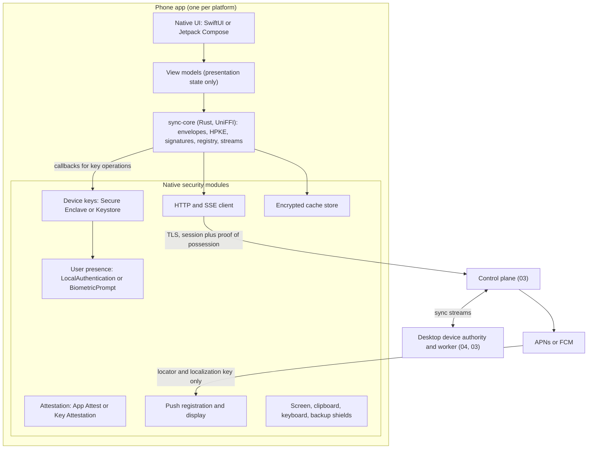
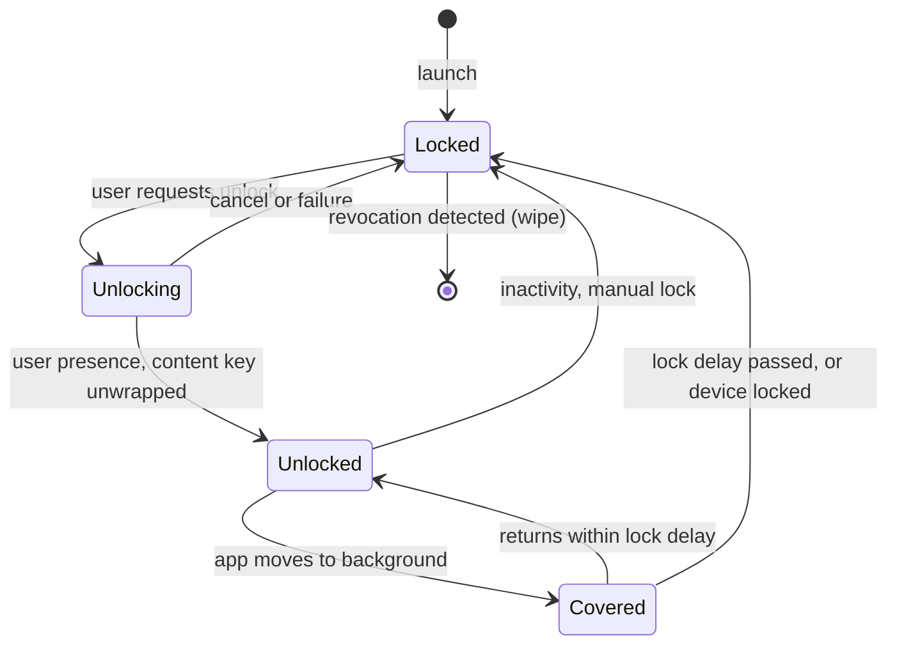
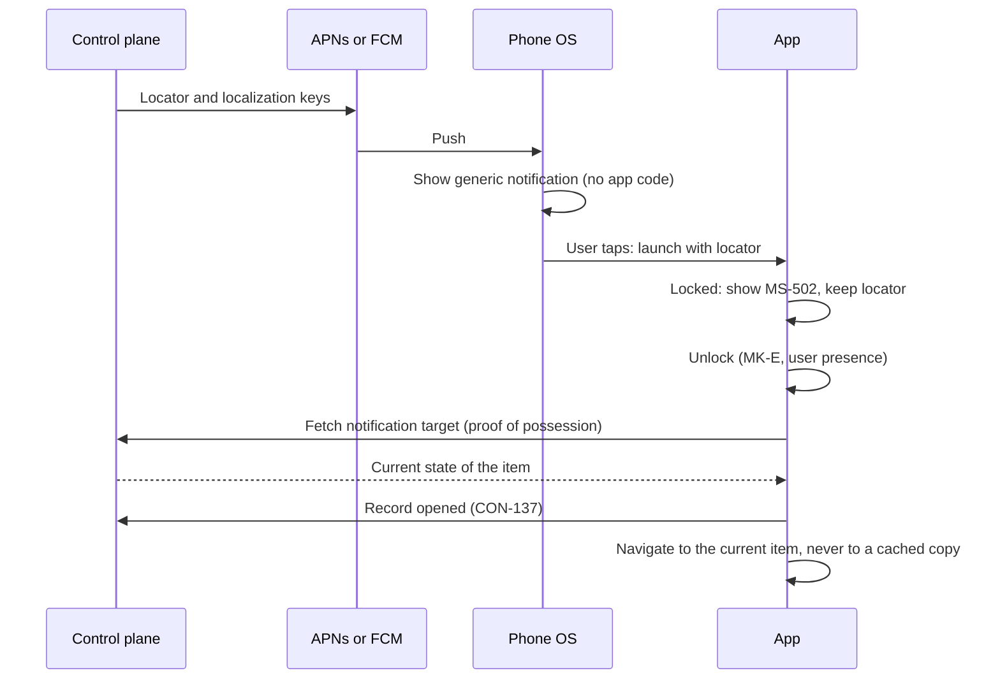

# 05_MOBILE_COMPANION_PLAN.md

## 1. Document Control and Status

| Item | Value |
| --- | --- |
| Document | Sixth of eight pre-production documents |
| Version and date | 0.3, 2026-09-30 (0.2 plus section 31, the security fixes applied upstream; 0.2 was 0.1 plus the gap review fixes of section 30) |
| Status | Draft for product-owner review. The decisions that need the owner are listed in section 31.4, which replaces sections 29.2 and 30.11; nothing in this document is binding until the owner approves it. |
| Upstream baseline | `00_PRODUCT_AND_SYSTEM_PLAN.md` v1.3, `01_SHARED_CONTRACTS_AND_DOMAIN_MODEL.md` v1.3, `02_SECURITY_AND_THREAT_MODEL.md` v1.3, `03_CONTROL_PLANE_AND_WORKER_RUNTIME_PLAN.md` v1.2, and `04_DESKTOP_APPLICATION_PLAN.md` v1.0, all approved by the product owner on 2026-09-29 |
| Other inputs | `Job_Automation_PLAN_Generator_Prompt.md` (`Generator`), `DEP_Prompt.md` (`DEP`), `AUDIT_RECORD_2026-09-29.md`, project instructions, the project chats of 2026-09-27 to 2026-09-30, dated research in section 28 (accessed 2026-09-30) |
| Owner | Mobile companion architecture; the product owner approves decisions marked for approval |
| Intended readers | Product owner, security reviewer, runtime and desktop plan authors (`03`, `04`) for the proposed additions in section 26.2, UX author (`06`), roadmap author (`07`), implementation agents |
| Downstream consumers | `06` (mobile screen inventory, notification copy, approval friction, accessibility on iOS and Android), `07` (mobile prerequisites, phases M0 to M3, experiments, store gates), `02` and `03` at their next revisions (mobile threats and controls, stop acknowledgement, device registry, proof-of-possession sessions, domain association files) |

Change control follows the rule used by `00` to `04`: identifiers are never renumbered or reused; a changed decision records old and new wording, affected sections and documents, migration consequences, and owner approval. Identifiers introduced here use the `5xx` range: `ADR-501`, `MB-CF-501` (conflicts and gaps), `MB-P1` (principles), `MA-501` (mobile action groups), `MS-501` (mobile screens), `NT-501` (notification kinds), `MK-C`, `MK-D`, `MK-E` (mobile device keys), `THR-501`, `CTRL-501`, `FAIL-501`, `EXP-501`, `ASM-501`, `RISK-501`, `OQ-501`, `AC-501`, `RES-501`, and `CHG-501`. They do not replace upstream identifiers. `THR-5xx` and `CTRL-5xx` refine `02` for the mobile surface and are proposed for `02`'s index at its next revision (`MB-CF-513`).

This document specifies the mobile companion for iOS and Android. It authorizes no application development, no Apple Developer Program or Google Play enrollment, no push credentials, no control-plane deployment, and no store submission.

## 2. Executive Summary

The mobile companion is a remote control and review surface for the product. It shows run status, notifications, jobs, prepared packages, and later review bundles; it sends pause, stop, and emergency stop; it records a small set of signed user decisions. It never executes work, never holds a job-site session, a model key, or a destination grant, and never becomes authoritative for anything (`00` `POL-13`, `AC-10`).

Mobile is not part of the MVP (`00` section 34). It depends on four things that do not exist yet: a deployed control plane (`03` section 22, `OQ-307`), the synchronization phase (`01` `CON-143`, `03` section 20), the end-to-end encryption protocol of `02` `ADR-205` (`OQ-208`), and the desktop sync client (`04` section 21.1). This document therefore designs the companion now so that `07` can sequence it, and so that the sync protocol is designed with the phone's constraints in view. Section 4.4 lists the prerequisites.

The principal decisions are these:

1. **Native UI on each platform, one shared Rust protocol core (`ADR-501`, `ADR-502`).** SwiftUI on iOS and Jetpack Compose on Android, both calling a Rust library, `sync-core`, through UniFFI bindings [RES-514]. The same library is linked into the desktop core, so the end-to-end encryption, signature, and registry rules are implemented once for every client. This proposal replaces the provisional Flutter choice of `00` `ARCH-05`, because every security-bearing part of the phone app (hardware keys, biometric prompts, attestation, push, screen protection) must be native code anyway, the desktop no longer uses Flutter (`04` `ADR-401`), and native UI gives the smallest trusted code base and the best accessibility. This needs owner approval (`MB-CF-502`).
2. **Three hardware-bound device keys per phone (`ADR-505`).** A command key `MK-C` signs every request and low-consequence commands; a decision key `MK-D` signs consequential decisions and can be used only after a fresh biometric check, never with the device passcode alone; a content key `MK-E` unwraps the account content key of `02` `ADR-205` and is used only after a biometric check at app unlock. None is exportable, synchronized, or backed up. This is the design `03` section 22.2 assigns to `05` ("the device's key storage and presentation") and the phone's own device key that `02` `ADR-205` item (4) requires.
3. **Enrollment only by pairing with an enrolled device (`ADR-507`).** A phone joins the account by scanning a QR code on an already enrolled desktop, comparing a short verification code on both screens, and receiving the account content key wrapped to its `MK-E`. The recovery phrase of `02` `CTRL-241` is never typed on a phone. Device keys are recorded in a device registry signed by enrolled devices, so a control-plane operator cannot add a device of its own (`MB-CF-505`).
4. **A phone approves only what it has shown (`ADR-511`).** A consequential decision is signed by `MK-D` over the exact bundle revision and digest, the single-use nonce, and the authority revision (`01` `CON-136`), after the phone has decrypted and displayed every part of the bundle, including every document page. If document pages are not available on the phone, the phone can decline or defer but cannot approve. The biometric signature is proposed as the `02` `CTRL-225` step-up for registered phones, so one prompt suffices (`MB-CF-503`).
5. **Push is a doorbell (`ADR-514`).** APNs and FCM payloads carry an opaque locator and a localization key only; the text a lock screen or a paired watch can show is generic and comes from the app's own strings. Tapping opens the app, which unlocks and fetches current state. Delivery, opening, and tapping never authorize anything (`02` `CTRL-208`).
6. **Offline is read-only (`ADR-515`).** Offline, the phone shows cached projections with their last authoritative sync time and a stale label, sends nothing, and queues nothing. A stop pressed offline is refused with an explanation, never shown as sent (`02` `CTRL-207`, `01` `CON-144`).
7. **Stops are acknowledged by the worker, not by the screen (`ADR-513`).** A stop moves through `SENT`, `ACCEPTED`, `WORKER_CONFIRMED`, or `WORKER_UNREACHABLE`, and the worker's confirmation is a receipt signed by the worker's own key, so neither the network nor the control plane can fake it (`MB-CF-504`).
8. **No background execution (`ADR-516`).** The app runs code only while it is in the foreground, plus the operating system's own display of a notification. No background refresh, no processing tasks, no foreground service, no location.
9. **Distribution follows the owner's free-tier rule until a decision is needed (`ADR-517`, `MB-CF-501`).** Android can be built, signed, and installed on the owner's own phone at no cost. An iOS companion cannot work without the paid Apple Developer Program: a free personal team cannot use push notifications or associated domains, and its profiles expire after 7 days [RES-505]. The owner decides at mobile phase entry whether to enroll, go Android-first, or defer iOS. Nothing is paid for before then.

## 3. Upstream Baseline, Inherited Obligations, and Conflict Register

### 3.1 Inherited decisions this document implements

| Upstream | Mobile consequence |
| --- | --- |
| `00` section 15, `POL-13`, `AC-10`, `03` section 21.1 | The phone monitors, reviews, decides, notifies, and stops; it is never a worker and never registers as one. Sections 4, 6. |
| `00` section 18 ("Desktop worker plus phone") | The phone reaches the control plane only; it has no path to the desktop's files. Section 5. |
| `00` section 19 capability matrix | Companion UI, no general worker, no browser automation, Keychain and Keystore for credentials, platform signing and review. Sections 4.5, 15, 20. |
| `00` section 29, `POL-06`, `ARCH-13`, `01` `CON-135` to `CON-137`, `SM-103` | Push is a hint; decisions are item- and version-bound, single-use, server-checked, and audited; two devices racing yield one decision. Sections 11, 13. |
| `00` section 33 | Mobile surfaces: current run, compact job and review detail, exact bundle inspection, approval, notification inbox, stop, account security. Section 6.3. |
| `00` section 34 | Mobile approvals are deferred beyond the MVP. Section 4.4. |
| `00` `ARCH-05` | Provisional Flutter, "change if approval flows or accessibility prototype fail". Re-evaluated in section 5.2 (`MB-CF-502`). |
| `00` section 39.1 | `05` owns the mobile packaging approach, push notification design, mobile release path, and, with `03`, authentication. Sections 5, 7, 13, 20. |
| `01` `CON-140`, `CON-142`, `ADR-103` | Commands carry actor, device, realm, expected revision, and idempotency key; streams have monotonic sequences and gaps force a snapshot. Sections 11, 14. |
| `01` `CON-143`, `CON-144`, `CON-145`, section 29.2 | The control plane is the authority after enrollment; offline clients cannot label anything current; tombstones need replica acknowledgement; protected classes are client-encrypted and consequential commands are device-signed. Sections 9, 14. |
| `02` `ADR-205`, `CTRL-237`, `OQ-208` | The phone holds its own device key and decrypts review content itself; `05` designs the device side of the protocol with `03`. Sections 8, 9. |
| `02` `CTRL-203` to `CTRL-208`, `CTRL-225`, `CTRL-226`, section 29.7 | The synchronization and mobile release gate. Sections 21, 23. |
| `02` `THR-206`, `THR-207`, `THR-216`, `IR-202`, `IR-206` | Approval replay, stale mobile cache, stale replica, lost device, unauthorized approval. Sections 21, 22. |
| `03` `ADR-303`, sections 7.2, 7.5 | HTTP with JSON and SSE over verified TLS; OpenAPI shared with every client. Section 5. |
| `03` `ADR-306` | Remote heartbeat 10 s, lease TTL 45 s; these bound stop confirmation. Section 12. |
| `03` section 22.2 | Passkeys, Argon2id fallback, 15-minute access tokens, 30-day device sessions with rotation and reuse detection, 5-minute step-up, device record; "the device's key storage and presentation are `05`'s design". Sections 7, 8. |
| `03` section 22.3 | APNs with token authentication and FCM HTTP v1; opaque payloads; "client-side handling belongs to `05`". Section 13. |
| `03` section 33.10 | Content validation runs in the device authority; consequential commands carry a device signature. Sections 9, 11. |
| `04` `ADR-409`, `OQ-402` | One identifier namespace per product; name and identifiers deferred until before `06`. Section 20.1. |
| `04` section 12.4, `01` `CON-144` | Display preferences and their merge rules; the phone adds its own device-local list. Section 19.3. |
| `04` section 21 | Desktop sign-in, devices view, and approvals in the sync phase; the phone pairs with this desktop client. Section 8.5. |
| `04` section 30, `00` `CHG-017` | Free signing tiers only until the owner decides to monetize. Section 20, `MB-CF-501`. |

### 3.2 Obligations assigned to this document

| Obligation | Source | Section |
| --- | --- | --- |
| Mobile packaging approach (framework) | `00` section 39.1, `ARCH-05` | 5.2 |
| iOS and Android flows | `00` section 38 | 6, 7, 8, 11, 12 |
| Secure registration | `00` section 38, `03` section 22.2 | 8 |
| Device key storage and presentation | `03` section 22.2, `02` `ADR-205` item (4) | 8 |
| Authentication implementation on the phone | `00` section 39.1, `02` `CTRL-225` | 7 |
| Push notification design and client handling | `00` section 39.1, `03` section 22.3, `02` `CTRL-208` | 13 |
| Offline behavior | `00` section 38, `02` `CTRL-207`, `01` `CON-137`, `CON-144` | 14 |
| Mobile release path, store release | `00` sections 38, 39.1 | 20 |
| Build, packaging, signing, updates, distribution (mobile side) | `00` section 39.1 | 20 |
| Mobile side of the end-to-end protocol | `02` `OQ-208` | 8, 9, 26.2 |
| Mobile acceptance tests | `02` `AC-202`, `AC-203`, `AC-206`, `AC-215`; `01` `AC-106`, `AC-107`, `AC-110`; `00` `AC-09`, `AC-10` | 25 |
| Mobile platform performance, accessibility, and compatibility gates | `01` section 27 (`NFR-03`, `NFR-05`, `NFR-08`) | 18, 19 |

### 3.3 Conflict and gap register

| ID | Statements and affected documents | Practical consequence | Recommended resolution | Approval |
| --- | --- | --- | --- | --- |
| `MB-CF-501` | `00` `CHG-017` and `04` section 30 use only free signing tiers until the owner decides to monetize. An iOS companion needs the paid Apple Developer Program (USD 99 per year [RES-504]): push notifications, associated domains (passkeys, universal links), and App Attest are unavailable to a free personal team, and a free team's provisioning profile expires 7 days after creation [RES-505]. Android needs no payment for personal use: FCM is free, and an app installed with `adb` is exempt from Google's new developer verification [RES-506]. Affects `00`, `04`, `07`. | An iOS companion cannot meet this design on the free tier. An Android companion can. | Keep the free-tier rule through the MVP and the sync phase. At mobile phase entry the owner chooses: (a) enroll in the Apple Developer Program for the iOS companion, (b) build Android first on the free path, or (c) defer iOS until monetization. The choice depends on which phone the owner uses (`OQ-501`). No cost is incurred by approving this document. | Owner decision at mobile phase entry |
| `MB-CF-502` | `00` `ARCH-05` provisionally selects Flutter "with native platform channels for security and push". Section 5.2 compares the options and recommends native SwiftUI and Jetpack Compose with a shared Rust core. The premise of code sharing with the desktop no longer holds, because `04` `ADR-401` chose Tauri with React. Affects `00`, `07`. | Language count, trusted code size, and accessibility differ by option. | Replace `ARCH-05`'s provisional choice with `ADR-501` and `ADR-502`. Flutter becomes the named fallback if `EXP-501` shows the two native UIs cannot be maintained. | Owner approval; `00` records it at its next revision |
| `MB-CF-503` | `03` section 22.2 defines step-up as "a fresh WebAuthn assertion no older than 5 minutes"; `01` section 29.2 separately requires approvals to be signed by the device key. On a phone that means two biometric prompts per decision, and synced passkeys (iCloud Keychain, Google Password Manager) are not bound to the registered device. Affects `02`, `03`. | Double prompts invite approval fatigue; a passkey alone does not prove which registered device decided. | For a registered phone, the `MK-D` signature with hardware-enforced per-use biometric verification (section 8) is the step-up proof for the command it signs. WebAuthn stays for sign-in, session renewal, device enrollment, and recovery. `02` `CTRL-225`'s rule (fresh user verification bound to the decision) is kept and made stronger, since the proof is bound to the command itself and to the device. | Owner approval; `03` section 22.2 and `02` `CTRL-225` note it at their next revisions |
| `MB-CF-504` | `01` `CON-137` requires that stop commands have an authoritative acknowledgement and `02` `CTRL-207` requires the phone to "label stop unacknowledged", but no contract defines acknowledgement states or how a phone learns them. Affects `01`, `03`. | Each client would invent its own stop status. | Add a `stop_status` projection to `GetRunStatus` with states `ACCEPTED`, `WORKER_CONFIRMED`, and `WORKER_UNREACHABLE` (the phone adds the local `SENT`), and a stop receipt signed by the worker installation's key (section 12). | Additive proposal to `01` and `03`; owner approval |
| `MB-CF-505` | `03` section 22.2 binds a device record to the account; `02` `ADR-205` item (2) says adding a device needs an existing device or the recovery key. No document says how a client knows that a device key in the registry was really added by the user. Under `ADR-205` the control plane is not trusted with content, so it must not be able to add a device key either. The same gap applies to verifying human decision signatures before an external effect. Affects `02`, `03`. | A malicious operator could register its own "device", receive the wrapped content key, and read everything; it could also forge an approval if workers trust the control plane's word. | A device registry in which every enrollment and revocation is signed by an enrolled device's decision key or by the recovery key, verified by every client from its pinned enrollment anchor, and verified by the worker before any external effect (section 8.6). Input to `02` `OQ-208`. | Owner approval with `OQ-208`; independent review of the protocol before the sync phase |
| `MB-CF-506` | `03` section 7.5 requires a request nonce on mutating remote requests; session tokens are bearer tokens. A token copied from a phone (memory, logs, a proxy) could be replayed from another machine until it expires. Affects `03`. | Bearer tokens on phones are a common theft target. | Every request from a phone carries a proof-of-possession signature by `MK-C` over method, path, body digest, time, and nonce, in the manner of OAuth DPoP [RES-516]; the control plane rejects a token presented without a valid proof from the device key registered with its session (section 7.2). | Additive proposal to `03`; owner approval |
| `MB-CF-507` | Passkeys in native apps require the relying-party domain to publish an association file: `apple-app-site-association` with `webcredentials` for iOS [RES-510, RES-511], `assetlinks.json` for Android [RES-512]. `03` section 22.1's self-hosted bundle and installer checks do not serve or check them. Affects `03`. | Passkey sign-in from the phone would fail on a self-hosted control plane. | The control-plane artifact serves both files from its configuration, and the installer checks them. | Additive proposal to `03`; no approval beyond this document |
| `MB-CF-508` | `01` section 21.2 keeps document bytes on the worker by default and `02` `PRIV-202` requires separate consent for explicit document sync. A phone cannot review "exact documents" (`00` section 29) without them. Affects `01`, `02`, `03`. | Mobile review of packages or bundles is impossible without some document transfer. | "Review on phone" consent (off by default) allows the desktop to publish the page images of a package or bundle under review as end-to-end encrypted blobs, deleted from the control plane when the item is decided, superseded, or 7 days old (section 9.4). Without it, the phone shows digests and structure and cannot approve (`ADR-511`). | Owner decides the default in `06`; the mechanism is within `PRIV-202` |
| `MB-CF-509` | `00` section 19 lists iOS background execution as "restricted, scheduled/continued tasks only" and Android as "restricted, scheduled/foreground work only". `ADR-516` uses none. Affects `00`. | None; narrower than allowed. | Record the narrowing; `00` may cite `ADR-516` at its next revision. | None |
| `MB-CF-510` | `00` section 19 lists file destinations on iOS and Android. The companion has no file destination and exports nothing to phone storage (section 16.2). Affects `00`. | None; narrower than allowed. | Record the narrowing. | None |
| `MB-CF-511` | `01` `CON-144` allows offline clients to create private edits or proposals. The phone creates none (`ADR-515`). Affects `01`. | None; stricter than allowed. | Record the narrowing. | None |
| `MB-CF-512` | `01` `SM-102` moves a package from `READY_FOR_REVIEW` to `COMPLETE` when "materials accepted" and the commit succeeds in one step. A phone can accept materials while the Mac is asleep, so acceptance and commit can be minutes or hours apart. Affects `01`, `03`, `04`. | Without a rule, a phone acceptance could either be lost or commit a package whose claims changed after acceptance. | A signed acceptance record on the package (accepting device, manifest digest, time). The desktop's `commit` principal commits only if the digests still match and the `SM-102` guards still hold at commit time; otherwise the acceptance is void and the user is told (section 11.3). No new state. | Additive refinement to `01` `SM-102` guard wording; owner approval |
| `MB-CF-513` | `02` has no threats or controls specific to phones (screen capture, lock screens and paired watches, accessibility services and overlays, platform backups, attestation). Affects `02`. | Mobile controls would otherwise live only here. | `THR-501` to `THR-514` and `CTRL-501` to `CTRL-515` (section 21) are proposed for `02`'s register and index at its next revision. | Owner approval |
| `MB-CF-514` | `04` section 12.4 lists desktop display preferences; `01` `CON-144` needs the full list of fields that may merge. The phone has preferences of its own. Affects `01`, `04`. | Gap. | Section 19.3 lists the phone's preferences; all are device-local and never synchronized. | None |
| `MB-CF-515` | `03` section 22.3 has the control plane send through APNs and FCM. Both require credentials of the app's publisher: an APNs key of the Apple team that signs the app, and a service account of the Firebase project that the app is registered in. A self-hosted control plane run by someone else cannot hold the publisher's credentials. Affects `03`, `07`. | For the owner's personal builds this is not a problem (the owner is publisher and operator). For any distribution with self-hosting, push needs a publisher-operated relay. | Personal phase: the owner's own credentials on the owner's control plane. Before distribution: a push relay that receives only a device token, a locator, and a localization key, designed with `OQ-505`. | Owner decision before any distribution |

## 4. Scope, Principles, Prerequisites, and Platform Tiers

### 4.1 Scope

In scope: the iOS and Android companion apps, their architecture, the Rust protocol core as used on phones, identity and sessions on the phone, device keys, enrollment, revocation, local storage, app lock, review and decision flows, run control and stop acknowledgement, push notification handling, offline and stale behavior, platform hardening, performance and accessibility baselines, build, signing, distribution, and store release, mobile failure handling, mobile tests, and the mobile side of the end-to-end protocol. Out of scope: the control plane's server implementation (`03`), the desktop sync client (`04`), visual design, copy, flows, and tokens (`06`), and phase order and CI/CD (`07`). The full end-to-end protocol (`02` `OQ-208`) is designed jointly with `03`; this document fixes the phone's requirements on it.

### 4.2 Mobile principles

| ID | Principle | Consequence |
| --- | --- | --- |
| `MB-P1` | The phone is a remote control, not a worker. | No task is ever leased to a phone; no browser, fetch, parse, render, model call, relay, or package write runs on it (`POL-13`). |
| `MB-P2` | Nothing on the phone is authoritative. | Everything shown is a projection with its authority revision and its age; every change is a command the authority accepts or rejects. |
| `MB-P3` | A consequential action is a signed, user-verified, single-use command, checked by the authority and again by the worker before any effect. | No notification, deep link, cached screen, or background event can cause one. |
| `MB-P4` | Push is a doorbell. | A push carries a locator and a localization key; it has no content and no authority. |
| `MB-P5` | Plaintext lives only in memory, only while the app is unlocked. | Stored content stays ciphertext; the content key is unwrapped at unlock and discarded at lock. |
| `MB-P6` | Fail visible. | Stale, offline, unacknowledged, unreachable, and revoked are named states on screen, never hidden behind the last good value. |
| `MB-P7` | Minimal surface. | No background execution, no custom URL scheme, no file export, no sensitive clipboard use, no WebView, no third-party analytics, crash, advertising, or attribution SDK. |

### 4.3 What the phone never holds

Model provider keys (`CON-151` `MODEL_API_KEY`), job-site sessions (`SITE_SESSION`), local endpoint tokens, worker credentials, the desktop's database key, destination grants, source query settings (`SOURCE_QUERY`), evidence originals, relay packages, and the recovery phrase of `02` `CTRL-241`. Each of these stays where `02` and `04` put it. A design change that would place one of them on a phone requires a new `02` review.

### 4.4 Prerequisites before any mobile build

| Prerequisite | Owner | Why the phone needs it |
| --- | --- | --- |
| A control plane chosen and deployed, hosted or self-hosted (`03` `OQ-307`, section 22) | Product owner, `03` | The phone talks only to the control plane (`00` section 18) |
| Identity implemented: passkeys, sessions, step-up, recovery (`02` `CTRL-225`, `03` section 22.2) | `03` | Sign-in and session renewal |
| Synchronization phase complete: enrollment `CMD-111`, replication, tombstones (`03` section 20) | `03`, `04` | Projections to display and the only path for commands |
| End-to-end protocol designed and independently reviewed (`02` `OQ-208`, `CTRL-237`, `AC-228`), including this document's requirements (section 26.2) | `03`, `05`, reviewer | The phone decrypts content and signs commands under that protocol |
| Desktop sync client with devices view and pairing (`04` sections 21.1, 21.2, `EXP-415`) | `04` | Enrollment of a phone needs an enrolled desktop (`ADR-507`) |
| For iOS only: the owner's decision on `MB-CF-501` | Product owner | Push, passkeys, App Attest |

### 4.5 Platform tiers and minimum versions

**`ADR-518` Mobile platform floors.** Context: `00` section 19 leaves minimum versions to the platform plans. The design depends on specific APIs: Secure Enclave keys with biometric access control and CryptoKit HPKE on iOS; Keystore key agreement (`PURPOSE_AGREE_KEY`, API 31 [RES-518]), per-use biometric signatures (`BiometricPrompt.CryptoObject(Signature)`, API 28), and crypto-bound key agreement prompts (`CryptoObject(KeyAgreement)`, API 35 [RES-519]) on Android; passkeys (iOS 16 and later [RES-510]; Credential Manager on Android [RES-512]). Decision:

| Tier | Platform | Declared minimum | Tested | Build requirement |
| --- | --- | --- | --- | --- |
| Reference | The owner's own phone (`OQ-501`) | As below | Only the reference phone, recorded in `EXP-506` | As below |
| iOS | iPhone | iOS 18.0 (provisional) | Reference iPhone if iOS is chosen | Built with Xcode 26 or later and the iOS 26 SDK or later, which App Store Connect requires for uploads since 2026-04-28 [RES-508] |
| Android | Phones with a secure lock screen and a Class 3 (strong) biometric | Android 12, API 31 (provisional) | Reference Android phone if Android is chosen | Target API 36 or later for Google Play from 2026-08-31 [RES-507]; the same target for sideloaded builds, so behavior does not diverge |
| Tablets | iPad, Android tablets | Not supported | No | Layouts may run; no claim |

Reasons: iOS 18 keeps the untested range small while covering every API above; it is two major versions behind the iOS release current at this writing (Flutter 3.47's release notes prepare for the iOS 27 SDK [RES-509], which suggests that iOS 27 is current or imminent; this is an inference, and `EXP-506` records the actual version). Android 12 is the lowest level with Keystore ECDH. On Android 12 to 14, `MK-E` uses a 10-second authentication window instead of a crypto-bound prompt (section 8.3). A declared minimum is not a support claim: only the reference phone is tested until `07` adds devices. Invalidation: raise a floor if `EXP-502` or `EXP-503` finds an API missing or unreliable at that level.

### 4.6 Mobile phases

`07` owns the sequence; this table defines what each phase contains so it can be scheduled.

| Phase | Contents | Entry condition |
| --- | --- | --- |
| `M0` Platform spikes | `EXP-501` to `EXP-510` on the reference phone with synthetic data only; no product release | Prerequisites of section 4.4 designed (not necessarily built) |
| `M1` Monitor and stop | Sign-in, pairing, app lock, run status, pause, stop, emergency stop with acknowledgement, notification inbox, job triage (`CMD-114`), readiness and health views, devices view and device revocation | Sync phase shipped; `M0` passed; the `M1` criteria of section 25 |
| `M2` Package review | Package manifest and page images under "Review on phone" consent, signed package acceptance (`MB-CF-512`), outcome recording (`CMD-109`), applications timeline | `M1` accepted |
| `M3` Decisions | Review bundle inspection and `CMD-107` decisions; resuming or starting a run from a saved run configuration | The Hybrid phase exists on the desktop and worker (`00` section 34); `02` section 29.7 gates for Hybrid |

## 5. Mobile Architecture

### 5.1 Components



The phone app has three layers. The UI and view models present data and collect intents. The native security modules own everything that needs a platform API or the app's code signature. `sync-core` owns every rule that must be identical on every client: canonical encoding of signed payloads, envelope encryption and decryption, device registry verification, bundle and receipt signature checks, command construction, and stream sequencing. The UI never sees a key, a token, or ciphertext, and never builds a signed payload itself.

### 5.2 Technology decision

**`ADR-501` Mobile UI technology.** Context: `00` `ARCH-05` chose Flutter provisionally, with native channels for security and push, subject to an approval-flow and accessibility prototype. Since then, `04` `ADR-401` chose Tauri with React for the desktop, `02` `ADR-205` put device-bound cryptography on every client, and the owner made security the first priority (`00` section 42.2). The companion has about 14 screens (section 6.3). Every security-bearing function of the app needs native platform code regardless of the UI framework.

| Criterion | Native (SwiftUI and Jetpack Compose) with Rust core | Flutter with Rust core and native modules | React Native with native modules | Kotlin Multiplatform with native UI |
| --- | --- | --- | --- | --- |
| Languages the maintainer adds beyond the desktop's Rust, TypeScript, Python | Swift, Kotlin | Dart, Swift, Kotlin | Swift, Kotlin (TypeScript shared) | Kotlin, Swift |
| UI codebases | Two | One | One | Two |
| Code that sees decrypted content | Native UI plus Rust core | Dart heap plus the platform channel plus native modules plus Rust core | JavaScript heap plus the bridge plus native modules plus Rust core | Kotlin core plus native UI |
| Runtime added to the trusted base | None beyond the OS UI frameworks | Flutter engine and Dart runtime | Hermes JavaScript engine and the React Native runtime | Kotlin/Native runtime on iOS |
| Third-party package exposure | Smallest | Pub packages for platform glue unless written in-house | Large npm dependency tree | Moderate |
| Accessibility | Native VoiceOver and TalkBack semantics | Flutter maps its own semantics tree to the platform; good, but a second layer to test | Native views; good | Native |
| Platform conventions (`06` platform-specific UX) | Free | Emulated | Mostly native | Free |
| Risk of code loaded after install | None | None (ahead-of-time compiled) | Over-the-air JavaScript updates are possible and must be banned by policy | None |
| Sharing with the desktop | Rust core, generated API types | Rust core | TypeScript types, Rust core | Rust core would duplicate Kotlin logic |

Decision: native SwiftUI on iOS and native Jetpack Compose on Android, over the shared Rust core of `ADR-502`. Reasons: (1) the native option adds the fewest languages, because Swift and Kotlin are needed for the security modules under every option; (2) it adds no runtime to the trusted base and keeps decrypted content out of an extra managed heap and bridge; (3) accessibility and platform conventions come from the OS, which matters for an approval screen whose correctness depends on the user seeing everything; (4) with the protocol logic in Rust and the API types generated from `03`'s OpenAPI description, the duplicated work is presentation only. React Native is rejected because it would place a JavaScript runtime and a large npm tree in the app that holds the decision key. Kotlin Multiplatform is rejected because the protocol already lives in Rust shared with the desktop core; a Kotlin implementation would be a second one.

Consequences: two UI codebases of about 14 screens each; `06` designs each platform's conventions rather than one compromise layout; implementation agents need SwiftUI and Compose skills. Invalidation: if `EXP-501` shows that keeping two UIs in step costs more than one maintainer can carry (measured as the effort to build `MS-503` and `MS-509` on both platforms), switch the UI to Flutter over the same Rust core and native modules, which is the named fallback. This replaces `ARCH-05`'s provisional choice (`MB-CF-502`).

### 5.3 Shared protocol core

**`ADR-502` `sync-core`, one Rust library for every client.** Context: `02` `ADR-205` moves content validation and signing to clients; the desktop core is Rust (`04` `ADR-401`); a protocol implemented separately in Rust, Swift, and Kotlin would drift, and drift in a signature or encryption format is a security defect. Decision: one Rust crate, `sync-core`, linked into the desktop core and, through UniFFI-generated Swift and Kotlin bindings [RES-514], into both phone apps.

| `sync-core` owns | Platform code owns |
| --- | --- |
| Canonical encoding of every signed or encrypted payload | Creating and using hardware keys (the core calls back for sign and key agreement; it never receives private key bytes) |
| HPKE unwrap of the account content key [RES-515], AEAD decryption of synchronized records, content key versioning | Prompting for user presence and binding it to the key operation |
| Device registry chain verification (section 8.6) | Attestation evidence generation |
| Bundle, manifest, and worker receipt signature verification | Network transport, TLS, proxies |
| `CON-140` command envelopes, idempotency keys, proof-of-possession payloads | Push token registration and notification display |
| Stream cursors, gap detection, snapshot triggers (`CON-142`), tombstone acknowledgement | Screen, clipboard, keyboard, and backup shields |
| Cache record encryption and expiry | File protection classes and storage locations |
| Zeroizing its own buffers | Everything the user sees |

Rules: the core has no network client and no clock of its own (both are injected, so tests control them); every function that verifies something returns a typed result, never a boolean that a caller could ignore; the core is fuzzed with malformed envelopes as part of `02` `CTRL-235`'s corpus. Consequence: a protocol change is one change, tested once, and shipped to all clients at once; the minimum client version rule of `01` `ADR-104` applies to the core's protocol version.

### 5.4 What runs where

| Computation | Where | Reason |
| --- | --- | --- |
| Claim grounding, eligibility, bundle assembly and validation | Desktop device authority (`03` section 33.10) | The phone has no claim ledger and must not validate content |
| Signing the bundle and manifest digests | Desktop device authority | The phone verifies the signer before display |
| Decrypting records and bundles for display | Phone, `sync-core` | End-to-end encryption (`02` `ADR-205`) |
| Verifying bundle, registry, and receipt signatures | Phone, `sync-core` | The phone does not trust the control plane for content or device identity |
| Ordering, compare-and-set, nonce and expiry checks, audit | Control plane | Single authority (`01` `CON-143`) |
| Re-verifying the human decision signature before an external effect or a commit | Worker installation and desktop `commit` principal | A control-plane compromise cannot forge a decision (`MB-CF-505`) |
| Rendering page images for review | Desktop `work-private` role | Existing renderer (`04` `ADR-411`); the phone never parses PDF or DOCX |
| Displaying text, page images, and notifications | Phone | Presentation |

## 6. Capabilities, Actions, and Screens

### 6.1 Mobile action groups

Each group names the `01` commands and queries the phone may use, the key that signs them, and the phase. Queries are read through the authenticated session with a proof of possession (section 7.2). "Online only" means the phone sends nothing when the control plane is unreachable (`ADR-515`).

| ID | Group | Commands and queries | Signing key | Allowed on the app lock screen | Phase |
| --- | --- | --- | --- | --- | --- |
| `MA-501` | Session | Passkey sign-in, session renewal, sign-out of this device, sign-out everywhere | `MK-C` proof; WebAuthn for sign-in | Sign-out only | `M1` |
| `MA-502` | Run monitoring | `GetRunStatus`, `GET /v1/events` (SSE while in the foreground), worker health | `MK-C` proof | Run state and counts only, no job or candidate content | `M1` |
| `MA-503` | Run risk reduction | `CMD-106` `ChangeRunState` to pause, graceful stop, emergency stop | `MK-C` | Yes | `M1` |
| `MA-504` | Run resume and start | `CMD-106` resume; `CreateRun` from a saved run configuration made on the desktop | `MK-D` | No | Resume `M1`; start `M3` |
| `MA-505` | Job triage | `GetJobWithObservations` (compact), `GetDecisionExplanation`, `CMD-114` shortlist, dismiss, restore | `MK-C` | No | `M1` |
| `MA-506` | Package review | `GetPackageManifest`, page images (section 9.4), signed package acceptance (`MB-CF-512`) | `MK-D` for acceptance | No | `M2` |
| `MA-507` | Review decisions | `GetReviewBundle`, `CMD-107` `DecideReview` approve or decline | `MK-D` | No | `M3` |
| `MA-508` | Notification inbox | Notification list, record opened state (`CON-137`) | `MK-C` | Count only | `M1` |
| `MA-509` | Devices and security | List devices and workers with capabilities, heartbeat age, and revocation state; `CMD-112` `RevokeDevice`; enroll another device as the enrolling device (section 8.5); security events | `MK-D` for revoke and enroll | No | `M1` |
| `MA-510` | Readiness and health | `GetReadiness`, source health, worker health, backup freshness reported by the desktop | `MK-C` proof | No | `M1` |
| `MA-511` | Sync status | `GetSyncStatus`, conflicts listed for resolution on the desktop, tombstone acknowledgement | `MK-C` | No | `M1` |
| `MA-512` | Applications and outcomes | `GetApplicationTimeline`; `CMD-109` `RecordExternalOutcome`; outcome events of `CON-152` | `MK-D` for `CMD-109`; `MK-C` for outcome events other than submission confirmation | No | `M2` |

### 6.2 Actions the phone does not offer

| Action | Where it stays | Reason |
| --- | --- | --- |
| Claim confirmation and withdrawal (`CMD-101`, `CMD-102`) | Desktop | Needs the claim ledger and evidence; the desktop authority validates |
| Preferences, targets, eligibility facts, destinations (`CMD-103`) | Desktop | Policy changes need the full context; destinations are desktop grants |
| Merge and split (`CMD-104`) | Desktop | Needs observation-level detail |
| Relay export and reply (`CON-153`) | Desktop | Relay packages hold candidate data and use the clipboard; phone keyboards and clipboards are harder to contain (`04` section 32.7); relay needs the desktop checklist |
| Provider keys, source settings, `SOURCE_QUERY` | Desktop | Secrets and policy |
| Reconciliation (`CMD-110`), manual action resolution (`CMD-113`) | Desktop | Needs the employer site and evidence |
| Export and deletion of all data | Desktop | Step-up, save panel, residue report (`04` section 20) |
| Enrollment of the first device, recovery with the phrase | Desktop | `ADR-507`; the phrase is never typed on a phone |

### 6.3 Screen inventory

`06` designs layouts, copy, and flows for each platform. This list fixes what each screen needs from the platform and its phase.

| ID | Screen | Contents | Action groups | Platform integration | Phase |
| --- | --- | --- | --- | --- | --- |
| `MS-501` | Welcome, sign-in, and pairing | Control-plane address from the QR code, passkey sign-in, verification code comparison, notification permission request after pairing | `MA-501`, `MA-509` | Camera for the QR code, passkey sheet | `M1` |
| `MS-502` | App lock | Unlock, and while locked: current run state, pause, stop, emergency stop | `MA-503` | LocalAuthentication, BiometricPrompt | `M1` |
| `MS-503` | Home | Active runs with state, worker online state, items needing attention, stale or offline banner | `MA-502`, `MA-503` | None | `M1` |
| `MS-504` | Run detail | Stage counts, budgets used, worker and slot status, stop status (section 12), run history | `MA-502` to `MA-504` | None | `M1` |
| `MS-505` | Notification inbox | Items in the authority's queue, newest first, with opened state | `MA-508` | None | `M1` |
| `MS-506` | Jobs (compact list) | Shortlist queue and recent evaluated jobs, filters from the desktop's saved filters | `MA-505` | None | `M1` |
| `MS-507` | Job detail | Posting summary, eligibility outcome, fit explanation, observations, triage actions | `MA-505` | External link opening (section 16.4) | `M1` |
| `MS-508` | Package review | Manifest, validation summary, page images of each document, acceptance | `MA-506` | Biometric prompt for `MK-D` | `M2` |
| `MS-509` | Review bundle and decision | Every `CON-135` element: job grouping, observation, destination, eligibility evidence, fit, document pages, answers, disclosures, warnings, policy; approve or decline | `MA-507` | Biometric prompt for `MK-D` | `M3` |
| `MS-510` | Applications and outcomes | Timeline, record an outcome | `MA-512` | None | `M2` |
| `MS-511` | Devices and security | This phone's keys and attestation status, other devices and workers, revoke, enroll another device, security events, sign out everywhere | `MA-509` | Biometric prompt for `MK-D`; camera | `M1` |
| `MS-512` | Readiness and health | Readiness blockers (resolved on the desktop), source health, worker health, backup freshness | `MA-510` | None | `M1` |
| `MS-513` | Sync status | Last sync per stream, conflicts to resolve on the desktop, pending tombstones | `MA-511` | None | `M1` |
| `MS-514` | Settings | Lock timing, notification kinds, "Review on phone" status (set on the desktop), version and protocol version, about, licenses | Local | None | `M1` |

## 7. Identity, Sign-In, and Sessions

### 7.1 Passkeys and domain association

The account's primary authenticator is a passkey (`02` `CTRL-225`, `03` section 22.2). On iOS the app uses the AuthenticationServices platform passkey APIs, which require the Associated Domains entitlement with a `webcredentials:` entry for the relying-party domain and an `apple-app-site-association` file on that domain [RES-510, RES-511]. On Android the app uses Credential Manager, which requires a Digital Asset Links `assetlinks.json` file on the relying-party domain that names the app's package and signing certificate fingerprint [RES-512]. The relying-party ID is the control plane's domain. The control plane serves both files from its configuration and its installer checks them (`MB-CF-507`).

Password fallback (Argon2id, `03` section 22.2) is entered only in the platform's secure text field, with autocorrect and learning off; the phone never stores it. Email links, where email is used, open the desktop flow only; the phone app does not register as a handler for email verification links (section 16.4).

### 7.2 Sessions bound to the device

**`ADR-503` Proof-of-possession sessions on the phone.** Context: `03` section 22.2 issues opaque 15-minute access tokens and up to 30-day device sessions with refresh rotation and reuse detection; `03` section 7.5 requires a nonce on mutating requests. A bearer token on a phone can leak through a debugging proxy, a crash artifact, or a compromised network library. Decision:

1. The session is created only after device enrollment (section 8.5) and is bound to the phone's registered `dev_` ID and its `MK-C` public key.
2. Every request from the phone, read or write, carries a proof header: a signature by `MK-C` over the HTTP method, the path, the SHA-256 of the body, the access token's digest, the phone's current time, and a fresh 128-bit nonce [RES-516]. The control plane accepts a proof only within 120 seconds of its own clock and rejects a nonce seen in the last 24 hours (the `03` section 7.5 window).
3. Tokens are stored in the Keychain with the class "when passcode set, this device only" on iOS, which also makes them disappear if the passcode is removed, and in a file encrypted with a non-exportable Keystore AES key that requires an unlocked device on Android. Neither is ever in a backup (section 16.3).
4. A token without a valid proof from the key registered with its session is rejected and raises a security event (`02` `CTRL-222`).

Consequence: a stolen token is useless without the phone's hardware key. This is additive to `03` section 7.5 (`MB-CF-506`).

### 7.3 Step-up for decisions

**`ADR-504` Hardware-verified step-up on registered phones.** Context: `02` `CTRL-225` requires a step-up proof no older than 5 minutes at a consequential decision; `03` section 22.2 implements it as a WebAuthn assertion; `01` section 29.2 requires device-signed approvals. Decision: on a registered phone, the `MK-D` signature over the exact command is the step-up proof. `MK-D` requires a fresh strong biometric match for every signature, enforced by the Secure Enclave or Keystore (section 8), and its properties were checked at enrollment (section 8.4). The control plane accepts a consequential command from a phone only with a valid `MK-D` signature over the command's canonical payload, whose `issued_at` is within 120 seconds of receipt. Reasons: the proof is bound to the decision, the device, and a live user in one step; a synced passkey cannot provide device binding; one prompt per decision reduces approval fatigue. WebAuthn remains required for sign-in, session renewal after expiry, enrolling another device, and account recovery. This refines, and does not weaken, `CTRL-225` (`MB-CF-503`).

### 7.4 Sign-out, session loss, and recovery

- **Sign-out of this device** revokes the phone's session at the control plane, discards tokens, deletes the cache, and keeps the device keys and registration, so the next sign-in needs no new pairing. It is not a revocation.
- **Revocation** (from any device, `CMD-112`) deletes everything on the phone at next contact (section 8.8).
- **Session expiry** after 30 days of no use requires passkey sign-in; the registration and keys remain valid.
- **Account recovery** (`02` section 10) revokes every session and pending decision, places submission-capable actions on the 24-hour hold, and requires the phone to be paired again.

## 8. Device Keys and Enrollment

### 8.1 Key inventory

**`ADR-505` Three hardware-bound keys per phone.** Context: `02` `ADR-205` item (4) requires the phone's own device key; `03` section 22.2 assigns its storage and presentation to `05`; `02` `CTRL-232` prefers non-exportable hardware keys with user presence. One key cannot serve all needs: request signing must work without a prompt, decisions must require a biometric match every time, and unwrapping content must follow the app lock. Decision:

| Key | Algorithm | Purpose | Hardware | User verification per use | Available when | Invalidated by |
| --- | --- | --- | --- | --- | --- | --- |
| `MK-C` command key | ECDSA P-256 | Proof of possession on every request (`ADR-503`); signs `MA-503`, `MA-505`, `MA-508`, `MA-511`, and outcome events | Secure Enclave; Android StrongBox, else TEE | None | Device unlocked | App deletion, passcode removal (Android: secure lock screen removal) |
| `MK-D` decision key | ECDSA P-256 | Signs consequential commands: `MA-504`, `MA-506` acceptance, `MA-507`, `MA-509` revoke and enroll, `CMD-109` | Secure Enclave; StrongBox, else TEE | Strong biometric for every signature; the device passcode alone is not accepted | Device unlocked | App deletion, passcode removal, any change to enrolled biometrics |
| `MK-E` content key | ECDH P-256 | Unwraps the account content key (HPKE recipient key [RES-515]) at app unlock | Secure Enclave; StrongBox, else TEE | Strong biometric by default; the device passcode also works only if the owner turns on the weaker setting "Allow device passcode to unlock the app" (`OQ-509`) | Device unlocked | App deletion, passcode removal; in the default mode, any change to enrolled biometrics |

Reasons for the biometric-only rule on `MK-D`: a person who has watched the owner type the device passcode and then steals the phone must not be able to approve or revoke. The same reasoning applies to reading: with the passcode fallback on, that person could open the app and read cached bundles, which is why the fallback for `MK-E` is off by default. Reasons for invalidating `MK-D` (and, by default, `MK-E`) when biometrics change: adding a new fingerprint or face requires only the passcode, so an attacker with the passcode could otherwise enroll their own biometric. After a biometric change the owner pairs the phone again (section 8.7). A phone without a strong biometric can register without `MK-D`, with the passcode setting on, and is then limited to the non-consequential groups (`OQ-506`).

No key is ever exported, synchronized, placed in a backup, or passed to `sync-core` or the UI. `sync-core` calls the platform for each signature or key agreement and receives only the result.

### 8.2 iOS realization

| Key | Creation | Access control | Notes |
| --- | --- | --- | --- |
| `MK-C` | CryptoKit `SecureEnclave.P256.Signing` [RES-513] | Private key usage; usable only while the device is unlocked | No prompt |
| `MK-D` | `SecureEnclave.P256.Signing` | Private key usage plus current biometry set; `LAContext` with no reuse window | Face ID or Touch ID for each signature; `NSFaceIDUsageDescription` present |
| `MK-E` | `SecureEnclave.P256.KeyAgreement` | Private key usage plus current biometry set (default), or plus user presence when the passcode setting is on (the key is recreated and re-wrapped when the setting changes) | The `LAContext` evaluated at unlock authorizes the one key agreement that unwraps the content key |

The keys' opaque representations are stored as Keychain items with the "when passcode set, this device only" class. Whether CryptoKit's HPKE recipient accepts a Secure Enclave key directly is checked in `EXP-503`; if it does not, `sync-core` performs the HPKE key schedule with the shared secret produced by the Secure Enclave's key agreement.

### 8.3 Android realization

| Key | Creation (`KeyGenParameterSpec`) | Access control | Notes |
| --- | --- | --- | --- |
| `MK-C` | EC P-256, `PURPOSE_SIGN`, `setIsStrongBoxBacked(true)` with fallback to TEE on `StrongBoxUnavailableException` [RES-517] | `setUnlockedDeviceRequired(true)` | No prompt |
| `MK-D` | EC P-256, `PURPOSE_SIGN`, StrongBox preferred | `setUserAuthenticationRequired(true)`, `setUserAuthenticationParameters(0, AUTH_BIOMETRIC_STRONG)` (per operation), `setInvalidatedByBiometricEnrollment(true)` [RES-517] | Signature authorized through `BiometricPrompt` with a `CryptoObject(Signature)` |
| `MK-E` | EC P-256, `PURPOSE_AGREE_KEY` (API 31 and later [RES-518]), StrongBox where it supports key agreement, else TEE | `AUTH_BIOMETRIC_STRONG` by default, plus `AUTH_DEVICE_CREDENTIAL` when the passcode setting is on; invalidated by biometric enrollment in the default mode. API 35 and later: per operation, authorized through `CryptoObject(KeyAgreement)` [RES-519]. API 31 to 34: authentication valid for 10 seconds after a `BiometricPrompt` with the same authenticators | The 10-second window on older versions is the only place the design accepts a time window; `EXP-502` measures it |

The security level actually obtained (StrongBox or TEE) is recorded in the device registry entry and shown on `MS-511`.

### 8.4 Attestation

**`ADR-506` Hardware and app attestation at enrollment.** Context: a phone that is an emulator, a modified build, or a device with software-only keys must not receive the content key or decision rights. Decision:

| Platform | Evidence | Verified by | Result required |
| --- | --- | --- | --- |
| Android | Keystore key attestation certificate chains for `MK-C`, `MK-D`, and `MK-E` [RES-520, RES-523]; the attestation records the security level, key purposes, the user authentication requirements, and the device's root of trust where the device provides it | Control plane and the enrolling device, both against pinned Google attestation roots; the control plane also checks the revocation status list | Security level TEE or StrongBox; purposes and authentication flags exactly as section 8.3; verified boot and locked bootloader where reported. Failure refuses enrollment |
| iOS | App Attest attestation of an app-instance key [RES-521], then an App Attest assertion over the digest of the three public keys | Control plane (App Attest root), and the enrolling device | Valid attestation for the app's identifier and team; valid assertion over the key set. Failure refuses enrollment |

On iOS the Secure Enclave keys' access-control flags cannot be attested; the assertion shows that the genuine app created and presented them, which is the strongest statement the platform allows. Play Integrity is not used in the personal phase, because the Android build is not distributed through Google Play and key attestation already covers the keys; it is reconsidered before Play distribution (`OQ-507`). App Attest assertions are also attached to every `MK-D`-signed command on iOS, so a cloned token plus a cloned key representation on another device fails.

Attestation is a hurdle, not proof of an uncompromised phone: a device compromised after enrollment keeps its keys. The residual risk is `RISK-503`.

### 8.5 Enrollment by pairing

**`ADR-507` Phone enrollment only from an enrolled device.** Context: `02` `ADR-205` item (2) allows adding a device through an existing device or the recovery key. Typing a 24-word recovery phrase on a phone exposes it to the keyboard, the screen, and shoulder surfing. Decision: a phone is enrolled only by an enrolled device that holds a decision key (in practice the desktop, later another phone), through the following steps.

```mermaid
sequenceDiagram
  participant U as Owner
  participant D as Enrolled desktop
  participant P as Phone
  participant C as Control plane
  U->>D: Devices, Add phone (WebAuthn step-up on the desktop)
  D->>C: Create pairing (expires in 5 min)
  C-->>D: Pairing ID
  D->>U: QR: control-plane URL, realm, pairing ID, 256-bit pairing secret, fingerprint of D's decision key
  U->>P: Scan QR in the app
  P->>C: Passkey sign-in (WebAuthn)
  P->>P: Create MK-C, MK-D, MK-E; produce attestation
  P->>C: Enrollment request: public keys, attestation, proof keyed by the pairing secret
  C->>C: Verify attestation, pairing, session
  C-->>D: Pending enrollment (keys, attestation)
  D->>D: Verify attestation; compute verification code from pairing secret, both key sets
  P->>P: Compute the same verification code
  U->>U: Compare the 6-digit code on both screens
  U->>D: Confirm (biometric for D's decision key)
  D->>C: Registry entry for P signed by D; content key wrapped to P's MK-E
  C-->>P: Registry entry, wrapped content key
  P->>P: Verify registry entry against the pinned fingerprint of D; unwrap with MK-E after user presence
  P-->>U: Enrolled
```

Rules: the QR code is shown only on the enrolling device's own screen, never sent over a network; the pairing expires after 5 minutes or one use; the verification code covers both key sets, so a control plane that swaps either set produces a mismatch; three failed comparisons cancel the pairing and create a security event. The phone pins the enrolling device's decision key fingerprint from the QR code as its trust anchor for the registry. Enrolling another device from the phone (for example a replacement phone) follows the same steps with the phone as the enrolling device.

### 8.6 Signed device registry

The registry is an append-only list of entries, each signed by the decision key of an enrolled device or by the recovery key of `02` `CTRL-241`:

| Entry | Contents | Signed by |
| --- | --- | --- |
| Genesis | The first desktop's device keys, created at sync enrollment (`CMD-111`) | That desktop's decision key and the recovery key |
| Enroll | New device ID, platform, public keys, key security levels, attestation digest, capability set (`FULL`, `NO_DECISIONS`), enrolling device ID, time, previous entry digest | An enrolled device's decision key |
| Revoke | Device ID, reason, time, previous entry digest | An enrolled device's decision key, or the recovery key |
| Worker key | Worker installation ID, its signing public key (for stop receipts and effect records), time, previous entry digest | An enrolled device's decision key |

Every client verifies the chain from its pinned anchor before trusting any key in it, and remembers the highest entry it has seen; a control plane that serves an older chain than a client has already seen is reported as a security event (`FAIL-515`). Workers and the desktop `commit` principal verify the human decision signature and the signer's registry entry before an external effect or a commit (`MB-CF-505`). The exact encoding is part of `02` `OQ-208`.

### 8.7 Re-enrollment triggers

| Trigger | Detected by | Effect | Recovery |
| --- | --- | --- | --- |
| Biometric set changed | `MK-D` (and, in the default mode, `MK-E`) operation fails as invalidated | Decisions unavailable; in the default mode the app cannot unlock content; run state and the lock-screen stop controls still work, since they use `OPERATIONAL` data and `MK-C` | Pair again from an enrolled device to replace the invalidated keys (a new registry entry supersedes the old ones) |
| Device passcode removed | Keys unusable, Keychain items deleted | App returns to first run | Set a passcode and pair again |
| App deleted and reinstalled, or phone restored from a backup or moved to a new phone | Keys absent ("this device only") | App returns to first run; the old registration stays until revoked | Revoke the old entry from any device; pair again |
| OS update invalidates keys (not expected; tested in `EXP-502`) | Key operations fail | Same as above | Same |

### 8.8 Revocation and wipe

Revocation (`CMD-112`, `EVT-112`) may be issued from any enrolled device with `MK-D`, or from the desktop recovery flow. The control plane invalidates the phone's sessions and pending decisions at once (`02` `CTRL-207`). An enrolled device then rotates the account content key: it generates a new key version, wraps it for every remaining device and the recovery key, and encrypts new content only under the new version; the revoked phone's copy of old keys cannot read anything created afterwards. When the revoked phone next reaches the control plane, it receives a revoked status, deletes its tokens, cache, and keys, and shows that it was revoked. A phone that never reconnects keeps its ciphertext cache, which it cannot open without `MK-E` and user presence (`RISK-502`). The phone's tombstone acknowledgement state is shown to other devices as `PENDING` or `UNREACHABLE` (`01` `CON-145`, `02` `AC-215`).

## 9. End-to-End Content on the Phone

### 9.1 What the phone decrypts

The phone decrypts only the records it displays: job projections, decision explanations, package manifests and page images under consent, review bundles, application timelines, and notification targets. It never receives evidence originals, claim histories beyond what a bundle cites, answer libraries, or relay exchanges (section 4.3). The control plane sends it only the streams `MA-5xx` need.

### 9.2 Local cache

**`ADR-508` Ciphertext cache with a content key held only while unlocked.** Decision:

1. Synchronized records are stored exactly as received: ciphertext plus `OPERATIONAL` metadata (entity ID, revision, authority revision, stream sequence, received time). Nothing is re-encrypted with a weaker key.
2. The account content key is unwrapped with `MK-E` at app unlock and held only in `sync-core`'s memory. It is zeroized at app lock, on backgrounding past the lock delay, and on memory pressure warnings.
3. Local metadata that is not synchronized (stream cursors, notification IDs, preferences) lives in a small database encrypted with an AES-256-GCM key: on iOS a Keychain item of class "when passcode set, this device only"; on Android a non-exportable Keystore key with `setUnlockedDeviceRequired(true)`. The database file uses the iOS "complete" file protection class and Android credential-encrypted storage.
4. Expiry: review bundles and package page images are deleted when the item is decided or superseded, or 7 days after receipt; job and run projections after 14 days without refresh; everything on sign-out, revocation, or `FAIL-511`. Storage is capped at 200 MB with oldest-first eviction.
5. The cache lives in a location the OS does not back up (section 16.3).

### 9.3 Memory hygiene

Swift and Kotlin strings cannot be reliably erased, so decrypted text in view models is short-lived: view models hold decrypted content only for the visible screen and release it on navigation, lock, and backgrounding. `sync-core` zeroizes its key and plaintext buffers. The app sets no debuggable flag in release builds (Android) and ships without the `get-task-allow` entitlement (iOS), so other processes cannot attach. Residual copies in freed memory are covered by `RISK-507`.

### 9.4 Document previews on the phone

**`ADR-509` Page images published per item under consent.** Context: `MB-CF-508`. Decision: when the owner has turned on "Review on phone" (a desktop setting, off by default, with `PRIV-201` consent text by `06`), the desktop publishes, for each package entering `READY_FOR_REVIEW` and each review bundle, the page images that the `work-private` role already renders for validation (`04` `ADR-411`), encrypted under the account content key, as blobs referenced by the manifest or bundle digest. The control plane deletes them when the item is decided, superseded, or 7 days old. The phone displays them in memory and never writes decrypted pages to storage; it offers no share, save, print, or open-in action. With the setting off, the phone shows the manifest, digests, and validation summary, and `ADR-511` blocks approval.

Page images, not PDF or DOCX files, are sent so that the phone runs no document parser (`02` `CTRL-214`) and the files cannot be opened in another app.

### 9.5 Requirements on the end-to-end protocol

For `02` `OQ-208`, the phone requires:

1. A content key hierarchy with versions, wrapping per device with HPKE (DHKEM P-256, HKDF-SHA256, AES-256-GCM [RES-515]), because P-256 is the only curve both the Secure Enclave and the Keystore support for key agreement.
2. Rotation of the content key by any enrolled device with `MK-D`, triggered by every revocation (section 8.8).
3. The signed registry of section 8.6, with an anchor pinned at pairing and a rule against rollback.
4. Bundle and manifest digests signed by the desktop device authority that assembled them, so the phone can check the signer before display.
5. Worker-signed stop receipts and effect records, with worker keys in the registry.
6. Records addressable per stream, so the phone can receive only the streams it needs.
7. A metadata budget: the control plane sees IDs, revisions, states, digests, timestamps, and sizes; it never sees titles, employer names, or document text of the protected classes.

## 10. App Lock and User Presence

### 10.1 Rules

**`ADR-510` Cryptographic app lock.** Decision: the app lock is the unwrapping of the account content key with `MK-E`, so unlocking needs the hardware key and user presence, as the desktop's `K2` tier does (`02` `ADR-207`).

| Aspect | Rule |
| --- | --- |
| Unlock | Face ID, Touch ID, or an Android Class 3 biometric. The device passcode works only if the owner turned on "Allow device passcode to unlock the app" (off by default, `OQ-509`); it never authorizes `MK-D` |
| Lock triggers | Launch; returning from the background after the lock delay (default 60 s; options immediately, 60 s, 5 min); 5 minutes without interaction in the foreground; device lock; manual lock |
| On lock | Zeroize the content key; release decrypted view state; show the lock screen |
| While locked | Only `MS-502`: run state from `OPERATIONAL` data, pause, stop, emergency stop (signed by `MK-C`), sign-out |
| On backgrounding | The app replaces its window content with a privacy cover before the OS captures the app-switcher snapshot (section 16.1) |
| Decisions | Always an additional `MK-D` biometric prompt, even when unlocked (`ADR-504`) |

### 10.2 Lock states



### 10.3 Stop controls from the lock screen

Pause, graceful stop, and emergency stop are available on `MS-502` without unlocking the app, as on the desktop (`04` section 6.5, `02` `ADR-209`), because they only reduce risk. They need the device itself to be unlocked (`MK-C` requirement) and the network (`ADR-515`). Emergency stop needs a confirmation step that `06` designs with an accessible alternative to any hold or slide gesture (section 19).

## 11. Review, Approval, and Package Acceptance

### 11.1 Display rules for a bundle or package

1. The phone fetches the item, verifies the desktop authority's signature over its digest against the registry, and decrypts it. A signature failure shows "cannot verify this item" and offers nothing else (`FAIL-513`).
2. Every `CON-135` element is displayed, in the order `06` defines, including every page of every document and every answer with its exact question. Nothing is summarized away.
3. The approve or accept control stays disabled until the owner has opened each section and viewed each page. Decline is always available.
4. The screen shows the bundle revision, its age, and the authority revision it was fetched at. When the event stream reports a newer revision, the screen shows that the item changed and must be reloaded, and the decision controls are disabled until it is.
5. Untrusted text (posting text, employer names, answers derived from forms) is rendered as plain text; links inside it are not tappable (section 16.4).

### 11.2 Decision protocol

**`ADR-511` A phone approves only what it has shown.** Decision: an approval from a phone is valid only if all of these hold, checked where stated.

| Check | Where |
| --- | --- |
| The phone displayed every element of the bundle revision it signs, including all document pages; without page images the phone can decline but not approve | Phone (UI gate) |
| The decision payload names the approval ID, decision, bundle revision and digest, single-use nonce, expected authority revision, registry head, device ID, and `issued_at` (`01` `CON-136`, section 24.3) | Phone, `sync-core` |
| The payload is signed by `MK-D` after a fresh biometric match | Phone hardware |
| Session, proof of possession, device registration, nonce unused, expiry, bundle revision current, digest match, compare-and-set `PENDING` to `ACCEPTED` or `DECLINED`, audit with the signature | Control plane (`02` `CTRL-206`) |
| The signature and the signer's registry entry are verified again before any external effect | Worker installation (`MB-CF-505`) |

```mermaid
sequenceDiagram
  participant U as Owner
  participant P as Phone
  participant C as Control plane
  participant W as Worker
  P->>C: GetReviewBundle (proof of possession)
  C-->>P: Encrypted bundle, desktop signature, approval ID, nonce, expiry
  P->>P: Verify signature and registry; decrypt; display all sections
  U->>P: Approve
  P->>U: Biometric prompt bound to MK-D signature
  P->>C: CMD-107 DecideReview (payload, MK-D signature, MK-C proof)
  C->>C: Checks and compare-and-set; EVT-107 with signature
  C-->>P: Accepted, or ERR-106 BUNDLE_STALE, or ERR-107 ALREADY_DECIDED
  C-->>W: Directive with the accepted decision
  W->>W: Verify MK-D signature against the registry before any effect
```

A losing device in a race receives `ERR-107` and the accepted outcome (`01` `AC-107`). A stale revision receives `ERR-106` and reloads (`01` `AC-106`). A notification tap only opens the item (`AC-203`).

### 11.3 Package acceptance from the phone

**`ADR-512` Signed acceptance, commit on the desktop.** Context: `MB-CF-512`. Decision: in Manual mode, the phone's acceptance of a package in `READY_FOR_REVIEW` is a signed record: package ID, package revision, manifest digest (every member digest), accepting device, `MK-D` signature, and time. The package stays in `READY_FOR_REVIEW` with an `accepted` marker. When the desktop is next running, its `commit` principal verifies the signature and the registry entry, checks that the manifest digest still matches and that every `SM-102` guard still holds (claims current, destination usable), and commits (`04` `ADR-421`). If anything changed, the acceptance is void, the package returns to plain `READY_FOR_REVIEW`, and the phone is told why. The phone shows "Accepted, commit pending on the desktop" until `EVT-106` arrives.

### 11.4 Outcomes

Recording "submitted" (`CMD-109`) changes the application identity guard (`01` `CON-141`), so it uses `MK-D`. Other outcome events of `CON-152` (response received, interview scheduled, rejection) use `MK-C`. Corrections follow `01`'s correction events.

## 12. Run Control and Stop Acknowledgement

### 12.1 Controls

The phone offers pause, graceful stop, and emergency stop for each active run (`03` section 11.2), and resume with `MK-D`. It never offers an action that `03` does not define. Commands carry idempotency keys; a retry after a timeout reuses the key (`01` `ADR-103`).

### 12.2 Stop status

**`ADR-513` Stop status with worker-signed receipts.** Context: `MB-CF-504`. Decision:

| State | Meaning | Set by | Shown as |
| --- | --- | --- | --- |
| `SENT` | The phone sent the command and has no response yet | Phone only | "Sending" |
| `ACCEPTED` | The authority committed the run transition and revoked leases (`03` section 11.2) | Control plane | "Stop accepted; waiting for the worker" |
| `WORKER_CONFIRMED` | The worker installation reported that no task of the run is leased and, for emergency stop, that every role process working on the run has ended; the report is signed by the worker's registry key | Worker receipt verified by the phone | "Stopped on (worker name)" |
| `WORKER_UNREACHABLE` | No heartbeat from the worker within one remote lease TTL (45 s, `03` `ADR-306`) after `ACCEPTED` | Control plane | "Worker unreachable: work in progress may continue until its lease expires; any effect in progress is uncertain" |

A request that fails before `ACCEPTED` returns the phone to the previous state with the error; the phone never displays a stop it cannot prove.

```mermaid
sequenceDiagram
  participant P as Phone
  participant C as Control plane
  participant W as Worker (MacBook Pro)
  P->>C: CMD-106 emergency stop (MK-C)
  C->>C: Revoke leases of the run; forbid effect starts
  C-->>P: ACCEPTED
  W->>C: Heartbeat (within 10 s)
  C-->>W: Directive REVOKED
  W->>W: Terminate role work of the run
  W->>C: Stop receipt signed by the worker key
  C-->>P: Receipt (event stream)
  P->>P: Verify receipt against the registry; WORKER_CONFIRMED
```

### 12.3 Timing

With a remote heartbeat of 10 s (`03` `ADR-306`), a reachable worker confirms within about 15 s of `ACCEPTED`; the phone shows elapsed time while waiting. `ACCEPTED` itself is bound by the network round trip (target in section 18). The local 5-second stop target of `00` `NFR-04` applies to a stop issued on the desktop, not through the control plane; `06` must not present a phone stop as equivalent.

## 13. Push Notifications

### 13.1 Transport

The control plane's `notify` module sends through APNs with token-based authentication (a `.p8` key of the Apple team that signs the app) [RES-502] and through FCM HTTP v1 with a service account of the Firebase project the Android app is registered in [RES-503]; the legacy FCM APIs were shut down starting 2024-07-22 [RES-503]. Push credentials are `SECRET` class on the control plane and never reach the phone. For the owner's personal builds, the owner is both the publisher and the operator, so the owner's own credentials are used (`MB-CF-515`).

### 13.2 Payload

**`ADR-514` A push carries a locator and a localization key, nothing else.** Context: `02` `CTRL-208` allows only an opaque locator and minimal generic text; phones show notifications on the lock screen and mirror them to paired watches and, depending on OS settings, to other devices. Decision:

| Field | APNs | FCM (Android) |
| --- | --- | --- |
| Visible text | `aps.alert` with `title-loc-key` and `loc-key` only; the strings come from the app bundle | `notification` with `title_loc_key` and `body_loc_key`; visibility `PRIVATE` |
| Locator | `ntf`: the `ntf_` ID | `data.ntf`: the `ntf_` ID |
| Grouping | `apns-collapse-id` set to the `ntf_` ID; `thread-id` set to the notification class | `tag` set to the `ntf_` ID; channel per class |
| Priority | High (10) only for `NT-503`, `NT-506`, `NT-507`; otherwise normal (5) | High only for the same kinds; normal otherwise |
| Not included | Job titles, employer names, counts, run IDs, candidate data, bundle digests, URLs, any server-supplied text | Same |

The server therefore sends no human-readable text at all. The localization keys name only the class of event. Android notification messages are displayed by the system even when the app process is not running, so no background code runs to show them (`ADR-516`).

### 13.3 Notification kinds

| ID | Kind | Generic text (English, final copy by `06`) | Opens |
| --- | --- | --- | --- |
| `NT-501` | Run finished, stopped, or failed | "A run has an update" | `MS-504` |
| `NT-502` | Run paused and needs attention (budget, readiness lost, worker unavailable) | "A run needs your attention" | `MS-504` |
| `NT-503` | Stop not confirmed: worker unreachable after `ACCEPTED` | "Stop not confirmed" | `MS-504` |
| `NT-504` | Package ready for review (`M2`) | "Items are ready for review" | `MS-505` |
| `NT-505` | Review bundle awaiting decision (`M3`) | "Items are ready for review" | `MS-505` |
| `NT-506` | Security: a device was enrolled or revoked, a sign-in from a new device, account recovery started, registry anomaly | "Security alert: open the app" | `MS-511` |
| `NT-507` | Pending acceptance voided or decision rejected as stale | "An item needs another look" | `MS-505` |
| `NT-508` | Sync conflict to resolve on the desktop | "Something needs attention on your desktop" | `MS-513` |

Security notifications (`NT-506`) cannot be turned off; the others can be turned off per kind in `MS-514`. Each kind is also listed in the in-app inbox, which is the authoritative list (`00` section 32: push failure keeps the item in the queue).

### 13.4 Client handling



Rules: the locator is looked up at the authority; if the item was decided, superseded, or deleted, the app says so and opens the inbox. A locator that the authority does not know, or that belongs to another account, is an ordinary "not found" and is logged as a security event. The app never acts on a push while it is in the foreground except to refresh the inbox badge. Duplicate or delayed pushes change nothing (`02` `AC-203`).

### 13.5 Registration, permission, and fallbacks

- The push token is registered with the control plane after pairing, bound to the `dev_` ID, and updated whenever the OS issues a new one; a revoked device's token is deleted.
- Notification permission is requested after pairing, with an explanation from `06`, not at first launch. On Android 13 and later the runtime notification permission is required.
- If permission is denied, the token is invalid, Google Play services are missing (FCM unavailable), or delivery fails, the inbox and the badge on the next launch are the fallback; `MS-511` shows push as unavailable with the reason (`FAIL-503`, `FAIL-504`, `03` `FAIL-323`).
- An Android build without Google Play services receives no push in this design. UnifiedPush with a self-hosted distributor is a possible later alternative, evaluated only if `OQ-501` names such a phone.

### 13.6 Exposure through lock screens, watches, and push providers

Because the text is generic, what a lock screen, a paired Apple Watch or Wear OS watch, or a mirrored notification shows is only the product name and the event class. Apple and Google still learn that the device has the app installed and when notifications are sent; timing can reveal activity patterns. This is inherent to using the platforms' push services and is recorded as `RISK-505`.

## 14. Synchronization, Offline, and Stale State

### 14.1 Streams in the foreground

While unlocked and in the foreground, the app holds one SSE connection to the control plane's event stream (`03` section 7.2) for the streams it needs, tracks `stream_seq`, and refetches a snapshot after any gap before enabling a consequential control (`01` `CON-142`, `AC-114`). On backgrounding it closes the stream. On return it resumes from the last sequence. There is no persistent socket and no polling in the background (`ADR-516`).

### 14.2 Offline behavior

**`ADR-515` Offline is read-only.** Decision:

| Situation | Behavior |
| --- | --- |
| Control plane unreachable (`03` `FAIL-324`) | Banner with the last authoritative sync time; every screen shows projections labeled stale; no command is sent or queued, including triage and outcomes |
| Stop pressed offline | Refused with "No connection. The stop was not sent." and guidance to use the desktop; never shown as `SENT` |
| Review bundle or package open when the connection drops | Decision and acceptance controls disabled; the item stays readable until its cache expiry |
| Reconnection | Fetch tombstones, then snapshots for gapped streams, then re-enable controls; items that changed show the change |
| Clock far off (more than 120 s from the server's time) | Signed requests are rejected (`ADR-503`); the app shows the clock problem instead of retrying (`FAIL-510`) |

This is stricter than `01` `CON-144` allows (`MB-CF-511`) and satisfies `02` `CTRL-207` and `01` `AC-110`.

### 14.3 Deletion and tombstones

The phone applies tombstones from every stream it follows, deletes the cached ciphertext and any page images, and acknowledges each tombstone (`01` `CON-145`, `03` section 20.3). A phone returning after a long absence must fetch the tombstone stream and a snapshot before it sends any command (`02` `AC-215`).

### 14.4 Conflicts

Sync conflicts (`ERR-113`) are listed on `MS-513` with both revisions' metadata and resolved on the desktop, where the claim ledger and evidence are. The phone never resolves a conflict.

## 15. Background Execution

**`ADR-516` No background execution.** Context: `00` section 19 records that iOS grants only defined background opportunities and Android constrains sustained background work; the Generator forbids promising unrestricted background automation or sustained inference on phones. Android 15 limits `dataSync` foreground services to 6 hours in 24 hours [RES-501], and apps targeting Android 12 or later cannot start foreground services from the background except under listed exemptions [RES-05 in `00`]; iOS background tasks are scheduled at the system's discretion with no guaranteed timing [RES-03 in `00`]. Decision: the companion runs code only in the foreground. It schedules no `BGAppRefreshTask`, `BGProcessingTask`, or continued-processing task on iOS; it declares no foreground service type, no `WorkManager` job, no exact alarm, and no boot receiver on Android; it requests no location, Bluetooth, or background audio permission. Notifications are displayed by the OS from the push payload.

Reasons: every function of the companion needs the user to look at the screen; background code would need the content key, which is held only while unlocked (`ADR-508`); background work is where platform review and battery policies bite hardest (App Review guideline 2.5.4 limits background services to their intended purposes [RES-453 in `04`]). Consequence: the inbox and run status are fresh only when the app is opened; the push tells the owner when to open it. This narrows `00` section 19 (`MB-CF-509`).

## 16. Platform Hardening

### 16.1 Screen capture and the app switcher

| Threat | iOS | Android |
| --- | --- | --- |
| App-switcher snapshot | Replace the window content with a privacy cover when the scene resigns active, before the system snapshot | `setRecentsScreenshotEnabled(false)` on Android 13 and later; `FLAG_SECURE` on every window |
| Screenshots | Cannot be prevented by an app. The app observes the screenshot notification and records a local security note; sensitive screens show a one-time reminder that screenshots leave the app's protection | `FLAG_SECURE` on every window blocks screenshots and non-secure displays |
| Screen recording, mirroring, AirPlay | Observe the capture state; while captured, sensitive screens (`MS-507` to `MS-510`) are replaced by a notice | `FLAG_SECURE` |

The iOS screenshot gap is recorded as `RISK-504`. `FLAG_SECURE` also blocks the owner's own screenshots on Android; there is no option to turn it off in this design.

### 16.2 Clipboard, keyboards, sharing, and files

- The app places no candidate or application content on the clipboard and offers no copy action on sensitive screens. The only copyable values are a job's public posting URL and diagnostic codes; on iOS they are local-only with a 2-minute expiry; on Android they are marked with the sensitive-content clip extra (Android 13 and later).
- iOS: the app refuses third-party keyboard extensions for the whole app. Android: text fields that accept sensitive input use the no-personalized-learning IME flag; the only free-text inputs are search filters and the password fallback.
- No share sheet, no "open in", no document provider, no file export, and no download to phone storage (`MB-CF-510`).

### 16.3 Backups and data leaving the device

- iOS: Keychain items use "this device only" classes; the cache and metadata database live in a directory marked excluded from backup; no iCloud entitlement.
- Android: `android:allowBackup="false"` and data extraction rules that exclude every domain from cloud backup and device-to-device transfer; keys are non-exportable by construction.
- A restored or migrated phone therefore starts at first run (section 8.7).

### 16.4 Links and deep links

The app registers no custom URL scheme. It accepts universal links (iOS) and verified app links (Android) only on the control plane's domain, only for the path form `/n/{ntf_}` and `/pair`, and treats both as navigation hints: `/n/` resolves like a push locator (section 13.4), and `/pair` only opens the scanner. No link can carry a command, a token, or a decision. Links inside posting text are displayed as text; the only tappable external link is a job's public posting URL from the authority's record, opened in the system browser after the same checks as the desktop (`04` section 12.8, `02` `CTRL-217`), with the full URL shown first. The app contains no WebView.

### 16.5 Overlays and accessibility services (Android)

- Decision and stop controls set `filterTouchesWhenObscured`, so a tap through an overlay from another app is ignored (tapjacking).
- Sensitive screens call `setHideOverlayWindows(true)` (API 31 and later) to hide other apps' overlay windows while shown.
- Sensitive views are marked accessibility-data-sensitive where the API exists, so that only services declared as accessibility tools can read them; ordinary screen readers keep working (`EXP-507` verifies TalkBack).
- On iOS, third-party apps cannot read another app's screen through accessibility; no equivalent control is needed.

### 16.6 Network

TLS 1.2 or newer with the platform's certificate validation and hostname checks; App Transport Security with no exceptions on iOS; a network security configuration with cleartext disabled on Android. The control plane must present a publicly trusted certificate (for a private network, one obtained with a DNS challenge), because a private certificate authority on a phone requires installing a configuration profile that widens trust for every app. The app does not pin certificates: content is end-to-end encrypted and signed, tokens are bound to `MK-C`, and stop receipts are worker-signed, so a network attacker with a mis-issued certificate learns only metadata and can only delay or drop traffic; pinning would add a lockout risk on every certificate rotation. This choice is revisited if `03` adopts a control-plane signing key (`OQ-508`).

### 16.7 Dependencies and SDKs

No analytics, crash reporting, advertising, attribution, or feature-flag SDK. Crash reports from the OS (Apple's and Google's developer crash feeds) are available to the developer account only if the owner opts in on the device; the app puts no candidate data in exception messages, following `02` `CTRL-246` item 6. Third-party libraries are limited to: the UniFFI runtime, the HTTP client (URLSession on iOS; OkHttp on Android), the platform's Credential Manager and biometric libraries, and a QR decoder from the platform (Vision on iOS, CameraX with ML Kit or ZXing on Android, chosen in `EXP-509`). Each is pinned with checksums and listed in the SBOM (section 20.6).

### 16.8 Logs

A local, size-capped, redacted log (1 MB ring buffer, 7 days) records event names, error codes, correlation IDs, and times, never content, tokens, keys, or URLs. It is viewable in `MS-514` and can be attached to a diagnostics bundle only through the desktop, by the phone sending it end-to-end encrypted to the owner's desktop at the owner's request.

## 17. Data Classes on the Phone

| Class (`01` section 23) | On the phone | At rest | In memory | Leaves the phone |
| --- | --- | --- | --- | --- |
| `PUBLIC_SOURCE` | Job summaries, posting text excerpts, page images of `job-description.txt` | Ciphertext cache, or protected metadata database | While displayed | Never, except the posting URL opened in the browser |
| `CANDIDATE_PERSONAL` | Fit explanations, manifests, resume and cover letter page images under consent | Ciphertext only | While displayed | Never |
| `CANDIDATE_SENSITIVE` | Eligibility evidence and sensitive answers only inside a bundle under review (`MS-509`) | Ciphertext only; deleted when the bundle is decided | While displayed | Never |
| `APPLICATION_CONFIDENTIAL` | Exact answers inside a bundle; application timelines | Ciphertext only | While displayed | Never |
| `SECRET` | Its own tokens and keys only | Keychain or Keystore, this device only | Tokens while requests run; keys never | Tokens to the control plane with proofs |
| `SOURCE_QUERY` | Not present | None | None | None |
| `OPERATIONAL` | Run states, counts, health, IDs, revisions, sync cursors | Protected metadata database | As needed | Tombstone acknowledgements, opened states, commands |

Whether `CANDIDATE_SENSITIVE` facts may be shown on the phone outside a bundle under review is open (`OQ-503`); the default is no.

## 18. Performance Targets

Provisional targets on the reference phone, measured in `EXP-506` and gated by `AC-528`. They are single-user engineering targets.

| Measure | Target |
| --- | --- |
| Cold launch to lock screen | At most 1.5 s at p95 over 20 launches |
| Unlock to home with current run state (good network) | At most 2 s at p95 |
| Stop command to `ACCEPTED` on the screen (good network) | At most 2 s at p95 |
| `ACCEPTED` to `WORKER_CONFIRMED` with a reachable worker | At most 20 s at p95 (bounded by the 10 s remote heartbeat) |
| Package or bundle open to first page image displayed | At most 3 s at p95 for a two-page resume on a good network |
| Jobs list scrolling with 500 cached rows | No dropped-frame streak longer than 100 ms during a scripted scroll |
| App size | Recorded; budget 40 MB installed per platform |
| Energy | No measurable background energy use (no background execution) |

"Good network" is defined in `EXP-506` (for example, a round-trip time under 100 ms to the control plane). Network latency never blocks navigation of cached screens.

## 19. Accessibility and Localization Baseline

### 19.1 Accessibility

`00` `NFR-05` sets WCAG 2.2 AA as the target; `06` owns the design. The phone must prove:

| Requirement | iOS | Android |
| --- | --- | --- |
| Screen reader | Every flow of `M1` to `M3` operable with VoiceOver, including the biometric prompt and the bundle review | Same with TalkBack, with accessibility-data-sensitive views still readable by TalkBack |
| Text size | Dynamic Type up to the largest accessibility size without truncating any decision-relevant text | Font scale up to 200 percent (the maximum the reference phone offers) with the same rule |
| Targets | At least 44 by 44 points | At least 48 by 48 dp |
| Motion and contrast | Reduce Motion and Increase Contrast honored | Remove animations and high-contrast text honored |
| Gestures | Every hold or slide confirmation (emergency stop) has a single-tap alternative with a second confirmation (WCAG 2.5.7 dragging movements) | Same |
| Switch access | Switch Control reaches every control | Switch Access reaches every control |
| Bundle completeness | The "viewed every section" gate of section 11.1 can be satisfied with a screen reader; page images carry text alternatives drawn from the validated document text | Same |

### 19.2 Localization

Strings are externalized from the first screen (`00` `NFR-10`); the UI language is English; the push localization keys (`ADR-514`) are part of the string catalog. Dates and times use the device locale with the IANA zone supplied by the authority; when the device's zone differs from a run's zone, both are shown (`03` section 11.4). Right-to-left layouts are not claimed.

### 19.3 Phone preferences

All are per device and never synchronized (`MB-CF-514`): lock delay; notification kinds on or off (except `NT-506`); list density; last visited tab. Theme and text size follow the OS.

## 20. Build, Signing, Distribution, and Store Release

### 20.1 Identity and naming

The product name and the identifier namespace are deferred by the owner until before `06` (`04` `OQ-402`, `ADR-409`). The phone apps use identifiers in the same namespace (proposed: the desktop identifier plus `.mobile` for the iOS bundle identifier and the Android application ID). Development builds use a `.dev` suffix, their own control-plane realm, and synthetic data only, so no development build can hold real keys or data. Changing an identifier after real enrollment requires re-pairing every phone, because keys and Keychain items are bound to it.

### 20.2 Signing and distribution tiers

**`ADR-517` Mobile signing tiers.** Keys, push, passkeys, and attestation depend on the signing identity, so the tier decides whether real data may be used.

| Tier | Platform | Identity and channel | Push | Passkeys | Attestation | Real data | Cost |
| --- | --- | --- | --- | --- | --- | --- | --- |
| `IT0` | iOS | Simulator, or a free personal team on a device (profile expires after 7 days [RES-505]) | No | No | No (the simulator has no Secure Enclave) | Never | None |
| `IT1` | iOS | Apple Developer Program team; installed on the owner's iPhone through TestFlight (builds expire after 90 days [RES-522]) or a development profile from Xcode | Yes | Yes | App Attest | Yes, owner only | USD 99 per year [RES-504] |
| `IT2` | iOS | Same team; App Store | Yes | Yes | App Attest | Yes | Same, plus App Review |
| `AT0` | Android | Debug-signed; emulator or device | Yes, with a development Firebase project | Yes, with the debug certificate in `assetlinks.json` | Emulator keys fail attestation, so enrollment needs a real phone | Never | None |
| `AT1` | Android | Release key held by the owner; installed on the owner's phone with `adb` (exempt from developer verification [RES-506]) or through a limited distribution account (up to 20 devices, no fee [RES-506]) | Yes | Yes | Key attestation | Yes, owner only | None |
| `AT2` | Android | Google Play with Play App Signing | Yes | Yes | Key attestation; Play Integrity reconsidered (`OQ-507`) | Yes | Google Play registration fee (amount checked at that phase) |

`IT2` and `AT2` belong to the "any use by another person" gate of `02` section 29.7 and require `02` `CTRL-236` first. `IT1` and `AT1` are the personal tiers. Google's developer verification applies from 2026-09-30 to apps installed through participating stores in Brazil, Indonesia, Singapore, and Thailand, and `adb` installs are exempt [RES-506]; `EXP-510` rechecks the rule for Canada before `AT1` is relied on.

### 20.3 Store review considerations

The findings below are technical research, not legal advice, and do not predict a review outcome.

| Topic | Guideline or policy | Assessment |
| --- | --- | --- |
| Automation of third-party sites | App Review 2.5.2 (self-contained apps, no downloaded code) and 4.2.7 (remote clients) [RES-453 in `04`] | The companion runs no automation and downloads no code; automation happens on the owner's desktop under `03`. No conflict found |
| Background use | 2.5.4 (background services only for intended purposes) | None used (`ADR-516`) |
| Minimum functionality | 4.2 | A native companion with review and control; not a wrapped website |
| Account sign-in | 5.1.1(v) (login only for account-based features) | The companion is account-based by nature (sync); login is required |
| Personal data compiled from other sources | 5.1.1(viii) | The app shows the owner's own data and public postings; it compiles no data about other people |
| Privacy disclosures | App Store privacy details, privacy manifest; Google Play Data safety form | Prepared at `IT2` and `AT2`; the honest answer is that the phone collects nothing for the developer and the control plane stores end-to-end encrypted user content |
| Account deletion | App Store requires in-app account deletion for apps that support account creation; Google Play requires a deletion path | The phone does not create accounts; at `IT2` and `AT2` it links to the account deletion flow, decided with `07` |
| Target API | Google Play: API 36 from 2026-08-31 [RES-507] | `ADR-518` |
| Build SDK | App Store Connect: Xcode 26 and the iOS 26 SDK since 2026-04-28 [RES-508] | `ADR-518` |

### 20.4 Updates and version compatibility

Store and TestFlight updates are installed by the OS; sideloaded Android updates are installed by the owner. The control plane publishes the minimum accepted client and protocol versions (`01` `ADR-104`). A phone below the minimum can read compatible projections but cannot send commands, and shows an update notice. The app never downloads code or configuration that changes behavior (no over-the-air code). TestFlight's 90-day expiry means an `IT1` build must be refreshed at least quarterly; the app warns 14 days before its build expires where the build date allows it to compute this.

### 20.5 Release key custody

| Key | Custody | Loss or compromise |
| --- | --- | --- |
| Apple distribution certificate and APNs `.p8` key (`IT1`, `IT2`) | Encrypted to a hardware-bound key on the owner's release Mac, as for desktop release keys (`02` `CTRL-234`); the APNs key also lives in the control plane's secret store | Revoke in the developer account and reissue; the APNs key is replaced on the control plane |
| Android release (upload) key | Same custody; for `AT2`, Play App Signing holds the app signing key | `AT1`: a lost key means reinstalling and re-pairing, since Android refuses an update signed with a different key; `AT2`: upload key reset through Play |
| Firebase service account (control plane) | Control plane secret store, least privilege (messaging only) | Rotate in Google Cloud |

### 20.6 Build and supply chain

Reproducible release builds from pinned toolchains (Xcode version, Android Gradle Plugin and Kotlin versions, Rust toolchain), lockfiles with checksums for Swift packages, Gradle dependencies (with dependency verification metadata), and Cargo crates; a CycloneDX SBOM per release covering all three; vulnerability and license scans (`03` section 26.2's gate applies); release builds with Android code shrinking and no debuggable flag, iOS builds without `get-task-allow`. The simulated-compromise idea of `02` `CTRL-235` applies in mobile form: `AC-521` and `AC-522` run on every release candidate.

## 21. Mobile Threats and Controls

### 21.1 Threats

Priorities use `02` section 8's method. These rows add to `02` section 9 (`MB-CF-513`).

| Threat, priority | Asset; adversary; entry and path | Impact and plausibility | Controls | Residual; test |
| --- | --- | --- | --- | --- |
| `THR-501` P1 | Cached content and decisions; thief with a phone that is unlocked or later unlocked; app opened on the stolen phone | High; credible, phones are stolen | `CTRL-506`, `CTRL-505`, `CTRL-515` | The thief can press stop (risk-reducing only); `AC-514`, `AC-503` |
| `THR-502` P0 | Consequential decisions and cached content; thief who watched the owner type the device passcode | Critical; credible, a common phone theft pattern | `CTRL-501` (biometric-only `MK-D`, `MK-E` by default, invalidation on biometric change), `CTRL-515` | Owner must revoke from the desktop quickly (`IR-202`); `AC-503` |
| `THR-503` P0 | All synchronized content and device trust; malicious or compromised control-plane operator | Critical; conditional on operator compromise | `02` `CTRL-237`, `CTRL-502`, `CTRL-503`, `CTRL-509` | Metadata, denial of service, withholding updates (detected as rollback); `AC-505`, `AC-510`, `AC-513` |
| `THR-504` P1 | Sessions and traffic; network attacker with a mis-issued certificate or a hostile network | High; conditional | `02` `CTRL-226`, `CTRL-504`, end-to-end encryption | Metadata and delay; `AC-506` |
| `THR-505` P1 | Review information; spoofed, replayed, delayed push, or lock-screen, watch, and mirrored display | High; credible | `CTRL-507`, `02` `CTRL-208` | Push providers see presence and timing (`RISK-505`); `AC-511` |
| `THR-506` P1 | Displayed content; screenshots, screen recording, mirroring, app-switcher snapshots, shoulder surfing | High; credible | `CTRL-510` | iOS screenshots (`RISK-504`); `AC-516` |
| `THR-507` P1 | Displayed content and decisions; another app on the phone using overlays, accessibility services, the clipboard, or a keyboard | High; conditional on a malicious app being installed and granted permissions | `CTRL-511` | A granted accessibility tool can still read; `AC-517`, `AC-530` |
| `THR-508` P0 | Content key and decision rights; emulator, rooted or jailbroken device, or repackaged app at enrollment | Critical; conditional | `CTRL-501` attestation, `CTRL-502` | Compromise after enrollment (`RISK-503`); `AC-529` |
| `THR-509` P1 | Tokens, cache; device backup, migration, or restore to another phone | High; credible (automatic backups) | `CTRL-512`, "this device only" keys | None known; `AC-518` |
| `THR-510` P1 | Commands; crafted universal or app link, intent, or QR code | High; credible | `CTRL-513`, `CTRL-502` | None known; `AC-522` |
| `THR-511` P1 | Application integrity; owner approves without reading (fatigue or pressure) | High; credible | `ADR-511` display gate, no approval from notifications, `06` design | Human judgment; `AC-509` |
| `THR-512` P0 | Approval and exact bundle; stale or substituted bundle, decision replay | Critical; credible on remote surfaces (`02` `THR-206`) | `CTRL-505`, `CTRL-503`, `02` `CTRL-206` | Completed external effects cannot be retracted; `AC-507` to `AC-510` |
| `THR-513` P1 | Cached ciphertext; lost or revoked phone that never reconnects | High; credible | `CTRL-506`, `CTRL-515` | Ciphertext remains (`RISK-502`); `AC-519` |
| `THR-514` P0 | Every installation; compromised dependency or build pipeline of the phone apps | Critical; conditional | `CTRL-514`, `02` `CTRL-223`, `CTRL-234` | Trusted publisher compromise; `AC-527` |

### 21.2 Controls

| ID | Control | Enforcer | Safe failure | Evidence; phase |
| --- | --- | --- | --- | --- |
| `CTRL-501` | Hardware-bound, non-exportable device keys with the access rules of `ADR-505`, checked by attestation at enrollment (`ADR-506`) | Secure Enclave or Keystore; control plane and enrolling device | Enrollment refused; decisions unavailable | `AC-502`, `AC-503`, `AC-529`; `M1` |
| `CTRL-502` | Enrollment only by pairing with an enrolled device, with a verification code over both key sets (`ADR-507`) | Phone, enrolling device, `sync-core` | Pairing cancelled | `AC-504`; `M1` |
| `CTRL-503` | Signed device registry, rollback detection, and re-verification of human decision signatures by workers and the `commit` principal (section 8.6) | All clients, workers | Unknown signer or rollback blocks the action and raises a security event | `AC-505`, `AC-510`; `M1` |
| `CTRL-504` | Proof-of-possession sessions (`ADR-503`) | Phone, control plane | Request rejected | `AC-506`, `AC-531`; `M1` |
| `CTRL-505` | Consequential commands signed by `MK-D` after a fresh biometric, over the exact payload, only after the display gate (`ADR-504`, `ADR-511`) | Phone, control plane, worker | Command rejected; no state change | `AC-507` to `AC-510`; `M1` for revoke and resume, `M2`, `M3` |
| `CTRL-506` | Cryptographic app lock and ciphertext cache (`ADR-508`, `ADR-510`) | Phone, `sync-core` | Content unreadable until unlock | `AC-514`; `M1` |
| `CTRL-507` | Push carries a locator and localization keys only (`ADR-514`) | Control plane, phone | Generic notification | `AC-511`; `M1` |
| `CTRL-508` | Offline is read-only (`ADR-515`) | Phone | Nothing sent or queued | `AC-512`; `M1` |
| `CTRL-509` | Stop status with worker-signed receipts (`ADR-513`) | Worker, control plane, phone | Shown as unconfirmed or unreachable | `AC-513`; `M1` |
| `CTRL-510` | Screen protections (section 16.1) | Phone | Content hidden | `AC-516`; `M1` |
| `CTRL-511` | Clipboard, keyboard, sharing, overlay, and accessibility shields (sections 16.2, 16.5) | Phone | Action unavailable | `AC-517`, `AC-530`; `M1` |
| `CTRL-512` | Backup and migration exclusion (section 16.3) | Phone | Restored phone starts at first run | `AC-518`; `M1` |
| `CTRL-513` | No URL scheme, no WebView, verified links as navigation hints only (section 16.4) | Phone | Link ignored | `AC-522`; `M1` |
| `CTRL-514` | No background execution, no third-party SDKs, pinned and scanned dependencies, reproducible builds (sections 15, 16.7, 20.6) | Build pipeline, phone | Build blocked | `AC-524`, `AC-527`; `M1` |
| `CTRL-515` | Revocation wipes the phone on contact and rotates the content key (section 8.8) | Control plane, enrolled devices, phone | Revoked phone reads nothing new | `AC-519`; `M1` |

## 22. Mobile Failure Handling

These rows add to `03` section 24 and `04` section 22.

| ID | Failure | Detection | Automatic action | User-visible status | Recovery | Related |
| --- | --- | --- | --- | --- | --- | --- |
| `FAIL-501` | Control plane unreachable | Connection failure, `ERR-114` | Read-only mode; backoff reconnect in the foreground only | Offline banner with last sync time | Wait, or use the desktop | `03` `FAIL-324` |
| `FAIL-502` | Session expired, or refresh token reuse detected | `401` with a session code | Discard tokens; for reuse, the control plane revokes the session family | Sign in again; for reuse, a security alert | Passkey sign-in | `03` section 22.2 |
| `FAIL-503` | Notification permission denied | Permission API | Inbox only | "Notifications off" on `MS-511` | Enable in system settings | `04` `FAIL-412` |
| `FAIL-504` | Push token invalid, or FCM unavailable (no Google Play services) | Provider error at the control plane; missing service on the phone | Token deleted; inbox only | "Push unavailable" with reason | Reinstall or re-register; none if services are absent | `03` `FAIL-323` |
| `FAIL-505` | Biometric set changed | Key invalidated error | Decisions (and content, in the default mode) unavailable | "Pair this phone again to restore access" | Pair from an enrolled device | Section 8.7 |
| `FAIL-506` | Biometric locked out after repeated failures | Platform lockout error | None | "Unlock your phone with its passcode to re-enable biometrics" | Device unlock | None |
| `FAIL-507` | Pairing failed: code mismatch, expired QR, attestation refused | Pairing protocol | Pairing cancelled; security event on mismatch | Reason shown on both devices | Start again; for attestation, use a supported phone | `ADR-506`, `ADR-507` |
| `FAIL-508` | Device revoked | Revoked status at contact | Wipe tokens, cache, keys | "This phone was removed from your account" | Pair again if intended | Section 8.8 |
| `FAIL-509` | App below the minimum version | Version check | Commands disabled; compatible reads continue | Update notice | Update | `01` `ADR-104` |
| `FAIL-510` | Device clock skew over 120 s | Proof rejected with a time code | No retry loop | Clock problem notice | Fix the time setting | `ADR-503` |
| `FAIL-511` | Keys missing (reinstall, restore, new phone, passcode removed) | Key lookup fails at launch | First-run state; cache deleted | "Set up this phone" | Revoke the old entry; pair again | Section 8.7 |
| `FAIL-512` | Bundle stale or already decided | `ERR-106`, `ERR-107` | Reload the current item | Item changed or decided elsewhere, with the accepted outcome | Review the current revision | `01` `AC-106`, `AC-107` |
| `FAIL-513` | Signature verification failure (bundle, manifest, receipt) | `sync-core` | Item not displayed; security event | "This item could not be verified" | Investigate from the desktop | `CTRL-503` |
| `FAIL-514` | Package acceptance voided at commit | Desktop `commit` principal | Package back to `READY_FOR_REVIEW` | "Acceptance no longer valid" with the reason (`NT-507`) | Review again | `ADR-512` |
| `FAIL-515` | Registry rollback or unknown signer | `sync-core` | Consequential controls disabled; security event (`NT-506`) | Security alert | Verify devices from the desktop; `IR-206` | Section 8.6 |
| `FAIL-516` | Low storage | Cache write failure or cap reached | Evict oldest cache entries | None unless items under review are evicted | Free space | Section 9.2 |
| `FAIL-517` | TestFlight build near expiry (`IT1`) | Build date | Warning 14 days before | "This test build expires on (date)" | Install a new build | Section 20.4 |
| `FAIL-518` | Event stream gap | `stream_seq` gap | Snapshot fetch; controls disabled until done | Brief refresh indicator | None | `01` `CON-142` |

## 23. Security Control Implementation Map

| `02` control | Mobile mechanism |
| --- | --- |
| `CTRL-201` classification | Section 17 data-class matrix; generic push; no sensitive clipboard |
| `CTRL-203` authority and sync | Projections only; commands with expected revisions; snapshot after gaps; read-only offline (sections 9, 14) |
| `CTRL-204` object authorization | The phone sends IDs only; server-side checks unchanged; foreign IDs yield "not found" (section 13.4) |
| `CTRL-206` consequential command gate | `MK-D` signed payloads with nonce, revision, digest; compare-and-set at the control plane (section 11.2) |
| `CTRL-207` offline and revocation | `ADR-515`; stop status (`ADR-513`); wipe on revocation (section 8.8) |
| `CTRL-208` push boundary | `ADR-514` |
| `CTRL-209` key lifecycle | Hardware keys, content key in memory only while unlocked, rotation on revocation (sections 8, 9) |
| `CTRL-210` secret inventory | Section 4.3: no provider keys, sessions, or grants on the phone; tokens bound to `MK-C` |
| `CTRL-211` storage and backup | Ciphertext cache, protected metadata database, backup exclusion (sections 9.2, 16.3) |
| `CTRL-214` ingestion isolation | The phone parses no documents; page images only (section 9.4) |
| `CTRL-217` destination validation | Posting URL opened only from authority records after checks (section 16.4) |
| `CTRL-221` deletion and export | Tombstones acknowledged; no export from the phone (section 14.3) |
| `CTRL-222` audit and diagnostics | Redacted local log; security events for proof, registry, and signature failures (section 16.8) |
| `CTRL-223`, `CTRL-234` supply chain and release keys | Section 20.5 and 20.6 |
| `CTRL-225` remote authentication | Passkeys, proof-of-possession sessions, hardware step-up (section 7) |
| `CTRL-226` transport | Platform TLS, no cleartext, publicly trusted certificate (section 16.6) |
| `CTRL-232` hardware-backed keys | `MK-C`, `MK-D`, `MK-E` (section 8) |
| `CTRL-235` adversarial testing | Malformed envelopes in the `sync-core` corpus; mobile abuse fixtures in section 24 |
| `CTRL-236` independent review | Required before `IT2` or `AT2` (section 20.2) |
| `CTRL-237` end-to-end encryption | Section 9 and the requirements of section 9.5 |

## 24. Mobile Test Strategy

`07` consolidates the strategy and places the tests at phase gates. Mobile tests use a mock control plane, a mock worker, synthetic accounts and candidates, and a controllable clock, and never touch real employer sites (`02` section 23).

| Layer | Tests |
| --- | --- |
| `sync-core` unit and property | Envelope encoding round trips; HPKE unwrap with test vectors [RES-515]; registry chain verification including rollback and unknown signer; receipt and bundle signature checks; stream gap handling; fuzzing with malformed envelopes |
| Native unit | Key creation parameters; proof header construction; lock state machine; cache expiry; locator handling |
| UI (XCUITest and Compose UI tests) | Every `M1` to `M3` flow on both platforms against the mock control plane; the display gate of section 11.1; stale and offline banners; lock-screen stop |
| Hardware and platform on the reference phone | Key attestation and access rules; biometric invalidation; passcode removal; screenshot, recording, and recents behavior; overlay and accessibility service behavior; backup and restore; push delivery with the app killed |
| Protocol integration | Phone plus mock control plane plus mock worker: pairing with a tampering control plane, decision races, stale bundles, forged receipts, revocation and key rotation |
| Abuse fixtures | Bundles with HTML, scripts, bidirectional characters, very long tokens, and lookalike URLs; crafted links; replayed proofs; skewed clocks; push spoofing |
| Accessibility | VoiceOver and TalkBack scripts for each flow; largest text sizes; Switch Control and Switch Access |
| Performance | Section 18 measures |
| Release checks | Info.plist and manifest scans for background modes, services, receivers, URL schemes, WebView use, debuggable flags; SBOM and license checks |

## 25. Acceptance Criteria

These criteria are new and do not replace `AC-01` to `AC-17`, `AC-101` to `AC-125`, `AC-201` to `AC-242`, `AC-301` to `AC-348`, or `AC-401` to `AC-451`. Phase names follow section 4.6.

| ID | Fixture and expected result | Upstream | Phase |
| --- | --- | --- | --- |
| `AC-501` | The control plane rejects a worker registration, a task claim, and a capability declaration presented with a phone's credentials; no task is ever leased to a `dev_` of a phone. | `00` `AC-10`, `POL-13` | `M1` |
| `AC-502` | On the reference phone, attestation shows `MK-C`, `MK-D`, and `MK-E` in hardware (Secure Enclave, or StrongBox or TEE), non-exportable, with the purposes and authentication rules of section 8; an export attempt fails; the keys are absent from a device backup. | `ADR-505`, `02` `CTRL-232` | `M0` |
| `AC-503` | `MK-D` cannot sign with the device passcode alone; after adding a fingerprint or face, `MK-D` (and `MK-E` in the default mode) fails as invalidated and the app requires re-pairing; with the passcode setting on, `MK-E` accepts the passcode and `MK-D` still does not. | `ADR-505`, `THR-502` | `M1` |
| `AC-504` | Pairing through a test control plane that substitutes the phone's keys, or the desktop's, produces different verification codes and the enrollment is refused; an expired or reused QR code is refused; three mismatches create a security event. | `ADR-507` | `M1` |
| `AC-505` | A registry entry injected by the test control plane without a valid enrolled-device signature is rejected by the phone, the desktop, and the worker; serving an older registry head than one a client has seen raises `FAIL-515`. | Section 8.6, `MB-CF-505` | `M1` |
| `AC-506` | A valid access token replayed from another machine without the phone's `MK-C` proof is rejected; a reused proof nonce is rejected; a proof with a time 121 s off is rejected. | `ADR-503` | `M1` |
| `AC-507` | A `CMD-107`, `CMD-112`, or package acceptance from a phone without a valid `MK-D` signature, with a signature over a different payload, or with `issued_at` older than 120 s is rejected with no state change. | `ADR-504`, `02` `CTRL-206` | `M1` (revoke), `M2`, `M3` |
| `AC-508` | Two phones, or a phone and the desktop, decide the same pending bundle concurrently over 100 trials: exactly one decision is accepted and audited each time; the other receives `ERR-107` with the accepted outcome. | `02` `AC-202`, `01` `AC-107`, `00` `AC-09` | `M3` |
| `AC-509` | On `MS-509` and `MS-508`, approve and accept stay disabled until every section and page has been viewed; without page images, approve is unavailable and decline works; a newer revision announced on the event stream disables the controls until reload; approving an old revision returns `ERR-106`. | `ADR-511`, `01` `AC-106` | `M2`, `M3` |
| `AC-510` | A decision inserted by a test hook in the control plane, without a valid `MK-D` signature from a registered device, causes no external effect: the worker refuses it; a package acceptance with a mismatched manifest digest is voided by the `commit` principal. | `MB-CF-505`, `ADR-512` | `M2`, `M3` |
| `AC-511` | Captured APNs and FCM payloads contain only localization keys, the `ntf_` locator, and grouping fields; lock screen and paired watch show only generic text; a spoofed, duplicated, delayed, or tapped push produces no accepted decision, and opening fetches the current item. | `ADR-514`, `02` `AC-203` | `M1` |
| `AC-512` | With the network off: no request is sent or queued for any action; the stop control refuses with the offline message; every screen shows the last sync time and a stale label; after reconnection no earlier action is replayed. | `ADR-515`, `01` `AC-110`, `02` `AC-206` | `M1` |
| `AC-513` | Emergency stop from the phone reaches `ACCEPTED` within 2 s at p95 on a good network; `WORKER_CONFIRMED` appears only after a receipt signed by the worker's registry key; a receipt forged by the test control plane is rejected; with the worker offline, `WORKER_UNREACHABLE` appears 45 s after `ACCEPTED`. | `ADR-513`, `00` `NFR-04` | `M1` |
| `AC-514` | In a debug build, a memory inspection after lock finds no content key; a scan of the app's storage after a session finds synchronized content only as ciphertext and no plaintext canary; each lock trigger of section 10.1 locks the app. | `ADR-508`, `ADR-510` | `M1` |
| `AC-515` | With the app locked, the lock screen shows only run state and counts, and pause, stop, and emergency stop work; no job, employer, or candidate text is visible. | Section 10.3 | `M1` |
| `AC-516` | Android: screenshots and screen recording of every window produce black frames; the recents thumbnail is blank. iOS: the app-switcher snapshot shows the privacy cover; while the screen is recorded or mirrored, sensitive screens show the notice. | `CTRL-510` | `M1` |
| `AC-517` | No sensitive screen offers copy, share, save, print, or open-in; the only copyable value (a posting URL) is local-only and expires on iOS and carries the sensitive flag on Android; a third-party keyboard cannot be used in the iOS app. | `CTRL-511` | `M1` |
| `AC-518` | After an iCloud or Finder backup and restore to another iPhone, and after an Android cloud backup and device-to-device transfer, the app starts at first run with no tokens, keys, or cache. | `CTRL-512` | `M1` |
| `AC-519` | Revoking the phone from the desktop: the phone's next request fails, it wipes its tokens, cache, and keys; content created after the revocation cannot be decrypted with any key the phone held; other devices show its tombstone state as `PENDING` or `UNREACHABLE` until it acknowledges. | Section 8.8, `02` `AC-215` | `M1` |
| `AC-520` | A deletion on the desktop removes the cached item and any page images from the phone at next sync, and the phone acknowledges the tombstone; a phone returning after 30 days offline fetches tombstones and a snapshot before enabling any command. | `02` `AC-215`, `01` `CON-145` | `M1` |
| `AC-521` | Posting text, employer names, and answers containing HTML, script tags, bidirectional controls, 10,000-character tokens, and lookalike URLs render as inert text; embedded links are not tappable. | `02` `CTRL-216` | `M1` |
| `AC-522` | The app registers no custom URL scheme; links on other hosts or paths do not open it; a verified link carrying command-like parameters only navigates; an unknown or foreign locator shows "not found" and logs a security event. | `CTRL-513` | `M1` |
| `AC-523` | A package accepted on the phone, whose supporting claim is withdrawn before the desktop commits, is not committed; the acceptance is voided and the phone receives `NT-507`. | `ADR-512`, `01` `AC-101` | `M2` |
| `AC-524` | Release builds declare no iOS background modes, no background task identifiers, and no Android foreground service, `WorkManager` job, exact alarm, or boot receiver; a 24-hour idle test shows no app process activity other than notification display. | `ADR-516` | `M1` |
| `AC-525` | A phone below the published minimum version can read compatible projections and cannot send any command. | `01` `ADR-104` | `M1` |
| `AC-526` | VoiceOver and TalkBack scripts pass for every flow of the phase, including the biometric prompt and the display gate; largest text sizes truncate no decision-relevant text; every hold or slide confirmation has a tap alternative. | `00` `NFR-05`, section 19 | Each phase |
| `AC-527` | The release SBOM lists every Swift, Gradle, and Cargo dependency with checksums; license and vulnerability gates pass; no analytics, crash, advertising, or attribution SDK is present; the Android build is not debuggable and the iOS build has no `get-task-allow`. | `CTRL-514`, `02` `CTRL-223` | Each release |
| `AC-528` | The section 18 targets are measured on the reference phone and met, or revised with a recorded decision. | Section 18 | `M1` |
| `AC-529` | Enrollment from an emulator, a device with an unlocked bootloader where attestation reports it, a repackaged app, and (iOS) a build without a valid App Attest attestation is refused. | `ADR-506` | `M1` |
| `AC-530` | On Android, taps on the decision and stop controls through another app's overlay are ignored; while a sensitive screen is shown, other apps' overlay windows are hidden; TalkBack still reads accessibility-sensitive views. | `CTRL-511` | `M1` |
| `AC-531` | With the device clock set 10 minutes ahead, the app shows the clock problem and sends no retries; after correction it works without re-pairing. | `ADR-503` | `M1` |
| `AC-532` | Signing out leaves the registration and keys, and the next passkey sign-in needs no pairing; revocation requires pairing; neither leaves cached content behind. | Section 7.4 | `M1` |

## 26. Decisions, Proposed Upstream Changes, Assumptions, Risks, Open Questions, and Experiments

### 26.1 Decisions

| ID | Decision | Status |
| --- | --- | --- |
| `ADR-501` | Native SwiftUI and Jetpack Compose; Flutter as the fallback | Proposed; owner approval (`MB-CF-502`); `EXP-501` |
| `ADR-502` | One Rust protocol core, `sync-core`, shared with the desktop through UniFFI | Proposed; `EXP-504` |
| `ADR-503` | Proof-of-possession sessions bound to `MK-C` | Proposed; `MB-CF-506` |
| `ADR-504` | `MK-D` signature as the step-up for phone decisions | Proposed; owner approval (`MB-CF-503`) |
| `ADR-505` | Three hardware-bound keys with the access rules of section 8.1 | Proposed; `EXP-502`, `EXP-503` |
| `ADR-506` | Key attestation (Android) and App Attest (iOS) at enrollment | Proposed; `EXP-502`, `EXP-503` |
| `ADR-507` | Enrollment only by pairing with an enrolled device | Proposed; `EXP-504` |
| `ADR-508` | Ciphertext cache; content key in memory only while unlocked | Proposed |
| `ADR-509` | Page images published per item under "Review on phone" consent | Proposed; default for `06` (`OQ-504`) |
| `ADR-510` | Cryptographic app lock through `MK-E` | Proposed |
| `ADR-511` | A phone approves only what it has shown | Proposed |
| `ADR-512` | Signed package acceptance with commit on the desktop | Proposed; `MB-CF-512` |
| `ADR-513` | Stop status with worker-signed receipts | Proposed; `MB-CF-504` |
| `ADR-514` | Push carries a locator and localization keys only | Proposed; `EXP-505` |
| `ADR-515` | Offline is read-only | Proposed |
| `ADR-516` | No background execution | Proposed |
| `ADR-517` | Signing and distribution tiers `IT0` to `IT2`, `AT0` to `AT2` | Proposed; iOS tiers need the owner's `MB-CF-501` decision |
| `ADR-518` | Platform floors iOS 18 and Android 12 (API 31) | Proposed; `EXP-506` |

### 26.2 Proposed changes to upstream documents

| Conflict | Change | Target | Approval |
| --- | --- | --- | --- |
| `MB-CF-502` | `ARCH-05` provisional Flutter replaced by `ADR-501` and `ADR-502` | `00` section 36, 39.1 | Owner |
| `MB-CF-503` | Step-up on registered phones is the `MK-D` signature | `02` `CTRL-225`, `03` section 22.2 | Owner |
| `MB-CF-504` | `stop_status` in `GetRunStatus`; worker-signed stop receipts | `01` section 19, `03` section 11.2 | Owner |
| `MB-CF-505` | Signed device registry; decision signature re-verification by workers and the `commit` principal; section 9.5 requirements | `02` `OQ-208`, `03` sections 19.4, 22.2, 33.10 | Owner, with the independent protocol review |
| `MB-CF-506` | Proof-of-possession on phone requests | `03` section 7.5 | Owner |
| `MB-CF-507` | Serve and check `apple-app-site-association` and `assetlinks.json` | `03` section 22.1 | None beyond this document |
| `MB-CF-508` | "Review on phone" publication of page images | `03` hosted object storage; `02` `PRIV-202` note | Owner (default) |
| `MB-CF-512` | `SM-102` guard wording: acceptance recorded remotely, guards rechecked at commit | `01` section 18.3 | Owner |
| `MB-CF-513` | Add `THR-501` to `THR-514`, `CTRL-501` to `CTRL-515` | `02` sections 9, 22.1 | Owner |
| `MB-CF-515` | Push relay for distribution with self-hosting | `03` section 22.3, `07` | Owner, before distribution |

### 26.3 Assumptions

| ID | Assumption | Verification |
| --- | --- | --- |
| `ASM-501` | The owner uses one phone with a passcode and a strong biometric | `OQ-501`, `EXP-506` |
| `ASM-502` | The phone runs an OS at or above `ADR-518`'s floor and receives security updates | `EXP-506` |
| `ASM-503` | The control plane is reachable over HTTPS with a publicly trusted certificate | `03` installer checks, `EXP-508` |
| `ASM-504` | An enrolled desktop is available whenever a phone is paired or re-paired | Owner practice; documented in `06` |
| `ASM-505` | The owner accepts that a stop from the phone is confirmed in seconds, not within the local 5-second target | Section 12.3 |

### 26.4 Risks

| ID | Risk | Mitigation |
| --- | --- | --- |
| `RISK-501` | Two native UI codebases strain one maintainer | Small screen set, generated API types, logic in `sync-core`; Flutter fallback (`ADR-501` invalidation) |
| `RISK-502` | A revoked or lost phone that never reconnects keeps its ciphertext cache | Hardware key with biometric needed to read; cache expiry does not run without the app opening; key rotation protects new content |
| `RISK-503` | The phone OS is compromised after enrollment | Hardware keys and per-use biometrics limit silent use; revocation; attestation at enrollment only |
| `RISK-504` | iOS cannot prevent screenshots | Detection, reminder, capture-state hiding for recordings |
| `RISK-505` | Apple and Google learn that the app is installed and when notifications arrive | Generic payloads; kinds can be turned off; inherent to platform push |
| `RISK-506` | Platform policy changes: developer verification expanding to Canada, TestFlight expiry, store rules, program fees | `EXP-510` before each phase; sideload and TestFlight paths documented |
| `RISK-507` | Decrypted text lingers in managed memory | Short-lived view models, release on lock, `sync-core` zeroization; residual accepted |
| `RISK-508` | A defect in `sync-core` affects every client at once | Fuzzing, test vectors, independent protocol review (`02` `OQ-208`), protocol versioning |
| `RISK-509` | Approval fatigue | Display gate, no approval from notifications, `06` design of review friction |
| `RISK-510` | Biometric-only rules lock the owner out of decisions and content after a biometric change | Re-pairing flow; the passcode setting for `MK-E` as an explicit, visible trade-off |

### 26.5 Open questions

| ID | Question | Owner and decision point |
| --- | --- | --- |
| `OQ-501` | Which phone (platform, model, OS version) is the reference device? | Product owner; before `M0` |
| `OQ-502` | Enroll in the Apple Developer Program for an iOS companion, go Android-first, or defer iOS (`MB-CF-501`)? | Product owner; at mobile phase entry |
| `OQ-503` | May `CANDIDATE_SENSITIVE` facts appear on the phone outside a bundle under review? Default no | Product owner with `06`; before `M1` |
| `OQ-504` | Default of "Review on phone" (proposed off) | Product owner with `06`; before `M2` |
| `OQ-505` | Push relay design for distribution with self-hosted control planes (`MB-CF-515`) | Product owner and `03`; before any distribution |
| `OQ-506` | Support phones without a strong biometric as monitor-only devices? Default yes, without `MK-D` | Product owner; before `M1` |
| `OQ-507` | Use Play Integrity in addition to key attestation for Play distribution | `05` revision; before `AT2` |
| `OQ-508` | Should the control plane have its own signing key so that phones can verify responses, and would that justify pinning? | `03`, with `OQ-208` |
| `OQ-509` | Default of "Allow device passcode to unlock the app" (proposed off) | Product owner with `06`; before `M1` |

### 26.6 Experiments

| ID | Experiment | Output |
| --- | --- | --- |
| `EXP-501` | Build `MS-503` and `MS-509` in SwiftUI and Compose against the mock control plane; record effort, VoiceOver and TalkBack results, and the display gate's usability | Confirms `ADR-501` or triggers the Flutter fallback |
| `EXP-502` | Android keys on the reference phone: StrongBox or TEE per key, `MK-D` per-operation biometric signatures, `MK-E` key agreement with `CryptoObject(KeyAgreement)` or the 10 s window, invalidation on biometric enrollment and passcode removal, attestation fields | Confirms `ADR-505`, `ADR-506` for Android |
| `EXP-503` | iOS keys at tier `IT1`: Secure Enclave keys with biometry-current-set, HPKE with a Secure Enclave key or the shared-secret path, `LAContext` reuse behavior, App Attest attestation and assertions | Confirms `ADR-505`, `ADR-506` for iOS |
| `EXP-504` | `sync-core` through UniFFI on both phones and in the desktop core: pairing with a tampering control plane, registry verification, binary size and call overhead | Confirms `ADR-502`, `ADR-507` |
| `EXP-505` | Push through APNs and FCM: localization-key payloads, lock screen and watch display, delivery with the app killed and in Doze, latency distribution, token rotation | Confirms `ADR-514`; latency input for `06` |
| `EXP-506` | Record the reference phone (model, OS, biometrics, StrongBox) and measure section 18 | `ADR-518`, `AC-528` |
| `EXP-507` | Screen and input shields: `FLAG_SECURE`, recents, capture state, overlays, accessibility-sensitive views with TalkBack, keyboard refusal | `AC-516`, `AC-517`, `AC-530` |
| `EXP-508` | Passkeys against a self-hosted control plane: association files, sign-in, session renewal, WebAuthn on the desktop during pairing | `MB-CF-507`; `ADR-503` |
| `EXP-509` | QR scanning with platform libraries; camera permission flow; pairing without network on the desktop side | QR decoder choice (section 16.7) |
| `EXP-510` | Distribution paths: TestFlight internal build flow and review requirement, development profile lifetime with a paid team, `adb` install, developer verification status in Canada, limited distribution account | `ADR-517`; `RISK-506` |
| `EXP-511` | Backup and migration: iCloud and encrypted Finder backups, Android cloud backup and device transfer | `AC-518` |

## 27. Requirements Traceability

| Upstream requirement | Sections and IDs | Verification |
| --- | --- | --- |
| `PRD-12` (mobile review, notifications, device registration, remote controls, single-use approvals) | 6 to 13; `ADR-503` to `ADR-515` | `AC-503` to `AC-519` |
| `PRD-01` (devices, security, deletion) | 7, 8, 14.3; `ADR-505`, `ADR-507` | `AC-502`, `AC-519`, `AC-520` |
| `PRD-16` (status and recoverable errors) | 12, 22 | `AC-513`, section 22 rows |
| `POL-06`, `ARCH-13`, `CON-135` to `CON-137`, `SM-103` | 11, 13; `ADR-511`, `ADR-514` | `AC-508`, `AC-509`, `AC-511` |
| `POL-13`, `AC-10` | 4, 6.2, 15; `ADR-516` | `AC-501`, `AC-524` |
| `CON-143`, `CON-144`, `CON-145`, `02` `CTRL-203`, `CTRL-207`, `THR-207`, `THR-216` | 9, 14; `ADR-515` | `AC-512`, `AC-519`, `AC-520` |
| `02` `ADR-205`, `CTRL-237`, `OQ-208` | 8, 9; `ADR-502`, `ADR-505`, `ADR-507` to `ADR-509` | `AC-504`, `AC-505`, `AC-514` |
| `02` `CTRL-206`, `THR-206` | 11.2; `ADR-504`, `ADR-511` | `AC-507` to `AC-510` |
| `02` `CTRL-208` | 13; `ADR-514` | `AC-511` |
| `02` `CTRL-225`, `03` section 22.2 | 7; `ADR-503`, `ADR-504` | `AC-506`, `AC-507`, `AC-531`, `AC-532` |
| `02` `CTRL-226` | 16.6 | `AC-506` |
| `03` section 22.3 | 13 | `AC-511` |
| `00` `NFR-03`, `NFR-05`, `NFR-10` | 18, 19 | `AC-526`, `AC-528` |
| `00` `NFR-04` | 12.3 | `AC-513` |
| `00` section 19 (iOS and Android rows) | 4.5, 15, 16.2, 20 | `AC-524`, `AC-517` |
| `00` section 33 (mobile surfaces) | 6.3 | `06` acceptance |
| `00` section 39.1 (mobile packaging, push design, mobile release path, authentication with `03`) | 5.2, 13, 20, 7 | `EXP-501`, `EXP-505`, `EXP-510` |
| Generator "Multi-device approvals and notifications" (push, deep links, lock-screen privacy, expiring approval sessions, server-side authorization, races, worker offline, delivery status, device revocation) | 8.8, 11, 12, 13, 16.4 | `AC-508`, `AC-511`, `AC-513`, `AC-519`, `AC-522` |
| Generator research requirement on Android and iOS background execution, storage, and push infrastructure | 13, 15, 28 | Research register |
| `DEP` sections 30 and 33 (security, user interface) | 16, 21, 6.3 | `AC-516`, `06` acceptance |

## 28. Research Register

All sources accessed 2026-09-30. Upstream references (`RES-01` to `RES-21`, `RES-201` to `RES-221`, `RES-301` to `RES-333`, `RES-401` to `RES-454`) keep their meaning. Findings about terms and policies are technical research, not legal advice. Secondary sources are labeled. Platform API behavior used in section 16 (window security flags, recents screenshots, capture state, overlay hiding, accessibility-sensitive views, keyboard extension refusal, clipboard options, backup rules, file protection classes) is taken from the platforms' reference documentation as known to the author and was not re-fetched in this session; `EXP-507` and `EXP-511` verify each item on the reference phone before any claim is relied on.

| ID | Source | URL | Supports |
| --- | --- | --- | --- |
| `RES-501` | Android Developers, Foreground service timeouts (Android 15: `dataSync` and `mediaProcessing` limited to 6 hours in 24 hours) | https://developer.android.com/develop/background-work/services/fgs/timeout | `ADR-516` |
| `RES-502` | Apple, Establishing a token-based connection to APNs | https://developer.apple.com/documentation/usernotifications/establishing-a-token-based-connection-to-apns | Section 13.1 |
| `RES-503` | Firebase, Migrate from legacy FCM APIs to HTTP v1 (legacy shutdown began 2024-07-22; OAuth 2.0 service account credentials) | https://firebase.google.com/docs/cloud-messaging/migrate-v1 | Section 13.1 |
| `RES-504` | Apple Developer Program, What's included (push notifications, certificates and profiles, USD 99 per year) | https://developer.apple.com/programs/whats-included/ | `MB-CF-501`, `ADR-517` |
| `RES-505` | "Signing With a Free Personal Team" (secondary): profiles expire after 7 days; push, App Groups, Associated Domains, Sign in with Apple unavailable; no TestFlight | https://zudo-tauri-wisdom.takazudomodular.com/docs/mobile/ios-signing-free-team | `MB-CF-501`, `ADR-517` |
| `RES-506` | Android Developers Blog, "Android developer verification" (June 2026): enforcement from 2026-09-30 in Brazil, Indonesia, Singapore, Thailand; `adb` installs exempt; limited distribution accounts for up to 20 devices without fee | https://android-developers.googleblog.com/2026/06/android-developer-verification.html | `MB-CF-501`, `ADR-517`, `EXP-510` |
| `RES-507` | Play Console Help, Target API level requirements (API 36 from 2026-08-31; Play only) | https://support.google.com/googleplay/android-developer/answer/11926878 | `ADR-518`, section 20.3 |
| `RES-508` | Apple, Upcoming requirements (Xcode 26 and iOS 26 SDK for uploads since 2026-04-28) | https://developer.apple.com/news/upcoming-requirements/ | `ADR-518` |
| `RES-509` | Flutter blog, "What's new in Flutter 3.47" (2026-08-12; iOS minimum raised to 15, preparation for the iOS 27 SDK) | https://flutter.dev/blog/whats-new-in-flutter-3-47 | `ADR-501` context, `ADR-518` (inference about the current iOS release) |
| `RES-510` | passkeys.dev, iOS and iPadOS reference (passkeys from iOS 16) | https://passkeys.dev/docs/reference/ios/ | Section 7.1 |
| `RES-511` | Apple, Supporting associated domains | https://developer.apple.com/documentation/xcode/supporting-associated-domains | Section 7.1, `MB-CF-507` |
| `RES-512` | Android Developers, Credential Manager prerequisites (Digital Asset Links) | https://developer.android.com/identity/credential-manager/prerequisites | Section 7.1, `MB-CF-507` |
| `RES-513` | Apple, Protecting keys with the Secure Enclave | https://developer.apple.com/documentation/security/protecting-keys-with-the-secure-enclave | Section 8.2 |
| `RES-514` | Mozilla, UniFFI user guide | https://mozilla.github.io/uniffi-rs/ | `ADR-502` |
| `RES-515` | RFC 9180, Hybrid Public Key Encryption | https://www.rfc-editor.org/rfc/rfc9180 | Sections 8.1, 9.5 |
| `RES-516` | RFC 9449, OAuth 2.0 Demonstrating Proof of Possession (DPoP) | https://www.rfc-editor.org/rfc/rfc9449 | `ADR-503` |
| `RES-517` | Android Developers, Android Keystore system (StrongBox from API 28, per-operation authentication, invalidation on biometric enrollment) | https://developer.android.com/privacy-and-security/keystore | Section 8.3 |
| `RES-518` | Microsoft Learn, `KeyProperties.PurposeAgreeKey` (`ApiSince=31`; secondary mirror of the Android reference) | https://learn.microsoft.com/en-us/dotnet/api/android.security.keystore.keyproperties.purposeagreekey | `ADR-518`, section 8.3 |
| `RES-519` | Android reference, `BiometricPrompt.CryptoObject` (`KeyAgreement` constructor from API 35) | https://developer.android.com/reference/android/hardware/biometrics/BiometricPrompt.CryptoObject | Section 8.3 |
| `RES-520` | Android Developers, Verify hardware-backed key pairs with key attestation (roots, revocation list, server-side verification) | https://developer.android.com/privacy-and-security/security-key-attestation | `ADR-506` |
| `RES-521` | Apple, Establishing your app's integrity (App Attest) | https://developer.apple.com/documentation/devicecheck/establishing-your-app-s-integrity | `ADR-506` |
| `RES-522` | App Store Connect Help, TestFlight overview (builds available for 90 days; first build to a group reviewed) | https://developer.apple.com/help/app-store-connect/test-a-beta-version/testflight-overview/ | `ADR-517`, section 20.4 |
| `RES-523` | Android Open Source Project, Key and ID attestation (attestation record including root of trust) | https://source.android.com/docs/security/features/keystore/attestation | `ADR-506` |

## 29. Completeness and Contradiction Audit

### 29.1 Checks

Checked against `00` sections 15, 18, 19, 29, 33, 34, 36, 38, 39.1; `01` sections 6, 16, 19, 21, 23, 29.2, 29.3; `02` sections 10, 11, 17, 22, 28, 29; `03` sections 5.3, 7, 9.4, 11.2, 20, 21.1, 22, 33.10; `04` sections 12, 21, 30, 32; the Generator; `DEP`; and the audit record.

- **Owned decisions.** Mobile packaging approach (5.2), push notification design (13), mobile release path (20), the phone side of authentication (7), device key storage and presentation (8), client-side push handling (13.4), offline behavior (14), and the phone's requirements on `OQ-208` (9.5) are decided, or assigned to a named experiment where evidence is missing.
- **Companion boundary.** The phone runs no work, holds no provider key, session, or grant, and has no background execution (`POL-13`, `AC-10`, sections 4.3, 15).
- **Authority.** The phone commits nothing; every change is a command checked by the control plane, and every human decision is re-verified by the worker before any effect.
- **Push.** No content and no authority in payloads; the inbox is authoritative (`CTRL-208`, `00` section 32).
- **Offline.** Read-only, stale-labeled, nothing queued (`CTRL-207`, `CON-144`).
- **End-to-end encryption.** The phone decrypts only what it shows, holds the content key only while unlocked, and cannot be added to the account by the control plane (`ADR-205`, `MB-CF-505`).
- **Security baseline.** The owner's rule that security comes first is applied to the phone: hardware keys, cryptographic app lock, biometric-only decisions, no third-party SDKs, and no background execution. The audit record's lessons were applied: no fallback runs without its protection (a phone without strong biometrics loses decision rights rather than gaining a weaker path), every unverified platform fact has an experiment, and no statement promises what the platform cannot do (iOS screenshots, `RISK-504`).
- **Contradictions.** `MB-CF-501` to `MB-CF-515` are recorded with resolutions. No upstream identifier was changed. The conflicts that change an approved document's decision or mechanism are `MB-CF-502` (`ARCH-05`), `MB-CF-503` (step-up mechanism), `MB-CF-504`, `MB-CF-505`, `MB-CF-506`, and `MB-CF-512` (additive contract changes); `MB-CF-501` is a cost decision for the owner.
- **Not solved here.** The full end-to-end protocol (`OQ-208`, jointly with `03` and an independent review), the control-plane operator (`03` `OQ-307`), the reference phone (`OQ-501`), and every platform fact assigned to `EXP-501` to `EXP-511`.

### 29.2 Items that need the product owner's decision

1. `OQ-501`: which phone is the reference device (platform and model). This decides whether the first companion is iOS or Android.
2. `MB-CF-501` and `OQ-502`: at mobile phase entry, enroll in the Apple Developer Program for iOS, build Android first at no cost, or defer iOS. Approving this document commits no spending.
3. `MB-CF-502`: replace `ARCH-05`'s provisional Flutter with native SwiftUI and Jetpack Compose over a shared Rust core, with Flutter as the fallback.
4. `MB-CF-503`: accept the biometric-bound `MK-D` signature as the step-up for decisions made on a registered phone.
5. `MB-CF-504`, `MB-CF-505`, `MB-CF-506`, `MB-CF-512`: approve the additive contract proposals (stop status and receipts, signed device registry and signature re-verification, proof-of-possession sessions, remote package acceptance).
6. `MB-CF-513`: add the mobile threats and controls to `02`.
7. Defaults for `06`: `OQ-503` (sensitive facts outside bundles, proposed no), `OQ-504` ("Review on phone", proposed off), `OQ-506` (phones without strong biometrics as monitor-only, proposed yes), `OQ-509` (passcode unlock of the app, proposed off).

## 30. Version 0.2: Gap Review Fixes (2026-09-30)

On 2026-09-30 the owner asked for version 0.1 to be checked for gaps and fixed. This section records the review and the fixes. No identifier was removed or renumbered and no line of version 0.1 was deleted; the Version and Status rows of section 1 were updated in place. Where this section and an earlier section disagree, this section governs to the extent stated in section 30.8.

### 30.1 Findings

The review re-read version 0.1 against `00` to `04`, the Generator's UX and multi-device sections, and the audit record's lessons. Findings use the prefix `MG-` and keep their numbers.

| ID | Severity | Finding | Fix |
| --- | --- | --- | --- |
| `MG-01` | High | Section 9.5 item 7 says the control plane never sees titles or employer names. That is false under `02` `ADR-205` as approved: job titles, employer names, and posting URLs are `PUBLIC_SOURCE`, which `ADR-205` does not encrypt, and `02` section 18 lets "selected job metadata" sync. Linked to the owner's account and to workflow states, they tell the operator which employers the owner is pursuing. | `MB-CF-516`, section 30.2 |
| `MG-02` | High | Section 7.2 says a session exists only after enrollment, but the pairing sequence of section 8.5 signs the phone in with a passkey before enrollment and sends the enrollment request under that sign-in. As written, the enrollment step had no defined session. | Section 30.3 |
| `MG-03` | High | The app sends its own encryption (HPKE, AES-GCM, signatures) beyond the operating system's TLS. App Store Connect requires an encryption export compliance answer for each uploaded build, including builds for TestFlight [RES-524]; a wrong answer or missing documentation blocks testing at tier `IT1`. Distribution of encryption software can also fall under export control rules. Version 0.1 did not mention it. | `MB-CF-519`, section 30.7 |
| `MG-04` | Medium | The rejections the phone must handle (revoked device, invalid proof, clock skew, invalid decision signature, refused enrollment) have no error codes in `01` section 19.3, so each client and the control plane would invent them. | `MB-CF-517`, section 30.4 |
| `MG-05` | Medium | Section 12.2 says the stop receipt is signed by "the worker installation's key", but under `02` `CTRL-239` the role processes hold no such key, and no section says which process signs. Runs that the desktop keeps local (`00` section 15: "explicitly local runs") cannot be stopped through the control plane, and the phone did not say so. | Section 30.5 |
| `MG-06` | Medium | Section 8.8 lets any device with `MK-D` rotate the content key after a revocation, but the rotation must also wrap the new key for the recovery key, and no section puts the recovery public key where a phone can find and verify it. Revoking the last enrolled desktop from a phone leaves no device that can validate content or assemble bundles; version 0.1 allowed it without a warning. | Section 30.5 |
| `MG-07` | Medium | The pairing QR code format was not fixed. If it were an `https` URL, scanning it with the system camera would open a browser on the control plane's domain with the pairing secret in the address. | Section 30.5 |
| `MG-08` | Medium | Biometric-only decisions and, by default, biometric-only app unlock exclude a person who cannot use Face ID, Touch ID, or a fingerprint sensor. Section 19 did not address it. | Section 30.6 |
| `MG-09` | Medium | The Generator asks for "mobile, tablet, desktop, and wide-desktop layouts"; `ADR-518` declared tablets unsupported without recording the difference. | `MB-CF-518`, section 30.6 |
| `MG-10` | Medium | `ADR-518` declares Android 12 (API 31) as the floor, but the `MK-E` path for API 31 to 34 (a 10-second authentication window) can be tested only on a physical phone at that level. If the reference phone runs API 35 or later, that path would ship untested, against `04` `DK-P3` ("platform facts are proven, not assumed"). | Section 30.6 |
| `MG-11` | Low | `01` `CON-137` records "delivery acknowledgement where available". Because the phone runs no code when a notification arrives (`ADR-516`), a phone never acknowledges delivery; only creation, the provider's accept or reject, and the opened view exist. | Section 30.6 |
| `MG-12` | Low | Surfaces outside the app (watch apps, home-screen widgets, Live Activities, Siri and App Intents shortcuts, Android quick settings tiles, CarPlay) were not ruled in or out. Each would run code or show content outside the app's protections. | Section 30.6 |

### 30.2 Job data linked to the account (`MB-CF-516`)

| ID | Statements and affected documents | Practical consequence | Recommended resolution | Approval |
| --- | --- | --- | --- | --- |
| `MB-CF-516` | `02` `ADR-205` encrypts only `CANDIDATE_PERSONAL`, `CANDIDATE_SENSITIVE`, and `APPLICATION_CONFIDENTIAL`; `02` section 18 lets selected `PUBLIC_SOURCE` job metadata sync; `05` section 9.5 item 7 assumed titles and employers stay hidden. Affects `01` section 29.2, `02` `ADR-205`, `03` section 33.10, `05`. | A control-plane operator, a database leak, or a subpoena of the host would show which employers and roles the owner shortlisted, applied to, and heard back from. That is personal information about the owner even though each posting is public. | Every synchronized record in a user's realm that names a posting, an employer, a job title, a location, or a posting URL is encrypted end to end like the three protected classes. The control plane keeps only IDs, states, revisions, digests, timestamps, and sizes. Public source configuration (the source registry, which names sources and not employers) stays readable. The control plane already cannot validate content under `ADR-205`, so no server function is lost; the phone and desktop decrypt job projections exactly as they decrypt bundles. | Owner approval; `02` extends `ADR-205`'s scope at its next revision |

Section 9.5 item 7 now reads: the control plane sees IDs, revisions, states, digests, timestamps, and sizes; it never sees titles, employer names, locations, posting URLs, or document text of any record in the user's realm (with `MB-CF-516` approved). Until `MB-CF-516` is approved, section 17's `PUBLIC_SOURCE` row is accurate only for what the phone stores, not for what the control plane can read, and `06` must not tell the owner that job lists are hidden from the operator.

### 30.3 Sessions before and after enrollment

The pairing sequence of section 8.5 is corrected as follows. The phone creates `MK-C`, `MK-D`, and `MK-E` immediately after scanning the QR code and before sign-in. The passkey sign-in then creates an **enrollment-scoped session**: bound to the new `MK-C` public key through the proof of `ADR-503`, valid for 5 minutes or until the enrollment result, and accepted only by the enrollment endpoint and the endpoint that returns the registry entry and wrapped content key. When the enrolling device signs the registry entry, the control plane converts it into the ordinary device session of section 7.2 (15-minute access token, up to 30-day device session). A refused, expired, or cancelled enrollment revokes the enrollment-scoped session and deletes the three keys. Section 7.2 item 1 ("created only after device enrollment") applies to the ordinary device session.

```mermaid
sequenceDiagram
  participant P as Phone
  participant C as Control plane
  participant D as Enrolling desktop
  P->>P: Scan QR; create MK-C, MK-D, MK-E; attestation
  P->>C: Passkey sign-in with MK-C proof
  C-->>P: Enrollment-scoped session (5 min, enrollment endpoints only)
  P->>C: Enrollment request (keys, attestation, pairing proof)
  D->>C: Registry entry signed by D; wrapped content key
  C-->>P: Registry entry, wrapped content key; session converted to device session
```

### 30.4 Error codes (`MB-CF-517`)

| ID | Statements and affected documents | Practical consequence | Recommended resolution | Approval |
| --- | --- | --- | --- | --- |
| `MB-CF-517` | `01` section 19.3 has no codes for the phone's rejection cases; `03` sections 7.5 and 22.2 describe the checks without naming the errors. Affects `01`, `03`, `04` (the desktop sync client meets the same cases). | Inconsistent client behavior; retry loops on errors that must not be retried. | Add the codes below to `01` section 19.3 (numbered by `01` from `ERR-117`); reuse `ERR-111` for a client below the minimum version. | Additive proposal to `01`; owner approval |

| Proposed error | Meaning | Retry behavior | Phone handling |
| --- | --- | --- | --- |
| `DEVICE_REVOKED` | The device's registration was revoked | Never; wipe | `FAIL-508` |
| `DEVICE_PROOF_INVALID` with reason `MISSING`, `KEY_MISMATCH`, `NONCE_REUSED`, or `CLOCK_SKEW` | The proof of possession failed | `CLOCK_SKEW`: after the clock is fixed; others: never automatically, raise a security event | `FAIL-510`, `CTRL-504` |
| `DECISION_SIGNATURE_INVALID` | The `MK-D` signature is missing, invalid, over a different payload, or too old | Never automatically; the user decides again | `ADR-504`, `AC-507` |
| `ENROLLMENT_REFUSED` with reason `PAIRING_EXPIRED`, `PAIRING_USED`, `CODE_MISMATCH`, `ATTESTATION_FAILED`, or `CANCELLED` | Enrollment did not complete | Start a new pairing | `FAIL-507` |

A registry that cannot be verified is detected by the client, not the server, and has no server error code (`FAIL-515`).

### 30.5 Stop receipts, local runs, rotation, and the QR code

**Stop receipt signer.** The worker installation's signing key (`03` section 7.5) is held by the process that supervises the installation's roles and speaks for it to the control plane: the desktop core in the desktop topology, stored under `04`'s key rules, and later the headless supervisor (`04` section 6.7). No role process holds it (`02` `CTRL-239`). The receipt names the run ID, the stop command ID, the time, and the supervisor's own observation that no lease of the run is held by any of its roles and, for an emergency stop, that the role processes serving the run have ended. The supervisor's key is a "Worker key" entry of the registry (section 8.6).

**Local-only runs.** A run the desktop keeps local (not synchronized) is not visible to the control plane and cannot be stopped from the phone. The phone lists only synchronized runs; the home screen states that local runs are controlled on the desktop. `06` designs how the desktop tells the owner which kind a run is.

**Recovery key and rotation.** The genesis entry of the registry (section 8.6) also carries the recovery public key used for the content key, signed together with the first desktop's keys, so any enrolled device can verify it and wrap a rotated content key for it. Revoking the last enrolled desktop from a phone is allowed, because a stolen laptop must be removable from anywhere, but the phone first states that until a desktop is enrolled again (only through the recovery flow on a desktop, `ADR-507`), no device can validate content or assemble review items, and it requires a second confirmation.

**QR code format.** The pairing QR code encodes a versioned binary payload (prefix, version, control-plane URL, realm, pairing ID, pairing secret, enrolling device fingerprint, expiry), not a URL. A system camera app shows it as text at most and opens nothing. The universal or app link `/pair` of section 16.4 carries no parameters. The pairing secret alone cannot enroll anything: enrollment also needs the owner's passkey sign-in and the code comparison confirmed on the enrolling device.

### 30.6 Accessibility, tablets, floors, notification states, and out-of-app surfaces

**Users who cannot use biometrics.** A person who cannot use any biometric sensor can still use the companion with the "Allow device passcode to unlock the app" setting (`OQ-509`) for reading and with `MK-C` actions (stop, triage, inbox), and makes consequential decisions on the desktop, whose step-up can use the password (`04` section 9.1). The phone says this plainly where a decision control would be; it never offers a weaker decision path. `OQ-506` and `OQ-509` include this case. `AC-526` adds a script with biometrics unavailable.

**Tablets (`MB-CF-518`).**

| ID | Statements and affected documents | Practical consequence | Recommended resolution | Approval |
| --- | --- | --- | --- | --- |
| `MB-CF-518` | The Generator requires "mobile, tablet, desktop, and wide-desktop layouts"; `ADR-518` lists tablets as not supported. Affects `05`, `06`. | `06` would design a layout that `05` says does not exist. | The companion builds for iPadOS and Android tablets with adaptive layouts that `06` designs (for example, list and detail side by side). There are no tablet-only features; every security rule is the same (iPads have Touch ID or Face ID; Android tablets must meet the same Class 3 biometric rule). Tablets are "may run, unsupported" until a tablet is tested; simulator and emulator layout checks run in CI. | None beyond this document |

**Android floor rule.** `ADR-518` is refined: the Android floor is API 31 only if `EXP-512` passes on a physical phone running API 31 to 34. If no such phone is available, the floor is API 35, where `MK-E` uses the crypto-bound prompt only.

**Notification states on phones.** For phones, `CON-137` records creation, the provider's acceptance or rejection (from APNs or FCM responses at the control plane), and the opened view. Delivery acknowledgement is recorded as unavailable, not as missing, so no screen implies that a notification reached the phone.

**Surfaces outside the app.** The companion has no watch app, no home-screen or lock-screen widget, no Live Activity, no Siri or App Intents shortcut, no Android quick settings tile, no app shortcut with content, and no CarPlay or Android Auto presence. Each would run code or show content outside the app lock. Watches receive only the operating system's mirrored generic notification (section 13.6). This extends `MB-P7`.

### 30.7 Encryption export compliance (`MB-CF-519`)

| ID | Statements and affected documents | Practical consequence | Recommended resolution | Approval |
| --- | --- | --- | --- | --- |
| `MB-CF-519` | App Store Connect asks, for every build, whether the app uses encryption and which exemptions apply; builds with a missing answer cannot be tested or released, and apps using non-exempt encryption may need documentation [RES-524]. The companion (and the desktop app, when distributed) implements end-to-end encryption, signatures, and key agreement beyond the operating system's TLS. Export control rules of Canada, where the owner is, and of the United States (Apple's platform) may apply to distributing such software. Affects `04` (at the distribution gate), `05`, `07`. | Tier `IT1` uploads to TestFlight need a correct answer; `IT2`, `AT2`, and any desktop distribution need the classification settled. This is a legal question, not a technical one, and this document gives no legal conclusion. | Before the first `IT1` upload, the owner records the encryption declaration with the reasoning; before `IT2`, `AT2`, or any desktop distribution, a professional review of export classification and any required reports is part of the "any use by another person" gate. The declaration is stored with each release record. `AT1` (owner's own phone through `adb`) involves no store declaration. | Owner decision and professional review before distribution |

### 30.8 Superseded or refined text

| Earlier text | Now |
| --- | --- |
| Section 9.5 item 7 (the control plane never sees titles or employer names) | Section 30.2 |
| Section 7.2 item 1 ("the session is created only after device enrollment") | Applies to the ordinary device session; enrollment-scoped session in section 30.3 |
| Section 8.5 sequence order (sign-in before key creation) | Section 30.3 sequence |
| Section 12.2 "signed by the worker's registry key" and `ADR-513` `WORKER_CONFIRMED` row | Signed by the supervising process's installation key (section 30.5) |
| Section 8.6 genesis entry contents | Adds the recovery public key (section 30.5) |
| Section 8.8 revocation from any device | Adds the last-desktop warning (section 30.5) |
| Section 8.5 rule on the QR code | Payload format in section 30.5 |
| `ADR-518` tablet row and Android floor | Section 30.6 |
| Section 13.4 opened state as the only client-side record | Section 30.6 notification states |
| `MB-P7` | Extended by section 30.6 (surfaces outside the app) |
| Section 20.3 store considerations | Adds `MB-CF-519` |
| Section 29.2 list of owner decisions | Section 30.11 |

### 30.9 Acceptance criteria, experiment, and research added

| ID | Fixture and expected result | Upstream | Phase |
| --- | --- | --- | --- |
| `AC-533` | With `MB-CF-516` approved, a full dump of the control-plane database for a realm with 200 jobs, 20 shortlisted, and 5 applications contains no job title, employer name, location, posting URL, or posting text. | `MB-CF-516`, `02` `AC-228` | Sync phase and `M1` |
| `AC-534` | An enrollment-scoped session is refused on every endpoint except enrollment and its result, is refused without a valid `MK-C` proof, and expires after 5 minutes; a refused enrollment deletes the phone's new keys. | Section 30.3 | `M1` |
| `AC-535` | Fixtures for a revoked device, a missing proof, a mismatched key, a reused nonce, a skewed clock, an invalid decision signature, and each enrollment refusal reason return the proposed error with a safe message and change no state; the phone follows the retry behavior of section 30.4. | `MB-CF-517` | `M1` |
| `AC-536` | A stop receipt signed by a role credential, an unknown key, or a revoked worker key is rejected; only the supervisor's registry key produces `WORKER_CONFIRMED`; a local-only run does not appear on the phone and cannot be addressed by any phone command. | Section 30.5 | `M1` |
| `AC-537` | Revoking the last enrolled desktop from the phone shows the consequence and needs a second confirmation; after rotation, the recovery phrase on a fresh desktop recovers the new content key. | Section 30.5 | `M1` |
| `AC-538` | The pairing QR payload is not a URL; scanning it with the system camera on both platforms opens no app or page; the `/pair` link with added parameters ignores them. | Section 30.5 | `M1` |
| `AC-539` | Every uploaded iOS build has an encryption declaration with recorded reasoning; the release record for `IT2`, `AT2`, or desktop distribution includes the professional review. | `MB-CF-519` | `IT1` onward |
| `AC-540` | Every `M1` screen renders without truncating decision-relevant text on an iPad simulator and an Android tablet emulator in both orientations (layout check, not a support claim). | `MB-CF-518` | `M1` |
| `AC-541` | With biometrics unavailable and the passcode setting on, the owner can unlock, read, triage, and stop; every decision control explains that decisions are made on the desktop. | Section 30.6 | `M1` |

| ID | Experiment | Output |
| --- | --- | --- |
| `EXP-512` | `MK-E` with the 10-second authentication window on a physical Android phone at API 31 to 34: expiry, reuse, and behavior across screen lock | Android floor at API 31, or API 35 if not run |

| ID | Source | URL | Supports |
| --- | --- | --- | --- |
| `RES-524` | Apple, Complying with encryption export regulations | https://developer.apple.com/documentation/security/complying-with-encryption-export-regulations | `MB-CF-519` |

### 30.10 Change record

| Change | Old state (0.1) | New state (0.2) | Sections | Downstream effect |
| --- | --- | --- | --- | --- |
| `CHG-501` | Findings `MG-01` to `MG-12` open | Fixed by sections 30.2 to 30.7; `MB-CF-516` to `MB-CF-519`; `AC-533` to `AC-541`; `EXP-512`; `RES-524` | 30 | `01` (errors), `02` (`ADR-205` scope), `03` (enrollment session, receipts), `04` (export review at distribution), `06` (tablets, accessibility copy), `07` |
| `CHG-502` | Version 0.1, status listing section 29.2 | Version 0.2, status listing section 30.11 | 1 | None |

### 30.11 Items that need the product owner's decision (replaces section 29.2)

1. `OQ-501`: which phone is the reference device (platform and model). It decides whether the first companion is iOS or Android.
2. `MB-CF-501` and `OQ-502`: at mobile phase entry, enroll in the Apple Developer Program for iOS, build Android first at no cost, or defer iOS. Approving this document commits no spending.
3. `MB-CF-502`: native SwiftUI and Jetpack Compose over a shared Rust core instead of `ARCH-05`'s provisional Flutter, with Flutter as the fallback.
4. `MB-CF-503`: the biometric-bound `MK-D` signature as the step-up for decisions made on a registered phone.
5. `MB-CF-516`: encrypt account-linked job data end to end, so the operator cannot see which employers and roles you pursue.
6. `MB-CF-504`, `MB-CF-505`, `MB-CF-506`, `MB-CF-512`, `MB-CF-517`: the additive contract proposals (stop status and receipts, signed device registry and signature re-verification, proof-of-possession sessions, remote package acceptance, error codes).
7. `MB-CF-513`: add the mobile threats and controls to `02`.
8. `MB-CF-519`: accept that an encryption export declaration is recorded before the first TestFlight upload and that a professional review is part of the distribution gate.
9. Defaults for `06`: `OQ-503` (sensitive facts outside bundles, proposed no), `OQ-504` ("Review on phone", proposed off), `OQ-506` (phones without strong biometrics as monitor-only, proposed yes), `OQ-509` (passcode unlock of the app, proposed off).

## 31. Version 0.3: Security Fixes Applied Upstream (2026-09-30)

On 2026-09-30 the owner directed that the security gaps recorded in versions 0.1 and 0.2 be fixed at their source rather than left as proposals. This section records where each fix now lives. No identifier was removed or renumbered and no line of earlier text was deleted; the Version and Status rows of section 1 were updated in place.

### 31.1 Applied fixes

| Conflict or finding | Fix now in | Upstream identifiers |
| --- | --- | --- |
| `MB-CF-516`, `MG-01` (job search visible to the sync operator) | `02` section 30.3, `01` section 29.4, `03` section 35.1, `04` section 33.5, `00` section 42.4 | `02` `THR-226`, `ADR-210`, `AC-243`, `AC-244`, `RISK-218`; `03` `ADR-325`, `AC-349`; `00` `CHG-026` |
| `MB-CF-506` (bearer sessions) | `02` section 30.4, `03` section 35.2, `04` section 33.1 | `02` `CTRL-251`, `AC-245`; `01` `ERR-118` |
| `MB-CF-505` (unsigned device records; approvals trusted on the control plane's word) | `02` section 30.4, `01` section 29.4, `03` sections 35.2 and 35.4, `04` sections 33.1 to 33.3 | `02` `CTRL-252`, `AC-246`; `01` `CON-159`, `CON-136` addition; `03` `AC-352`; `04` `ADR-424` |
| `MB-CF-504`, `MG-05` (unconfirmed stops; receipt signer) | `02` section 30.4, `01` section 29.4, `03` section 35.3, `04` section 33.2 | `02` `CTRL-253`, `AC-247`; `01` `CON-158`, `AC-127`; `04` `AC-453` |
| `MB-CF-512` (remote package acceptance) | `01` section 29.4, `04` section 33.4 | `01` `CON-160`, `SM-102` refinement, `AC-128`; `04` `AC-455` |
| `MB-CF-517`, `MG-04` (error codes) | `01` section 29.4 | `01` `ERR-117` (`DEVICE_REVOKED`), `ERR-118` (`DEVICE_PROOF_INVALID`), `ERR-119` (`DECISION_SIGNATURE_INVALID`), `ERR-120` (`ENROLLMENT_REFUSED`), `AC-126` |
| `MB-CF-503` (step-up on phones) | `02` section 30.4, `03` section 35.2 | `02` `CTRL-225` refinement |
| `MB-CF-507` (passkey association files) | `03` section 35.2 | `03` `AC-351` |
| `MB-CF-513` (mobile threats and controls) | `02` section 30.4 | `THR-501` to `THR-514`, `CTRL-501` to `CTRL-515` adopted |
| `MB-CF-519`, `MG-03` (encryption export) | `02` section 30.4, `04` section 33.6, `00` section 42.4 | `02` `CTRL-254`, `RES-222`; `00` `CHG-028` |
| `MG-11` (notification delivery states) | `01` section 29.4, `03` section 35.5 | `CON-137` addition |
| `MG-02`, `MG-06` to `MG-10`, `MG-12` | This document (section 30) | Enrollment-scoped session also in `03` section 35.2 (`AC-350`); pairing QR window in `04` section 33.3 (`AC-454`) |

### 31.2 Text in this document now aligned

| Earlier text | Now |
| --- | --- |
| Section 30.4 "proposed error" names | `01` `ERR-117` to `ERR-120` |
| Section 30.5 "Worker key" entry and section 8.6 registry | `01` `CON-159` |
| Section 12.2 receipt and `ADR-513` states | `01` `CON-158` and `stop_status` |
| Section 11.3 acceptance record | `01` `CON-160` |
| Section 17 `PUBLIC_SOURCE` row | On the phone as before; at the control plane only as ciphertext (`02` `ADR-210`), so section 9.5 item 7 as corrected in section 30.2 holds |
| Section 30.2 "Until `MB-CF-516` is approved" caveat | No longer applies; `06` may state that job lists are hidden from the sync operator, with `02` `RISK-218`'s limits (counts, timing, bucketed sizes, addresses) |
| Section 26.2 "Proposed changes to upstream documents" rows for `MB-CF-503` to `MB-CF-507`, `MB-CF-512`, `MB-CF-513` | Applied (section 31.1) |

### 31.3 Change record

| Change | Old state (0.2) | New state (0.3) | Sections | Downstream effect |
| --- | --- | --- | --- | --- |
| `CHG-503` | Security fixes recorded as proposals to `00` to `04` | Applied upstream: `00` v1.4, `01` v1.4, `02` v1.4, `03` v1.3, `04` v1.1 | 1, 31 | `06`, `07` build on the applied versions |

### 31.4 Items that still need the product owner's decision (replaces section 30.11)

1. `OQ-501`: which phone is the reference device (platform and model).
2. `MB-CF-501` and `OQ-502`: at mobile phase entry, Apple Developer Program for iOS, Android first at no cost, or defer iOS. Nothing is spent by approving.
3. `MB-CF-502`: native SwiftUI and Jetpack Compose over a shared Rust core instead of `ARCH-05`'s provisional Flutter.
4. `MB-CF-515` and `OQ-505`: a push relay, only before any distribution.
5. Defaults for `06`: `OQ-503` (sensitive facts outside bundles, proposed no), `OQ-504` ("Review on phone", proposed off), `OQ-506` (phones without strong biometrics as monitor-only, proposed yes), `OQ-509` (passcode unlock of the app, proposed off).
6. Review of the text of the upstream changes listed in section 31.1, which the owner directed on 2026-09-30.
