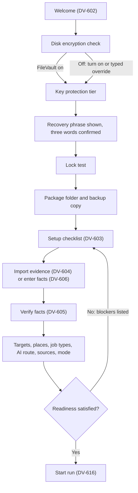

# 06_DESIGN_SYSTEM_AND_UX_PLAN.md

## 1. Document Control and Status

| Item | Value |
| --- | --- |
| Document | Seventh of eight pre-production documents |
| Product name | Kārya (display name); `Karya` in every machine-facing identifier (section 5.2) |
| Version and date | 0.1, 2026-10-01 |
| Status | Draft for product-owner review. The owner's decisions D1 to D14 of 2026-10-01 (section 3.3) are applied. Nothing in this document is binding until the owner approves it. |
| Upstream baseline | `00_PRODUCT_AND_SYSTEM_PLAN.md` v1.5, `01_SHARED_CONTRACTS_AND_DOMAIN_MODEL.md` v1.5, `02_SECURITY_AND_THREAT_MODEL.md` v1.5, `03_CONTROL_PLANE_AND_WORKER_RUNTIME_PLAN.md` v1.4, `04_DESKTOP_APPLICATION_PLAN.md` v1.2, `05_MOBILE_COMPANION_PLAN.md` v0.4, all approved by the product owner on 2026-10-01 (decision D1, section 3.3) |
| Other inputs | `Job_Automation_PLAN_Generator_Prompt.md` (`Generator`), `DEP_Prompt.md` (`DEP`, sections 21, 26, 27, 33, 34, 38, 39 in particular), `AUDIT_RECORD_2026-09-29.md`, `AUDIT_RECORD_2026-10-01.md`, `AUDIT_RECORD_2026-10-01_SECURITY_REVIEW.md`, the owner's design brief of 2026-10-01 (section 5.1), dated research in section 27 (accessed 2026-10-01) |
| Owner | Information architecture, user flows, design system, content design, accessibility design, platform UX; the product owner approves decisions marked for approval |
| Intended readers | Product owner, implementation agents building the desktop UI (React and TypeScript inside Tauri, `04` `ADR-401`) and the Android UI (Jetpack Compose, `05` `ADR-519`), security reviewer, roadmap author (`07`) |
| Downstream consumers | `07` (design artifacts per phase, UX acceptance criteria, research gates), the production handoff prompt, later `M-iOS` work |

Change control follows the rule used by `00` to `05`: identifiers are never renumbered or reused; a changed decision records old and new wording, affected sections and documents, migration consequences, and owner approval. Identifiers introduced here use the `6xx` range:

| Prefix | Meaning |
| --- | --- |
| `UX-CF-601` | Conflicts and gaps |
| `UX-P1` | UX principles |
| `TK-` | Design token names (not numbered; section 6) |
| `CMP-601` | Components |
| `PT-601` | Interaction patterns |
| `ST-601` | System states |
| `DV-601` | Desktop views (screens) |
| `FL-601` | User flows |
| `UR-601` | User research studies |
| `ADR-601`, `ASM-601`, `RISK-601`, `OQ-601`, `EXP-601`, `AC-601`, `RES-601`, `CHG-601` | As in upstream documents |

Mobile screens keep their `05` identifiers (`MS-501` to `MS-514`), notification kinds keep `NT-501` to `NT-509`, and every command, error, state, and control keeps its upstream identifier. This document specifies design. It authorizes no application development and no production code; the mockups that accompany it (section 22.6) are design references, not code to ship.

## 2. Executive Summary

Kārya is a private job-search workstation for one person: it finds paid technical jobs, separates whether the owner can take a job from how well it fits, prepares truthful resumes from verified evidence, and records what happened. This document defines how every surface of it looks, reads, moves, and behaves, on the macOS desktop (the MVP reference), on Windows and Linux as desktop compatibility targets, and on the Android companion; iOS and iPadOS are mapped for the later `M-iOS` phase.

The design language follows the owner's brief: warm limestone, unbleached linen, and stone grey as the base; molten rust and copper as accents; Indian heritage expressed through geometry, rhythm, and symmetry rather than ornament. It is bounded by rules that the approved documents already make binding: eligibility before fit (`00` section 24), truth before tailoring (`POL-01`), visible failure (`05` `MB-P6`), approvals that show everything they sign (`05` `ADR-511`), and WCAG 2.2 AA (`00` `NFR-05`). Where the brief and those rules met, the owner decided on 2026-10-01 (section 3.3); this document carries out those decisions.

The principal decisions are these:

1. **One flame (`ADR-601`).** Rust means one thing: the next action the owner must take, and keyboard focus. Fit strength uses a separate copper scale. Errors, warnings, success, and information each have their own color, icon, and words, so no state is carried by color alone. Every text and control color meets AA, which makes the working rust darker than the glow in the brief; the glow survives as decoration only.
2. **Eligibility leads, fit follows (`ADR-602`).** Every job surface shows the eligibility outcome first, in words, at a weight equal to or greater than fit. A 91 percent fit never visually outranks "Eligibility unclear".
3. **Quiet surfaces, one signature (`ADR-603`).** The memorable element is the Chakra run ring, a concentric status mark that shows the current run's stages and stop state. Data surfaces stay opaque, flat, and calm; translucent material appears only on overlays; motion answers the owner's actions and never delays a safety control.
4. **The Yantra grid (`ADR-604`).** Layout proportions come from a square construction grid: an 8 px unit, square modules, a framed outer boundary, and symmetrical divisions. It shows itself as faint construction lines only in three places (setup, the lock screen, and empty states).
5. **Sūtra as a secondary view (`ADR-605`).** Job detail can show threads from verified claims to the posting's requirements, each thread backed by a claim identifier and mirrored in a table. Lists and tables remain primary everywhere. No view draws a "trajectory" to roles the owner has not verified evidence for.
6. **Brand look, native behavior (`ADR-606`).** The visual system is Kārya's own on every platform; interaction follows each platform: macOS menus, shortcuts, and sheets; Android edge-to-edge layout, predictive back, Material 3 component semantics with dynamic color turned off.
7. **Swipe only where it is safe (`ADR-607`).** The phone's job triage may use a card stack with equal tap buttons; no swipe, drag, hold, or magnetic control ever approves, accepts, revokes, or stops.
8. **Plain words (`ADR-608`).** Interface copy is plain English in sentence case. The Sanskrit vocabulary (Sūtra, Chakra, Agni, Yantra) is the design team's internal language and never a feature label. The product name Kārya is the one visible exception.

The document also contains the component inventory, the screen specifications for every desktop view and every mobile screen of `05`, the flows for the three automation modes and three run strategies, the content and copy system, the accessibility specification, the privacy and security display patterns, a design-to-code handoff method, and a user research plan sized for a one-person product.

## 3. Upstream Baseline, Inherited Obligations, Owner Decisions, and Conflict Register

### 3.1 Inherited decisions this document implements

| Upstream | Design consequence |
| --- | --- |
| `00` section 33, `NFR-05` | Desktop and mobile surface lists; WCAG 2.2 AA as the release target; always show operating mode, worker availability, source failure, stale or offline state, and why an action is blocked. Sections 7, 11, 18. |
| `00` `NFR-03`, `NFR-06`, `NFR-10` | 2-second jobs view at 10,000 jobs; offline inspection; UTC storage with time zone display and externalized strings. Sections 6.9, 17, 21. |
| `00` sections 21, 24, `POL-01`, `POL-02`, `01` `CON-121` to `CON-123`, `CON-128` | Verified versus proposed content is visually distinct; eligibility outcomes and fit are separate; likely or ambiguous eligibility never fills an answer. Sections 6.2, 9, 12. |
| `00` section 25 | Resume fonts and readability floor are a document concern, separate from interface typography. Section 6.4. |
| `00` sections 27, 28, `01` `CON-130`, `CON-131` | Exactly three modes and three run strategies; continuous-run warning; budgets in every strategy. Section 14. |
| `00` `POL-04`, `01` `SM-104` | `MANUAL_ACTION_REQUIRED` and its reason codes need designed states. Sections 11, 12.23. |
| `01` `CON-148`, `CON-155` | Package contents and names are fixed; the UI shows them, never invents labels for them. Section 12.22. |
| `01` `CON-153`, `02` `CTRL-227`, `CTRL-244`, `CTRL-249`, `03` section 16.4, `04` section 32.7 | Relay disclosure preview, per-session checklist, random-marker package, 2-minute clipboard clear, repair prompt. Sections 12.21, 13.4. |
| `02` `ADR-207`, `ADR-209`, `CTRL-240` to `CTRL-242` | Key tiers `K2`, `K1P`, `K1` shown by name; the interface lock protects the interface while runs continue; per-role confinement status; FileVault requirement and typed overrides. Sections 12.1, 12.2, 12.14, 12.27. |
| `02` `CTRL-201`, `PRIV-201` to `PRIV-205` | Classification-aware display, separate consents, diagnostics preview. Section 20. |
| `03` sections 9.2, 11.2, 12.3, 13, 24 | Pause reasons, stop semantics, source states and circuits, failure rows; each has a designed status and recovery action. Sections 11, 12. |
| `04` sections 5.4, 12, 14, 17, 18, 32 | Webview rules (text-only rendering of untrusted content, no remote assets), menu bar extra, menus, notifications, display preferences, onboarding mechanics, screen list, prompt budget. Sections 7 to 13, 19. |
| `05` sections 6.3, 10, 11, 12, 13, 19, 30.6, 32.2, 32.8, 32.11 to 32.15 | Mobile screen inventory, app lock, display gate, stop states including `NOT_CONFIRMED`, notification catalog and channels, accessibility baseline, tablet rule, Android first, state handoff table. Section 15. |

### 3.2 Obligations assigned to this document

| Obligation | Source | Section |
| --- | --- | --- |
| Full information architecture, screen flows, design tokens, copy, platform prototypes | `00` section 38 | 6, 7, 12 to 17, 22 |
| Accessibility detail, localization, time zones (with `01` for data types) | `00` section 39.1 | 17.6, 18 |
| Client UI framework (shared with `04`) | `00` section 39.1 | 19 |
| Readability floor finalization for documents | `00` section 25 | 6.4.4 |
| Relay disclosure preview and checklist design | `02` `CHG-209`, `03` section 16.4 | 12.21, 13.4 |
| Copy for setup risk statements, recovery phrase, FileVault override | `04` sections 8.3, 32.4, 32.5 | 12.2, 17.5 |
| Screen inventory, layouts, copy, flows for every desktop view | `04` sections 17, 18 | 12, 13 |
| Display of key tier, confinement option, protection status | `04` sections 32.3, 32.4 | 12.14, 12.27 |
| Mobile screen inventory, notification copy, approval friction, accessibility on Android and iOS | `05` sections 1, 6.3, 13.3, 19 | 15, 16, 18 |
| States, copy keys, and channel IDs handed off by `05` | `05` section 32.15 | 15.4 |
| Defaults decided with `06`: `OQ-503`, `OQ-504`, `OQ-506`, `OQ-509`, `OQ-510`, `04` `OQ-406` | `05` section 32.22, `04` section 30 | 3.3 |
| "Review on phone" consent text | `05` `ADR-509`, `04` section 34.4 | 20.4 |
| Phishing rule copy in onboarding | `05` section 32.11 item 2 | 15.3, 17.5 |
| How local runs and synchronized runs are told apart | `05` section 30.5 | 12.16 |
| Tablet and wide-desktop layouts | `Generator` UX section, `05` `MB-CF-518` | 8 |
| Use of design skills and tools during implementation | `Generator` UX section | 22 |

### 3.3 Owner decisions of 2026-10-01

On 2026-10-01 the product owner received the list of pending decisions for this document and answered "Approve all". Each decision is recorded with the option that applies. Where a decision offered options without a recommendation, the reading taken is stated.

| ID | Decision | Applied as |
| --- | --- | --- |
| D1 | Approve the upstream text this document builds on | `00` v1.5, `01` v1.5, `02` v1.5, `03` v1.4, `04` v1.2, and `05` v0.4 are approved as they stand, including the 2026-09-30 changes still marked for review. Their Status rows are not edited by this document; the approval is recorded here and in `APPROVAL_RECORD_2026-10-01.md` and is written into each document's Status row at its next revision (section 25.2) |
| D2 | Open `05` decisions | `MB-CF-502` as restated (Jetpack Compose over `sync-core` for Android; iOS UI technology at `M-iOS` entry) and `MB-CF-520` (desktop sign-in through the system browser; phone passkey registered during pairing) approved. `OQ-501` (the phone's model) is still unknown; layouts target the Android compact width class, 360 to 412 dp wide, and `EXP-514` records the phone |
| D3 | Defaults decided with `06` | `OQ-503` no, `OQ-504` off, `OQ-506` yes, `OQ-509` off, `OQ-510` 24 hours (owner range 1 to 72), `04` `OQ-406` 15-minute auto-lock with "Pause runs when locked" off (opt-in) |
| D4 | Name and identifiers | "Kārya" with no qualifier; display name with the macron; `Karya` (ASCII) for file names, executables, and identifiers; bundle identifier `dev.vishhz.karya`, development `dev.vishhz.karya.dev`, Android application ID `dev.vishhz.karya.mobile`; accessibility name "Karya"; upstream records proposed now (`UX-CF-607`, section 25.2) |
| D5 | Meaning of rust; semantic palette | Rust is primary action and focus only; fit uses a copper scale placed after eligibility; error oxblood, warning ochre, success muted green, information deep indigo, each with icon and label; text and control colors meet AA even where this darkens the rust |
| D6 | Sūtra | Option (a): lists primary; Sūtra an optional view on job detail; trajectory view deferred to the skill-gap phase |
| D7 | Motion and materials | Glass on overlays only; ripples only for accepted events; determinate Chakra rings where progress is known; no magnetic effect on consequential or destructive controls; Reduce Motion and Reduce Transparency honored; cursor glow trails an opt-in "Ambient effects" setting, off by default |
| D8 | Swipe cards on the phone | Approved for job triage only, with equal tap buttons, disabled offline, never for decisions; the list view stays available |
| D9 | Heritage vocabulary and geometry | (a) internal vocabulary only; (b) read as: Latin wordmark everywhere, with the Devanagari word कार्य allowed only on the welcome and About screens as a companion lockup (the decision offered two options without a recommendation; this reading keeps the interface plain and confines the extra font to two screens); (c) original geometry only, no reproduction of a specific sacred yantra, the Ashoka Chakra, or the State Emblem of India |
| D10 | App icon and logo | Option (a): this document specifies an original geometric mark with construction rules; SVG drafts accompany the mockups (section 5.5) |
| D11 | Platform look | Brand-forward visual system with each platform's interaction conventions; Android dynamic color off |
| D12 | Platform depth | Full specification for macOS desktop and Android; Windows and Linux as deltas; iOS and iPadOS as a conventions mapping; Android tablets with list and detail layouts |
| D13 | Phase depth | Full information architecture for every phase; detailed specifications for the desktop MVP and mobile `M1` to `M3`; later-phase screens at wireframe level with phase tags |
| D14 | Visual artifacts | Text specification plus a token specimen and key-screen mockups, non-normative except the tokens |
| Defaults | Themes, typefaces, icon set, copy voice, language, emergency stop, job card | Applied as listed in section 3.3.1 |

#### 3.3.1 Defaults accepted with D1 to D14

| Default | Where specified |
| --- | --- |
| Light theme "Limestone" and dark theme "Obsidian", following the system setting, with a per-device override | Section 6.2 |
| Typefaces bundled offline under the SIL Open Font License: EB Garamond (display), Instrument Sans (interface), JetBrains Mono (machine values only) | Section 6.4 |
| One open-source icon family shared by desktop and Android | Section 6.10 (Phosphor, MIT) |
| Plain, specific copy; evocative language only on welcome and About; fixed notification texts; a handoff is never called "Applied" | Section 17 |
| English, left-to-right, strings externalized, text scaling to 200 percent | Sections 17.6, 18 |
| Emergency stop: one confirmation, a tap alternative, never inside a swipe or a magnetic control | Pattern `PT-605` |
| Job card after `DEP` section 34 with eligibility before fit | Component `CMP-618` |

### 3.4 Conflict and gap register

| ID | Statements and affected documents | Practical consequence | Resolution | Approval |
| --- | --- | --- | --- | --- |
| `UX-CF-601` | The brief assigns rust and bronze to active states, focus points, and "AI match highlights". `00` section 24 and `01` `CON-123` keep fit below eligibility; `01` `CON-106` makes model output a proposal; `05` `MB-P6` requires visible failure; WCAG 1.4.1 forbids color as the only signal. | A single accent for "act now", "focus", and "strong match" blurs action, error, and model opinion. | `ADR-601`, `ADR-602` (owner decision D5). | Decided 2026-10-01 |
| `UX-CF-602` | The brief's Sūtra "replaces dry lists with connected networks" and links current skills to "future roles". `01` `CON-135` and `05` `ADR-511` require complete, exact display for decisions; `00` section 6 and `DEP` section 38 make skill-gap guidance a later, advisory feature; `POL-01` forbids implied claims. | A network as the primary view hides detail from screen readers and can read as a claim. | `ADR-605` (D6). | Decided 2026-10-01 |
| `UX-CF-603` | The brief's warm glass panels, ripples across panels, glowing cursor trails, magnetic buttons. `00` `NFR-03` and `04` `AC-419` (10,000-row list with 95 percent of frames under 50 ms in WKWebView); WCAG 2.2.2 and 2.3.3; `05` section 19.1 (Reduce Motion, Increase Contrast). | Background blur over scrolling data costs frames; uninvited motion fails users with vestibular disorders; a magnet near Approve or Emergency stop invites mis-hits. | `ADR-603`, section 6.8 motion rules, "Ambient effects" setting off by default (D7). | Decided 2026-10-01 |
| `UX-CF-604` | The brief's "swiping through opportunities like physical cards". `05` `ADR-511`, `THR-511`, `RISK-509` (approval fatigue); `05` `ADR-515` (offline read-only); WCAG 2.5.1 and 2.5.7. | Swipe as a decision gesture would make approvals trivial and inaccessible. | `ADR-607` (D8). | Decided 2026-10-01 |
| `UX-CF-605` | The brief's Chakra motion "fluid, continuous, organic rather than segmented". `05` `ADR-513`, section 32.8 (`SENT`, `ACCEPTED` reported by the server, `WORKER_CONFIRMED`, `WORKER_UNREACHABLE`, `NOT_CONFIRMED`, "Not verified"). | Continuous motion would hide discrete safety states, including an unconfirmed stop. | `CMP-623` Chakra ring: determinate segments for real stages, discrete states by label and icon, motion only for waiting (D7). | Decided 2026-10-01 |
| `UX-CF-606` | The interface must honor Reduce Transparency (D7, `05` section 19.1 Increase Contrast analogue). WebKit does not support the `prefers-reduced-transparency` media feature; at the research date only Chromium does [RES-603]. `04` defines no channel for the macOS setting. Affects `04`. | On macOS the webview cannot detect Reduce Transparency, so glass would stay on for people who turned it off. | The Rust core reads `NSWorkspace.accessibilityDisplayShouldReduceTransparency` and its change notification and sends the value to the UI as a display event on the `GW-411` channel; the UI sets `data-reduce-transparency` on the root element. The same channel carries Increase Contrast and Differentiate Without Color where the media queries are not reliable (`EXP-603` checks each). Additive proposal to `04` section 7.3. | Additive; owner approval with this document |
| `UX-CF-607` | `04` `OQ-402` and `ADR-409` proposed `dev.vishhz.jobsearch` with the name deferred; `05` section 20.1 derives the phone identifiers from it; `00` section 1 names no product. The owner chose "Kārya" (D4). Affects `00`, `04`, `05`, `07`. | Identifiers key the keychain service, data paths, and privacy grants; they must be fixed before the first build that touches real data. | `04` `OQ-402` closed: bundle identifier `dev.vishhz.karya`, development `dev.vishhz.karya.dev`; `05` application ID `dev.vishhz.karya.mobile`; keychain service `dev.vishhz.karya.keys`; display name "Kārya". Change records proposed in section 25.2. | Decided 2026-10-01 (D4); records at the next revision of `00`, `04`, `05` |
| `UX-CF-608` | `04` section 12.4 lists every display preference and its merge rule; this document adds per-device appearance settings (motion level, Ambient effects, transparency override, density already listed). Affects `04`, `01` `CON-144`. | Without listing, sync (later) would have no rule. | Added as per-device, never synchronized: "Ambient effects", "Reduce motion override" (already listed), "Reduce transparency override", "Sūtra view as default on job detail". Section 6.11. | Additive |
| `UX-CF-609` | `DEP` section 34's job card shows "Fit: 91%" above "Eligibility: Verified", status "Ready for application", and an `[Apply]` button. `00` section 24, `00` `POL-16`, `00` section 26 (MVP ends at external handoff), `01` `CON-129` (`EXTERNAL_HANDOFF` is not submission). | Copying the card literally would rank fit over eligibility and promise an in-app apply that the MVP does not have. | `CMP-618` keeps the card's content and order of interest but places eligibility first; "Apply" becomes "Open application page" in the MVP; "Applied" is never shown for a handoff. | Within approved documents; no approval needed |
| `UX-CF-610` | `05` `ADR-501` chose native UI partly because "platform conventions come free"; D11 chose a brand-forward visual system. Affects `05`. | A fully custom Android component set would lose platform semantics and accessibility behavior. | Android uses Material 3 Compose components with Kārya's own color, type, shape, and motion theme; custom components only where Material 3 has none (Chakra ring, Sūtra view, code entry). Accessibility semantics come from the platform components. Section 19.4. | Within D11 |
| `UX-CF-611` | The `Generator` requires "mobile, tablet, desktop, and wide-desktop layouts"; `05` `MB-CF-518` makes tablets "may run, unsupported" with adaptive layouts; `05` `ADR-519` defers iPad to `M-iOS`. | Tablet design scope needed fixing. | Android tablets get list and detail layouts by window size class (section 8.3); iPad is mapped in section 19.5 and designed at `M-iOS` entry. | Within D12 |
| `UX-CF-612` | The `Generator` asks for flows of all three modes and all three run strategies; `00` section 34 defers Hybrid, Auto, scheduled, and continuous runs. | Designing them fully now would design features whose prerequisites are unproven. | Wireframe-level flows with phase tags (section 14); the MVP flows are specified fully. | Within D13 |
| `UX-CF-613` | `04` section 18 lists "Analytics: Later; the MVP shows run and source counts" and `DEP` sections 26, 38, 39 ask for analytics, skill gaps, and interview preparation; `00` section 6 makes the latter advisory and later. | The information architecture must reserve places without implying the features exist in the MVP. | `DV-630` and `DV-633` reserved, hidden in the MVP navigation, shown with "Available in a later version" only in the command palette's help (section 7.2). | Within approved documents |
| `UX-CF-614` | The design brief's cultural motifs (yantra, chakra) could be read as permission to use sacred or national symbols. Indian law restricts use of the State Emblem and the national flag's elements in some contexts; this is a design constraint, not legal advice. | A literal Sri Yantra, Ashoka Chakra, or emblem in the logo or ring would be both culturally careless and possibly restricted. | Section 5.3 rule set: original construction only; the Chakra ring has no 24 spokes and no wheel spokes at all; no lotus, deity, or temple imagery (D9). | Decided 2026-10-01 |
| `UX-CF-615` | The frontend design guidance used for this document names a warm cream ground with a terracotta accent and a high-contrast serif as a common generated-design cliché; the owner's brief asks for sand, rust, and (with D3.3.1) EB Garamond display. | The brief wins, but the result can look generic. | The brief is followed. Distinctness is carried by: stone grey rather than cream as the structural tone, a deeper copper-rust rather than clay, the Yantra grid, the Chakra ring as the single signature, sparing use of the serif (titles only), and the absence of the usual card-kit chrome (section 5.4). | No approval needed |
| `UX-CF-616` | `05` section 19.3 says theme and text size on the phone "follow the OS"; D3.3.1 adds a per-device theme override on desktop (already in `04` section 12.4). | None on the phone. | The phone follows the OS; no in-app theme override on Android. | None |

## 4. Scope, Audience, and UX Principles

### 4.1 Scope

In scope: brand expression, design tokens, information architecture, layouts by platform and window size, components, interaction patterns, system states, every desktop view, every mobile screen of `05`, user flows, the three modes and three strategies, notifications, content design and copy, accessibility, platform conventions, privacy-sensitive display, UI performance budgets, design-to-code handoff, and user research. Out of scope: runtime behavior (`03`), platform mechanics such as keys, IPC, packaging, and signing (`04`, `05`), and phase order (`07`).

### 4.2 Who it is for

The first user is the owner: an early-career engineer who works on a MacBook Pro, owns an Android phone, applies to software, systems, Python, and game roles across several countries, and has eligibility constraints that differ by employer. Two upstream personas remain valid: a privacy-focused person running everything locally, and a multi-device person who reviews from the phone (`00` section 7). The design assumes a technically fluent user who still deserves plain language, because the consequential parts (eligibility, disclosure, submission) are legal and personal, not technical.

### 4.3 What the product's surfaces must achieve

| Job to be done | Measure the design is judged by |
| --- | --- |
| Decide in seconds whether a job is worth reading | Eligibility outcome and fit visible in the first row of every job surface; median time to triage a job in the usability study (`UR-602`) under 20 s |
| Trust what the product wrote | Every factual line in a document preview links to its claim; the owner can answer "where did this come from" in one action (`AC-604`) |
| Prepare a package with the least friction the safety rules allow | Relay route: median owner time per prepared job at most 2 minutes (`03` `EXP-309`, `00` `AC-16`); R3 route: review only, at most 1 minute (`04` section 32.11) |
| Know at a glance what is running and whether it can be stopped | Run state, mode, worker availability, and lock state visible on every desktop view; stop reachable in one action from anywhere (`AC-610`) |
| Never be surprised by a disclosure | Every data departure (relay copy, export, provider call, package write) shows a preview of what leaves and where (`PT-609`) |

### 4.4 Principles

| ID | Principle | Consequence in the design |
| --- | --- | --- |
| `UX-P1` | Truth is traceable. | Verified, proposed, and generated content look different (`CMP-626` provenance marks). Every factual line can show its source. Model output is labeled as a proposal until the owner accepts it. |
| `UX-P2` | Eligibility before fit. | Eligibility is shown first, in words, never smaller than fit. "Likely eligible" and "Unclear" never use the success color. |
| `UX-P3` | One flame. | Rust marks the single next action on a view and keyboard focus. Everything else is stone, ink, and paper. A view with two rust buttons is a design defect. |
| `UX-P4` | Fail visible. | Stale, offline, not verified, unconfirmed, uncertain, locked, and unavailable are named states with a reason and a next step (section 11). The last good value is never shown as current. |
| `UX-P5` | Friction matches consequence. | Reading is free; reversible triage is one action; disclosure needs a preview; decisions need the full display gate and a step-up; irreversible actions need a typed confirmation. |
| `UX-P6` | Motion explains change. | Motion answers the owner's actions or marks a real state change; it never decorates data, never loops without a reason, and never delays stop, pause, lock, or decline. |
| `UX-P7` | Plain words. | Sentence case, active voice, the name of the thing as the owner knows it. No internal identifiers in copy except machine values the owner must compare (codes, digests on request). |
| `UX-P8` | One object, one name. | A thing keeps its name on every surface and in every notification: a "package" is never a "bundle" on another screen (section 17.3). |
| `UX-P9` | Private by default on screen. | Sensitive values are masked in lists and on shared-screen-prone surfaces; notifications carry no job or candidate text by default (`04` section 12.1). |
| `UX-P10` | Keyboard first on the desktop, thumb first on the phone. | Every desktop action has a keyboard path; every phone action that matters sits in the lower half of the screen. |

## 5. Brand and Design Language

### 5.1 The brief, as given

The owner's brief of 2026-10-01 asks for "high-end architectural modernism infused with the warm, timeless spirit of Indian heritage": warm limestone with molten rust and raw copper; surfaces with the tactility of heavy silk paper or polished terracotta; precision of modern luxury software. Base palette of sandy beige, unbleached linen, and soft stone grey, without cold blues or stark whites; dark modes of warm obsidian and dark basalt. Accents of burnt rust, terracotta, and amber, with rust standing for drive and Agni. Heritage expressed through geometry, rhythm, and symmetry: Yantra grids, the Sūtra thread for matching, Chakra motion for progress. Motion: panels like heavy sliding doors on polished stone, magnetic micro-lifts, ripples like water in a stone fountain. Desktop as an executive workstation with large split views; mobile as a tactile object with bottom sheets, a floating action dock, and haptics.

### 5.2 Name, wordmark, and identifiers

| Surface | Form | Reason |
| --- | --- | --- |
| In-app text, window title, About, Android launcher label, notification title, menu bar extra tooltip | Kārya | The owner's chosen name; the macron is part of it |
| Accessibility name (`accessibilityLabel`, `contentDescription`, `aria-label` of the wordmark) | Karya | Predictable pronunciation by VoiceOver, TalkBack, Narrator, and Orca; a pronunciation test is part of `EXP-605` |
| macOS bundle file name, executable, Windows executable, Linux package name | Karya | ASCII-safe for shells, installers, and paths |
| Bundle identifier; development identifier; Android application ID; keychain service | `dev.vishhz.karya`; `dev.vishhz.karya.dev`; `dev.vishhz.karya.mobile`; `dev.vishhz.karya.keys` | `UX-CF-607` |
| Default package folder suggested at setup (`04` section 10.2 step 1) | `~/Karya Packages` | ASCII, outside privacy-protected folders, says what it holds |
| Wordmark | "Kārya" set in EB Garamond Medium at optical display size, tracked +1 percent, with the macron drawn as part of the glyph, not a separate rule | Section 5.5 |
| Devanagari companion | कार्य in Noto Serif Devanagari, only on the welcome screen and the About screen, always beside the Latin wordmark, never alone, never as a button or label | D9 |

The name means "work" or "action". It reveals nothing about job searching, which suits a lock screen and a notification shade. Before any public release, a trademark search is part of the distribution gate, since other apps called "Karya" exist [RES-609]; this is not legal advice.

### 5.3 Heritage through geometry: rules

The design team uses four internal terms. None of them appears in the interface.

| Internal term | What it means in this design | Where it appears | Never |
| --- | --- | --- | --- |
| Yantra | The square construction grid of section 6.5: an 8 px unit, square modules, a framed boundary, centered symmetrical divisions | Page proportions everywhere; visible construction lines only on setup, the lock screen, and empty states | A reproduction of any specific sacred yantra (for example the Sri Yantra); interlocking triangles; bindu dots used as decoration |
| Chakra | Concentric rings that report a run: stages as arcs on the outer ring, the stop state at the center | `CMP-623` run ring; the app icon (section 5.5) | Spokes of any number; a wheel; any likeness of the Ashoka Chakra |
| Sūtra | A single thread drawn from a verified claim to a requirement it satisfies | `CMP-627` on job detail, optional; the progress line of setup | Threads to roles, futures, or skills the owner has not verified; animated "living" networks |
| Agni | Rust as the color of the next action | Primary button and focus ring only (`ADR-601`) | Flames, fire imagery, flickering animation |

General rules: no lotus, deity, temple, mandala, paisley, or mehndi motifs; no Devanagari outside the two screens named in section 5.2; no cultural symbol used as a status color or as an icon for a product function. The heritage reads through proportion, symmetry, material color, and rhythm, which is what the brief asked for.

### 5.4 Distinctness check

The guidance used for this document warns that a warm cream ground, a terracotta accent, and a high-contrast display serif together are a common generated-design default (`UX-CF-615`). The brief asks for that territory, so the design is anchored by choices that a default would not make:

1. Stone grey, not cream, carries the structure: rails, dividers, table headers, and the dark theme's basalt. Sand is the canvas, linen the raised paper.
2. The accent is a deep copper-rust (`#A13D16` light, `#E37A4B` dark), closer to oxidized metal than to clay, and it appears once per view.
3. The serif is used for titles and the wordmark only; all working text is a variable grotesk whose width axis gives dense tables a narrower cut.
4. Layout is built on a visible-when-quiet square grid with framed, symmetric divisions rather than a stack of identical rounded cards; radii differ by role (section 6.6); shadows are warm and rare.
5. The signature element is a single instrument, the Chakra ring. There is no hero gradient, no glow behind headings, no decorative blob.

### 5.5 App icon and logo mark

**`ADR-609` App mark.** Decision: an original geometric mark, constructed as follows, used for the macOS app icon, the Android adaptive icon, the Windows and Linux icons, the menu bar extra (monochrome template), and the Android notification small icon (monochrome).

Construction (on a 24-unit square):

1. Outer frame: a square of side 20 units, centered, stroke 1.5 units, corners squared. This is the "bhupura" frame of the Yantra grid, abstracted to one square without gates.
2. Inner field: a circle of diameter 12 units centered in the frame.
3. Ring: an arc on the circle covering 300 degrees, stroke 2 units, starting at the top and running clockwise, leaving a 60-degree opening at the upper left. The opening reads as work in progress; it is the Chakra ring's "running" form.
4. Center: a filled square of 3 units, rotated 0 degrees (not 45), the "seed" of the grid.
5. Color: the arc in rust, the frame in stone ink, the field in linen on the full-color icon; one color (template) on the menu bar and notification icon.

Platform outputs:

| Platform | Output | Rule |
| --- | --- | --- |
| macOS | 1024 px master in the macOS icon grid (rounded-square container supplied by the system in macOS 26 and later; a full-bleed linen tile with the mark at 62 percent width for earlier versions) | Verify against the current Apple icon template at build time (`EXP-604`) |
| macOS menu bar extra | 18 pt template image: frame and arc only, no fill; the arc's coverage shows the run state (section 12.34) | Template images are monochrome by system rule |
| Android | Adaptive icon: foreground layer (mark) inside the 66 dp safe zone of the 108 dp canvas; background layer linen `#F7F3EC`; monochrome layer for themed icons | Themed icon uses the monochrome layer |
| Android notification small icon | 24 dp white-on-transparent: frame and arc | System tints it |
| Windows, Linux | 256 px and smaller sizes from the same master; 16 px variant drops the frame | Pixel-hinted at 16, 24, 32 |

The SVG drafts accompanying the mockups show three weight variants for the owner's choice; the construction above is fixed, the stroke weight is the open choice (`OQ-601`).

### 5.6 Voice

Kārya speaks like a precise colleague: short sentences, exact nouns, no cheerleading, no apology, no exclamation marks. Evocative language is allowed in two places only, the welcome screen and About, where one line may describe the product's character (section 17.5). Everywhere else, words exist to make the next decision easier.

## 6. Design Tokens

### 6.1 Source of truth and format

**`ADR-610` Token format.** Decision: tokens are authored once as a W3C Design Tokens Community Group format JSON file (`tokens/karya.tokens.json`), with three tiers:

1. **Reference tokens** (`ref.*`): raw values, such as `ref.color.rust.600 = #A13D16`.
2. **System tokens** (`sys.*`): roles, such as `sys.color.action.primary`, resolved per theme.
3. **Component tokens** (`cmp.*`): only where a component needs a value that no system role covers.

A build step generates CSS custom properties for the desktop webview and a Kotlin `KaryaTheme` (Material 3 `ColorScheme`, `Typography`, `Shapes`, plus a `KaryaExtendedColors` object for roles Material 3 lacks) for Android. Components reference system tokens only; a lint rule rejects raw color, size, or duration literals in component code. A change to a token is a reviewed change with a before and after contrast report (section 22.3).

### 6.2 Color

#### 6.2.1 Reference palette

| Reference token | Hex | Material it describes |
| --- | --- | --- |
| `ref.color.sand.100` | `#F7F3EC` | Unbleached linen, raised paper |
| `ref.color.sand.200` | `#EEE8DD` | Sandy limestone, the canvas |
| `ref.color.sand.300` | `#E3DCCF` | Honed limestone, sunken wells |
| `ref.color.stone.400` | `#D3CABA` | Stone joint, hairline dividers |
| `ref.color.stone.600` | `#7F7568` | Weathered stone, control borders |
| `ref.color.ink.900` | `#2B2621` | Basalt ink, primary text |
| `ref.color.ink.700` | `#5A5249` | Secondary text |
| `ref.color.ink.600` | `#665E52` | Tertiary text and placeholders |
| `ref.color.rust.600` | `#A13D16` | Molten rust, primary action fill and focus (light) |
| `ref.color.rust.650` | `#9A3912` | Rust for text links (light) |
| `ref.color.rust.400` | `#E37A4B` | Rust for fills (dark theme) |
| `ref.color.rust.350` | `#EE8B5C` | Rust for text and focus (dark theme) |
| `ref.color.copper.700` | `#8E5320` | Raw copper, fit scale text (light) |
| `ref.color.copper.300` | `#D9A06B` | Copper (dark theme) |
| `ref.color.amber.400` | `#E2A03A` | Amber fire, decorative glow only (light) |
| `ref.color.amber.300` | `#F2BC5A` | Amber (dark theme), decorative only |
| `ref.color.obsidian.950` | `#14110F` | Obsidian, sunken (dark) |
| `ref.color.obsidian.900` | `#191613` | Warm obsidian, canvas (dark) |
| `ref.color.basalt.850` | `#231F1B` | Dark basalt, raised (dark) |
| `ref.color.basalt.700` | `#3A342D` | Basalt joint, dividers (dark) |
| `ref.color.basalt.500` | `#857A6C` | Control borders (dark) |
| `ref.color.chalk.100` | `#F0E8DB` | Primary text (dark) |
| `ref.color.chalk.300` | `#C2B7A7` | Secondary text (dark) |
| `ref.color.chalk.400` | `#A69B8C` | Tertiary text (dark) |
| `ref.color.oxblood.700` | `#8C1D2A` | Error (light) |
| `ref.color.ochre.700` | `#7A5200` | Warning (light) |
| `ref.color.neem.700` | `#356240` | Success (light) |
| `ref.color.indigo.700` | `#33407C` | Information (light) |

Semantic container colors (tinted wells that hold a status message) and their dark counterparts are in section 6.2.2. Pure white (`#FFFFFF`) and pure black (`#000000`) are not used.

#### 6.2.2 System color roles

| System role | Limestone (light) | Obsidian (dark) | Use |
| --- | --- | --- | --- |
| `sys.color.canvas` | `#EEE8DD` | `#191613` | Window background |
| `sys.color.surface` | `#F7F3EC` | `#231F1B` | Panels, list rows, sheets |
| `sys.color.surface.sunken` | `#E3DCCF` | `#14110F` | Wells, code entry, table header band |
| `sys.color.line` | `#D3CABA` | `#3A342D` | Hairline dividers (decorative, no contrast requirement) |
| `sys.color.border.control` | `#7F7568` | `#857A6C` | Input and control boundaries (meets 3:1, WCAG 1.4.11) |
| `sys.color.text.primary` | `#2B2621` | `#F0E8DB` | Body and titles |
| `sys.color.text.secondary` | `#5A5249` | `#C2B7A7` | Supporting text |
| `sys.color.text.tertiary` | `#665E52` | `#A69B8C` | Placeholders, timestamps, captions |
| `sys.color.action.primary` | `#A13D16` | `#E37A4B` | The one primary button per view |
| `sys.color.on.action.primary` | `#FFF7EE` | `#1C120C` | Text on the primary button |
| `sys.color.text.link` | `#9A3912` | `#EE8B5C` | Inline links |
| `sys.color.focus` | `#A13D16` | `#EE8B5C` | Focus ring |
| `sys.color.selection` | `#F1DCCF` | `#3A2218` | Selected row tint |
| `sys.color.fit` | `#8E5320` | `#D9A06B` | Fit score numerals and meter |
| `sys.color.fit.track` | `#EEDCC6` | `#33261A` | Fit meter track |
| `sys.color.error` / `container` / `on.container` | `#8C1D2A` / `#F2D9D6` / `#7E1A25` | `#F08C92` / `#3A1C1F` / `#F49AA0` | Errors, ineligible |
| `sys.color.warning` / `container` / `on.container` | `#7A5200` / `#F1E2B8` / `#6B4800` | `#E6BC62` / `#33290F` / `#EBC46E` | Warnings, unclear eligibility, stale data |
| `sys.color.success` / `container` / `on.container` | `#356240` / `#DDE7D9` / `#2F5838` | `#8DC69B` / `#1F2E22` / `#9BD2A8` | Verified, confirmed, committed |
| `sys.color.info` / `container` / `on.container` | `#33407C` / `#DDE0F0` / `#2E3A72` | `#A9B3EC` / `#222844` / `#B4BDF0` | Neutral information, likely eligible, reported by the server |
| `sys.color.glow` | `#E2A03A` at 0 to 24 percent opacity | `#F2BC5A` at 0 to 20 percent opacity | Decorative only: ripple, Ambient effects, Chakra ring halo |

Rules:

1. Status is never color alone: every status uses an icon and a word as well (`CMP-606`).
2. `sys.color.glow` never carries meaning and never sits behind text.
3. Success green is reserved for states the product has verified or confirmed (a verified claim, a confirmed stop, a committed package, `VERIFIED_ELIGIBLE`). Model opinion is never green.
4. The information indigo is muted and warm-shifted on purpose; it is the only cool hue and appears in small areas (owner decision D5).
5. Selection uses the rust tint with primary text, never rust text on rust tint.

#### 6.2.3 Contrast evidence

Ratios were computed with the WCAG 2.2 relative luminance formula over every text role on each of the three backgrounds (canvas, surface, sunken); the minimum of the three is listed. Section 22.3 makes this computation a build check.

| Pair (minimum over canvas, surface, sunken) | Limestone | Obsidian | Requirement |
| --- | --- | --- | --- |
| `text.primary` | 10.99 | 13.46 | 4.5 |
| `text.secondary` | 5.63 | 8.28 | 4.5 |
| `text.tertiary` | 4.69 | 5.99 | 4.5 |
| `text.link` | 5.19 | 6.61 | 4.5 |
| `fit` | 4.52 | 7.16 | 4.5 |
| `error`, `warning`, `success`, `info` as text | 6.63, 5.08, 5.18, 7.11 | 6.91, 9.14, 8.33, 8.06 | 4.5 |
| `on.container` on its container (error, warning, success, info) | 7.60, 6.39, 6.41, 8.14 | 7.30, 8.64, 8.27, 7.89 | 4.5 |
| `on.action.primary` on `action.primary` | 6.20 | 6.27 | 4.5 |
| `border.control` | 3.32 | 3.89 | 3.0 (non-text) |
| `focus` against canvas | 5.39 | 7.28 | 3.0 (non-text) |
| `text.primary` on `selection` | 11.33 | 12.15 | 4.5 |

`fit` on the sunken limestone well (4.52) is the closest margin; fit numerals are therefore never placed on `surface.sunken` in the light theme.

#### 6.2.4 Increased contrast

When the system requests more contrast (macOS Increase Contrast, the `prefers-contrast: more` query where the webview supports it, Android high-contrast text), the high-contrast variant applies: `text.secondary` and `text.tertiary` map to `text.primary`; `border.control` maps to `text.secondary`; dividers become `border.control`; the glow is removed; focus ring width rises from 2 px to 3 px.

### 6.3 Status palette by meaning

| Meaning | Color role | Icon (Phosphor) | Word |
| --- | --- | --- | --- |
| Verified eligible (`VERIFIED_ELIGIBLE`) | success | `seal-check` | Eligible, verified |
| Likely eligible (`LIKELY_ELIGIBLE`) | info | `circle-half` | Likely eligible, not verified |
| Ambiguous (`AMBIGUOUS`) | warning | `question` | Eligibility unclear |
| Ineligible (`INELIGIBLE`) | error | `prohibit` | Not eligible |
| Hard filter `REVIEW` | warning | `eye` | Needs your review |
| Claim `PROPOSED` | info | `pencil-simple-line` | Proposed, not verified |
| Claim `VERIFIED` | success | `check-circle` | Verified |
| Claim `DISPUTED`, `EXPIRED` | warning | `warning` | Disputed / Expired |
| Claim `WITHDRAWN`, `REJECTED` | neutral (text.tertiary) | `minus-circle` | Withdrawn / Rejected |
| Package `READY_FOR_REVIEW` | action (rust outline) | `file-magnifying-glass` | Ready for your review |
| Package `COMPLETE` | success | `package` | Saved |
| Package `FAILED` | error | `x-circle` | Failed |
| Package `SUPERSEDED_OR_UNSAFE_FOR_REUSE` | neutral | `archive` | Superseded |
| Application `EXTERNAL_HANDOFF` | info | `arrow-square-out` | Opened on employer site |
| Application `SUBMITTED_CONFIRMED` | success | `paper-plane-tilt` | Submitted, confirmed |
| Application `SUBMISSION_UNCERTAIN` | warning | `question` | Submission uncertain |
| Application `MANUAL_ACTION_REQUIRED` | action (rust outline) | `hand` | Needs your action |
| Data stale or offline | warning | `cloud-slash` / `clock-counter-clockwise` | Offline / Last updated (time) |
| Not verified (run statements) | warning | `shield-warning` | Not verified |
| Reported by the server (unverified acknowledgement) | info | `cloud` | Reported by the server |
| Locked | neutral | `lock-simple` | Locked |
| Protection problem (`FAIL-338`, role below tier) | error | `shield-slash` | Protection problem |

### 6.4 Typography

#### 6.4.1 Families

| Role | Family | License | Use |
| --- | --- | --- | --- |
| Display | EB Garamond (variable, weights 400 to 800) | SIL OFL 1.1 (`00` RES-17) | Wordmark, screen titles at 24 px and above, job title on job detail, the recovery phrase words, empty-state titles. Never below 20 px, never for body text, never for numbers in tables |
| Interface | Instrument Sans (variable: weight 400 to 700, width 75 to 100, italic axis) | SIL OFL 1.1 [RES-604] | All working text: labels, body, tables, buttons, forms, data |
| Machine values | JetBrains Mono | SIL OFL 1.1 (confirmed at pin time) | Only values the owner must read or compare character by character: pairing and verification codes, digests on request, version strings, exchange IDs and check codes in the relay sheet. Never for small decorative labels |
| Devanagari companion | Noto Serif Devanagari, subset to the glyphs of कार्य | SIL OFL 1.1 (confirmed at pin time) | Welcome and About only (section 5.2) |

All fonts are bundled with the app (`04` section 5.4, no CDN; `00` `NFR-06`) and with the Android app as `res/font` resources. Licenses are listed in the app's licenses screen. Resume fonts (`00` section 25) are a separate concern handled by the renderer; this document does not change them.

#### 6.4.2 Type scale (desktop, CSS pixels; root 16 px)

The scale follows a 1.2 ratio near the body size and opens up for titles, aligned to a 4 px baseline.

| Token | Family, weight, width | Size / line height | Letter spacing | Use |
| --- | --- | --- | --- | --- |
| `sys.type.display.l` | EB Garamond 500 | 40 / 48 | -0.5 percent | Welcome, lock screen wordmark line |
| `sys.type.display.m` | EB Garamond 500 | 32 / 40 | -0.3 percent | Setup step titles, empty-state titles |
| `sys.type.title.l` | EB Garamond 500 | 24 / 32 | 0 | View titles, job title on job detail |
| `sys.type.title.m` | Instrument Sans 600, width 100 | 18 / 24 | 0 | Section headings within a view |
| `sys.type.title.s` | Instrument Sans 600, width 100 | 15 / 20 | 0 | Panel headings, dialog titles |
| `sys.type.body.l` | Instrument Sans 400 | 16 / 24 | 0 | Long text: posting text, explanations, relay sheet |
| `sys.type.body.m` | Instrument Sans 400 | 14 / 20 | 0 | Default working text |
| `sys.type.body.s` | Instrument Sans 400 | 13 / 18 | +0.1 percent | Secondary rows, captions |
| `sys.type.label` | Instrument Sans 600, width 100 | 13 / 16 | +0.2 percent | Form labels, button text, chips (sentence case, never all caps) |
| `sys.type.table` | Instrument Sans 450, width 88 | 13 / 18 | 0 | Dense table cells (the narrower width keeps columns readable at 10,000 rows) |
| `sys.type.numeric` | Instrument Sans 500, tabular figures | as context | 0 | Counts, scores, money, times in tables |
| `sys.type.mono` | JetBrains Mono 400 | 13 / 20 | 0 | Machine values (section 6.4.1) |

No interface text token is smaller than 13 px on the desktop. Long-form text (posting text, explanations) is set at `body.l` with a measure of at most 72 characters; tables and lists may run wider.

#### 6.4.3 Type scale (Android, sp)

| Token | Family and weight | Size / line height (sp) | Material 3 slot |
| --- | --- | --- | --- |
| `display.m` | EB Garamond 500 | 32 / 40 | `displaySmall` |
| `title.l` | EB Garamond 500 | 24 / 32 | `headlineSmall` |
| `title.m` | Instrument Sans 600 | 18 / 24 | `titleLarge` |
| `title.s` | Instrument Sans 600 | 16 / 22 | `titleMedium` |
| `body.l` | Instrument Sans 400 | 16 / 24 | `bodyLarge` |
| `body.m` | Instrument Sans 400 | 14 / 20 | `bodyMedium` |
| `label` | Instrument Sans 600 | 14 / 20 | `labelLarge` |
| `body.s` | Instrument Sans 400 | 13 / 18 | `bodySmall` |
| `mono` | JetBrains Mono 400 | 15 / 22 | Extended token |

All Android sizes are in sp so they follow the system font scale, including Android 14's nonlinear scaling to 200 percent [RES-605]. Line heights are also in sp so large text does not clip.

#### 6.4.4 Document readability floor (finalized for `00` section 25)

`00` section 25 proposed a floor and left its finalization to this document with `EXP-03`. The floor is confirmed unchanged: body text at least 10 pt in Times New Roman and 10.5 pt in EB Garamond, secondary text at least 9 pt, margins at least 0.5 in, line spacing at least 1.0. If `03` `EXP-303` shows extraction or visual failures at these sizes, the floor rises; it never falls (`AC-623`).

### 6.5 Space, grid, and the Yantra layout

**`ADR-604` Yantra grid.** The layout unit is 8 px (4 px for type baselines and fine adjustments). The space scale:

| Token | Value |
| --- | --- |
| `sys.space.1` to `sys.space.10` | 2, 4, 8, 12, 16, 24, 32, 48, 64, 96 px |

Construction rules:

1. **Frame.** Every window has an outer frame of 24 px (desktop) or 16 dp (Android compact) between the window edge and content, the "boundary" of the grid. Content never touches the frame except full-bleed media.
2. **Modules.** Major regions are sized in multiples of a 96 px square module on the desktop (the navigation rail is 1 module collapsed at 72 px plus frame alignment, see section 8; the list pane 4 modules; the detail pane the remainder).
3. **Symmetry.** Within a region, content is left aligned for reading; symmetry is applied to framing: equal insets on opposite sides, centered dialogs, centered setup steps, the Chakra ring centered in its module.
4. **Proportion.** Region splits use 1:1, 2:3, or 1:2; no arbitrary percentages.
5. **Visible construction.** On setup, the lock screen, and empty states, the grid is drawn as hairlines in `sys.color.line` at 40 percent opacity: the frame square, one inscribed circle, and the module lines that the content sits on. Nowhere else is the grid visible.

### 6.6 Shape

| Token | Value | Applies to |
| --- | --- | --- |
| `sys.shape.none` | 0 | Table rows, dividers, the Yantra construction lines, document page frames |
| `sys.shape.xs` | 3 px | Inputs, chips, small buttons, code-entry cells |
| `sys.shape.s` | 6 px | Buttons, segmented controls, list row selection |
| `sys.shape.m` | 10 px | Panels, side sheets, menus, the floating run dock |
| `sys.shape.l` | 16 px (Android 28 dp top corners for bottom sheets per Material) | Dialogs, bottom sheets |
| `sys.shape.full` | 50 percent | Avatars, the Chakra ring container, status dots |

Radius follows hierarchy: the larger and more temporary the surface, the softer its corners. Data never sits in rounded boxes inside rounded boxes.

### 6.7 Elevation and materials

| Token | Limestone | Obsidian | Use |
| --- | --- | --- | --- |
| `sys.elevation.0` | none | none | Canvas, surfaces in the page |
| `sys.elevation.1` | `0 1px 0 rgba(43,38,33,0.06)` | `0 1px 0 rgba(0,0,0,0.4)` | Sticky table header, run strip |
| `sys.elevation.2` | `0 2px 6px rgba(90,52,20,0.08), 0 1px 2px rgba(90,52,20,0.06)` | `0 2px 8px rgba(0,0,0,0.45)` | Menus, popovers, the run dock |
| `sys.elevation.3` | `0 12px 32px rgba(90,52,20,0.12), 0 2px 6px rgba(90,52,20,0.08)` | `0 12px 36px rgba(0,0,0,0.55)` | Dialogs, side sheets, command palette |

Shadows are tinted toward warm brown, never neutral grey. In the dark theme, elevation is carried mostly by a lighter surface (`basalt.850` over `obsidian.900`) with a 1 px top highlight `rgba(240,232,219,0.06)`.

**Glass material (`sys.material.glass`).** Used only for overlays: command palette, side sheets, dialogs' scrim-backed surfaces, the lock screen panel, and the mobile run dock. Light: background `rgba(247,243,236,0.82)` with `backdrop-filter: blur(24px) saturate(1.05)`; dark: `rgba(35,31,27,0.84)` with the same blur. Under Reduce Transparency (`UX-CF-606`) or when the overlay sits above a scrolling region longer than 200 rows, the material becomes the opaque `sys.color.surface`. Glass is never used for list rows, tables, document previews, or anything that holds untrusted text.

### 6.8 Motion

**`ADR-603` Motion and materials policy.** Motion answers an action or marks a state change; nothing moves on its own except a waiting indicator, and that stops under Reduce Motion.

| Token | Duration | Easing | Use |
| --- | --- | --- | --- |
| `sys.motion.instant` | 0 ms | none | State changes under Reduce Motion; stop, pause, lock feedback |
| `sys.motion.fast` | 120 ms | `cubic-bezier(0.2, 0, 0, 1)` | Hover, press, focus ring, chip toggle |
| `sys.motion.base` | 200 ms | `cubic-bezier(0.2, 0, 0, 1)` | Menus, popovers, row expansion |
| `sys.motion.door` | 320 ms enter / 220 ms exit | enter `cubic-bezier(0.16, 1, 0.3, 1)`; exit `cubic-bezier(0.4, 0, 1, 1)` | "Sliding door": side sheets and detail panes slide 24 px with a weighted settle, no bounce |
| `sys.motion.ceremony` | 480 ms | `cubic-bezier(0.16, 1, 0.3, 1)` | Once per session: the lock screen reveal after unlock; once per setup: the setup completion ring closing |
| `sys.motion.ripple` | 600 ms | ease-out | One ripple from the origin of an accepted event (section 6.8.2) |

Rules:

1. **Safety controls never wait.** Pause, stop, emergency stop, lock, and decline take effect on press; any animation runs after the command is sent, and the visible state comes from the authority's response, not from the animation finishing.
2. **Reduce Motion** (macOS, `prefers-reduced-motion`, Android "Remove animations"): all movement becomes a 0 to 120 ms crossfade; the ripple and Ambient effects are off; waiting indicators become a static ring with "Waiting" text and an elapsed time.
3. **No loop longer than 5 seconds** without a way to stop it (WCAG 2.2.2): the only loops are waiting indicators, and each one stops when its wait ends or after 5 seconds turns into a static state with elapsed time.
4. **Data never animates in.** Rows, tables, and documents appear without fades or staggered entrances; skeletons are static blocks (`ST-601`).
5. **Magnetic lift.** Secondary and quiet buttons on the desktop lift 1 px with `elevation.1` on hover (`motion.fast`); no button moves toward the pointer. Primary consequential buttons (Approve, Accept materials, Commit, Revoke, Delete, Emergency stop, Copy relay package) have no hover movement at all, only a color change (D7).

#### 6.8.1 Sliding doors

Detail panes and side sheets enter from the edge they belong to (detail from the right, navigation drawers from the left, bottom sheets from below) over `motion.door`. They do not slide when content inside them changes; only the content crossfades (120 ms). Closing a pane never moves the list beneath it.

#### 6.8.2 Ripple

A single soft ring of `sys.color.glow` expands from the control or row that caused an accepted event and fades within 600 ms. It is used for exactly these events: relay reply accepted, package saved (`COMPLETE`), claim verified, stop confirmed (`WORKER_CONFIRMED`), phone paired. It is not used for "processing", for a model call starting, or on any list. The brief's "AI processing triggers ripples" is satisfied by acknowledgement, since in the MVP the slow part of model work is the owner pasting a reply (`UX-CF-603`).

#### 6.8.3 Ambient effects (opt-in)

A per-device setting "Ambient effects", off by default, enables two decorative effects on the desktop only: a soft glow that follows the pointer over the canvas (not over panels, tables, or documents), fading 300 ms after the pointer stops; and a faint warm vignette at the window's top edge while a run is active. Both turn off under Reduce Motion, Reduce Transparency, battery power below 30 percent (`04` `ENV-402`), Low Power Mode (`ENV-403`), or thermal state serious or critical (`ENV-404`).

### 6.9 Layout breakpoints and window classes

| Class | Desktop window width | Android width (dp) | Layout |
| --- | --- | --- | --- |
| Compact | below 900 px | below 600 | One pane at a time; navigation collapses to a rail of icons (desktop) or a bottom bar (Android) |
| Medium | 900 to 1279 px | 600 to 839 | List and detail side by side at 2:3; navigation rail collapsed |
| Expanded | 1280 to 1679 px | 840 and above | Navigation rail expanded, list and detail at 2:3 |
| Wide | 1680 px and above | not applicable | Navigation, list, detail, and an optional inspector column (evidence or Sūtra) at 1:2:3:2 module ratio |

The desktop window minimum is 760 by 560 px (compact), set in `04`'s window configuration.

### 6.10 Iconography

**`ADR-611` Icon family.** Phosphor Icons (MIT license; no attribution needed in the interface, license text kept in the licenses screen) [RES-607], "Light" weight at 20 px for navigation and 16 px inline, "Regular" for 16 px dense rows, "Fill" only to show a selected or active state. The family's thin geometric construction matches the architectural brief. The same SVG sources are converted to Android vector drawables. Rules: every icon that is the only content of a control has an accessible name; status icons always sit with a word; icons never stand in for the product's own status meanings in other places (the `seal-check` glyph means "verified" and nothing else).

### 6.11 Haptics (Android)

| Event | Haptic | API |
| --- | --- | --- |
| Command accepted that reduces risk (pause, stop, emergency stop sent) | Confirm | `HapticFeedbackConstants.CONFIRM` (API 30 and later); Compose `HapticFeedbackType.Confirm` where the pinned Compose version provides it [RES-606] |
| Command rejected (offline, clock problem, refused) | Reject | `HapticFeedbackConstants.REJECT` |
| Decision signed after the biometric prompt | Confirm | as above |
| Card swiped past the triage threshold | Gesture threshold tick | `GESTURE_THRESHOLD_ACTIVATE` (API 34) or `CONTEXT_CLICK` below |
| Toggle in settings | Toggle on or off | Compose toggle types where available, else none |

No haptic on scroll, on notification arrival (the system handles it), or on any read-only navigation. Haptics follow the system setting; there is no in-app override.

### 6.12 Per-device appearance preferences

These extend `04` section 12.4 (`UX-CF-608`); all are per device and never synchronized.

| Preference | Default | Platform |
| --- | --- | --- |
| Theme (system, Limestone, Obsidian) | System | Desktop (phone follows OS, `UX-CF-616`) |
| Text zoom | 100 percent | Desktop (phone follows OS) |
| Reduce motion override | Follow system | Desktop |
| Reduce transparency override | Follow system | Desktop |
| Ambient effects | Off | Desktop |
| Density (comfortable, compact) | Comfortable | Desktop; per account per `04` section 12.4 |
| Open job detail with the Sūtra view | Off | Desktop, tablet |

## 7. Information Architecture

### 7.1 Object model the interface is built around

The interface is organized around the owner's objects, not the runtime's processes. Each object has one home view and appears elsewhere only as a reference that links home.

| Object (contract) | Owner's name for it | Home view | Also appears in |
| --- | --- | --- | --- |
| Claim (`CON-112`), evidence (`CON-111`) | Fact, evidence | Profile, Facts (`DV-605`) | Job detail (matches), package review (sources of each line) |
| Readiness (`CON-113`, `CON-114`) | Setup checklist | Today (`DV-618`), Setup checklist (`DV-603`) | Start-run dialog (blockers) |
| Target role, preferences (`CON-116`) | Targets | Search setup (`DV-608` to `DV-610`) | Job detail (role match) |
| Destination (`CON-117`) | Package folder | Search setup, Package folder (`DV-611`) | Package review (where it saves) |
| Source (`CON-118`, `CON-150`) | Source | Sources (`DV-612`) | Job detail (where it was seen), run detail |
| Canonical job (`CON-120`), observation (`CON-119`) | Job, listing | Jobs (`DV-619`, `DV-620`) | Today, review queue, applications |
| Decision record (`CON-121` to `CON-123`) | Eligibility, fit | Job detail | Jobs list columns, job card |
| Relay exchange (`CON-153`) | Copy-and-paste step | Review queue, Relay sheet (`DV-621`) | Job detail, run detail |
| Package (`CON-127`, `CON-148`) | Package | Package review (`DV-622`), Documents (`DV-625`) | Job detail, applications |
| Application, attempt (`CON-129`) | Application | Applications (`DV-624`) | Job detail |
| Run (`CON-131`, `SM-107`) | Run | Runs (`DV-616`, `DV-617`) | Run strip on every view, menu bar extra, phone home |
| Worker installation and roles (`CON-132`, `CON-154`) | This Mac's protection | Protection and workers (`DV-614`) | Run strip (role status) |
| Provider, model route (`CON-138`) | AI route | AI routes (`DV-613`) | Relay sheet, run setup |
| Device (`CON-159`) | Device | Security and devices (`DV-627`) | Phone settings |
| Notification (`CON-137`) | Notification | Notifications (`DV-626`), phone inbox (`MS-505`) | Menu bar extra |
| Disclosure ledger entry (`PRIV-203`) | What left this Mac | Privacy and data (`DV-628`) | Relay sheet, package review |

### 7.2 Desktop navigation

The navigation rail has four groups, top to bottom. Group names are not shown as all-caps eyebrows; groups are separated by space and a hairline.

| Group | Item | View | Phase | Shortcut |
| --- | --- | --- | --- | --- |
| Work | Today | `DV-618` | MVP | Cmd 1 |
| Work | Jobs | `DV-619`, `DV-620` | MVP | Cmd 2 |
| Work | Review | `DV-623` (with relay `DV-621` and package review `DV-622`) | MVP | Cmd 3 |
| Work | Applications | `DV-624` | MVP | Cmd 4 |
| Evidence | Profile | `DV-605`, `DV-606`, `DV-607` | MVP | Cmd 5 |
| Evidence | Documents | `DV-625` | MVP | Cmd 6 |
| Engine | Runs | `DV-616`, `DV-617` | MVP | Cmd 7 |
| Engine | Sources | `DV-612` | MVP | Cmd 8 |
| Engine | AI routes | `DV-613` | MVP | none |
| Engine | Protection and workers | `DV-614` | MVP | none |
| Setup | Search setup | `DV-608` to `DV-611`, `DV-615` | MVP | Cmd 9 |
| Setup | Security and devices | `DV-627` | MVP | none |
| Setup | Privacy and data | `DV-628` | MVP | none |
| Setup | Settings | `DV-629` | MVP | Cmd , |
| Later | Analytics | `DV-630` | Later | not shown until its phase |
| Later | Approvals (Hybrid) | `DV-631` | Later | not shown until its phase |
| Later | Local models | `DV-632` | Later (R4) | not shown until its phase |
| Later | Skills and interview practice | `DV-633` | Later | not shown until its phase |

Rules:

1. Items for later phases do not appear in the rail until their phase ships. The command palette lists them under "Not yet available" with one sentence each, so the owner can see the roadmap without dead navigation.
2. The rail shows a count badge only for items that need the owner: Review (items waiting for the owner), Today (readiness blockers). Counts above 99 show "99+". Badges are text plus color, announced by screen readers ("Review, 4 items waiting").
3. The title bar region carries the run strip (`CMP-624`) on every view.

### 7.3 Global elements on every desktop view

```text
+----+--------------------------------------------------------------------------+
|    |  [View title]                 [Run strip: ring | Manual | 3 roles ok | lock]|
| R  +--------------------------------------------------------------------------+
| a  |  [Banner area: offline, stale, protection problem, readiness blocked]     |
| i  +--------------------------------------------------------------------------+
| l  |                                                                          |
|    |                     View content (list / detail / form)                  |
|    |                                                                          |
+----+--------------------------------------------------------------------------+
```

1. **Run strip** (`CMP-624`): the Chakra ring at 20 px, the operating mode as a word ("Manual"), worker role health ("Protection: all roles confined" or the problem), the lock control. Clicking the ring opens run control (`DV-616`). This satisfies `00` section 33's rule to always show mode, worker availability, and why actions are blocked.
2. **Banner area**: at most two banners, most severe first (section 11.2).
3. **Command palette** (`DV-635`, Cmd K): search jobs, facts, applications, and commands; every navigation item and every non-consequential command is reachable here.
4. **Menu bar extra** (`DV-634`): outside the window.

### 7.4 Mobile navigation (Android)

```text
+----------------------------------+
|  Status bar (edge to edge)       |
|  [Title]               [lock]    |
|  [Banner: offline / not verified]|
|                                  |
|          Screen content          |
|                                  |
|  +----------------------------+  |
|  | (ring) Run running  [Stop] |  |   <- run dock (CMP-631), floats 12 dp above the bar
|  +----------------------------+  |
| [Home] [Jobs] [Inbox] [More]     |   <- navigation bar (Material 3 NavigationBar)
|  Gesture navigation area         |
+----------------------------------+
```

| Destination | Screens (`05`) | Phase |
| --- | --- | --- |
| Home | `MS-503`, `MS-504` | `M1` |
| Jobs | `MS-506`, `MS-507` | `M1` |
| Inbox | `MS-505`, `MS-508`, `MS-509` (opened from inbox items) | `M1`, `M2`, `M3` |
| More | `MS-510` (Applications, `M2`), `MS-511` (Devices and security), `MS-512` (Readiness and health), `MS-513` (Sync status), `MS-514` (Settings) | `M1` to `M2` |
| Outside navigation | `MS-501` (welcome and pairing), `MS-502` (app lock) | `M1` |

The run dock appears only when at least one synchronized run is active or a stop is awaiting confirmation; otherwise the bar stands alone. On medium and expanded Android widths the bar becomes a navigation rail and the dock moves into the rail's footer.

### 7.5 Deep links and routes

Routes carry entity IDs only (`04` section 5.4). The phone accepts only `/n/{ntf_}` and `/pair` (`05` section 16.4); the desktop registers no URL scheme (`04` section 12.5). A notification click on the desktop navigates through an ID held by the core. A route to an item that no longer exists opens its parent list with a banner: "This job is no longer available" (or the object's name).

### 7.6 Search and filtering

The jobs list filters by: eligibility outcome, fit band (copper scale buckets: 85 and above, 70 to 84, below 70, unknown), workflow state (`SM-106`), source, job type, work arrangement, posted or first-seen date, and saved filters (`04` section 12.4). The default saved filter, "Worth reading", is eligibility in verified, likely, or unclear; workflow not dismissed, filtered out, or archived; sorted by eligibility first, then fit, then freshness. The phone uses the desktop's saved filters (`05` `MS-506`).

## 8. Layout System

### 8.1 Desktop split views

```text
Expanded (1280 to 1679 px)
+------+------------------------+-------------------------------------------+
| Rail | List pane (4 modules)  | Detail pane (remainder)                   |
| 232  | 384 px min             |                                           |
|      | filter bar             | title                                     |
|      | rows                   | eligibility + fit header                  |
|      |                        | tabs / sections                           |
|      |                        |                                           |
+------+------------------------+-------------------------------------------+

Wide (1680 px and above)
+------+---------------+-----------------------------+-------------------+
| Rail | List          | Detail                      | Inspector         |
|      | 1 part        | 2 parts                     | 1 part (evidence, |
|      |               |                             | Sūtra, history)   |
+------+---------------+-----------------------------+-------------------+

Medium (900 to 1279 px): rail collapsed to 72 px icons with tooltips; list and detail 2:3.
Compact (below 900 px): rail collapsed; one pane at a time; detail opens over the list with a back control (Cmd [).
```

The detail pane is the "sliding door": it enters from the right over `motion.door` the first time it opens and stays; selecting another row swaps its content with a 120 ms crossfade.

### 8.2 Forms and setup layouts

Setup and settings forms use a single centered column of 560 px maximum inside the Yantra frame, with labels above fields, helper text below, and errors under the field they describe. Long setup steps use a two-column layout at expanded widths: the form on the left (3 modules), the explanation of why it is needed on the right (2 modules), so the explanation never pushes the form below the fold.

### 8.3 Android layouts

| Window class | Layout |
| --- | --- |
| Compact (below 600 dp) | One screen at a time; navigation bar; run dock above the bar; bottom sheets for actions and confirmations |
| Medium (600 to 839 dp) | Navigation rail; list and detail side by side for Jobs and Inbox (Material 3 list-detail scaffold); dock in rail footer |
| Expanded (840 dp and above) | As medium with a wider detail pane; review screens (`MS-508`, `MS-509`) use the full width for page images |

The app goes edge to edge: Android 16 removes the opt-out for apps targeting API 36 [RES-601], so every screen pads content by the system bar and display cutout insets, and nothing interactive sits under the gesture navigation area. On large screens (smallest width 600 dp or more), orientation and resizability restrictions are ignored for apps targeting API 36 [RES-601]; layouts therefore must work in any orientation and aspect ratio, and the app declares no orientation lock.

## 9. Component Inventory

Each component lists its variants, states, accessibility contract, and platform realization. "Web" means the React component in the Tauri webview; "Compose" means the Android realization. All components take system tokens only.

| ID | Component | Variants | States | Accessibility contract | Web / Compose |
| --- | --- | --- | --- | --- | --- |
| `CMP-601` | Button | Primary (rust fill, one per view), secondary (stone outline), quiet (text), destructive (oxblood outline; fill only inside the confirming dialog) | Default, hover, pressed, focused, disabled, busy (spinner replaces icon, label stays) | Native `button`; label states the action ("Save package", not "Submit"); busy sets `aria-busy` and keeps focus | `<button>` / Material 3 `Button`, `OutlinedButton`, `TextButton` with Kārya shapes |
| `CMP-602` | Icon button | Standard 32 px (desktop), 48 dp (Android) | As button | Accessible name required; tooltip on desktop after 600 ms | `<button>` / `IconButton` |
| `CMP-603` | Text field | Single line, multi-line, masked secret (R3 key, passphrase), numeric, search | Empty, filled, focused, invalid, disabled, read-only | Label element bound to input; error text referenced by `aria-describedby`; no placeholder-only labels | `<input>` / `OutlinedTextField`; secrets use `PasswordVisualTransformation`; on Android only the passkey path exists for sign-in (`05` section 32.3) |
| `CMP-604` | Selection controls | Checkbox, radio group, switch, segmented control | Checked, unchecked, mixed (checkbox), disabled | Grouped with a legend; switches announce on and off | Native inputs / Material 3 equivalents |
| `CMP-605` | Select and combobox | Single, multi (chips), searchable (countries, time zones) | Open, closed, filtered, empty result | ARIA combobox pattern; type-ahead | Custom on web over a listbox / `ExposedDropdownMenuBox` |
| `CMP-606` | Status badge | One per meaning in section 6.3 | Static | Icon is decorative (`aria-hidden`); the word is the label | `<span>` / custom `Row` |
| `CMP-607` | Banner | Error, warning, info, success; persistent or dismissible | With action, without | `role="status"` for info and success, `role="alert"` only for new errors that block work | Web / Compose `Surface` with icon, text, action |
| `CMP-608` | Toast | Neutral, success, error | Visible 4 s minimum, longer by 1 s per 10 words; pauses on hover or focus | `aria-live="polite"`; never the only place an outcome is reported | Web / `SnackbarHost` |
| `CMP-609` | Dialog | Confirmation, consequential decision (`PT-604`), typed confirmation (`PT-606`) | Open, busy, error | Focus trapped; initial focus on the least destructive action; Esc closes unless busy | `<dialog>` / `AlertDialog` or full-screen dialog |
| `CMP-610` | Side sheet (desktop) and bottom sheet (Android) | Standard, modal | Open, closed, expanded (Android) | Modal sheets trap focus; standard sheets do not | Web / `ModalBottomSheet` with `FLAG_SECURE` window flag (`05` section 32.10 item 3) |
| `CMP-611` | Data table | Virtualized, sortable, column chooser, sticky header | Loading (skeleton rows), empty, error, stale | Grid semantics with row headers; sort state announced; arrow-key navigation; Enter opens detail | TanStack Virtual (`04` section 5.4) / not used on phone |
| `CMP-612` | List row | Job row, fact row, application row, notification row | Default, hover, selected, unread, stale | Whole row is one focus stop with a descriptive label; secondary actions reachable by Tab or a context menu | Web / `ListItem` |
| `CMP-613` | Tabs | Underlined, in-pane | Selected, focus | Roving tabindex; arrow keys move | Web / `PrimaryTabRow` |
| `CMP-614` | Setup stepper | Vertical list of steps with state | Not started, in progress, blocked, done | Each step is a link with its state in its name ("Recovery phrase, done") | Web only |
| `CMP-615` | Readiness checklist | Grouped items with blocker reason and fix link | Satisfied, blocked, not applicable | List with status words | Web; phone shows a read-only version (`MS-512`) |
| `CMP-616` | Evidence span | Quoted text with source locator | Matched, unmatched, highlighted | Quote rendered as plain text (`04` section 5.4); highlight uses underline plus tint, not color alone | Web / Compose `Text` with `AnnotatedString` |
| `CMP-617` | Diff view | Claim revision or edit diff | Added, removed, unchanged | Added and removed marked by words in the accessible name, not only color | Web only |
| `CMP-618` | Job card | Compact row, card (phone), header (detail) | Default, dismissed, stale, changed since dismissed | Name reads eligibility first: "Eligible, verified. Junior C++ Engineer at Example Robotics. Fit 91." | Web / Compose |
| `CMP-619` | Eligibility block | Outcome, reasons for and against with posting quotes, the owner's facts used | Per outcome | Outcome word first; quotes as plain text | Web / Compose |
| `CMP-620` | Fit meter | Number plus a short copper bar on a track; dimension breakdown on expand | Known, unknown | Value read as "Fit 91 out of 100"; unknown read as "Fit not scored" | Web / Compose |
| `CMP-621` | Document preview | Page images (PDF), structural view (DOCX), text view (`job-description.txt`) | Loading, page, zoom, failed | Each page image has a text alternative from the validated document text (`05` section 19.1) | Web `` from blob URLs / Compose `Image` with bounded decode (`05` section 32.13) |
| `CMP-622` | Manifest table | Members, size, digest (on request), privacy class | Valid, invalid, omitted with reason | Table semantics | Web / Compose list |
| `CMP-623` | Chakra ring | 20 px (strip), 48 px (dock), 160 px (run control) | Idle, running, pausing, paused, stopping, stopped, completed, failed; stop sub-states | The ring is decorative; the state word and counts beside it carry the meaning; `role="img"` with a full description at 160 px | SVG / Compose `Canvas` |
| `CMP-624` | Run strip | Desktop title-bar strip | As ring plus mode, role health, lock | Each part a separate focusable control with its own name | Web only |
| `CMP-625` | Stage rail | The pipeline of `03` section 10 as counts per stage | Counts, active stage, paused stage | Ordered list of stages with counts | Web / Compose |
| `CMP-626` | Provenance mark | Verified (check in a square), proposed (dashed square), generated text (thin left rule) | Static | Mark names its meaning on focus and in the accessible name of the text it marks | Web / Compose |
| `CMP-627` | Sūtra view | Claims on the left, posting requirements on the right, one thread per match | Hover or focus highlights one thread and its pair | Every thread is also a row in the mirrored table; the view is skipped by screen readers in favor of the table, which is announced as "Matches between your facts and this job's requirements" | SVG / Compose `Canvas` (tablet only) |
| `CMP-628` | Code entry | Six cells for the pairing code typed on the desktop (`05` section 32.4 item 9) | Empty, partial, wrong (with attempts left), locked | One input with `inputmode=numeric`, visually split; the remaining attempts announced | Web only |
| `CMP-629` | Code display | Large mono digits (phone shows the pairing code) | Visible, expired | Digits spaced and read one by one | Compose |
| `CMP-630` | Recovery phrase panel | 24 words in a 4 by 6 grid, numbered; three-word confirmation | Showing, confirming, wrong word | Words read with their number; no copy action exists (`04` section 32.4) | Web only, window excluded from capture |
| `CMP-631` | Run dock (Android) | Floating dock: ring, state word, primary risk-reducing action | Running, pausing, stopping, awaiting confirmation, not confirmed | Dock is a landmark "Run controls"; actions at least 48 by 48 dp | Compose `Surface` with glass material |
| `CMP-632` | Disclosure preview | What leaves, privacy classes, destination, counts of identifying strings | Ready, checklist pending, copied, cleared | The exact outgoing text in a scrollable read-only region with its length | Web only |
| `CMP-633` | Countdown | Clipboard clear (2 minutes), approval expiry, pairing expiry | Running, expired | Announced at start, at 30 s left, and at expiry only (not every second) | Web / Compose |
| `CMP-634` | Typed confirmation | A field that must match a sentence or a name exactly | Empty, mismatch, match | The required text is shown above the field and read aloud | Web / Compose |
| `CMP-635` | Empty state | Title in display serif, one sentence, one action; optional Yantra construction lines | Static | Title is a heading | Web / Compose |
| `CMP-636` | Skeleton | Row and block skeletons | Static (no shimmer) | `aria-busy` on the region; skeletons hidden from screen readers | Web / Compose |
| `CMP-637` | Command palette | Search plus commands | Open, results, empty | Combobox with listbox; results grouped with headings | Web only |
| `CMP-638` | QR display | Pairing QR in a capture-excluded window (`04` section 33.3) | Valid with countdown, expired | Text alternative: "Pairing code. Scan with the Kārya app on your phone. Expires in 4 minutes." | Web only |
| `CMP-639` | Lock screen | Desktop lock panel, Android lock screen | Locked, unlocking, failed, biometrics unavailable | Unlock button first in focus order; stop controls next | Web / Compose |
| `CMP-640` | Timeline | Application and run history | Events with time, actor, evidence | Ordered list; times in the owner's zone with the event's original zone on request | Web / Compose |

## 10. Interaction Patterns

| ID | Pattern | Rule |
| --- | --- | --- |
| `PT-601` | Forms and validation | Validate on blur and on submit, never on each keystroke for format errors. Errors say what is wrong and how to fix it, under the field ("Enter a date after your start date"). A form summary at the top lists errors as links when submit fails. Required fields are marked "Required" in words; optional fields are not marked. |
| `PT-602` | Reversible actions | Shortlist, dismiss, restore, archive: act at once, show a toast with Undo for 8 seconds, and keep the action reachable afterwards (Restore). No confirmation dialog. |
| `PT-603` | Disclosure actions | Any action that sends data off this Mac (relay copy, R3 call enablement, export, diagnostics bundle, package write to a folder) shows a preview of what leaves and where before the action, and records it (`PRIV-203`). First use per destination asks for consent (`PRIV-201`). |
| `PT-604` | Consequential decisions | Accept materials, approve a bundle (later), accept a package on the phone, revoke a device, record "submitted": the decision control is disabled until every required section has been opened (`05` section 11.1 rule 3); the dialog restates exactly what will happen, the target, and the revision; a step-up follows where required (`04` section 9.1, `05` `ADR-504`); after the signature, the item's revision is rechecked and a change discards the decision with "This item changed. Review it again." (`05` section 32.7 item 4). |
| `PT-605` | Stop controls | Pause and graceful stop: one action, no confirmation. Emergency stop: one confirmation dialog or sheet ("Stop now? Work in progress is ended immediately; anything being written is checked when the app restarts.") with "Stop now" as the default focused button, because the risk is in not stopping. No hold, slide, or swipe is ever required; the confirmation is a tap or Enter. Available while locked. |
| `PT-606` | Irreversible and override actions | Delete all data, FileVault override, folder class override, tier change to `K1`: a typed confirmation of an exact sentence (`02` `CTRL-242`: "I accept plaintext at rest on this Mac") plus a step-up where `04` section 9.1 requires one. |
| `PT-607` | Privacy-sensitive display | Values of class `CANDIDATE_SENSITIVE` (eligibility facts, sensitive answers) are masked in lists ("Work authorization: hidden, select to show") and shown in full only in the item's detail after a click; they never appear in notifications, window titles, or the menu bar extra. "Hide window from screen sharing" (`04` section 7.6) is offered in Settings. |
| `PT-608` | Untrusted text | Posting text, employer names, relay replies, and extracted evidence render as plain text in a distinct "quoted source" style (`CMP-616`): left rule, `body.l`, no links tappable; URLs shown as text. The product's own words never share that style. |
| `PT-609` | Clipboard | Only the core writes to the clipboard (`04` section 12.6). After a copy: a countdown "Clipboard clears in 2:00" stays visible in the sheet; clearing early on reply acceptance shows "Clipboard cleared". |
| `PT-610` | Long work | Anything over 1 second shows what is happening in words ("Checking the package on disk"); over 10 seconds shows elapsed time; nothing blocks navigation (`00` `NFR-03`). |
| `PT-611` | Time | Times show in the owner's time zone with relative form for the last 24 hours ("12 minutes ago", full time on hover or focus); posting times keep their original offset on request; schedules show their IANA zone and, when it differs from the device zone, both (`03` section 11.4). |
| `PT-612` | Keyboard | Every action has a keyboard path; shortcuts follow section 19.1; no single-key shortcut for consequential or destructive actions; Esc closes the topmost overlay unless it is busy. |
| `PT-613` | Undo of mode and policy changes | Mode and policy changes create revisions (`01` `CON-116`, `CON-130`); the change dialog states that queued work keeps its captured policy (`00` `POL-05`). |
| `PT-614` | Focus and scroll restoration | Returning to a list restores scroll position and focus to the row that was opened; after the lock screen, the last route (IDs only) and focus are restored (`04` section 9.1). |
| `PT-615` | Gestures (Android) | Every gesture has an equal button: swipe triage has Shortlist and Dismiss buttons; pull-to-refresh has a Refresh action in the overflow menu; predictive back is supported through the platform back APIs (section 19.4). |

## 11. System States

### 11.1 State catalog

| ID | State | Detection (upstream) | What the owner sees | Next step offered |
| --- | --- | --- | --- | --- |
| `ST-601` | Loading | Query in flight | Static skeleton rows (no shimmer); after 1 s a line of text saying what is loading | None |
| `ST-602` | Empty | Query returned nothing | `CMP-635` with a reason that fits the context (no jobs yet, all filtered, no sources enabled) | The one action that fills it |
| `ST-603` | Error (recoverable) | Typed error with retry class (`01` section 19.3) | Banner or inline message: what failed, what is safe, how to fix | Retry, or the fix action named by the error |
| `ST-604` | Stale | Projection older than its freshness rule; `stale` marker (`03` section 7.2) | Warning badge "Last updated 3 hours ago" on the region | Refresh |
| `ST-605` | Offline (phone, later desktop sync) | `05` `FAIL-501`, `03` `FAIL-324` | Banner "Offline. Showing what was saved at 14:02. Nothing can be sent." | None; controls that send are disabled with the reason |
| `ST-606` | Not verified | No fresh signed statement (`05` `FAIL-520`) | "Not verified" badge on run and worker state with the age of the last verified statement | Check the desktop |
| `ST-607` | Degraded capability | Role unavailable, route unavailable, source circuit open (`03` `FAIL-334`, `FAIL-338`, `FAIL-304`) | Named capability off with its reason; dependent buttons disabled with the reason in their tooltip | The fix (reinstall, re-enable, wait) |
| `ST-608` | Locked | `04` `ADR-407`, `05` `ADR-510` | Lock screen; stop controls available; content hidden | Unlock |
| `ST-609` | Permission lost | `04` `FAIL-410`, `FAIL-411`, destination statuses (`ENV-408`) | Banner on Package folder and on affected packages | Re-grant or choose another folder |
| `ST-610` | Readiness blocked | `01` `ERR-102` | Start disabled with the list of blockers | Each blocker links to its fix |
| `ST-611` | Uncertain outcome | `SUBMISSION_UNCERTAIN`, `EFFECT_UNCERTAIN`, `WORKER_UNREACHABLE`, `NOT_CONFIRMED` | Warning state with "What we know" and "What we don't know" in two short lines | Reconcile, or check the desktop |
| `ST-612` | Expired | Approval past expiry (`ERR-121`), pairing expired, relay exchange stale (`03` `FAIL-328`) | The item says when it expired; decision controls removed | Regenerate or start again |
| `ST-613` | Read-only below minimum version | `05` `FAIL-509` | Banner "Update the app to send commands" | Update |
| `ST-614` | Integrity problem | `03` `FAIL-317`, `FAIL-332` | Persistent error banner; consequential commands frozen | Restore from backup or review |

### 11.2 Banner precedence

At most two banners show at once, in this order: integrity problem, protection problem, locked key store, offline or not verified, permission lost, readiness blocked, stale. A lower banner that cannot show is listed in the run strip's status menu. Banners never cover content; they push it down.

## 12. Desktop View Specifications

Each view lists purpose, phase, gateway groups (`04` `GW-401` to `GW-412`), layout, content, actions, states, and notes. Copy in quotation marks is final English copy unless marked "example". Copy keys follow section 17.4.

### 12.1 `DV-601` Lock and unlock

- **Purpose:** the only screen while the app is locked (`04` `ADR-407`, `02` `ADR-209`). **Phase:** MVP. **Gateway:** `GW-411`, `GW-407` (stop controls).
- **Layout:** the Yantra frame drawn faintly around a centered glass panel (opaque under Reduce Transparency). Wordmark at `display.l`. Below: one primary button "Unlock". At launch with tier `K1P`, a passphrase field replaces the button. Beneath, separated by a hairline, the run area: the 48 px Chakra ring, "2 runs continuing while locked" (or "No runs"), and the buttons Pause, Stop, Emergency stop (quiet style; emergency stop in oxblood outline).
- **Content never shown while locked:** job, employer, candidate, or package text; counts by source; any name except the product's.
- **States:** locked; unlocking (system authentication sheet); failed ("Unlock didn't complete. Try again."); biometrics unavailable (`04` `FAIL-413`: "Use your Mac password to unlock"); passphrase wrong at `K1P` ("That passphrase doesn't match. Try again."); any attempt limit or delay is set by `04` and shown in words when it applies (`OQ-604`).
- **Motion:** on unlock, the panel recedes and the last route appears with `motion.ceremony` once per session; under Reduce Motion, an instant swap.
- **Notes:** the lock screen is reachable by Cmd Ctrl Q (system lock) and by the run strip's lock control (Cmd L inside the app).

### 12.2 `DV-602` First-run setup: security and recovery

- **Purpose:** steps 1 and 11 of the onboarding order (`04` section 17): device security, key tier, recovery phrase, lock test, package folder, backup folder. **Phase:** MVP.
- **Layout:** full-window setup with the stepper (`CMP-614`) on the left (2 modules) and the step on the right in the centered form column; the Yantra construction lines visible; one primary button per step.
- **Steps and copy:**

| Step | Content | Blocking rule |
| --- | --- | --- |
| Welcome | Wordmark with कार्य companion; one line: "Kārya finds jobs you can take, prepares truthful applications from your verified facts, and keeps a record of everything." Button "Set up this Mac" | None |
| Disk encryption | Checks FileVault (`04` section 32.5). On: "FileVault is on. Your data at rest is encrypted." Off: "Turn on FileVault before continuing. Kārya stores your resumes and eligibility facts on this Mac, and FileVault protects them if the Mac is lost." Button "Open FileVault settings"; secondary "Continue without FileVault" opens `PT-606` with the sentence "I accept plaintext at rest on this Mac" | Blocks until on or overridden (`02` `CTRL-242`) |
| Key protection | Shows the tier `EXP-417` selected: `K2` "Your data key is protected by this Mac's Secure Enclave. Touch ID or your password unlocks it." or `K1P` "Hardware key protection isn't available on this build. Choose a launch passphrase of at least 12 characters." Passphrase field with strength guidance (length only, no composition rules) | `K1P` requires the passphrase twice |
| Before the recovery phrase | "Next you'll see 24 words. They are the only way to open your backups on another Mac. Write them on paper. They are never saved on this Mac. If you lose this Mac and the words, your data cannot be recovered." Button "Show the words" | None |
| Recovery phrase | `CMP-630`, window excluded from capture; no copy, save, or print control; "I've written them down" button | Must continue to confirmation |
| Confirm three words | Three numbered blanks chosen at random: "Word 7", "Word 15", "Word 22" | Wrong word: "Word 15 doesn't match. Check your paper and try again." Blocks setup (`04` `AC-444`) |
| Lock test | "Lock and unlock once so you know how it works." Button "Lock now"; after unlock, a check mark and "Lock works" | Must complete |
| Package folder | Default `~/Karya Packages`; "Choose another folder" opens the system panel; result shows the folder's protection status (`04` section 10.6): encrypted volume, internal, not cloud-synchronized | Refused classes per `04` section 32.5 with override by `PT-606` |
| Backup copy | "Copies on this Mac don't survive losing this Mac. Choose an encrypted external drive for a second copy." Buttons "Choose external drive", "Later" | Optional; "Later" adds a readiness reminder, not a blocker |
| Done | The setup ring closes (ceremony motion once): "This Mac is set up. Next, add your facts." Button "Add your facts" | None |

- **States:** each step can be resumed after relaunch (progress stored by the authority, `04` section 17); a Phase 0 protection problem (`03` `FAIL-338`) stops setup on a dedicated step "A protection check failed" naming the role and its tier with "Export diagnostics".

### 12.3 `DV-603` Setup checklist and readiness

- **Purpose:** the remaining onboarding steps (2 to 15) and the readiness gate (`01` `CON-114`, `00` `AC-01`). **Phase:** MVP. **Gateway:** `GW-401`, `GW-402`.
- **Layout:** a checklist in three groups: "About you" (identity and contact, location and eligibility facts, education, work history, projects and skills, links), "What you're looking for" (target roles, places and arrangement, job types, sensitive-question policy), "How Kārya works" (AI route, sources, package folder, automation mode, schedule). Each item shows its state (`CMP-615`) and one line of what is missing.
- **Readiness summary at the top:** either "Ready to search" with the Start run button, or "3 things to finish before Kārya can search" with the list. The Start button is disabled with the reason in its tooltip and accessible description (`00` `AC-01`).
- **Behavior:** items relevant only to jurisdictions the owner selected appear only when those are selected (`00` section 21). An expired or contradicted fact reopens its item and the summary changes at once (`01` `CON-115`).

### 12.4 `DV-604` Import evidence

- **Purpose:** add resumes, documents, portfolio URLs, repository links (`00` `PRD-02`). **Phase:** MVP (portfolio fetching may move to increment 2, `04` section 32.15). **Gateway:** `GW-401`.
- **Layout:** a drop zone in the Yantra frame ("Drop PDF or DOCX files here, or choose files"), a URL field for a portfolio or repository, and a list of imports with progress per item.
- **Rules shown to the owner:** "Imported text becomes proposed facts. Nothing is used in an application until you verify it." File limits from `04` section 10.8 (regular files only, 25 MB).
- **States:** reading (with `PT-610` text), extracted (count of proposed facts with a link to review), quarantined ("This file couldn't be read safely. It's been set aside for 7 days and nothing from it is used." `02` `CTRL-247`), refused (type or size, with the reason).
- **Relay extraction:** when no R3 key exists, extraction of a resume needs one copy-and-paste step (`RP-EXTRACT`); the import row shows "One copy-and-paste step needed" with "Start" opening the relay sheet (`DV-621`).

### 12.5 `DV-605` Facts: review and verify

- **Purpose:** the claim ledger (`01` `CON-112`, `SM-101`): accept, correct, merge, reject, set permitted uses, set review dates. **Phase:** MVP. **Gateway:** `GW-401`.
- **Layout:** list pane of facts grouped by category (`CON-112` categories with plain names: Identity, Contact, Location, Eligibility, Education, Work, Projects, Skills, Certifications, Achievements, Links, Preferences, Other) with filters by status; detail pane with the statement, the evidence spans (`CMP-616`) side by side with the source document page or text, permitted uses as checkboxes, sensitivity, review date, contradictions, and history (`CMP-617` diff).
- **Actions:** "Verify" (primary when status is proposed), "Edit and verify", "Reject", "Merge with...", "Withdraw" (for verified facts). Verify requires at least one permitted use. Changing permitted uses on a verified fact creates a new revision and says so ("This creates revision 3. Documents that used revision 2 will be checked again.").
- **Sensitive facts:** eligibility facts are masked in the list (`PT-607`); their detail explains, once, "These facts are used only to decide eligibility and to answer the exact questions you approve. Kārya never infers them."
- **States:** proposed, verified, disputed, expired, withdrawn, rejected (section 6.3); a contradiction banner on both facts with "Resolve" (`01` `CON-112`).

### 12.6 `DV-606` Profile editor

- **Purpose:** manual entry as a complete alternative to import (`00` `PRD-02`). **Phase:** MVP.
- **Layout:** the same categories as `DV-605` as forms; each saved entry becomes a fact with origin "Entered by you" (`MANUAL_ATTESTATION`) and is verified on save after the owner confirms it ("Save and verify"). Explicit "I have no work history to list" option for the employment item (`01` `CON-114` item 6).

### 12.7 `DV-607` Answers and sensitive questions

- **Purpose:** the answer library (`00` `PRD-17`, `01` `CON-128`) and the sensitive-question policy (`01` `CON-114` item 12). **Phase:** MVP for review display; form use later.
- **Layout:** two sections: "Reusable answers" (contact, links, education, availability) and "Questions Kārya never answers without you" (fixed list from `00` `POL-02`, each with "Ask me every time" locked on). Each reusable answer shows the exact question wording it was verified against.
- **Copy:** "A sensitive answer you gave for one form is only a suggestion for the next. You'll confirm it each time."

### 12.8 `DV-608` Target roles

- **Purpose:** ordered role families with titles, aliases, exclusions, seniority, skills, thresholds, archetype hints (`01` `CON-116`). **Phase:** MVP.
- **Layout:** ordered list (drag handle plus "Move up" and "Move down" buttons for keyboard and accessibility, WCAG 2.5.7) of role families; detail editor with chips for titles, aliases, and excluded words; a threshold slider with a numeric field (0 to 100) and the copper fit color; the archetype hint as a select (Systems and C++, Software and Python, Real-time and games and graphics).
- **Rule shown:** "Thresholds decide what's recommended. They never change eligibility."

### 12.9 `DV-609` Places, arrangement, and eligibility facts

- **Purpose:** the five separate concepts of the `Generator` (job geography, work arrangement, legal eligibility, job type, destination), kept on separate screens or sections so "location" never means two things. **Phase:** MVP.
- **Layout:** three sections with their own headings: "Where you'd work from" (current location, time zone, relocation policy, travel limits), "Where jobs can be" (countries, regions, cities, remote from selected countries, remote worldwide), "Your eligibility facts" (per jurisdiction: verified facts with their status; links to the facts in `DV-605`).
- **Explainer (once, dismissible):** "A remote job isn't automatically open to you. Kārya checks each posting's own restrictions against your verified facts."

### 12.10 `DV-610` Job types

- Checkboxes for the `01` job types with "Paid only" on by default and "Unpaid or volunteer" off (`03` `HF-UNPAID`). **Phase:** MVP.

### 12.11 `DV-611` Package folder and backups

- **Purpose:** destination and backup folders (`04` sections 10.2 to 10.6, 32.5, 32.15). **Phase:** MVP. **Gateway:** `GW-402`, `GW-410`.
- **Layout:** two panels. Package folder: path (shortened with full path on hover), status (`ENV-408`: Usable, Moved, Volume missing, Permission lost, Read-only, Low space), protection facts (encrypted, internal or removable, cloud-synchronized, reduced durability), overrides in effect, "Change folder". Backups: in-app backups with last restore test; external copy with last export and its verification; "Choose external drive"; "Run recovery drill" (90-day prompt, `02` `CTRL-241`).
- **Copy for plaintext:** "Packages are saved as ordinary files so you can open and send them. Anyone with access to this folder can read them."

### 12.12 `DV-612` Sources

- **Purpose:** the source registry with health (`00` `PRD-05`, `AC-11`, `03` section 13). **Phase:** MVP.
- **Layout:** table (`CMP-611`) with one row per registered source: name, state (Enabled, Disabled, Restricted, Blocked, Unsupported), method (official API, feed, ATS board, link import, paste), last attempt, last success, items, freshness, rate state, circuit state, and a one-line remediation. Detail pane: terms evidence (URL, access date, review due date, `03` `ADR-310`), attribution rule, attempt history, what will be sent to it (`SOURCE_QUERY` values, `02` `CTRL-239` amendment 2).
- **Rules:** no source row ever disappears; blocked and restricted rows explain why in plain words ("This site's terms forbid automated access. Paste a job's link or text to add it."). Enabling a source without current terms evidence is impossible and the switch is disabled with "Terms review due".
- **Watched employer boards:** a sub-table of proposed and confirmed ATS boards (`03` section 14.3) with "Add to watchlist" per proposed board.

### 12.13 `DV-613` AI routes

- **Purpose:** model routes R2 and R3 (`00` section 30, `03` section 16); R1 shown as unavailable with its reason; R4 later. **Phase:** MVP.
- **Layout:** one panel per route:
  - "Copy and paste with your chat app" (R2): enabled; the chat services the owner has consented to; "Add a chat service" (consent per `PRIV-201`); expected effort ("About one paste per prepared job").
  - "Your API key" (R3): off until a key is entered (`CMP-603` masked); per-run and per-day spend caps (`03` section 11.3 defaults USD 2 and 5) as required fields; provider data-handling link shown before enabling; when on, labeled "Recommended" (`00` `CHG-023`).
  - "Subscription sign-in tools" (R1): "Not available. As of 2026-09-29 the vendors' terms don't allow this use. Kārya rechecks every 90 days." (`03` section 16.3).
  - "Models on your own computer" (R4): "Available in a later version."
- **Order:** a short ordered list "Use in this order" when both R2 and R3 exist (R3 then R2).

### 12.14 `DV-614` Protection and workers

- **Purpose:** worker installation status, role confinement and self-test results (`02` `CTRL-240`, `04` `ADR-420`), resource load and slots (`04` section 11.5), later remote workers (`04` section 21.2). **Phase:** MVP.
- **Layout:** a schematic of this Mac's roles as a row of five tiles (authority, source access, model access, public parsing, private work; plain names), each with confinement option ("Sandboxed service", "Confined process", "Unavailable"), self-test result, network allowance in words ("No network", "Only job sources in the current task"), and current activity. Below: resource load (memory, CPU, slots and the reason for any reduction such as "Battery below 30 percent").
- **Problem state:** a role below its required tier shows "Protection problem" with the role's plain name and "Start is turned off until this is fixed" (`04` `AC-441`).

### 12.15 `DV-615` Automation mode

- **Purpose:** choose Manual, Hybrid, Auto (`00` section 27). **Phase:** MVP (Manual selectable; Hybrid and Auto shown disabled with reasons).
- **Layout:** three large option cards in a 1:1:1 row, each with what happens before submission, what always pauses, and availability. See section 14.1.

### 12.16 `DV-616` Runs: run control and new run

- **Purpose:** start, pause, resume, stop, emergency stop; create a run with a strategy, scope, and budgets (`01` `CON-130`, `CON-131`, `03` section 11). **Phase:** MVP (user-started and timed runs).
- **Layout (run control):**

```text
+-------------------------------------------------------------------+
|  Runs                                             [New run]       |
+----------------------------+--------------------------------------+
|        ( Chakra ring )     |  Run started 14:02, ends 18:02       |
|          Running           |  Manual mode, full workflow          |
|        2 h 14 m left       |  Budgets: 212 of 600 source requests |
|                            |  Model steps: 4 of 25                |
|  [Pause]  [Stop]           |  Stage rail: Discover 212 > Filter...|
|  [Emergency stop]          |                                      |
+----------------------------+--------------------------------------+
|  Run history (table)                                              |
+-------------------------------------------------------------------+
```

- **Local versus synchronized runs (`05` section 30.5):** each run shows "This Mac only" or "Visible on your phone"; in the MVP every run is "This Mac only" and the label is hidden until sync exists.
- **New run sheet:** strategy (section 14.2), scope (Full, Discovery only, Prepare only), sources (defaults to all enabled), budgets prefilled from settings (`03` section 11.3) with per-run edits, a summary of the readiness state; button "Start run". A blocked readiness shows the blockers and disables Start.

### 12.17 `DV-617` Run detail

- **Purpose:** stage counts, source attempts, model steps, budgets, worker activity, pause reasons, history of transitions (`00` section 32, `DEP` section 31). **Phase:** MVP.
- **Layout:** the stage rail (`CMP-625`) across the top; below, tabs: Sources (one row per source attempt including skipped ones, `01` `CON-150`), Items (jobs moved in this run by stage), Model steps (relay exchanges and API calls with cost), Events (timeline `CMP-640`).
- **Pause reasons:** each paused task group shows its reason in words from `03` section 9.7 (for example `SOURCE_CIRCUIT_OPEN`: "Paused: this source stopped responding as expected. It will be tried again at 20:00.").

### 12.18 `DV-618` Today

- **Purpose:** the daily summary (`DEP` section 26, `04` section 18). **Phase:** MVP.
- **Layout (expanded):**

```text
+---------------------------------------------------------------------------+
| Today                                                    [Start run]      |
| Wednesday 1 October                                                       |
+------------------------------------+--------------------------------------+
| Needs you (3)                      |  Run                                 |
|  2 copy-and-paste steps            |   ( ring )  Not running              |
|  1 package ready for review        |   Last run ended 09:14, 41 new jobs  |
+------------------------------------+--------------------------------------+
| New since your last visit                                                 |
|  12 jobs worth reading   4 eligible, verified   6 likely   2 unclear      |
|  [Job rows: eligibility, title, employer, fit, freshness]                 |
+---------------------------------------------------------------------------+
| Sources: 3 enabled, 1 needs attention          Packages saved this week: 5|
+---------------------------------------------------------------------------+
```

- **Rules:** "Needs you" is first because it is the only part that waits on the owner. Counts are counts, never percentages of small numbers. Analytics beyond these counts are later (`UX-CF-613`).
- **Empty (first day):** "No jobs yet. Finish setup, then start your first run." with the readiness list.

### 12.19 `DV-619` Jobs list

- **Purpose:** sortable, filterable jobs at 10,000 rows within `00` `NFR-03`. **Phase:** MVP. **Gateway:** `GW-404`.
- **Columns (default order):** eligibility (badge, sortable by outcome order verified, likely, unclear, not eligible), title, employer, place and arrangement ("Remote, Canada" as posted), fit (copper number), posted or first seen, workflow state, sources (count). Columns chooser and density per `04` section 12.4.
- **Row actions:** Shortlist, Dismiss (`PT-602`), Open. Keyboard: J and K move, Enter opens, S shortlists, D dismisses (single-key shortcuts only for these reversible actions, active only when the list has focus; listed in the shortcut help).
- **Filter bar:** saved filters as a select ("Worth reading" default); chips for active filters with clear buttons.
- **States:** loading (skeleton rows), empty for filter ("No jobs match these filters. Clear filters"), stale (badge), changed since dismissed (badge "Changed").

### 12.20 `DV-620` Job detail

- **Purpose:** everything about one job: posting, eligibility, fit, observations, decision, packages, application (`DEP` section 33, `01` `CON-120` to `CON-123`). **Phase:** MVP.
- **Header (`CMP-618` header form):**

```text
+------------------------------------------------------------------------+
| Junior C++ Software Engineer                                (title.l)  |
| Example Robotics                                                       |
| [Eligible, verified]   Fit 91   Remote, worldwide   Full-time          |
| Posted 2 days ago, seen on 2 sources                                   |
| [Prepare package]  [Open job posting]  [Shortlist]  [Dismiss]          |
+------------------------------------------------------------------------+
| Overview | Eligibility | Fit | Posting | Sources | Packages | History  |
+------------------------------------------------------------------------+
```

  "Prepare package" is the primary (rust) action when the job is shortlisted and eligible or likely eligible; for unclear eligibility the primary action is "Review eligibility", and "Prepare package" is secondary with the note "Eligibility is unclear. You can prepare a package, but sensitive answers will need you."
- **Eligibility tab (`CMP-619`):** outcome in words; "What the posting says" (quotes, `PT-608`); "What your facts say" (fact names and statuses; sensitive values masked until opened); "Why this outcome" in one or two sentences from the rules of `03` section 15.4; hard filter results with rule names in plain words and overrides (`01` `CON-122`) with "Override this filter" requiring a reason and showing its expiry.
- **Fit tab (`CMP-620`):** the overall number and each dimension (`03` section 15.5) as a row with value, confidence, and explanation; unknown dimensions say "Not scored: no reliable data" and are excluded from the total; a toggle "Show as threads" switches to the Sūtra view (`CMP-627`, section 12.20.1).
- **Posting tab:** sanitized posting text (`body.l`, measure 72 characters), source links (`04` section 12.8 confirmation before opening), the requirement list with quotes.
- **Sources tab:** observations with source, time, and URL; merge evidence and "This isn't the same job" (split, `CMD-104`).
- **Packages tab:** versions with state and links to `DV-622`.
- **History tab:** decision records over time (stale marked), workflow transitions.
- **Matched skills and gaps (from `DEP` section 34):** in Overview, "Matches" lists requirement and the fact that satisfies it; "Gaps" lists requirements without a verified fact, phrased neutrally ("No verified fact for: ROS (preferred)"). Gaps never suggest adding a fact the owner does not have.

#### 12.20.1 Sūtra view

```text
 Your verified facts                          This job's requirements
 +---------------------------+                +---------------------------+
 | C++20 (Project: Atlas)    |----------------| C++ (required)            |
 | CMake (Project: Atlas)    |----------------| CMake (required)          |
 | Git                       |------.         | Git (preferred)           |
 | Debugging (Course work)   |----. '---------| Linux (preferred)    gap  |
 +---------------------------+     '----------| Debugging (required)      |
                                              +---------------------------+
```

  Rules: one straight or single-curve thread per match, in `sys.color.fit` at 1.5 px; a hovered or focused fact or requirement brightens its thread and dims others; gaps show a short open stub on the requirement side, never a thread to anything; every thread corresponds to a row in the table below the view, and the table is what screen readers receive. No animation of threads except the 120 ms emphasis change. The view is optional and off by default (section 6.12).

### 12.21 `DV-621` Copy-and-paste step (relay sheet)

- **Purpose:** the R2 exchange (`01` `CON-153`, `03` section 16.4, `02` `CTRL-244`, `CTRL-249`, `04` section 32.7). **Phase:** MVP. **Gateway:** `GW-408`.
- **Layout:** a side sheet (modal) in four stacked parts:
  1. **What this step does:** "Kārya needs a chat model to read 3 job postings and list their requirements. You'll copy a prepared message into your chat app and paste the reply back." Package type in plain words (Read postings, Draft a resume, Draft a cover letter, Read your resume).
  2. **What leaves this Mac (`CMP-632`):** destination service (select from consented services), privacy classes in words ("Public job text only" or "Your verified facts permitted for resumes; your name and contact details are replaced with placeholders"), the count of identifying strings remaining (for evidence extraction), and the exact text in a read-only scroll region with "Edit before copying" for `RP-EXTRACT` (`02` `CTRL-244` item 4).
  3. **Before the first copy this session (checklist, `02` `CTRL-244` item 2):** four checkboxes: "Use a temporary or incognito chat", "Turn memory off", "Turn off connectors and web browsing", "Don't use a project or custom instructions". "Copy message" is disabled until all four are checked; the confirmation lasts until the app restarts.
  4. **Paste the reply:** a text area (200,000-character cap, `04` section 12.6) with "Check reply". Exchange ID and check code are shown in mono for the owner to see they match.
- **After copy:** the countdown "Clipboard clears in 2:00" (`PT-609`); "Open ChatGPT" or "Open Claude" opens the service's fixed address in the default browser (`04` section 12.6 item 3).
- **Outcomes:** accepted ("Reply accepted. 3 jobs updated." ripple once; clipboard cleared; reminder once per session: "Your chat service keeps its own copy of this conversation."); rejected with itemized reasons in plain words (wrong exchange, out of date, not valid JSON, unsupported claim, contains a link where none is allowed) and "Copy a repair message" that contains only the errors (`03` section 16.4 item 7); stale ("Your facts or this posting changed after you copied. Copy the new message.").
- **Effort target:** one prepared job in at most 2 minutes median including both pastes (`UR-602` measures).

### 12.22 `DV-622` Package review

- **Purpose:** the materials checkpoint in Manual mode (`01` `SM-102` `READY_FOR_REVIEW` to `COMPLETE`), resume preview and comparison (`04` `ADR-411`, section 32.8). **Phase:** MVP. **Gateway:** `GW-405`.
- **Layout (expanded):**

```text
+-----------------------------------------------------------------------------+
| Package for Junior C++ Software Engineer, Example Robotics   Version 2       |
| [Eligible, verified]  Fit 91        Resume: Systems and C++, 1 page          |
+------------------------------+----------------------------------------------+
| Checks                       |  [ Resume PDF | Resume DOCX | Cover letter ] |
|  Facts current        pass   |                                              |
|  PDF text extraction  pass   |     page image (zoom 100%)                   |
|  DOCX structure       pass   |     each factual line: hover or focus shows  |
|  Fonts, sizes         pass   |     its facts in the inspector               |
|  Links                pass   |                                              |
|  Layout overflow      pass   |                                              |
|  DOCX visual check    not run|                                              |
+------------------------------+----------------------------------------------+
| Saves to: ~/Karya Packages/Example Robotics - Junior C++ ... / v002         |
| [Compare with version 1]           [Reject and redo]   [Accept and save]   |
+-----------------------------------------------------------------------------+
```

- **Line provenance:** each factual line in the preview has a hit region; hover or keyboard focus (Tab through lines in "Line check" mode) shows the supporting facts with their revision in the inspector (`AC-604`). Lines flagged by the leadership-verb rule (`03` `ADR-314` item 3) are marked "Check wording" with the verb named.
- **Accept and save** (primary, no hover motion): opens `PT-604` restating "Save version 2 of this package to ~/Karya Packages. The files can be read by anyone with access to that folder." On success: "Package saved" with a ripple and "Show in Finder", "Open application page".
- **Rules:** "Not run" is never shown as pass (`03` section 17.5); a failed check disables Accept with the check named; a fact withdrawn while the view is open marks the package "Out of date" and disables Accept (`01` `CON-115`).
- **Compare:** side-by-side page images of two versions with changed lines marked by an outline and a text list of changes.

### 12.23 `DV-623` Review queue

- **Purpose:** everything waiting on the owner: copy-and-paste steps, packages ready for review, manual actions (`MANUAL_ACTION_REQUIRED` with reason codes, later), uncertain submissions (later), approvals (later). **Phase:** MVP.
- **Layout:** grouped list by kind, oldest first within a group; each row shows the job, the kind, the reason in words, and age; the detail opens the right view (`DV-621`, `DV-622`).
- **Manual action reasons (`01` `SM-104`) in words:** CAPTCHA "The site asked for a CAPTCHA"; MFA "The site asked for a sign-in code"; Authentication required "Sign in to the site"; Unsupported flow "This form isn't supported"; Form changed "The form changed since it was read"; Sensitive answer unknown "A sensitive question needs your answer"; Eligibility unresolved "Eligibility for this job is unclear"; Validation failed "A check failed"; Duplicate suspected "This may be a duplicate application"; Destination unverified "The application page couldn't be verified"; Adapter untrusted "The form helper isn't trusted for this site"; User rule "Your rule asks to review this".

### 12.24 `DV-624` Applications

- **Purpose:** history (`01` `CON-129`, `CON-152`, `DEP` section 25). **Phase:** MVP (handoff and owner-recorded outcomes).
- **Layout:** table of applications with state words from section 6.3, job, employer, date opened, latest outcome; detail with a timeline (`CMP-640`) and "Record an outcome" (response, assessment, interview, rejection, offer, withdrawn, no response) and "I submitted this application" (`CMD-109`; dialog: "Record that you submitted this application on [date]? This prevents Kārya from preparing another application for the same job." with optional evidence).
- **Wording rule:** an `EXTERNAL_HANDOFF` row says "Opened on employer site, not recorded as submitted" until the owner records submission.

### 12.25 `DV-625` Documents

- Resume and cover letter versions per job and per archetype (`DEP` section 35), never overwritten; filter by archetype, job, date; open shows `CMP-621` with its validation record. **Phase:** MVP.

### 12.26 `DV-626` Notifications

- In-app list of notifications (`04` section 12.1), newest first, read state, each linking to its item; push settings per kind for the desktop. Approvals section appears in the Hybrid phase. **Phase:** MVP.

### 12.27 `DV-627` Security and devices

- **Purpose:** key tier, lock policy, recovery drill, devices (later), pairing a phone (sync phase). **Phase:** MVP for this Mac; sync phase for devices.
- **This Mac:** key tier in words: `K2` "Secure Enclave, Touch ID or password at launch"; `K1P` "Launch passphrase (hardware protection unavailable on this build)"; `K1` "Keychain only, app lock not cryptographic" with an oxblood outline and "Switch to passphrase protection". Lock settings: auto-lock (5 to 60 minutes, default 15), "Lock when the screen locks" (on, not changeable), "Pause runs when locked" (off). Recovery drill with last date.
- **Devices (sync phase):** list from the registry (`01` `CON-159`) with platform, capability (`FULL` "Can approve", `NO_DECISIONS` "Monitor only"), key security level, last seen; "Remove device" (`PT-604` with step-up; for the last desktop, the second confirmation of `05` section 30.5).
- **Add phone (sync phase):** `FL-610`.

### 12.28 `DV-628` Privacy and data

- Export (step-up, save panel, `04` section 20), delete all data (`PT-606` with the typed name "Delete Kārya data"), diagnostics bundle with preview (`02` `PRIV-205`), the disclosure ledger ("What left this Mac": destination, purpose, class, time, without the content), consents per purpose with "Withdraw consent for future use", "Review on phone" (sync phase, off by default, section 20.4). **Phase:** MVP.

### 12.29 `DV-629` Settings

- Appearance (section 6.12), notifications (detail in notifications off by default, `04` section 12.1), clipboard ("Clear after" fixed at 2 minutes for relay packages, shown, not editable, per `02` `CTRL-249`), menu bar extra, display preferences, licenses, About (wordmark with कार्य, version, build, signing tier, protocol version). **Phase:** MVP.

### 12.30 to 12.33 Later views (wireframe level)

| View | Phase | Content | Key rules |
| --- | --- | --- | --- |
| `DV-630` Analytics | Later | `DEP` section 26 metrics by source, role family, country, technology; conversion rates with sample sizes always shown; learning-loop observations (`DEP` section 27) as suggestions the owner can apply to weights | Small samples labeled "Too few to compare" under 20; no metric changes a fact |
| `DV-631` Approvals and review bundle | Hybrid | Every `01` `CON-135` element in order: job and observation, destination, eligibility evidence, fit, every document page, every answer with its exact question, disclosures, warnings, policy, expiry countdown | `PT-604`; approve disabled until every section and page is viewed; expiry from `01` `CON-136`; one decision per bundle revision |
| `DV-632` Local models | R4 | Setup wizard (`03` section 16.7): inventory, existing runtime check, recommendation from the catalog, download with checksum, benchmark, task mapping | Never exposes a network endpoint; only evaluated tasks mapped |
| `DV-633` Skills and interview practice | Later | Recurring requirements across discovered jobs (`DEP` sections 38, 39), suggested projects, topic lists | Advisory; never creates or edits a fact; labeled "Suggestions from job postings, not facts about you" |

### 12.34 `DV-634` Menu bar extra

- Template icon whose arc shows state: full ring idle; 300-degree arc with opening running; arc with two short bars paused; arc in outline stopping; a small dot when something needs the owner. Menu: state line ("Running, 2 h 14 m left"), Open Kārya, Pause or Resume, Stop, Emergency stop (with confirmation), Lock now, Quit. Works while locked and with the window closed (`04` `AC-427`). No job or employer text ever appears in it. **Phase:** MVP.

### 12.35 `DV-635` Command palette

- Cmd K. Sections: Go to (views), Jobs, Facts, Applications, Commands (Start run, Pause run, Lock, New saved filter...), Not yet available (later views). Consequential commands (accept, approve, delete, revoke) are not in the palette. **Phase:** MVP.

## 13. Desktop User Flows

Flows name each step, the view, the command or query, and the failure branches. MVP flows are specified fully; later flows are in section 14.

### 13.1 `FL-601` First run to first search



Failure branches: a protection self-test failure stops at "A protection check failed" (`03` `FAIL-338`); a wrong confirmation word returns to the phrase; a refused folder class offers another folder or the typed override; an import that cannot be parsed is quarantined and does not block other imports.

### 13.2 `FL-602` Verify a proposed fact

1. The owner opens Profile, filters "Proposed".
2. Selects a fact; the detail shows the statement, the evidence span highlighted in the source page, and suggested permitted uses (none preselected for eligibility facts).
3. Edits the statement if needed (diff shown), chooses permitted uses, presses Verify (`CMD-101`).
4. The fact moves to Verified; readiness recomputes; a toast "Fact verified" with Undo for 8 seconds (Undo issues `CMD-102` withdraw, which is honest about what happens: "Undo withdraws the fact you just verified").
5. If the fact contradicts another, both show the contradiction banner and Verify is replaced by "Resolve contradiction".

### 13.3 `FL-603` Triage jobs

1. Today or Jobs with "Worth reading".
2. The owner reads eligibility first, opens a row (Enter), reads the posting and the eligibility tab if unclear.
3. Shortlist (S) or Dismiss (D). Dismissed jobs leave the saved filter; "Show dismissed" restores visibility; a dismissed job that changes later shows "Changed" (`01` `SM-106`).

### 13.4 `FL-604` Prepare a package with copy and paste (R2)

```mermaid
sequenceDiagram
  participant O as Owner
  participant K as Kārya
  participant C as Chat app
  O->>K: Prepare package (job detail)
  K-->>O: Review queue item: one copy-and-paste step
  O->>K: Open step (relay sheet)
  K-->>O: What leaves this Mac; checklist (first time this session)
  O->>K: Copy message
  K->>K: Clipboard countdown 2:00
  O->>C: Paste, send, copy reply
  O->>K: Paste reply, Check reply
  alt Reply valid
    K-->>O: Reply accepted; clipboard cleared; documents render and validate
    K-->>O: Package ready for review (DV-622)
  else Reply invalid or out of date
    K-->>O: Reasons; Copy a repair message or Copy the new message
  end
```

With R3 configured, steps 3 to 8 are replaced by a progress line ("Drafting with your API key. 1 of 2 steps.") and the cost so far against the cap; the package arrives in review the same way.

### 13.5 `FL-605` Accept materials and save

1. Package review opens with checks and the resume preview.
2. The owner reads the pages (Line check mode available), compares versions if any.
3. Accept and save (`PT-604` dialog), step-up not required in Manual mode for a package (it is not an external effect; `04` section 9.1 lists step-up actions).
4. The core commits (`04` `ADR-421`); on success, "Package saved", folder link, "Open application page".
5. Failure branches: destination permission lost (`ERR-105`: "Kārya can't write to ~/Karya Packages. Allow access in System Settings, or choose another folder."), digest mismatch (`03` `FAIL-340`: "The saved files didn't match what Kārya prepared. Nothing was marked as saved. Check the drive or choose another folder."), path too long (`ERR-115`).

### 13.6 `FL-606` Hand off and record

1. "Open application page" shows the confirmation sheet with the full URL (`04` section 12.8): "Open this page in your browser? https://boards.greenhouse.io/example/jobs/123". The application moves to "Opened on employer site".
2. Later the owner records "I submitted this application" with the date, or "I didn't apply".
3. Outcomes are added from the application's timeline.

### 13.7 `FL-607` Run control

Start: from Today, Runs, the command palette, or the menu bar extra. Pause and Stop: one action each from the run strip menu, Runs, the menu bar extra, or the lock screen. Emergency stop: one confirmation (`PT-605`). The ring shows Stopping until the authority reports the run stopped; on the desktop the local stop is direct (`00` `NFR-04`), so no worker-confirmation states appear for local runs.

### 13.8 `FL-608` Lock and resume

Auto-lock after 15 minutes of inactivity, on screen lock, fast user switch, and sleep. On lock: the webview reloads to `DV-601`; runs continue (`02` `ADR-209`) and the lock screen counts them. On unlock: one authentication; the last route and focus return (`PT-614`).

### 13.9 `FL-609` Recover from a problem

Every banner of section 11.2 has a single recovery action that opens the place where the problem is fixed: protection problem opens `DV-614`; permission lost opens `DV-611`; readiness blocked opens `DV-603`; integrity problem opens `DV-628` restore.

### 13.10 `FL-610` Pair a phone (sync phase)

```mermaid
sequenceDiagram
  participant O as Owner
  participant D as Desktop (DV-627)
  participant P as Phone (MS-501)
  O->>D: Add phone (system-browser sign-in step-up)
  D-->>O: QR in a capture-excluded window, 5-minute countdown
  O->>P: Scan QR in the Kārya app
  P-->>O: Shows a 6-digit code
  O->>D: Type the code on the desktop (three tries)
  D-->>O: Phone details: model, Android version, key security, "Can approve" or "Monitor only"
  O->>D: Add this phone (Touch ID or password)
  P-->>O: Create your passkey for this phone
  P-->>O: Paired; notification permission explained and requested
```

Copy on the desktop while waiting: "Scan this code with the Kārya app on your phone. The phone will show a 6-digit code; type it here." Failure copy maps to `01` `ERR-120` reasons: expired ("This code expired. Show a new code."), used ("This code was already used."), mismatch ("That code doesn't match. 2 tries left."), attestation ("This phone can't be added: its security check failed. Reason: [plain reason]."), cancelled.

### 13.11 `FL-611` Remove a device (sync phase)

From `DV-627` or `MS-511`: "Remove [device name]?" with the consequences: "It will be signed out, its keys will stop working, and new content will be encrypted with new keys." For the last desktop removed from a phone: the second confirmation of `05` section 30.5 ("No device will be able to prepare packages until you set up a desktop again with your recovery phrase."). Biometric prompt states "Remove device: [name]" (`05` section 32.7 item 3).

## 14. Automation Modes and Run Strategies

### 14.1 Modes

`DV-615` presents the three modes as three equal option cards. The current mode is also shown in the run strip on every view.

```text
+----------------------+  +----------------------+  +----------------------+
| Manual               |  | Hybrid               |  | Auto                 |
| You choose each job, |  | Kārya prepares and   |  | Kārya submits only   |
| review each document,|  | fills supported      |  | where you allowed it |
| and submit yourself. |  | forms, then waits    |  | and every check      |
|                      |  | for your one final   |  | passes.              |
| Available            |  | approval.            |  | Available in a later |
| (selected)           |  | Available in a later |  | version              |
|                      |  | version              |  |                      |
+----------------------+  +----------------------+  +----------------------+
Always pauses for you, in every mode: CAPTCHA and sign-in codes, unsupported or changed forms,
sensitive questions without a verified answer, unclear eligibility, failed checks, possible duplicates.
```

| Mode | Phase | Flow summary | Validation and warnings | Confirmation copy |
| --- | --- | --- | --- | --- |
| Manual | MVP | Select job, prepare package, review materials, save, open application page, record outcome (`FL-603` to `FL-606`) | None beyond readiness | None (default mode) |
| Hybrid | Later (`00` section 34) | Kārya prepares and fills supported forms; the review bundle (`DV-631`) waits for one approval from an authorized device; submission follows only after approval | Requires an evaluated model route (R3 or R4) for every model task (`03` `ADR-312`); shows "Hybrid needs an API key or a local model; copy-and-paste replies can't be used without you reviewing each one" | "Switch to Hybrid? Jobs already queued keep Manual. New runs will fill supported forms and wait for your approval before submitting." |
| Auto | Later | Submission without per-item approval only on allowed source and form helper pairs when every gate passes; every pause moves the item to "Needs your action" | Requires an allowlist the owner sets per source and form helper; shows the full list of gates; refuses to enable while any gate lacks its evidence | "Switch to Auto? Kārya will submit applications without asking, only on the sites you allowed and only when every check passes. You can stop at any time. Jobs already queued keep their current mode." Typed confirmation "Turn on Auto" (`PT-606`) |

Mode changes are revisions (`PT-613`); per-role, per-source, and per-job overrides appear later in the role and source editors with the same wording rules.

### 14.2 Run strategies

The new run sheet presents the three strategies as a segmented control: "Run now for a set time", "Run on a schedule", "Keep running until stopped".

| Strategy | Phase | Fields | Validation | Confirmation and status |
| --- | --- | --- | --- | --- |
| Timed immediate | MVP | Duration (hours and minutes, up to 12 hours for an untimed MVP run, `03` section 11.1); scope; budgets | Duration over 0; readiness; at least one enabled source | Status: "Running, ends at 18:02 (3 h 58 m left)"; time asleep counts toward the duration (`03` section 11.6), stated in the sheet: "If your Mac sleeps, the run pauses and the time still counts." |
| Scheduled | Later | Time of day, days of week, IANA time zone (defaults to device zone), missed-run policy ("Run once when I'm back, within 12 hours" or "Skip"), offline-worker policy ("Wait up to 2 hours" or "Skip"), DST note | Time zone required; schedule preview lists the next five run times with dates, including DST changes | "Your schedule: weekdays at 09:00 Vancouver time. Next runs: [list]." Laptop note: "Your MacBook must be awake and Kārya running at these times." |
| Continuous | Later | Budgets per day (required), auto-resume at the next day boundary (off by default), stop conditions | Every per-day budget must be set; the acknowledgement must be accepted | The warning below, then status "Running until you stop it" with today's budget use |

**Continuous run warning (final copy, `00` section 28):**

> **Keep running until you stop it?**
>
> A continuous run has no end time. While it runs, Kārya keeps using this Mac's processor, memory, disk, and network, and it can drain the battery and make the Mac warm. If it uses an API key, it spends money up to your daily cap. Job sites see regular requests from you, within each site's limits; a site may still restrict your access if it decides you're making too many.
>
> Your daily limits still apply: when one is reached, the run pauses until tomorrow. You can pause or stop at any time from the menu bar, this window, or your phone.
>
> [ ] I understand that a continuous run uses this Mac's resources and my budgets until I stop it.
>
> [Cancel] [Start continuous run]

The checkbox is required; "Start continuous run" stays disabled until it is checked. The warning appears every time a continuous run is started, not only the first time.

### 14.3 Budgets display

Budgets show as "used of limit" with a thin copper bar (never rust, never green): "212 of 600 source requests", "4 of 25 model steps", "USD 0.84 of 2.00". At 80 percent, a warning line appears; at 100 percent, the run's state shows "Paused: budget reached" with "Raise this run's limit" (a policy revision) and the reset time for daily limits.

## 15. Android Companion UX

### 15.1 Platform frame

Android is the first mobile platform (`05` `ADR-519`). The app uses Material 3 components themed with Kārya's tokens (`UX-CF-610`), dynamic color off, edge to edge (section 8.3), predictive back through the platform back APIs (`OnBackPressedDispatcher` or `BackHandler` in Compose, with no reliance on `onBackPressed`, which apps targeting API 36 no longer receive [RES-601, RES-602]). Every window, including dialogs, popups, and bottom sheets, carries `FLAG_SECURE` (`05` section 32.10 item 3), which also blocks the owner's own screenshots; the design never asks the owner to take a screenshot.

### 15.2 The run dock

`CMP-631` floats 12 dp above the navigation bar with `shape.m` corners and glass material, holding the 48 dp Chakra ring, the run state word, and one action. The action is the least drastic useful one: "Pause" while running, "Resume" while paused (resume uses `MK-D` and its biometric prompt, `05` `MA-504`). A second control "Stop" opens a bottom sheet with "Pause", "Stop when safe", and "Emergency stop" (confirmation inside the sheet, `PT-605`). The dock shows the stop status per installation in one line ("Stop accepted, waiting for your Mac"), and expands on tap into the run detail (`MS-504`).

### 15.3 Screens

Each row covers the states handed off by `05` section 32.15 and the copy keys named there. Phases from `05` section 32.2.3.

| Screen | Layout | States and final copy | Notes |
| --- | --- | --- | --- |
| `MS-501` Welcome and pairing (`M1`) | Wordmark with कार्य on the welcome; "Pair with your Mac" primary; camera scanner full screen with a framed target; after scan, the 6-digit code large (`CMP-629`) with "Type this code on your Mac"; then passkey creation; then notification permission explanation | Scanning: "Point your camera at the code on your Mac." Wrong origin: "This code is for a different Kārya server. Use the code shown on your own Mac." Expired or used: "This code has expired. Show a new one on your Mac." Waiting for desktop: "Type this code on your Mac." Attestation refused: "This phone can't be added. [reason]" Not eligible (`EXP-514` item): reason named, for example "This phone's security patch is more than 12 months old. Update the phone, then try again." Passkey: "Create a passkey to sign in on this phone." Enrolled: "Paired with [Mac name]." Notification explanation: "Kārya sends a notice when a run needs you, a stop isn't confirmed, or something changes in your account's security. Notices never include job or company names." Phishing rule (`05` section 32.11 item 2): "Kārya will never ask you to pair, recover your account, or approve anything from a notification. Ignore any notice that does." | Camera permission requested only on "Scan" |
| `MS-502` App lock (`M1`) | Centered unlock button; below, run state from statements and Pause, Stop, Emergency stop | Locked: "Unlock Kārya". Biometrics unavailable or locked out (`FAIL-505`, `FAIL-506`): "Unlock your phone with its PIN to turn fingerprint unlock back on." Content unreadable after a biometric change: "Your fingerprints changed, so this phone's keys stopped working. Pair it again from your Mac." | No content behind the lock; the privacy cover appears in recents |
| `MS-503` Home (`M1`) | Run cards from verified statements, "Needs you" list, worker online state | Current; offline ("Offline. Showing what was saved at 14:02."); not verified ("Not verified. Last confirmed 3 minutes ago."); no synchronized runs ("No runs visible to this phone. Runs started as This Mac only are controlled on your Mac."); security alerts blocked ("Security alerts are blocked in system settings. Turn them on so you know when something changes.") with "Open settings" | "No active runs" only when every installation has a fresh statement (`05` section 32.8 item 1) |
| `MS-504` Run detail (`M1`) | Ring at 160 dp, stage counts, budgets, stop status per installation | Sending ("Sending stop"); accepted ("Stop accepted by the server. Waiting for your Mac to confirm."); confirmed ("Stopped on [Mac name]"); unreachable ("Your Mac isn't responding. Work in progress may continue until it times out."); not confirmed ("Stop not confirmed. Check your Mac.") with an oxblood outline and a haptic Reject | `NOT_CONFIRMED` is the phone's own state at its local deadline (`05` section 32.8 item 3) |
| `MS-505` Inbox (`M1`) | List of notification targets, newest first | Empty ("Nothing needs you."); decided elsewhere ("Decided on [device] at [time]: [outcome]."); expired ("This approval expired at 18:00."); not found ("This item is no longer available.") | Delivery shown as "Delivery not tracked on phones" in item detail (`05` `AC-567`) |
| `MS-506` Jobs (`M1`) | Two views: list (default) and cards (opt-in toggle); filters from the desktop's saved filters | Empty, stale, cannot verify ("This item couldn't be verified, so it isn't shown.") | Card view rules in section 15.4 |
| `MS-507` Job detail (`M1`) | Header as `CMP-618`; eligibility block; fit; posting summary; Shortlist and Dismiss buttons; "Open job posting" with full URL shown first | Same as `MS-506` | Posting links not tappable inside text |
| `MS-508` Package review (`M2`) | Manifest, checks, page images one per screen with page counter, non-visible content report per document, "Accept" bottom bar | Sections not yet viewed ("Open every page to accept. 2 of 3 viewed."); no page images ("Pages aren't available on this phone. Turn on Review on phone on your Mac, or decline here."); DOCX without images ("This DOCX has no page images, so it can be declined or left for later, not accepted here."); non-visible content present (list of items: metadata, hidden text, embedded objects); item changed ("This package changed. Reload it."); expiring soon; expired; decisions disabled with the reason ("This phone is monitor only", "USB debugging is on", "[Service name] can read your screen") | Biometric prompt text "Accept package: [title] at [employer], version 2" (`05` section 32.7 item 3) |
| `MS-509` Review bundle (`M3`) | Every `CON-135` element, one section per screen with a progress indicator; answers with their exact questions | As `MS-508` plus expiry countdown | Approve disabled 60 s before expiry (`05` `ADR-520`) |
| `MS-510` Applications (`M2`) | Timeline; "Record an outcome"; "I submitted this application" (`MK-D`) | Acceptance pending on desktop ("Accepted. Saving happens on your Mac next time it runs."); acceptance void ("Your acceptance no longer applies: [reason].") | |
| `MS-511` Devices and security (`M1`) | This phone: capability ("Can approve" or "Monitor only"), key security ("Keys in StrongBox" or "Keys in the secure area of the processor"); other devices; Remove device; sign out everywhere; security events | Debugging warning ("USB or wireless debugging is on. Approvals are turned off until you turn it off in Developer options."); accessibility service warning ("[Service name] can read and control your screen, so approvals are turned off while it's on."); push unavailable with reason; revoked ("This phone was removed from your account."); registry anomaly ("Kārya found a problem with your device list. Check your devices on your Mac.") | |
| `MS-512` Readiness and health (`M1`) | Readiness blockers (fixed on the Mac), source health, worker health | Not verified | Read only |
| `MS-513` Sync status (`M1`) | Last sync per stream; conflicts to resolve on the Mac | Not verified; conflicts | Read only |
| `MS-514` Settings (`M1`) | Notification kinds and quiet hours (stored at the control plane, `05` `MB-CF-521`); lock delay; about; licenses | Security and stop alerts shown as always on with "Can't be turned off here" | |

### 15.4 Card triage (`ADR-607`)

The Jobs card view shows one job per card in a stack of up to three visible cards, on a linen surface with `shape.l` corners and a 1 px stone border; the "texture" of the brief is carried by type and spacing, not by images. Swiping right shortlists, left dismisses; the card tilts no more than 4 degrees and follows the finger; past 30 percent of the width, a threshold tick haptic plays and the verb appears on the card ("Shortlist" or "Dismiss"). Buttons "Dismiss" and "Shortlist" sit under the stack at 48 dp each, and an "Undo" snackbar follows each action. Offline, swiping is disabled, the cards stay readable, and the buttons show "Offline" (`05` `ADR-515`). Under Remove animations, the card changes without motion. There is no swipe anywhere else in the app.

### 15.5 Tablets

Medium and expanded widths show Jobs and Inbox as list and detail side by side; review screens show the page image on the left two thirds and the checks on the right third. The run dock moves into the navigation rail footer. Orientation is free (section 8.3).

### 15.6 Approval friction on the phone

The friction of `PT-604` is applied with the phone's constraints: sections open one at a time with a "Next section" button at the bottom; the decision bar shows "Accept" disabled with the count of unviewed sections; the biometric prompt names the action and target; after signing, the revision recheck happens before sending; the result is a full-screen confirmation with the decision, the time, and "Undo isn't possible" for accepted decisions (a decision is final; `05` section 11).

## 16. Notifications

### 16.1 Desktop

Desktop notifications follow `04` section 12.1: generic text by default, no job or candidate data unless "Show job details in notifications" is on, never while locked. Title "Kārya". Bodies:

| Event | Body |
| --- | --- |
| Run finished | "Your run finished. 41 new jobs, 6 worth reading." (counts only) |
| Run paused | "Your run paused: [reason category, for example budget reached]." |
| Copy-and-paste steps waiting | "2 copy-and-paste steps are waiting." |
| Package ready | "A package is ready for review." |
| Package saved | "A package was saved." |
| Backup or integrity problem | "Kārya needs attention: [category]." |
| Update available | Not in the MVP (`04` `ADR-423`) |

### 16.2 Android notification catalog (final copy for `05` `NT-501` to `NT-509`)

The app builds every notification from this catalog (`05` section 32.11 item 1). Title is always "Kārya".

| Kind | Code | Channel ID | Channel name (shown in Android settings) | Body | Opens |
| --- | --- | --- | --- | --- | --- |
| `NT-501` | `n1` | `ch_n1` | Run updates | "A run has an update." | `MS-504` |
| `NT-502` | `n2` | `ch_n2` | Runs needing attention | "A run needs your attention." | `MS-504` |
| `NT-503` | `n3` | `ch_n3` | Stop not confirmed | "A stop isn't confirmed yet." | `MS-504` |
| `NT-504` | `n4` | `ch_n4` | Packages ready | "Something is ready for review." | `MS-505` |
| `NT-505` | `n5` | `ch_n5` | Decisions waiting | "Something is ready for review." | `MS-505` |
| `NT-506` | `n6` | `ch_n6` | Security alerts | "Security alert. Open the app." | `MS-511` |
| `NT-507` | `n7` | `ch_n7` | Items to look at again | "An item needs another look." | `MS-505` |
| `NT-508` | `n8` | `ch_n8` | Needs your Mac | "Something needs attention on your Mac." | `MS-513` |
| `NT-509` | `n9` | `ch_n9` | Reminders | "Items are still waiting for review." | `MS-505` |

Rules: visibility `PRIVATE` with the public version "Kārya: open the app"; small icon from section 5.5; accent color `sys.color.action.primary`; no actions on notifications (no "Approve", no "Stop" buttons), because tapping only opens the app (`05` `ADR-514`, `CTRL-208`). "Security alerts" and "Stop not confirmed" channels are created with high importance and are described in the channel description as "Kārya can't turn this off. If you block it, the app will remind you."

## 17. Content Design and Copy System

### 17.1 Voice and tone

Plain, exact, calm. Sentence case everywhere, including buttons and titles. Active voice. The owner is "you"; the product is "Kārya" when it must name itself, otherwise it does not refer to itself. No "please", no "oops", no "successfully", no exclamation marks, no emoji. Errors state what happened and what to do, in that order.

### 17.2 Writing rules

1. A button names its action and its object when the object is not obvious: "Save package", "Verify fact", "Copy message", "Check reply". The result uses the same verb: "Package saved", "Fact verified".
2. No all-caps labels. No eyebrows above headings. No meta strings joined with middle dots; use separate lines, table cells, or commas.
3. No arrows appended to link or button text.
4. Numbers: digits for all numbers; thousands separators by locale; percentages only where the base is meaningful and at least 20 items.
5. Times: section `PT-611`.
6. Never "Applied" for a handoff (`UX-CF-609`); never "Eligible" without its qualifier ("Eligible, verified", "Likely eligible, not verified"); never "AI" as a label for content: say "drafted", "proposed", or "suggested", and say by what route when it matters ("drafted with your API key", "from your chat reply").
7. Uncertainty is stated as what is known and what is not: "Submission uncertain. Kārya pressed submit, but no confirmation arrived. Check your email or the employer's site before trying again."

### 17.3 Interface vocabulary

The interface uses the owner's words; implementation agents use this table so a term never changes between screens.

| Contract term | Interface term | Never |
| --- | --- | --- |
| Claim | Fact | Claim, assertion |
| Evidence | Evidence, source | Proof |
| Readiness | Setup checklist; "Ready to search" | Readiness score |
| Canonical job / observation | Job / listing | Canonical job, posting record |
| Eligibility assessment | Eligibility | Eligibility score |
| Fit analysis | Fit | Match score, compatibility |
| Package | Package | Bundle (on the desktop in the MVP), application |
| Review bundle | Review bundle (Hybrid only) | Package |
| Relay exchange | Copy-and-paste step | Relay, exchange |
| Destination | Package folder | Output directory |
| Worker roles | Protection (roles named: data store, source access, model access, public reading, private work) | XPC, egress, sandbox |
| Run strategy | "Run now for a set time", "Run on a schedule", "Keep running until stopped" | Strategy |
| `EXTERNAL_HANDOFF` | Opened on employer site | Applied |
| `MANUAL_ACTION_REQUIRED` | Needs your action | Manual action required |

### 17.4 String keys

Strings live in ICU MessageFormat catalogs (`04` section 5.4) and Android string resources generated from the same source. Keys: `view.region.element.state` (for example `jobs.list.empty.title`, `relay.checklist.memory.label`). Error and failure keys are the upstream identifiers (`err.ERR-121`, `fail.FAIL-519`), as `05` section 32.15 requires. Notification keys are the kind codes (`notify.n1.body`). Plurals and numbers use ICU plural rules; no string is assembled by concatenation.

### 17.5 Key copy catalog

| Key | Copy |
| --- | --- |
| `welcome.line` | "Kārya finds jobs you can take, prepares truthful applications from your verified facts, and keeps a record of everything." |
| `about.line` | "Work, done with care." (the one evocative line, About only) |
| `setup.filevault.off.body` | "Turn on FileVault before continuing. Kārya stores your resumes and eligibility facts on this Mac, and FileVault protects them if the Mac is lost." |
| `setup.filevault.override.sentence` | "I accept plaintext at rest on this Mac" |
| `setup.phrase.before.body` | "Next you'll see 24 words. They are the only way to open your backups on another Mac. Write them on paper. They are never saved on this Mac. If you lose this Mac and the words, your data cannot be recovered." |
| `readiness.blocked.title` | "{count, plural, one {# thing} other {# things}} to finish before Kārya can search" |
| `eligibility.verified` / `.likely` / `.ambiguous` / `.ineligible` | "Eligible, verified" / "Likely eligible, not verified" / "Eligibility unclear" / "Not eligible" |
| `eligibility.likely.help` | "The posting suggests you can take this job, but a fact it depends on isn't verified. Kārya won't answer eligibility questions for you." |
| `fit.unknown` | "Not scored" |
| `relay.leaves.public` | "Public job text only. Nothing about you." |
| `relay.leaves.personal` | "Your verified facts permitted for resumes. Your name and contact details are replaced with placeholders." |
| `relay.checklist.title` | "Before you paste, set up your chat" |
| `relay.reply.rejected.stale` | "Your facts or this posting changed after you copied. Copy the new message." |
| `relay.reply.accepted` | "Reply accepted." |
| `package.accept.dialog` | "Save version {n} of this package to {folder}? The files can be read by anyone with access to that folder." |
| `stop.emergency.confirm` | "Stop now? Work in progress ends immediately. Anything being saved is checked the next time Kārya starts." |
| `lock.runs.continuing` | "{count, plural, one {# run} other {# runs}} continuing while locked" |
| `review_on_phone.consent` | Section 20.4 |
| `phishing.rule` | "Kārya will never ask you to pair, recover your account, or approve anything from a notification. Ignore any notice that does." |
| `err.ERR-121` | "This approval expired at {time}. Prepare it again on your Mac." |
| `err.ERR-105` | "Kārya can't write to {folder}. Allow access in System Settings, or choose another folder." |
| `err.ERR-102` | "Finish setup first: {first_blocker}." |

### 17.6 Localization, dates, and direction

English only at first, left to right; all strings externalized from the first screen (`00` `NFR-10`). Layouts avoid fixed-width text containers so a 30 percent longer translation fits. Dates use the device locale through `Intl` and Android `DateTimeFormatter`; times show the owner's IANA zone; posting times keep their original offset on request. The macron in "Kārya" is stored as the precomposed character U+0101 (NFC) everywhere.

## 18. Accessibility Specification

`00` `NFR-05` sets WCAG 2.2 Level AA as the release target. This section states how each AA criterion that the design can affect is met, then the platform specifics. `04` section 14 and `05` section 19 define what each platform must prove.

### 18.1 WCAG 2.2 AA mapping

| Criterion | How the design meets it |
| --- | --- |
| 1.1.1 Non-text content | Every icon-only control has a name (`CMP-602`); page images carry text alternatives from validated document text (`CMP-621`); the Chakra ring and Sūtra view are decorative with adjacent text or a mirrored table |
| 1.3.1 Info and relationships | Tables use table semantics; forms bind labels; lists are lists; headings follow view structure; Compose uses `semantics` headings and `CollectionInfo` |
| 1.3.2, 1.3.3 Sequence, sensory characteristics | Reading order follows visual order; instructions never rely on position or color ("the rust button" is never written) |
| 1.3.4 Orientation | Android supports both orientations; required on large screens anyway (section 8.3) |
| 1.3.5 Identify input purpose | Personal data fields set `autocomplete` tokens where the webview supports them and Android autofill hints for name, email, phone |
| 1.4.1 Use of color | Every status has an icon and a word (section 6.3); links in text are underlined |
| 1.4.3, 1.4.6 (AA part), 1.4.11 Contrast | Section 6.2.3 contrast evidence; build check in section 22.3 |
| 1.4.4, 1.4.10 Resize and reflow | Desktop text zoom to 200 percent keeps all content and functions at the compact window class; Android text to 200 percent with sp line heights; tables scroll horizontally only inside their own region |
| 1.4.12 Text spacing | No fixed-height text containers; spacing overrides do not clip |
| 1.4.13 Content on hover or focus | Tooltips appear on hover and focus, stay while the pointer is over them, dismiss with Esc |
| 2.1.1, 2.1.2 Keyboard, no trap | Every action keyboard reachable; overlays trap focus only while open and release on close |
| 2.2.1, 2.2.2 Timing, pause | Timed elements (clipboard clear, approval expiry, pairing code) show their time and do not end the owner's work without warning; motion stops within 5 s or on demand (section 6.8) |
| 2.3.1, 2.3.3 Flashes, animation from interactions | No flashing; Reduce Motion removes interaction-triggered motion; Ambient effects off by default |
| 2.4.1 to 2.4.7 | Skip link to main content; view titles in window title; logical focus order; link text names its target; headings and labels describe; visible focus ring 2 px rust with 2 px offset |
| 2.4.11 Focus not obscured (minimum) | Sticky headers and the run dock reserve space; focused elements scroll into view with a 16 px margin above the dock and below sticky headers |
| 2.5.1 Pointer gestures | Swipe triage has buttons; zoom in previews has buttons; no path-based gesture is required |
| 2.5.2 Pointer cancellation | Actions fire on release; consequential actions fire only on release inside the control |
| 2.5.3 Label in name | Accessible names start with the visible label |
| 2.5.7 Dragging movements | Role reordering has Move up and Move down; cards have buttons |
| 2.5.8 Target size (minimum) | Desktop targets at least 24 by 24 CSS px, with 32 px for primary controls; Android at least 48 by 48 dp (`05` section 19.1) |
| 3.1.1, 3.1.2 Language | `lang="en"` on the document; the Devanagari companion marked `lang="hi"` and `aria-hidden` beside the Latin wordmark |
| 3.2.1, 3.2.2 On focus, on input | Focus never triggers actions; changing a select never navigates |
| 3.2.3, 3.2.4 Consistent navigation and identification | Same rail and run strip everywhere; same names (section 17.3) |
| 3.2.6 Consistent help | Help ("How this works" links and the shortcut sheet) sits in the same place on every view: the overflow menu of the run strip |
| 3.3.1 to 3.3.4 Errors | Errors identified in text, with suggestions; consequential actions are confirmable and reversible where possible (`PT-602` to `PT-606`) |
| 3.3.7 Redundant entry | Facts entered once are offered, not re-typed, in later setup steps and forms |
| 3.3.8 Accessible authentication (minimum) | Touch ID, the system password sheet, passkeys, and biometric prompts need no cognitive test; the launch passphrase at `K1P` allows paste and password-manager autofill. Typing the recovery phrase on a new Mac is transcription, which WCAG treats as a cognitive function test; the recovery field therefore accepts paste and autofill as the assisting mechanism the criterion allows, even though Kārya itself never puts the phrase on the clipboard. The three-word check at setup is a confirmation, not an authentication step, and reads "Check your paper" |
| 4.1.2, 4.1.3 Name, role, value; status messages | Native elements first; custom components follow ARIA patterns; toasts and status changes use live regions politely; only blocking new errors use `alert` |

### 18.2 Keyboard map (desktop)

| Shortcut | Action |
| --- | --- |
| Cmd 1 to Cmd 9 | Navigation items (section 7.2) |
| Cmd K | Command palette |
| Cmd L | Lock now |
| Cmd , | Settings |
| Cmd [ / Cmd ] | Back and forward between views |
| Cmd F | Filter the current list |
| J / K | Next and previous row (list focused) |
| Enter | Open selected row |
| S / D | Shortlist / dismiss (jobs list focused) |
| Cmd Shift P | Pause or resume the active run |
| Cmd Period | Stop the active run when safe (no confirmation) |
| Cmd Shift Period | Emergency stop (opens the confirmation) |
| Cmd / | Shortcut sheet |
| Esc | Close the topmost overlay |

Windows and Linux use Ctrl in place of Cmd. No consequential command has a shortcut that completes it without a confirmation.

### 18.3 Screen readers

- VoiceOver on macOS through WKWebView (`04` `EXP-410`), TalkBack on Android (`05` `EXP-507`), Narrator and Orca at their compatibility phases.
- Job rows read eligibility first: "Eligible, verified. Junior C++ Software Engineer, Example Robotics. Fit 91. Remote, worldwide. Posted 2 days ago."
- The review display gate counts sections read by screen readers as viewed when the reader has reached the end of the section or page, so the gate is satisfiable without sight (`05` section 19.1).
- Sensitive views on Android carry accessibility-data-sensitive semantics where available; TalkBack and other accessibility tools still read them (`05` section 32.10 item 1).
- Live regions: run state changes are announced at most once per state; counts are not announced as they tick.

### 18.4 Motion, transparency, contrast preferences

| Preference | macOS source | Android source | Effect |
| --- | --- | --- | --- |
| Reduce Motion | `prefers-reduced-motion` (WebKit supports it) | Remove animations (`ANIMATOR_DURATION_SCALE` 0) | Section 6.8 rule 2 |
| Reduce Transparency | Core-provided flag (`UX-CF-606`), since WebKit lacks the media query [RES-603] | No system equivalent; glass is limited to the run dock and sheets and has an opaque fallback under high-contrast text | Glass becomes opaque |
| Increase Contrast | `prefers-contrast: more` where supported, else the core-provided flag | High contrast text | Section 6.2.4 |
| Differentiate Without Color | Core-provided flag | Not applicable | Status icons get a text label even in compact chips |
| Text size | Text zoom setting (50 to 200 percent, `04` section 12.4) and the system's text size where WebKit honors it | Font scale to 200 percent | Layout reflows at every step |

### 18.5 Accessibility for people who cannot use biometrics

Following `05` section 30.6: on the phone, with the passcode setting on, the owner can unlock, read, triage, and stop; every decision control explains "Approvals on this phone need a fingerprint or face unlock. You can approve on your Mac." On the desktop, the system password works wherever Touch ID does (`04` `ADR-424`).

## 19. Platform-Specific UX

### 19.1 macOS (reference)

- **Window:** unified title bar with traffic lights at the left; the run strip occupies the right of the title bar region; the view title sits in the content area under the title bar. Full-screen mode supported; the rail stays.
- **Menus (`04` section 12.3):** Kārya (About, Settings, Lock now, Quit), File (Import evidence, New run, Export data), Edit (system edit items, required for paste in the webview), View (theme, text zoom, Show Sūtra view, density), Run (Start, Pause or Resume, Stop when safe, Emergency stop), Window, Help (Shortcut sheet, How Kārya works, Licenses).
- **Sheets and panels:** system open and save panels for files and folders; the system authentication sheet for unlock and step-up; Kārya's own side sheets for in-app tasks.
- **Notifications:** system notification center; one notification per event kind per minute at most (coalesced).
- **Menu bar extra:** section 12.34.
- **Capture exclusion:** the recovery phrase window and the pairing QR window set the window sharing type to none (`04` sections 32.4, 33.3).

### 19.2 Windows (compatibility)

Ctrl shortcuts; the run strip sits in a custom title bar with the system caption buttons on the right; the menu bar becomes an application menu button at the left of the title bar; the menu bar extra becomes a notification area icon with the same menu; WebView2 renders; Narrator checks per `04` `AC-430`. Text uses the bundled fonts, not Segoe, for brand consistency; ClearType rendering is accepted as is.

### 19.3 Linux (compatibility, Pop!_OS first)

Client-side decorations by Tauri on COSMIC, with the run strip in the header bar; tray icon where the status notifier is supported (`04` section 15.7), otherwise run control stays in the window and a persistent notification is not attempted; WebKitGTK accessibility through AT-SPI with Orca checks and documented exceptions (`04` `RISK-404`).

### 19.4 Android

- **Theme:** Material 3 `MaterialTheme` with Kārya's color scheme, typography, and shapes; `dynamicColor = false`; light and dark follow the system.
- **Components:** Material 3 for buttons, fields, lists, navigation bar and rail, bottom sheets, dialogs, snackbars, tabs; custom only for the Chakra ring, code display, card stack, and Sūtra view (tablet).
- **Edge to edge and back:** section 15.1.
- **Biometric prompt:** system `BiometricPrompt`, title and description built by `sync-core` (`05` section 32.7 item 3); the app never draws a fake biometric UI.
- **Notifications:** section 16.2.
- **Adaptive icon:** section 5.5.

### 19.5 iOS and iPadOS mapping (`M-iOS`)

Designed in full at `M-iOS` entry, after the UI technology decision (`05` `ADR-519` item 6). Mapping now: navigation bar becomes a tab bar; the run dock becomes a floating accessory above the tab bar; bottom sheets become sheets with detents; haptics map to `UINotificationFeedbackGenerator` success and error; Face ID or Touch ID through LocalAuthentication; Dynamic Type sizes replace sp; iPad uses a split view like the Android tablet layout; screenshots cannot be blocked on iOS, so sensitive screens follow `05` section 16.1 (capture-state notice and the one-time reminder).

## 20. Privacy- and Security-Sensitive Design

### 20.1 Control-to-design map

| Control | Design mechanism |
| --- | --- |
| `02` `CTRL-201` classification | Privacy classes named in plain words wherever data leaves (`CMP-632`, manifest table `CMP-622`); sensitive values masked in lists (`PT-607`) |
| `CTRL-202`, `ADR-209` lock | `DV-601`; runs continue while locked; lock screen shows counts only |
| `ADR-207` key tiers | Tier named in setup and in `DV-627`; `K1` shown with an oxblood outline and a path to `K1P` |
| `CTRL-208`, `05` `ADR-514` push | Catalog-only notification text, no actions on notifications (section 16.2) |
| `CTRL-216` claim validation | Provenance marks (`CMP-626`); line check in package review |
| `CTRL-217` destination validation | Full URL shown before opening any external page (`FL-606`) |
| `CTRL-221` export and deletion | Step-up and typed confirmation; residue list after deletion (`04` section 20) |
| `CTRL-227`, `CTRL-244` relay | Disclosure preview, checklist, identifying-string count, repair message without new data |
| `CTRL-240` confinement | Protection status per role; Start disabled with the reason |
| `CTRL-241` recovery phrase | Capture-excluded window; no copy or save; three-word check |
| `CTRL-242` FileVault and folders | Blocking step with typed override; folder protection facts |
| `CTRL-249` clipboard | Visible countdown; cleared on acceptance |
| `PRIV-201` consent | Separate consents per purpose and per chat service; withdrawals in `DV-628` |
| `PRIV-203` disclosure ledger | "What left this Mac" table |
| `PRIV-205` diagnostics | Preview before export; nothing uploaded |
| `05` `CTRL-510`, `CTRL-511`, section 32.10 | `FLAG_SECURE` on all windows; decisions disabled with reasons when debugging or a non-tool accessibility service is on |
| `05` `ADR-511` display gate | `PT-604` and `MS-508`, `MS-509` designs |

### 20.2 What never appears where

| Place | Never shows |
| --- | --- |
| Notifications (desktop default, phone always) | Job titles, employer names, counts by source on the phone, candidate data |
| Lock screens (desktop and phone) | Anything but run state and counts |
| Menu bar extra, Dock badge | Job or employer text; the Dock badge shows only the count of items needing the owner |
| Window title | The view name only, never a job or person name (window titles are visible to other apps and screen sharing) |
| Logs and diagnostics shown in the app | Content, tokens, URLs with queries |
| Recent items and the app switcher on the phone | Content (privacy cover, `05` section 16.1) |

### 20.3 Showing untrusted content safely

Posting text, employer names, replies, and extracted evidence use `PT-608`: plain text only, no rendered HTML, no clickable links, a distinct quoted style so the product's own statements are never confused with a source's; bidirectional control characters are stripped before display, consistent with `01` `CON-148` rule 3 and `CON-155`.

### 20.4 "Review on phone" consent (final text, `05` `OQ-504` default off)

> **Review packages on your phone?**
>
> When this is on, your Mac sends picture copies of each package's pages to your phone when the package is ready for review. They are encrypted on your Mac and can be read only on your devices. The sync server stores them until you decide, a newer version replaces them, or 7 days pass, whichever comes first. They include your resume and cover letter as the employer would see them.
>
> You can turn this off at any time; pictures already sent are deleted from the server.
>
> [Not now] [Turn on]

### 20.5 Sensitive facts on the phone (`05` `OQ-503` default no)

Eligibility facts and sensitive answers appear on the phone only inside a review bundle under review (`M3`); job detail on the phone shows the eligibility outcome and the posting's quotes, and, for the owner's side, "Your facts are on your Mac".

## 21. UI Performance and Quality Budgets

| Measure | Budget | Source |
| --- | --- | --- |
| Jobs view first rows at 10,000 jobs | 2 s at p95 | `00` `NFR-03`, `04` `AC-419` |
| Scroll smoothness on the jobs table | 95 percent of frames under 50 ms; glass never over the table | `04` section 13 |
| Interaction feedback (press to visible change) | Under 100 ms | This document |
| Detail pane open | Content visible within 200 ms of selection for cached data; animation does not hold content back | This document |
| Font loading | Fonts bundled; no flash of invisible text; Instrument Sans variable font under 400 KB, EB Garamond subset to Latin Extended under 500 KB | `EXP-602` measures |
| Images | Page images decoded at display size; Android bounded decode (`05` section 32.13 item 5) | `05` |
| Android cold start to lock screen | 1.5 s at p95 | `05` section 18 |

## 22. Design Tooling, Handoff, and Verification

### 22.1 Artifacts by phase

| Phase (`07` numbering pending) | Design artifacts delivered before implementation |
| --- | --- |
| Phase 0 | Token file (`karya.tokens.json`) with generated CSS and Compose theme; contrast report; type specimen on WKWebView and on the Android reference phone |
| Desktop MVP | Component library with every `CMP` in its states (web); view specifications of section 12; flows of section 13; copy catalog |
| Sync phase | Pairing, devices, Review on phone designs |
| `M1` to `M3` | Compose component previews for every screen state of section 15.3 |
| Hybrid, Auto, scheduling, continuous, R4, analytics | Wireframes upgraded to full specifications at each phase's entry |

### 22.2 Implementation method

- **Web:** a component workbench (Storybook or Ladle, chosen at Phase 0) showing every component in every state of section 9 and every system state of section 11, in both themes, with Reduce Motion and Reduce Transparency toggles.
- **Compose:** `@Preview` functions for every screen state of section 15.3 in both themes and at font scales 1.0, 1.3, and 2.0.
- **Tokens:** generated, never hand-copied (`ADR-610`).

### 22.3 Verification

| Check | Method | Gate |
| --- | --- | --- |
| Contrast | A script computes every text and non-text pair of section 6.2.3 from the token file and fails below the requirement | Every token change |
| Accessibility (web) | axe-core in component and end-to-end tests; no serious or critical violations (`04` section 14) | Every build |
| Accessibility (Android) | Compose UI tests with accessibility checks enabled; TalkBack scripts at phase gates | Each phase |
| Visual regression | Screenshot tests of the workbench (web) and Compose previews (Roborazzi or Paparazzi, chosen at `M0`), both themes | Every build |
| Copy | A lint that rejects strings with all-caps words longer than 3 letters (except product names and acronyms on an allowlist), exclamation marks, "successfully", "please", the word "Applied" for handoff states, and the em and en dash characters | Every build |
| Manual review | Owner review of each phase's screens against section 12 or 15 before the phase exits | Each phase |

### 22.4 Using design skills and tools

During implementation, a coding agent with design skills uses them at three moments: (1) before building a view, to produce a wireframe and a state list from section 12 and compare it with this document; (2) after building, to critique screenshots against the principles of section 4.4 and the distinctness check of section 5.4, and to run an accessibility review; (3) at each phase gate, to update the visual regression baselines. When such skills are unavailable, the same steps run as a manual checklist from sections 4.4, 5.4, 18, and 22.3. This document, the token file, and the mockups are sufficient on their own.

### 22.5 Handoff rules for implementation agents

1. Tokens only; no literals (`ADR-610`).
2. Copy from the catalog; new strings get keys and follow section 17.
3. Every view ships with all its states from sections 11 and 12 or 15.
4. A deviation from this document is recorded as a conflict row in the phase report, never silently built.

### 22.6 Mockups

A token specimen and key-screen mockups accompany this document as a published design artifact (decision D14). They show: the token specimen in both themes; desktop Today; desktop job detail with the eligibility block, fit, and the Sūtra view; desktop package review; the desktop relay sheet; the desktop lock screen; Android home with the run dock; Android job card triage; Android stop status. They are non-normative except for token values, which must match section 6. Where a mockup and this text differ, this text governs.

## 23. User Research and Usability Evaluation Plan

### 23.1 Context and constraints

Kārya has one real user, the owner, and processes real personal data. Research must therefore (1) use the owner's own sustained use as the primary evidence, (2) test flows with a small number of other people on synthetic data only, never their own facts or the owner's, and (3) answer specific design questions rather than general satisfaction. No participant ever sees the owner's real profile, packages, or job history.

### 23.2 Objectives

| Objective | Design decisions it tests |
| --- | --- |
| O1. People read eligibility before fit and understand the four outcomes | `ADR-602`, `CMP-618`, `CMP-619`, copy of section 17.5 |
| O2. The copy-and-paste step takes at most 2 minutes median per prepared job and the checklist is followed, not skipped | `DV-621`, `03` `EXP-309`, `00` `AC-16` |
| O3. People find the source of any resume line | `DV-622` line check, `AC-604` |
| O4. Stop states on the phone are understood, especially "accepted by the server" versus "confirmed" | `MS-504`, `05` `ADR-513` |
| O5. The navigation groups match how people think about the work | Section 7.2 |
| O6. Setup security steps (FileVault, recovery phrase) are completed correctly without help | `DV-602` |
| O7. The visual direction reads as calm, precise, and trustworthy, and not as a generic template | Sections 5, 6 |

### 23.3 Studies

| ID | Study | Method | Participants | When | Output |
| --- | --- | --- | --- | --- | --- |
| `UR-601` | Owner diary study | The owner logs each session for 3 weeks of MVP use: what he tried to do, what slowed him, where he hesitated, what he did not trust; a 10-minute weekly review | The owner | Desktop MVP, first 3 weeks | Friction log, prioritized fixes |
| `UR-602` | Moderated usability test, desktop | Think-aloud on a clickable prototype or test build with synthetic data; tasks below | 5 early-career job seekers (classmates or peers), plus the owner | Before desktop MVP feature freeze | Task success, time on task, severity-rated issues |
| `UR-603` | Open card sort | 30 cards (objects and actions from section 7.1), unmoderated, with a free card-sorting tool | 12 to 15 peers | Before navigation is built (Phase 0 or 1) | Similarity matrix; confirm or revise section 7.2 |
| `UR-604` | Phone usability test | Think-aloud on the Android build with a mock control plane: stop from the lock screen, read stop states, triage cards, review a package (`M2`) | 5 participants with Android phones | `M1` and `M2` exits | Task success; comprehension of stop states (O4) |
| `UR-605` | Accessibility walkthroughs | Scripted VoiceOver, keyboard-only, TalkBack, 200 percent text, Reduce Motion runs of every MVP flow (`04` section 14, `05` `AC-526`); one session with an experienced screen reader user if one can be recruited | Owner plus 1 assistive-technology user (best effort) | Each phase gate | Issue list mapped to WCAG criteria |
| `UR-606` | Five-second and preference test of the visual direction | Show the mockups for 5 seconds, ask what the product is and three words that describe it; then a preference between the final direction and a neutral control | 10 peers | Before the token file is frozen | Evidence for O7; any word like "generic" or "template" triggers a design review |

### 23.4 Usability test script (`UR-602`)

Session of 50 minutes:

1. **Warm-up (5 min):** how they look for jobs now; what tools they use.
2. **Context (10 min):** the last time they decided whether to apply to a job; what made them unsure.
3. **Tasks (25 min), synthetic profile and jobs preloaded:**
   - T1. "From Today, find a job you could apply to and decide whether it's worth reading." (O1; success: names the eligibility outcome correctly before mentioning fit)
   - T2. "This job says eligibility is unclear. Find out why." (O1)
   - T3. "Prepare a package for this job using the chat app on this laptop." (O2; timed; success: reply accepted, checklist completed)
   - T4. "Pick any line in this resume and show where it came from." (O3)
   - T5. "Stop the running search right now." (success under 10 s from any view)
   - T6. "Where would you go to change which countries jobs can be in?" (O5)
4. **Reaction (5 min):** three words for the product; anything that felt untrustworthy.
5. **Wrap-up (5 min):** anything missed.

Probes: "What do you expect to happen when you press that?"; "What does this label mean to you?"; never "Was that easy?".

### 23.5 Measures and thresholds

| Measure | Threshold that passes |
| --- | --- |
| T1 eligibility read first | At least 5 of 6 participants |
| T3 median time per prepared job (copy-and-paste route) | At most 2 minutes (excluding the chat model's own response time, measured separately) |
| T3 checklist completed before first copy | 6 of 6 (it is enforced; the measure is whether it was understood, asked afterwards) |
| T4 success | At least 5 of 6 |
| T5 time to stop | Under 10 s for all |
| O4 comprehension ("Is the run stopped yet?" at `ACCEPTED`) | At least 4 of 5 answer "not yet confirmed" |
| Severity | No open severity-1 (blocks task or misleads about a consequence) issue at a phase exit |

### 23.6 Synthesis

Affinity mapping of observations into themes; each issue rated on severity (1 blocks or misleads, 2 slows, 3 cosmetic) and frequency; an impact and effort matrix decides fixes; results stored as a dated research note in the project with the study ID, participants (role only, no names), findings, and the design changes they caused. A finding that contradicts an upstream rule (for example, people want swipe-to-approve) is recorded but does not change the rule without a security review.

### 23.7 Ethics and data

Participants give informed consent for observation and notes; sessions use synthetic candidates and fictional employers; no recordings of participants' own screens or accounts; notes keep roles, not names; the owner's real data is never shown.

## 24. Acceptance Criteria

These criteria are new and do not replace upstream criteria. "MVP" criteria are release checks on the macOS reference build; "M1" to "M3" follow `05` phases; "Later" gate the phase that ships the feature.

| ID | Fixture and expected result | Upstream | Release |
| --- | --- | --- | --- |
| `AC-601` | The contrast script of section 22.3 passes for every pair in section 6.2.3 in both themes and in increased contrast; a token change that drops any pair below its requirement fails the build | `NFR-05`, `ADR-601` | MVP |
| `AC-602` | On every job surface (jobs row, job card, job detail header, Today rows, phone card and detail) eligibility is rendered before fit in reading order and at a type size equal to or larger than fit; a fixture with fit 95 and `AMBIGUOUS` shows "Eligibility unclear" first and no success color anywhere on the item | `00` section 24, `01` `CON-123`, `ADR-602` | MVP, M1 |
| `AC-603` | A static check finds at most one primary (rust) button per view in every workbench story and screen | `UX-P3` | MVP |
| `AC-604` | In package review, every factual line of a resume fixture exposes its supporting fact IDs and revisions by hover and by keyboard focus; a line without claim references fails rendering before review | `POL-01`, `01` `CON-125` | MVP |
| `AC-605` | With Reduce Motion on (macOS and Android), no element moves more than a crossfade, the ripple and Ambient effects never run, and waiting indicators are static with elapsed time | `ADR-603`, WCAG 2.3.3 | MVP, M1 |
| `AC-606` | With macOS Reduce Transparency on, the core flag reaches the UI within 1 s of the change and every glass surface becomes opaque; the same holds at startup | `UX-CF-606` | MVP |
| `AC-607` | Pause, stop, and emergency stop send their commands before any animation starts; a test that delays animation frames by 2 s shows no delay in the command timestamp | `ADR-603`, `00` `NFR-04` | MVP |
| `AC-608` | No consequential or destructive control has a hover-movement transform; a style audit of the workbench finds none | D7 | MVP |
| `AC-609` | The relay sheet blocks "Copy message" until the four checklist items are checked in a session; the clipboard countdown is visible from copy to clear; the repair message contains no data beyond the validation errors | `02` `CTRL-244`, `CTRL-249` | MVP |
| `AC-610` | From every desktop view, the active run can be paused by one action and stopped by one action plus at most one confirmation, by mouse and by keyboard; from the lock screen the same holds | `00` section 33 | MVP |
| `AC-611` | Every system state of section 11.1 has a workbench story and a test in which the state shows its reason and its next step in words | `MB-P6`, `UX-P4` | MVP |
| `AC-612` | The copy lint of section 22.3 passes; a fixture string with "Applied" on a handoff state, an all-caps label, an exclamation mark, or an em or en dash fails | Section 17 | MVP |
| `AC-613` | Every desktop target is at least 24 by 24 CSS px and every primary control at least 32 px; every Android target at least 48 by 48 dp | WCAG 2.5.8, `05` section 19.1 | MVP, M1 |
| `AC-614` | Keyboard-only scripts complete every MVP flow of section 13; focus is always visible and never hidden under the run strip, sticky headers, or the run dock | WCAG 2.1.1, 2.4.7, 2.4.11 | MVP |
| `AC-615` | At 200 percent text (desktop zoom and Android font scale), every MVP and `M1` screen keeps all content and actions without horizontal page scroll (tables scroll inside their region) | WCAG 1.4.4, 1.4.10 | MVP, M1 |
| `AC-616` | The Sūtra view's mirrored table contains exactly one row per drawn thread and one row per gap; screen readers reach the table and not the drawing; no thread connects to anything that is not a verified fact and a posting requirement | `ADR-605` | MVP |
| `AC-617` | The phone's card triage has equal buttons for shortlist and dismiss; swiping is disabled offline with the buttons showing "Offline"; no swipe gesture exists on any decision, acceptance, revocation, or stop screen (UI test enumerates gesture handlers) | `ADR-607`, `05` `ADR-515` | M1 |
| `AC-618` | Every Android notification is built from the catalog of section 16.2 with title "Kārya"; channel names match the table; no notification carries an action button | `05` `ADR-514` | M1 |
| `AC-619` | On Android 16 with target API 36, every screen draws edge to edge with content clear of system bars and cutouts, and back navigation works through predictive back on every screen, including bottom sheets | `RES-601` | M1 |
| `AC-620` | The stop status on `MS-504` shows the five states of `05` section 32.8 with their exact copy; `UR-604` comprehension threshold met | `05` `ADR-513` | M1 |
| `AC-621` | Window titles, the menu bar extra, the Dock badge, lock screens, and notifications contain no job, employer, or candidate text in any fixture (section 20.2) | `02` `CTRL-201` | MVP, M1 |
| `AC-622` | The Devanagari companion appears only on the welcome and About screens and is hidden from screen readers; the wordmark's accessible name is "Karya" | D9 | MVP |
| `AC-623` | Generated resumes never set body text below 10 pt (Times New Roman) or 10.5 pt (EB Garamond), secondary text below 9 pt, margins below 0.5 in, or line spacing below 1.0 | `00` section 25, `AC-14` | MVP |
| `AC-624` | The usability thresholds of section 23.5 are met before the desktop MVP exits, or the misses are recorded with the owner's decision | Section 23 | MVP |

## 25. Decisions, Proposed Upstream Changes, Assumptions, Risks, Open Questions, and Experiments

### 25.1 Decisions

| ID | Decision | Status |
| --- | --- | --- |
| `ADR-601` | Rust means the next action and focus only; semantic colors with icons and words | Owner decision D5 |
| `ADR-602` | Eligibility before fit on every surface | Owner decision D5; within `00` section 24 |
| `ADR-603` | Motion and materials policy (section 6.8) | Owner decision D7 |
| `ADR-604` | Yantra grid (section 6.5) | Proposed with this document |
| `ADR-605` | Sūtra as an optional, table-mirrored view | Owner decision D6 |
| `ADR-606` | Brand-forward visuals, native interaction | Owner decision D11 |
| `ADR-607` | Swipe only for reversible phone triage | Owner decision D8 |
| `ADR-608` | Plain English interface; internal Sanskrit vocabulary | Owner decision D9 |
| `ADR-609` | App mark construction | Owner decision D10; stroke weight `OQ-601` |
| `ADR-610` | Design Tokens Community Group format as the single token source | Proposed |
| `ADR-611` | Phosphor icon family | Proposed (default accepted with D1 to D14) |

### 25.2 Proposed changes to upstream documents

| Conflict | Change | Target | Approval |
| --- | --- | --- | --- |
| D1 | Record the owner's approval of 2026-10-01 in each Status row | `00` to `05` section 1 | Owner approval given (D1); written at each document's next revision |
| `UX-CF-606` | Display event on `GW-411` carrying Reduce Transparency, Increase Contrast, and Differentiate Without Color from the core to the UI | `04` section 7.3 | Owner approval with this document |
| `UX-CF-607` | Close `OQ-402`: bundle identifier `dev.vishhz.karya`, development `dev.vishhz.karya.dev`, keychain service `dev.vishhz.karya.keys`, display name "Kārya", file names `Karya` | `04` `ADR-409`, `OQ-402`, section 15.1 | Decided (D4); record at the next revision |
| `UX-CF-607` | Phone identifiers `dev.vishhz.karya.mobile` (and `.dev`); close `05` section 32.22 item 2 | `05` section 20.1 | Decided (D4) |
| `UX-CF-607` | Product name recorded; `CHG-018` closed | `00` sections 1, 42 | Decided (D4) |
| `UX-CF-608` | Add the per-device appearance preferences of section 6.12 | `04` section 12.4 | Additive |
| `UX-CF-610` | Note that Android uses Material 3 components with Kārya's theme | `05` section 5.2 | None |
| D3 | Record the defaults `OQ-503` no, `OQ-504` off, `OQ-506` yes, `OQ-509` off, `OQ-510` 24 h, `OQ-406` 15 minutes with runs continuing | `05` section 32.22, `04` section 30 | Decided (D3) |

### 25.3 Assumptions

| ID | Assumption | Verification |
| --- | --- | --- |
| `ASM-601` | The owner's phone is a compact Android phone of 360 to 412 dp width | `05` `EXP-514` |
| `ASM-602` | WKWebView on the reference Mac renders the variable fonts' width axis and tabular figures correctly | `EXP-602` |
| `ASM-603` | Peers are available for 5-person usability tests and a 12 to 15 person card sort | `UR-602`, `UR-603` |
| `ASM-604` | The Material 3 Compose version pinned at `M0` exposes theming for color, type, and shapes sufficient for section 6 without forking components | `EXP-606` |

### 25.4 Risks

| ID | Risk | Mitigation |
| --- | --- | --- |
| `RISK-601` | The warm-sand-and-rust direction reads as a generic template | Section 5.4 distinctness rules; `UR-606` five-second test |
| `RISK-602` | Darkened rust for AA loses the brief's "glowing" quality | Glow kept as decoration (ripple, ring halo, Ambient effects); owner reviews the mockups |
| `RISK-603` | Glass and ripples cost frames in WKWebView | Glass only on overlays; opaque above long lists; `EXP-601` measures |
| `RISK-604` | The phone's card view encourages fast, shallow triage | List view is default; triage is reversible; decisions never use swipe |
| `RISK-605` | Allowing paste into the recovery field (for WCAG 3.3.8) lets an owner store the phrase in a password manager, outside the paper-only model of `02` `CTRL-241` | The setup copy recommends paper; storage is the owner's choice; the risk is stated in `DV-627`'s recovery drill help |
| `RISK-606` | Two typefaces plus a monospace face and a Devanagari subset add bundle size | Subsetting; sizes measured in `EXP-602`; `04` section 13 budget is 300 MB |
| `RISK-607` | The name "Kārya" collides with existing apps | Trademark search before any public release; no effect on personal use |

### 25.5 Open questions

| ID | Question | Owner and decision point |
| --- | --- | --- |
| `OQ-601` | App mark stroke weight among the three drafts | Product owner; before Phase 0 icon export |
| `OQ-602` | Component workbench tool (Storybook or Ladle) and Compose screenshot tool (Roborazzi or Paparazzi) | Implementation at Phase 0 and `M0` |
| `OQ-603` | Whether a Devanagari companion should also appear in the app icon | Product owner; default no |
| `OQ-604` | Launch passphrase attempt limit and delay at `K1P` | `04` at its next revision; this document shows whatever rule is set |

### 25.6 Experiments

| ID | Experiment | Output |
| --- | --- | --- |
| `EXP-601` | Glass material and ripple cost in WKWebView over the 10,000-row table on the reference Mac, with and without glass on overlays | Confirms `ADR-603` budgets |
| `EXP-602` | Font rendering in WKWebView and on the Android phone: variable width axis, tabular figures, sizes and subsetting, macron rendering in all three families | Final font files and sizes |
| `EXP-603` | Which macOS accessibility preferences WKWebView exposes as media queries (reduced motion, contrast, transparency) on the reference macOS version | Confirms `UX-CF-606` scope |
| `EXP-604` | App icon in the current macOS icon template and Android adaptive and themed icons | Final icon assets |
| `EXP-605` | Screen reader pronunciation of "Karya" (VoiceOver, TalkBack) and the reading order of job rows | Accessible names |
| `EXP-606` | Material 3 theming in the pinned Compose version: color scheme, extended colors, typography, shapes; bottom sheets and dialogs with `FLAG_SECURE` | Confirms `UX-CF-610` |

## 26. Requirements Traceability

| Upstream requirement | Sections and IDs | Verification |
| --- | --- | --- |
| `00` section 33 surfaces, always-visible state | 7.2, 7.3, 12, 15 | `AC-610`, `AC-611` |
| `00` `NFR-05` WCAG 2.2 AA | 6.2.3, 18 | `AC-601`, `AC-613` to `AC-615` |
| `00` `NFR-03` responsiveness | 21 | `04` `AC-419` |
| `00` `NFR-10` locale and time | 10 (`PT-611`), 17.6 | Locale fixtures |
| `00` section 24, `01` `CON-121` to `CON-123` | `ADR-602`, `CMP-618` to `CMP-620`, 12.20 | `AC-602` |
| `00` `POL-01`, `01` `CON-125` | `CMP-626`, 12.22 | `AC-604` |
| `00` section 25 readability floor | 6.4.4 | `AC-623` |
| `00` sections 27, 28 modes and strategies | 14 | `UR-602`, later phase criteria |
| `00` `PRD-02`, `PRD-03` | 12.3 to 12.6, `FL-601`, `FL-602` | `00` `AC-01` |
| `00` `PRD-05`, `AC-11` | 12.12 | `03` `AC-308` |
| `00` `PRD-08` | 12.22, 12.25 | `AC-604` |
| `00` `PRD-12` (mobile) | 15, 16 | `AC-617` to `AC-620` |
| `00` `PRD-13`, `POL-17` | 12.13, 12.21 | `AC-609` |
| `00` `PRD-14` | 12.24, 12.30 | Later |
| `00` `PRD-16` | 11, 12.17 | `AC-611` |
| `00` `PRD-17` | 12.7 | `00` `AC-15` (later) |
| `02` `CTRL-201`, `CTRL-241`, `CTRL-242`, `CTRL-244`, `CTRL-249`, `PRIV-201` to `PRIV-205` | 20 | `AC-609`, `AC-621` |
| `04` sections 17, 18 | 12, 13 | Owner review per phase |
| `05` section 32.15 handoff | 15.3 | `AC-620` |
| `05` `NT-501` to `NT-509` | 16.2 | `AC-618` |
| `05` section 19 | 18 | `05` `AC-526` |
| `Generator` UX section (information architecture, navigation, responsive layouts, tokens, themes, accessibility, icons, components, patterns, states, education, screen inventory, mode and strategy flows, continuous warning, design tools) | 6 to 22 | This audit (section 28) |
| `Generator` onboarding order | 12.2, 12.3, `FL-601` | `00` `AC-01` |
| `DEP` sections 33, 34 | 7.2, 12, `CMP-618` | `UR-602` |
| `DEP` sections 26, 27, 38, 39 | 12.30, 12.33 | Later |

## 27. Research Register

All sources accessed 2026-10-01. Upstream references keep their meaning. Findings are technical research; nothing here is legal advice.

| ID | Source | URL | Supports |
| --- | --- | --- | --- |
| `RES-601` | Android Developers, Behavior changes: apps targeting Android 16 or higher (edge-to-edge opt-out disabled; predictive back animations on by default and `onBackPressed` not called; orientation and resizability restrictions ignored at smallest width 600 dp) | https://developer.android.com/about/versions/16/behavior-changes-16 | Sections 8.3, 15.1, `AC-619` |
| `RES-602` | Android Developers, Add support for the predictive back gesture | https://developer.android.com/guide/navigation/custom-back/predictive-back-gesture | Section 15.1 |
| `RES-603` | Can I use, `prefers-reduced-transparency` (supported in Chromium from version 118; not supported in Safari or WebKit, not enabled by default in Firefox) | https://caniuse.com/mdn-css_at-rules_media_prefers-reduced-transparency | `UX-CF-606` |
| `RES-604` | Instrument Sans repository (SIL Open Font License 1.1; variable weight 400 to 700, width 75 to 100, italic axis) | https://github.com/Instrument/instrument-sans | Section 6.4 |
| `RES-605` | Android Developers, Android 14 features (nonlinear font scaling to 200 percent) | https://developer.android.com/about/versions/14/features | Section 6.4.3 |
| `RES-606` | Android Developers, `HapticFeedbackType` (Compose) and Add haptic feedback to events (`CONFIRM`, `REJECT` constants); the Compose constant list was not readable from the reference page and is confirmed at `M0` | https://developer.android.com/reference/kotlin/androidx/compose/ui/hapticfeedback/HapticFeedbackType and https://developer.android.com/develop/ui/views/haptics/haptic-feedback | Section 6.11 |
| `RES-607` | "What I didn't know about icon library licenses" (secondary): Lucide ISC, Phosphor MIT, no interface attribution required | https://dev.to/usapopopooon/what-i-didnt-know-about-icon-library-licenses-and-you-might-not-either-30of | `ADR-611` |
| `RES-608` | W3C, Web Content Accessibility Guidelines 2.2 (criteria cited in section 18.1) | https://www.w3.org/TR/WCAG22/ | Section 18 |
| `RES-609` | Google Play and App Store listings of existing apps named "Karya" | https://play.google.com/store/apps/details?id=com.daiatech.app and https://apps.apple.com/in/app/karya-cloud/id6502628273 | Section 5.2, `RISK-607` |

Unverified and assigned to experiments: the exact Compose haptic constants (`EXP-606`), WKWebView's exposure of contrast preferences (`EXP-603`), the current macOS icon template (`EXP-604`), JetBrains Mono and Noto Serif Devanagari license files at pin time (`EXP-602`).

## 28. Completeness and Contradiction Audit

Checked against `00` sections 21 to 29 and 33, `01` sections 8 to 19, `02` sections 18 to 20, 29 to 31, `03` sections 9 to 17 and 24, `04` sections 5, 9, 10, 12, 14, 17, 18, 32 to 34, `05` sections 6, 10 to 13, 16, 19, 30 to 32, the `Generator` UX section and self-audit list, and `DEP` sections 21, 26, 27, 33, 34, 38, 39.

- **Generator UX list:** information architecture (7), navigation by platform (7.2, 7.4), responsive behavior and mobile, tablet, desktop, wide layouts (6.9, 8), principles (4.4), tokens for typography, color, spacing, radius, elevation, motion (6), light and dark themes (6.2), accessibility (18), icon strategy (6.10), component inventory (9), form validation, confirmation, destructive, and privacy-sensitive patterns (10), loading, empty, error, stale, offline, degraded states (11), user education (inline explainers in 12, 14, 20.4), screen inventory with behavior (12, 15), mode and strategy flows with wireframes, validation, warnings, confirmation copy (14), the continuous-run warning (14.2), design tools during implementation (22.4). Each present.
- **Generator screen list:** welcome and authentication (`DV-601`, `MS-501`), onboarding checklist (`DV-603`), candidate import (`DV-604`), evidence review (`DV-605`), manual editor (`DV-606`), target roles (`DV-608`), location and eligibility (`DV-609`), job types (`DV-610`), sources (`DV-612`), model provider (`DV-613`), self-hosted wizard (`DV-632`, later), hardware and worker discovery and worker detail (`DV-614`), output destination (`DV-611`), automation mode (`DV-615`), scheduling (`DV-616`, 14.2), dashboard (`DV-618`), jobs list (`DV-619`), job detail and explanations (`DV-620`), resume preview and comparison (`DV-622`, `DV-625`), review bundle (`DV-631`, later; `MS-509`), manual action queue (`DV-623`), applications history (`DV-624`), run detail (`DV-617`), notifications and approvals (`DV-626`, `MS-505`), analytics (`DV-630`, later), security and devices (`DV-627`, `MS-511`), privacy and data (`DV-628`), settings (`DV-629`, `MS-514`). Each present.
- **Brief:** every element of the owner's brief is either adopted (palette, dark materials, geometry, Sūtra, Chakra, sliding doors, micro-lifts, ripples, workstation split views, bottom sheets, floating dock, haptics, card triage) or bounded by an owner decision (rust meaning, Sūtra role, glass and motion rules, cursor trails as opt-in, swipe scope).
- **Truth and authority:** no design element lets model output, a notification, a swipe, or a cached view authorize anything; eligibility always precedes fit; handoff is never called "Applied".
- **Contradictions:** `UX-CF-601` to `UX-CF-616` are recorded with resolutions. No upstream identifier was changed. The upstream edits this document needs are listed in section 25.2.
- **Not solved here:** the phone model (`05` `OQ-501`), icon stroke weight (`OQ-601`), tool choices (`OQ-602`), passphrase attempt policy (`OQ-604`), and the experiments of section 25.6.

## 29. Change Record and Items for the Owner

| Change | Old state | New state | Sections | Downstream effect |
| --- | --- | --- | --- | --- |
| `CHG-601` | No design document; product unnamed; `05` defaults pending | Version 0.1 with D1 to D14 applied | All | `07` derives design gates and artifacts per phase; `04` and `05` receive the changes of section 25.2 |

Items that need the product owner's decision when reviewing this draft:

1. Approve this document, including `ADR-604` (Yantra grid), `ADR-610` (token format), and `ADR-611` (Phosphor icons), which were proposed rather than chosen by you.
2. `OQ-601`: choose the app mark's stroke weight from the drafts in the mockups.
3. Approve the upstream changes of section 25.2, which are written into `00`, `04`, and `05` at their next revisions.
4. Review the final copy of section 17.5, the continuous-run warning (section 14.2), the "Review on phone" consent (section 20.4), and the notification catalog (section 16.2), since these are the words you will see every day.
