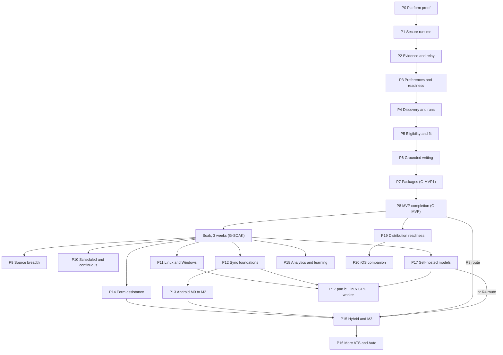

# 07_PHASED_IMPLEMENTATION_ROADMAP.md

## 1. Document Control and Status

| Item | Value |
| --- | --- |
| Document | Eighth of eight pre-production documents |
| Product | Kārya (display name); `Karya` in machine-facing identifiers (`06` section 5.2) |
| Version and date | 0.1, 2026-10-02 |
| Status | Draft for product-owner review. Nothing in this document is binding until the owner approves it. Section 26 lists the decisions that need the owner. |
| Upstream baseline | `00_PRODUCT_AND_SYSTEM_PLAN.md` v1.5, `01_SHARED_CONTRACTS_AND_DOMAIN_MODEL.md` v1.5, `02_SECURITY_AND_THREAT_MODEL.md` v1.5, `03_CONTROL_PLANE_AND_WORKER_RUNTIME_PLAN.md` v1.4, `04_DESKTOP_APPLICATION_PLAN.md` v1.2, `05_MOBILE_COMPANION_PLAN.md` v0.4 (all approved by the owner on 2026-10-01, `APPROVAL_RECORD_2026-10-01.md`); `06_DESIGN_SYSTEM_AND_UX_PLAN.md` v0.1 (draft; its decisions D1 to D14 are approved, the document itself is not, `RM-CF-701`) |
| Other inputs | `Job_Automation_PLAN_Generator_Prompt.md` (`Generator`), `AUDIT_RECORD_2026-09-29.md`, `AUDIT_RECORD_2026-10-01.md`, `AUDIT_RECORD_2026-10-01_SECURITY_REVIEW.md`, `APPROVAL_RECORD_2026-10-01.md`, project instructions, dated research in section 24 (accessed 2026-10-02) |
| Owner | Roadmap, phase gates, consolidated test strategy, repository structure, CI/CD; the product owner approves decisions marked for approval |
| Intended readers | Product owner, implementation agents (Claude Code, Codex, or another coding agent), security reviewer, the author of the production handoff prompt |
| Downstream consumers | The production handoff prompt (section 20); every phase report the implementation produces |

Change control follows the rule used by `00` to `06`: identifiers are never renumbered or reused; a changed decision records old and new wording, affected sections and documents, migration consequences, and owner approval. Identifiers introduced here use the `7xx` range:

| Prefix | Meaning |
| --- | --- |
| `RM-CF-701` | Conflicts and gaps found by the consistency audit |
| `P0` to `P20` | Implementation phases of this roadmap (section 6) |
| `G-MVP1`, `G-MVP`, `G-SOAK`, `G-DIST` | Named release gates (section 9) |
| `ADR-701`, `ASM-701`, `RISK-701`, `OQ-701`, `AC-701`, `RES-701`, `CHG-701` | As in upstream documents |

This document plans implementation. It authorizes no development inside this project, no purchase, no account enrollment, no infrastructure, and no real-world submission. The production handoff prompt, written after this document is approved, is the instrument that starts implementation, one phase at a time.

## 2. Executive Summary

The approved documents describe a product far larger than one release: a sandboxed desktop runtime, a manual relay model route, discovery from permitted sources, eligibility and fit, grounded resume writing, PDF and DOCX packages, then synchronization, an Android companion, browser-based form assistance, Hybrid and Auto modes, self-hosted models, analytics, and distribution. This roadmap turns that into 21 phases with explicit entry criteria, exit criteria, tests, demonstrations, rollback, and stop conditions, and allocates every acceptance criterion, experiment, and open question of `00` to `06` to the phase that must satisfy it.

The principal decisions are these:

1. **Prove the platform before building features (`P0`).** The blocking experiments of `04` section 32.10 run first, in their fixed order, together with the experiments that `04` `ADR-401` makes conditions of the Tauri choice (`EXP-401`, `EXP-409`, `EXP-410`) and the wheel and license checks of `03` `EXP-302`. `P0` has a real no-go outcome (`04` section 32.15). No feature code is merged before the `P0` record exists (`04` `AC-449`, `AC-450`).
2. **One vertical slice to a usable personal MVP (`P1` to `P8`).** The secure runtime comes first (`P1`), then candidate evidence and the relay (`P2`), preferences, sources, and the readiness gate (`P3`), discovery and run control (`P4`), eligibility and fit (`P5`), grounded writing (`P6`), rendering and package commit (`P7`). The exit of `P7` is `G-MVP1`: the owner can prepare a real package end to end through the relay. `P8` completes the MVP release checks (`G-MVP`), including every item the `04` cut list may have deferred.
3. **A three-week soak before automation.** After `G-MVP`, the owner uses the product for three weeks (`06` `UR-601` diary study) before any phase that widens what the product does on its own (`G-SOAK`).
4. **Later phases are tracks with dependencies, not a fixed line.** Source breadth, scheduling, Linux and Windows, synchronization, the Android companion, form assistance, Hybrid, more ATS adapters and Auto, self-hosted models, analytics, distribution, and iOS form a dependency graph (section 6.2). The default order is numeric; the owner may reorder within the graph (`OQ-705`).
5. **Security gates attach to phases, not to the end.** `02` section 29.7, section 30.5, and section 31.5 gates map to phase exits (section 9). Every phase that ships a feature also ships that feature's controls.
6. **Every phase stops for approval.** The implementation agent stops after each phase, writes the phase report of section 14, and waits for the owner's explicit approval. Passing tests is not sufficient if a demonstration, a security check, or a user-visible criterion fails.
7. **Effort is estimated, not promised.** The MVP is estimated at 480 to 840 owner hours with coding-agent assistance (section 7). This is an uncalibrated guess, re-estimated after `P0` and `P1` from measured hours.

The consistency audit (section 4) found no contradiction that blocks `P0` and 16 conflicts or gaps, each with a recorded resolution. One of them needs action before the handoff: the copies of `00` to `05` in the owner's local `Docs` folder are older than the approved project versions (`RM-CF-714`).

## 3. Sources, Authority, and Baseline

### 3.1 Authority order

Latest explicit owner instruction, project instructions, approved documents (`00` to `05` at the versions in section 1, `06` decisions D1 to D14), `Generator`, `DEP_Prompt.md`, then labeled assumptions. Where `06` v0.1 text goes beyond D1 to D14, this roadmap uses it as the working design and records that the owner has not yet approved it (`RM-CF-701`).

### 3.2 Files read for this document

| File | Version read | Note |
| --- | --- | --- |
| `00` to `05` | Project copies, versions in section 1 | Read in full |
| `06` | v0.1 | Read in full |
| `AUDIT_RECORD_2026-09-29.md`, `AUDIT_RECORD_2026-10-01.md`, `AUDIT_RECORD_2026-10-01_SECURITY_REVIEW.md`, `APPROVAL_RECORD_2026-10-01.md` | As stored | Read in full |
| `Job_Automation_PLAN_Generator_Prompt.md` | As stored | Read in full; its phase list and per-phase fields shape section 8 |
| `DEP_Prompt.md` | Not available | Not in the project and not in the local `Docs` folder. Its requirements reach this document through `00` section 39 traceability, which mapped every `DEP` section. No `DEP` requirement is traced here directly (`RM-CF-715`) |

### 3.3 Upstream statements this roadmap is bound by

| Statement | Source | Roadmap consequence |
| --- | --- | --- |
| Phase 0 gate with ordered blocking experiments and a no-go outcome | `04` sections 32.10, 32.15; `00` section 42.3 | `P0` (section 8.1) |
| Cut list for the first MVP increment; "`07` estimates effort for each item" | `04` section 32.15 | Section 7.3; `P8` holds every cut item |
| MVP release gate controls | `02` section 29.7 (replaces section 22 and 28.6 MVP rows), section 31.5 MVP row | `G-MVP` (section 9) |
| "Any use by another person" gate | `02` sections 29.7, 30.5; `04` sections 30, 32.9, 33.6 | `P19` (`G-DIST`) |
| Synchronization and mobile gate | `02` sections 29.7, 30.5, 31.5 | `P12` and `P13` |
| Hybrid gate; browser automation gate | `02` sections 29.7, 31.5; `03` `ADR-312` | `P14`, `P15` |
| Mobile phases `M0` to `M3`, `M-iOS`, with entry and exit criteria | `05` section 32.2.3 | `P13`, `P15`, `P20` |
| Design artifacts per phase ("`07` numbering pending") | `06` section 22.1 | Each phase's design artifacts row |
| Every requirement `PRD-01` to `PRD-17` stays in scope and is sequenced by `07`; deferral never removes a requirement | `00` section 34, `CHG-006` | Section 23 traceability |
| `07` owns CI/CD strategy, repository and package structure, consolidated testing and AI evaluation strategy | `00` section 39.1 | Sections 10, 11, 12 |
| Required negative tests run at every affected release gate; `07` places them in phase order | `02` section 23 | Sections 12, 16 |
| `OQ-101` and `OQ-102` decided before the phase that enables each feature | `01` section 26 | Section 18 |

## 4. Consistency Audit and Conflict Register

### 4.1 Method

1. Every acceptance criterion, experiment, and open question defined in `00` to `06` was extracted by a script from the table rows that define them and compared with the allocation tables of sections 16 to 18. Each identifier is allocated to exactly one phase, split across named phases with the part each phase owns, marked superseded with its replacement, or marked closed with the decision that closed it.
2. Each phase's dependencies were checked against the upstream statements that create them (section 3.3) and against the release gates (section 9).
3. Statements that two documents make about the same mechanism were compared where a later document changed the mechanism (the isolation baseline, keys and recovery, the updater, the relay, identifiers, mobile platform order).
4. The local `Docs` folder was compared with the project copies.

The audit did not re-review the security design itself. `APPROVAL_RECORD_2026-10-01.md` records that no independent review has run on the text after the `V-01` to `V-16` fixes; section 21 makes that review an owner decision before the handoff (`OQ-706`).

### 4.2 Conflict and gap register

| ID | Statements and affected documents | Practical consequence | Resolution | Approval |
| --- | --- | --- | --- | --- |
| `RM-CF-701` | `APPROVAL_RECORD_2026-10-01.md` approves `00` to `05` but their Status rows still say "awaiting the owner's review"; `06` v0.1 is a draft whose decisions D1 to D14 are approved but whose text is not. Affects `00` to `06`. | An implementation agent reading the Status rows would treat approved text as unapproved, or treat `06` text as binding when it is not. | Before the handoff, write the approval into each Status row (section 19). The owner approves `06` (with or without changes) before `P0` starts, because `P0` produces the token file and contrast report from `06` section 6. | Owner: approve `06`; Status edits need no further decision |
| `RM-CF-702` | Edits that `06` section 25.2 and `APPROVAL_RECORD_2026-10-01.md` say are written "at the next revision" of `00`, `04`, `05`: identifiers (`UX-CF-607`), product name (`00` `CHG-018`), the `GW-411` display event (`UX-CF-606`), per-device appearance preferences (`UX-CF-608`), Material 3 note (`UX-CF-610`), the D3 defaults. Affects `00`, `04`, `05`. | Until written, `04` still names `dev.vishhz.jobsearch` and leaves `OQ-402` open. | Apply all of them in one documentation revision pass before the handoff prompt (section 19). No decision changes. | None beyond D1 to D14 |
| `RM-CF-703` | `04` section 32.10 orders six blocking experiments. `04` `ADR-401` makes the Tauri choice conditional on `EXP-401`, `EXP-409`, and `EXP-410`; `03` `EXP-302` confirms the SQLCipher license and wheels; `EXP-405` confirms the T1 signing identity that `ADR-412` and `ADR-422` rely on; `06` section 22.1 requires the token file and contrast report in "Phase 0". None of these is in the section 32.10 list. Affects `03`, `04`, `06`. | `P0` could pass the isolation experiments while the UI framework, signing tier, or database license fails later. | `P0` runs the `04` section 32.10 list in its order, then the additional experiments of section 8.1. A failure of an additional experiment follows that experiment's own named fallback (for example Electron for `ADR-401`). | Owner approval with this document |
| `RM-CF-704` | `00` `AC-17` (R3 with a spend cap) is an MVP release check (`00` `CHG-023`). `04` section 32.15 cut item 1 moves `EgressModel.xpc` and R3 to increment 2. | The MVP release could be declared without `AC-17`. | `AC-17` is a `G-MVP` check (exit of `P8`). The cut item may move R3 out of `G-MVP1` (exit of `P7`) only. If the owner has no API key (`OQ-701`), `AC-17` is tested with a mock provider and a key-holding test account is not required; the owner records that R3 was not exercised against a real provider. | Owner approval with this document |
| `RM-CF-705` | `02` `AC-240`, `AC-231`, and `04` `AC-451` require a second Mac (fresh install restored from the phrase; copied keychain and containers on another Mac). The owner has one Mac (`00` `ASM-01`). Affects `02`, `04`. | Three MVP criteria cannot run as written. | Run them against a macOS virtual machine on the reference Mac, created with Apple's Virtualization framework, which installs and runs macOS guests on Apple silicon [RES-701]. The VM has no Secure Enclave of the host, so it is a faithful "other Mac" for these tests: tier `K2` data must not open in it, and the phrase must restore. The VM holds synthetic data only. `EXP-701` confirms the VM setup at `P1`. | Owner approval with this document |
| `RM-CF-706` | Phase names differ across documents: `03` uses "MVP", "Source breadth", "Later (scheduled runs)", "Later (forms)", "Later (R4)"; `04` uses "Phase 0", "Phase 1", "increment 2", "Linux phase", "Windows phase", "Sync"; `05` uses `M0` to `M3`, `M-iOS`; `02` uses gate names; `06` says "`07` numbering pending". | A coding agent cannot tell which criteria belong to which build. | Section 6.4 maps every upstream label to a phase of this document. Upstream labels are not rewritten. | None |
| `RM-CF-707` | `02` `AC-212` (modified, unsigned, or downgraded update rejected; known-good rollback) is an "MVP release" check, but `04` `ADR-423` removed the updater from the MVP and moved `AC-416`, `AC-437`, and update parts of `CTRL-223` to the distribution gate. | `AC-212` cannot be met in the MVP as written. | Split: the rollback part (pre-migration backup restore and the single N-1 reinstall through the install script, `03` `AC-324`) is a `G-MVP` check; the update-verification part moves to `P19` with `AC-416`. | Owner approval with this document |
| `RM-CF-708` | `06` `OQ-604` (launch passphrase attempt limit and delay at tier `K1P`) is assigned to "`04` at its next revision"; `04` has no rule. | `K1P` would ship without brute-force pacing if `EXP-417` selects it. | Proposed rule: after 5 failed passphrase attempts, each further attempt waits a delay that doubles from 30 seconds to a maximum of 15 minutes, persisted across relaunch; the product never wipes data on failed attempts (a wipe would turn a forgotten passphrase into data loss when the recovery phrase exists anyway). Argon2id at about 1 second per attempt (`04` `ADR-422`) already bounds offline guessing; the delay bounds online guessing at the lock screen. Recorded in `04` at the revision pass (section 19). | Owner approval with this document |
| `RM-CF-709` | `06` section 18.5 cites `04` `ADR-424` for "the system password works wherever Touch ID does" on the desktop. `ADR-424` is the sync-phase decision key; the MVP rule is `04` `ADR-407` (LocalAuthentication with the device-owner policy). Affects `06`. | Low: a wrong citation, not a wrong rule. | Cite both: `ADR-407` for the MVP lock and step-up, `ADR-424` for sync-phase decisions. Fixed at the `06` revision. | None |
| `RM-CF-710` | `04` section 32.10 says Phase 1 builds "enough to discover and parse public postings" first. `00` `AC-01`, `PRD-03`, and `01` `CON-114` block job automation, including discovery, until readiness is verified. | Building real discovery before the readiness gate would either violate the gate or need a temporary bypass. | `P1` proves the three-role baseline (`Authority.xpc`, `EgressSource.xpc`, `WorkPublic.xpc`) end to end against a local mock source harness with synthetic postings, with every control in force. Real sources are first contacted in `P4`, after `P3` delivers the readiness gate. The baseline that `04` wants proven first is proven first; only the target changes. | Owner approval with this document |
| `RM-CF-711` | `03` sections 18 and `04` sections 6.2 and 10.2 name `jsa-runtime`, `.jsa-lock`, `.jsa-partial`, and `.jsa-probe-<random>`, derived from the earlier working name. D4 set the ASCII identifier `Karya`. | Low; inconsistent names on disk. | Rename to `karya-runtime`, `.karya-lock`, `.karya-partial`, `.karya-probe-<random>` before the first build. Recorded in `03` and `04` at the revision pass. | Owner approval with this document (follows from D4) |
| `RM-CF-712` | `06` section 22.1 places a "type specimen ... on the Android reference phone" in Phase 0, and `06` `EXP-602` covers WKWebView and Android together. No Android work exists before `P13`; the phone is not recorded until `05` `EXP-514`. | `P0` could not complete. | `P0` runs the WKWebView half of `EXP-602`; the Android half runs at `M0` (`P13`). | None |
| `RM-CF-713` | `00` section 19 lists iOS as a target platform. `05` `ADR-519` defers iOS to `M-iOS`, which needs the paid Apple Developer Program; `04` section 30 keeps the free tier until the owner decides to monetize (`04` `OQ-401`). | Five-OS coverage, which the `Generator` requires, cannot be reached without a paid enrollment. | `P20` (`M-iOS`) is in the roadmap with its entry condition: the owner's decision on `04` `OQ-401`. The roadmap does not claim iOS support before `P20` exits. | Owner decision at `P20` entry, already recorded as open |
| `RM-CF-714` | The owner's local folder `/Users/vishhzhome/Projects/Job Search/Documentations/Docs/` holds `00` v1.4, `01` v1.4, `02` v1.4, `03` v1.3, `04` v1.1, and `05` v0.3, while the project holds `00` v1.5, `01` v1.5, `02` v1.5, `03` v1.4, `04` v1.2, and `05` v0.4. The two 2026-10-01 audit records are not in the local folder. | A coding agent given the local folder would implement superseded text (for example one content key for phones instead of scoped keys). | Refresh the local folder from the project before the handoff, and make the handoff prompt name the exact versions (section 20). This roadmap does not overwrite the owner's files without the owner's instruction. | Owner instruction to refresh |
| `RM-CF-715` | `DEP_Prompt.md` is cited as an input by `00` to `06` but is not available in the project or the local folder. | `DEP` requirements cannot be re-checked here. | Rely on `00` section 39 (which maps `DEP` sections 1 to 52) and the downstream traceability of `01` to `06`. If the owner still has the file, add it to the project before the handoff; it is not needed by the coding agent, because every requirement it contributed is already in `00` to `06`. | None |
| `RM-CF-716` | `03` `EXP-301` compares a relocatable CPython bundle with PyInstaller and measures a two-process runtime. `03` `ADR-322` and `04` `ADR-419` replaced that runtime with five XPC role services, and `03` `EXP-314` measures them. | Low; `EXP-301` would test a design no longer used. | `EXP-301` is narrowed to recording the reference Mac (macOS version, chip, memory; `04` `DK-CF-411`) and the lease and stop timings, run inside `EXP-401`. Its packaging comparison is dropped; `EXP-314` and `EXP-416` cover the current design. | None |

No conflict changes the MVP boundary of `00` section 34 or any approved security control.

## 5. Roadmap Decisions

| ID | Decision | Context and alternatives | Consequence |
| --- | --- | --- | --- |
| `ADR-701` | Phase structure: a platform-proof phase, eight MVP phases that each end in a working vertical slice, a soak, then post-MVP tracks ordered by dependencies (section 6) | The `Generator` proposes 15 phases with account features in Phase 1, all source adapters in Phase 8, and Hybrid with multi-device approvals in Phase 10. The approved documents put accounts and sync after the MVP (`00` `CHG-006`), make isolation an MVP feature (`00` `CHG-015`), and gate Hybrid on an evaluated model route (`03` `ADR-312`). Following the `Generator` order literally would build sync before the local slice works. | The `Generator`'s permission to "reorder or split phases if justified" is used; section 6.3 maps each `Generator` phase to the phases that implement it |
| `ADR-702` | One monorepo for every component (section 10) | Alternatives: one repository per component. Contracts (`01`), the frame codec (`01` `CON-157`), `sync-core`, and test vectors must be identical across Python, Rust, TypeScript, and Kotlin; separate repositories would need version pinning across four repositories for one maintainer. | One CI configuration; contract changes are atomic commits |
| `ADR-703` | CI on hosted runners with synthetic data only; release builds and signing happen only on the owner's reference Mac (section 11) | The T1 signing identity exists only on the owner's Mac (`04` `ADR-412`), release keys are hardware-bound there (`02` `CTRL-234` for later), and no real data may enter CI. A self-hosted runner on the owner's daily Mac would put CI jobs next to real data and keys. | Confinement tests that need the T1 identity run on the owner's Mac at phase gates, not in CI; CI runs everything that does not |
| `ADR-704` | Contract types have one source: the Pydantic models of `01` contracts generate JSON Schema and the OpenAPI document (`03` `ADR-303`); TypeScript types are generated from them; Rust types are generated where a maintained generator handles the schema, otherwise written by hand and checked by conformance tests against the same JSON Schemas; `CON-162` test vectors are shared files | Hand-copied types across four languages drift. | CI fails when generated files differ from committed ones (`AC-705`) |
| `ADR-705` | Phase gate procedure: stop, report, demonstrate, owner approval, tag (section 14) | `Generator` handoff contract items 7 to 10 | No phase starts on a branch that contains unapproved work from the previous phase |
| `ADR-706` | Real candidate data enters only a T1 build with the final identifier `dev.vishhz.karya`, only after the `P1` exit, and never enters the repository, CI, fixtures, or phase reports (section 13) | `04` `ADR-409` and `ADR-412` forbid real data in development and ad hoc builds; `02` requires the isolation baseline before the owner's data is processed | `P0` and `P1` use synthetic data only; the owner's first real evidence import happens in `P2` |
| `ADR-707` | Effort is estimated in owner hours with coding-agent assistance, labeled as uncalibrated, and re-estimated after `P0` and after `P1` from measured hours (section 7) | A one-person project with coding agents has no reliable historical velocity | Calendar dates are computed from the owner's available hours (`OQ-702`), never promised |
| `ADR-708` | Upstream edits found by this audit are applied to the documents in a single revision pass inside this project before the handoff prompt is written (section 19) | Leaving them as "at the next revision" would hand the coding agent contradictory text | One pass, one change record per document, no decision changes |
| `ADR-709` | The MVP is released in two gates: `G-MVP1` at the exit of `P7` (first real use, cut items allowed) and `G-MVP` at the exit of `P8` (every MVP release check of `00` to `06`) | `04` section 32.15 defines a first increment and an increment 2 | The owner can use the product for real after `P7` while `P8` completes the deferred items |

## 6. Phase Overview

### 6.1 Phases

| Phase | Name | Track | Gate at exit | Mobile phase (`05`) |
| --- | --- | --- | --- | --- |
| `P0` | Foundations and platform proof | MVP | `P0` record (`04` `AC-449`, `AC-450`) | |
| `P1` | Secure local runtime and first-run setup | MVP | Security baseline in force | |
| `P2` | Candidate evidence, claim ledger, and relay | MVP | First real data | |
| `P3` | Preferences, source registry, destination, and readiness gate | MVP | Readiness gate | |
| `P4` | Discovery slice and run control | MVP | First real source contact | |
| `P5` | Eligibility, hard filters, fit, and explanations | MVP | Calibrated decisions | |
| `P6` | Resume strategy and grounded writing | MVP | Grounded content | |
| `P7` | Rendering, validation, package commit, and handoff | MVP | `G-MVP1` | |
| `P8` | MVP completion and personal release | MVP | `G-MVP` | |
| (soak) | Three weeks of real use, `06` `UR-601` | MVP | `G-SOAK` | |
| `P9` | Source breadth and coverage dashboard | Discovery | | |
| `P10` | Scheduled and continuous runs, headless supervisor | Runs | | |
| `P11` | Linux and Windows compatibility | Platforms | Compatibility claim | |
| `P12` | Synchronization foundations | Multi-device | `02` sync gate (desktop) | |
| `P13` | Android companion: monitor, stop, package review | Multi-device | `02` mobile gate | `M0`, `M1`, `M2` |
| `P14` | Browser isolation, Manual form assistance, first ATS adapter | Application | `02` browser gate | |
| `P15` | Hybrid mode and approvals | Application | `02` Hybrid gate | `M3` |
| `P16` | Additional ATS adapters and controlled Auto | Application | `02` Auto gate | |
| `P17` | Self-hosted models (R4), setup wizard, distributed workers | Models | | |
| `P18` | Analytics, outcome learning, skill gaps, interview preparation | Learning | | |
| `P19` | Distribution readiness | Release | `G-DIST` | `IT2`, `AT2` prerequisites |
| `P20` | iOS companion | Multi-device | iOS claim | `M-iOS` |

### 6.2 Dependency graph



Rules read from the graph:

1. `P1` to `P8` are strictly sequential; each builds on the previous slice.
2. After `G-SOAK`, any phase whose predecessors have exited may start. Only one phase is in progress at a time, because there is one maintainer and the gate procedure (section 14) assumes it; the owner may approve a different order than the numeric default (`OQ-705`).
3. `P15` needs `P13` only for its `M3` part. If the owner wants Hybrid on the desktop before the phone, `P15` may run without `M3`, and `M3` is added when `P13` exits.
4. `P15` needs an evaluated model route (`03` `ADR-312`): R3 from `P8`, or R4 from `P17`.
5. `P19` can run at any time after `G-MVP`; it must exit before anyone other than the owner uses any build (`04` section 30).

### 6.3 Mapping of the `Generator` phase list

| `Generator` phase | Implemented in | Reason for the difference |
| --- | --- | --- |
| 0 Repository, environment, skeleton, CI, security baseline, spikes | `P0`, with the security baseline completed in `P1` | Isolation is a feature of the MVP (`00` `CHG-015`), not only a CI setting |
| 1 Account, devices, worker registration, secure configuration | Local identity, role principals, and secure configuration in `P1`; accounts and devices in `P12` | Hosted accounts follow the MVP (`00` `CHG-006`) |
| 2 Candidate ingestion, manual entry, claim ledger, readiness gate | `P2` (ledger), `P3` (gate) | The gate also needs preferences and a destination (`01` `CON-114` items 9 to 11) |
| 3 Roles, eligibility preferences, job types, source registry, output destination | `P3` | Same |
| 4 One-source discovery slice, canonical jobs, deduplication, dashboard | `P4` with two sources | `00` `AC-02` and `03` `AC-311` need one posting from two sources |
| 5 Filters, eligibility, fit, explanations | `P5` | Same |
| 6 Resume strategy and truthful content | `P6` | Same |
| 7 PDF and DOCX, fonts, packaging, ATS validation | `P7` | Same |
| 8 All named discovery sources with coverage dashboard | `P9` | Registry and coverage records for every source exist from `P3` and `P4` (`03` `AC-308`); `P9` adds the remaining adapters |
| 9 Manual mode and one safe ATS adapter | Manual preparation and handoff in `P7`; form assistance and the first adapter in `P14` | The MVP ends at external handoff (`00` `POL-16`) |
| 10 Hybrid, review bundle, multi-device approvals, notifications | `P12`, `P13`, `P15` | Multi-device approval needs sync and the end-to-end protocol first (`02` `OQ-208`) |
| 11 Scheduling, timed runs, continuous runs, budgets, recovery | Timed runs, budgets, and stop in `P4`; scheduled and continuous runs in `P10` | Laptop sleep and headless supervision need their own experiments (`03` `EXP-305`, `EXP-306`) |
| 12 More ATS adapters and controlled Auto | `P16` | Same |
| 13 Self-hosted setup wizard, catalog, benchmarking, routing | `P17` | Same |
| 14 Analytics, outcome feedback, hardening, accessibility, performance, release readiness | MVP hardening in `P8`; analytics in `P18`; release readiness in `P19` | Hardening of the MVP cannot wait for analytics |

### 6.4 Mapping of upstream phase labels

| Upstream label | Where it appears | Phase here |
| --- | --- | --- |
| "Phase 0" | `04` section 32.10, `06` section 22.1 | `P0` |
| "Phase 1", "first MVP increment" | `04` section 32.10, 32.15 | `P1` to `P7` (`G-MVP1`) |
| "increment 2" | `04` section 32.15 | `P8` |
| "MVP", "MVP release", "MVP (setup)" | `00` to `06` | The phase named in section 16 for each criterion; all must pass by `G-MVP` |
| "Source breadth", "breadth phase" | `03` | `P9` |
| "Later (scheduled runs)", "Continuous" | `03`, `02` | `P10` |
| "Linux compatibility gate", "Linux phase", "Windows phase" | `02`, `04` | `P11` |
| "Sync", "sync (later)", "Synchronization and mobile" | `02`, `03`, `04` | `P12` (desktop and control plane), `P13` (phone) |
| `M0`, `M1`, `M2` | `05` | `P13` |
| `M3`, "Hybrid" | `05`, `02`, `03`, `04` | `P15` |
| "Later (forms)", "browser phase", "Later assisted form" | `02`, `03` | `P14` |
| "Auto" | `02` | `P16` |
| "Later (R4)", "R4 phase" | `03` | `P17` |
| "Any use by another person", "distribution", `IT2`, `AT2`, "T2" | `02`, `04`, `05` | `P19` |
| `M-iOS`, `IT1` | `05` | `P20` |
| "Each phase", "Each release", "Every release" | `05`, `03` | Every phase from the one in which the criterion first applies (section 16) |

## 7. Effort, Owner Time, and Calendar

### 7.1 Basis

All numbers in this section are guesses. They assume that coding agents write most of the code and that the owner reviews it, runs tests on the reference Mac and phone, investigates platform failures, labels evaluation data, and makes decisions. They are expressed in owner hours. They have not been calibrated against any measured work on this project. `AC-707` requires the owner to record actual hours per phase, and the estimates of every later phase are revised after `P0` and after `P1`.

The heaviest uncertainty is in `P0` and `P1`: embedding Python in App-Sandboxed XPC services, signing every native library with a free-tier identity, and the Secure Enclave under the free tier are each unverified (`02` section 29.1). A single failing experiment can add weeks.

### 7.2 Estimates per phase

| Phase | Owner hours (guess) | Of which owner-only activities (guess) |
| --- | --- | --- |
| `P0` | 60 to 120 | Experiments on the reference Mac, `EXP-417` 90-day follow-up check, decisions on outcomes |
| `P1` | 80 to 140 | Recovery phrase setup on real hardware, VM restore test (`EXP-701`), canary suite review |
| `P2` | 50 to 90 | Importing and verifying own evidence (3 to 6 hours) |
| `P3` | 30 to 50 | Entering preferences and eligibility facts (1 to 2 hours) |
| `P4` | 60 to 100 | Labeling 200 posting pairs for `EXP-307` (about 4 to 6 hours) |
| `P5` | 50 to 80 | Labeling 150 eligibility and 100 fit postings for `EXP-304` (about 10 to 15 hours) |
| `P6` | 40 to 70 | `EXP-309` relay usability on 10 postings (about 2 hours) |
| `P7` | 60 to 100 | Reviewing the 30-resume benchmark output |
| `P8` | 50 to 90 | `UR-602` sessions with 5 participants (about 6 to 8 hours), accessibility scripts |
| MVP total | 480 to 840 | |
| Soak | 3 weeks of normal use plus 10 minutes a week of diary review | |
| `P9` | 60 to 100 | Terms review of each source (`03` `ADR-310`) |
| `P10` | 50 to 80 | Lid-close and power tests |
| `P11` | 70 to 120 | Pop!_OS and Windows machines needed |
| `P12` | 160 to 260 | Control-plane operation decision, independent protocol review coordination |
| `P13` | 140 to 220 | Phone tests, `UR-604` sessions |
| `P14` | 140 to 220 | Independent review coordination, adapter terms review |
| `P15` | 70 to 120 | |
| `P16` | 100 to 180 | About 15 to 30 per additional ATS adapter |
| `P17` | 80 to 150 | Benchmark review, GPU worker when the Pop!_OS desktop is available |
| `P18` | 50 to 90 | |
| `P19` | 50 to 90 | External review and professional advice are additional and paid |
| `P20` | 100 to 170 | Requires an iPhone and the paid Apple Developer Program |

### 7.3 Cut list items (`04` section 32.15)

`04` asks `07` to estimate each item. Each item is built in increment 1 (`P1` to `P7`) by default; if `P1` to `P7` overrun by more than 25 percent of their upper estimates combined, the owner may move items to `P8` in this order. No security control is ever cut.

| Order | Item | Default phase | Moves to | Owner hours saved in increment 1 (guess) |
| --- | --- | --- | --- | --- |
| 1 | `EgressModel.xpc` and R3 | `P6` | `P8` | 20 to 35 |
| 2 | Seatbelt implementation of `RoleLauncher` | `P1`, only if `P0` selects option 3 of `04` `ADR-420` | Not cuttable when selected; not built otherwise | 15 to 30 when not needed |
| 3 | `K1P` | `P1`, only if `EXP-417` rules out `K2` | Not cuttable when selected; not built otherwise | 10 to 20 when not needed |
| 4 | Recovery drill screen | `P1` | `P8` | 5 to 10 |
| 5 | Portfolio fetching | `P2` | `P8` | 10 to 20 |
| 6 | Third discovery source (Ashby) | `P4` | `P8` | 8 to 15 |

### 7.4 The `P0` no-go alternative

If no confinement option of `04` `ADR-420` works for the Python-hosting roles, `P0` stops and the owner chooses (`04` section 32.15, `AC-450`). The named alternative is to implement the work roles in Rust inside confined Rust XPC services. Estimate: an additional 120 to 250 owner hours across `P1` to `P7` (guess), mainly for HTML sanitization and parsing, PDF text extraction, DOCX generation and reading, and validation in Rust. Risk: maintained Rust libraries for PDF text extraction are less mature than pdfminer.six and pypdfium2, so `03` `AC-320` and `AC-321` may need a different extractor pair; this would be decided by a new experiment at that point. Typst is a Rust library and needs no change.

### 7.5 Calendar

Calendar time is owner hours divided by the hours the owner can spend each week (`OQ-702`).

| Hours per week | MVP (480 to 840 hours) |
| --- | --- |
| 10 | 48 to 84 weeks |
| 15 | 32 to 56 weeks |
| 20 | 24 to 42 weeks |
| 40 | 12 to 21 weeks |

The cut list (section 7.3) can shorten `G-MVP1` by up to about 43 to 80 hours (items 1, 4, 5, and 6); it does not shorten `G-MVP`.

### 7.6 Costs that are not owner time

| Item | Phase | Cost basis |
| --- | --- | --- |
| R3 model spend | `P6` or `P8` onward, optional | Capped by `03` section 11.3 defaults (USD 2 per run, USD 5 per day) |
| Hosted control plane or self-hosting hardware | `P12` | Depends on `03` `OQ-307` |
| CI minutes | `P0` onward | Free for public repositories; private repositories consume the plan's included minutes, macOS minutes at a higher rate; GitHub announced lower hosted-runner prices from 2026-01-01 and postponed a planned self-hosted runner charge [RES-702]. Checked at `P0` (`OQ-703`) |
| Independent security review and penetration test (`02` `CTRL-236`) | Before `P14`, `P15`, `P16`, and `P19` | Quoted when commissioned |
| Professional export classification review (`02` `CTRL-254`), privacy and legal review (`02` `OQ-204`), trademark search (`06` `RISK-607`) | `P19` | Quoted when commissioned |
| Apple Developer Program | `P19` (desktop distribution) and `P20` | USD 99 per year (`05` `RES-504`) |
| Google Play registration | `P19`, only for `AT2` | Checked at that phase (`05` section 20.2) |

## 8. Phase Specifications

Each phase lists the fields the `Generator` requires. "Allocated criteria" means every acceptance criterion that section 16 allocates to the phase; the exit of a phase requires each of them to pass, with evidence in the phase report. Criteria allocated to earlier phases keep passing (regression). Rows marked "per section 12" refer to the consolidated test strategy. Later phases (`P9` onward) are specified to the same fields; their task lists are refined at a phase entry review, which may add detail but may not remove a field's content without an owner-approved change record.

Common to every phase:

- **Entry:** the previous phase is approved and tagged (section 14); the phase's prerequisite decisions in section 18 are taken; the phase's design artifacts from `06` section 22.1 exist.
- **Rollback:** revert to the previous phase tag; if the phase migrated a database holding real data, restore the pre-migration backup and reinstall the N-1 build (`03` section 8.6, `04` section 16.3 as amended by `ADR-423`). Phase-specific rollback notes add to this.
- **Global stop conditions:** section 15.2 applies to every phase in addition to its own.

### 8.1 `P0` Foundations and Platform Proof

| Field | Content |
| --- | --- |
| Objective | Settle every unverified platform fact the MVP depends on, set up the repository and CI, and record a go or no-go decision before any feature code |
| User-visible value | None in the product. The owner receives the `P0` record: what works on the reference Mac, which fallback each role uses, which key tier is the default |
| Included requirements | `04` section 32.10 (all six rows, in order); `04` `ADR-401` conditions (`EXP-401`, `EXP-409`, `EXP-410`); `03` `EXP-302`, `EXP-312`, `EXP-314`, `EXP-316`; `04` `EXP-402`, `EXP-403` (layout under `codesign --verify --strict`; notarization part deferred to `P19`), `EXP-405`, `EXP-407` with `03` `EXP-310`, `EXP-416`, `EXP-417`, `EXP-419`, `EXP-420`; `06` token file, contrast report, WKWebView half of `EXP-602`, `EXP-603`, `OQ-601`, `OQ-602` (web part), `OQ-603`; `00` `EXP-01` macOS part and the record of `04` `DK-CF-411`; `03` `EXP-301` as narrowed (`RM-CF-716`) |
| Excluded | Any product feature; any real candidate data; any network access to real job sources or model providers |
| Dependencies | `06` approved (`RM-CF-701`); upstream revision pass done (section 19); `OQ-703` (repository hosting and visibility) answered |
| Design artifacts | `design/tokens/karya.tokens.json` (DTCG format, `06` `ADR-610`) with generated CSS variables; contrast report (`06` section 6.2.3); type specimen in WKWebView; app mark drafts with the chosen stroke weight (`OQ-601`) |
| Data migrations | None |
| Implementation tasks | (1) Create the monorepo of section 10 with tool pins (Rust toolchain, Python 3.13 per `03` `EXP-302`, Node, Xcode version), lockfiles with hashes, and the `AGENTS.md` and `CLAUDE.md` rules. (2) CI per section 11: lint, type checks, unit test runners, secret scan, license gate, dependency scans, SBOM, copy lint, contrast check. (3) Spike builds for each experiment on branches named `spike/<EXP>`; spike code is not merged into `main` except the pieces that pass review and become the starting point of `P1` (for example the XPC host skeleton). (4) Install script for T1 builds that keeps the N-1 bundle (`04` `ADR-423`). (5) Write the `P0` record. |
| Security tasks | Generate the T1 Apple Development identity on the reference Mac (`EXP-405`); confirm hardened runtime and library validation with every pinned wheel (`EXP-402`); set up secret scanning and the license gate before the first dependency is added; record which hardened-runtime exceptions each wheel needs and reject any that grant network or file access (`02` `CTRL-246` item 5) |
| Tests | Each experiment's pass and fail criteria as written in `04` section 32.10 and the source documents; `06` `AC-601` on the token file; CI pipeline self-tests (a planted fake secret and a planted GPL dependency each fail the build) |
| Required fixtures | Synthetic posting set (HTML, JSON, XML) of at least 50 items for `EXP-314` and `EXP-316`; a 10,000-row synthetic jobs dataset for `EXP-401` and `EXP-410`; the first 50 files of the malformed-input corpus (`02` `CTRL-235`) |
| Demo script | The owner launches a T1 test build on the reference Mac; sees each role's confinement option and self-test result; sees a synthetic posting fetched from a local mock through `EgressSource.xpc` and parsed in `WorkPublic.xpc`; sees the 10,000-row list scroll; unlocks a test key at the chosen tier |
| Entry criteria | Common entry; the owner has the reference Mac with Xcode and an Apple Account (`04` `ASM-403`) |
| Exit criteria | `P0` record contains a result and chosen option for every row of `04` section 32.10 and every additional experiment listed above (`04` `AC-449`); confinement rows state the chosen option or the no-go outcome with the owner's decision (`04` `AC-450`); the macOS version, chip, and memory are recorded (`04` `DK-CF-411`); `EXP-417`'s 90-day criterion has a scheduled check date (the 90-day part completes during `P1` to `P4`; if it fails, the tier change is handled as an owner-confirmed change under `02` `ADR-207`); allocated criteria pass |
| Rollback | Discard spike branches; nothing is released |
| Stop conditions | No confinement option works for a Python-hosting role (no-go of `04` section 32.15: stop and present the Rust-roles alternative, section 7.4); any `ADR-401` condition fails and Electron becomes the fallback (stop for owner decision before continuing, because the core's language changes); `EXP-302` finds a SQLCipher license incompatible with the license gate (stop: `03` `RISK-306` fallback needs a `02` review) |
| Handed to `P1` | `P0` record; chosen `RoleLauncher` implementation per role; key tier default; framed-protocol carrier (`03` `ADR-323` primary or XPC payload); list of permitted temporary files per library (`03` `EXP-316`); measured role budgets (`03` `EXP-314`); repository with CI; token file |
| Owner hours (guess) | 60 to 120 |

### 8.2 `P1` Secure Local Runtime and First-Run Setup

| Field | Content |
| --- | --- |
| Objective | Build the confined runtime, the authority with its database and audit chain, the keys, recovery phrase, backups, lock, and the first-run security setup, and prove them against the simulated-compromise suite |
| User-visible value | The app installs, runs the security setup (FileVault check, key tier, recovery phrase, backup folder), locks and unlocks, shows each role's protection status, and backs up and restores |
| Included requirements | `PRD-01` (local setup, export and deletion foundations), `NFR-02` (audit with state), `NFR-07`; `02` `CTRL-201`, `CTRL-202`, `CTRL-203` (local), `CTRL-209` to `CTRL-212`, `CTRL-222`, `CTRL-226` (local channels), `CTRL-228` to `CTRL-233`, `CTRL-235` (MVP scope), `CTRL-239` to `CTRL-242`, `CTRL-245`, `CTRL-246`, `CTRL-250`, `CTRL-255` setup part; `03` sections 5, 6.1, 7 (frames), 8, 9 (task queue, leases, fencing, budgets ledger), 34; `04` sections 5 to 9, 32.1 to 32.6, 34.2; `06` `DV-601`, `DV-602`, `DV-603` shell, `DV-614`, `DV-627` (this device, lock, keys, recovery), `DV-629`, `DV-634`, workbench and component library start |
| Excluded | Evidence, claims, sources, models, packages; any network destination other than the local mock harness; sync |
| Dependencies | `P0` |
| Design artifacts | Component workbench with the components these views need (`06` section 22.2); view specifications `DV-601`, `DV-602`, `DV-614`, `DV-627`; copy catalog entries for setup and lock |
| Data migrations | Initial schema: `authority_meta`, `profiles`, `policies`, `tasks`, `budget_ledger`, `workers`, `devices` (local principals), `secret_refs`, `idempotency_results`, `audit_events`, `outbox`, `blobs`; key history table for retired DEKs (`02` `CTRL-241` item 4); recovery public keys and the recovery-wrapped DEK |
| Implementation tasks | Rust core: gateway with typed allowlisted commands (`04` `ADR-403`), supervisor and `RoleLauncher` with the `P0`-selected implementation, watchdog (`02` `CTRL-246`), environment monitor (`ENV-401` to `ENV-412`), keystore at the selected tier, LocalAuthentication lock, sleep handshake (`04` `ADR-415`), event bridge, `commit` principal skeleton with the `backup` capability; `Authority.xpc`: storage adapter for SQLCipher with the `03` settings and `fullfsync` pragmas, migrations with pre-migration backup, audit hash chain, outbox and event stream, task queue with leases and fencing, budgets ledger, backups and weekly restore test, framed protocol server; `EgressSource.xpc` with ticket verification and `GuardedHttp` rules (`03` `ADR-318`, section 34.2); `WorkPublic.xpc` host with the self-test; the mock source harness (`RM-CF-710`); crash-report sweep (`02` `CTRL-246` item 6); UI: lock screen, security setup flow, protection status, settings, menu bar extra |
| Security tasks | Simulated-compromise canary suite in every role (`02` `AC-220`, `AC-221`, `AC-230`) running in the T1 test build; malformed-frame corpus (`01` `AC-125`); recovery phrase window excluded from capture (`04` `AC-444`); the `K1P` attempt limit if `K1P` is selected (`RM-CF-708`); VM-based "other Mac" tests (`RM-CF-705`, `EXP-701`) |
| Tests | Per section 12 at the levels unit, contract, state machine (for run and task machines built here), fault injection (kill each role at each step), platform integration on the reference Mac; allocated criteria |
| Required fixtures | Mock source harness with synthetic postings; canary files; malformed-frame corpus; a VM image with a fresh install (synthetic data only) |
| Demo script | Fresh install on the reference Mac: FileVault check passes, recovery phrase shown once and three words confirmed, backup folder chosen on an encrypted external volume (or override typed), lock after inactivity, unlock with Touch ID; protection status lists every role; a mock run fetches and parses synthetic postings; emergency stop from the menu bar ends role processes; backup, then restore in the VM with only the phrase |
| Entry criteria | Common entry; `P0` record approved |
| Exit criteria | Allocated criteria pass; the `02` section 29.7 MVP controls that this phase owns are in force (section 9.2); real candidate data may be used from the next phase (`ADR-706`) |
| Rollback | No real data exists yet; revert to the `P0` tag |
| Stop conditions | Any role starts below its required confinement tier; any canary readable from a role; the restore test in the VM fails |
| Handed to `P2` | Running secure baseline; `RoleLauncher`; frame codec; task queue; audit; backups; lock |
| Owner hours (guess) | 80 to 140 |

### 8.3 `P2` Candidate Evidence, Claim Ledger, and Relay

| Field | Content |
| --- | --- |
| Objective | Let the owner import evidence or enter facts manually, review and verify proposed claims, and complete extraction through the R2 relay with all its protections |
| User-visible value | The owner's verified fact base: imported resume, manual facts, verified claims with provenance; the first relay exchange with the disclosure preview and checklist |
| Included requirements | `PRD-02`, `PRD-03` (claim side), `PRD-17` (answer library storage and review display), `POL-01`, `POL-02`, `POL-17`; `01` `CON-111` to `CON-113`, `CON-128` (storage), `CON-138`, `CON-139`, `CON-151`, `CON-153`, `SM-101`; `02` `CTRL-214`, `CTRL-215`, `CTRL-216` (extraction side), `CTRL-227`, `CTRL-244`, `CTRL-249`; `03` `TT-301` to `TT-303`, section 16.4 (`RP-EXTRACT`), section 34.3 two-stage validation; `04` section 10.8 evidence import, section 32.7 relay mechanics; `06` `DV-604` to `DV-607`, `DV-613` (R2 and the R1 status), `DV-621`, `FL-602`, `FL-604` (extraction part) |
| Excluded | Job sources, decisions, documents; R3 (default `P6`) |
| Dependencies | `P1` |
| Design artifacts | View specifications listed above; copy for the relay checklist, disclosure preview, and consent per destination service (`06` sections 12.21, 17.5) |
| Data migrations | `evidence`, `claims` with revisions and `claims_current`, `answers`, `providers`, `model_calls`, `relay_exchanges`, `relay_exchange_items`, `disclosures` |
| Implementation tasks | `WorkPrivate.xpc` with per-task recycling; PDF and DOCX evidence parsing in memory with `CTRL-214` bounds; deterministic extraction of contact, link, and date facts; `RP-EXTRACT` packages with placeholders and random markers; relay sheet with checklist, preview, clipboard handling, paste-back; stage 1 and stage 2 validation; claim review and verification flows; manual profile editor; answer library with sensitivity rules; provider records with R1 evidence status `NOT_PERMITTED` and `NOT_SUPPORTED_FOR_PROGRAMMATIC_USE` (`03` `AC-316`); portfolio page fetch through `EgressSource.xpc` with the portfolio host rules (cut item 5) |
| Security tasks | Malformed-input corpus extended with PDF and DOCX attacks; relay injection fixtures (`02` `AC-236`); disclosure ledger entries for every export; first real data handled only on the T1 build with the final identifier |
| Tests | Per section 12; allocated criteria; `00` `OQ-02` resolved for the owner's jurisdictions during onboarding |
| Required fixtures | Synthetic resumes (PDF, DOCX) with known claims; hostile documents (external relationships, macros, oversized, nested); relay replies (malformed, wrong exchange, stale, extra fields, injected instructions, URLs and images) |
| Demo script | The owner imports a synthetic resume, runs `RP-EXTRACT` through a chat service after the checklist, pastes the reply, sees proposed claims with source spans, verifies some, rejects one, adds a manual fact; then repeats with the owner's own resume |
| Entry criteria | Common entry; the owner has decided which chat services are used for the relay and consents per service |
| Exit criteria | Allocated criteria pass; the owner's own evidence is in the ledger with verified claims |
| Rollback | Common; claims are revisions, never overwritten |
| Stop conditions | Any relay package carries a value outside its allowed classes; any reply changes state without passing both validation stages |
| Handed to `P3` | Verified claim ledger; relay framework reused for `RP-JOB` and `RP-RESUME` |
| Owner hours (guess) | 50 to 90 |

### 8.4 `P3` Preferences, Source Registry, Destination, and Readiness Gate

| Field | Content |
| --- | --- |
| Objective | Capture every preference the readiness gate needs, register every named source with its researched state, choose the package folder, and enforce the readiness gate |
| User-visible value | Target roles, places and eligibility facts, job types, the package folder, the source list with reasons, and a readiness checklist that unlocks Start only when complete |
| Included requirements | `PRD-03` (gate), `PRD-04`, `PRD-05` (registry side), `PRD-10` (Manual mode only, others shown unavailable), `NFR-10`; `01` `CON-114`, `CON-116`, `CON-117`, `CON-118`, `CON-130` (policy records), `CON-149`; `02` `CTRL-242` (destination classes), `CTRL-213` (destination validation part); `03` section 12.1 (strategies, `ADR-310`), section 13 (all `SRC-301` to `SRC-322` rows with their initial states), section 15.1 (hard filter policy record); `04` section 10.2, 10.3, 32.5, section 17 onboarding order; `06` `DV-603`, `DV-608` to `DV-612`, `DV-615`, `FL-601` |
| Excluded | Fetching any real source; decisions; packages |
| Dependencies | `P2` |
| Design artifacts | Views listed above; readiness blocker copy |
| Data migrations | `sources`, `source_attempts`, `employers`, `employer_domains`, `ats_tenants`, `readiness_results`; policy kinds for roles, geography, job types, hard filters, budgets |
| Implementation tasks | Preference editors with versioned policy revisions; destination picker, class checks, write probe, revalidation, protection status; source registry with terms-evidence records and remediation text; readiness evaluator with itemized blockers; mode selector with Manual only; `SOURCE_QUERY` preview of what each source will receive (`02` `CTRL-239` amendment 2) |
| Security tasks | Destination class refusal fixtures for packages and backups (`02` `AC-232` destination part, `04` `AC-443`); terms-evidence gate (`03` `AC-309`) |
| Tests | Per section 12; allocated criteria; `04` `EXP-404` (privacy prompts for protected folders) |
| Required fixtures | Readiness fixtures for each missing item; destination fixtures on APFS internal, encrypted external, exFAT, an unencrypted volume, and an iCloud Drive folder |
| Demo script | With one readiness item missing, Start is disabled and names the item; after completing it, Start becomes available (`00` `AC-01`); the source list shows the three MVP sources enabled and every other source with its state and remediation |
| Entry criteria | Common entry |
| Exit criteria | Allocated criteria pass; the owner's own profile reaches readiness |
| Rollback | Common |
| Stop conditions | Any path by which Start can be enabled with a blocker present |
| Handed to `P4` | Ready profile; source registry; destination |
| Owner hours (guess) | 30 to 50 |

### 8.5 `P4` Discovery Slice and Run Control

| Field | Content |
| --- | --- |
| Objective | Discover real postings from the MVP sources, normalize and deduplicate them, and give the owner run control with budgets, stop, and sleep handling |
| User-visible value | A Today view and a jobs list filled with real postings, merged across sources, with run progress, budgets, pause, stop, and emergency stop |
| Included requirements | `PRD-05`, `PRD-06`, `PRD-11` (timed and user-started runs), `PRD-16` (run and source health), `NFR-03`, `NFR-04`; `01` `CON-119`, `CON-120`, `CON-131`, `CON-150`, `ADR-102`, `SM-105`, `SM-106`, `SM-107`; `02` `CTRL-217`, `CTRL-224`, `CTRL-247`; `03` `ADR-311` (Himalayas and Greenhouse required; Ashby is cut item 6), sections 10, 11.1 to 11.3, 11.6, 12, 14, 34.2, 34.6; `04` sections 11, 12.1, 12.2; `06` `DV-616` to `DV-619`, `DV-626`, `DV-634`, `FL-603`, `FL-607`, `FL-608` |
| Excluded | Eligibility and fit decisions beyond hard filter placeholders; scheduled and continuous strategies |
| Dependencies | `P3` |
| Design artifacts | Views listed above; the run strip and Chakra ring states (`06` `CMP-623`); notification copy |
| Data migrations | `observations`, `jobs`, `job_observations`, `runs` (strategy limited to timed and user-started), `schedules` table created but unused |
| Implementation tasks | Source adapters (plan, transport, parse) for Himalayas, Greenhouse, and Ashby; board discovery from apply URLs with owner confirmation; normalization and match keys; grouping with thresholds from `EXP-307`; run creation, pause, graceful stop, emergency stop; budget reservation in the claim transaction; circuit breakers and health projection; sleep handshake integration; Today and jobs list with virtualized rendering; desktop notifications with generic text |
| Security tasks | `GuardedHttp` fixtures (`03` `AC-319`) against the real egress role; source rate limits never exceeded (`03` `AC-310`); raw response retention (`03` `AC-345`) |
| Tests | Per section 12; fixture replay for each adapter; the 12-hour soak against mock sources with worker kills (`03` section 27); allocated criteria; `03` `EXP-307`, `04` `EXP-408`, `06` `EXP-601` |
| Required fixtures | Recorded responses for each adapter (scrubbed or synthetic per source terms); the Himalayas-to-Greenhouse duplicate fixture (`03` `AC-311`); 200 labeled posting pairs (owner) |
| Demo script | The owner starts a 1-hour timed run; real postings appear; one Greenhouse job found through Himalayas shows two observations; pause and resume; emergency stop from the menu bar; the Mac sleeps during a run and the run history shows `RESUMED_AFTER_SLEEP` |
| Entry criteria | Common entry; owner's profile is ready |
| Exit criteria | Allocated criteria pass |
| Rollback | Common; observations are append-only and survive rollback of code |
| Stop conditions | Any request to a host outside a ticket; any source budget exceeded; any posting text rendered as markup |
| Handed to `P5` | Canonical jobs with observations; run machinery |
| Owner hours (guess) | 60 to 100 |

### 8.6 `P5` Eligibility, Hard Filters, Fit, and Explanations

| Field | Content |
| --- | --- |
| Objective | Decide eligibility separately from fit, explain both, and calibrate them on the owner's labeled data |
| User-visible value | Every job shows its eligibility outcome first, with the posting text and the owner's facts behind it, then a decomposed fit score; the Sūtra view shows which verified facts meet which requirements |
| Included requirements | `PRD-07`; `01` `CON-121` to `CON-123`, decision records; `02` `CTRL-216` (quote grounding); `03` section 15, `RP-JOB`, `TT-307`, section 34.3; `06` `DV-620`, `CMP-618` to `CMP-620`, `CMP-627` (Sūtra), `ADR-602`, `ADR-605` |
| Excluded | Resume writing |
| Dependencies | `P4`; the owner's eligibility facts verified in `P2` and `P3` |
| Design artifacts | Job detail with eligibility block, fit dimensions, Sūtra view and its mirrored table |
| Data migrations | `decisions`; restriction library and synonym taxonomy as versioned data files |
| Implementation tasks | Hard filter rules; location restriction library with fixtures; `RP-JOB` batched relay packages; quote grounding by exact span; eligibility combination rules (`03` section 15.4); fit features and weights; explanation views; reevaluation on changed inputs |
| Security tasks | Prompt-injection fixtures in postings (`02` `AC-204` posting part); no eligibility outcome ever fills an answer (`01` `AC-104`) |
| Tests | Per section 12; `03` `EXP-304` with the section 15.6 targets; allocated criteria |
| Required fixtures | 150 eligibility-labeled and 100 fit-rated postings (owner; stored per section 13); restriction phrasing fixtures with negations |
| Demo script | The owner opens a job that says "Remote" without a region and sees "Eligibility unclear" with the reason before the fit score; opens a job open to the owner's country and sees the facts behind "Eligible"; opens the Sūtra view and reads the same content as a table with a screen reader |
| Entry criteria | Common entry |
| Exit criteria | Allocated criteria pass; `EXP-304` targets met or the owner records a decision on the misses |
| Rollback | Common; decisions are versioned and stale decisions are recomputed |
| Stop conditions | Any `VERIFIED_ELIGIBLE` among postings labeled ineligible |
| Handed to `P6` | Decision records with grounded requirements |
| Owner hours (guess) | 50 to 80 |

### 8.7 `P6` Resume Strategy and Grounded Writing

| Field | Content |
| --- | --- |
| Objective | Produce resume and cover-letter content in which every factual sentence is traced to verified claims, through R2 and (by default) R3 |
| User-visible value | For a selected job, a proposed resume structure with each line linked to the facts behind it; rejected lines show why |
| Included requirements | `PRD-08` (content), `PRD-13`, `POL-01`, `POL-17`; `01` `CON-124`, `CON-125`, `CON-126` (content part); `02` `CTRL-216`, `CTRL-230` (if R3), `CTRL-248` (data-only template input); `03` sections 16.2, 16.5, 16.6, 16.8, 17.1 to 17.3, `ADR-314`, `RP-RESUME`, `RP-COVER`; `04` section 8.5 (R3 key entry), `EgressModel.xpc` (cut item 1) |
| Excluded | Rendering and packages |
| Dependencies | `P5` |
| Design artifacts | Package review content panes (pre-render); R3 consent and spend cap copy |
| Data migrations | `documents` (structured content revisions) |
| Implementation tasks | Archetype selection; strategy ordering; structured resume representation; `RP-RESUME` and `RP-COVER` packages with placeholders; deterministic grounding check; leadership-verb flag; R3 adapters with schema-constrained output where tested, spend caps, and the evaluation harness of `03` section 16.8 for R3 eligibility |
| Security tasks | Unsupported-claim and reversed-taxonomy fixtures (`03` `AC-318`); provider key never in work roles (`02` `AC-222`, `AC-234` when R3 is built) |
| Tests | Per section 12; `03` `EXP-309`; allocated criteria |
| Required fixtures | Fixed claim set with 20 postings for the evaluation harness; fixtures with invented metrics, technologies, dates |
| Demo script | The owner selects a shortlisted job, runs the relay for `RP-RESUME`, sees every line linked to its facts, sees a line with an invented number rejected, repairs it, and (if R3 is configured) repeats with R3 under a spend cap |
| Entry criteria | Common entry; `OQ-701` answered (whether an API key is available) |
| Exit criteria | Allocated criteria pass; `EXP-309` median at most 2 minutes per prepared job or a recorded owner decision |
| Rollback | Common |
| Stop conditions | Any accepted factual line without a current, permitted claim reference |
| Handed to `P7` | Validated structured content |
| Owner hours (guess) | 40 to 70 |

### 8.8 `P7` Rendering, Validation, Package Commit, and Handoff

| Field | Content |
| --- | --- |
| Objective | Render PDF and DOCX, validate them, commit versioned packages to the owner's folder, and record the external handoff; reach `G-MVP1` |
| User-visible value | The owner reviews the exact documents, accepts them, finds the package in the chosen folder, opens the employer's application page, and records the outcome |
| Included requirements | `PRD-08` (rendering, validation, packages), `NFR-09`, `PRD-14` (history part); `01` `CON-126`, `CON-127`, `CON-129` (`EXTERNAL_HANDOFF`, user-attested outcomes), `CON-148`, `CON-152`, `CON-155`, `CON-156`, `SM-102`, `SM-104` (MVP transitions); `02` `CTRL-213`, `CTRL-243`, `CTRL-248`; `03` sections 17.4 to 17.6, 18, `ADR-315`, `ADR-316`, `ADR-324`; `04` section 12.7 as amended by section 32.8, section 12.8, `ADR-421`; `06` `DV-622`, `DV-624`, `DV-625`, `FL-605`, `FL-606` |
| Excluded | Form filling and submission |
| Dependencies | `P6` |
| Design artifacts | Package review view with page images and claim references; applications view; copy that never calls a handoff "Applied" |
| Data migrations | `packages`, `package_exports`, `applications`, `attempts`, `identity_guards` (created, used for handoff records), outcome events |
| Implementation tasks | Typst and python-docx templates in both fonts with page fitting; validation suite (two extractors, glyphs, fonts, sizes, links, raster overflow, DOCX structure, claim rerun); page images for preview; package review and acceptance; core `commit` principal writing through the directory handle with the `CON-148` and `CON-155` allowlists and digest comparison; external page opening with URL checks; outcome recording |
| Security tasks | Package minimization (`02` `AC-233`); full-pipeline canary scan (`02` `AC-223`); writer kill tests (`03` `AC-322`, `AC-342`) |
| Tests | Per section 12; 30-resume benchmark in both fonts (`03` `AC-321`, `EXP-303`); `00` `EXP-03`; allocated criteria |
| Required fixtures | 30 synthetic resumes; naming fixtures on APFS case-insensitive, case-sensitive, and exFAT volumes; ligature, glyph, and overflow fixtures |
| Demo script | `00` `AC-16` end to end with the owner's real profile and a real posting: discovery to package through the relay; the package opens in the folder; the owner opens the application page and records that the application was submitted by hand |
| Entry criteria | Common entry |
| Exit criteria | Allocated criteria pass; `G-MVP1` checks of section 9.1 pass |
| Rollback | Common; committed packages are never deleted by the product |
| Stop conditions | A partial package listed as complete; any member outside the allowlist written |
| Handed to `P8` | Working personal MVP; list of cut items moved to `P8` |
| Owner hours (guess) | 60 to 100 |

### 8.9 `P8` MVP Completion and Personal Release

| Field | Content |
| --- | --- |
| Objective | Complete every MVP release check of `00` to `06`, including cut items, accessibility, performance, diagnostics, deletion, and the usability study; reach `G-MVP` |
| User-visible value | The full MVP: R3 if desired, recovery drill, portfolio pages, third source, export and deletion, diagnostics, accessible and measured performance |
| Included requirements | Every cut item moved from increment 1; `00` `AC-17`; `02` `CTRL-221` (export and deletion), `CTRL-222` (diagnostics bundle), `PRIV-205`; `04` sections 19, 20, 32.11; `06` `DV-628`, `UR-602`, accessibility specification (section 18), performance budgets (section 21), `EXP-604`, `EXP-605` (desktop parts); `00` `EXP-04` |
| Excluded | Everything after the MVP |
| Dependencies | `P7` |
| Design artifacts | Privacy and data view; diagnostics preview; final app icon assets |
| Data migrations | Only those the cut items need |
| Implementation tasks | Cut items; data export with step-up; "Delete all local data" with the residue list; diagnostics bundle with preview; accessibility fixes from the scripts; performance fixes from measurements; release checklist for T1 builds |
| Security tasks | Secret-injection test across logs and diagnostics (`02` `AC-208`, `04` `AC-425`); full `02` section 29.7 MVP control list re-verified (section 9.2); every `FAIL` row not marked later has a test (`03` `AC-329`) |
| Tests | Per section 12 at all levels; VoiceOver and keyboard scripts for every MVP flow; `UR-602` |
| Required fixtures | Usability study materials with synthetic profile and jobs (`06` section 23.4) |
| Demo script | The owner runs the full release checklist on the reference Mac; reviews the `UR-602` results; performs a fresh install, setup, and restore from backup |
| Entry criteria | Common entry; participants for `UR-602` scheduled (`OQ-704`) |
| Exit criteria | Allocated criteria pass; `G-MVP` checks of section 9.1 pass; `06` `AC-624` thresholds met or misses recorded with the owner's decision |
| Rollback | Common |
| Stop conditions | Any `02` section 29.7 MVP control not in force |
| Handed to the soak | MVP 1.0 on the owner's Mac; diary template for `UR-601` |
| Owner hours (guess) | 50 to 90 |

### 8.10 Soak (`G-SOAK`)

Three weeks of real use with the `06` `UR-601` diary and a 10-minute weekly review. Exit: the friction log is triaged; every severity-1 issue (blocks a task or misleads about a consequence) is fixed in a patch release under the gate procedure; the owner approves starting the next track. No new capability is added during the soak.

### 8.11 `P9` Source Breadth and Coverage Dashboard

| Field | Content |
| --- | --- |
| Objective | Give every named source its designed strategy and make coverage visible |
| User-visible value | More postings; link import and manual capture for restricted sources; a coverage view with every source's state, freshness, and remediation |
| Included requirements | `PRD-05`, `PRD-06`, `POL-15`; `03` `SRC-301` to `SRC-322` strategies (Lever first, then Remotive, Remote OK, We Work Remotely; `USER_LINK_IMPORT`, `MANUAL_CAPTURE`, `STRUCTURED_DATA_PAGE` for the rest); `00` `OQ-03`; `03` `OQ-304`, `OQ-308` |
| Excluded | Any source whose terms review does not permit the planned strategy |
| Dependencies | `G-SOAK` |
| Design artifacts | Coverage dashboard and link-import flow at full specification (upgraded from `06` wireframes) |
| Data migrations | None expected; new registry states only |
| Implementation tasks | Each adapter with fixtures and terms evidence; link import with one fetch per link and no crawling; manual capture parser; structured data page fetch for employer pages the owner adds; automatic board addition if `OQ-308` is answered yes |
| Security tasks | `CTRL-217` fixtures for every new host; rate-limit stress fixtures (`03` `AC-310` Remotive part) |
| Tests | Fixture replay per adapter; full-coverage run attempt records (`03` `AC-308`); allocated criteria |
| Required fixtures | Recorded or synthetic responses per source; link-import pages including bot-protection pages |
| Demo script | A full-coverage run lists every registry entry with an attempt record; the owner imports a posting by link from a restricted source and by pasting text from a blocked one |
| Entry criteria | Common entry; `ADR-310` terms evidence current for each source to be enabled |
| Exit criteria | Allocated criteria pass; every named source has a strategy, a state, and remediation text |
| Rollback | Disable the new adapters in the registry; observations remain |
| Stop conditions | Any adapter enabled without current terms evidence |
| Handed on | Registry with all strategies |
| Owner hours (guess) | 60 to 100 |

### 8.12 `P10` Scheduled and Continuous Runs, Headless Supervisor

| Field | Content |
| --- | --- |
| Objective | Add the scheduled and continuous run strategies with their warnings, missed-run rules, and a headless supervisor |
| User-visible value | Runs at a chosen time of day, or continuously with acknowledged limits, without keeping the window open |
| Included requirements | `PRD-11`, `POL-12`; `01` `CON-131` (scheduled and continuous), `AC-116`; `03` sections 11.4, 11.5, `EXP-305`, `EXP-306`; `04` section 21.5, `SMAppService` registration; `06` section 14.2 continuous-run warning |
| Excluded | Unattended form filling (later phases) |
| Dependencies | `G-SOAK` |
| Design artifacts | Scheduling and continuous-run views at full specification; warning copy |
| Data migrations | `schedules` in use; supervisor attachment records |
| Implementation tasks | Schedule computation with `zoneinfo` and DST rules; missed-run and offline-worker policies; continuous strategy with daily budgets and auto-resume setting; `--role supervisor` with desktop attachment through a keychain item restricted to the app's signing identity; optional LaunchAgent with calendar intervals; power assertions only on AC power |
| Security tasks | The supervisor holds the same key tier rules as the core; attachment credential tests |
| Tests | `03` `AC-307`; `01` `AC-116`; `02` `AC-213`; lid-close and power tests (`EXP-306`); allocated criteria |
| Required fixtures | Virtual-clock schedule fixtures in three time zones |
| Demo script | A schedule fires after the Mac wakes from sleep and coalesces missed fires; a continuous run pauses on its daily budget and resumes the next day |
| Entry criteria | Common entry |
| Exit criteria | Allocated criteria pass |
| Rollback | Remove the LaunchAgent; schedules disabled |
| Stop conditions | Any run that exceeds a budget; any claim in the UI that the Mac stays awake with the lid closed |
| Handed on | Headless supervisor (needed by `P17` part b and later remote workers) |
| Owner hours (guess) | 50 to 80 |

### 8.13 `P11` Linux and Windows Compatibility

| Field | Content |
| --- | --- |
| Objective | Prove the desktop on Pop!_OS and Windows 11 with the same isolation baseline, then decide whether to claim support |
| User-visible value | The app on the owner's Pop!_OS desktop (and a Windows machine if available) |
| Included requirements | `00` `NFR-08`, `EXP-01` (Linux and Windows parts), `RISK-06`; `02` `AC-218`, `OQ-203` (Linux and Windows), `ADR-201` Linux fallback; `03` `OQ-302`; `04` sections 15.6, 15.7, 31.9, `EXP-412`, `EXP-413`, `OQ-404`, `OQ-405`; `06` sections 19.2, 19.3 |
| Excluded | Distribution to others (`P19`) |
| Dependencies | `G-SOAK`; access to a Pop!_OS machine and a Windows 11 machine |
| Design artifacts | Windows and Linux deltas from `06` section 19 |
| Data migrations | None |
| Implementation tasks | Role confinement per `04` section 31.9 (AppContainer on Windows; bubblewrap, Landlock, seccomp, network namespace or Flatpak sub-sandboxes on Linux); key protection (TPM where present, Secret Service with timeouts, passphrase fallback); inherited connected handles for local channels; packaging (`.deb` plus AppImage, NSIS per user, unsigned under the free-tier rule); lifelines and sleep inhibitors |
| Security tasks | The simulated-compromise suite on each OS; `02` `AC-218` |
| Tests | `04` `AC-429`, `AC-430`; `00` `AC-13` on ext4 and NTFS; `04` `AC-418` (NTFS and ext4 parts); accessibility with Orca and Narrator; allocated criteria |
| Required fixtures | The MVP fixture set on each OS |
| Demo script | Install on Pop!_OS; run the MVP demo of `P7` with synthetic data; restart the keyring daemon during a run |
| Entry criteria | Common entry |
| Exit criteria | Allocated criteria pass on each OS for which support is claimed; exceptions documented before any claim |
| Rollback | No claim is made; builds remain experimental |
| Stop conditions | Any role that cannot be confined on that OS (its capability is unavailable there, `02` `ADR-206`) |
| Handed on | Linux build for the `P17` part b GPU worker |
| Owner hours (guess) | 70 to 120 |

### 8.14 `P12` Synchronization Foundations

| Field | Content |
| --- | --- |
| Objective | Design, review, and build the end-to-end encrypted synchronization: control plane, identity, device registry, desktop sync client, and the shared `sync-core` |
| User-visible value | The desktop enrolled with a control plane the owner chooses; synchronized state ready for a phone |
| Included requirements | `PRD-01` (accounts, devices, recovery), `PRD-12` (foundations); `00` `EXP-02`; `01` `CON-143` to `CON-145`, `CON-158` to `CON-162`, `CMD-111`, `CMD-112`, `CMD-116` to `CMD-120`, `ERR-117` to `ERR-121`; `02` `ADR-205`, `ADR-210`, `ADR-211`, `CTRL-203` to `CTRL-208`, `CTRL-225`, `CTRL-226` (remote), `CTRL-237`, `CTRL-251` to `CTRL-259`, `OQ-208`; `03` sections 20, 22, 35, 36; `04` sections 21.1, 21.2, 33, 34; `05` section 32.4 wire formats; `01` `OQ-101` |
| Excluded | Phone app (`P13`); approvals (`P15`) |
| Dependencies | `G-SOAK`; `03` `OQ-307` decided; the end-to-end protocol document written and independently reviewed at phase entry (`02` `OQ-208`); the wire-format appendix with test vectors approved (`05` section 32.2.1) |
| Design artifacts | Pairing, devices, sync status, Review on phone consent (`06` section 22.1 sync row); `FL-610`, `FL-611` |
| Data migrations | `tombstones`, `sync_cursors`; registry chain storage; PostgreSQL schema for the control plane (`03` `ADR-304`) |
| Implementation tasks | Protocol document and test vectors (entry deliverable, in `docs/protocol/` of the repository); `sync-core` crate with UniFFI bindings prepared; control plane (same Python codebase) with PostgreSQL, identity (passkeys through the system browser at tier T1, `04` section 34.6), proof-of-possession sessions, registry, ciphertext-only storage with padding and keyed digests, operational-metadata-only queries (`03` `ADR-325`), event streams, tombstones; desktop device keys (`04` `ADR-424`, `ADR-425`); `GENESIS` with the recovery signing key; desktop sync client with scoped keys; self-hosted Compose bundle and installer checks including association files |
| Security tasks | Independent review of the protocol before build and of the implementation before exit; `02` `AC-228`, `AC-243` to `AC-253` (desktop side); `04` `EXP-415` |
| Tests | Dialect differential (SQLite and PostgreSQL); `00` `EXP-02` (outages, partitions, two claimants); shared test vectors in all implementations; allocated criteria |
| Required fixtures | Synthetic realm with 200 jobs, 20 shortlisted, 5 applications, saved search terms (`02` `AC-243`); tampering control-plane test hooks |
| Demo script | The owner enrolls the desktop; a database dump of the control plane shows no job title, employer, or search term; a stop issued through the control plane is confirmed by a signed receipt |
| Entry criteria | Common entry; dependencies above |
| Exit criteria | Allocated criteria pass; independent review findings closed or accepted by the owner |
| Rollback | Unenroll: the local authority stays authoritative for every record (`03` section 20.1); control-plane data is deleted |
| Stop conditions | Any plaintext of a covered class at the control plane; any registry entry accepted without a valid signature |
| Handed on | `sync-core`, control plane, enrolled desktop |
| Owner hours (guess) | 160 to 260 |

### 8.15 `P13` Android Companion (`M0`, `M1`, `M2`)

| Field | Content |
| --- | --- |
| Objective | Build the Android companion through `05` phases `M0`, `M1`, and `M2` |
| User-visible value | Run status, stop with confirmation, notifications, job triage, devices, and package review on the owner's phone |
| Included requirements | `PRD-12`; `POL-13`; `05` in full except `M3`, `M-iOS`, and store tiers; `06` section 15, `ADR-607`, section 16.2, `EXP-606`, Android half of `EXP-602`, `EXP-604`, `EXP-605`, `UR-604`; `04` section 34.3 (pairing on the desktop), 34.4 (Review on phone) |
| Excluded | Decisions (`M3`, `P15`); iOS (`P20`); Play distribution (`P19`) |
| Dependencies | `P12`; `05` `EXP-514` recorded (`OQ-501`); `05` section 32.2.1 prerequisites (Firebase project, `adb` rules) |
| Design artifacts | Compose previews for every screen state (`06` section 22.1); notification catalog with channel IDs |
| Data migrations | Device preference fields on `dev_` records; page-image blob storage at the control plane (`03` section 36.4) |
| Implementation tasks | `M0` experiments; `M1` and `M2` scope of `05` section 32.2.3; desktop pairing and Review on phone publication |
| Security tasks | Mobile threats and controls `05` `CTRL-501` to `CTRL-520`; attestation rules (`05` section 32.9); `02` `AC-245` to `AC-253` phone side |
| Tests | `05` section 24; allocated criteria; `UR-604` at `M1` and `M2` exits |
| Required fixtures | Recorded attestation chains (`05` section 32.16); mock control plane and mock worker |
| Demo script | Pair the phone with the desktop by entering the code on the desktop; stop a run from the phone's lock screen and watch it reach "confirmed"; triage jobs with cards and buttons; review a package's pages and accept it, then see the desktop commit it |
| Entry criteria | `05` `M0` entry conditions |
| Exit criteria | `05` `M0`, `M1`, `M2` exit criteria; allocated criteria pass |
| Rollback | Revoke the phone from the desktop (`05` section 8.8); uninstall |
| Stop conditions | Any `05` stop condition; any decision possible without the display gate |
| Handed on | Enrolled phone for `M3` |
| Owner hours (guess) | 140 to 220 |

### 8.16 `P14` Browser Isolation, Manual Form Assistance, First ATS Adapter

| Field | Content |
| --- | --- |
| Objective | Fill a supported application form in an isolated browser in Manual mode, with the user submitting, against mock ATS sites first and one real ATS form only after review |
| User-visible value | The product opens the application in its own isolated browser, fills supported fields from verified answers, and stops for the owner to review and submit |
| Included requirements | `PRD-09`, `PRD-10` (Manual form assistance), `PRD-17` (answer use), `POL-04`, `POL-09` to `POL-11`; `00` `AC-08`, `AC-12`, `AC-15`; `01` `CON-129`, `CON-141`, `SM-104` (form transitions), `OQ-102`, `OQ-103`; `02` `CTRL-218` to `CTRL-220`, `CTRL-238`, fresh `CTRL-236` review; `03` section 19, `ADR-309`, `ADR-321`, `EXP-308`, `OQ-303` |
| Excluded | Hybrid approval and automatic submission |
| Dependencies | `G-SOAK`; `01` `OQ-102` decided; independent review of the browser isolation design (`02` `CTRL-236`) |
| Design artifacts | Manual action queue, form-assist view, review bundle (Manual) at full specification |
| Data migrations | `bundles`, `approvals` (Manual review use); attempts with effect records |
| Implementation tasks | Linux VM browser worker with exchange directory and `egress` policy (`03` `ADR-321`); application adapter contract; mock ATS sites for every reason code; first adapter (Greenhouse hosted form recommended by `03` section 19.2, chosen after the terms review); effect protocol and reconciliation |
| Security tasks | `02` `AC-205`, `AC-214`, `AC-229`; hostile page fixtures |
| Tests | Mock ATS suite; `01` `AC-108`, `AC-109`, `AC-117`; `03` `AC-328`; allocated criteria |
| Required fixtures | Mock ATS sites with CAPTCHA, MFA, changed forms, sensitive questions, autosave; synthetic candidate |
| Demo script | Against the mock ATS: the product fills a form, pauses at a sensitive question, the owner answers and submits; a lost receipt leaves the attempt uncertain and blocks retry |
| Entry criteria | Common entry; dependencies above |
| Exit criteria | Allocated criteria pass; independent review findings closed; the first real ATS form is used only after the owner reviews a mock-only run log |
| Rollback | Disable the browser capability; attempts remain recorded |
| Stop conditions | Any submit request leaving the product without the owner's action; any test against a real employer form that could submit (`02` section 23) |
| Handed on | Adapter framework, effect guard, reconciliation |
| Owner hours (guess) | 140 to 220 |

### 8.17 `P15` Hybrid Mode and Approvals (`M3`)

| Field | Content |
| --- | --- |
| Objective | Hybrid mode: the product prepares and fills, then waits for one exact-bundle approval from the desktop or the phone |
| User-visible value | Approve or decline an application from the desktop or the phone, with expiry and reminders |
| Included requirements | `PRD-10` (Hybrid), `PRD-12` (approvals), `POL-06`, `ARCH-13`; `00` `AC-09`; `01` `CON-135`, `CON-136`, `SM-103`, `ERR-121`; `02` `CTRL-206`, `CTRL-256`, `CTRL-258`, fresh `CTRL-236` review; `03` `ADR-312`, sections 36.1, 36.3; `04` section 21.6; `05` `M3`, `ADR-511`, `ADR-520` |
| Excluded | Auto submission |
| Dependencies | `P14`; an evaluated route (R3 from `P8` or R4 from `P17`); `P13` for the `M3` part |
| Design artifacts | Review bundle and decision views (desktop `DV-623` and phone `MS-509`) at full specification |
| Data migrations | Approval lifetimes and reminders |
| Implementation tasks | Hybrid policy; bundle assembly and signing; approvals with step-up; consumed-approvals table and effect binding in the supervisor; expiry sweep and reminders; phone decisions |
| Security tasks | `02` `AC-202`, `AC-250`; `03` `AC-352`, `AC-353`; `05` `AC-552`, `AC-557` |
| Tests | Approval races over 100 trials; stale bundles; allocated criteria |
| Required fixtures | Mock ATS; two-device test setup (desktop and phone) |
| Demo script | A Hybrid run fills a mock form and waits; the owner approves from the phone; a second decision from the desktop receives "already decided" |
| Entry criteria | Common entry; dependencies above |
| Exit criteria | Allocated criteria pass; `05` `M3` exit |
| Rollback | Switch policy back to Manual; pending approvals expire |
| Stop conditions | Any effect without a matching consumed approval |
| Handed on | Approval machinery for Auto gates |
| Owner hours (guess) | 70 to 120 |

### 8.18 `P16` Additional ATS Adapters and Controlled Auto

| Field | Content |
| --- | --- |
| Objective | More application adapters, then Auto mode on explicitly allowed flows with every mandatory gate |
| User-visible value | Submissions without final approval on flows the owner allows, with pauses whenever a gate fails |
| Included requirements | `PRD-09` (Lever, Ashby, Workday, SmartRecruiters, BambooHR, Teamtailor, generic form, each after its terms review), `PRD-10` (Auto), `POL-03`; `00` `AC-06` (Auto gates); `02` Auto gate and fresh `CTRL-236` review; `03` `AC-317` |
| Excluded | Any adapter whose terms or form behavior do not permit it |
| Dependencies | `P15` |
| Design artifacts | Auto policy, allowlist, and per-flow gate views at full specification |
| Data migrations | Per-flow allowlist policies |
| Implementation tasks | Adapters with mock sites; Auto policy engine with allowlists, thresholds, and every `00` section 27 gate; abuse monitoring and submission budgets |
| Security tasks | Operator incident drill (`02` section 22 Auto row); tabletop exercises `IR-202` to `IR-209` (`02` section 23) |
| Tests | Policy fixture matrix for every gate; mock ATS per adapter; allocated criteria |
| Required fixtures | Mock sites per adapter |
| Demo script | An Auto run submits to a mock allowed flow and pauses on a changed form, a sensitive unknown, and a duplicate |
| Entry criteria | Common entry |
| Exit criteria | Allocated criteria pass; review findings closed |
| Rollback | Auto disabled by policy; queued items stay as they were (`00` `POL-05`) |
| Stop conditions | Any Auto submission that bypassed a gate |
| Handed on | Full application capability |
| Owner hours (guess) | 100 to 180 |

### 8.19 `P17` Self-Hosted Models (R4), Setup Wizard, Distributed Workers

| Field | Content |
| --- | --- |
| Objective | Part a: a local model route on the reference Mac with the setup wizard and capability catalog. Part b: a Linux GPU worker on the Pop!_OS desktop, scheduled by capability |
| User-visible value | Model tasks without a paid API or manual relay, on the owner's own hardware |
| Included requirements | `PRD-13`, `PRD-15`; `00` `EXP-05`; `03` sections 16.7, 21, `ADR-313`, `OQ-305`, `TT-315`, `TT-316`; `04` section 21.4; `02` `THR-210` controls |
| Excluded | Pooled GPU memory across machines (never, `00` section 18) |
| Dependencies | `G-SOAK` (part a); `P11` and `P12` for part b |
| Design artifacts | Setup wizard and worker views at full specification |
| Data migrations | Capability catalog records; benchmark results |
| Implementation tasks | `model-local` role; managed `llama-server` on loopback with an API key; signed catalog with dated entries; benchmarks per task; routing by evaluation; part b: remote worker enrollment and capability scheduling |
| Security tasks | `03` `AC-327`; loopback-only checks |
| Tests | `03` section 16.8 harness on local models; allocated criteria |
| Required fixtures | Evaluation datasets from `P5` and `P6` (section 13) |
| Demo script | The wizard inventories the Mac, recommends a model class, downloads and verifies it, benchmarks it, and maps only passing tasks |
| Entry criteria | Common entry |
| Exit criteria | Allocated criteria pass |
| Rollback | Remove the model and its route; tasks fall back only to routes that passed the same evaluation |
| Stop conditions | Any model endpoint reachable beyond loopback |
| Handed on | An evaluated route for `P15` if R3 is not used |
| Owner hours (guess) | 80 to 150 |

### 8.20 `P18` Analytics, Outcome Learning, Skill Gaps, Interview Preparation

| Field | Content |
| --- | --- |
| Objective | Read-only analytics over outcomes, evidence-based ranking proposals, and advisory skill-gap and interview preparation |
| User-visible value | Which roles, sources, and documents lead to responses; suggestions the owner can accept or ignore |
| Included requirements | `PRD-14`; `00` section 6 later measures; `01` `CON-152` projections; `06` `DV-630`, `DV-633`, the trajectory view deferred by D6 |
| Excluded | Any change to facts; any claim that advice is evidence (`00` section 6) |
| Dependencies | `G-SOAK`; enough outcome data to be meaningful (owner judgment) |
| Design artifacts | Analytics and learning views at full specification |
| Data migrations | Read-only projections |
| Implementation tasks | Cohort metrics with small-sample warnings; ranking proposals as policy revisions the owner approves; skill-gap and preparation content labeled advisory |
| Security tasks | No new disclosure; projections respect privacy classes |
| Tests | Projection correctness; no fact edits possible; allocated criteria |
| Required fixtures | Synthetic outcome histories |
| Demo script | The owner sees response rates by role family with sample sizes and accepts one ranking proposal as a new policy revision |
| Entry criteria | Common entry |
| Exit criteria | Allocated criteria pass |
| Rollback | Hide the views; projections are derived |
| Stop conditions | Any path from a suggestion to a changed claim |
| Handed on | Nothing required |
| Owner hours (guess) | 50 to 90 |

### 8.21 `P19` Distribution Readiness (`G-DIST`)

| Field | Content |
| --- | --- |
| Objective | Everything required before any build is used by anyone other than the owner |
| User-visible value | A notarized, updatable desktop build and store-ready phone builds |
| Included requirements | `02` section 29.7 "any use by another person" row (`CTRL-223`, `CTRL-234`, `CTRL-236`, continuous fuzzing, tier T2), `CTRL-254`, `OQ-204`; `04` `ADR-408` updater, `EXP-403` notarization part, `EXP-411`, `OQ-401`, `OQ-403`, `AC-416`, `AC-428` T2 part, `AC-437`; `05` tiers `IT2`, `AT2`, `OQ-505`, `OQ-507`, `MB-CF-515`; `06` `RISK-607` trademark search; `02` `AC-212` update part, `AC-227` |
| Excluded | Commercial operation of a hosted service (needs its own legal review) |
| Dependencies | `G-MVP`; the owner's decision to distribute and to pay for the programs |
| Design artifacts | Install, update, and account deletion flows at full specification |
| Data migrations | None |
| Implementation tasks | Developer ID signing and notarization; updater with signature, version rules, and N-1 rollback; release key protection; continuous fuzzing; push relay if self-hosting is distributed; store listings, privacy disclosures, and account deletion paths |
| Security tasks | Independent security review and penetration test; vulnerability disclosure policy; professional export classification review |
| Tests | Update and rollback suite; release smoke tests; allocated criteria |
| Required fixtures | Tampered archives, wrong keys, older versions |
| Demo script | A tampered update is refused; a valid update migrates and a failing one restores and reinstalls N-1 |
| Entry criteria | Common entry; owner decisions above |
| Exit criteria | Allocated criteria pass; review and legal findings closed |
| Rollback | Do not distribute |
| Stop conditions | Any open finding rated critical or high by the independent review |
| Handed on | Distributable builds |
| Owner hours (guess) | 50 to 90, plus external reviews |

### 8.22 `P20` iOS Companion (`M-iOS`)

| Field | Content |
| --- | --- |
| Objective | The iOS companion as `05` specifies, after re-running the UI technology comparison |
| User-visible value | The companion on an iPhone |
| Included requirements | `05` `M-iOS` contents (section 32.2 item 3); `05` iOS clauses of the allocated criteria; `06` section 19.5 |
| Excluded | iPad support claims until tested |
| Dependencies | `P13`, `P15` for decisions; `04` `OQ-401` decided (paid program); `02` `CTRL-254` declaration |
| Design artifacts | iOS screens designed at entry (`06` section 19.5) |
| Data migrations | None |
| Implementation tasks | Per `05` sections 8.2, 13 (APNs), 20 (`IT1`) |
| Security tasks | `05` iOS controls; App Attest |
| Tests | `05` iOS clauses; allocated criteria |
| Required fixtures | As `P13`, iOS variants |
| Demo script | As `P13` on an iPhone |
| Entry criteria | `05` `M-iOS` entry |
| Exit criteria | `05` `M-iOS` exit |
| Rollback | Revoke the iPhone |
| Stop conditions | As `P13` |
| Handed on | Five-OS coverage |
| Owner hours (guess) | 100 to 170 |

## 9. Release Gates and Security Gate Mapping

### 9.1 Named gates

| Gate | At | Checks |
| --- | --- | --- |
| `G-MVP1` | Exit of `P7` | Every criterion allocated to `P0` to `P7` passes; `00` `AC-01` to `AC-05`, `AC-13`, `AC-14`, `AC-16` pass on the reference Mac; the `02` section 29.7 MVP controls are in force except those tied to cut items that moved to `P8` (for example `CTRL-230` when R3 moved) |
| `G-MVP` | Exit of `P8` | Every criterion allocated to `P0` to `P8` passes, including `00` `AC-17` (`RM-CF-704`) and the rollback part of `02` `AC-212` (`RM-CF-707`); every control of the `02` section 29.7 MVP row and the `02` section 31.5 MVP row is in force (section 9.2) |
| `G-SOAK` | End of the soak | Section 8.10 |
| `02` sync gate (desktop) | Exit of `P12` | `02` sections 29.7, 30.5, 31.5 sync rows for the desktop and control plane |
| `02` mobile gate | Exit of `P13` | `02` section 30.5 mobile row; `05` `CTRL-501` to `CTRL-520`; `02` `AC-245` to `AC-253` phone side |
| `02` browser gate | Exit of `P14` | `02` section 29.7 browser row: `CTRL-238` and a fresh `CTRL-236` review |
| `02` Hybrid gate | Exit of `P15` | `02` sections 29.7 and 31.5 Hybrid rows: `CTRL-256`, fresh `CTRL-236` |
| `02` Auto gate | Exit of `P16` | `02` section 22 Auto row as amended: explicit allowlist, complete answer and eligibility gate, leases and budgets, abuse monitoring, operator incident drill |
| `G-DIST` | Exit of `P19` | `02` sections 29.7 and 30.5 "any use by another person" rows |

### 9.2 `02` MVP controls by phase of first enforcement

| Control | Phase | Control | Phase |
| --- | --- | --- | --- |
| `CTRL-201` | `P1`, extended each phase | `CTRL-231` | `P1` |
| `CTRL-202` | `P1` | `CTRL-232` | `P1` |
| `CTRL-203` (local) | `P1` | `CTRL-233` | `P1` |
| `CTRL-209` | `P1` | `CTRL-235` (MVP scope) | `P0` (CI), `P1` (canary suite), extended each phase |
| `CTRL-210` | `P1` (data keys), `P6` or `P8` (provider keys) | `CTRL-239` | `P1` (three roles), `P2` (`work-private`), `P6` or `P8` (`egress-model`) |
| `CTRL-211` | `P1` | `CTRL-240` | `P1` |
| `CTRL-212` | `P1` | `CTRL-241` | `P1` |
| `CTRL-213` | `P3` (destination), `P7` (packages) | `CTRL-242` | `P1` (FileVault, backup folder), `P3` (package folder) |
| `CTRL-214` | `P2` (evidence), `P4` (postings) | `CTRL-243` | `P7` |
| `CTRL-215` | `P2` | `CTRL-244` | `P2` |
| `CTRL-216` | `P2` (extraction), `P5` (quotes), `P6` (claims) | `CTRL-245` | `P1` |
| `CTRL-217` | `P1` (mock), `P4` (real sources) | `CTRL-246` | `P1` |
| `CTRL-221` | `P1` (backups), `P8` (export and deletion) | `CTRL-247` | `P4` |
| `CTRL-222` | `P1` (audit, logs), `P8` (diagnostics) | `CTRL-248` | `P6` (data-only input), `P7` (templates) |
| `CTRL-224` | `P4` | `CTRL-249` | `P2` |
| `CTRL-226` | `P1` (local), `P6` or `P8` (R3) | `CTRL-250` | `P1` |
| `CTRL-227` | `P2` | `CTRL-255` (setup part) | `P1` |
| `CTRL-228` | `P1` | `CTRL-229` | `P1` |
| `CTRL-230` | `P6` or `P8` | | |

## 10. Repository and Package Structure

### 10.1 Layout

```text
karya/
  AGENTS.md                     rules for coding agents (section 20.1)
  CLAUDE.md                     contains the line "@AGENTS.md"
  README.md
  docs/
    plan/                       00 to 07 at their approved versions, read-only
    protocol/                   end-to-end protocol and wire-format appendix (P12 entry)
    phase-reports/              P0.md, P1.md, ... (section 14)
    adr/                        decisions taken during implementation (new range, section 14.3)
  design/
    tokens/karya.tokens.json    single source of design values (06 ADR-610)
    reference/                  mockup screenshots, standalone HTML, README (non-normative)
  contracts/
    schemas/                    JSON Schema generated from python/karya_contracts
    openapi/                    OpenAPI generated from the same models
    vectors/                    CON-162 test vectors (P12), CON-157 frame fixtures
  python/
    pyproject.toml, uv.lock     locked with hashes
    karya_contracts/            Pydantic models of 01 (source of truth for types)
    karya_authority/            authority and, later, control plane modules (03 section 6.1)
    karya_roles/                work-public and work-private entry points
    karya_adapters/sources/     himalayas, greenhouse, ashby, then breadth adapters
    karya_adapters/ats/         application adapters (P14 onward)
    karya_docs/                 Typst templates, DOCX writer, validation
    karya_models/               relay packages, R3 clients, evaluation harness
    tests/
  rust/
    Cargo.toml, Cargo.lock
    karya-core/                 Tauri core: gateway, supervisor, keystore, commit, environment
    karya-role-host/            XPC host embedding Python
    karya-egress/               egress-source and egress-model builds
    karya-frames/               CON-157 codec shared by core and egress
    karya-launcher/             only if P0 selects option 3 of 04 ADR-420
    sync-core/                  P12
  ui/
    package.json, lockfile      React and TypeScript, Vite
    src/, workbench/            component workbench (06 OQ-602)
  apple/
    xpc/                        Info.plist and entitlements per service bundle
    keys/                       Swift component for CryptoKit Secure Enclave keys
  android/                      P13
  control-plane/                P12: Compose bundle, installer, deployment config
  fixtures/                     synthetic data only: candidates, postings, mock sources, mock ATS, malformed corpus
  tools/                        build, install (keeps N-1), canary scan, contrast check, copy lint, SBOM, ID check
  .github/workflows/
```

### 10.2 Rules

1. Module boundaries of `03` section 6.1 are enforced by import-linter rules in Python and by crate boundaries in Rust; a violation fails CI.
2. Generated files (schemas, OpenAPI, TypeScript types, CSS and Compose themes from tokens) are committed and regenerated in CI; a difference fails the build (`AC-705`).
3. `fixtures/` contains synthetic data only. Real postings used for evaluation stay outside the repository (section 13).
4. `docs/plan/` is copied from the project at the approved versions and is never edited inside the repository; a change goes through this project's change control first.
5. Every phase adds its own tests next to its code and its own fixtures under `fixtures/`.

## 11. CI/CD, Environments, Configuration, and Secrets

### 11.1 Pipelines

| Pipeline | Trigger | Runner | Contents |
| --- | --- | --- | --- |
| `ci-fast` | Every push | Hosted Linux | Format and lint (ruff, clippy, eslint), type checks (pyright or mypy, tsc), unit tests (Python, Rust, TypeScript), contract tests and generated-file check, copy lint and contrast check (`06` section 22.3), dash-character check on UI strings, secret scan, license gate (no GPL or AGPL in shipped components, `03` section 26.2), dependency vulnerability scans (pip-audit, cargo audit, npm audit), CycloneDX SBOM |
| `ci-macos` | Pull request to `main` | Hosted macOS | Build of the app with the development identifier and ad hoc signing (tier T0, `04` `ADR-412`); UI component and end-to-end tests with mocked IPC; Rust tests that need macOS APIs; malformed-input corpus against parsers |
| `ci-nightly` | Nightly | Hosted Linux and macOS | 12-hour soak against mock sources (from `P4`), dialect differential tests (from `P12`), extended malformed corpus |
| Phase gate run | At each phase exit | Owner's reference Mac, T1 build | Confinement self-tests, simulated-compromise suite, keychain and Secure Enclave tests, sleep tests, VM restore, performance measurements, accessibility scripts, demonstration |
| Release | Owner's command | Owner's reference Mac | T1 build, signing with the T1 identity, `codesign` verification, install script keeping N-1; from `P19`, Developer ID signing and notarization |

Whether App Sandbox confinement tests can run on hosted macOS runners with ad hoc signing is not verified; the design does not depend on it, because the phase gate run on the reference Mac is authoritative (`ADR-703`).

### 11.2 Environments

| Environment | Identifier | Data | Where |
| --- | --- | --- | --- |
| `dev` | `dev.vishhz.karya.dev` | Synthetic only | Owner's Mac and coding-agent sandboxes |
| `test` | `dev.vishhz.karya.dev` | Synthetic only | CI |
| `reference` | `dev.vishhz.karya` | Real, owner only, from `P2` | Owner's Mac, T1 builds |
| Control plane `dev`, `test`, `staging`, `production` | Per `03` section 22.4 | Per `03` section 22.4 | From `P12` |

A development build cannot read release data or keychain items (`04` `AC-439`).

### 11.3 Configuration and secrets

Non-secret settings follow `03` section 26.1. CI holds no secret that can reach real data or real accounts. The T1 signing identity lives only in the owner's login keychain. R3 API keys exist only in the owner's keychain and, from `P12`, nowhere else. The Firebase service account (`P13`) and APNs key (`P20`) live only in the control plane's secret store (`05` section 20.5). Release keys from `P19` follow `02` `CTRL-234`.

## 12. Consolidated Test and AI Evaluation Strategy

### 12.1 Layers and cadence

| Layer | Owned by (upstream) | Cadence | First phase |
| --- | --- | --- | --- |
| Unit | All | Every push | `P0` |
| Contract and schema (JSON Schema round trips, unknown-field rejection, version negotiation) | `01`, `03` section 27 | Every push | `P1` |
| State machine (property-based sequences over `SM-101` to `SM-107`) | `03` section 27 | Every push | `P1` (tasks, runs), `P2` (claims), `P7` (packages, applications) |
| Frame and envelope fuzzing (malformed corpus) | `02` `CTRL-235`, `01` `AC-125`, `05` `sync-core` | Every pull request; continuous fuzzing from `P19` | `P1` |
| Source adapter fixture replay | `03` section 12.4 | Every push | `P4` |
| Simulated-compromise suite (canaries, network, sockets) | `02` `AC-220`, `AC-221`, `AC-230`, `AC-237` | Every phase gate on the reference Mac | `P1` |
| Fault injection (kill each role and the core at each step; `SIGSTOP`; disk full; consent revoked) | `03`, `04` section 24 | Pull requests where possible; every phase gate | `P1` |
| Platform integration (keychain, Secure Enclave, LocalAuthentication, sleep, power, volumes) | `04` section 24 | Every phase gate | `P1` |
| Document benchmark (30 resumes, two fonts, two formats) | `03` `AC-321` | Every change to templates or validation; every phase gate from `P7` | `P7` |
| Visual regression (workbench, later Compose previews) | `06` section 22.3 | Every build | `P1` (web), `P13` (Compose) |
| Accessibility (axe-core automatic; VoiceOver, keyboard, TalkBack scripts manual) | `04` section 14, `05` section 19, `06` section 18 | Automatic every build; manual every phase gate | `P1` |
| Performance (10,000-job dataset; launch; scrolling; stop timing) | `03` `AC-326`, `04` section 13, `06` section 21 | Every phase gate from `P4` | `P4` |
| Soak (12 hours, mock sources, periodic kills) | `03` section 27 | Nightly from `P4` | `P4` |
| Backup, migration, and rollback | `03` `AC-324`, `02` `AC-211`, `AC-240` | Every release; every migration | `P1` |
| Dialect differential (SQLite and PostgreSQL) | `03` section 27 | Nightly | `P12` |
| Mobile (unit, Compose UI, hardware, protocol integration, abuse fixtures) | `05` section 24 | Every build and phase gate | `P13` |
| Mock ATS and browser isolation | `02` `AC-205`, `AC-214`, `AC-229` | Every build | `P14` |
| Usability studies | `06` section 23 | At the phases named there | `P0` (`UR-603` optional), `P8` (`UR-602`), soak (`UR-601`), `P13` (`UR-604`) |

### 12.2 AI evaluation

| Evaluation | Dataset | Target | Phase | Note |
| --- | --- | --- | --- | --- |
| Eligibility precision | 150 owner-labeled postings (`03` `EXP-304`) | `03` section 15.6 targets | `P5` | Rerun on every policy, library, or prompt change |
| Fit calibration | 100 owner-rated postings | Spearman at least 0.5 on held-out 30 percent | `P5` | Same |
| Grouping thresholds | 200 labeled posting pairs (`03` `EXP-307`) | Calibrated thresholds; no false automatic merge on the set | `P4` | |
| Route eligibility (R3, R4) | `03` section 16.8 datasets | Thresholds in `03` section 16.8 | `P6` or `P8` (R3), `P17` (R4) | R2 is exempt and limited by `03` `ADR-312` |
| Resume factuality | Benchmark plus injected unsupported claims | Zero accepted unsupported claims | `P6`, `P7` | Deterministic grounding is authoritative; human review remains in Manual mode |
| ATS parsing approximation | 30-resume benchmark | At least 95 percent pass | `P7` | Not a guarantee of employer ATS behavior (`00` section 25) |
| Prompt injection | Hostile postings, documents, replies (`02` section 15 fixtures) | Every fixture blocked with an attributable error | `P2`, `P4`, `P5`, `P6` | Includes benign paraphrases to detect false blocks |
| Relay usability | 10 real postings (`03` `EXP-309`) | Median at most 2 minutes per prepared job | `P6` | |

Every evaluation result is stored with the dataset version, prompt version, policy version, and route, so that a change can be compared before it is adopted (`03` section 15.6).

### 12.3 Rules

1. No test submits anything to a real employer, and no automated test contacts a real application form (`02` section 23).
2. Tests that need real data run only on the reference Mac in the `reference` environment and record results, never the data, in the phase report.
3. A failing required negative test blocks the phase gate even if every functional test passes.

## 13. Data Handling During Development

| Data | Where it may exist | Where it must never exist |
| --- | --- | --- |
| Synthetic candidates, postings, documents | Repository `fixtures/`, CI, agent sandboxes | Nowhere restricted |
| The owner's real evidence, claims, answers, packages | The `reference` installation on the owner's Mac (and later the owner's own synchronized devices) | Repository, CI, phase reports, issue trackers, chat transcripts with coding agents, model prompts other than relay or R3 exchanges the owner approves |
| Real postings used for evaluation (`EXP-304`, `EXP-307`, `EXP-309`) | An encrypted folder on the owner's Mac outside the repository, referenced by digest in phase reports | Repository (source terms may forbid redistribution, `03` section 13.1), CI |
| Evaluation labels and results | Labels with the posting digests in the same encrypted folder; aggregate results in phase reports | Repository unless the postings are synthetic |
| Signing identities and keys | Owner's keychain, later hardware-bound per `02` `CTRL-234` | Anywhere else |

When a coding agent needs to debug a real-data failure, the owner reproduces it with a synthetic fixture first. `AC-704` scans the repository and CI artifacts for canary strings planted in the owner's real profile.

## 14. Phase Gate Procedure

### 14.1 Procedure

1. **Entry review.** The implementation agent reads this document, the phase's upstream sections, and the previous phase report; confirms the entry criteria; lists any task-level refinement it proposes. The owner approves the entry.
2. **Build.** Only the artifacts the phase authorizes. A needed change to an approved contract or decision is not built: the agent stops and records it as a conflict row in the phase report, and the change goes through this project's change control (`06` section 22.5 rule 4).
3. **Verify.** All tests of section 12 that apply, every allocated criterion, the phase gate run on the reference Mac.
4. **Demonstrate.** The owner performs the demo script on the reference build.
5. **Report.** The agent writes `docs/phase-reports/Pn.md` (section 14.2).
6. **Decide.** The owner approves, approves with recorded exceptions, or rejects. Approval is recorded in the report with the date.
7. **Tag.** The approved commit is tagged `phase-Pn-approved`.

### 14.2 Phase report template

```text
# Phase report: Pn <name>

Status: awaiting owner decision | approved on YYYY-MM-DD | rejected on YYYY-MM-DD
Commit: <hash>   Tag after approval: phase-Pn-approved

## Entry criteria
| Criterion | Evidence |

## Scope delivered
What was built, by component. What was not built, and why.

## Acceptance criteria
| ID | Result (pass, fail, not run) | Evidence (test name, log, measurement) |
Every criterion allocated to Pn in 07 section 16 appears here.

## Experiments
| ID | Result | Decision taken | Owner approval needed |

## Security gate
Controls first enforced in this phase (07 section 9.2) and their evidence.
Simulated-compromise suite result on the reference Mac.

## Tests
Counts per layer; failures and their disposition.

## Demonstration
Steps performed by the owner; result.

## Deviations and conflicts
| Item | Document and section | What differs | Proposed resolution |

## Risks and open issues
Honest list, including anything that passed only partially.

## Effort
Owner hours estimated (07 section 7.2) and recorded.

## Handed to the next phase

## Request
"Approve Pn" or the specific decision needed.
```

### 14.3 Decisions taken during implementation

Decisions that the implementation needs and that no document makes (library choices within an approved category, tool choices such as `06` `OQ-602`) are recorded as ADRs in `docs/adr/` with identifiers `ADR-801` onward, reported in the phase report, and approved with it. A decision that changes an approved document's behavior is not an implementation ADR; it is a conflict (section 14.1 step 2).

## 15. Rollback and Stop Conditions

### 15.1 Rollback mechanics

| Situation | Mechanism |
| --- | --- |
| Code of a rejected phase | Revert `main` to the previous `phase-Pn-approved` tag |
| Database migration with real data | Pre-migration backup restored by the authority; the N-1 bundle reinstalled by the install script (`03` section 8.6, `04` section 16.3, `ADR-423`) |
| A synchronized realm (from `P12`) | Unenroll: local authority remains authoritative; control-plane data deleted (`03` section 20.1) |
| A phone (from `P13`) | Revocation from the desktop with key rotation (`05` section 8.8) |
| A capability that fails its controls after release | Disable it by policy (sources, browser, Auto, routes); its records remain |

`AC-709` exercises the rollback of a migration with real-data shape (synthetic data) once in `P1` and once in `P8`.

### 15.2 Global stop conditions

The implementation agent stops work, reports, and waits for the owner when any of these occurs:

1. A role starts without its required confinement, or any canary is readable from a role.
2. A required negative test or a P0 security control (`02` section 8) fails and the fix is not within the phase's scope.
3. Real candidate data appears, or would need to appear, in the repository, CI, a fixture, a phase report, or a coding-agent conversation.
4. A change to an approved contract, decision, or control would be needed.
5. Any code path could submit to a real employer without the gates of the current phase.
6. A test would contact a real application form.
7. Measured owner hours for the phase exceed 150 percent of the upper estimate (re-plan with the owner, including the cut list).
8. An experiment's result has no pre-decided outcome.
9. An upstream document and this roadmap disagree in a way section 4 does not resolve.

## 16. Allocation of Acceptance Criteria

Every acceptance criterion defined in `00` to `06` is allocated below. A criterion listed under several phases is split: each phase owns the part named in parentheses, and the criterion counts as passed only when every part has passed. A criterion keeps passing after its phase (regression). Superseded criteria are not tested separately; their replacements carry them. `00` and `01` criteria have no release column upstream; their phases are assigned here from their content and the features they test. iOS clauses of `05` criteria belong to `P20` under `05` section 32.2 item 2. Where a parenthesis names a condition instead of a part (for example "if R3 is built in `P6`"), the criterion belongs to the one phase the condition selects.

#### `00`

| Phase | Identifiers |
| --- | --- |
| `P3` | `AC-01`, `AC-06` (policy model) |
| `P4` | `AC-02`, `AC-07`, `AC-11` |
| `P6` | `AC-03` |
| `P7` | `AC-04`, `AC-05`, `AC-13` (APFS and exFAT), `AC-14`, `AC-16` |
| `P8` | `AC-17` |
| `P11` | `AC-13` (ext4 and NTFS) |
| `P13` | `AC-10` |
| `P14` | `AC-08`, `AC-12`, `AC-15` |
| `P15` | `AC-09` |
| `P16` | `AC-06` (Auto gates in execution) |

#### `01`

| Phase | Identifiers |
| --- | --- |
| `P1` | `AC-111`, `AC-114`, `AC-125` |
| `P4` | `AC-102`, `AC-103`, `AC-115`, `AC-119`, `AC-121` |
| `P5` | `AC-104` (eligibility) |
| `P6` | `AC-101`, `AC-113`, `AC-122` |
| `P7` | `AC-105`, `AC-118`, `AC-120` (MVP transitions), `AC-123`, `AC-124` |
| `P10` | `AC-116` |
| `P12` | `AC-112`, `AC-126`, `AC-127`, `AC-130`, `AC-131`, `AC-132`, `AC-133` (vectors and desktop) |
| `P13` | `AC-110`, `AC-128`, `AC-133` (phone) |
| `P14` | `AC-108`, `AC-109`, `AC-117`, `AC-120` (form transitions) |
| `P15` | `AC-106`, `AC-107`, `AC-129` |
| `P16` | `AC-104` (Auto gate) |

#### `02`

| Phase | Identifiers |
| --- | --- |
| `P1` | `AC-201`, `AC-211`, `AC-220`, `AC-221`, `AC-224`, `AC-225`, `AC-226`, `AC-230`, `AC-231`, `AC-232` (FileVault and backup folder), `AC-235`, `AC-237`, `AC-238`, `AC-240`, `AC-242`, `AC-248` (setup part) |
| `P2` | `AC-204` (documents), `AC-219`, `AC-236`, `AC-241` (or P8 if cut item 5) |
| `P3` | `AC-232` (package folder) |
| `P4` | `AC-204` (postings), `AC-213` (caps for user-started runs) |
| `P5` | `AC-204` (model output) |
| `P6` | `AC-216` (documents and packages), `AC-217` (if R3 is built in P6), `AC-222` (if R3 is built in P6), `AC-234` (if R3 is built in P6) |
| `P7` | `AC-207`, `AC-223`, `AC-233`, `AC-239` |
| `P8` | `AC-208`, `AC-212` (rollback part, `RM-CF-707`), `AC-217` (otherwise, cut item 1), `AC-222` (otherwise, cut item 1), `AC-234` (otherwise, cut item 1) |
| `P10` | `AC-213` (continuous fixture) |
| `P11` | `AC-218` |
| `P12` | `AC-209`, `AC-210`, `AC-215`, `AC-228`, `AC-243`, `AC-244`, `AC-245` (desktop), `AC-246`, `AC-247`, `AC-248` (registry part), `AC-249` (desktop), `AC-250` (commit part), `AC-251` (desktop), `AC-252`, `AC-253` |
| `P13` | `AC-203`, `AC-206`, `AC-245` (phone), `AC-249` (phone), `AC-251` (phone) |
| `P14` | `AC-205`, `AC-214`, `AC-229` |
| `P15` | `AC-202`, `AC-216` (approvals), `AC-250` (effects part) |
| `P19` | `AC-212` (update verification), `AC-227` |

#### `03`

| Phase | Identifiers |
| --- | --- |
| `P1` | `AC-303`, `AC-319`, `AC-323`, `AC-324`, `AC-330`, `AC-332`, `AC-336`, `AC-337`, `AC-338`, `AC-343`, `AC-344`, `AC-346`, `AC-347` |
| `P2` | `AC-315`, `AC-316`, `AC-341` |
| `P3` | `AC-309` |
| `P4` | `AC-304`, `AC-305`, `AC-306`, `AC-308`, `AC-310` (Himalayas), `AC-311`, `AC-312`, `AC-325`, `AC-326`, `AC-339`, `AC-345`, `AC-348` |
| `P5` | `AC-313`, `AC-314`, `AC-340` |
| `P6` | `AC-318` |
| `P7` | `AC-320`, `AC-321`, `AC-322`, `AC-333`, `AC-342` |
| `P8` | `AC-329` (every MVP row; each phase tests its own rows) |
| `P9` | `AC-310` (Remotive) |
| `P10` | `AC-307` |
| `P12` | `AC-349`, `AC-350`, `AC-351`, `AC-354`, `AC-357`, `AC-358` |
| `P13` | `AC-355` (payload and preferences), `AC-356` |
| `P14` | `AC-328`, `AC-329` (browser rows) |
| `P15` | `AC-317`, `AC-352`, `AC-353`, `AC-355` (expiry and reminders) |
| `P17` | `AC-327` |

| Identifier | Disposition |
| --- | --- |
| `AC-301` | Superseded by `03` `AC-337` |
| `AC-302` | Superseded by `03` `AC-338` |
| `AC-331` | Superseded by `03` `AC-341` |
| `AC-334` | Superseded by `03` `AC-343` |
| `AC-335` | Superseded by `03` `AC-342` |

#### `04`

| Phase | Identifiers |
| --- | --- |
| `P0` | `AC-449`, `AC-450` |
| `P1` | `AC-403`, `AC-404`, `AC-405`, `AC-407`, `AC-415` (T1), `AC-417`, `AC-423`, `AC-426`, `AC-428` (location check), `AC-431`, `AC-432`, `AC-433` (`02` `AC-220` to `AC-222`, `AC-225`), `AC-435`, `AC-438`, `AC-439`, `AC-440`, `AC-441`, `AC-443` (FileVault, backup folder), `AC-444`, `AC-445`, `AC-451`, `AC-457` (setup part) |
| `P2` | `AC-413`, `AC-422`, `AC-446` |
| `P3` | `AC-443` (package folder) |
| `P4` | `AC-401`, `AC-406`, `AC-411`, `AC-412`, `AC-414`, `AC-419`, `AC-427`, `AC-442` |
| `P7` | `AC-409`, `AC-410`, `AC-418` (APFS and exFAT), `AC-433` (`02` `AC-223`), `AC-447` |
| `P8` | `AC-420`, `AC-421`, `AC-425`, `AC-448` |
| `P11` | `AC-418` (NTFS and ext4), `AC-429`, `AC-430` |
| `P12` | `AC-452`, `AC-453`, `AC-454`, `AC-456`, `AC-457` (GENESIS part), `AC-460` (statements) |
| `P13` | `AC-455`, `AC-458`, `AC-459` |
| `P15` | `AC-460` (substitution fixtures) |
| `P19` | `AC-415` (T2), `AC-416`, `AC-428` (T2 path), `AC-437` |

| Identifier | Disposition |
| --- | --- |
| `AC-402` | Superseded by `04` `AC-438` |
| `AC-408` | Superseded by `04` `AC-439` |
| `AC-424` | Superseded by `04` `AC-440` |
| `AC-434` | Superseded by `03` `AC-342` |
| `AC-436` | Superseded by `03` `AC-341` |

#### `05`

| Phase | Identifiers |
| --- | --- |
| `P12` | `AC-533` (control plane), `AC-548` (sync-core vectors and all implementations) |
| `P13` | `AC-501`, `AC-502` (Android parts), `AC-503`, `AC-504`, `AC-505`, `AC-506`, `AC-507` (`M1` and `M2` parts), `AC-509` (`M1` and `M2` parts), `AC-510` (`M1` and `M2` parts), `AC-511` (Android parts), `AC-512`, `AC-513`, `AC-514`, `AC-515`, `AC-516` (Android parts), `AC-517` (Android parts), `AC-518` (Android parts), `AC-519`, `AC-520`, `AC-521`, `AC-522`, `AC-523`, `AC-524`, `AC-525`, `AC-526` (Android parts), `AC-527`, `AC-528`, `AC-529` (Android parts), `AC-530`, `AC-531`, `AC-532`, `AC-533` (`M1`), `AC-534`, `AC-535`, `AC-536`, `AC-537`, `AC-538` (Android parts), `AC-540` (Android parts), `AC-541`, `AC-542`, `AC-543`, `AC-546`, `AC-547`, `AC-548` (`M0` phone check), `AC-549`, `AC-550`, `AC-551`, `AC-553`, `AC-554`, `AC-555`, `AC-556`, `AC-557` (revoke), `AC-558`, `AC-559`, `AC-560`, `AC-561`, `AC-562`, `AC-563`, `AC-564`, `AC-565`, `AC-566`, `AC-567`, `AC-568` |
| `P15` | `AC-507` (`M3` part), `AC-508`, `AC-509` (`M3` part), `AC-510` (`M3` part), `AC-544`, `AC-545`, `AC-552`, `AC-557` (decisions) |
| `P20` | `AC-502` (iOS parts), `AC-511` (iOS parts), `AC-516` (iOS parts), `AC-517` (iOS parts), `AC-518` (iOS parts), `AC-526` (iOS parts), `AC-529` (iOS parts), `AC-538` (iOS parts), `AC-539`, `AC-540` (iOS parts) |

#### `06`

| Phase | Identifiers |
| --- | --- |
| `P0` | `AC-601` |
| `P1` | `AC-603`, `AC-606`, `AC-608`, `AC-612`, `AC-622` |
| `P2` | `AC-609` |
| `P4` | `AC-607`, `AC-610` |
| `P5` | `AC-602` (desktop), `AC-616` |
| `P7` | `AC-604`, `AC-623` |
| `P8` | `AC-605` (desktop), `AC-611`, `AC-613` (desktop), `AC-614`, `AC-615` (desktop), `AC-621` (desktop), `AC-624` |
| `P13` | `AC-602` (phone), `AC-605` (phone), `AC-613` (phone), `AC-615` (phone), `AC-617`, `AC-618`, `AC-619`, `AC-620`, `AC-621` (phone) |

## 17. Allocation of Experiments

Experiments run in the phase listed, before the phase's feature work that depends on them. `P0` experiments run in the order of `04` section 32.10, then the others (`RM-CF-703`). `EXP-701` is new in this document: create a macOS virtual machine on the reference Mac with the Virtualization framework [RES-701], install a fresh copy of the app with synthetic data, and confirm that it can stand in for "a second Mac" in `02` `AC-231` and `AC-240` and `04` `AC-451` (`RM-CF-705`).

#### `00`

| Phase | Identifiers |
| --- | --- |
| `P0` | `EXP-01` (macOS) |
| `P7` | `EXP-03` |
| `P8` | `EXP-04` |
| `P11` | `EXP-01` (Linux and Windows) |
| `P12` | `EXP-02` |
| `P17` | `EXP-05` |

#### `03`

| Phase | Identifiers |
| --- | --- |
| `P0` | `EXP-301`, `EXP-302`, `EXP-310`, `EXP-312`, `EXP-314`, `EXP-316` |
| `P1` | `EXP-315` |
| `P4` | `EXP-307` |
| `P5` | `EXP-304` |
| `P6` | `EXP-309` |
| `P7` | `EXP-303` |
| `P10` | `EXP-305`, `EXP-306` |
| `P14` | `EXP-308` |

| Identifier | Disposition |
| --- | --- |
| `EXP-311` | Superseded by `03` `EXP-314` |
| `EXP-313` | Superseded by `03` `EXP-315` |

#### `04`

| Phase | Identifiers |
| --- | --- |
| `P0` | `EXP-401`, `EXP-402`, `EXP-403` (layout), `EXP-405`, `EXP-406` (only if option 3 of `04` `ADR-420` is needed), `EXP-407`, `EXP-409`, `EXP-410`, `EXP-416`, `EXP-417`, `EXP-419`, `EXP-420` |
| `P1` | `EXP-414`, `EXP-421` |
| `P3` | `EXP-404` |
| `P4` | `EXP-408` |
| `P11` | `EXP-412`, `EXP-413` |
| `P12` | `EXP-415` |
| `P19` | `EXP-403` (notarization), `EXP-411` |

| Identifier | Disposition |
| --- | --- |
| `EXP-418` | Informational only (`04` section 32.13); not scheduled |

#### `05`

| Phase | Identifiers |
| --- | --- |
| `P12` | `EXP-504` (desktop) |
| `P13` | `EXP-501` (Android half), `EXP-502`, `EXP-504` (phones), `EXP-505` (FCM), `EXP-506`, `EXP-507`, `EXP-508`, `EXP-509`, `EXP-510` (Android parts), `EXP-511` (Android parts), `EXP-512` (only if the phone runs API 31 to 34), `EXP-513`, `EXP-514` (before `M0`; may run any time) |
| `P20` | `EXP-501` (iOS half and UI comparison), `EXP-503`, `EXP-505` (APNs), `EXP-510` (iOS parts), `EXP-511` (iOS parts) |

#### `06`

| Phase | Identifiers |
| --- | --- |
| `P0` | `EXP-602` (WKWebView), `EXP-603` |
| `P4` | `EXP-601` |
| `P8` | `EXP-604` (desktop), `EXP-605` (desktop) |
| `P13` | `EXP-602` (Android), `EXP-604` (Android), `EXP-605` (Android), `EXP-606` |

| Identifier | Phase |
| --- | --- |
| `EXP-701` (this document) | `P1` |

## 18. Open Question Decision Points

Each open question is decided at the phase listed, before the work that depends on it. Questions closed by the owner's decisions of 2026-10-01 or by later upstream text are listed as closed. Questions of this document are in section 21.

#### `00`

| Phase | Identifiers |
| --- | --- |
| `P2` | `OQ-02` |
| `P9` | `OQ-03` |

| Identifier | Disposition |
| --- | --- |
| `OQ-01` | Closed: resolved in `00` v1.1 |

#### `01`

| Phase | Identifiers |
| --- | --- |
| `P7` | `OQ-104` (APFS and exFAT) |
| `P11` | `OQ-104` (ext4 and NTFS) |
| `P12` | `OQ-101` |
| `P14` | `OQ-102`, `OQ-103` |

#### `02`

| Phase | Identifiers |
| --- | --- |
| `P0` | `OQ-203` (macOS) |
| `P7` | `OQ-206` (APFS and exFAT) |
| `P11` | `OQ-203` (Windows and Linux), `OQ-206` (ext4 and NTFS) |
| `P12` | `OQ-201`, `OQ-208` |
| `P14` | `OQ-202`, `OQ-205` |
| `P19` | `OQ-204` |

| Identifier | Disposition |
| --- | --- |
| `OQ-207` | Closed: resolved in `02` v1.1 |

#### `03`

| Phase | Identifiers |
| --- | --- |
| `P9` | `OQ-304`, `OQ-308` |
| `P11` | `OQ-302` |
| `P12` | `OQ-307` |
| `P14` | `OQ-303` |
| `P17` | `OQ-305` |

| Identifier | Disposition |
| --- | --- |
| `OQ-301` | Closed: answered by `03` `ADR-324` and `04` `ADR-421` |
| `OQ-306` | Open: vendor clarification; not scheduled |
| `OQ-309` | Closed: answered in `03` section 34.4 |

#### `04`

| Phase | Identifiers |
| --- | --- |
| `P11` | `OQ-404`, `OQ-405` |
| `P12` | `OQ-401` (only if 04 EXP-415 fails) |
| `P19` | `OQ-401` (desktop distribution), `OQ-403` |
| `P20` | `OQ-401` (iOS) |

| Identifier | Disposition |
| --- | --- |
| `OQ-402` | Closed: owner decision D4 |
| `OQ-406` | Closed: owner decision D3 |

#### `05`

| Phase | Identifiers |
| --- | --- |
| `P12` | `OQ-508` |
| `P13` | `OQ-501` (entry, through EXP-514) |
| `P19` | `OQ-505`, `OQ-507` |

| Identifier | Disposition |
| --- | --- |
| `OQ-502` | Closed: `05` `ADR-519` |
| `OQ-503` | Closed: owner decision D3 |
| `OQ-504` | Closed: owner decision D3 |
| `OQ-506` | Closed: owner decision D3 |
| `OQ-509` | Closed: owner decision D3 |
| `OQ-510` | Closed: owner decision D3 |

#### `06`

| Phase | Identifiers |
| --- | --- |
| `P0` | `OQ-601`, `OQ-602` (web workbench), `OQ-603` (default no) |
| `P1` | `OQ-604` (rule proposed in `RM-CF-708`) |
| `P13` | `OQ-602` (Compose screenshots) |

## 19. Upstream Edits Required Before the Handoff

These edits change no decision. They write approved decisions and this audit's resolutions into the documents, so that the coding agent reads one consistent package (`ADR-708`). Each document gets one change record for the pass.

| Document | Edit | Source |
| --- | --- | --- |
| `00` | Status row: approved 2026-10-01 (v1.5); product name "Kārya" recorded and `CHG-018` closed; `ARCH-05` recorded as replaced by `05` `ADR-501` as restated (Jetpack Compose for Android, iOS at `M-iOS`); R1 negative finding of `03` `RT-CF-301` written into section 30 (already noted by `CHG-014`) | `RM-CF-701`, `RM-CF-702`, `06` section 25.2 |
| `01` | Status row: approved 2026-10-01 (v1.5) | `RM-CF-701` |
| `02` | Status row: approved 2026-10-01 (v1.5); `AC-212` split note (`RM-CF-707`); `AC-240` and `AC-231` may use a VM as the second Mac (`RM-CF-705`) | `RM-CF-701`, `RM-CF-705`, `RM-CF-707` |
| `03` | Status row: approved 2026-10-01 (v1.4); `.jsa-*` names to `.karya-*` (`RM-CF-711`); `EXP-301` narrowed (`RM-CF-716`) | `RM-CF-701`, `RM-CF-711`, `RM-CF-716` |
| `04` | Status row: approved 2026-10-01 (v1.2); `OQ-402` closed with the D4 identifiers, keychain service `dev.vishhz.karya.keys`; `OQ-406` closed with D3; `jsa-runtime` and `.jsa-probe` renamed; `GW-411` display event (`06` `UX-CF-606`); per-device appearance preferences (`06` `UX-CF-608`); `K1P` attempt rule (`RM-CF-708`); section 32.10 cross-reference to `07` section 8.1 for the additional `P0` experiments (`RM-CF-703`) | `RM-CF-701` to `RM-CF-703`, `RM-CF-708`, `RM-CF-711` |
| `05` | Status row: approved 2026-10-01 (v0.4); phone identifiers `dev.vishhz.karya.mobile` and `.dev` (section 20.1); section 32.22 items 2 and 6 closed with D3 and D4; Material 3 note (`06` `UX-CF-610`) | `RM-CF-701`, `RM-CF-702` |
| `06` | Status row after the owner's approval; `RM-CF-709` citation; `RM-CF-712` split of the type specimen; section 22.1 "`07` numbering pending" replaced by `07` phase IDs | `RM-CF-709`, `RM-CF-712` |
| Local `Docs` folder | Replace the stale copies with the project versions after the pass; add the two 2026-10-01 audit records and `07` | `RM-CF-714`, owner instruction |

## 20. Inputs to the Production Handoff Prompt

The handoff prompt is written after this document is approved. It must:

1. Name the exact files and versions of `00` to `07` the coding agent receives, and state that `docs/plan/` in the repository is a read-only copy of them.
2. Instruct the agent to implement exactly one phase per session, starting from `P0`, and to follow section 14 (entry review, build, verify, demonstrate, report, stop).
3. Restate the global stop conditions of section 15.2 and the data rules of section 13.
4. Point to the design reference bundle (`design/tokens/karya.tokens.json`, `design/reference/`) and state that `06` text governs and the token file is the only source of design values.
5. Include the `Generator` handoff contract items 1 to 10 and a reusable phase-execution prompt template that takes a phase ID.
6. Require the agent to report deviations honestly, never to mark a criterion passed without evidence, and never to change an approved document.

### 20.1 Rules for `AGENTS.md`

The repository's `AGENTS.md`, which coding agents read at the start of every session (Claude Code reads it through the line `@AGENTS.md` in `CLAUDE.md`), carries at least: the current phase and its allowed scope; the global stop conditions; the data rules; "tokens only, no literal design values"; "open the reference screenshot and the `06` section for a view before building it, and compare a screenshot after"; "never edit `docs/plan/`"; and the phase report requirement. A draft accompanies the design reference bundle.

## 21. Assumptions, Risks, and Open Questions of This Roadmap

### 21.1 Assumptions

| ID | Assumption | Verification |
| --- | --- | --- |
| `ASM-701` | One maintainer works on one phase at a time with coding agents | Phase reports |
| `ASM-702` | The owner keeps the reference MacBook Pro as the build and release machine throughout the MVP | `P0` record |
| `ASM-703` | Peers are available for `UR-602` and optional `UR-603` (`06` `ASM-603`) | `OQ-704` |
| `ASM-704` | A Pop!_OS machine and a Windows 11 machine are available when `P11` starts | `P11` entry |
| `ASM-705` | Coding agents can build and test most components; device-level confinement, keychain, Secure Enclave, sleep, and phone hardware tests need the owner's hands on the devices | Phase reports |

### 21.2 Risks

| ID | Risk | Mitigation |
| --- | --- | --- |
| `RISK-701` | `P0` fails on embedding Python in sandboxed XPC services, forcing the Rust-roles alternative and adding 120 to 250 hours | Fixed order of experiments; the alternative is named and estimated (section 7.4); the owner decides with the results |
| `RISK-702` | Effort estimates are wrong by a large factor | Re-estimate after `P0` and `P1`; stop condition 7; cut list |
| `RISK-703` | The MVP's breadth exhausts the owner's available time before `G-MVP1` | `G-MVP1` after `P7` gives real use early; cut list; `P1` to `P7` stay in order, but the owner may pause the project after `G-MVP1` with a usable product |
| `RISK-704` | Coding agents implement superseded text from the stale local copies | `RM-CF-714`; handoff prompt names versions; `docs/plan/` is copied from the project |
| `RISK-705` | Hosted macOS CI cannot run confinement tests | Phase gate runs on the reference Mac are authoritative (`ADR-703`) |
| `RISK-706` | The package has not been independently reviewed since the `V-01` to `V-16` fixes | `OQ-706` |
| `RISK-707` | Free-tier Secure Enclave access expires or changes between `P0` and `G-MVP` | `EXP-417` 90-day check; `K1P` path; owner-confirmed tier change (`02` `ADR-207`) |
| `RISK-708` | Source terms or APIs change during the long MVP build | `03` `ADR-310` 180-day review; circuit breakers; the third source is cuttable |

### 21.3 Open questions

| ID | Question | Owner and decision point |
| --- | --- | --- |
| `OQ-701` | Will an R3 API key be available (it decides whether R3 is built in `P6` and how `00` `AC-17` is tested, and which route enables Hybrid) | Owner, before `P6` |
| `OQ-702` | How many hours per week can the owner spend (calendar of section 7.5) | Owner, before `P0` |
| `OQ-703` | Repository hosting and visibility (public repositories have free CI minutes but expose the code; private ones consume plan minutes), and whether CI runs at all on hosted runners | Owner, at `P0` entry |
| `OQ-704` | Which peers can take part in `UR-602` (5 people) and the optional `UR-603` (12 to 15 people) | Owner, before `P8` (and `P0` for `UR-603`) |
| `OQ-705` | Order of the post-MVP tracks after `G-SOAK` (default numeric) | Owner, at the end of the soak |
| `OQ-706` | Commission an independent consistency and security review of `00` to `07` before the handoff prompt (recommended, because none has run since the `V-01` to `V-16` fixes) | Owner, before the handoff prompt |

## 22. Acceptance Criteria for This Roadmap

These criteria verify the roadmap's own process. They are new and do not replace upstream criteria.

| ID | Fixture and expected result | Phase |
| --- | --- | --- |
| `AC-701` | A script over `00` to `07` finds every acceptance criterion, experiment, and open question defined upstream in exactly one disposition of sections 16 to 18 (allocated, split, superseded, closed, open, or informational) | Before the handoff prompt |
| `AC-702` | `main` contains no commit of phase `Pn+1` before the tag `phase-Pn-approved` and the approved report `docs/phase-reports/Pn.md` exist | Every phase |
| `AC-703` | CI fails on each planted violation: a secret, a GPL or AGPL dependency, a missing SBOM, a copy lint violation, a contrast failure, an em or en dash in a UI string, an import across a forbidden module boundary | `P0` |
| `AC-704` | Canary strings planted in the owner's real profile are absent from the repository, CI logs and artifacts, and phase reports | `P2` onward, every phase |
| `AC-705` | Changing a Pydantic contract model without regenerating schemas, OpenAPI, and TypeScript types fails CI; changing the token file without regenerating CSS (and from `P13` the Compose theme) fails CI | `P0` onward |
| `AC-706` | Every phase report records the owner's demonstration result | Every phase |
| `AC-707` | Every phase report records estimated and actual owner hours; estimates for later phases are revised after `P0` and after `P1` | Every phase |
| `AC-708` | The edits of section 19 are applied, each with a change record, before the handoff prompt is written | Before the handoff prompt |
| `AC-709` | A deliberately failing migration on a database with synthetic data restores the pre-migration backup and the N-1 build opens it; run once at `P1` and once at `P8` | `P1`, `P8` |

## 23. Requirements Traceability

| Requirement | Phases |
| --- | --- |
| `PRD-01` security setup, devices, export, deletion | `P1`, `P8`, `P12`, `P13` |
| `PRD-02` evidence ingestion, all paths | `P2`: resume files, manual entry, relay extraction, portfolio pages (cut item 5 may move them to `P8`), and supporting files such as website exports, transcripts, and certificates as file evidence "where supported" (`00` `PRD-02`) |
| `PRD-03` readiness gate | `P2`, `P3` |
| `PRD-04` roles, job types, geography, arrangement, eligibility facts, destination | `P3` |
| `PRD-05`, `PRD-06` sources, registry, provenance, deduplication | `P3`, `P4`, `P9` |
| `PRD-07` filters, eligibility, fit | `P5` |
| `PRD-08` resume, cover letter, PDF, DOCX, packages | `P6`, `P7` |
| `PRD-09` ATS adapters, safe handoff | `P7` (handoff), `P14`, `P16` |
| `PRD-10` Manual, Hybrid, Auto | `P3` (policy), `P7` (Manual preparation), `P14` (Manual form assistance), `P15` (Hybrid), `P16` (Auto) |
| `PRD-11` Scheduled, Continuous, Timed Immediate | `P4` (timed and user-started), `P10` |
| `PRD-12` mobile review, notifications, approvals, remote control | `P4` (desktop notifications), `P12`, `P13`, `P15`, `P20` |
| `PRD-13` model routes | `P2` (R2), `P6` or `P8` (R3), `P17` (R4); R1 stays disabled (`03` `RT-CF-301`) |
| `PRD-14` outcomes and learning | `P7` (history and outcomes), `P18` |
| `PRD-15` self-hosted setup and catalog | `P17` |
| `PRD-16` status, health, recoverable errors | `P1` onward; `03` `AC-329` at `P8` |
| `PRD-17` answer library | `P2` (storage and review), `P14` (use in forms) |
| `NFR-01` no duplicate submission | `P14`, `P15`, `P16` |
| `NFR-02` audit with state, backups | `P1` |
| `NFR-03` responsiveness | `P4`, `P8` |
| `NFR-04` stop timing | `P4`; remote stops `P12`, `P13` |
| `NFR-05` accessibility | Every phase with UI; complete at `P8` (desktop), `P13` (Android), `P20` (iOS) |
| `NFR-06` offline inspection | `P1` (local), `P13` (phone) |
| `NFR-07` private diagnostics | `P1`, `P8` |
| `NFR-08` platforms | `P0`, `P11`, `P13`, `P20` |
| `NFR-09` document benchmark | `P7` |
| `NFR-10` time, locale, strings | `P1` (strings), `P3` (zones), `P10` (schedules) |
| `POL-01`, `POL-02` truth and sensitive answers | `P2`, `P5`, `P6`, `P14` |
| `POL-03` to `POL-05` modes and manual action | `P3`, `P14` to `P16` |
| `POL-06` notification is not approval | `P13`, `P15` |
| `POL-07`, `POL-08` untrusted input, audit | `P1` onward |
| `POL-09` duplicates and uncertainty | `P14` |
| `POL-10`, `POL-11` isolated browser, no bypass | `P14` |
| `POL-12` protective budgets | `P4`, `P10` |
| `POL-13` mobile is not a worker | `P13` |
| `POL-14`, `POL-17` subscriptions and relay | `P2`, `P6` |
| `POL-15` honest coverage | `P3`, `P4`, `P9` |
| `POL-16` no automatic submission in the MVP | `P0` to `P8` (no submission code path); `P16` first Auto |

## 24. Research Register

Accessed 2026-10-02. Upstream references keep their meaning.

| ID | Source | URL | Supports |
| --- | --- | --- | --- |
| `RES-701` | Apple Developer, "Running macOS in a virtual machine on Apple silicon" (Virtualization framework; installs macOS from a restore image into a VM and runs it; the current sample also runs two VMs from a shared base image) | https://developer.apple.com/documentation/virtualization/running-macos-in-a-virtual-machine-on-apple-silicon | `RM-CF-705`, `EXP-701` |
| `RES-702` | GitHub changelog, 2025-12-16, simpler pricing for GitHub Actions (hosted runner prices reduced up to 39 percent from 2026-01-01; public repositories free; a planned self-hosted runner platform charge was postponed) | https://github.blog/changelog/2025-12-16-coming-soon-simpler-pricing-and-a-better-experience-for-github-actions/ | Section 7.6, `OQ-703` |

Not verified in this research and assigned to checks: the number of macOS guest VMs the macOS software license permits on one Mac (checked at `EXP-701`; the tests need one); current per-minute rates for hosted macOS runners and the included minutes of the owner's GitHub plan (checked at `P0`, `OQ-703`); whether App Sandbox tests can run with ad hoc signing on hosted runners (`RISK-705`).

## 25. Completeness and Contradiction Audit

- **`Generator` phase requirements.** Every phase of section 8 has objective, user-visible value, included and excluded requirements, dependencies, design artifacts, data migrations, implementation tasks, security tasks, tests, fixtures, demo script, entry criteria, measurable exit criteria, rollback, stop conditions, and artifacts handed on. Exit criteria are measurable through the allocated criteria of section 16 plus phase-specific conditions.
- **Phase-gated, no autonomous submission in the MVP.** `P0` to `P8` contain no submission path (`POL-16`); one complete vertical slice (`G-MVP1`) precedes source breadth; the agent stops after every phase (section 14).
- **All upstream criteria, experiments, and open questions** have a disposition (sections 16 to 18; checked by script, `AC-701`).
- **Five operating systems.** macOS in the MVP; Linux and Windows in `P11`; Android in `P13`; iOS in `P20`, which needs the paid program (`RM-CF-713`).
- **Owned decisions of `00` section 39.1.** CI/CD strategy (section 11), repository and package structure (section 10), consolidated testing and AI evaluation (section 12).
- **`04` cut list effort** (section 7.3) and the **no-go alternative** (section 7.4) are estimated.
- **Contradictions.** `RM-CF-701` to `RM-CF-716` are recorded with resolutions. No upstream identifier was changed. The resolutions that change an approved document's text are listed in section 19 and change no decision.
- **Not solved here.** Calendar dates (depend on `OQ-702`), the post-MVP order (`OQ-705`), whether an independent review runs before the handoff (`OQ-706`), and every experiment's outcome.

## 26. Change Record and Items for the Owner

| Change | Old state | New state | Sections | Downstream effect |
| --- | --- | --- | --- | --- |
| `CHG-701` | No roadmap | Version 0.1 | All | Upstream edits of section 19; the handoff prompt |

Items that need the product owner's decision:

1. Approve `06` (needed before `P0`, `RM-CF-701`) and this document.
2. Approve the resolutions that touch approved documents: `RM-CF-703` (additional `P0` experiments), `RM-CF-704` (`AC-17` at `G-MVP`), `RM-CF-705` (VM as the second Mac), `RM-CF-707` (`AC-212` split), `RM-CF-708` (passphrase attempt rule), `RM-CF-710` (mock harness first, real sources after the readiness gate), `RM-CF-711` (`karya` file names).
3. Instruct whether to refresh the stale copies in the local `Docs` folder (`RM-CF-714`).
4. Answer `OQ-702` (hours per week) and `OQ-703` (repository hosting and visibility) before `P0`.
5. Decide `OQ-706`: an independent review of `00` to `07` before the handoff prompt.
6. Later, at their decision points: `OQ-701` before `P6`, `OQ-704` before `P8`, `OQ-705` at the end of the soak.
