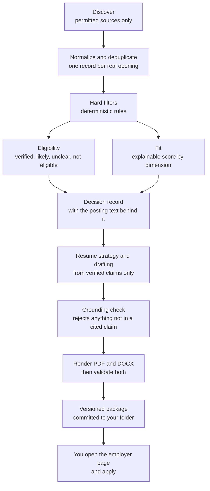
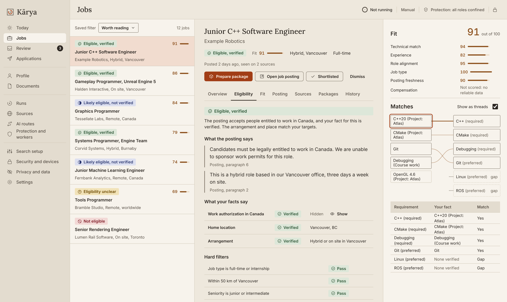
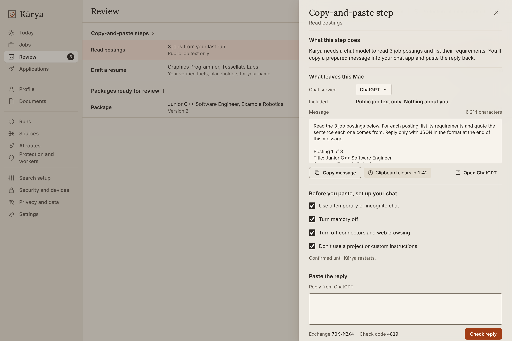
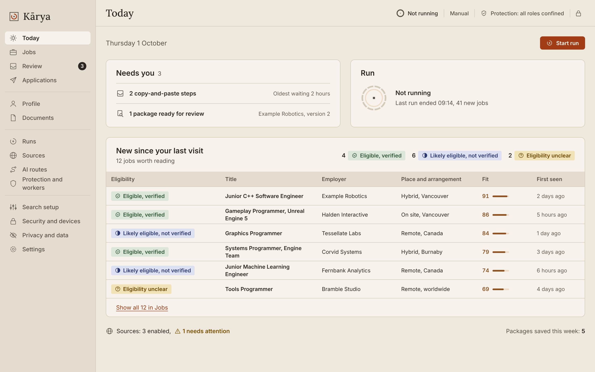
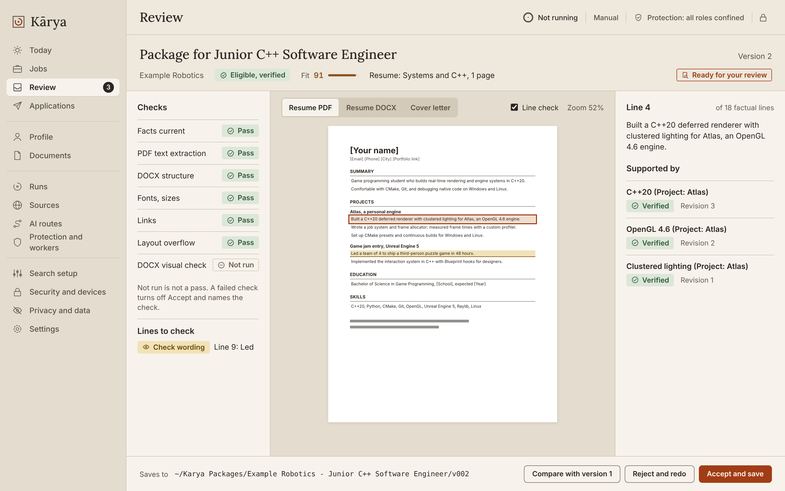
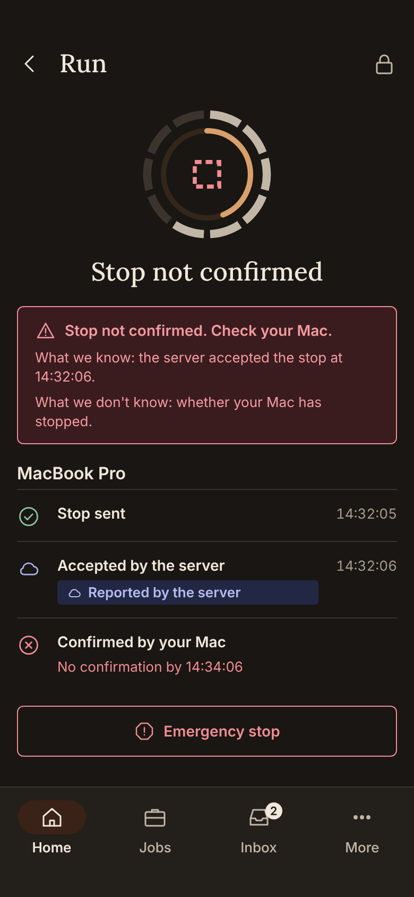
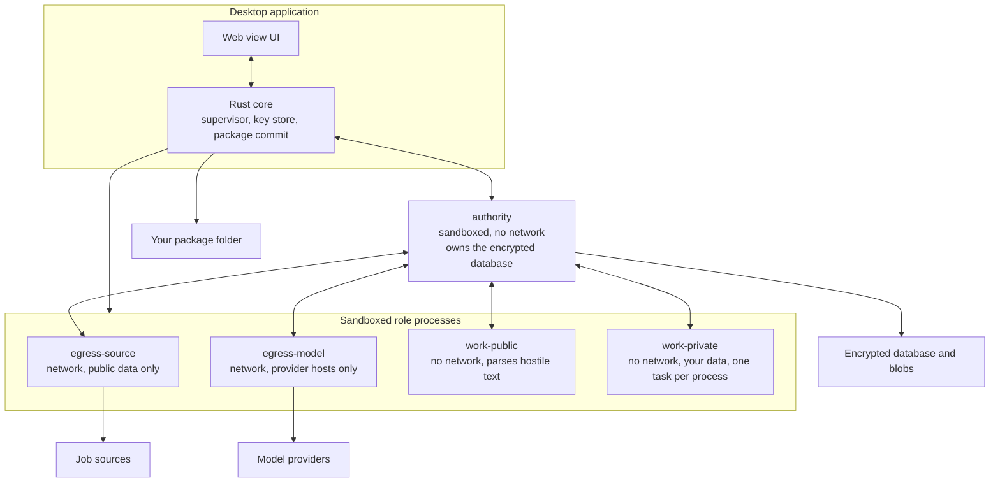
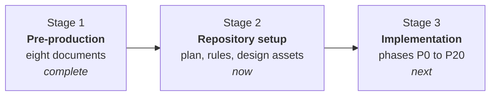
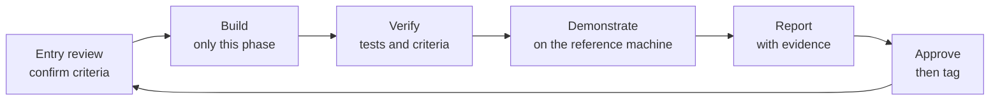

<picture>
  <source media="(prefers-color-scheme: dark)" srcset="docs/assets/banner-dark.svg">
  
</picture>

<p align="center">
  <strong>Kārya</strong> (Sanskrit <em>कार्य</em>, "work, that which must be done") finds jobs you are actually eligible for,
  <br>explains why, and prepares application materials in which every factual sentence traces back to evidence you verified.
</p>

<p align="center">
  
  
  
  
  
</p>

---

> [!IMPORTANT]
> **There is no product here yet, and that is on purpose.**
> This repository currently holds a complete specification and a plan. Implementation begins with phase `P0`.
> Nothing here is installable, and the product will not submit anything to any employer in its first release.

## Contents

- [Contents](#contents)
- [What Kārya is](#what-kārya-is)
- [The problem it solves](#the-problem-it-solves)
- [What it does](#what-it-does)
- [What it will never do](#what-it-will-never-do)
- [What it looks like](#what-it-looks-like)
- [Architecture](#architecture)
- [Keeping the AI layer honest](#keeping-the-ai-layer-honest)
- [Security posture](#security-posture)
- [How this project was planned](#how-this-project-was-planned)
- [The three stages](#the-three-stages)
- [The implementation roadmap](#the-implementation-roadmap)
- [Repository layout](#repository-layout)
- [How work proceeds](#how-work-proceeds)
- [Technology](#technology)
- [Questions people ask](#questions-people-ask)
- [Status, license, and author](#status-license-and-author)

---

## What Kārya is

Kārya is a **local-first desktop application** for one person's job search. It runs on your own machine, keeps your data on your own disk, and automates the tedious parts of applying for work without automating the parts that require a human being to be honest.

It does four things:

| | |
| --- | --- |
| **Finds** | Reads job postings from sources whose terms permit it, and merges duplicates into one record per real opening |
| **Judges** | Decides whether you are *eligible* (can you legally take this job) separately from whether you *fit* it (are you a good match), and shows the posting text behind every conclusion |
| **Prepares** | Drafts a tailored resume and, when needed, a cover letter, then rejects any sentence that is not grounded in a claim you verified |
| **Packages** | Renders validated PDF and DOCX files into a versioned folder you own, and records what happened next |

The first release stops there. You open the employer's page and apply yourself.

## The problem it solves

Applying for software jobs at any volume creates three failures that tools usually make worse rather than better.

1. **Eligibility is buried.** A posting marked "Remote" may be remote within one country only. Whether you can accept it depends on facts about you that no job board knows. Most tools either ignore this or guess, and a guess about work authorization is not a harmless guess.
2. **Tailoring drifts into fiction.** A language model asked to tailor a resume to a posting will reliably produce a better match than the truth supports. It adds a metric, upgrades a course project into production experience, or turns "used" into "led".
3. **Duplicate and untracked effort.** The same opening appears on four boards. You cannot remember whether you already applied, and you cannot reconstruct which version of your resume you sent.

Kārya treats all three as engineering problems with deterministic answers, and uses models only where judgment genuinely helps.

## What it does



Two rules shape the whole pipeline:

- **Eligibility is not fit.** A fit score of 95 can sit beside "not eligible", and the score never promotes an eligibility outcome. They are computed separately and shown separately.
- **Nothing becomes a fact by being generated.** Model output is a proposal. It becomes part of a document only after deterministic code confirms that every number, date, technology, and proper noun appears in a claim you verified.

## What it will never do

This list is as much a part of the design as the feature list. Each item is enforced by a control in the specification, not by good intentions.

| Never | Why |
| --- | --- |
| Submit an application automatically in the first release | A submission is irreversible and cannot be un-sent. The MVP ends at a package you review |
| Invent, upgrade, or imply experience you do not have | Every factual sentence resolves to a verified claim, or it is rejected before rendering |
| Answer a legal question on your behalf | Work authorization, citizenship, clearance, and similar answers require your explicit confirmation for that exact question and context |
| Scrape a site that forbids it | Every source carries dated terms evidence. Sources that forbid automated access are visibly marked blocked, and are read only when you paste a link yourself |
| Solve a CAPTCHA, evade bot detection, or replay your cookies | Challenges hand control back to you. There is no evasion code in the design |
| Treat a chat subscription as an API | Research recorded in the plan found this is not permitted by either major vendor. The product uses a manual copy-and-paste relay instead |
| Send your personal data to a model by default | Job analysis sends public posting text only. Anything about you requires explicit consent per destination, and is written to a disclosure ledger |
| Phone home | Telemetry is off, the first release ships no updater, and only two sandboxed processes may touch the network at all |

## What it looks like

The interface is designed as a quiet, architectural workspace in two themes, Limestone and Obsidian. These are mockups from the design reference, not screenshots of working software.



<sup><b>Job detail.</b> Eligibility quotes the posting sentence it relied on, and names which of your verified facts answered it. Fit is broken down by dimension, and requirement matching shows which claim covers which requirement and where the gaps are.</sup>

<br>



<sup><b>The model relay.</b> When Kārya needs a chat model, it shows the exact message that will leave your machine, what it contains and what it does not. You paste it into your own chat app and paste the reply back. The reply is then validated like any other model output.</sup>

<details>
<summary><strong>More views</strong></summary>

<br>



<sup><b>Today.</b> What needs you, what the last run found, and the state of the current run.</sup>

<br>



<sup><b>Package review.</b> The exact documents, with each claim traceable back to its evidence, before anything is written to disk.</sup>

<br>



<sup><b>The Android companion</b>, in a later phase. It can monitor and stop a run, but a stop is shown as confirmed only when your Mac cryptographically confirms it. "The server accepted it" and "your machine stopped" are different statements, and the interface never merges them.</sup>

</details>

<sup>Note: these PNGs were rendered with substitute fonts. Colors, spacing, sizing, and layout are exact; letterforms and text widths are approximate until the licensed fonts are bundled.</sup>

## Architecture

Kārya runs as a supervised set of small processes with different privileges. The guiding rule is that **no process that decodes hostile bytes may also reach both your data and the network.**



| Process | Sees your data | Network | Parses untrusted input |
| --- | --- | --- | --- |
| `authority` | Yes, all of it | No | No |
| `egress-source` | No | Allow-listed source hosts | HTTP framing only |
| `egress-model` | In flight only | Provider hosts only | HTTP framing only |
| `work-public` | No | No | Yes, job postings and HTML |
| `work-private` | Yes, one task at a time | No | Yes, your documents and model replies |
| core `commit` | Package bytes during a write | No | No |

A compromised posting parser therefore holds no key, no network socket, and none of your data, and the process is destroyed when its task ends. Isolation is enforced by the operating system's sandbox, and a role that cannot be confined does not start at all: its capability is reported as unavailable rather than silently downgraded.

<details>
<summary><strong>Why this is stricter than it first appears</strong></summary>

<br>

The product automatically ingests text that anyone on the internet can author. Anyone can post a job advertisement containing a payload crafted for a PDF parser, an HTML sanitizer, or a language model. The reward for a successful attack is a complete identity dossier: resumes, contact details, work authorization status, and application history.

So the threat model treats a parser compromise as **credible, not hypothetical**, and the response is structural rather than defensive coding:

- Network access exists in exactly two processes, neither of which decodes your data.
- Requests are brokered. A worker cannot choose a host; it presents an authority-signed ticket naming the hosts, methods, and byte budget it is allowed.
- Secrets are injected at the network broker, so an API key never enters the process that builds the request.
- There is no plaintext staging area. Intermediates live in memory or as encrypted blobs.
- There is no socket file and no listening port. Channels are pre-connected at process start, so there is no endpoint for another process to discover.
- The database key is held by hardware where the platform allows it, with a 24-word recovery phrase that is shown once and never stored.

</details>

## Keeping the AI layer honest

Models are used for interpretation and drafting. They are never trusted, and they can never change state.

| Mechanism | What it does |
| --- | --- |
| **Quote grounding** | Every statement a model makes about a posting must carry a verbatim quote. The quote is verified by exact byte comparison against the stored posting text at the claimed offsets. A response whose statements are largely ungrounded is rejected whole |
| **Claim grounding** | Every factual sentence in a generated document cites claim identifiers. Deterministic code then checks that each number, date, URL, proper noun, and technology term in the sentence appears in those claims. A reversed term, a borrowed metric, or an invented employer fails the check |
| **Two-stage validation** | A model reply is parsed, size-capped, schema-checked, and stripped of control characters in a sandboxed process that holds no authority. Only the structured result reaches the component that can change state |
| **Schema strictness** | Output schemas forbid additional properties. A reply that tries to set a field such as "verified" is rejected rather than ignored |
| **Route evaluation** | A model route is eligible for a task only after passing that task's benchmark at that prompt version. Unevaluated routes are allowed only in the fully manual mode, where a human reviews every result |
| **Disclosure ledger** | Every byte sent to a provider is recorded with purpose, privacy class, and destination, and shown to you before it leaves |

The default model path in the first release is a **manual relay**: the application assembles a minimal prompt, you paste it into your own chat product, and you paste the reply back. It needs no API key, sends nothing about you during job analysis, and is subject to exactly the same validation as any automated route.

## Security posture

| Area | Position |
| --- | --- |
| Data location | Your machine. The first release needs no account and no server |
| At rest | Encrypted database and blob store; full-disk encryption required at setup; unsafe destinations such as cloud-synced folders are refused unless you override with a typed confirmation |
| Keys | Hardware-backed where available, with a visible security tier and a recovery phrase shown once |
| Isolation | Operating system sandbox per role, enforced by a self-test before any work is accepted |
| Network | Two brokered processes, allow-listed hosts, address checks against private ranges, per-hop redirect revalidation |
| Later sync | End-to-end encrypted. A control plane cannot read which jobs you looked at, which employers, or your search terms |
| Testing | A simulated-compromise suite plants canary files and verifies that each role fails to read them, reach forbidden hosts, or open sockets. It runs on every build |

## How this project was planned

Before any code, the project produced **eight specification documents** that answer the questions implementation would otherwise answer by improvisation. They were written in sequence, each inheriting from the ones above it, with identifiers that never change so that any decision can be cited from anywhere.

| # | Document | What it settles |
| --- | --- | --- |
| `00` | Product and System Plan | Scope, requirements, policies, architecture decisions, the MVP boundary |
| `01` | Shared Contracts and Domain Model | Types, schemas, identifiers, state machines, commands, events, errors |
| `02` | Security and Threat Model | Trust boundaries, threats, mandatory controls, privacy classes, retention, incident response |
| `03` | Control Plane and Worker Runtime | Processes, database, queue, leases, source adapters, model routing, document pipeline, failure matrix |
| `04` | Desktop Application Plan | Supervision, key storage, packaging, signing, updates, platform behavior |
| `05` | Mobile Companion Plan | The Android companion, then iOS |
| `06` | Design System and UX Plan | Information architecture, flows, views, components, tokens, copy, accessibility |
| `07` | Phased Implementation Roadmap | Phases, gates, consistency audit, allocation of every acceptance criterion, CI, test strategy |

What that produced, in numbers:

<p align="center">
<strong>313</strong> numbered acceptance criteria &nbsp;&#183;&nbsp;
<strong>21</strong> phases &nbsp;&#183;&nbsp;
<strong>63</strong> experiments with pre-decided outcomes &nbsp;&#183;&nbsp;
<strong>4</strong> release gates
</p>

<details>
<summary><strong>The method, and why it was worth the time</strong></summary>

<br>

Three practices did most of the work.

**Research with dates, not recollection.** Every external claim carries a URL and an access date. This changed real decisions. The original plan assumed existing chat subscriptions could be used programmatically; dated reading of both vendors' terms showed that they cannot, so that route was disabled and a manual relay became the guaranteed path. Every job source was checked the same way, and several are marked blocked as a result.

**Independent audits.** The package was reviewed three times by a reviewer that had not written it, including a second pass to verify the fixes. Findings were recorded with severity and tracked to closure. The first audit returned 24 findings and forced a structural change: the worker became a set of sandboxed roles rather than one process.

**A consistency audit before implementation.** The roadmap read all seven upstream documents and found 16 real contradictions, each recorded with its affected documents, practical consequence, recommended resolution, and whether owner approval was required. Finding those before writing code is the entire point of the exercise.

Deliberate honesty rules applied throughout: assumptions, risks, and open questions are labeled as such; nothing uncertain is presented as settled; and estimates are marked as uncalibrated guesses rather than commitments.

</details>

<details>
<summary><strong>What is deliberately still open</strong></summary>

<br>

A plan that claims to have decided everything is lying. These are tracked with owners and decision points:

- Whether Python can be embedded in sandboxed services on the reference machine. This is settled in `P0`, and a negative answer triggers a named alternative with its own cost estimate.
- Which confirmation evidence counts as proof that an employer received an application. Decided per adapter, when that adapter is built.
- Which local models are suitable, with licenses and benchmarks. Decided at the self-hosted model phase, because model facts go stale faster than documents do.
- Effort estimates. They are guesses until the first two phases report measured hours.

</details>

## The three stages



**Stage 1, pre-production.** Specification only. No code was written, and the project was explicitly forbidden from writing any.

**Stage 2, repository setup.** This repository: the approved plan copied in read-only, the rules an AI coding agent must follow, the design tokens and reference mockups, and the handoff prompt that starts implementation.

**Stage 3, implementation.** 21 phases, one at a time, each ending in a report and an approval. The phases are numbered `P0` to `P20` inside the roadmap, where `P0` is foundations and platform proof.

## The implementation roadmap

| Phase | Name | Delivers |
| --- | --- | --- |
| `P0` | Foundations and platform proof | Repository, CI, and an answer to every unverified platform assumption. No features |
| `P1` | Secure local runtime and first-run setup | Confined processes, encrypted database, keys, recovery phrase, lock, backups |
| `P2` | Evidence, claim ledger, and relay | Your verified facts, and the model relay |
| `P3` | Preferences, sources, destination, readiness gate | What to search for, where to save, and the gate that blocks automation until facts are verified |
| `P4` | Discovery slice and run control | First real contact with a job source |
| `P5` | Eligibility, filters, fit, explanations | Calibrated decisions you can audit |
| `P6` | Resume strategy and grounded writing | Drafting that cannot invent |
| `P7` | Rendering, validation, package commit | **First usable release.** Real packages in your folder |
| `P8` | MVP completion | Every MVP release check passes |
| | *Three-week soak* | Real daily use before anything else is built |
| `P9` to `P11` | Source breadth, scheduled runs, Linux and Windows | Coverage and platforms |
| `P12` to `P13` | Synchronization, Android companion | Multi-device, end-to-end encrypted |
| `P14` to `P16` | Browser isolation, form assistance, approvals, controlled Auto | Assisted applying, gated at every step |
| `P17` to `P18` | Self-hosted models, analytics and learning | Local inference, outcome feedback |
| `P19` to `P20` | Distribution readiness, iOS companion | Release engineering |

Four gates interrupt the sequence: first usable release at `P7`, full MVP at `P8`, a three-week soak of real use, and distribution readiness at `P19`. A gate is not a milestone to be declared; it is a checklist with evidence.

## Repository layout

```text
karya/
├── AGENTS.md              rules an AI coding agent reads every session
├── CLAUDE.md              one line, @AGENTS.md
├── docs/
│   ├── HANDOFF.md         how implementation starts, and the per-phase prompt
│   ├── plan/              the eight documents, read-only
│   ├── adr/               decisions taken during implementation
│   └── phase-reports/     one evidence-based report per phase
├── design/
│   ├── tokens/            the single source of every design value
│   └── reference/         12 mockup boards as HTML and PNG
├── contracts/             generated schemas, OpenAPI, test vectors
├── python/                authority, roles, adapters, documents, models
├── rust/                  core, role host, egress, frame codec
├── ui/                    React and TypeScript
├── apple/  android/  control-plane/
├── fixtures/              synthetic data only, never real data
└── tools/                 build, canary scan, contrast check, copy lint, SBOM
```

Three rules are enforced by CI rather than by discipline: module boundaries fail the build when crossed, generated files must match regeneration, and `fixtures/` may contain synthetic data only.

## How work proceeds

Implementation is done with AI coding agents under a fixed protocol. One phase per session:



The agent operates under rules it cannot negotiate: it never edits the plan, never changes an approved decision to make code work, never lets real personal data touch the repository or CI, and never marks a criterion passed without evidence a reader can check. Nine global stop conditions require it to halt and report rather than improvise, and **stopping is treated as a correct outcome**, not a failure.

Every phase ends with a report listing what was built, what was not, every acceptance criterion with its result and evidence, deviations, and an honest risk list including anything that passed only partially.

## Technology

| Layer | Choice |
| --- | --- |
| Desktop shell | Tauri 2, Rust core, React and TypeScript |
| Runtime and logic | Python, with a modular authority that also runs as the optional control plane |
| Local storage | SQLite with SQLCipher; PostgreSQL when synchronized |
| Documents | Typst for PDF, python-docx for DOCX, validated by two independent PDF text extractors |
| Isolation | Operating system sandboxes per role, brokered network egress |
| Mobile | Jetpack Compose on Android first, iOS later |
| Type system | Pydantic models generate JSON Schema, OpenAPI, and TypeScript types, so contracts have one source |

## Questions people ask

<details>
<summary><strong>Can I download and use it?</strong></summary>
<br>
Not yet, and not for a while. It is being built for one user on one machine. Distribution to anyone else requires paid platform signing and an independent security review first, both of which are gates in the plan rather than afterthoughts.
</details>

<details>
<summary><strong>Is this a scraper?</strong></summary>
<br>
No. Every source has a dated record of its terms, and a source adapter cannot be enabled without one. Sources that permit programmatic reading are read through their documented APIs or feeds. Sources that forbid automated access are shown in the interface as blocked, with the reason, and are only ever read when you paste a specific link yourself. "Full coverage" here means transparent attempts at permitted sources, not universal scraping.
</details>

<details>
<summary><strong>Does an AI write my resume?</strong></summary>
<br>
A model drafts, and deterministic code then tries to break the draft. Every factual sentence must cite claims you verified, and every number, date, employer, and technology in that sentence must already appear in those claims. Anything else is rejected before rendering. The model cannot mark a claim verified, cannot approve anything, and cannot write to the document directly.
</details>

<details>
<summary><strong>Will it apply to jobs for me?</strong></summary>
<br>
Not in the first release. It prepares the package and you apply. Assisted form filling arrives later, behind a browser running in a virtual machine, explicit per-approval gates, and a duplicate-submission guard. Fully automatic submission is restricted to explicitly allow-listed flows after every mandatory gate passes, and remains off by default.
</details>

<details>
<summary><strong>Why so much documentation for one person's project?</strong></summary>
<br>
Because the expensive mistakes in this product are architectural, and they become irreversible once there is code. Process isolation, the authority boundary, encrypted synchronization, and the grounding rules cannot be retrofitted onto a system that did not plan for them. The consistency audit found 16 contradictions before a line of code existed; each one would have been a rewrite later.
</details>

<details>
<summary><strong>Does it give legal advice about work authorization?</strong></summary>
<br>
No, and it is designed to refuse. It records facts you confirm, shows the posting text that raises a question, and marks anything unresolved as unclear. It never infers an affirmative answer to a legal question, and an eligibility result never fills in a form answer by itself.
</details>

## Status, license, and author

| | |
| --- | --- |
| **Stage** | Implementation starting at phase `P0` |
| **Usable** | Not yet. First usable release is the exit of `P7` |
| **Reference platform** | macOS, with Linux and Windows as later compatibility targets |
| **Distribution** | None. Direct distribution only, after signing and an independent security review |
| **License** | Not yet chosen. All rights reserved until one is |

Built by **Vishesh Mistry** ([vishhz.dev](https://vishhz.dev)).

Kārya is a personal project. It is not affiliated with, endorsed by, or connected to any job board, applicant tracking system, or model provider named in its documentation. Nothing in this repository is legal advice.

<sub>Design: EB Garamond, Instrument Sans, and JetBrains Mono under the SIL Open Font License. Icons by Phosphor under the MIT license.</sub>
